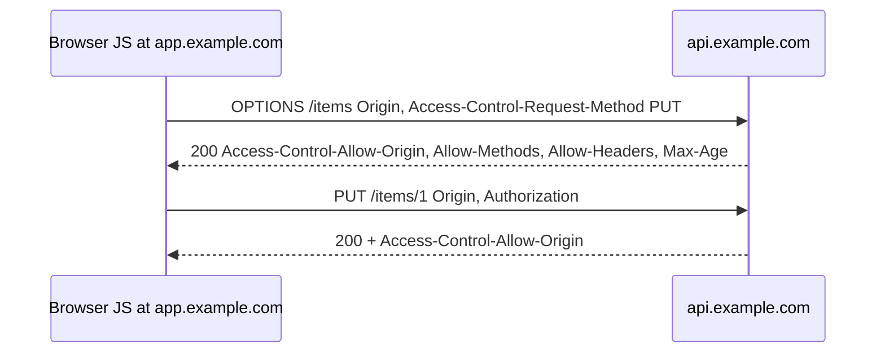

# Authorization, CORS, rate limiting and common vulnerabilities

> **Before this lesson:** you should know how a request is authenticated with a bearer token and a
> `get_current_user` dependency ([lesson 19](#/lesson/fastapi/oauth2-jwt)), parameterised
> dependencies such as `RequireRole` ([lesson 10](#/lesson/fastapi/depends-basics)), and what
> middleware is ([lesson 3](#/lesson/fastapi/asgi-stack)). Redis counters from
> [lesson 18](#/lesson/fastapi/nosql-redis) appear once.

## In plain words

The previous lesson answered "who is calling?". Knowing who someone is does not make an API safe.
This lesson covers the other protections, and there are four.

1. **Authorization**: deciding what each caller is allowed to do.
2. **CORS**: a rule built into web browsers about which websites may call which APIs.
3. **Rate limiting**: stopping any one caller from sending too many requests.
4. **Common vulnerabilities**: the mistakes that show up again and again in reports of real
   break-ins.

An everyday picture: an office building. The reception desk checks your badge (authentication). But
a badge does not open every door. Your badge opens your floor and not the server room
(authorization by role), and your locker key opens your locker and nobody else's (authorization per
object). The turnstile lets people through one at a time however large the crowd (rate limiting).
And the building's insurer has a list of the ways offices typically get burgled, which the security
manager works through (the vulnerability list).

Why this matters for a job: the most common serious flaw in real APIs is not broken cryptography.
It is a missing ownership check, where a logged-in user reads someone else's data by changing a
number in the address. Interviewers ask about that, and "the frontend gets a CORS error, what is
happening?" is close to universal.

## Authorization

Lubanovic presents authorization as the *what* that follows the *who*: which resources may this
identity reach, and in what way? Reading is usually more open than writing. Three common models:

- **Role-based** (RBAC, role-based access control). Each user has one or more **roles** (`admin`,
  `editor`, `viewer`), and each role grants a set of permissions.
- **Scope-based.** The *token* itself carries the permissions that were granted when it was issued,
  as short strings called **scopes** (`items:read`, `items:write`).
- **Attribute- or ownership-based** (ABAC). The decision uses properties of the user *and of the
  resource*: "only the owner may edit this order".

In FastAPI, authorization is written as dependencies stacked on top of `get_current_user`:

```python
class RequireRole:
    def __init__(self, *roles: str):
        self.roles = set(roles)

    def __call__(self, user: CurrentUser) -> User:
        if not self.roles & set(user.roles):
            raise HTTPException(status_code=403, detail="Not enough permissions")
        return user

@router.delete("/users/{user_id}", status_code=204)
def delete_user(user_id: int, admin: Annotated[User, Depends(RequireRole("admin"))]): ...
```

`RequireRole("admin")` creates a callable object that remembers a set of roles (the pattern from
lesson 10). When called, it receives the current user and compares the two sets with `&`, the
set-intersection operator. If the user holds none of the required roles, it raises `403 Forbidden`:
we know who you are, and you may not do this. The `delete_user` endpoint lists it as a dependency,
so the check runs before the endpoint's own code.

Role checks are not enough. A role says what *kind* of thing a user may do, not *which* things.
Checks **per object** need the object itself:

```python
@router.get("/orders/{order_id}", response_model=OrderPublic)
def read_order(order_id: int, user: CurrentUser, session: SessionDep):
    order = session.get(Order, order_id)
    if order is None or (order.owner_id != user.id and "admin" not in user.roles):
        raise HTTPException(status_code=404, detail="Order not found")   # 404 hides existence
    return order
```

The endpoint loads the order and then asks: does it belong to the caller (or is the caller an
admin)? If not, it answers 404, not 403, so that the caller cannot even confirm that the order
exists.

Forgetting this check is called **BOLA** (Broken Object Level Authorization), also known as IDOR
(insecure direct object reference). It is first on the *OWASP API Security Top 10*, a widely used
ranking of API risks published by the Open Worldwide Application Security Project. The scenario:
user 7 requests `/orders/8` and receives somebody else's order, because the endpoint only verified
that the caller was *logged in*. The best defence is to put the owner into the query itself
(`WHERE id = :id AND owner_id = :user_id`) in the data layer, so that a row the caller may not see
can never be loaded in the first place.

### OAuth2 scopes

FastAPI supports scopes directly, with two tools: `Security`, which is `Depends` with a list of
scopes attached, and `SecurityScopes`, an object FastAPI fills with the scopes required for the
current request.

```python
from fastapi import Security
from fastapi.security import OAuth2PasswordBearer, SecurityScopes

oauth2_scheme = OAuth2PasswordBearer(
    tokenUrl="token",
    scopes={"me": "Read your own profile.", "items:read": "Read items.", "items:write": "Modify items."},
)

async def get_current_user(security_scopes: SecurityScopes,
                           token: Annotated[str, Depends(oauth2_scheme)]) -> User:
    authenticate = f'Bearer scope="{security_scopes.scope_str}"' if security_scopes.scopes else "Bearer"
    try:
        payload = jwt.decode(token, SECRET_KEY, algorithms=[ALGORITHM])
    except InvalidTokenError:
        raise HTTPException(401, "Could not validate credentials", headers={"WWW-Authenticate": authenticate})
    token_scopes = set(payload.get("scope", "").split())
    for scope in security_scopes.scopes:             # all scopes required anywhere in the dependency chain
        if scope not in token_scopes:
            raise HTTPException(403, "Not enough permissions", headers={"WWW-Authenticate": authenticate})
    return load_user(payload["sub"])

@app.get("/items/")
async def read_items(user: Annotated[User, Security(get_current_user, scopes=["items:read"])]): ...
```

- The `scopes={...}` argument on `OAuth2PasswordBearer` lists the scopes that exist, with
  descriptions that are shown in the docs.
- `get_current_user` now takes `security_scopes`. After decoding the token it reads the scopes the
  token was granted (`payload["scope"]`, a space-separated string).
- The `for` loop checks that every *required* scope is among the *granted* ones, and raises 403 if
  one is missing.
- The endpoint declares what it requires: `Security(get_current_user, scopes=["items:read"])`.

`SecurityScopes` collects the scopes required by the endpoint *and* by every dependency in the chain
leading to it, so a single `get_current_user` serves all endpoints. At login, put into the token
only scopes the user is entitled to. Never copy the scopes the client asked for into the token
unchecked.

## CORS

This topic confuses almost everyone at first, because the rule is enforced by the browser and not
by your server.

An **origin** is the combination of scheme, host and port: `https://app.example.com` is one origin
and `https://api.example.com` is another. Browsers apply the **same-origin policy**: JavaScript that
was loaded from one origin may not read responses from a different origin. The reason is your
protection as a user. Without the rule, any web page you visit could silently call your bank's
website with your login cookies and read the reply.

But legitimate cases exist: your own web page at `app.example.com` needs to call your own API at
`api.example.com`. **CORS** (Cross-Origin Resource Sharing) is the way an API says "pages from these
origins may read my responses". It says so with response headers.

Browsers treat two kinds of request differently:

- **Simple requests** (GET, HEAD, or POST with only basic headers and form or plain-text content).
  The browser sends the request with an `Origin` header naming the page's origin, and lets the
  page's script see the response only if the response header `Access-Control-Allow-Origin` matches.
- **Preflighted requests** (everything else: JSON bodies, an `Authorization` header, PUT, DELETE).
  The browser first sends a separate `OPTIONS` request, the **preflight**, asking "would you accept
  this method and these headers from this origin?". Only if the server approves does the browser
  send the real request.



The first pair of arrows is the preflight: an `OPTIONS` request, answered with the allowed origin,
methods and headers and a `Max-Age` saying how long the browser may remember the answer. The second
pair is the actual `PUT`, whose response again carries `Access-Control-Allow-Origin`.

In FastAPI this is one piece of middleware from Starlette, as the book's short CORS section shows:

```python
from fastapi.middleware.cors import CORSMiddleware

app.add_middleware(
    CORSMiddleware,
    allow_origins=["https://app.example.com", "http://localhost:5173"],   # exact origins
    allow_credentials=True,                    # cookies / Authorization allowed
    allow_methods=["GET", "POST", "PUT", "PATCH", "DELETE"],
    allow_headers=["Authorization", "Content-Type"],
    max_age=600,                               # browser may cache the preflight for 10 min
)
```

`allow_origins` lists the exact origins whose pages may call the API (here the real website and a
local development server). `allow_credentials=True` permits cookies and the `Authorization` header.
`allow_methods` and `allow_headers` list what the preflight will approve, and `max_age` lets the
browser reuse a preflight answer for ten minutes. The middleware answers `OPTIONS` preflights
itself and adds the headers to every other response.

Facts that save hours of confusion:

- CORS is enforced by **browsers**, to protect **users**. `curl`, Postman, mobile apps and other
  servers ignore it. It is *not* a way of controlling access to your API.
- `allow_origins=["*"]` (any origin) cannot be combined with credentials. Browsers reject a wildcard
  together with `Allow-Credentials: true`. List the origins explicitly, or use `allow_origin_regex`.
- Never echo back whatever `Origin` arrives while credentials are enabled. That would let any website
  read your users' private data.
- A "CORS error" in the browser console often hides a different failure. If your app produces a 500
  somewhere outside the middleware, that error response lacks the CORS headers, and the browser
  reports CORS.
- Origins must match exactly: `http://localhost:5173`, `http://127.0.0.1:5173` and
  `https://localhost:5173` are three different origins.

The problem *CORS Preflight Decision* has you implement the decision logic.

## Rate limiting

With no limits, one client stuck in a loop, or a program trying thousands of stolen passwords,
degrades the service for everybody. For endpoints that run machine-learning models, each request
also costs real money. **Rate limiting** caps the number of requests a client may make in a period.
A client over the limit receives `429 Too Many Requests`. The common algorithms:

| Algorithm | Idea | Trade-off |
|---|---|---|
| Fixed window | count per client per minute bucket | simple; allows 2× bursts at window edges |
| Sliding window log/counter | count over the trailing N seconds | accurate; more state |
| **Token bucket** | tokens refill at rate r up to capacity b; each request spends one | allows controlled bursts; O(1) state |
| Leaky bucket | queue drained at constant rate | smooths output; adds delay |

The **token bucket** is the one most worth understanding. Picture a bucket that holds at most
`capacity` tokens. Tokens drip in at a steady `rate`. Each request takes one token out; when the
bucket is empty, requests are refused. A client that has been quiet finds a full bucket and may send
a short burst, but over time it cannot exceed the drip rate.

```python-run
class TokenBucket:
    def __init__(self, capacity, rate):
        self.capacity, self.rate = capacity, rate
        self.tokens, self.last = float(capacity), 0.0

    def allow(self, now, cost=1.0):
        self.tokens = min(self.capacity, self.tokens + (now - self.last) * self.rate)   # lazy refill
        self.last = now
        if self.tokens >= cost:
            self.tokens -= cost
            return True
        return False

bucket = TokenBucket(capacity=5, rate=1)          # burst of 5, then 1 request/second
timeline = [0, 0, 0, 0, 0, 0, 0.5, 1.0, 1.2, 3.0, 3.0, 3.0, 10, 10, 10, 10, 10, 10]
for t in timeline:
    print(f"t={t:>4}: {'200' if bucket.allow(t) else '429 Too Many Requests'}")
```

- `__init__` stores the capacity and the refill rate, starts with a full bucket, and records the
  time of the last update.
- `allow(now)` first adds the tokens that have dripped in since the last call
  (`(now - self.last) * self.rate`), never exceeding the capacity. This is a "lazy refill": no timer
  runs in the background, and the amount is calculated when it is needed.
- If at least one token is present, it is spent and the request is allowed.

The bucket holds 5 tokens and gains 1 per second. Reading the output against the timeline:

- Six requests at `t=0`: five are `200` (the burst) and the sixth is `429`.
- `t=0.5`: only half a token has arrived, so `429`. `t=1.0`: a whole token, `200`. `t=1.2`: `429`.
- Three requests at `t=3.0`: about two tokens have accumulated, so `200`, `200`, `429`.
- Six requests at `t=10`: the bucket has refilled to its capacity of 5 (not 7), so five `200`s and
  one `429`.

In FastAPI a limiter is a dependency (for particular routes) or middleware (for everything). Count
per API key or user id where possible, and otherwise per client network address (behind a proxy,
take the address from `X-Forwarded-For`, and only when the proxy is one you trust):

```python
async def rate_limit(request: Request, r: RedisDep, user: CurrentUser):
    key = f"rl:{user.id}:{int(time.time() // 60)}"          # fixed window per minute
    count = await r.incr(key)
    if count == 1:
        await r.expire(key, 60)
    if count > 100:
        raise HTTPException(429, "Rate limit exceeded", headers={"Retry-After": "60"})

router = APIRouter(dependencies=[Depends(rate_limit)])
```

This is the fixed-window limiter of lesson 18 as a dependency. The key combines the user id with the
current minute number; `incr` adds one and returns the new count; the first request of each minute
sets a 60-second expiry; beyond 100 the dependency raises 429 with a `Retry-After` header. The last
line attaches the limiter to every route of a router.

The counters must be **shared**, in Redis. Counters held in memory belong to one worker process, so
the real limit would be multiplied by workers × replicas. Libraries such as `slowapi` and
`fastapi-limiter` package all this, and many teams also apply rough limits at the gateway in front
(nginx, Envoy, Cloudflare) before traffic reaches Python. Always answer `429` with `Retry-After`,
and apply stricter limits to `/token` and the other login endpoints.

## Common vulnerabilities

A **vulnerability** is a weakness that an attacker can use. The table follows the OWASP API Security
Top 10 and notes what FastAPI does and does not do for you:

| Risk | Example | Defence |
|---|---|---|
| **Broken object-level authorization** | `/orders/8` returns another user's order | check ownership per object; scope queries by user |
| Broken authentication | weak hashes, no expiry, `alg: none` | previous lesson |
| **Excessive data exposure** | returning ORM objects with `hashed_password` | `response_model` with public schemas |
| **Mass assignment** | client sends `"is_admin": true` in a profile update and the server copies all fields | separate input models containing only client-settable fields; `extra="forbid"` |
| Unrestricted resource consumption | `limit=10000000`, 5 GB uploads, huge JSON, expensive prompts | cap sizes (`Query(le=100)`), body size limits at proxy, rate limits, timeouts |
| **Injection** | SQL built with f-strings; shelling out with user input | bound parameters/ORM; never `eval`/`os.system` on input |
| SSRF | "fetch this URL for me" hits `http://169.254.169.254/` cloud metadata | allow-list hosts, block private IP ranges, no redirects |
| Security misconfiguration | `debug=True`, permissive CORS, default secrets, verbose errors | settings per environment; generic 500s |
| XSS (if you render HTML) | unescaped user content in templates | Jinja2 autoescape; CSP headers |
| CSRF (cookie auth) | another site submits a form with the user's cookies | `SameSite` cookies, CSRF tokens; bearer headers are immune |
| Path traversal | `GET /files/../../etc/passwd` | resolve and verify the path stays inside the base directory |
| Secrets leakage | keys in Git, logs, error messages | `SecretStr`, secret managers, log scrubbing |

Several rows use terms worth spelling out:

- **Mass assignment**: the server copies *every* field the client sent onto a stored object,
  including fields the client should never control.
- **Injection**: input from the user ends up being executed as code or as a query (lesson 16).
- **SSRF** (server-side request forgery): an attacker makes *your server* fetch an address of the
  attacker's choosing, for instance an internal address that only your server can reach.
- **XSS** (cross-site scripting): an attacker's script runs inside your web page.
- **CSRF** (cross-site request forgery): another website makes the user's browser send a request to
  your API, and the browser attaches the user's cookies automatically.
- **Path traversal**: a file name such as `../../etc/passwd` climbs out of the intended folder.

Mass assignment is easy to demonstrate, and so is its Pydantic cure:

```python-run
from pydantic import BaseModel, ConfigDict, ValidationError

user_row = {"id": 7, "email": "ann@example.com", "display_name": "Ann", "is_admin": False}
attack = {"display_name": "Ann the Great", "is_admin": True}

# VULNERABLE: blindly copy whatever the client sent
vulnerable = {**user_row, **attack}
print("vulnerable:", vulnerable)

# SAFE: the input model lists only what a client may change
class ProfileUpdate(BaseModel):
    model_config = ConfigDict(extra="forbid")
    display_name: str | None = None

try:
    ProfileUpdate.model_validate(attack)
except ValidationError as e:
    print("rejected:", e.errors()[0]["loc"], e.errors()[0]["type"])

safe = {**user_row, **ProfileUpdate(display_name="Ann the Great").model_dump(exclude_unset=True)}
print("safe:", safe)
```

`user_row` is the stored user, and `attack` is what a malicious client sends as a "profile update".

- The vulnerable version merges the two dictionaries, and the printed result has `'is_admin': True`.
  The client has promoted itself.
- The safe version defines `ProfileUpdate` with exactly one field a client may change and
  `extra="forbid"`. Validating the attack prints `rejected: ('is_admin',) extra_forbidden`.
- The final merge uses only the validated fields: the display name changes and `is_admin` stays
  `False`.

The input model acts as an allow-list: a field that is not on it cannot get in.

Other hardening measures:

- **HTTPS everywhere**, and the header `Strict-Transport-Security`, which tells browsers always to
  use HTTPS for your site. The encryption is usually handled by a proxy or load balancer in front of
  the app (this is called TLS termination).
- `TrustedHostMiddleware(allowed_hosts=[...])` against forged `Host` headers, and
  `HTTPSRedirectMiddleware` if the app is exposed to the internet directly.
- Do not reveal internals. Answer a 500 with a general message and write the full error trace to
  the server log.
- Keep installed packages up to date (`pip-audit`, Dependabot) and run security tests. The book's
  testing chapter mentions fuzzing tools such as Schemathesis (lesson 6).

> [!INTERVIEW]
> "The frontend gets a CORS error calling our API. What's happening and how do you fix it safely?" —
> The browser blocks reads across origins unless the API returns `Access-Control-Allow-Origin` for
> the page's origin; requests that are not "simple" need a successful `OPTIONS` preflight first. Add
> `CORSMiddleware` with the exact frontend origins and the methods and headers needed, and
> `allow_credentials=True` only if cookies or login headers are sent (never together with `*`).
> Check that the failing response is not really a 500 or a redirect that lacks CORS headers. And
> remember that CORS does not protect the API itself: clients other than browsers ignore it.

## A worked decision: one request, four gates

It helps to see the four protections of this lesson as gates that a request passes in order.
Consider `DELETE /orders/8` sent by a browser page at `https://app.example.com`, carrying a bearer
token for user 7, who has the role `user`:

1. **CORS (in the browser).** The request has an `Authorization` header and the method DELETE, so
   the browser sends a preflight. If the API does not list that origin, the real request is never
   sent.
2. **Rate limit.** The limiter dependency counts the request against user 7. Over the limit: `429`.
3. **Authentication.** `get_current_user` verifies the token. Invalid or expired: `401`.
4. **Authorization.** First the role or scope ("may this kind of user delete orders at all?"), then
   the object ("does order 8 belong to user 7?"). No: `403`, or `404` to hide the order's existence.

Only a request that passes all four reaches the code that deletes the order. Each gate has its own
status code, which is why a precise code makes a failure so much quicker to diagnose.

## Pitfalls

- Authenticating the caller but not checking ownership per object (BOLA).
- `allow_origins=["*"]` "to make the error go away" on an API that uses cookies for login.
- Rate limiters that count in memory when there are several workers.
- Trusting `X-Forwarded-For` from the open internet (anyone can forge it) instead of only from your
  own proxy.
- One model for both input and storage (mass assignment), or returning storage models (data
  exposure).

## Summary

- Authorization = roles, scopes and ownership checks per object, written as dependencies; FastAPI's
  `Security` and `SecurityScopes` support OAuth2 scopes.
- CORS is permission that browsers enforce, granted through `CORSMiddleware`: exact origins, and no
  wildcard with credentials.
- Rate-limit with a token bucket or with windows counted per client, with shared state in Redis;
  answer 429 with `Retry-After`.
- Know the OWASP API risks: BOLA, data exposure, mass assignment, resource exhaustion, injection,
  SSRF.

## Glossary

- **Authorization** — deciding what an authenticated caller is allowed to do.
- **Role / RBAC** — a named group of permissions / granting access by role.
- **Scope** — a permission string carried inside a token, such as `items:read`.
- **ABAC / ownership check** — decisions based on attributes of the user and of the resource.
- **BOLA (IDOR)** — a missing per-object check that lets a user reach another user's data.
- **OWASP** — the organisation that publishes widely used rankings of security risks.
- **Origin** — scheme + host + port of a web page or API.
- **Same-origin policy** — the browser rule that scripts may not read other origins' responses.
- **CORS** — the response headers by which an API permits other origins to read its responses.
- **Preflight** — the `OPTIONS` request a browser sends first to ask permission.
- **Rate limiting** — capping how many requests a client may send in a period.
- **Token bucket** — a limiter in which tokens refill at a steady rate up to a capacity.
- **Vulnerability** — a weakness an attacker can exploit.
- **Mass assignment** — copying every client-supplied field onto a stored object.
- **SSRF** — tricking a server into fetching an address chosen by the attacker.
- **CSRF** — another site causing the user's browser to send an authenticated request.
- **Path traversal** — escaping the intended folder with `..` in a file path.
- **TLS termination** — decrypting HTTPS at a proxy in front of the application.

```quiz
[
  {"q": "A logged-in user fetches /orders/8, which belongs to someone else, and receives it. Which flaw is this?", "options": ["CSRF", "Broken object-level authorization (BOLA/IDOR)", "XSS", "SQL injection"], "answer": 1,
   "explain": "The endpoint authenticated the caller but never checked that the object belongs to them."},
  {"q": "Who enforces CORS?", "options": ["The FastAPI server blocks requests", "The browser, based on headers the server returns", "The database", "curl"], "answer": 1,
   "explain": "Servers only emit headers; browsers decide whether scripts may read the response. Non-browser clients ignore CORS."},
  {"q": "Why can't allow_origins=['*'] be used with allow_credentials=True?", "options": ["Starlette bug", "Browsers refuse credentialed responses with a wildcard origin; otherwise any site could read users' authenticated data", "It is slower", "Wildcard only works for GET"], "answer": 1,
   "explain": "The CORS spec forbids the combination; explicit origins must be echoed."},
  {"q": "What triggers a CORS preflight OPTIONS request?", "options": ["Every GET request", "Non-simple requests, e.g. a JSON body or an Authorization header or PUT/DELETE", "Only WebSockets", "Requests from curl"], "answer": 1,
   "explain": "Simple requests skip the preflight; anything with custom headers, JSON content type or other methods is preflighted."},
  {"q": "A token bucket has capacity 10 and rate 2/s. After a long idle period, how many requests can be served instantly?", "options": ["2", "10", "20", "Unlimited"], "answer": 1,
   "explain": "Tokens accumulate only up to capacity; the burst is 10, then throughput is 2 per second."},
  {"q": "Why must rate-limit counters live in Redis (or similar) rather than process memory?", "options": ["Redis is faster than memory", "Each worker/replica would otherwise keep its own counter, multiplying the effective limit", "Python cannot count", "To enable CORS"], "answer": 1,
   "explain": "Shared state is required for a global limit across processes and machines."},
  {"q": "How does a separate ProfileUpdate input model prevent mass assignment?", "options": ["It encrypts fields", "Only explicitly declared client-settable fields are accepted; is_admin isn't one of them", "It disables PATCH", "It hashes the password"], "answer": 1,
   "explain": "The schema is an allow-list; with extra='forbid' unexpected fields are rejected outright."}
]
```

> **Source:** Lubanovic, *FastAPI*, ch. 11 "Authentication and Authorization" (Authorization, Middleware, CORS, Third-Party Packages) and ch. 12 "Testing" (Security Testing); https://fastapi.tiangolo.com/tutorial/cors/, /advanced/security/oauth2-scopes/, /advanced/middleware/; OWASP API Security Top 10 (2023)
