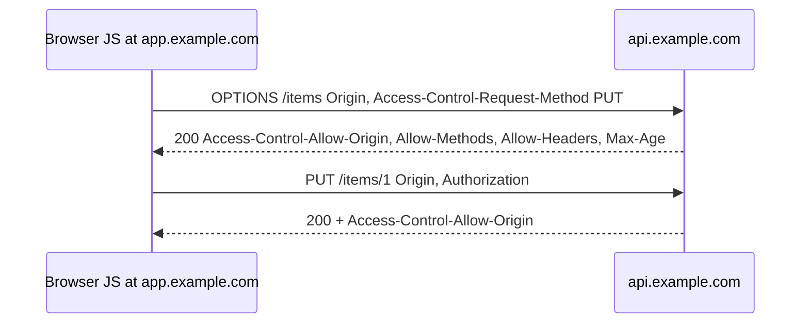

# Authorization, CORS, rate limiting and common vulnerabilities

Authentication told you *who* is calling. This lesson covers everything else that keeps an API safe:
deciding *what* each caller may do (authorization and OAuth2 scopes), letting browsers on other origins
call you (CORS), stopping abuse (rate limiting), and the vulnerabilities that actually show up in API
breach reports.

## Authorization

Lubanovic frames it as the *what* after the *who*: which resources may this identity access, and in what
way? Reading is usually more open than writing. Common models:

- **Role-based (RBAC)**: users have roles (`admin`, `editor`, `viewer`); roles grant permissions.
- **Scope-based**: the *token* carries the permissions it was granted (`items:read`, `items:write`).
- **Attribute/ownership-based (ABAC)**: decisions use attributes of the user *and the resource* — "only
  the owner may edit this order".

In FastAPI, authorization is expressed as dependencies layered on `get_current_user`:

```python
class RequireRole:
    def __init__(self, *roles: str):
        self.roles = set(roles)

    def __call__(self, user: CurrentUser) -> User:
        if not self.roles & set(user.roles):
            raise HTTPException(status_code=403, detail="Not enough permissions")
        return user

@router.delete("/users/{user_id}", status_code=204)
def delete_user(user_id: int, admin: Annotated[User, Depends(RequireRole("admin"))]): ...
```

Role checks are not enough. **Object-level** checks need the resource itself:

```python
@router.get("/orders/{order_id}", response_model=OrderPublic)
def read_order(order_id: int, user: CurrentUser, session: SessionDep):
    order = session.get(Order, order_id)
    if order is None or (order.owner_id != user.id and "admin" not in user.roles):
        raise HTTPException(status_code=404, detail="Order not found")   # 404 hides existence
    return order
```

Forgetting this check is **BOLA** (Broken Object Level Authorization, a.k.a. IDOR) — #1 on the OWASP API
Security Top 10: user 7 requests `/orders/8` and gets someone else's order because the endpoint only
verified they were *logged in*. Best defence: scope the query itself (`WHERE id = :id AND owner_id =
:user_id`) in the data layer so an unauthorised row can never be loaded.

### OAuth2 scopes

FastAPI has first-class scope support via `Security` (a `Depends` that also carries scopes) and
`SecurityScopes`:

```python
from fastapi import Security
from fastapi.security import OAuth2PasswordBearer, SecurityScopes

oauth2_scheme = OAuth2PasswordBearer(
    tokenUrl="token",
    scopes={"me": "Read your own profile.", "items:read": "Read items.", "items:write": "Modify items."},
)

async def get_current_user(security_scopes: SecurityScopes,
                           token: Annotated[str, Depends(oauth2_scheme)]) -> User:
    authenticate = f'Bearer scope="{security_scopes.scope_str}"' if security_scopes.scopes else "Bearer"
    try:
        payload = jwt.decode(token, SECRET_KEY, algorithms=[ALGORITHM])
    except InvalidTokenError:
        raise HTTPException(401, "Could not validate credentials", headers={"WWW-Authenticate": authenticate})
    token_scopes = set(payload.get("scope", "").split())
    for scope in security_scopes.scopes:             # all scopes required anywhere in the dependency chain
        if scope not in token_scopes:
            raise HTTPException(403, "Not enough permissions", headers={"WWW-Authenticate": authenticate})
    return load_user(payload["sub"])

@app.get("/items/")
async def read_items(user: Annotated[User, Security(get_current_user, scopes=["items:read"])]): ...
```

`SecurityScopes` collects the scopes required by the endpoint *and* every dependant in the chain, so one
`get_current_user` serves all endpoints. At login, grant only scopes the user is entitled to — never copy
the client's requested scopes into the token unchecked.

## CORS

Browsers enforce the **same-origin policy**: JavaScript loaded from `https://app.example.com` may not read
responses from `https://api.example.com` (a different **origin** = scheme + host + port) unless the API
opts in. **CORS** (Cross-Origin Resource Sharing) is that opt-in, via response headers.

- **Simple requests** (GET/HEAD/POST with basic headers and form/text content types): the browser sends
  the request with an `Origin` header and only exposes the response to the script if
  `Access-Control-Allow-Origin` matches.
- **Preflighted requests** (anything else — JSON bodies, `Authorization` header, PUT/DELETE): the browser
  first sends `OPTIONS` with `Access-Control-Request-Method` / `-Headers`. Only if the server approves does
  it send the real request.



In FastAPI it's one middleware (from Starlette), as the book's short CORS section shows:

```python
from fastapi.middleware.cors import CORSMiddleware

app.add_middleware(
    CORSMiddleware,
    allow_origins=["https://app.example.com", "http://localhost:5173"],   # exact origins
    allow_credentials=True,                    # cookies / Authorization allowed
    allow_methods=["GET", "POST", "PUT", "PATCH", "DELETE"],
    allow_headers=["Authorization", "Content-Type"],
    max_age=600,                               # browser may cache the preflight for 10 min
)
```

Facts that prevent hours of confusion:

- CORS is enforced by **browsers** to protect **users**. `curl`, Postman, mobile apps and other servers
  ignore it. It is *not* an access-control mechanism for your API.
- `allow_origins=["*"]` cannot be combined with credentials: browsers reject wildcard +
  `Allow-Credentials: true`. List explicit origins (or `allow_origin_regex`).
- Never reflect arbitrary `Origin` values back with credentials enabled — that lets any website read your
  users' authenticated data.
- A "CORS error" in the browser console often masks a different failure: if your app returns a 500 from
  outside the middleware, the error response lacks CORS headers, and the browser reports CORS.
- Origins match exactly: `http://localhost:5173` ≠ `http://127.0.0.1:5173` ≠ `https://localhost:5173`.

The problem *CORS Preflight Decision* has you implement the decision logic.

## Rate limiting

Without limits, one buggy client loop or a credential-stuffing bot degrades the service for everybody —
and for LLM/ML endpoints each request costs real money. Algorithms:

| Algorithm | Idea | Trade-off |
|---|---|---|
| Fixed window | count per client per minute bucket | simple; allows 2× bursts at window edges |
| Sliding window log/counter | count over the trailing N seconds | accurate; more state |
| **Token bucket** | tokens refill at rate r up to capacity b; each request spends one | allows controlled bursts; O(1) state |
| Leaky bucket | queue drained at constant rate | smooths output; adds delay |

```python-run
class TokenBucket:
    def __init__(self, capacity, rate):
        self.capacity, self.rate = capacity, rate
        self.tokens, self.last = float(capacity), 0.0

    def allow(self, now, cost=1.0):
        self.tokens = min(self.capacity, self.tokens + (now - self.last) * self.rate)   # lazy refill
        self.last = now
        if self.tokens >= cost:
            self.tokens -= cost
            return True
        return False

bucket = TokenBucket(capacity=5, rate=1)          # burst of 5, then 1 request/second
timeline = [0, 0, 0, 0, 0, 0, 0.5, 1.0, 1.2, 3.0, 3.0, 3.0, 10, 10, 10, 10, 10, 10]
for t in timeline:
    print(f"t={t:>4}: {'200' if bucket.allow(t) else '429 Too Many Requests'}")
```

In FastAPI, a limiter is a dependency (per route) or middleware (global). Key it by API key/user id where
possible, else by client IP (behind a proxy: the correctly-trusted `X-Forwarded-For`):

```python
async def rate_limit(request: Request, r: RedisDep, user: CurrentUser):
    key = f"rl:{user.id}:{int(time.time() // 60)}"          # fixed window per minute
    count = await r.incr(key)
    if count == 1:
        await r.expire(key, 60)
    if count > 100:
        raise HTTPException(429, "Rate limit exceeded", headers={"Retry-After": "60"})

router = APIRouter(dependencies=[Depends(rate_limit)])
```

State must be **shared** (Redis) — in-memory counters are per worker process, so the effective limit
multiplies by workers × replicas. Libraries such as `slowapi` and `fastapi-limiter` package this up; many
teams also enforce coarse limits at the gateway/ingress (nginx, Envoy, Cloudflare) before traffic reaches
Python. Always return `429` with `Retry-After`, and stricter limits on `/token` and other auth endpoints.

## Common vulnerabilities

Based on the OWASP API Security Top 10 and what FastAPI does or doesn't do for you:

| Risk | Example | Defence |
|---|---|---|
| **Broken object-level authorization** | `/orders/8` returns another user's order | check ownership per object; scope queries by user |
| Broken authentication | weak hashes, no expiry, `alg: none` | previous lesson |
| **Excessive data exposure** | returning ORM objects with `hashed_password` | `response_model` with public schemas |
| **Mass assignment** | client sends `"is_admin": true` in a profile update and the server copies all fields | separate input models containing only client-settable fields; `extra="forbid"` |
| Unrestricted resource consumption | `limit=10000000`, 5 GB uploads, huge JSON, expensive prompts | cap sizes (`Query(le=100)`), body size limits at proxy, rate limits, timeouts |
| **Injection** | SQL built with f-strings; shelling out with user input | bound parameters/ORM; never `eval`/`os.system` on input |
| SSRF | "fetch this URL for me" hits `http://169.254.169.254/` cloud metadata | allow-list hosts, block private IP ranges, no redirects |
| Security misconfiguration | `debug=True`, permissive CORS, default secrets, verbose errors | settings per environment; generic 500s |
| XSS (if you render HTML) | unescaped user content in templates | Jinja2 autoescape; CSP headers |
| CSRF (cookie auth) | another site submits a form with the user's cookies | `SameSite` cookies, CSRF tokens; bearer headers are immune |
| Path traversal | `GET /files/../../etc/passwd` | resolve and verify the path stays inside the base directory |
| Secrets leakage | keys in Git, logs, error messages | `SecretStr`, secret managers, log scrubbing |

A mass-assignment demonstration and its Pydantic fix:

```python-run
from pydantic import BaseModel, ConfigDict, ValidationError

user_row = {"id": 7, "email": "ann@example.com", "display_name": "Ann", "is_admin": False}
attack = {"display_name": "Ann the Great", "is_admin": True}

# VULNERABLE: blindly copy whatever the client sent
vulnerable = {**user_row, **attack}
print("vulnerable:", vulnerable)

# SAFE: the input model lists only what a client may change
class ProfileUpdate(BaseModel):
    model_config = ConfigDict(extra="forbid")
    display_name: str | None = None

try:
    ProfileUpdate.model_validate(attack)
except ValidationError as e:
    print("rejected:", e.errors()[0]["loc"], e.errors()[0]["type"])

safe = {**user_row, **ProfileUpdate(display_name="Ann the Great").model_dump(exclude_unset=True)}
print("safe:", safe)
```

Other hardening:

- **HTTPS everywhere**; add `Strict-Transport-Security`. TLS usually terminates at a proxy/load balancer.
- `TrustedHostMiddleware(allowed_hosts=[...])` against Host-header attacks; `HTTPSRedirectMiddleware` if
  the app is directly exposed.
- Don't leak internals: return a generic message for 500s and log the traceback server-side.
- Keep dependencies patched (`pip-audit`, Dependabot); run security tests (the book's testing chapter
  mentions fuzzing tools like Schemathesis).

> [!INTERVIEW]
> "The frontend gets a CORS error calling our API. What's happening and how do you fix it safely?" — The
> browser blocks cross-origin reads unless the API returns `Access-Control-Allow-Origin` for the page's
> origin; non-simple requests need a successful `OPTIONS` preflight first. Add `CORSMiddleware` with the
> exact frontend origins, the needed methods/headers, and `allow_credentials=True` only if cookies/auth are
> sent (never with `*`). Check that the failing response isn't actually a 500/redirect lacking CORS headers.
> And remember CORS isn't security for the API itself — non-browser clients ignore it.

## Pitfalls

- Authenticating but not authorising per object (BOLA).
- `allow_origins=["*"]` "to make the error go away" on a cookie-authenticated API.
- In-memory rate limiters with multiple workers.
- Trusting `X-Forwarded-For` from the open internet (spoofable) rather than only from your proxy.
- Using one model for input and storage (mass assignment), or returning storage models (data exposure).

## Summary

- Authorization = roles, scopes and per-object ownership checks, implemented as dependencies; FastAPI's
  `Security`/`SecurityScopes` supports OAuth2 scopes.
- CORS is a browser-enforced opt-in via `CORSMiddleware`; exact origins, no wildcard with credentials.
- Rate limit with a token bucket or windows keyed per client, with shared state in Redis; return 429 +
  `Retry-After`.
- Know the OWASP API risks: BOLA, data exposure, mass assignment, resource exhaustion, injection, SSRF.

```quiz
[
  {"q": "A logged-in user fetches /orders/8, which belongs to someone else, and receives it. Which flaw is this?", "options": ["CSRF", "Broken object-level authorization (BOLA/IDOR)", "XSS", "SQL injection"], "answer": 1,
   "explain": "The endpoint authenticated the caller but never checked that the object belongs to them."},
  {"q": "Who enforces CORS?", "options": ["The FastAPI server blocks requests", "The browser, based on headers the server returns", "The database", "curl"], "answer": 1,
   "explain": "Servers only emit headers; browsers decide whether scripts may read the response. Non-browser clients ignore CORS."},
  {"q": "Why can't allow_origins=['*'] be used with allow_credentials=True?", "options": ["Starlette bug", "Browsers refuse credentialed responses with a wildcard origin; otherwise any site could read users' authenticated data", "It is slower", "Wildcard only works for GET"], "answer": 1,
   "explain": "The CORS spec forbids the combination; explicit origins must be echoed."},
  {"q": "What triggers a CORS preflight OPTIONS request?", "options": ["Every GET request", "Non-simple requests, e.g. a JSON body or an Authorization header or PUT/DELETE", "Only WebSockets", "Requests from curl"], "answer": 1,
   "explain": "Simple requests skip the preflight; anything with custom headers, JSON content type or other methods is preflighted."},
  {"q": "A token bucket has capacity 10 and rate 2/s. After a long idle period, how many requests can be served instantly?", "options": ["2", "10", "20", "Unlimited"], "answer": 1,
   "explain": "Tokens accumulate only up to capacity; the burst is 10, then throughput is 2 per second."},
  {"q": "Why must rate-limit counters live in Redis (or similar) rather than process memory?", "options": ["Redis is faster than memory", "Each worker/replica would otherwise keep its own counter, multiplying the effective limit", "Python cannot count", "To enable CORS"], "answer": 1,
   "explain": "Shared state is required for a global limit across processes and machines."},
  {"q": "How does a separate ProfileUpdate input model prevent mass assignment?", "options": ["It encrypts fields", "Only explicitly declared client-settable fields are accepted; is_admin isn't one of them", "It disables PATCH", "It hashes the password"], "answer": 1,
   "explain": "The schema is an allow-list; with extra='forbid' unexpected fields are rejected outright."}
]
```

> **Source:** Lubanovic, *FastAPI*, ch. 11 "Authentication and Authorization" (Authorization, Middleware, CORS, Third-Party Packages) and ch. 12 "Testing" (Security Testing); https://fastapi.tiangolo.com/tutorial/cors/, /advanced/security/oauth2-scopes/, /advanced/middleware/; OWASP API Security Top 10 (2023)
