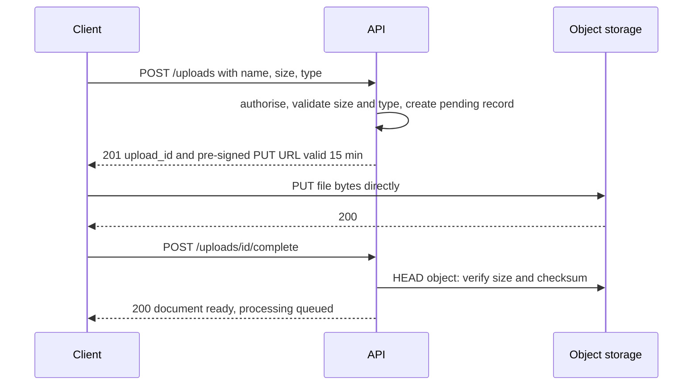

# Files, forms and static content

> **Before this lesson:** you should know JSON request bodies and the `Content-Type` header
> ([lesson 1](#/lesson/fastapi/http-basics), [lesson 5](#/lesson/fastapi/body-responses)), the input
> markers `Query()`, `Header()` and `Body()` ([lesson 6](#/lesson/fastapi/openapi-docs)), and
> generators with `yield` ([lesson 11](#/lesson/fastapi/yield-deps)).

## In plain words

Until now every request body has been JSON. A great deal of what people send to servers is not
JSON: a login form on a web page, a profile photo, a spreadsheet, a video. And much of what servers
send back is not JSON either: a PDF report, a CSV export, the images and style sheets of a website.

Two things make these different. They use different **encodings** (ways of laying out the bytes of a
body), designed in the early days of the web for HTML forms. And files can be *large*. A JSON body
of a few hundred bytes can be read into memory without a thought. A 2-gigabyte video cannot; it must
be handled a piece at a time.

An everyday picture: a post office. A letter (JSON) is dropped in the slot and read in one go. A
parcel goes to a different counter with a different form. A truckload of furniture is not carried in
through the front door at all: it is unloaded piece by piece at the loading dock, or better still
delivered straight to the warehouse while the office only handles the paperwork. Those three cases
are form fields, small uploads, and large uploads that stream or bypass the API entirely.

Lubanovic covers the mechanics in two short chapters ("Files", "Forms and Templates"). This lesson
follows them and adds what matters once real users, and real attackers, send you files.

Why this matters for a job: almost every product accepts uploads somewhere, and an upload endpoint
is the classic place for security holes. "How would you accept a 2 GB video upload?" is a standard
interview question.

## Form data

An HTML form (and the OAuth2 token endpoint of lesson 19) sends its fields in an encoding called
`application/x-www-form-urlencoded`. The body looks like a query string:
`username=ann&password=secret`. To read such fields, mark parameters with `Form()`. This needs the
`python-multipart` package, which `fastapi[standard]` includes.

```python
from typing import Annotated
from fastapi import FastAPI, Form

app = FastAPI()

@app.post("/login/")
async def login(username: Annotated[str, Form()], password: Annotated[str, Form()]):
    return {"username": username}
```

`username: Annotated[str, Form()]` means "a required text value, taken from a form field named
`username`". It is the same pattern as `Query()` and `Header()`, with a different source.

`Form` supports the same validation options as `Query` and `Body` (`min_length`, `pattern` and so
on). Form fields can also be grouped in a Pydantic model (FastAPI 0.113 and later):

```python
class LoginForm(BaseModel):
    model_config = {"extra": "forbid"}
    username: str
    password: str

@app.post("/login/")
async def login(data: Annotated[LoginForm, Form()]):
    return {"username": data.username}
```

One rule of HTTP to remember: a request has **one body in one encoding**. An endpoint cannot declare
both a JSON model and `Form` or `File` fields. To send structured information along with a file,
either use additional form fields, or put a JSON string in one form field and parse it yourself.

The book demonstrates a small and instructive trap. An HTML form that uses the `GET` method sends
its fields as **query parameters**, while a `POST` form sends them in the body. A `Form()`
declaration therefore only works for the second.

## What multipart looks like

File uploads use a second encoding, `multipart/form-data`. The body is divided into **parts**
separated by a marker line called the **boundary**, and each part has small headers of its own:

```text
POST /upload HTTP/1.1
Content-Type: multipart/form-data; boundary=----X

------X
Content-Disposition: form-data; name="description"

Quarterly numbers
------X
Content-Disposition: form-data; name="file"; filename="q3.csv"
Content-Type: text/csv

region,revenue
EMEA,1200
------X--
```

The `Content-Type` header of the request names the boundary (`----X`). Each part starts with `--`
plus the boundary. The first part is an ordinary field named `description`. The second is a file: it
has a `filename`, a content type of its own, and then the file's bytes. The final line, the boundary
followed by `--`, ends the body.

Python can take such a body apart with a module from the standard library:

```python-run
from email.parser import BytesParser
from email.policy import HTTP

boundary = "----X"
body = (
    f"--{boundary}\r\n"
    'Content-Disposition: form-data; name="description"\r\n\r\n'
    "Quarterly numbers\r\n"
    f"--{boundary}\r\n"
    'Content-Disposition: form-data; name="file"; filename="q3.csv"\r\n'
    "Content-Type: text/csv\r\n\r\n"
    "region,revenue\nEMEA,1200\r\n"
    f"--{boundary}--\r\n"
).encode()

# A multipart HTTP body is MIME, so the stdlib email parser can read it
msg = BytesParser(policy=HTTP).parsebytes(
    f"Content-Type: multipart/form-data; boundary={boundary}\r\n\r\n".encode() + body)
for part in msg.iter_parts():
    name = part.get_param("name", header="content-disposition")
    filename = part.get_filename()
    payload = part.get_payload(decode=True)
    print(f"field={name!r} filename={filename!r} type={part.get_content_type()} bytes={len(payload)}")
```

The code builds the same body by hand. HTTP requires each line to end with `\r\n` (carriage return
plus line feed). A multipart body follows the rules of MIME, the format of email attachments, so the
email parser can read it. The loop prints one line per part: the field `description` with no
filename and 17 bytes, then the field `file` with the filename `q3.csv` and the type `text/csv`.
FastAPI does this parsing for you, with `python-multipart`.

## Uploading files

FastAPI offers two ways to declare a file parameter, which the book contrasts as `File()` and
`UploadFile`:

```python
from fastapi import File, UploadFile

@app.post("/small")
async def upload_small(file: Annotated[bytes, File()]):
    return {"size": len(file)}             # entire content in memory - small files only

@app.post("/big")
async def upload_big(file: UploadFile):
    return {"filename": file.filename, "content_type": file.content_type, "size": file.size}
```

| | `bytes` + `File()` | `UploadFile` |
|---|---|---|
| Storage | whole file in RAM | **spooled**: in memory up to a threshold (~1 MB), then a temp file on disk |
| Metadata | none | `filename`, `content_type`, `size`, `headers` |
| Interface | bytes | async file-like: `await read(n)`, `seek`, `write`, `close`; `.file` is the underlying sync file |
| Use for | tiny payloads | everything else |

"Spooled" in the table means the data is held in memory while it is small and moved to a temporary
file on disk once it grows past a threshold.

Process large uploads in **chunks** (pieces of a fixed size), so that memory use stays flat however
large the file is:

```python
import hashlib

@app.post("/upload")
async def upload(file: UploadFile, description: Annotated[str, Form()] = ""):
    sha, size = hashlib.sha256(), 0
    with open(dest_path_for(file), "wb") as out:
        while chunk := await file.read(1024 * 1024):        # 1 MB at a time
            size += len(chunk)
            if size > MAX_BYTES:
                raise HTTPException(status_code=413, detail="File too large")
            sha.update(chunk)
            out.write(chunk)
    return {"sha256": sha.hexdigest(), "size": size, "description": description}
```

- `file: UploadFile` is the upload, and `description` is an ordinary form field sent alongside it.
- `hashlib.sha256()` starts a running fingerprint of the content.
- `while chunk := await file.read(1024 * 1024):` reads up to one megabyte at a time and stops when
  `read` returns nothing.
- Each chunk is counted. If the running total passes the limit, the endpoint raises
  `413 Payload Too Large` at once, without reading the rest.
- Otherwise the chunk is added to the fingerprint and written to the output file.

Several files: `files: list[UploadFile]`. An optional file: `file: UploadFile | None = None`.

The same loop in a form you can run:

```python-run
import hashlib, io

def process_in_chunks(stream, chunk_size=4, max_bytes=20):
    """Chunked read with a size cap - memory use is bounded by chunk_size, not file size."""
    sha, size = hashlib.sha256(), 0
    while chunk := stream.read(chunk_size):
        size += len(chunk)
        if size > max_bytes:
            return 413, "File too large"
        sha.update(chunk)
    return 200, {"size": size, "sha256": sha.hexdigest()[:16]}

print(process_in_chunks(io.BytesIO(b"hello world")))
print(process_in_chunks(io.BytesIO(b"x" * 1000)))
```

`io.BytesIO(...)` wraps bytes in an object that behaves like an open file. The chunk size is 4 bytes
and the limit is 20. The first call reads the 11 bytes of `hello world` in three chunks and returns
`(200, {'size': 11, 'sha256': ...})`. The second is given 1,000 bytes and returns
`(413, 'File too large')` after reading only 24 of them. Memory use is bounded by the chunk size,
not by the size of the file.

### Upload security checklist

An upload consists of bytes chosen by the sender under a name chosen by the sender. Treat both as
hostile:

- **Size limits.** Enforce them at the reverse proxy (the setting is `client_max_body_size` in
  nginx) *and* in your code while reading. The `Content-Length` header can be wrong or missing.
- **Never trust `filename`.** `../../etc/cron.d/x` is a legal filename, and using it as a path would
  write outside your upload folder (path traversal, lesson 20). Generate a storage name of your own,
  such as a UUID, and keep the original only as information.
- **Never trust `content_type`.** It is whatever the client claims. Look at the first bytes of the
  content, or really parse the file (open an image with an imaging library, a CSV with a CSV
  parser).
- **Do not serve uploads from your application's own origin** as HTML, SVG or JavaScript. A browser
  would run them as part of your site, which is stored cross-site scripting. Use a separate domain
  or storage bucket and the header `Content-Disposition: attachment`.
- **Store uploads outside the container's file system.** Use **object storage**, a service that
  stores files under keys (Amazon S3, Google Cloud Storage, Azure Blob Storage). Containers are
  thrown away and recreated, and replicas do not share disks. For large files, give the client a
  **pre-signed URL**: a temporary address at which it may upload directly to the storage service, so
  that your API handles only the description of the file.
- Scan untrusted files (antivirus, re-encoding images) if other users will see them.
- Beware of "decompression bombs", tiny compressed files that expand enormously. Limit the
  uncompressed size and the dimensions of images.

```python-run
from pathlib import PurePosixPath
import uuid

def safe_storage_name(client_filename: str, allowed={".png", ".jpg", ".csv", ".pdf"}):
    ext = PurePosixPath(client_filename.replace("\\", "/")).suffix.lower()
    if ext not in allowed:
        raise ValueError(f"extension {ext!r} not allowed")
    return f"{uuid.uuid4().hex}{ext}"          # never reuse the client's path

for name in ["report.csv", "../../etc/passwd", "photo.JPG", "evil.php", "C:\\Users\\x\\a.png"]:
    try:
        print(f"{name!r:28} -> {safe_storage_name(name)}")
    except ValueError as e:
        print(f"{name!r:28} -> rejected: {e}")
```

`safe_storage_name` takes the client's filename, extracts only the extension (the part after the
last dot, lower-cased), checks it against an allow-list, and returns a brand-new random name with
that extension. The five test names give: `report.csv` becomes a random name ending in `.csv`;
`../../etc/passwd` is rejected because it has no allowed extension; `photo.JPG` becomes a random
`.jpg`; `evil.php` is rejected; and the Windows path ending in `a.png` becomes a random `.png`.
Nothing of the client's path survives.

## Downloading files

**`FileResponse`** sends a file that exists on disk. It sends the file in chunks and sets the
`Content-Length`, `Last-Modified` and `ETag` headers for you:

```python
from fastapi.responses import FileResponse

@app.get("/reports/{report_id}")
def download_report(report_id: int, user: CurrentUser):
    path = locate_report(report_id, user)          # authorise first!
    return FileResponse(path, media_type="application/pdf",
                        filename=f"report-{report_id}.pdf")   # sets Content-Disposition: attachment
```

The comment in the code is the important part: check that this user may have this report *before*
returning it. The `filename=` argument produces a `Content-Disposition: attachment` header, which
tells a browser to save the file instead of displaying it.

**`StreamingResponse`** sends content that is produced as it goes, by a generator: an export being
generated, a file passed along from object storage, the rows of a database query.

```python
from fastapi.responses import StreamingResponse
import csv, io

def csv_rows(session):
    buf = io.StringIO()
    writer = csv.writer(buf)
    writer.writerow(["id", "name", "price"])
    for item in session.exec(select(Item)).yield_per(1000):      # don't load all rows at once
        writer.writerow([item.id, item.name, item.price])
        yield buf.getvalue()
        buf.seek(0); buf.truncate(0)

@app.get("/items.csv")
def export_items(session: SessionDep):
    return StreamingResponse(csv_rows(session), media_type="text/csv",
                             headers={"Content-Disposition": 'attachment; filename="items.csv"'})
```

`csv_rows` is a generator. It writes the header row, then loops over the items from the database
(`yield_per(1000)` fetches them a thousand at a time instead of all at once). After each row it
yields the text written so far and empties the buffer. The endpoint wraps the generator in a
`StreamingResponse`, so each yielded piece is sent to the client immediately. The whole table is
never in memory.

The book's guidance: `FileResponse` when you have a file and want it delivered whole;
`StreamingResponse` for large content that is better sent in pieces. With an ordinary generator,
Starlette runs it in the thread pool; with an async generator, on the event loop, so do no blocking
I/O inside an async generator.

When serving files by a path the user supplies, block **path traversal**:

```python
BASE = Path("/srv/files").resolve()

@app.get("/files/{file_path:path}")
def get_file(file_path: str):
    target = (BASE / file_path).resolve()
    if not target.is_relative_to(BASE) or not target.is_file():
        raise HTTPException(status_code=404, detail="Not found")
    return FileResponse(target)
```

`(BASE / file_path).resolve()` joins the base folder and the requested path and then *resolves* the
result, which removes every `..`. `is_relative_to(BASE)` then checks that the result is still inside
the base folder. A request for `../../etc/passwd` resolves to `/etc/passwd`, fails the check, and
gets a 404.

## Static files

**Static files** are files served exactly as they are, such as style sheets, scripts and images.
Mount a folder of them as a sub-application (lesson 14):

```python
from fastapi.staticfiles import StaticFiles

app.mount("/static", StaticFiles(directory="static"), name="static")
# html=True also serves index.html for directories - handy for a small bundled frontend
```

A mounted app is separate from your routes and does not appear in the OpenAPI document. In
production a CDN or the reverse proxy usually serves static content more efficiently than Python
does. `StaticFiles` is ideal for development, internal tools and small deployments.

## Templates

A **template** is an HTML file with placeholders that are filled in with data for each request. For
HTML generated on the server in this way, FastAPI works with the Jinja2 template library through
Starlette. The book builds a small page listing creatures like this:

```python
from fastapi.templating import Jinja2Templates

templates = Jinja2Templates(directory="templates")

@app.get("/creatures", response_class=HTMLResponse)
def list_creatures(request: Request):
    return templates.TemplateResponse(request=request, name="list.html",
                                      context={"creatures": service.get_all()})
```

`TemplateResponse` fills the template `list.html` with the `creatures` data and returns HTML. Jinja2
**autoescapes** values in `.html` templates: characters such as `<` are converted so that they
display as text and cannot act as HTML. That is your defence against cross-site scripting. Never
mark user-supplied content `|safe`, which switches the protection off.

> [!INTERVIEW]
> "How would you accept a 2 GB video upload?" — Not through the API process if that can be avoided:
> issue a pre-signed URL (or a multi-part upload session) so that the client uploads straight to
> object storage, and then tells the API, which validates the result and queues the processing. If
> the bytes must pass through the API: `UploadFile` with chunked streaming to storage, size limits at
> both the proxy and the application, a generated storage name, verification of the content, and
> timeouts. Never `bytes = File()`, and never `await file.read()` of the whole thing. Return 202 and
> process in the background.

## Worked example: a hardened upload endpoint

Every item of the checklist in one endpoint, in the order the checks should run: the cheapest
rejections first, nothing trusted, nothing unlimited.

```python
MAX_BYTES = 10 * 1024 * 1024
ALLOWED = {"image/png": ".png", "image/jpeg": ".jpg", "application/pdf": ".pdf"}

@router.post("/documents", status_code=201, response_model=DocumentPublic)
async def upload_document(
    request: Request,
    file: UploadFile,
    title: Annotated[str, Form(min_length=1, max_length=200)],
    user: CurrentUser,
    storage: StorageDep,
    session: SessionDep,
):
    # 1. cheap early rejection (advisory only: the header can be absent or wrong)
    declared = request.headers.get("content-length")
    if declared and int(declared) > MAX_BYTES + 4096:
        raise HTTPException(413, "File too large")

    # 2. sniff the real type from the first bytes; ignore file.content_type and the extension
    head = await file.read(8)
    kind = sniff(head)
    if kind not in ALLOWED:
        raise HTTPException(415, "Unsupported file type")

    # 3. stream to storage under a generated name, enforcing the limit as we go
    key = f"{user.id}/{uuid.uuid4().hex}{ALLOWED[kind]}"
    sha, size = hashlib.sha256(head), len(head)
    async with storage.open_writer(key, content_type=kind) as out:
        await out.write(head)
        while chunk := await file.read(1024 * 1024):
            size += len(chunk)
            if size > MAX_BYTES:
                await out.abort()                       # don't leave a partial object behind
                raise HTTPException(413, "File too large")
            sha.update(chunk)
            await out.write(chunk)

    # 4. record metadata; the original filename is stored as data, never used as a path
    doc = Document(owner_id=user.id, title=title, storage_key=key, content_type=kind, size=size,
                   sha256=sha.hexdigest(), original_name=(file.filename or "")[:255])
    session.add(doc); session.commit(); session.refresh(doc)
    return doc
```

The four numbered steps:

1. **A cheap early look at `Content-Length`.** If the client itself announces a body that is too
   large, refuse immediately. This is only advisory, since the header may be absent or false.
2. **Detect the real type from the first eight bytes**, ignoring the claimed type and the extension.
   An unknown type gets `415 Unsupported Media Type`.
3. **Stream to storage under a generated key**, counting bytes as they pass. If the limit is
   exceeded, abort the upload so that no partial object is left behind, and raise 413.
4. **Record the details** in the database. The original filename is stored as data, cut to 255
   characters, and is never used as a path.

The type detection and the size-limited loop are the two parts people get wrong, so here they are in
runnable form:

```python-run
import hashlib, io

SIGNATURES = [                       # "magic numbers": the first bytes identify the real format
    (b"\x89PNG\r\n\x1a\n", "image/png"),
    (b"\xff\xd8\xff",       "image/jpeg"),
    (b"%PDF-",              "application/pdf"),
    (b"PK\x03\x04",         "application/zip"),      # also docx/xlsx/jar: zip containers
    (b"GIF87a",             "image/gif"), (b"GIF89a", "image/gif"),
]

def sniff(head: bytes):
    return next((kind for magic, kind in SIGNATURES if head.startswith(magic)), None)

ALLOWED = {"image/png", "image/jpeg", "application/pdf"}

def handle_upload(stream, claimed_type, filename, max_bytes=64, chunk_size=16):
    head = stream.read(8)
    kind = sniff(head)
    if kind not in ALLOWED:
        return 415, f"rejected: claimed {claimed_type!r}, name {filename!r}, actual {kind!r}"
    sha, size, stored = hashlib.sha256(head), len(head), [head]
    while chunk := stream.read(chunk_size):
        size += len(chunk)
        if size > max_bytes:
            stored.clear()                                # abort: discard the partial object
            return 413, f"rejected after reading {size} bytes (limit {max_bytes})"
        sha.update(chunk); stored.append(chunk)
    return 201, {"content_type": kind, "size": size, "sha256": sha.hexdigest()[:12]}

png = b"\x89PNG\r\n\x1a\n" + b"\x00" * 30
uploads = [
    ("honest png",           io.BytesIO(png),                              "image/png",  "photo.png"),
    ("script named .png",    io.BytesIO(b"<?php system($_GET['c']); ?>"),  "image/png",  "avatar.png"),
    ("html claiming pdf",    io.BytesIO(b"<html><script>steal()</script>"), "application/pdf", "invoice.pdf"),
    ("zip bomb as jpeg",     io.BytesIO(b"PK\x03\x04" + b"\x00" * 20),     "image/jpeg", "cat.jpg"),
    ("oversized real pdf",   io.BytesIO(b"%PDF-1.7\n" + b"x" * 500),       "application/pdf", "big.pdf"),
]
for label, stream, claimed, name in uploads:
    print(f"{label:20} ->", *handle_upload(stream, claimed, name))
```

Most file formats begin with a fixed sequence of bytes, a signature known as its **magic number**: a
PNG image starts with `\x89PNG`, a PDF with `%PDF-`. `sniff` compares the first bytes against a list
of signatures. `handle_upload` then follows the steps above with a limit of 64 bytes.

Five uploads are tried:

- **honest png**: `201`, type `image/png`, 38 bytes.
- **script named .png**: `415`. It claimed `image/png` and was named `avatar.png`; its actual type
  is `None`, because the bytes are a PHP script.
- **html claiming pdf**: `415`, actual type `None`.
- **zip bomb as jpeg**: `415`, actual type `application/zip`.
- **oversized real pdf**: `413`, `rejected after reading 72 bytes (limit 64)`.

Three of the five lie about what they are, and the claimed content type and the extension would
have let every one of them through. Only the bytes tell the truth. And the oversized file was cut
off after reading barely more than the limit, not after all 500 bytes had been collected.

## What happens on the wire and in memory

Tracing a 50 MB upload through the layers of lesson 3 shows where each limit really takes effect:

1. The client sends headers, then the multipart body in TCP segments. Nothing is "uploaded first and then
   delivered"; bytes arrive over time.
2. A reverse proxy such as nginx by default **buffers the whole request body** (to disk beyond a small
   memory threshold) before forwarding, and rejects bodies over `client_max_body_size` with `413` — the
   first and cheapest line of defence. Many proxies also enforce a body read timeout, which protects
   against slow-drip uploads.
3. Uvicorn passes chunks to the app as `http.request` events. When FastAPI resolves an `UploadFile`
   parameter, Starlette's multipart parser consumes the stream **before your endpoint body runs**, writing
   each file part into a `SpooledTemporaryFile`: in memory up to about 1 MB, then rolled to a temp file on
   disk.
4. Your endpoint then reads from that spooled file. So with `UploadFile`, peak memory is small, but the
   server's **temp disk** must hold the upload — size your container's ephemeral storage accordingly, and
   note that the in-code size check runs after the bytes are already on local disk.
5. To enforce a limit *while the bytes arrive*, or to pipe directly to object storage without touching
   local disk, bypass form parsing and consume `request.stream()` yourself (with a streaming multipart
   parser), or — usually better — avoid the problem with pre-signed direct uploads.

## Pre-signed uploads: the three-step dance



Read it as three steps. First, the client tells the API what it wants to upload, and the API
checks permission, creates a "pending" record and returns a pre-signed URL. Second, the client sends
the bytes straight to the storage service. Third, the client tells the API it has finished, and the
API asks the storage service whether the object is really there, with the promised size.

The API never handles the bytes, so its workers stay free and small. The pre-signed URL grants
permission for one object key for a limited time, and conditions in its signature can fix the
content type and the maximum length. The `complete` step exists because the API cannot trust that
the upload happened, or that it was what the client said; it checks with the storage service and
then queues scanning or processing. Pending records that are never completed are removed by a
scheduled job.

## Download details that matter

- **Range requests.** `FileResponse` honours `Range: bytes=...` in current Starlette versions, enabling
  resumable downloads and video seeking; a hand-rolled `StreamingResponse` doesn't unless you implement
  `206 Partial Content` yourself.
- **`Content-Disposition`.** `attachment; filename="report.pdf"` forces a download; `inline` lets the
  browser display. Passing `filename=` to `FileResponse` handles non-ASCII names correctly
  (`filename*=UTF-8''...`) — build this header by hand and you'll get the quoting wrong.
- **Never interpolate user input into headers.** A filename containing a newline is a header-injection
  attempt; frameworks reject it, string formatting doesn't.
- **Authorise before serving, every time.** A URL to a private file must go through an endpoint that
  checks ownership, or be a short-lived pre-signed URL — never a guessable static path.
- **Offload when you can.** For large private files, return a redirect to a pre-signed GET URL, or let
  the proxy serve the bytes (`X-Accel-Redirect` in nginx) after your app has authorised the request.

## Pitfalls

- `python-multipart` not installed, which gives a runtime error on the first form or file route.
- Mixing JSON body models with `Form` or `File` parameters.
- `await file.read()` with no size limit.
- Using the client's filename as a path; trusting the claimed content type.
- Writing uploads to the container's local disk when there are several replicas.
- Blocking file I/O in `async def` handlers for large files. Use `def`, chunked async reads, or a
  thread.

## Summary

- Forms: `Form()` fields (urlencoded). Files: multipart, with `UploadFile` (spooled, read in chunks)
  or `bytes` (tiny files only).
- One body encoding per request: JSON *or* form/multipart.
- Enforce size limits, generate storage names, verify the content, store in object storage.
- `FileResponse` for files on disk, `StreamingResponse` for generated or large content; guard
  against path traversal.
- `StaticFiles` mounts assets; Jinja2 templates produce HTML with autoescaping.

## Glossary

- **Encoding (of a body)** — the layout of a request body's bytes: JSON, urlencoded, multipart.
- **Form data** — fields sent in the encodings HTML forms use.
- **`application/x-www-form-urlencoded`** — the form encoding that looks like `a=1&b=2`.
- **Multipart** — the encoding that splits a body into parts, used for file uploads.
- **Boundary** — the marker line separating the parts of a multipart body.
- **`UploadFile`** — FastAPI's file object: file-like, with a name, a type and a size.
- **Spooled** — kept in memory while small, moved to a temporary disk file when large.
- **Chunk** — one fixed-size piece of a larger stream of data.
- **Magic number** — the first bytes of a file, which identify its real format.
- **Object storage** — a service that stores files under keys, such as S3.
- **Pre-signed URL** — a temporary address permitting a direct upload or download.
- **`FileResponse` / `StreamingResponse`** — send a file from disk / send content as it is generated.
- **`Content-Disposition`** — the header saying whether to display or download, and under what name.
- **Path traversal** — escaping the intended folder with `..`.
- **Static files** — files served exactly as stored (CSS, JavaScript, images).
- **Template / autoescaping** — HTML with placeholders / automatic neutralising of HTML characters in
  inserted values.

```quiz
[
  {"q": "Which package must be installed for Form() and file uploads to work?", "options": ["aiofiles", "python-multipart", "jinja2", "requests"], "answer": 1,
   "explain": "FastAPI relies on python-multipart to parse urlencoded and multipart bodies."},
  {"q": "Main advantage of UploadFile over 'bytes = File()'?", "options": ["It validates images", "It spools to disk beyond a threshold and exposes a file-like interface plus metadata, so large files don't sit in RAM", "It is always faster", "It encrypts the upload"], "answer": 1,
   "explain": "bytes loads the entire file into memory; UploadFile streams via a spooled temporary file."},
  {"q": "Can one endpoint declare both a Pydantic JSON body and File() parameters?", "options": ["Yes, always", "No - a request body has a single encoding (JSON or multipart/form)", "Only with async def", "Only for PUT"], "answer": 1,
   "explain": "This is an HTTP limitation; send metadata as form fields alongside the file instead."},
  {"q": "Why generate your own storage filename for uploads?", "options": ["Shorter names", "Client filenames are attacker-controlled and may contain path traversal or collide", "S3 requires UUIDs", "To hide the file type from the OS"], "answer": 1,
   "explain": "Never use client-supplied names as paths; keep them only as metadata."},
  {"q": "Which response class suits a CSV export generated row by row from a large table?", "options": ["JSONResponse", "FileResponse", "StreamingResponse", "RedirectResponse"], "answer": 2,
   "explain": "StreamingResponse sends chunks as the generator yields them, keeping memory flat."},
  {"q": "How do you defend a /files/{file_path:path} endpoint against path traversal?", "options": ["Reject paths longer than 10 chars", "Resolve the joined path and verify it stays inside the base directory", "URL-encode the path", "Use POST instead"], "answer": 1,
   "explain": "After resolve(), '..' segments are collapsed; is_relative_to(BASE) proves containment."},
  {"q": "For multi-gigabyte uploads at scale, what is the preferred architecture?", "options": ["Base64 in JSON", "Client uploads directly to object storage via a pre-signed URL; the API handles metadata", "Increase worker memory", "Use GET with a body"], "answer": 1,
   "explain": "Bypassing the API for the bytes avoids tying up workers and memory; the API stays small and fast."}
]
```

> **Source:** Lubanovic, *FastAPI*, ch. 15 "Files" (Multipart Support, Uploading Files, File(), UploadFile, Downloading Files, FileResponse, StreamingResponse, Serving Static Files) and ch. 16 "Forms and Templates"; https://fastapi.tiangolo.com/tutorial/request-forms/, /tutorial/request-form-models/, /tutorial/request-files/, /tutorial/static-files/, /advanced/custom-response/, /advanced/templates/
