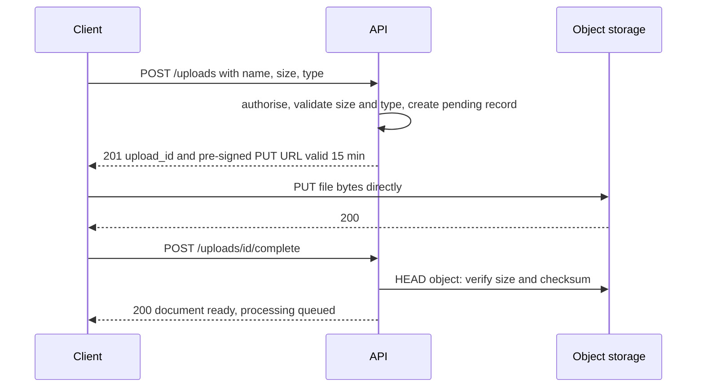

# Files, forms and static content

JSON isn't the only thing that crosses an API. Users upload images and CSVs, download reports, submit
HTML forms; ML services receive audio, PDFs and datasets. These travel as **form data** and
**multipart** bodies rather than JSON, and large ones must be handled without loading everything into
memory. Lubanovic covers the mechanics in two short chapters ("Files", "Forms and Templates"); this
lesson follows them and adds the production concerns.

## Form data

HTML forms (and the OAuth2 token endpoint) send bodies encoded as
`application/x-www-form-urlencoded` — `username=ann&password=secret` — not JSON. Declare fields with
`Form()`. This requires the `python-multipart` package (included in `fastapi[standard]`):

```python
from typing import Annotated
from fastapi import FastAPI, Form

app = FastAPI()

@app.post("/login/")
async def login(username: Annotated[str, Form()], password: Annotated[str, Form()]):
    return {"username": username}
```

`Form` supports the same validation as `Query`/`Body` (`min_length`, `pattern`, ...). You can also group
fields in a Pydantic model (FastAPI ≥ 0.113):

```python
class LoginForm(BaseModel):
    model_config = {"extra": "forbid"}
    username: str
    password: str

@app.post("/login/")
async def login(data: Annotated[LoginForm, Form()]):
    return {"username": data.username}
```

One HTTP rule to remember: a request has **one body with one encoding**. You cannot declare both a JSON
`Body` model and `Form`/`File` fields on the same endpoint. To send structured metadata alongside a file,
either use additional form fields or a form field containing a JSON string that you parse yourself.

The book demonstrates a small but instructive trap: a `GET` form submits its fields as **query
parameters**, while a `POST` form submits them in the body — so the `Form()` declaration only works for
the latter.

## What multipart looks like

File uploads use `multipart/form-data`: the body is split into parts by a boundary string, each part with
its own headers:

```text
POST /upload HTTP/1.1
Content-Type: multipart/form-data; boundary=----X

------X
Content-Disposition: form-data; name="description"

Quarterly numbers
------X
Content-Disposition: form-data; name="file"; filename="q3.csv"
Content-Type: text/csv

region,revenue
EMEA,1200
------X--
```

```python-run
from email.parser import BytesParser
from email.policy import HTTP

boundary = "----X"
body = (
    f"--{boundary}\r\n"
    'Content-Disposition: form-data; name="description"\r\n\r\n'
    "Quarterly numbers\r\n"
    f"--{boundary}\r\n"
    'Content-Disposition: form-data; name="file"; filename="q3.csv"\r\n'
    "Content-Type: text/csv\r\n\r\n"
    "region,revenue\nEMEA,1200\r\n"
    f"--{boundary}--\r\n"
).encode()

# A multipart HTTP body is MIME, so the stdlib email parser can read it
msg = BytesParser(policy=HTTP).parsebytes(
    f"Content-Type: multipart/form-data; boundary={boundary}\r\n\r\n".encode() + body)
for part in msg.iter_parts():
    name = part.get_param("name", header="content-disposition")
    filename = part.get_filename()
    payload = part.get_payload(decode=True)
    print(f"field={name!r} filename={filename!r} type={part.get_content_type()} bytes={len(payload)}")
```

## Uploading files

FastAPI offers two declarations, which the book contrasts as `File()` versus `UploadFile`:

```python
from fastapi import File, UploadFile

@app.post("/small")
async def upload_small(file: Annotated[bytes, File()]):
    return {"size": len(file)}             # entire content in memory - small files only

@app.post("/big")
async def upload_big(file: UploadFile):
    return {"filename": file.filename, "content_type": file.content_type, "size": file.size}
```

| | `bytes` + `File()` | `UploadFile` |
|---|---|---|
| Storage | whole file in RAM | **spooled**: in memory up to a threshold (~1 MB), then a temp file on disk |
| Metadata | none | `filename`, `content_type`, `size`, `headers` |
| Interface | bytes | async file-like: `await read(n)`, `seek`, `write`, `close`; `.file` is the underlying sync file |
| Use for | tiny payloads | everything else |

Process large uploads in chunks so memory stays flat:

```python
import hashlib

@app.post("/upload")
async def upload(file: UploadFile, description: Annotated[str, Form()] = ""):
    sha, size = hashlib.sha256(), 0
    with open(dest_path_for(file), "wb") as out:
        while chunk := await file.read(1024 * 1024):        # 1 MB at a time
            size += len(chunk)
            if size > MAX_BYTES:
                raise HTTPException(status_code=413, detail="File too large")
            sha.update(chunk)
            out.write(chunk)
    return {"sha256": sha.hexdigest(), "size": size, "description": description}
```

Multiple files: `files: list[UploadFile]`. Optional: `file: UploadFile | None = None`.

```python-run
import hashlib, io

def process_in_chunks(stream, chunk_size=4, max_bytes=20):
    """Chunked read with a size cap - memory use is bounded by chunk_size, not file size."""
    sha, size = hashlib.sha256(), 0
    while chunk := stream.read(chunk_size):
        size += len(chunk)
        if size > max_bytes:
            return 413, "File too large"
        sha.update(chunk)
    return 200, {"size": size, "sha256": sha.hexdigest()[:16]}

print(process_in_chunks(io.BytesIO(b"hello world")))
print(process_in_chunks(io.BytesIO(b"x" * 1000)))
```

### Upload security checklist

Uploads are attacker-controlled bytes with attacker-controlled names:

- **Size limits.** Enforce at the reverse proxy (`client_max_body_size` in nginx) *and* in code while
  streaming. `Content-Length` can lie or be absent.
- **Never trust `filename`.** `../../etc/cron.d/x` is a filename. Generate your own storage name
  (UUID) and keep the original only as metadata.
- **Never trust `content_type`.** It's whatever the client claims. Sniff magic bytes or actually parse the
  file (open the image with Pillow, the CSV with a parser).
- **Don't serve uploads from your app's origin** as HTML/SVG/JS — that's stored XSS. Use a separate
  domain/bucket and `Content-Disposition: attachment`.
- **Store outside the container filesystem** — object storage (S3/GCS/Azure Blob). Containers are
  ephemeral and replicas don't share disks. For big files, give the client a **pre-signed URL** so it
  uploads directly to storage and your API only handles metadata.
- Scan untrusted files (antivirus, image re-encoding) if they'll be shown to other users.
- Decompression bombs: cap decompressed size and image dimensions.

```python-run
from pathlib import PurePosixPath
import uuid

def safe_storage_name(client_filename: str, allowed={".png", ".jpg", ".csv", ".pdf"}):
    ext = PurePosixPath(client_filename.replace("\\", "/")).suffix.lower()
    if ext not in allowed:
        raise ValueError(f"extension {ext!r} not allowed")
    return f"{uuid.uuid4().hex}{ext}"          # never reuse the client's path

for name in ["report.csv", "../../etc/passwd", "photo.JPG", "evil.php", "C:\\Users\\x\\a.png"]:
    try:
        print(f"{name!r:28} -> {safe_storage_name(name)}")
    except ValueError as e:
        print(f"{name!r:28} -> rejected: {e}")
```

## Downloading files

**`FileResponse`** sends a file from disk, streaming it in chunks and setting `Content-Length`,
`Last-Modified` and `ETag` for you:

```python
from fastapi.responses import FileResponse

@app.get("/reports/{report_id}")
def download_report(report_id: int, user: CurrentUser):
    path = locate_report(report_id, user)          # authorise first!
    return FileResponse(path, media_type="application/pdf",
                        filename=f"report-{report_id}.pdf")   # sets Content-Disposition: attachment
```

**`StreamingResponse`** sends content produced on the fly by an iterator/async iterator — an export being
generated, a file proxied from object storage, a database cursor:

```python
from fastapi.responses import StreamingResponse
import csv, io

def csv_rows(session):
    buf = io.StringIO()
    writer = csv.writer(buf)
    writer.writerow(["id", "name", "price"])
    for item in session.exec(select(Item)).yield_per(1000):      # don't load all rows at once
        writer.writerow([item.id, item.name, item.price])
        yield buf.getvalue()
        buf.seek(0); buf.truncate(0)

@app.get("/items.csv")
def export_items(session: SessionDep):
    return StreamingResponse(csv_rows(session), media_type="text/csv",
                             headers={"Content-Disposition": 'attachment; filename="items.csv"'})
```

The book's guidance: `FileResponse` when you have a file and want it delivered in one go;
`StreamingResponse` for large content you'd rather send in pieces. With a plain (sync) generator,
Starlette iterates it in the thread pool; with an async generator, on the event loop — so don't do
blocking I/O inside an async generator.

When serving files by user-supplied path, block **path traversal**:

```python
BASE = Path("/srv/files").resolve()

@app.get("/files/{file_path:path}")
def get_file(file_path: str):
    target = (BASE / file_path).resolve()
    if not target.is_relative_to(BASE) or not target.is_file():
        raise HTTPException(status_code=404, detail="Not found")
    return FileResponse(target)
```

## Static files

Mount a directory of static assets (CSS, JS, images) as a sub-application:

```python
from fastapi.staticfiles import StaticFiles

app.mount("/static", StaticFiles(directory="static"), name="static")
# html=True also serves index.html for directories - handy for a small bundled frontend
```

Mounted apps are separate from your routes (not in OpenAPI). In production, a CDN or the reverse proxy
usually serves static content more efficiently than Python; `StaticFiles` is ideal for development,
internal tools and small deployments.

## Templates

For server-rendered HTML, FastAPI integrates Jinja2 through Starlette — the book builds a small
creature-listing page this way:

```python
from fastapi.templating import Jinja2Templates

templates = Jinja2Templates(directory="templates")

@app.get("/creatures", response_class=HTMLResponse)
def list_creatures(request: Request):
    return templates.TemplateResponse(request=request, name="list.html",
                                      context={"creatures": service.get_all()})
```

Jinja2 autoescapes HTML in `.html` templates, which is your XSS defence — never mark user content `|safe`.

> [!INTERVIEW]
> "How would you accept a 2 GB video upload?" — Not through the API process if avoidable: issue a
> pre-signed URL (or multipart-upload session) so the client uploads straight to object storage, then
> notify the API, which validates and enqueues processing. If it must pass through the API: `UploadFile`
> with chunked streaming to storage, size limits at proxy and app level, a generated storage name,
> content verification, and timeouts — never `bytes = File()` or `await file.read()` of the whole thing.
> Return 202 and process asynchronously.

## Worked example: a hardened upload endpoint

All the checklist items in one endpoint, in the order they should execute — cheapest rejections first,
nothing trusted, nothing unbounded:

```python
MAX_BYTES = 10 * 1024 * 1024
ALLOWED = {"image/png": ".png", "image/jpeg": ".jpg", "application/pdf": ".pdf"}

@router.post("/documents", status_code=201, response_model=DocumentPublic)
async def upload_document(
    request: Request,
    file: UploadFile,
    title: Annotated[str, Form(min_length=1, max_length=200)],
    user: CurrentUser,
    storage: StorageDep,
    session: SessionDep,
):
    # 1. cheap early rejection (advisory only: the header can be absent or wrong)
    declared = request.headers.get("content-length")
    if declared and int(declared) > MAX_BYTES + 4096:
        raise HTTPException(413, "File too large")

    # 2. sniff the real type from the first bytes; ignore file.content_type and the extension
    head = await file.read(8)
    kind = sniff(head)
    if kind not in ALLOWED:
        raise HTTPException(415, "Unsupported file type")

    # 3. stream to storage under a generated name, enforcing the limit as we go
    key = f"{user.id}/{uuid.uuid4().hex}{ALLOWED[kind]}"
    sha, size = hashlib.sha256(head), len(head)
    async with storage.open_writer(key, content_type=kind) as out:
        await out.write(head)
        while chunk := await file.read(1024 * 1024):
            size += len(chunk)
            if size > MAX_BYTES:
                await out.abort()                       # don't leave a partial object behind
                raise HTTPException(413, "File too large")
            sha.update(chunk)
            await out.write(chunk)

    # 4. record metadata; the original filename is stored as data, never used as a path
    doc = Document(owner_id=user.id, title=title, storage_key=key, content_type=kind, size=size,
                   sha256=sha.hexdigest(), original_name=(file.filename or "")[:255])
    session.add(doc); session.commit(); session.refresh(doc)
    return doc
```

The type sniffing and the size-capped streaming loop are the two parts people get wrong, so here they are
in runnable form:

```python-run
import hashlib, io

SIGNATURES = [                       # "magic numbers": the first bytes identify the real format
    (b"\x89PNG\r\n\x1a\n", "image/png"),
    (b"\xff\xd8\xff",       "image/jpeg"),
    (b"%PDF-",              "application/pdf"),
    (b"PK\x03\x04",         "application/zip"),      # also docx/xlsx/jar: zip containers
    (b"GIF87a",             "image/gif"), (b"GIF89a", "image/gif"),
]

def sniff(head: bytes):
    return next((kind for magic, kind in SIGNATURES if head.startswith(magic)), None)

ALLOWED = {"image/png", "image/jpeg", "application/pdf"}

def handle_upload(stream, claimed_type, filename, max_bytes=64, chunk_size=16):
    head = stream.read(8)
    kind = sniff(head)
    if kind not in ALLOWED:
        return 415, f"rejected: claimed {claimed_type!r}, name {filename!r}, actual {kind!r}"
    sha, size, stored = hashlib.sha256(head), len(head), [head]
    while chunk := stream.read(chunk_size):
        size += len(chunk)
        if size > max_bytes:
            stored.clear()                                # abort: discard the partial object
            return 413, f"rejected after reading {size} bytes (limit {max_bytes})"
        sha.update(chunk); stored.append(chunk)
    return 201, {"content_type": kind, "size": size, "sha256": sha.hexdigest()[:12]}

png = b"\x89PNG\r\n\x1a\n" + b"\x00" * 30
uploads = [
    ("honest png",           io.BytesIO(png),                              "image/png",  "photo.png"),
    ("script named .png",    io.BytesIO(b"<?php system($_GET['c']); ?>"),  "image/png",  "avatar.png"),
    ("html claiming pdf",    io.BytesIO(b"<html><script>steal()</script>"), "application/pdf", "invoice.pdf"),
    ("zip bomb as jpeg",     io.BytesIO(b"PK\x03\x04" + b"\x00" * 20),     "image/jpeg", "cat.jpg"),
    ("oversized real pdf",   io.BytesIO(b"%PDF-1.7\n" + b"x" * 500),       "application/pdf", "big.pdf"),
]
for label, stream, claimed, name in uploads:
    print(f"{label:20} ->", *handle_upload(stream, claimed, name))
```

Three of the five uploads lie about what they are, and the declared content type and extension would have
waved every one of them through. Only the bytes tell the truth — and the oversized file is cut off after
reading barely more than the limit, not after buffering all of it.

## What happens on the wire and in memory

Tracing a 50 MB upload through the stack clarifies where limits actually apply:

1. The client sends headers, then the multipart body in TCP segments. Nothing is "uploaded first and then
   delivered"; bytes arrive over time.
2. A reverse proxy such as nginx by default **buffers the whole request body** (to disk beyond a small
   memory threshold) before forwarding, and rejects bodies over `client_max_body_size` with `413` — the
   first and cheapest line of defence. Many proxies also enforce a body read timeout, which protects
   against slow-drip uploads.
3. Uvicorn passes chunks to the app as `http.request` events. When FastAPI resolves an `UploadFile`
   parameter, Starlette's multipart parser consumes the stream **before your endpoint body runs**, writing
   each file part into a `SpooledTemporaryFile`: in memory up to about 1 MB, then rolled to a temp file on
   disk.
4. Your endpoint then reads from that spooled file. So with `UploadFile`, peak memory is small, but the
   server's **temp disk** must hold the upload — size your container's ephemeral storage accordingly, and
   note that the in-code size check runs after the bytes are already on local disk.
5. To enforce a limit *while the bytes arrive*, or to pipe directly to object storage without touching
   local disk, bypass form parsing and consume `request.stream()` yourself (with a streaming multipart
   parser), or — usually better — avoid the problem with pre-signed direct uploads.

## Pre-signed uploads: the three-step dance



The API never handles the bytes, so its workers stay free and small. The pre-signed URL is a
time-limited capability scoped to one object key; conditions in the signature can pin content type and
maximum length. The `complete` step exists because the API can't trust that the upload happened or was
what the client claimed — it verifies against storage, then enqueues scanning or processing. Pending
records that are never completed are cleaned up by a scheduled job (and a storage lifecycle rule).

## Download details that matter

- **Range requests.** `FileResponse` honours `Range: bytes=...` in current Starlette versions, enabling
  resumable downloads and video seeking; a hand-rolled `StreamingResponse` doesn't unless you implement
  `206 Partial Content` yourself.
- **`Content-Disposition`.** `attachment; filename="report.pdf"` forces a download; `inline` lets the
  browser display. Passing `filename=` to `FileResponse` handles non-ASCII names correctly
  (`filename*=UTF-8''...`) — build this header by hand and you'll get the quoting wrong.
- **Never interpolate user input into headers.** A filename containing a newline is a header-injection
  attempt; frameworks reject it, string formatting doesn't.
- **Authorise before serving, every time.** A URL to a private file must go through an endpoint that
  checks ownership, or be a short-lived pre-signed URL — never a guessable static path.
- **Offload when you can.** For large private files, return a redirect to a pre-signed GET URL, or let
  the proxy serve the bytes (`X-Accel-Redirect` in nginx) after your app has authorised the request.

## Pitfalls

- `python-multipart` not installed → runtime error on the first form/file route.
- Mixing JSON body models with `Form`/`File` parameters.
- `await file.read()` without a size cap.
- Using the client's filename as a path; trusting the claimed content type.
- Writing uploads to the container's local disk in a multi-replica deployment.
- Blocking file I/O in `async def` handlers for big files (use `def`, chunked async reads, or a thread).

## Summary

- Forms: `Form()` fields (urlencoded); files: multipart with `UploadFile` (spooled, chunked) or `bytes`
  (tiny only).
- One body encoding per request: JSON *or* form/multipart.
- Enforce size limits, generate storage names, verify content, store in object storage.
- `FileResponse` for files on disk, `StreamingResponse` for generated/large content; guard against path
  traversal.
- `StaticFiles` mounts assets; Jinja2 templates render HTML with autoescaping.

```quiz
[
  {"q": "Which package must be installed for Form() and file uploads to work?", "options": ["aiofiles", "python-multipart", "jinja2", "requests"], "answer": 1,
   "explain": "FastAPI relies on python-multipart to parse urlencoded and multipart bodies."},
  {"q": "Main advantage of UploadFile over 'bytes = File()'?", "options": ["It validates images", "It spools to disk beyond a threshold and exposes a file-like interface plus metadata, so large files don't sit in RAM", "It is always faster", "It encrypts the upload"], "answer": 1,
   "explain": "bytes loads the entire file into memory; UploadFile streams via a spooled temporary file."},
  {"q": "Can one endpoint declare both a Pydantic JSON body and File() parameters?", "options": ["Yes, always", "No - a request body has a single encoding (JSON or multipart/form)", "Only with async def", "Only for PUT"], "answer": 1,
   "explain": "This is an HTTP limitation; send metadata as form fields alongside the file instead."},
  {"q": "Why generate your own storage filename for uploads?", "options": ["Shorter names", "Client filenames are attacker-controlled and may contain path traversal or collide", "S3 requires UUIDs", "To hide the file type from the OS"], "answer": 1,
   "explain": "Never use client-supplied names as paths; keep them only as metadata."},
  {"q": "Which response class suits a CSV export generated row by row from a large table?", "options": ["JSONResponse", "FileResponse", "StreamingResponse", "RedirectResponse"], "answer": 2,
   "explain": "StreamingResponse sends chunks as the generator yields them, keeping memory flat."},
  {"q": "How do you defend a /files/{file_path:path} endpoint against path traversal?", "options": ["Reject paths longer than 10 chars", "Resolve the joined path and verify it stays inside the base directory", "URL-encode the path", "Use POST instead"], "answer": 1,
   "explain": "After resolve(), '..' segments are collapsed; is_relative_to(BASE) proves containment."},
  {"q": "For multi-gigabyte uploads at scale, what is the preferred architecture?", "options": ["Base64 in JSON", "Client uploads directly to object storage via a pre-signed URL; the API handles metadata", "Increase worker memory", "Use GET with a body"], "answer": 1,
   "explain": "Bypassing the API for the bytes avoids tying up workers and memory; the API stays small and fast."}
]
```

> **Source:** Lubanovic, *FastAPI*, ch. 15 "Files" (Multipart Support, Uploading Files, File(), UploadFile, Downloading Files, FileResponse, StreamingResponse, Serving Static Files) and ch. 16 "Forms and Templates"; https://fastapi.tiangolo.com/tutorial/request-forms/, /tutorial/request-form-models/, /tutorial/request-files/, /tutorial/static-files/, /advanced/custom-response/, /advanced/templates/
