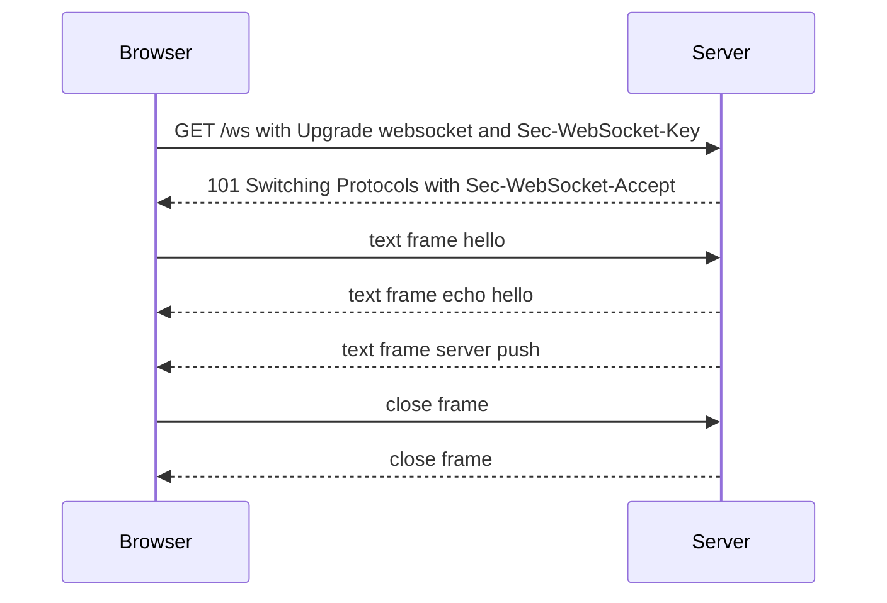

# WebSockets, streaming and Server-Sent Events

> **Before this lesson:** you should know the request/response cycle and headers
> ([lesson 1](#/lesson/fastapi/http-basics)), how ASGI apps send messages
> ([lesson 3](#/lesson/fastapi/asgi-stack)), what the event loop is and why blocking it is bad
> ([lesson 12](#/lesson/fastapi/async-fundamentals)), and generators with `yield`
> ([lesson 11](#/lesson/fastapi/yield-deps)). [Lesson 23](#/lesson/fastapi/files-forms) used
> `StreamingResponse` for downloads; this lesson explains how it works underneath.

## In plain words

Everything so far has followed one rhythm: the client asks, the server thinks, the server sends back
one complete answer, and the exchange is over. That is like sending a letter and waiting for the
reply letter. It works well for most things, but not for all:

- A report with a million rows takes time to produce. Making the user wait for the whole thing, and
  holding it all in memory, is wasteful when the first rows are ready almost at once.
- A chatbot built on a **large language model** (LLM, the kind of model behind ChatGPT) produces its
  answer one word-piece at a time over ten or twenty seconds. Users expect to watch the text appear.
- A chat room or a multiplayer game needs both sides to speak whenever they like.

This lesson covers three techniques that keep the conversation open. An everyday picture for each:

- **Streaming response**: a long letter that the post office delivers page by page as the writer
  finishes each page, instead of waiting for the whole letter.
- **Server-Sent Events (SSE)**: a radio station. The server talks; the client listens and can tune
  back in if the signal drops.
- **WebSocket**: a phone call. Once connected, either side can speak at any moment until someone
  hangs up.

Why this matters for a job: streaming is how every LLM product delivers answers, and chat and live
dashboards are everywhere. "How would you stream model output to a browser, and what breaks in
production?" is a standard interview question for backend and ML-platform roles.

## Three ways to keep the conversation open

| Technique | Who talks | How it travels | Typical use |
|---|---|---|---|
| **StreamingResponse** | server to client, inside one response | an HTTP body sent in pieces | large downloads, NDJSON feeds |
| **Server-Sent Events** | server to client, as a series of events | `text/event-stream` over HTTP | notifications, progress bars, **LLM token streaming** |
| **WebSocket** | both directions, for as long as the connection lives | an HTTP connection "upgraded" to a different protocol (`ws://`, `wss://`) | chat, collaborative editing, games, live control |

Two words in the table need defining. **Bidirectional** (also called *full-duplex*) means both sides
can send at the same time, as on a phone call. A **persistent connection** is one that stays open
after the first exchange instead of closing; underneath it is a **TCP connection**, the reliable
two-way byte pipe that HTTP itself runs on.

All three rely on the message-based design of ASGI from lesson 3. There, a response was not one
function return value but a series of `send(...)` calls: one `http.response.start` message with the
status and headers, then one or more `http.response.body` messages. Nothing forces the app to send
the body in a single message. It may keep sending pieces for as long as the connection lives, and
that is the whole trick behind streaming.

## StreamingResponse

A **generator** is a function containing `yield`: each time the caller asks for the next value, the
function runs until the next `yield` and pauses there. An **async generator** is the same thing
written with `async def`, so it may also `await` between values. A `StreamingResponse` takes either
kind and sends each yielded value to the client as soon as it is produced. Each piece is called a
**chunk**.

```python
import asyncio, json
from fastapi import FastAPI
from fastapi.responses import StreamingResponse

app = FastAPI()

async def ndjson_feed():
    for i in range(5):
        yield json.dumps({"seq": i}) + "\n"       # newline-delimited JSON
        await asyncio.sleep(0.5)

@app.get("/feed")
async def feed():
    return StreamingResponse(ndjson_feed(), media_type="application/x-ndjson")
```

Line by line:

- `async def ndjson_feed():` defines an async generator. Calling `ndjson_feed()` does not run it; it
  creates an object that produces values when asked.
- `yield json.dumps({"seq": i}) + "\n"` produces one line of JSON text. **NDJSON** (newline-delimited
  JSON) is a simple format in which each line is one complete JSON document, so the client can
  process each line as it arrives instead of waiting for one giant array to close.
- `await asyncio.sleep(0.5)` pauses for half a second, standing in for real work such as reading the
  next batch of database rows. While it waits, the event loop serves other requests.
- The endpoint returns `StreamingResponse(ndjson_feed(), media_type=...)`. The response object holds
  the generator; Starlette pulls values from it one by one and sends each to the client.

A client calling `GET /feed` receives `{"seq": 0}` at once, `{"seq": 1}` half a second later, and so
on for two and a half seconds.

### What goes over the wire

A normal response announces its size in the `Content-Length` header, the number of bytes in the
body, so the client knows when the body ends. A streamed response cannot know its size in advance.
HTTP/1.1 solves this with **chunked transfer encoding**: the server sends the header
`Transfer-Encoding: chunked`, then each chunk prefixed by its length in hexadecimal, and finally a
chunk of length zero to say "that is all". (HTTP/2 has its own framing and does not need this, but
the idea is the same.) Here is the layout, built by hand:

```python-run
def ndjson_feed():
    for i in range(3):
        yield '{"seq": %d}\n' % i

def chunked_wire(status, headers, body_parts):
    """What a server writes to the socket for a streamed HTTP/1.1 response."""
    yield f"HTTP/1.1 {status}\r\n".encode()
    for name, value in headers.items():
        yield f"{name}: {value}\r\n".encode()
    yield b"Transfer-Encoding: chunked\r\n\r\n"
    for part in body_parts:
        data = part.encode()
        yield f"{len(data):x}\r\n".encode() + data + b"\r\n"    # length in hex, then the bytes
    yield b"0\r\n\r\n"                                          # zero-length chunk = end of body

for piece in chunked_wire("200 OK", {"Content-Type": "application/x-ndjson"}, ndjson_feed()):
    print(piece)

def broken_feed():
    yield '{"seq": 0}\n'
    raise RuntimeError("database went away")

sent = []
try:
    for piece in chunked_wire("200 OK", {"Content-Type": "application/x-ndjson"}, broken_feed()):
        sent.append(piece)
except RuntimeError as e:
    print(f"\nfailure after {len(sent)} pieces were already on the wire: {e}")
    print("the client has already read:", sent[0])
```

`chunked_wire` is itself a generator that yields the bytes a server would write to the network. It
first yields the status line and the headers, then, for each body part, the part's length in
hexadecimal (`f"{len(data):x}"`), a line break, the data and another line break. The final
`0\r\n\r\n` is the terminating empty chunk.

The first loop prints seven pieces. Each JSON line is 11 bytes long, which is `b` in hexadecimal, so
each chunk starts with `b\r\n`. The last piece is the zero-length chunk.

The second half is the important lesson. `broken_feed` yields one line and then fails. By the time
the error happens, four pieces have already gone out, and the first of them was
`HTTP/1.1 200 OK`. The client has been told "success" and there is no way to take that back.

### Consequences of streaming

- **The status code and headers go out before the first chunk.** If something fails mid-stream you
  cannot switch to a `500`. Signal errors *in-band*, meaning inside the stream itself (for example a
  final "error" event that the client knows to look for), and validate everything you can *before*
  starting to stream.
- **An async generator runs on the event loop**, so it must contain no blocking calls; one blocking
  call freezes every other request on that worker for its duration. A plain (sync) generator is
  iterated in the thread pool instead, as lesson 12 described for `def` endpoints.
- **The client may leave.** When the client disconnects, Starlette stops pulling from the generator
  and cancels it: Python raises `asyncio.CancelledError` (or `GeneratorExit`) at the paused `yield`.
  Code in a `try/finally` block still runs, so put clean-up there: closing files, releasing database
  sessions, and, for an LLM, **stopping the paid generation that nobody is reading any more**.

## Server-Sent Events

**Server-Sent Events** (SSE) is a small text format, defined in the HTML standard, layered on top of
a streaming response whose `Content-Type` is `text/event-stream`. The stream is a series of
**events**. Each event is a block of `field: value` lines, and a blank line ends the event:

```text
event: token
id: 7
data: {"text": " world"}

: this is a comment, often used as a keep-alive ping

data: [DONE]

```

The fields:

- `data` — the payload. If an event has several `data:` lines, the client joins them with a newline
  character.
- `event` — a type name for the event. If omitted, the type is `message`.
- `id` — an identifier. The browser remembers the last one it saw and, when it reconnects after a
  dropped connection, sends it back in a `Last-Event-ID` request header so the server can resume
  from the right place.
- `retry` — how many milliseconds the browser should wait before reconnecting.
- A line starting with `:` is a **comment**. Clients ignore it. Servers send comments as
  **keep-alive pings**: small messages whose only purpose is to show that the connection is still
  in use, so that nothing in between decides it is dead.

In the browser, `new EventSource(url)` opens the stream, parses it, hands you each event, and
**reconnects automatically** if the connection drops.

Why SSE is the default choice for LLM streaming:

- It is plain HTTP. It passes through proxies, load balancers, authentication middleware and HTTP/2
  without special treatment.
- It is one-directional, from server to client, which is all that token streaming needs.
- It is trivial to produce (it is only text) and to consume.

### SSE in FastAPI

Recent FastAPI versions (0.135 and later) support SSE directly. You `yield` from the endpoint itself
and declare `response_class=EventSourceResponse`:

```python
from collections.abc import AsyncIterable
from fastapi import FastAPI
from fastapi.sse import EventSourceResponse, ServerSentEvent

app = FastAPI()

@app.get("/items/stream", response_class=EventSourceResponse)
async def stream_items() -> AsyncIterable[Item]:
    for item in items:
        yield item                           # serialised to JSON in the data: field

@app.get("/chat/stream", response_class=EventSourceResponse)
async def chat_stream(prompt: str) -> AsyncIterable[ServerSentEvent]:
    i = 0
    async for token in llm.generate(prompt):
        i += 1
        yield ServerSentEvent(data={"text": token}, event="token", id=str(i))
    yield ServerSentEvent(raw_data="[DONE]")        # raw_data: sent without JSON encoding
```

- In the first endpoint each yielded `Item` (a Pydantic model) becomes one event whose `data:` line
  holds the item as JSON.
- In the second, `async for token in llm.generate(prompt)` reads tokens from some model client as
  they arrive. A **token** is the unit an LLM generates: a word or a piece of a word, such as
  `" world"` (note the leading space, which is part of the token).
- `ServerSentEvent(data=..., event="token", id=str(i))` builds one event with all three fields.
- `raw_data="[DONE]"` sends the text as it is. With `data=`, even a plain string is JSON-encoded, so
  `data="[DONE]"` would put `"[DONE]"` *with quotes* on the wire.

`ServerSentEvent` also accepts `retry` and `comment`. FastAPI adds the headers
`Cache-Control: no-cache` (do not store this stream) and `X-Accel-Buffering: no` (tells the nginx
proxy not to hold the stream back), and sends a keep-alive comment when nothing has been sent for
about 15 seconds.

### Writing the frames yourself

On older versions, or when you want full control, you format the events yourself. It is only text:

```python
def sse(data: str, event: str | None = None, id: str | None = None) -> str:
    lines = []
    if event: lines.append(f"event: {event}")
    if id:    lines.append(f"id: {id}")
    lines += [f"data: {line}" for line in data.split("\n")]     # multi-line data = several data: lines
    return "\n".join(lines) + "\n\n"

@app.post("/v1/chat")
async def chat(req: ChatRequest):
    async def gen():
        try:
            async for token in llm.generate(req.prompt):
                yield sse(json.dumps({"text": token}), event="token")
            yield sse("[DONE]")
        except Exception:
            logger.exception("generation failed")
            yield sse(json.dumps({"message": "generation failed"}), event="error")   # in-band error
    return StreamingResponse(gen(), media_type="text/event-stream",
                             headers={"Cache-Control": "no-cache", "X-Accel-Buffering": "no"})
```

- `sse(...)` builds one event: optional `event:` and `id:` lines, then one `data:` line per line of
  the payload (a payload containing a newline must be split, because a newline would otherwise end
  the field), and finally the blank line that ends the event (the second `\n` of `"\n\n"`).
- Inside the endpoint, `gen()` is an async generator defined on the spot. It relays each token as a
  `token` event and ends with `[DONE]`.
- If the model fails part-way, the `except` branch logs the error and sends an `error` event. The
  status has already gone out as `200`, so this in-band event is the only way to tell the client.
- `StreamingResponse(..., media_type="text/event-stream", headers=...)` marks the stream as SSE and
  adds the two anti-buffering headers by hand.

A detail: the browser's `EventSource` only performs `GET` requests. LLM APIs usually take a `POST`
with a JSON body and stream SSE back; their clients read the stream with `fetch` instead of
`EventSource`. Both are legitimate.

### Producing and consuming a stream end to end

```python-run
import asyncio, json

def sse(data, event=None, id=None):
    lines = ([f"event: {event}"] if event else []) + ([f"id: {id}"] if id else [])
    lines += [f"data: {line}" for line in data.split("\n")]
    return "\n".join(lines) + "\n\n"

async def fake_llm(prompt):
    for tok in ["Fast", "API", " streams", " tokens", " nicely", "."]:
        await asyncio.sleep(0.05)            # model "thinking"
        yield tok

async def endpoint(prompt):
    i = 0
    async for tok in fake_llm(prompt):
        i += 1
        yield sse(json.dumps({"text": tok}), event="token", id=str(i))
    yield ": keep-alive comment\n\n"
    yield sse("[DONE]")

def parse(stream):                           # minimal client-side parser
    for block in stream.split("\n\n"):
        fields = {}
        for line in block.split("\n"):
            if not line or line.startswith(":"):
                continue
            k, _, v = line.partition(":")
            fields[k] = fields.get(k, "") + ("\n" if k in fields else "") + v.removeprefix(" ")
        if "data" in fields:
            yield fields

wire, text = "", ""
async for chunk in endpoint("hi"):
    wire += chunk
    for ev in parse(chunk):
        if ev["data"] != "[DONE]":
            text += json.loads(ev["data"])["text"]
            print(f"  [{ev.get('event')}#{ev.get('id')}] so far: {text!r}")
print("raw wire format (first 2 events):")
print(wire.split("\n\n", 2)[0] + "\n\n" + wire.split("\n\n", 2)[1])
```

The pieces:

- `fake_llm` is an async generator that yields six tokens with a short pause before each, playing
  the role of a model.
- `endpoint` is the server side: it numbers each token, wraps it with `sse(...)` as a `token`
  event, then sends a comment and the `[DONE]` marker.
- `parse` is a minimal client. It splits the text on blank lines into events, skips comments, splits
  each line on its first colon (`partition(":")`), and removes the single space after the colon.
- The loop at the bottom reads the stream chunk by chunk, decodes each event's JSON, and prints the
  text accumulated so far.

The output shows six lines growing from `'Fast'` to `'FastAPI streams tokens nicely.'`, each tagged
`[token#1]` to `[token#6]`. The comment and `[DONE]` are not printed: the parser drops the comment,
and the loop skips the marker. Then the raw wire format of the first two events appears, three lines
each (`event:`, `id:`, `data:`). Notice that `" streams"` keeps its leading space: a parser that
called `.strip()` on values would glue the words together.

The problem *Parse a Server-Sent Events Stream* has you write a parser that follows the
specification exactly (all three kinds of line ending, comments, the single optional space, and ids
that persist from one event to the next). The problem *Encode Server-Sent Events* asks for the
opposite direction.

### Streaming in production

A few terms first. A **reverse proxy** (such as nginx) is a server that sits in front of your app and
forwards requests to it. A **load balancer** spreads requests over several copies of your app.
**Buffering** means collecting data before passing it on, which is the opposite of what a stream
wants.

- **Buffering proxies defeat streaming.** nginx collects the response by default; turn that off with
  `proxy_buffering off` or the `X-Accel-Buffering: no` header. Disable gzip compression for event
  streams, since the compressor also waits for data to accumulate. Some CDNs (content delivery
  networks, the caching servers in front of many sites) need configuration too.
- **Idle timeouts.** Load balancers often close a connection after 60 seconds without traffic. A
  stream that is quiet for a while is then killed. Send keep-alive comments.
- **Resuming.** Give events ids and honour `Last-Event-ID` so a reconnecting client continues where
  it stopped.
- **Long-lived connections.** Each open stream holds a socket and a little memory. With async code a
  worker can hold thousands, but release database sessions *before* streaming begins, or one slow
  reader keeps a pooled connection busy for minutes.
- **Cancellation.** Detect disconnects (`await request.is_disconnected()`, or the generator being
  cancelled) and cancel the upstream work.
- **Deploys.** A graceful shutdown (lesson 25) must let streams in progress finish, or end them
  cleanly with a final event.

## WebSockets

A **WebSocket** is a persistent, bidirectional connection. It begins life as an ordinary HTTP `GET`
request carrying the headers `Upgrade: websocket` and `Connection: Upgrade`, which ask the server to
switch protocols on this connection. The server agrees by answering `101 Switching Protocols`. From
then on the connection no longer speaks HTTP: both sides exchange **frames**, small self-contained
messages that are either text or binary, in either direction, until one side sends a close frame.



The handshake contains a small proof that the server really understands WebSockets and is not an
ordinary HTTP server replaying a cached reply. The client sends a random value in
`Sec-WebSocket-Key`; the server appends a fixed string defined by the standard (RFC 6455), hashes the
result with SHA-1, and returns the hash in `Sec-WebSocket-Accept`. Uvicorn does this for you, but it
fits in four lines:

```python-run
import base64, hashlib

GUID = "258EAFA5-E914-47DA-95CA-C5AB0DC85B11"     # fixed constant from the WebSocket standard

def accept_value(client_key: str) -> str:
    digest = hashlib.sha1((client_key + GUID).encode()).digest()
    return base64.b64encode(digest).decode()

key = "dGhlIHNhbXBsZSBub25jZQ=="                   # the example key used in RFC 6455
print("Sec-WebSocket-Key   :", key)
print("Sec-WebSocket-Accept:", accept_value(key))
```

`accept_value` concatenates the key and the constant, takes the SHA-1 hash (`digest()` gives raw
bytes) and encodes those bytes as Base64 text. It prints `s3pPLMBiTxaQ9kYGzzhZRbK+xOo=`, exactly the
answer given in the standard's own example. If a server returned anything else, the browser would
refuse the connection.

In FastAPI a WebSocket endpoint uses the `@app.websocket` decorator:

```python
from fastapi import FastAPI, WebSocket, WebSocketDisconnect

app = FastAPI()

@app.websocket("/ws")
async def echo(websocket: WebSocket):
    await websocket.accept()                     # complete the handshake
    try:
        while True:
            text = await websocket.receive_text()        # also receive_json / receive_bytes
            await websocket.send_text(f"echo: {text}")   # also send_json / send_bytes
    except WebSocketDisconnect:
        pass                                     # client went away: clean up here
```

- `@app.websocket("/ws")` registers a WebSocket route instead of an HTTP one.
- The function receives a `WebSocket` object representing the connection.
- `await websocket.accept()` sends the `101` answer, completing the handshake. Until you call it,
  the connection is not open.
- `while True:` loops for the life of the connection. `await websocket.receive_text()` waits,
  without blocking the event loop, until the client sends a text frame.
- `await websocket.send_text(...)` sends a frame back. The server could also send frames without
  being asked, for example from a timer, which is impossible with plain HTTP.
- When the client closes the connection, the next `receive_text()` raises `WebSocketDisconnect`.
  Catching it ends the loop quietly; this is where you would remove the connection from any list
  you keep.

WebSocket routes accept path and query parameters, headers, cookies and `Depends`, like HTTP routes.
One difference: there is no HTTP response to put a status code in, so `HTTPException` does not apply.
Raise `WebSocketException(code=status.WS_1008_POLICY_VIOLATION)` instead, or call
`await websocket.close(code=...)`. WebSocket close codes are numbers of their own: `1000` means a
normal close and `1008` means "policy violation", the usual choice for a refused login.

**Authentication** needs care, because browsers cannot set an `Authorization` header on a WebSocket
connection. The options:

- Send a token in the first message after connecting, and close the connection if it is missing or
  wrong.
- Use a cookie. Then check the `Origin` header yourself: CORS (lesson 20) does **not** apply to
  WebSockets, so any website could open a connection that carries your user's cookie. That attack is
  called *cross-site WebSocket hijacking*.
- Put a short-lived, single-use ticket in the query string, obtained from a normal authenticated
  HTTP endpoint immediately before connecting.

### Broadcasting and the multi-worker problem

A chat room must send one client's message to every other client. The usual first version keeps a
set of open connections:

```python
class ConnectionManager:
    def __init__(self):
        self.active: set[WebSocket] = set()

    async def connect(self, ws: WebSocket):
        await ws.accept()
        self.active.add(ws)

    def disconnect(self, ws: WebSocket):
        self.active.discard(ws)

    async def broadcast(self, message: str):
        for ws in list(self.active):
            try:
                await ws.send_text(message)
            except Exception:
                self.disconnect(ws)

manager = ConnectionManager()

@app.websocket("/ws/{room}")
async def chat(websocket: WebSocket, room: str):
    await manager.connect(websocket)
    try:
        while True:
            await manager.broadcast(f"{room}: {await websocket.receive_text()}")
    except WebSocketDisconnect:
        manager.disconnect(websocket)
```

- `ConnectionManager` holds `active`, the set of connections currently open in this process.
- `connect` completes the handshake and records the connection; `disconnect` forgets it.
- `broadcast` sends a message to every connection. It loops over a *copy* (`list(self.active)`)
  because a failed send removes a connection, and changing a set while looping over it is an error.
- The endpoint registers the new connection, then forwards each message it receives to everyone.

This works with **one process only**. Lesson 25 explains that production servers run several
**worker processes**, often on several machines, and processes do not share memory. Ann may be
connected to worker 1 and Bob to worker 2; when Ann speaks, worker 1 loops over *its* set, which does
not contain Bob.

The fix is a **message broker** with **publish/subscribe** (pub/sub): a separate service where a
sender *publishes* a message to a named channel, and every process *subscribed* to that channel
receives a copy. Each worker subscribes to the room's channel in Redis (lesson 18), or in NATS or
Kafka, and relays whatever arrives to its own local connections.

The runnable demo below shrinks the idea to one process: a `Hub` plays the broker and each client
gets its own queue.

```python-run
import asyncio

class Hub:
    """In-memory pub/sub: what a single-process ConnectionManager boils down to."""
    def __init__(self): self.subscribers = {}
    def subscribe(self, name):
        q = asyncio.Queue(maxsize=100)           # bounded: slow consumers can't exhaust memory
        self.subscribers[name] = q
        return q
    def publish(self, sender, message):
        for name, q in self.subscribers.items():
            if name != sender:
                try: q.put_nowait(f"{sender}: {message}")
                except asyncio.QueueFull: pass   # drop for slow consumer (or disconnect them)

async def client(name, hub, script, inbox_log):
    q = hub.subscribe(name)
    async def reader():
        while True:
            inbox_log.append((name, await q.get()))
    task = asyncio.create_task(reader())
    for delay, msg in script:
        await asyncio.sleep(delay)
        hub.publish(name, msg)
    await asyncio.sleep(0.05)
    task.cancel()

hub, log = Hub(), []
await asyncio.gather(
    client("ann", hub, [(0.01, "hi all"), (0.03, "anyone here?")], log),
    client("bob", hub, [(0.02, "hey ann")], log),
    client("cy", hub, [], log),
)
for who, msg in log:
    print(f"{who:>3} received <- {msg}")
```

How it works:

- `Hub.subscribe(name)` creates an `asyncio.Queue` for one client. The `maxsize=100` makes it a
  **bounded queue**: once 100 messages are waiting, it refuses more.
- `Hub.publish(sender, message)` puts the message into every queue except the sender's.
  `put_nowait` never waits; if a queue is full, `QueueFull` is raised and the message is dropped for
  that one slow reader. This is **backpressure**: the system refuses to pile up unlimited work for a
  consumer that cannot keep up, instead of letting memory grow until the process dies.
- `client(...)` subscribes, starts a background `reader` task that records every message it
  receives, then sends its own scripted messages at the given delays.
- `asyncio.gather` runs three clients at once: Ann speaks twice, Bob once, and Cy only listens.

The output has six lines. Ann's "hi all" reaches Bob and Cy; Bob's "hey ann" reaches Ann and Cy;
Ann's "anyone here?" reaches Cy and Bob. Nobody receives their own message. With a real broker the
shape is identical, except that each queue lives in a different worker process.

### Choosing

- The server pushes updates and the client only listens: **SSE** (simpler, works over ordinary
  HTTP, reconnects automatically).
- Both sides talk continuously with low delay, or you need binary frames: **WebSocket**.
- One large payload produced a bit at a time: **StreamingResponse**.
- Occasional updates where simplicity beats speed: plain **polling** (the client asks again every
  few seconds) is still legitimate. *Long polling*, where the server holds each request open until
  something happens, sits between polling and SSE.

> [!INTERVIEW]
> "How do you stream LLM output to a browser, and what breaks in production?" — Expose an endpoint
> returning `text/event-stream`: an async generator forwards model tokens as SSE `data:` events and ends
> with a terminator like `[DONE]`. Things that break: proxies buffering the response (disable buffering,
> no gzip), idle timeouts (send keep-alive comments), errors after headers are sent (emit an in-band error
> event), client disconnects (cancel generation to stop wasting compute), resources held for the stream's
> lifetime (release DB sessions first), and reconnection (event ids + `Last-Event-ID`). WebSockets are
> only needed when the client must also send messages mid-stream.

## Pitfalls

- Blocking calls inside async stream generators: the entire worker stalls for the stream's
  duration.
- Expecting to change the status code after streaming has begun.
- Forgetting the blank line that ends an SSE event; calling `.strip()` on token data (LLM tokens
  often start with a space).
- In-memory WebSocket broadcast with several workers.
- No backpressure: an unbounded queue per slow client.
- Not handling `WebSocketDisconnect`, which leaves noisy errors and leaked connections.
- Relying on CORS to protect a cookie-authenticated WebSocket; check `Origin` yourself.

## Summary

- `StreamingResponse` sends a body in chunks; the status and headers are committed before the first
  chunk, so later failures must be reported inside the stream.
- SSE is `text/event-stream` with `data:`, `event:` and `id:` lines and a blank line after each
  event; it is ideal for server-to-client token streaming, and FastAPI offers `EventSourceResponse`
  and `ServerSentEvent`.
- WebSockets give bidirectional frames after an HTTP upgrade answered with `101`; broadcasting
  across processes needs a broker with pub/sub.
- Production streaming is about buffering, timeouts, cancellation and backpressure.

## Glossary

- **Streaming** — sending a response in pieces as they are produced, instead of all at once.
- **Chunk** — one piece of a streamed body.
- **Chunked transfer encoding** — the HTTP/1.1 way of sending a body of unknown length: each chunk
  prefixed by its size, ended by a zero-size chunk.
- **Generator / async generator** — a function that produces values one at a time with `yield`;
  the async kind may also `await`.
- **NDJSON** — newline-delimited JSON: one complete JSON document per line.
- **In-band error** — an error reported inside the stream, because the status code has already
  been sent.
- **Server-Sent Events (SSE)** — a text format for a one-way stream of events from server to
  client, `text/event-stream`.
- **Event / field** — one block of an SSE stream / one `name: value` line inside it.
- **Keep-alive ping** — a small message (an SSE comment) that keeps an idle connection from being
  closed.
- **`Last-Event-ID`** — the header a reconnecting SSE client sends so the server can resume.
- **Token** — the unit of text an LLM generates, often a word or part of a word.
- **WebSocket** — a persistent, bidirectional connection that starts as an HTTP upgrade.
- **Handshake / `101 Switching Protocols`** — the opening exchange of a WebSocket / the status that
  accepts it.
- **Frame** — one WebSocket message, text or binary.
- **Bidirectional (full-duplex)** — both sides can send at any time.
- **Reverse proxy / load balancer** — a server in front of your app that forwards requests / spreads
  them over several copies.
- **Buffering** — collecting data before passing it on.
- **Pub/sub (publish/subscribe)** — messages published to a channel are delivered to every
  subscriber.
- **Message broker** — a separate service, such as Redis, that carries pub/sub messages between
  processes.
- **Backpressure** — refusing or slowing incoming work when a consumer cannot keep up.
- **Polling / long polling** — the client asks repeatedly / the server holds each request until
  there is news.

```quiz
[
  {"q": "Which Content-Type identifies a Server-Sent Events stream?", "options": ["application/json", "text/event-stream", "multipart/form-data", "application/octet-stream"], "answer": 1,
   "explain": "SSE responses use text/event-stream; browsers' EventSource requires it."},
  {"q": "What terminates a single SSE event?", "options": ["A semicolon", "A blank line", "The string [DONE]", "Closing the connection"], "answer": 1,
   "explain": "Events are blocks of field lines ended by an empty line. [DONE] is only a convention some APIs send as data."},
  {"q": "An exception occurs after a StreamingResponse has sent several chunks. What can the server do?", "options": ["Change the status to 500", "Send an in-band error event and end the stream - status and headers are already sent", "Resend the headers", "Nothing is sent to the client until the generator finishes"], "answer": 1,
   "explain": "HTTP status and headers precede the body; mid-stream failures must be signalled within the stream."},
  {"q": "Why prefer SSE over WebSockets for LLM token streaming?", "options": ["SSE is bidirectional", "It is one-directional plain HTTP: simpler, proxy-friendly, with built-in reconnection", "SSE supports binary frames", "WebSockets can't send text"], "answer": 1,
   "explain": "Token streaming only needs server-to-client; SSE reuses ordinary HTTP infrastructure."},
  {"q": "A WebSocket chat works locally but with 4 workers users miss messages. Why?", "options": ["WebSockets can't scale", "Each worker keeps its own in-memory connection set; broadcasting needs a shared broker like Redis Pub/Sub", "Uvicorn drops frames", "CORS blocks them"], "answer": 1,
   "explain": "Processes don't share memory; a broker fans messages out to every worker's local connections."},
  {"q": "What should a streaming endpoint do when the client disconnects mid-generation?", "options": ["Keep generating to completion", "Stop/cancel the upstream generation and release resources", "Restart the stream", "Return 404"], "answer": 1,
   "explain": "Continuing wastes GPU/compute and money; handle cancellation in try/finally."},
  {"q": "Which HTTP status completes a WebSocket handshake?", "options": ["200 OK", "101 Switching Protocols", "204 No Content", "302 Found"], "answer": 1,
   "explain": "The Upgrade request is answered with 101, after which the connection speaks the WebSocket protocol."},
  {"q": "A streamed HTTP/1.1 response has no Content-Length. How does the client know where the body ends?", "options": ["It waits 30 seconds", "Chunked transfer encoding: each chunk carries its size and a zero-size chunk marks the end", "The server sends the string END", "It cannot know"], "answer": 1,
   "explain": "Transfer-Encoding: chunked prefixes each piece with its length in hexadecimal and finishes with a chunk of length 0."}
]
```

> **Source:** Lubanovic, *FastAPI*, ch. 15 "Files" (StreamingResponse) and ch. 7 "Framework Comparisons" (Other Web Framework Features: server-sent events, WebSockets); https://fastapi.tiangolo.com/advanced/websockets/, /advanced/custom-response/, /tutorial/server-sent-events/; WHATWG HTML Standard, "Server-sent events"; RFC 6455, "The WebSocket Protocol"
