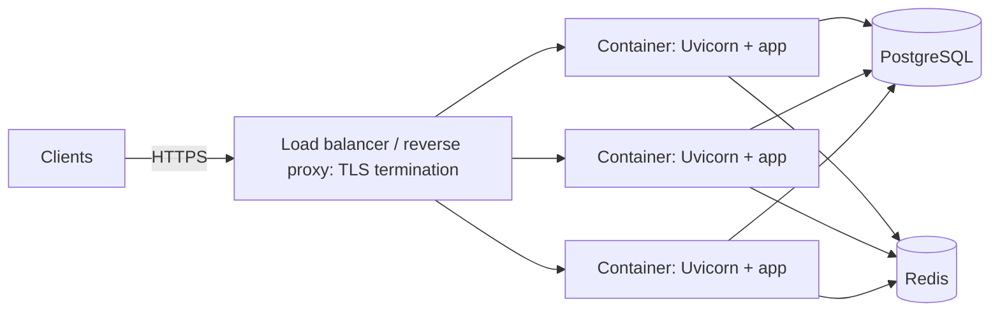

# Workers, Docker and running in production

> **Before this lesson:** you should know what Uvicorn does and what the lifespan is
> ([lesson 3](#/lesson/fastapi/asgi-stack), [lesson 11](#/lesson/fastapi/yield-deps)), how settings
> are read from environment variables ([lesson 9](#/lesson/fastapi/pydantic-settings)), what the
> event loop, the thread pool and the GIL are ([lesson 12](#/lesson/fastapi/async-fundamentals)), and
> what a database migration is ([lesson 17](#/lesson/fastapi/migrations-async-db)). Familiarity with
> typing commands in a terminal helps.

## In plain words

On your laptop you start the app with `fastapi dev main.py`, open the browser, and it works. That
single process, restarting itself whenever you save a file, is perfect for development and wrong for
real users. If it crashes, nobody restarts it. It uses one processor core while the machine has
eight. It speaks plain HTTP, so passwords cross the network readable by anyone in between. And it
runs on *your* machine, with *your* Python version and *your* installed packages.

Think of the difference between cooking dinner at home and running a restaurant. At home one cook
does everything. A restaurant has several cooks working at once (**worker processes**), a host at
the door who seats guests at whichever table is free (a **load balancer**), a manager who replaces a
cook who falls ill (a **supervisor**), a locked door for deliveries (**HTTPS**), and ingredients that
arrive in standard sealed containers so every kitchen gets exactly the same thing (**Docker**). This
lesson builds the restaurant.

Lubanovic's production chapter lists what a single development server is missing: something to keep
it running, something to gather incoming requests and hand them out, HTTPS, and the use of every
core. The official FastAPI deployment guide frames the same needs as a list of *concepts*: security
(HTTPS), running on startup, restarts, replication, memory, and the steps that must happen before
the app starts. This lesson covers each one, with Docker as the packaging.

Why this matters for a job: "How would you deploy this?" follows almost every system-design or
backend interview, and a service that is correct but falls over under load, or cannot be shut down
cleanly, is not finished work.

## The production topology

Here is the shape almost every deployed API takes:



Read it from left to right.

- **Clients** connect with **HTTPS**, which is HTTP inside an encrypted channel called **TLS**
  (Transport Layer Security). TLS needs a **certificate**, a file that proves the server owns its
  domain name. Certificates used to cost money; today Let's Encrypt issues them free and
  automatically.
- The **load balancer / reverse proxy** (nginx, Traefik, Caddy, a cloud load balancer, a Kubernetes
  ingress) holds the certificate and decrypts the traffic. That job is called **TLS termination**.
  It then forwards plain HTTP over the private network to one of the app copies, spreading the load.
- **Several app processes**, here each in its own container, share the work and survive one of them
  crashing.
- **State lives outside** the app processes: data in PostgreSQL, caches and counters in Redis, files
  in object storage. A process that keeps nothing important in its own memory is called
  **stateless**. Because of that, any copy can serve any request, and copies can be added, removed
  or replaced at any moment.

## Processes and workers

A **process** is a running program with its own private memory. A **core** is one of the
processor's independent execution units; a typical server has 4 to 64. Lesson 12 explained that
inside one Python process the **GIL** (global interpreter lock) lets only one thread execute Python
code at a time, so one process uses roughly one core for Python work. To use a machine with several
cores you run several **worker processes**, each a complete copy of your app. Each worker has its
own event loop, its own memory (so its own copy of your ML model), and its own database connection
pool.

```bash
fastapi run --workers 4 main.py
uvicorn main:app --host 0.0.0.0 --port 8000 --workers 4
```

Both commands start four workers. `main:app` means "the object called `app` in the file `main.py`",
`--host 0.0.0.0` means "accept connections on every network interface of this machine", and
`--port 8000` is the port number to listen on. With `--workers`, Uvicorn starts a parent process that
creates the four worker processes and hands incoming connections to them.

The book, written a little earlier, shows the then-standard recipe: **Gunicorn** as the process
manager, running Uvicorn workers.

```bash
gunicorn main:app --workers 4 --worker-class uvicorn.workers.UvicornWorker --bind 0.0.0.0:8000
```

Gunicorn on its own is a WSGI server (lesson 3), so it cannot run an ASGI app directly; the
`--worker-class` option tells it to use Uvicorn's worker type, which speaks ASGI. At the time, the
book noted, Uvicorn's own `--workers` did not supervise its workers, so Gunicorn was preferred. Since
Uvicorn 0.30 (2024) the built-in manager restarts workers that die, and the current official docs use
it directly. You will still meet the Gunicorn form in many codebases; its worker class now lives in a
separate package called `uvicorn-worker`. Gunicorn's own documentation suggests that a handful of
workers, roughly 4 to 12, is enough for hundreds or thousands of requests per second.

### Everything per process is multiplied

The most common surprise with workers is that anything kept in a process's memory exists once *per
worker*. Here four workers each run an in-memory rate limiter of 10 requests per client, and the
load balancer sends requests to them in turn:

```python-run
class Worker:
    """One worker process with its own private memory."""
    def __init__(self, name, limit):
        self.name, self.limit, self.count = name, limit, {}
    def handle(self, client):
        self.count[client] = self.count.get(client, 0) + 1
        return 200 if self.count[client] <= self.limit else 429

for n_workers in (1, 4):
    workers = [Worker(f"w{i}", limit=10) for i in range(n_workers)]
    statuses = [workers[i % n_workers].handle("ann") for i in range(50)]   # round-robin
    print(f"{n_workers} worker(s), limit 10 per minute -> ann got {statuses.count(200)} requests through")
```

- `Worker` keeps a dictionary `count` in its own memory, like a real process would.
- `handle` adds one to the client's count and answers `200` while the count is within the limit,
  `429 Too Many Requests` after that.
- `workers[i % n_workers]` sends request number `i` to the workers in turn (0, 1, 2, 3, 0, 1, ...),
  which is called **round-robin**.

The output: with 1 worker, Ann gets 10 requests through; with 4 workers she gets **40**. Each worker
saw only a quarter of her requests and never reached its limit. The same multiplication applies to
in-memory caches (four separate caches, each with its own misses), database pools (four pools of 15
connections is 60 connections), scheduled jobs (each worker runs its own copy, so the nightly email
goes out four times) and models (four copies in memory). Shared state belongs in Redis or the
database (lessons 18 and 20).

### How many workers?

- **An I/O-bound async app**, one that mostly waits on databases and other services: about one
  worker per CPU core.
- **CPU-bound synchronous work** such as running a model on the CPU: one per core as well; more
  workers only make them fight over the same cores.
- **Memory is usually the limit for ML services.** Four workers each holding a 3 GB model need 12 GB.
  Loading the model before the workers are created can share memory pages between processes through
  *copy-on-write* (the operating system shares a page until someone writes to it), but in practice
  Python's reference counting writes to objects constantly, so the sharing fades over time.
- Multiply every per-process quantity by the worker count, as the demo showed.

### One process per container

A **container** is a packaged, isolated process with its own file system, created from an image
(next section). An **orchestrator** is a system that runs containers across many machines for you;
**Kubernetes** is the best known. Lubanovic sums up its spirit well: you describe what you want ("three
copies of this service, always"), and it works out how.

In Kubernetes or any orchestrator that replicates containers, the official docs recommend **a single
Uvicorn process per container**, without `--workers`. The orchestrator already restarts crashed
containers, spreads them over machines, adds copies under load (**autoscaling**) and measures memory
and CPU per container. A process manager inside the container duplicates that work, and worse, hides
crashes from the orchestrator, which only sees the container. Use `--workers` on a single virtual
machine or a simple Docker Compose host, where nothing else replicates for you.

## The Docker image

**Docker** packages an application together with everything it needs to run: the operating-system
files, the Python interpreter, the installed packages and your code. The package is an **image**; a
running instance of an image is a **container**. Because the image carries its own Python and its own
packages, it runs the same way on your laptop, in the test pipeline and in production, which removes
the classic "but it works on my machine". Unlike a virtual machine, a container does not emulate a
whole computer; it shares the host's operating-system kernel and is isolated from other containers,
which makes it fast to start and light on memory.

You describe an image in a text file called a **Dockerfile**:

```dockerfile
FROM python:3.13-slim

WORKDIR /code

# 1. dependencies first: this layer is cached until requirements.txt changes
COPY ./requirements.txt /code/requirements.txt
RUN pip install --no-cache-dir --upgrade -r /code/requirements.txt

# 2. application code last: changes here don't invalidate the dependency layer
COPY ./app /code/app

# exec form, so the server is PID 1 and receives SIGTERM for graceful shutdown
CMD ["fastapi", "run", "app/main.py", "--port", "80", "--proxy-headers"]
```

Line by line:

- `FROM python:3.13-slim` starts from a **base image**: a small Linux system with Python 3.13
  already installed. `slim` variants leave out compilers and documentation to stay small.
- `WORKDIR /code` makes `/code` the current folder for the following instructions.
- `COPY ./requirements.txt /code/requirements.txt` copies only the list of required packages into the
  image.
- `RUN pip install ...` runs a command during the build, here installing the packages.
  `--no-cache-dir` stops pip keeping its download cache, which would only make the image bigger.
- `COPY ./app /code/app` copies your application code.
- `CMD [...]` is the command a container runs when it starts.

This follows the official FastAPI image recipe; the book reproduces its earlier version, which
started `uvicorn` directly.

### Layer caching: why the order matters

Each instruction produces a **layer**, a saved snapshot of the changes it made. When you rebuild,
Docker reuses a saved layer if the instruction *and everything it depends on* are unchanged: the
layers before it and, for a `COPY`, the content of the files copied. Once one layer changes, every
layer after it must be rebuilt. The simulation below compares two orders after you edit one line of
Python:

```python-run
import hashlib

def build(steps, files, cache):
    """Rebuild a step only if its cache key is new. key = previous key + instruction + copied files."""
    key, rebuilt = "", []
    for step in steps:
        copied = step.split()[1:-1] if step.startswith("COPY") else []
        content = "".join(files[name] for name in copied)
        key = hashlib.sha256((key + step + content).encode()).hexdigest()
        if key not in cache:
            rebuilt.append(step)
            cache.add(key)
    return rebuilt

good = ["FROM python:3.13-slim", "COPY requirements.txt .", "RUN pip install -r requirements.txt",
        "COPY app ./app", 'CMD ["fastapi", "run", "app/main.py"]']
bad = ["FROM python:3.13-slim", "COPY app ./app", "COPY requirements.txt .",
       "RUN pip install -r requirements.txt", 'CMD ["fastapi", "run", "app/main.py"]']

for name, steps in [("dependencies first", good), ("code first", bad)]:
    cache = set()
    files = {"requirements.txt": "fastapi==0.115.0", "app": "version 1 of the code"}
    build(steps, files, cache)                        # first build: everything runs
    files["app"] = "version 2 of the code"           # you edit one line of Python
    rebuilt = build(steps, files, cache)
    slow = any(s.startswith("RUN pip") for s in rebuilt)
    print(f"{name:18} -> rebuilt {len(rebuilt)} steps, reinstall packages: {slow}")
    for s in rebuilt:
        print("     ", s)
```

- `build` walks the steps. Each step's cache key is a hash (lesson 19) of the previous key, the
  instruction text and, for `COPY`, the content of the copied files. Chaining the previous key in is
  what makes "one change invalidates everything after it" happen.
- If the key has been seen before, the step is reused; otherwise it is "rebuilt" and remembered.
- Each order is built once, then the code changes and it is built again.

With dependencies first, the second build reruns only 2 steps (`COPY app` and `CMD`), and packages
are not reinstalled. With code first, the changed code invalidates the `COPY app` layer and therefore
everything after it, so 4 steps rerun, including `pip install`. On a real project that is the
difference between a rebuild of a few seconds and one of several minutes, on every commit.

### Exec form, signals and PID 1

To stop a container, Docker and Kubernetes send it a **signal**, a short notification from the
operating system. `SIGTERM` means "please finish up and exit"; if the process is still alive after a
grace period, `SIGKILL` ends it immediately, with no chance to clean up. The signal goes to the
container's first process, which has process ID 1 (**PID 1**).

`CMD` can be written two ways:

- **Exec form**, `CMD ["fastapi", "run", ...]`: Docker starts `fastapi` directly, so it is PID 1 and
  receives `SIGTERM`. Uvicorn then shuts down gracefully (described below).
- **Shell form**, `CMD fastapi run ...`: Docker starts a shell (`/bin/sh`) as PID 1, and the shell
  starts `fastapi`. The shell does not pass `SIGTERM` on. Your server never hears the request to stop,
  lifespan clean-up never runs, and requests in progress are cut off when `SIGKILL` arrives.

Two more options in that `CMD`:

- **`--proxy-headers`** tells Uvicorn to trust the `X-Forwarded-For` and `X-Forwarded-Proto` headers
  added by the proxy in front of it. Without it, the app thinks every request comes from the proxy's
  address over plain `http`, so client IPs in logs and rate limits are wrong, and redirect URLs it
  generates start with `http://`. Restrict which proxies are trusted with `--forwarded-allow-ips`.
- **Binding to `0.0.0.0`** (which `fastapi run` does by default) is required inside a container.
  `127.0.0.1` means "only this container itself", so nothing outside could connect.

### Hardening and hygiene

A more careful version of the same image:

```dockerfile
FROM python:3.13-slim AS runtime
ENV PYTHONUNBUFFERED=1 PYTHONDONTWRITEBYTECODE=1
RUN useradd --create-home --uid 10001 app          # don't run as root
WORKDIR /code
COPY requirements.txt .
RUN pip install --no-cache-dir -r requirements.txt
COPY ./app ./app
USER app
EXPOSE 8000
CMD ["fastapi", "run", "app/main.py", "--port", "8000", "--proxy-headers"]
```

- `ENV PYTHONUNBUFFERED=1` makes Python write output immediately instead of holding it in a buffer,
  so log lines appear at once (and are not lost if the process dies). `PYTHONDONTWRITEBYTECODE=1`
  stops Python creating `.pyc` cache files inside the image.
- `useradd` creates an ordinary user and `USER app` switches to it. A process running as the
  all-powerful `root` user would give an attacker who breaks into the app much more to work with.
- `EXPOSE 8000` documents which port the app listens on.

And the habits that go with it:

- **Pin dependency versions** in a lock file (`uv lock`, `pip-compile`, Poetry) so that every build
  installs exactly the same packages.
- Add a **`.dockerignore`** file listing what must not be copied in: `.git`, `.venv`, `__pycache__`,
  `.env`, tests, data files. The build is faster and no secrets leak into the image.
- **Never put secrets or a `.env` file into the image.** Anyone who can pull the image can read
  them. Inject configuration as environment variables when the container starts (lesson 9): one
  image, many environments.
- **Multi-stage builds** when you need compilers: build the packages in a large first stage, then
  copy only the results into a slim final stage.
- **For ML**: do not bake multi-gigabyte model files into the app image if they change on their own
  schedule; download them from a model registry or object storage at startup, or mount a volume. Use
  a GPU base image and pin the CUDA and framework versions when you need a GPU.

Building and running:

```bash
docker build -t myapi:1.4.0 .
docker run --rm -p 8000:8000 --env-file .env myapi:1.4.0
```

`docker build -t myapi:1.4.0 .` builds the Dockerfile in the current folder (`.`) and **tags** the
image with a name and version. `docker run` starts a container from it: `--rm` deletes the container
when it stops, `-p 8000:8000` connects port 8000 of your machine to port 8000 of the container, and
`--env-file .env` passes the variables in a local file as environment variables, at run time rather
than build time.

## Startup, shutdown and "previous steps"

- **Before starting**: run database migrations as a separate one-off step (a job or an init
  container), not inside each copy of the app. Ten replicas starting together would otherwise race
  to apply the same migration.
- **Startup** (the lifespan): create connection pools, load models, warm caches. Report **not ready**
  until this is done (lesson 26 covers readiness checks).
- **Graceful shutdown**: on `SIGTERM`, Uvicorn stops accepting new connections, lets requests in
  progress finish (for up to `--timeout-graceful-shutdown` seconds), then runs the lifespan's shutdown
  code. Orchestrators send `SIGTERM`, wait a grace period (30 seconds by default in Kubernetes), then
  send `SIGKILL`; keep your shutdown well inside that window.
- **Rolling deploys**: new copies start and pass their readiness checks before old ones are stopped,
  so there is no moment with nothing serving. Old and new versions run side by side for a while,
  which is why database schema changes must work with both (lesson 17).

A simulation of graceful shutdown: stop accepting, drain, then clean up.

```python-run
import asyncio

async def handle(i, duration, log):
    await asyncio.sleep(duration)
    log.append(f"request {i} completed")

async def server(log, grace=0.2):
    in_flight = {asyncio.create_task(handle(i, d, log)) for i, d in enumerate([0.05, 0.1, 0.5])}
    await asyncio.sleep(0.02)
    log.append("SIGTERM received: stop accepting new connections")
    done, pending = await asyncio.wait(in_flight, timeout=grace)       # drain
    for t in pending:
        t.cancel()                                                     # grace period exceeded
        log.append("request cancelled after grace period")
    log.append("lifespan shutdown: close DB pool, flush logs")

log = []
await server(log)
print("\n".join(log))
```

- `handle` stands for a request that takes `duration` seconds.
- `server` starts three requests lasting 0.05, 0.1 and 0.5 seconds, each as a task. After 0.02
  seconds the "SIGTERM" arrives.
- `asyncio.wait(in_flight, timeout=grace)` waits up to 0.2 seconds for the tasks and returns two sets:
  those that finished (`done`) and those still running (`pending`). That is the **draining** period.
- Anything still pending is cancelled, and finally the lifespan clean-up runs.

The output is five lines: the SIGTERM line, `request 0 completed`, `request 1 completed`, one
`request cancelled after grace period` (the 0.5-second request did not fit in the 0.2-second
window), and the clean-up line. The two short requests were not cut off, which is the whole point.

## Performance: where the time goes

Lubanovic splits performance into two questions: how long *one* request takes, and how *many*
requests can be handled at the same time. His list of levers, extended and roughly in the order to
pull them:

1. **Measure first.** Look at latency **percentiles** per endpoint (p95 is the time that 95% of
   requests beat; lesson 26), use a **profiler** (a tool that shows where a program spends its time,
   such as `py-spy` or `pyinstrument`) and the database's query log. The bottleneck is usually the
   database or another service, rarely FastAPI.
2. **Async correctness.** No blocking calls on the event loop; run independent I/O concurrently
   with `gather` or `TaskGroup` (lesson 12).
3. **The database.** A missing **index** (a lookup structure that lets the database find rows
   without scanning the whole table) is one of the most common causes of a slow site; the book notes
   that the problem often appears only once a table grows large. Fix N+1 query patterns, select only
   the columns you need, paginate, size the connection pool.
4. **Caching**: HTTP caching, Redis, `functools.lru_cache` for hot reference data (lesson 18).
5. **Queues**: move anything slower than a fraction of a second, such as sending email or resizing
   images, off the request path (lesson 13).
6. **Payloads**: smaller responses, compression (`GZipMiddleware` or at the proxy), streaming for
   large files.
7. **Python itself**: newer CPython versions are measurably faster; `uvloop` and `httptools` come
   with `uvicorn[standard]`; hot loops can move to compiled code.
8. **Scale out**: more replicas. This works only if the app is stateless and the database can take
   the extra load.

Estimating capacity on the back of an envelope is a useful interview skill. The rule underneath is
simple: if you have a number of **slots** (things that can each handle one request at a time) and
each request holds a slot for a certain time, then throughput is at most slots divided by time.

```python-run
def capacity(workers, concurrency_per_worker, avg_latency_s):
    """Max throughput ~ concurrent slots / time each request holds a slot."""
    return workers * concurrency_per_worker / avg_latency_s

# CPU-bound sync inference: one request at a time per worker, 80 ms each
print("CPU inference, 4 workers       :", round(capacity(4, 1, 0.080)), "req/s")
# I/O-bound sync endpoints: 40 threadpool slots per worker, 50 ms DB time each
print("sync I/O, 4 workers x 40 thr   :", round(capacity(4, 40, 0.050)), "req/s (if the DB pool allows)")
# ...but a DB pool of 15 connections per worker is the real limit
print("limited by DB pool 4 x 15      :", round(capacity(4, 15, 0.050)), "req/s")
# async I/O: hundreds of in-flight requests per worker
print("async I/O, 4 workers x 500     :", round(capacity(4, 500, 0.050)), "req/s (upstream permitting)")
```

The four lines print 50, 3,200, 1,200 and 40,000 requests per second. Four CPU-bound workers, each
busy for 80 ms per request, manage 4 / 0.08 = 50 per second. Forty threads per worker would allow
3,200, *but* each request also needs a database connection and there are only 15 per worker, so the
real ceiling is 1,200. The slowest-to-free, scarcest resource sets the limit, which is why "add async"
or "add workers" often changes nothing: the bottleneck was somewhere else.

## Deployment options at a glance

| Option | You manage | Good for |
|---|---|---|
| VM + systemd + nginx/Caddy | everything | small projects, full control |
| Docker Compose on a VM | containers, proxy | small teams, one host |
| PaaS / serverless containers (Cloud Run, Fly.io, Render, Railway, Azure Container Apps, FastAPI Cloud) | the image or code | most APIs; autoscaling and HTTPS included |
| Kubernetes | manifests, cluster | many services, fine-grained control |
| Functions (AWS Lambda + an adapter such as Mangum) | a handler | spiky, low-traffic APIs; mind cold starts and no long-lived connections |

A few terms from the table. A **VM** (virtual machine) is a rented, emulated computer. **systemd** is
the Linux service manager that starts programs at boot and restarts them when they die. A **PaaS**
(platform as a service) runs your image or code and handles servers, HTTPS and scaling for you.
**Serverless** means you never see a server at all and pay per request; a **cold start** is the
delay when the platform has to start a fresh copy for a request. The book lists similar paths (cloud
services, Kubernetes) and points to the official docs for the details.

> [!INTERVIEW]
> "How would you deploy a FastAPI app to production?" — Package it as a Docker image (slim base,
> dependencies layer before code, non-root user, exec-form CMD running `fastapi run`/Uvicorn on 0.0.0.0
> with `--proxy-headers`). Run multiple replicas behind a load balancer that terminates TLS; in Kubernetes
> one process per container with replication, probes and resource limits handled by the cluster; on a
> single host use `--workers` (or Gunicorn + Uvicorn workers). Config and secrets via environment;
> migrations as a pre-deploy step; lifespan for startup/shutdown; graceful shutdown on SIGTERM; health
> endpoints; logs to stdout; metrics and tracing.

## Pitfalls

- Shell-form `CMD`, so no graceful shutdown.
- `--reload` or `fastapi dev` in production.
- Copying the code before installing dependencies, so every commit reinstalls everything.
- `--workers 8` inside each of 10 Kubernetes pods: 80 model copies and 80 database pools.
- Missing `--proxy-headers`: wrong client IPs and `http://` redirect URLs behind an HTTPS proxy.
- Keeping uploads, sessions, rate-limit counters or caches on the container's disk or in process
  memory.
- Secrets in the image or in `ENV` instructions.
- Running migrations from every replica at startup.

## Summary

- Production needs HTTPS termination, process supervision and restarts, replication, startup steps
  and bounded memory.
- Workers are processes; each has its own event loop, memory and pools, so per-process state is
  multiplied. On a single VM use `--workers`; under an orchestrator run one process per container.
- A Docker image needs a cache-friendly layer order, an exec-form `CMD`, a non-root user and
  configuration from the environment.
- Shut down gracefully on `SIGTERM`; run migrations before, not during, startup.
- Tune by measuring: async correctness, database, caching, queues, then scale out. Capacity is set
  by the scarcest resource.

## Glossary

- **Process / worker process** — a running program with its own memory / one of several copies of
  the app serving requests.
- **Core** — one independent execution unit of a processor.
- **Supervisor (process manager)** — a program that starts processes and restarts them when they die.
- **TLS / HTTPS / certificate** — the encryption layer / HTTP over TLS / the file proving a server
  owns its domain.
- **TLS termination** — decrypting HTTPS at the proxy and forwarding plain HTTP inside the network.
- **Reverse proxy / load balancer** — a server in front of the app that forwards requests / spreads
  them across copies.
- **Stateless** — keeping nothing important in the process's own memory, so any copy can serve any
  request.
- **Round-robin** — handing requests to workers in turn.
- **Docker image / container** — the packaged app with its dependencies / a running instance of it.
- **Dockerfile / layer / base image** — the build recipe / the snapshot one instruction produces /
  the image you start from.
- **Layer caching** — reusing unchanged layers on rebuild.
- **Orchestrator / Kubernetes** — a system that runs and replicates containers across machines / the
  best-known one.
- **Replica** — one copy of a service.
- **Signal / SIGTERM / SIGKILL / PID 1** — an operating-system notification / "please stop" / "stop
  now" / the first process in a container, which receives the signals.
- **Exec form / shell form** — `CMD ["prog", "arg"]` runs the program directly / `CMD prog arg` runs
  it through a shell.
- **Graceful shutdown / draining** — finishing requests in progress before exiting / the period in
  which that happens.
- **Rolling deploy** — replacing copies a few at a time so the service never stops.
- **Profiler** — a tool that shows where a program spends its time.
- **Index** — a database lookup structure that avoids scanning the whole table.
- **PaaS / serverless / cold start** — a platform that runs your app for you / paying per request
  with no visible servers / the delay of starting a fresh copy.

```quiz
[
  {"q": "Why does a CPU-bound Python web app need multiple worker processes to use multiple cores?", "options": ["Uvicorn limits threads", "The GIL lets only one thread run Python bytecode at a time within a process", "Docker restricts cores", "ASGI forbids threads"], "answer": 1,
   "explain": "Parallelism for Python code comes from separate processes, each with its own interpreter and GIL."},
  {"q": "In Kubernetes, what do the FastAPI docs recommend?", "options": ["Gunicorn with 2xCPU+1 workers in each pod", "A single Uvicorn process per container, with replication handled by the cluster", "One pod with 32 workers", "Running without containers"], "answer": 1,
   "explain": "The orchestrator already handles restarts, replication and scaling; an in-container process manager duplicates that."},
  {"q": "Why install requirements before copying the application code in a Dockerfile?", "options": ["Python requires it", "So the dependency layer stays cached when only code changes", "To reduce image size", "For security scanning"], "answer": 1,
   "explain": "Docker invalidates a layer and all later ones when its inputs change; code changes far more often than dependencies."},
  {"q": "What goes wrong with the shell form 'CMD fastapi run app/main.py'?", "options": ["It can't find Python", "The shell becomes PID 1 and doesn't forward SIGTERM, so graceful shutdown and lifespan cleanup don't happen", "It disables HTTPS", "It runs as root"], "answer": 1,
   "explain": "Exec form makes the server PID 1 so it receives signals directly."},
  {"q": "What does --proxy-headers do?", "options": ["Adds CORS headers", "Makes Uvicorn trust X-Forwarded-* headers from the proxy for client IP and scheme", "Enables HTTP/2", "Compresses responses"], "answer": 1,
   "explain": "Behind a TLS-terminating proxy the app otherwise sees the proxy's IP and http scheme."},
  {"q": "4 workers each load a 2 GB model. Approximate memory needed for models?", "options": ["2 GB", "4 GB", "8 GB", "0.5 GB"], "answer": 2,
   "explain": "Each worker process holds its own copy, so memory multiplies by the worker count."},
  {"q": "Which statement about performance tuning is most accurate?", "options": ["Switching every endpoint to async def always speeds things up", "Measure first; the bottleneck is usually the database or an upstream, and throughput is capped by the scarcest resource", "More workers always help", "JSON serialisation is always the bottleneck"], "answer": 1,
   "explain": "Capacity is limited by the resource with the fewest slots (DB pool, CPU, upstream limits)."},
  {"q": "An in-memory rate limiter allows 10 requests per minute. The app runs 4 workers behind a round-robin balancer. Roughly how many requests can one client get through per minute?", "options": ["10", "About 40", "2.5", "Unlimited"], "answer": 1,
   "explain": "Each worker counts separately and sees a quarter of the requests; shared limits belong in Redis."}
]
```

> **Source:** Lubanovic, *FastAPI*, ch. 13 "Production" (Deployment, Multiple Workers, HTTPS, Docker, Cloud Services, Kubernetes, Performance); https://fastapi.tiangolo.com/deployment/concepts/, /deployment/server-workers/, /deployment/docker/, /deployment/https/, /deployment/manually/
