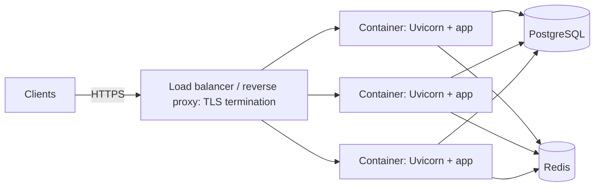

# Workers, Docker and running in production

`fastapi dev main.py` on your laptop and a service that survives real traffic are separated by a
checklist. Lubanovic's production chapter names what a single development server lacks: something to keep
it **running** (a supervisor), something to **gather and distribute** requests (a reverse proxy/load
balancer), **HTTPS** termination, and the use of **multiple cores**. The official deployment docs phrase
the same thing as concepts: security (HTTPS), running on startup, restarts, replication, memory, and
previous steps before starting. This lesson covers them, with Docker as the packaging.

## The production topology



- **TLS termination proxy** (nginx, Traefik, Caddy, a cloud load balancer, a Kubernetes ingress) owns the
  certificates — nowadays free and automatic via Let's Encrypt — and forwards plain HTTP to the app.
- **Several app processes** share the load and survive individual crashes.
- **State lives outside** the app processes (database, Redis, object storage), so any replica can serve
  any request and replicas can be added or replaced freely.

## Processes and workers

One Python process executes Python bytecode on one core at a time (GIL). To use a multi-core machine you
run several **worker processes**. Each worker has its own event loop, its own memory (its own copy of
your ML model!), its own DB pool.

```bash
fastapi run --workers 4 main.py
uvicorn main:app --host 0.0.0.0 --port 8000 --workers 4
```

Uvicorn's `--workers` starts a parent process that manages worker subprocesses and restarts dead ones.
The book, written a little earlier, shows the then-standard recipe: **Gunicorn** as process manager with
Uvicorn's worker class —

```bash
gunicorn main:app --workers 4 --worker-class uvicorn.workers.UvicornWorker --bind 0.0.0.0:8000
```

— because Gunicorn is a WSGI server by itself, it needs that special worker class to speak ASGI. You'll
still meet this in many codebases (the worker class now lives in the separate `uvicorn-worker` package),
but the current official docs simply use Uvicorn's built-in `--workers`.

How many workers?

- **I/O-bound async app**: about one per CPU core.
- **CPU-bound sync work** (inference on CPU): one per core too; more just adds contention.
- **Memory is usually the limit** for ML: 4 workers × a 3 GB model = 12 GB. (Loading the model *before*
  forking so pages are shared copy-on-write helps a little; in practice refcount updates un-share memory
  over time.)
- Multiply everything per-process by the worker count: DB connections, in-memory caches, rate-limit
  counters, background schedulers.

### One process per container

In Kubernetes or any orchestrator that replicates containers, the docs' recommendation is **a single
Uvicorn process per container** — no `--workers`. Let the orchestrator do the replication: it already
restarts crashed containers, spreads them over nodes, autoscales on load, and measures resources per
container. A process manager inside the container duplicates that and hides crashes from it. Use
`--workers` on a single VM or a simple Docker Compose host, where nothing else replicates for you.

## The Docker image

```dockerfile
FROM python:3.13-slim

WORKDIR /code

# 1. dependencies first: this layer is cached until requirements.txt changes
COPY ./requirements.txt /code/requirements.txt
RUN pip install --no-cache-dir --upgrade -r /code/requirements.txt

# 2. application code last: changes here don't invalidate the dependency layer
COPY ./app /code/app

# exec form, so the server is PID 1 and receives SIGTERM for graceful shutdown
CMD ["fastapi", "run", "app/main.py", "--port", "80", "--proxy-headers"]
```

This follows the official image recipe (the book reproduces its earlier `uvicorn`-based version). The
important ideas:

- **Layer caching.** Docker reuses unchanged layers. Copying `requirements.txt` and installing *before*
  copying the code means a code change rebuilds in seconds instead of reinstalling everything.
- **Exec form `CMD [...]`**, not the shell form `CMD fastapi run ...`. With the shell form, `/bin/sh` is
  PID 1 and doesn't forward signals, so `docker stop` can't trigger a graceful shutdown — lifespan
  shutdown code doesn't run and in-flight requests are killed after the timeout.
- **`--proxy-headers`** tells Uvicorn to trust `X-Forwarded-For`/`X-Forwarded-Proto` from the proxy in
  front, so `request.client.host` and generated URLs/redirects are right. (Restrict which proxies are
  trusted with `--forwarded-allow-ips`.)
- **Bind `0.0.0.0`** inside containers (`fastapi run` does by default); `127.0.0.1` is unreachable from
  outside the container.
- `--no-cache-dir` and a `slim` base keep the image small.

Hardening and hygiene:

```dockerfile
FROM python:3.13-slim AS runtime
ENV PYTHONUNBUFFERED=1 PYTHONDONTWRITEBYTECODE=1
RUN useradd --create-home --uid 10001 app          # don't run as root
WORKDIR /code
COPY requirements.txt .
RUN pip install --no-cache-dir -r requirements.txt
COPY ./app ./app
USER app
EXPOSE 8000
CMD ["fastapi", "run", "app/main.py", "--port", "8000", "--proxy-headers"]
```

- Pin dependency versions (a lock file: `uv lock`/`pip-compile`/Poetry) for reproducible builds.
- `.dockerignore`: `.git`, `.venv`, `__pycache__`, `.env`, tests, data — smaller context, no leaked
  secrets.
- **Never bake secrets or `.env` into the image**; inject configuration as environment variables at run
  time (settings lesson). One image, many environments.
- Multi-stage builds when you need compilers: build wheels in a fat stage, copy only the result into the
  slim runtime stage.
- For ML: don't bake multi-GB model weights into the app image if they change independently — pull from a
  model registry/object storage at startup, or mount a volume; do use a GPU base image and pin
  CUDA/framework versions when needed.

```bash
docker build -t myapi:1.4.0 .
docker run --rm -p 8000:8000 --env-file .env myapi:1.4.0
```

## Startup, shutdown and "previous steps"

- **Before starting**: run migrations as a separate one-off step (job/init container), not in each
  replica.
- **Startup** (lifespan): create pools, load models, warm caches. Report **not ready** until done.
- **Graceful shutdown**: on `SIGTERM` Uvicorn stops accepting connections, lets in-flight requests finish
  (`--timeout-graceful-shutdown`), then runs lifespan shutdown. Orchestrators send `SIGTERM`, wait a grace
  period, then `SIGKILL` — keep shutdown well inside it.
- **Rolling deploys**: new replicas start and pass readiness checks before old ones are drained. Old and
  new versions overlap, which is why schema changes must be backward-compatible.

A simulation of graceful shutdown semantics — stop accepting, drain, then clean up:

```python-run
import asyncio

async def handle(i, duration, log):
    await asyncio.sleep(duration)
    log.append(f"request {i} completed")

async def server(log, grace=0.2):
    in_flight = {asyncio.create_task(handle(i, d, log)) for i, d in enumerate([0.05, 0.1, 0.5])}
    await asyncio.sleep(0.02)
    log.append("SIGTERM received: stop accepting new connections")
    done, pending = await asyncio.wait(in_flight, timeout=grace)       # drain
    for t in pending:
        t.cancel()                                                     # grace period exceeded
        log.append("request cancelled after grace period")
    log.append("lifespan shutdown: close DB pool, flush logs")

log = []
await server(log)
print("\n".join(log))
```

## Performance: where the time goes

The book's performance section is a list of levers, in roughly the order to pull them:

1. **Measure first.** Per-endpoint latency percentiles (p50/p95/p99), profilers (`py-spy`, `pyinstrument`)
   and DB query logs find the real bottleneck — usually the database or an upstream call, rarely FastAPI.
2. **Async correctness.** No blocking calls on the event loop; concurrent I/O with `gather`/`TaskGroup`.
3. **Database.** Indexes, fixing N+1 queries, selecting only needed columns, pagination, pool sizing.
4. **Caching.** HTTP caching, Redis, in-process caches for hot reference data.
5. **Queues.** Move slow work off the request path.
6. **Payloads.** Smaller responses, compression (`GZipMiddleware` or at the proxy), faster JSON
   (Pydantic v2 already serialises in Rust; `ORJSONResponse` for huge dict payloads).
7. **Python itself.** Newer CPython versions are measurably faster; `uvloop` and `httptools` come with
   `uvicorn[standard]`.
8. **Scale out.** More replicas — only works if the app is stateless and the database can take it.

Back-of-envelope capacity estimation is a useful interview skill:

```python-run
def capacity(workers, concurrency_per_worker, avg_latency_s):
    """Max throughput ~ concurrent slots / time each request holds a slot."""
    return workers * concurrency_per_worker / avg_latency_s

# CPU-bound sync inference: one request at a time per worker, 80 ms each
print("CPU inference, 4 workers       :", round(capacity(4, 1, 0.080)), "req/s")
# I/O-bound sync endpoints: 40 threadpool slots per worker, 50 ms DB time each
print("sync I/O, 4 workers x 40 thr   :", round(capacity(4, 40, 0.050)), "req/s (if the DB pool allows)")
# ...but a DB pool of 15 connections per worker is the real limit
print("limited by DB pool 4 x 15      :", round(capacity(4, 15, 0.050)), "req/s")
# async I/O: hundreds of in-flight requests per worker
print("async I/O, 4 workers x 500     :", round(capacity(4, 500, 0.050)), "req/s (upstream permitting)")
```

The bottleneck is whichever resource has the fewest slots — a concrete illustration of why "just add
async" or "just add workers" often changes nothing.

## Deployment options at a glance

| Option | You manage | Good for |
|---|---|---|
| VM + systemd + nginx/Caddy | everything | small projects, full control |
| Docker Compose on a VM | containers, proxy | small teams, one host |
| PaaS / serverless containers (Cloud Run, Fly.io, Render, Railway, Azure Container Apps, FastAPI Cloud) | just the image/code | most APIs; autoscaling and HTTPS included |
| Kubernetes | manifests, cluster | many services, fine-grained control |
| Functions (AWS Lambda + adapter such as Mangum) | handler | spiky, low-traffic APIs; mind cold starts and no long-lived connections |

The book lists similar paths (cloud services, Kubernetes) and points to the official docs for specifics.

> [!INTERVIEW]
> "How would you deploy a FastAPI app to production?" — Package it as a Docker image (slim base,
> dependencies layer before code, non-root user, exec-form CMD running `fastapi run`/Uvicorn on 0.0.0.0
> with `--proxy-headers`). Run multiple replicas behind a load balancer that terminates TLS; in Kubernetes
> one process per container with replication, probes and resource limits handled by the cluster; on a
> single host use `--workers` (or Gunicorn + Uvicorn workers). Config and secrets via environment;
> migrations as a pre-deploy step; lifespan for startup/shutdown; graceful shutdown on SIGTERM; health
> endpoints; logs to stdout; metrics and tracing.

## Pitfalls

- Shell-form `CMD` → no graceful shutdown.
- `--reload` or `fastapi dev` in production.
- Copying code before installing dependencies → slow builds every commit.
- `--workers 8` inside each of 10 Kubernetes pods → 80 model copies and 80 DB pools.
- Missing `--proxy-headers` → wrong client IPs, `http://` redirect URLs behind an HTTPS proxy.
- Storing uploads, sessions or caches on the container filesystem or in process memory.
- Secrets in the image or in `ENV` instructions.

## Summary

- Production needs: HTTPS termination, process supervision/restarts, replication, startup steps,
  bounded memory.
- Workers = processes; each has its own loop, memory and pools. Single VM → `--workers`; orchestrator →
  one process per container.
- Docker image: cache-friendly layer order, exec-form CMD, non-root, config from the environment.
- Tune by measuring: async correctness, database, caching, queues — then scale out.

```quiz
[
  {"q": "Why does a CPU-bound Python web app need multiple worker processes to use multiple cores?", "options": ["Uvicorn limits threads", "The GIL lets only one thread run Python bytecode at a time within a process", "Docker restricts cores", "ASGI forbids threads"], "answer": 1,
   "explain": "Parallelism for Python code comes from separate processes, each with its own interpreter and GIL."},
  {"q": "In Kubernetes, what do the FastAPI docs recommend?", "options": ["Gunicorn with 2xCPU+1 workers in each pod", "A single Uvicorn process per container, with replication handled by the cluster", "One pod with 32 workers", "Running without containers"], "answer": 1,
   "explain": "The orchestrator already handles restarts, replication and scaling; an in-container process manager duplicates that."},
  {"q": "Why install requirements before copying the application code in a Dockerfile?", "options": ["Python requires it", "So the dependency layer stays cached when only code changes", "To reduce image size", "For security scanning"], "answer": 1,
   "explain": "Docker invalidates a layer and all later ones when its inputs change; code changes far more often than dependencies."},
  {"q": "What goes wrong with the shell form 'CMD fastapi run app/main.py'?", "options": ["It can't find Python", "The shell becomes PID 1 and doesn't forward SIGTERM, so graceful shutdown and lifespan cleanup don't happen", "It disables HTTPS", "It runs as root"], "answer": 1,
   "explain": "Exec form makes the server PID 1 so it receives signals directly."},
  {"q": "What does --proxy-headers do?", "options": ["Adds CORS headers", "Makes Uvicorn trust X-Forwarded-* headers from the proxy for client IP and scheme", "Enables HTTP/2", "Compresses responses"], "answer": 1,
   "explain": "Behind a TLS-terminating proxy the app otherwise sees the proxy's IP and http scheme."},
  {"q": "4 workers each load a 2 GB model. Approximate memory needed for models?", "options": ["2 GB", "4 GB", "8 GB", "0.5 GB"], "answer": 2,
   "explain": "Each worker process holds its own copy, so memory multiplies by the worker count."},
  {"q": "Which statement about performance tuning is most accurate?", "options": ["Switching every endpoint to async def always speeds things up", "Measure first; the bottleneck is usually the database or an upstream, and throughput is capped by the scarcest resource", "More workers always help", "JSON serialisation is always the bottleneck"], "answer": 1,
   "explain": "Capacity is limited by the resource with the fewest slots (DB pool, CPU, upstream limits)."}
]
```

> **Source:** Lubanovic, *FastAPI*, ch. 13 "Production" (Deployment, Multiple Workers, HTTPS, Docker, Cloud Services, Kubernetes, Performance); https://fastapi.tiangolo.com/deployment/concepts/, /deployment/server-workers/, /deployment/docker/, /deployment/https/, /deployment/manually/
