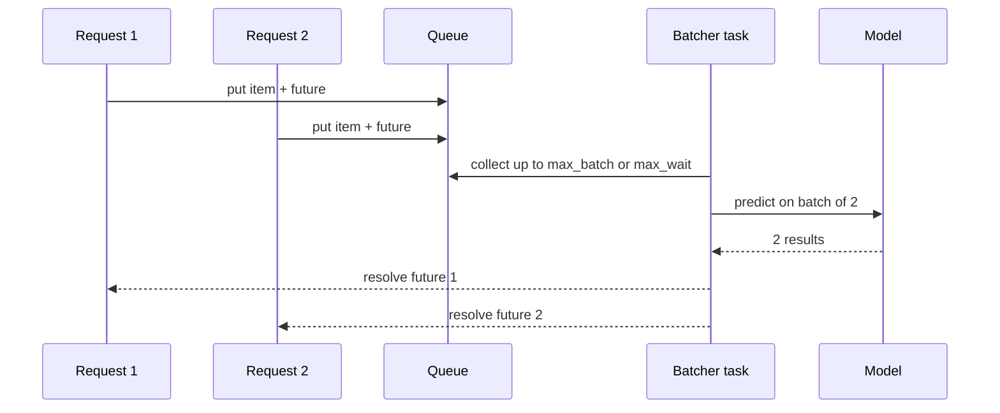

# Serving an ML model with FastAPI

FastAPI has become the default way to put a Python model behind an HTTP API: the model already lives in
Python, Pydantic gives you a typed input contract, async handles many waiting clients, and OpenAPI
documents the result. Lubanovic's "Data Science and AI" section shows the minimal version — a text
generation model wrapped in one endpoint. This lesson builds the *production* version piece by piece:
loading the model once, typing inputs and outputs, running inference without freezing the server, and
batching.

## The serving problem

A model server is a web service with unusual properties:

| Property | Consequence |
|---|---|
| The model is **large and slow to load** (seconds to minutes, MBs to GBs) | load once per process at startup — never per request |
| Inference is **CPU/GPU-bound** | it must not run on the event loop; concurrency ≠ throughput |
| Hardware prefers **batches** | grouping requests multiplies throughput |
| Inputs come from untrusted clients | strict validation and size limits protect memory and GPU |
| Models **change** independently of code | version everything; make rollbacks trivial |
| Outputs are probabilistic | monitor predictions and inputs, not just HTTP status |

## Load the model in the lifespan

```python
from contextlib import asynccontextmanager
from fastapi import FastAPI
import joblib

ml = {}                                         # or use app.state

@asynccontextmanager
async def lifespan(app: FastAPI):
    # --- startup: runs once per worker process, before any request is served ---
    ml["model"] = joblib.load(settings.model_path)
    ml["version"] = settings.model_version
    ml["model"].predict(WARMUP_BATCH)           # warm-up: first call is often much slower
    yield
    # --- shutdown ---
    ml.clear()

app = FastAPI(lifespan=lifespan)
```

Why lifespan rather than a module-level global or loading lazily on first request?

- **Not at import time**: importing the module (in tests, in tooling, by the reloader) shouldn't load 2 GB.
- **Not lazily in the endpoint**: the first user would wait for the load (and concurrent first requests
  might each trigger it). With lifespan, the server doesn't accept traffic until the model is ready, and
  the readiness probe can say so.
- **Cleanup**: GPU memory, thread pools and temp files are released on shutdown.
- **Per process**: with N workers, each loads its own copy — budget memory accordingly.

Expose it to endpoints through a dependency so tests can override it with a fake:

```python
def get_model(request: Request):
    model = getattr(request.app.state, "model", None)
    if model is None:
        raise HTTPException(status_code=503, detail="Model not loaded")
    return model

ModelDep = Annotated[Model, Depends(get_model)]
```

> [!WARNING]
> `pickle`/`joblib` files execute arbitrary code when loaded. Only load model artefacts from sources you
> control, verify checksums, and prefer safer formats (ONNX, `safetensors`) where available.

## A typed contract with Pydantic

The request schema is your first line of defence and your documentation:

```python-run
from typing import Literal
from pydantic import BaseModel, ConfigDict, Field, ValidationError, model_validator

class HouseFeatures(BaseModel):
    model_config = ConfigDict(extra="forbid")            # typo'd feature names are errors, not silence
    sqft: float = Field(gt=0, le=50_000, description="Living area in square feet")
    bedrooms: int = Field(ge=0, le=20)
    bathrooms: float = Field(ge=0, le=20)
    year_built: int = Field(ge=1800, le=2100)
    city: Literal["Austin", "Boston", "Denver"]

    @model_validator(mode="after")
    def plausible(self):
        if self.bedrooms > 0 and self.sqft / self.bedrooms < 50:
            raise ValueError("implausible sqft per bedroom")
        return self

class PredictRequest(BaseModel):
    instances: list[HouseFeatures] = Field(min_length=1, max_length=256)   # cap the batch size!

class Prediction(BaseModel):
    price: float
    lower: float
    upper: float

class PredictResponse(BaseModel):
    model_config = ConfigDict(protected_namespaces=())   # allow field names starting with "model_"
    predictions: list[Prediction]
    model_version: str

ok = PredictRequest.model_validate({"instances": [
    {"sqft": 1450, "bedrooms": 3, "bathrooms": 2, "year_built": 1999, "city": "Austin"}]})
print(ok.instances[0])

bad = {"instances": [{"sqft": -5, "bedrooms": 3, "bathrooms": 2, "year_built": 1999,
                      "city": "Paris", "sqfeet": 1}]}
try:
    PredictRequest.model_validate(bad)
except ValidationError as e:
    for err in e.errors():
        print(["body", *err["loc"]], err["type"])
```

Design points:

- **Bound everything**: list lengths, string lengths, numeric ranges, image dimensions. An unbounded
  `list[float]` is a denial-of-service vector — one request can allocate gigabytes.
- **`extra="forbid"`** catches the most insidious serving bug: a client sends `sqfeet`, the model silently
  uses a default for `sqft`, and predictions are quietly wrong.
- **Validation ≠ preprocessing parity.** The schema checks shape; you must also apply the *same*
  feature engineering as in training (training–serving skew). Ship preprocessing inside the model artefact
  (an sklearn `Pipeline`, a TorchScript/ONNX graph) rather than re-implementing it in the API.
- Return the **model version** with every prediction so results are traceable and debuggable.
- Pydantic warns about field names beginning with `model_` (its own namespace); configure
  `protected_namespaces=()` as above when you want `model_version`.

## Inference without blocking the event loop

Inference is CPU- or GPU-bound and synchronous. Applying the async module's rule:

```python
# Option 1: a plain def endpoint - FastAPI runs it in the thread pool
@app.post("/v1/predict")
def predict(req: PredictRequest, model: ModelDep) -> PredictResponse:
    X = to_matrix(req.instances)
    y = model.predict(X)                       # NumPy/sklearn/PyTorch release the GIL in native code
    return PredictResponse(predictions=to_predictions(y), model_version=model.version)

# Option 2: async def endpoint that offloads explicitly (needed when you also await other things)
@app.post("/v1/predict")
async def predict(req: PredictRequest, request: Request) -> PredictResponse:
    features = await fetch_extra_features(req)                     # async I/O
    async with request.app.state.inference_sem:                    # bound concurrent inferences
        y = await run_in_threadpool(model.predict, to_matrix(req.instances, features))
    return PredictResponse(...)
```

The one thing never to write is `async def` with a direct `model.predict(...)` call: it freezes the
worker's loop for the duration of every inference — health checks time out, other requests queue
invisibly.

Further considerations:

- **Thread oversubscription.** NumPy/BLAS and PyTorch each use their own thread pools. Forty FastAPI
  threads × eight BLAS threads thrash the CPU. Limit concurrent inferences with a semaphore and set
  `OMP_NUM_THREADS`/`torch.set_num_threads` deliberately.
- **GPU.** One GPU effectively runs one batch at a time. Guard it with a semaphore or — better — a
  batching queue (below). Use `torch.inference_mode()` and keep the model in `eval()`.
- **Pure-Python CPU work** (tokenisation loops, feature code) holds the GIL: threads don't help; use
  multiple worker processes.
- **Heavy models** often deserve a dedicated model server (Triton, TorchServe, vLLM, TGI, Ray Serve,
  BentoML) with FastAPI as the thin API layer in front handling auth, validation, business logic and
  fan-out via async HTTP/gRPC. Then the endpoint *is* I/O-bound and `async def` shines.

## Batching

### Client-side batches

The simplest win is to accept a list (`instances`) and run one vectorised `predict` call — orders of
magnitude faster than a Python loop of single predictions.

### Dynamic (micro-)batching

Clients usually send single items. **Dynamic batching** groups requests that arrive within a few
milliseconds of each other into one model call: each request is put on a queue with a future; a background
task collects up to `max_batch` items or waits at most `max_wait`, runs the model once, and resolves each
future.



A complete, runnable implementation:

```python-run
import asyncio, time

class MicroBatcher:
    def __init__(self, predict_batch, max_batch=8, max_wait=0.01, max_queue=1000):
        self.predict_batch, self.max_batch, self.max_wait = predict_batch, max_batch, max_wait
        self.queue = asyncio.Queue(maxsize=max_queue)        # bounded -> backpressure
        self.batch_sizes = []

    async def submit(self, item):
        fut = asyncio.get_running_loop().create_future()
        self.queue.put_nowait((item, fut))                   # QueueFull -> respond 503
        return await fut

    async def run(self):                                     # started in lifespan
        while True:
            item, fut = await self.queue.get()               # wait for the first request
            batch, deadline = [(item, fut)], time.monotonic() + self.max_wait
            while len(batch) < self.max_batch:
                timeout = deadline - time.monotonic()
                if timeout <= 0:
                    break
                try:
                    batch.append(await asyncio.wait_for(self.queue.get(), timeout))
                except asyncio.TimeoutError:
                    break
            self.batch_sizes.append(len(batch))
            try:
                # real code: await run_in_threadpool(self.predict_batch, inputs)
                outputs = await self.predict_batch([i for i, _ in batch])
                for (_, f), out in zip(batch, outputs):
                    if not f.cancelled():
                        f.set_result(out)
            except Exception as exc:                         # fail the whole batch, keep the loop alive
                for _, f in batch:
                    if not f.done():
                        f.set_exception(exc)

model_calls = 0
async def fake_gpu_model(xs):
    global model_calls
    model_calls += 1
    await asyncio.sleep(0.02)                 # ~20 ms per call regardless of batch size
    return [x * 2 for x in xs]

batcher = MicroBatcher(fake_gpu_model, max_batch=8, max_wait=0.01)
task = asyncio.create_task(batcher.run())

async def client(i):
    await asyncio.sleep(i * 0.001)            # requests trickle in 1 ms apart
    return await batcher.submit(i)

t = time.perf_counter()
results = await asyncio.gather(*(client(i) for i in range(40)))
elapsed = time.perf_counter() - t
task.cancel()
print("results ok :", results == [i * 2 for i in range(40)])
print("model calls:", model_calls, "instead of 40; batch sizes:", batcher.batch_sizes)
print(f"elapsed    : {elapsed:.2f}s  (unbatched and sequential would be ~{40 * 0.02:.1f}s)")
```

The knobs are a latency/throughput trade: larger `max_batch` and `max_wait` raise throughput and add up
to `max_wait` of latency at low load. Typical values: 1–10 ms wait, batch sized to GPU memory. The
problem *Dynamic Micro-Batching for Inference* asks you to compute the resulting batches for a given
arrival pattern. Remember the queue is per process, and handle failures per batch so one bad input can't
hang the others (validate *before* enqueueing).

## Caching, timeouts and degradation

- **Cache** deterministic predictions keyed by `(model_version, hash(canonical input))` in Redis — big
  savings for repeated inputs (embeddings of popular queries, classification of common items).
- **Timeouts**: give inference a budget (`asyncio.timeout`), return 504/503 with `Retry-After` when
  exceeded; shed load when the queue is full rather than queueing unboundedly.
- **Fallbacks**: a cheaper model, a cached answer or a rule-based default can beat an error.
- **Long jobs** (batch scoring, fine-tuning): `202 Accepted` + job resource + task queue, not a held
  connection.

## Operational endpoints

```python
@app.get("/healthz", include_in_schema=False)
def live():
    return {"status": "ok"}

@app.get("/readyz", include_in_schema=False)
def ready(request: Request, response: Response):
    loaded = getattr(request.app.state, "model", None) is not None
    if not loaded:
        response.status_code = 503
    return {"model_loaded": loaded}

@app.get("/v1/model")
def model_info(model: ModelDep):
    return {"name": model.name, "version": model.version, "features": model.feature_names}
```

> [!INTERVIEW]
> "How would you serve a scikit-learn/PyTorch model with FastAPI?" — Load it once per worker in the
> lifespan (warm it up; readiness fails until done) and expose it via a dependency. Define strict Pydantic
> request/response schemas with bounds and `extra="forbid"`, and return the model version. Run inference
> off the event loop: a sync `def` endpoint or `run_in_threadpool`, with a semaphore to bound concurrent
> inferences; never call `predict` directly in `async def`. Vectorise batches; add dynamic micro-batching
> for GPU throughput. Scale with processes/replicas (memory = copies × model size), version the endpoint
> and the model, and monitor latency percentiles, batch sizes, errors and input/prediction drift.

## Pitfalls

- Loading the model inside the endpoint, or per request in a dependency.
- `async def predict` calling blocking inference.
- Unbounded input sizes.
- Preprocessing in the API that differs from training.
- Assuming N async requests = N parallel inferences; ignoring thread oversubscription.
- Forgetting each worker holds its own model copy and its own batching queue.

## Summary

- Load once per process in the lifespan; warm up; expose through a dependency; gate readiness on it.
- Pydantic schemas with strict bounds are both contract and protection; echo the model version.
- Keep inference off the event loop and bound its concurrency.
- Batch: vectorised lists from clients, dynamic micro-batching across clients (max batch / max wait).
- Add caching, timeouts, load shedding and health/model-info endpoints.

```quiz
[
  {"q": "Where should a model that takes 30 seconds to load be loaded?", "options": ["Inside the predict endpoint", "In the lifespan startup, once per worker process", "In a Pydantic validator", "In middleware on each request"], "answer": 1,
   "explain": "Lifespan runs once before the worker accepts traffic, so no request pays the load cost and readiness can reflect it."},
  {"q": "Why is 'async def predict(...): return model.predict(x)' harmful?", "options": ["async functions can't return values", "The CPU-bound call blocks the event loop, stalling every other request and health check on that worker", "FastAPI rejects it", "It uses too many threads"], "answer": 1,
   "explain": "Blocking code in async def runs on the loop thread; use a def endpoint or run_in_threadpool."},
  {"q": "What does extra='forbid' protect against in a feature schema?", "options": ["Slow inference", "Misspelled or unexpected feature names being silently ignored, producing wrong predictions", "Large batches", "Model drift"], "answer": 1,
   "explain": "Without it, a typo'd field is dropped and the real feature falls back to a default or fails later in a confusing way."},
  {"q": "In dynamic micro-batching, when is a batch dispatched?", "options": ["Every second", "When it reaches max_batch items or the oldest request has waited max_wait, whichever comes first", "Only when the queue is full", "After each request"], "answer": 1,
   "explain": "The two limits trade a bounded latency increase for much higher throughput."},
  {"q": "Why set max_length on the list of instances in the request schema?", "options": ["Pydantic requires it", "An unbounded batch lets one request exhaust memory/GPU - a denial-of-service risk", "To speed up validation", "For OpenAPI formatting"], "answer": 1,
   "explain": "All client-controlled sizes must be bounded so resource use per request is predictable."},
  {"q": "You run 4 workers with a 3 GB model on an 8 GB machine. What happens?", "options": ["Workers share one copy automatically", "Roughly 12 GB is needed; expect swapping or OOM kills", "Only 3 GB is used", "Uvicorn refuses to start"], "answer": 1,
   "explain": "Each process loads its own copy; memory multiplies by the number of workers."},
  {"q": "Why include model_version in every prediction response?", "options": ["It speeds up clients", "For traceability: debugging, A/B analysis and reproducing results after models change", "HTTP requires it", "To enable caching in browsers"], "answer": 1,
   "explain": "Models change independently of code; knowing which one produced an output is essential for audits and incident analysis."}
]
```

> **Source:** Lubanovic, *FastAPI*, ch. 14 "Databases, Data Science, and a Little AI" (Data Science and AI) and ch. 13 "Production" (Performance); https://fastapi.tiangolo.com/advanced/events/ (lifespan, with an ML model example), https://fastapi.tiangolo.com/async/, https://fastapi.tiangolo.com/tutorial/body-nested-models/
