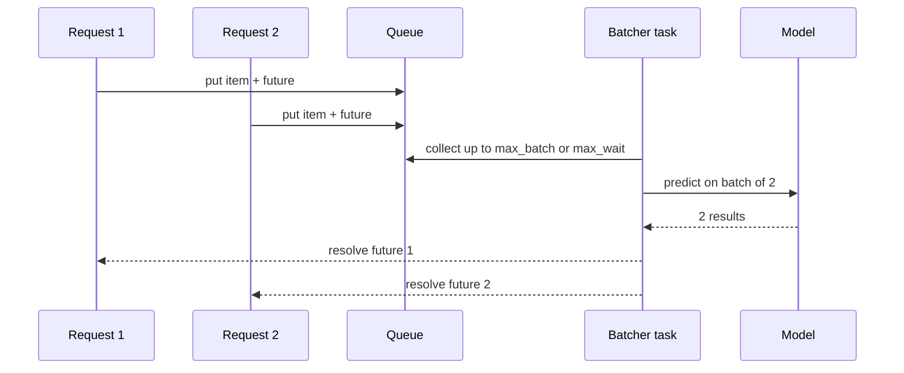

# Serving an ML model with FastAPI

> **Before this lesson:** you should know Pydantic models, `Field` constraints and validators
> ([lesson 7](#/lesson/fastapi/pydantic-models), [lesson 8](#/lesson/fastapi/pydantic-validators)),
> the lifespan, `app.state` and dependencies ([lesson 11](#/lesson/fastapi/yield-deps)), `def`
> versus `async def` and the thread pool ([lesson 12](#/lesson/fastapi/async-fundamentals)),
> semaphores and bounded queues ([lesson 13](#/lesson/fastapi/background-concurrency)), and why each
> worker holds its own memory ([lesson 25](#/lesson/fastapi/deploy-docker)). From machine learning
> you only need the idea that a trained model has a `predict` method that turns inputs into outputs.

## In plain words

A **machine-learning model** is a program whose behaviour was learned from data rather than written
by hand: it takes some inputs (the size, age and location of a house) and returns a prediction (a
price). Training the model is one job; making it available to other programs is another. Running a
trained model on new inputs is called **inference**, and putting it behind an API so that apps,
websites and other services can ask it questions is called **serving**.

A word of warning that the book itself gives: "model" means two different things in this lesson. A
**Pydantic model** is a class that describes the shape of some data. An **ML model** is the trained
predictor. Both appear in the same code, often a few lines apart.

An everyday picture: a pizzeria's wood-fired oven. It takes half an hour to heat up, so you light it
once in the morning, not once per pizza (load the model once). It bakes six pizzas in the same time as
one, so you wait a moment to fill the oven when orders are coming in (batching). The menu lists what
can be ordered and how big, so nobody asks for a pizza three metres wide (input validation). And the
oven is shared by every cook, so it needs a rule about who uses it when (bounded concurrency).

FastAPI has become the default way to put a Python model behind HTTP: the model already lives in
Python, Pydantic gives you a typed contract for inputs and outputs, async handles many waiting
clients, and the OpenAPI page documents it all. Lubanovic's "Data Science and AI" section shows a
minimal version, one text-generation model behind one endpoint. This lesson builds the *production*
version a piece at a time.

Why this matters for a job: "How would you serve this model?" is one of the most common questions in
ML-engineering and MLOps interviews, and in practice most models that create value do so behind an
API like the one built here.

## The serving problem

A model server is a web service with some unusual properties:

| Property | Consequence |
|---|---|
| The model is **large and slow to load** (seconds to minutes, megabytes to gigabytes) | load it once per process at startup, never per request |
| Inference is **CPU- or GPU-bound** (limited by computing, not by waiting) | it must not run on the event loop; many concurrent requests do not mean more throughput |
| The hardware prefers **batches** | grouping requests multiplies throughput |
| Inputs come from untrusted clients | strict validation and size limits protect memory and GPU |
| Models **change** independently of code | version everything; make rollbacks trivial |
| Outputs are probabilistic | monitor predictions and inputs, not only HTTP status codes |

Two words recur below. A **GPU** (graphics processing unit) is a processor that performs thousands of
simple calculations in parallel, which is what neural networks need. **Throughput** is how many
predictions per second the server produces; **latency** is how long one caller waits. Much of model
serving is trading one against the other.

## The minimal version, and what it lacks

The book's example loads a small open-source text model from Hugging Face (a hub of free models and
the `transformers` library that runs them) and answers prompts from a query parameter. In the same
spirit, the smallest possible model server looks like this:

```python
from fastapi import FastAPI
from transformers import pipeline

app = FastAPI()
generator = pipeline("text-generation", model="Qwen/Qwen2.5-0.5B-Instruct")   # loaded at import time

@app.get("/ai")
def answer(prompt: str) -> str:
    out = generator(prompt, max_new_tokens=200, return_full_text=False)
    return out[0]["generated_text"]
```

- `pipeline(...)` downloads (the first time) and loads a small open model together with its
  **tokenizer**, the part that converts text to numbers and back.
- `return_full_text=False` asks for only the newly generated text, without the prompt in front.
- `answer` is a plain `def` endpoint, so FastAPI runs it in the thread pool, and the event loop stays
  free while the model computes.
- `max_new_tokens=200` caps how much text the model may generate.

It works, and the book enjoys showing how odd a small model's answers can be: confident, fluent and
wrong. Such made-up answers are called **hallucinations**. Larger models answer better but take
longer to download and run. What the minimal version lacks for production is the subject of this
lesson: the model loads when the module is *imported* (so tests and tools pay for it too), nothing
says whether it is ready, any number of requests may hit the model at once, inputs are unbounded,
and nothing records which model produced an answer.

## Load the model in the lifespan

```python
from contextlib import asynccontextmanager
from fastapi import FastAPI
import joblib

ml = {}                                         # or use app.state

@asynccontextmanager
async def lifespan(app: FastAPI):
    # --- startup: runs once per worker process, before any request is served ---
    ml["model"] = joblib.load(settings.model_path)
    ml["version"] = settings.model_version
    ml["model"].predict(WARMUP_BATCH)           # warm-up: first call is often much slower
    yield
    # --- shutdown ---
    ml.clear()

app = FastAPI(lifespan=lifespan)
```

Line by line:

- `ml = {}` is a module-level dictionary that will hold the model; `app.state` is an equally good
  home.
- The `lifespan` function (lesson 11) runs its code before `yield` once, when the worker starts, and
  the code after `yield` once, when it stops.
- `joblib.load(...)` reads a saved model from disk. **joblib** is the usual way to save and load
  scikit-learn models.
- `ml["model"].predict(WARMUP_BATCH)` is a **warm-up** call: one prediction on dummy data before real
  traffic arrives. The first call is often much slower than later ones because libraries allocate
  memory, compile code paths or move weights to the GPU on first use. Better that the warm-up pays
  that price than the first user.
- After `yield`, `ml.clear()` drops the model when the worker shuts down.

Why the lifespan, rather than a module-level global or loading lazily on the first request?

- **Not at import time.** Importing the module happens in tests, in tooling and in the auto-reloader;
  none of them should load two gigabytes.
- **Not lazily in the endpoint.** The first user would wait for the load, and several simultaneous
  first requests might each start loading. With the lifespan, the server does not accept traffic
  until the model is ready, and the readiness probe (lesson 26) can say so.
- **Clean-up.** GPU memory, thread pools and temporary files are released on shutdown.
- **Per process.** With N workers, each loads its own copy; budget memory accordingly.

Give endpoints the model through a dependency, so tests can replace it with a fake:

```python
def get_model(request: Request):
    model = getattr(request.app.state, "model", None)
    if model is None:
        raise HTTPException(status_code=503, detail="Model not loaded")
    return model

ModelDep = Annotated[Model, Depends(get_model)]
```

`get_model` looks for the model on `app.state` and answers `503 Service Unavailable` if it is not
there (still loading, or shutting down). `ModelDep` is the reusable alias (lesson 10). In a test,
`app.dependency_overrides[get_model] = lambda: FakeModel()` swaps in a tiny fake, so API tests run in
milliseconds without the real model.

> [!WARNING]
> `pickle`/`joblib` files execute arbitrary code when loaded. Only load model artefacts from sources you
> control, verify checksums, and prefer safer formats (ONNX, `safetensors`) where available.

## A typed contract with Pydantic

The request schema is your first line of defence and your documentation at the same time. Here is a
house-price service's contract:

```python-run
from typing import Literal
from pydantic import BaseModel, ConfigDict, Field, ValidationError, model_validator

class HouseFeatures(BaseModel):
    model_config = ConfigDict(extra="forbid")            # typo'd feature names are errors, not silence
    sqft: float = Field(gt=0, le=50_000, description="Living area in square feet")
    bedrooms: int = Field(ge=0, le=20)
    bathrooms: float = Field(ge=0, le=20)
    year_built: int = Field(ge=1800, le=2100)
    city: Literal["Austin", "Boston", "Denver"]

    @model_validator(mode="after")
    def plausible(self):
        if self.bedrooms > 0 and self.sqft / self.bedrooms < 50:
            raise ValueError("implausible sqft per bedroom")
        return self

class PredictRequest(BaseModel):
    instances: list[HouseFeatures] = Field(min_length=1, max_length=256)   # cap the batch size!

class Prediction(BaseModel):
    price: float
    lower: float
    upper: float

class PredictResponse(BaseModel):
    model_config = ConfigDict(protected_namespaces=())   # allow field names starting with "model_"
    predictions: list[Prediction]
    model_version: str

ok = PredictRequest.model_validate({"instances": [
    {"sqft": 1450, "bedrooms": 3, "bathrooms": 2, "year_built": 1999, "city": "Austin"}]})
print(ok.instances[0])

bad = {"instances": [{"sqft": -5, "bedrooms": 3, "bathrooms": 2, "year_built": 1999,
                      "city": "Paris", "sqfeet": 1}]}
try:
    PredictRequest.model_validate(bad)
except ValidationError as e:
    for err in e.errors():
        print(["body", *err["loc"]], err["type"])
```

Reading the classes:

- `HouseFeatures` describes one house. `extra="forbid"` rejects any field not listed. Each `Field`
  sets bounds: `gt=0` is "greater than 0", `ge`/`le` are "greater/less than or equal". `Literal[...]`
  allows only the three cities the model was trained on.
- The `model_validator(mode="after")` runs after the individual fields are valid and checks a rule
  involving two of them: fewer than 50 square feet per bedroom is implausible.
- `PredictRequest` wraps a list of houses, between 1 and 256 of them. That upper bound matters (see
  below).
- `Prediction` and `PredictResponse` describe the output: a price with a lower and upper estimate,
  and the version of the model that produced it.

The first `print` shows the validated house, `sqft=1450.0 bedrooms=3 bathrooms=2.0 year_built=1999
city='Austin'`; notice that the integers sent for `sqft` and `bathrooms` became floats. The bad
request then produces three errors, printed with `body` in front as FastAPI would report them in a
`422` response: `['body', 'instances', 0, 'sqft'] greater_than` (−5 is not above 0),
`['body', 'instances', 0, 'city'] literal_error` (Paris is not allowed) and
`['body', 'instances', 0, 'sqfeet'] extra_forbidden` (a misspelt field). The plausibility check
does not run, because the fields themselves failed.

Design points:

- **Bound everything**: list lengths, string lengths, numeric ranges, image dimensions. An unbounded
  `list[float]` is a **denial-of-service** risk, meaning a way to make the service unavailable: one
  request could ask the server to allocate gigabytes.
- **`extra="forbid"`** catches the most insidious serving bug. A client sends `sqfeet` instead of
  `sqft`; without the rule, the misspelt field is silently ignored, the real one falls back to a
  default or fails somewhere confusing, and predictions are quietly wrong.
- **Validation is not the same as preprocessing.** The schema checks the shape of the input. The model
  also needs the *same* feature engineering it saw in training (scaling, encoding categories,
  tokenising text). When serving code re-implements that and gets it slightly different, the result
  is called **training–serving skew**. Ship the preprocessing inside the model artefact (a
  scikit-learn `Pipeline`, a TorchScript or ONNX graph) instead of rewriting it in the API.
- **Return the model version** with every prediction, so that any result can be traced and debugged
  later.
- Pydantic reserves names that begin with `model_` for its own methods. Versions before 2.10 warn
  about any field with that prefix; newer versions only object to names that actually clash. Setting
  `protected_namespaces=()` as above allows `model_version` on every version.

## Inference without blocking the event loop

Inference is CPU- or GPU-bound and synchronous: the `predict` call does not `await` anything, it
computes. Lesson 12's rule therefore applies: such work must not run on the event loop. Two correct
shapes:

```python
# Option 1: a plain def endpoint - FastAPI runs it in the thread pool
@app.post("/v1/predict")
def predict(req: PredictRequest, model: ModelDep) -> PredictResponse:
    X = to_matrix(req.instances)
    y = model.predict(X)                       # NumPy/sklearn/PyTorch release the GIL in native code
    return PredictResponse(predictions=to_predictions(y), model_version=model.version)

# Option 2: async def endpoint that offloads explicitly (needed when you also await other things)
@app.post("/v1/predict")
async def predict(req: PredictRequest, request: Request) -> PredictResponse:
    features = await fetch_extra_features(req)                     # async I/O
    async with request.app.state.inference_sem:                    # bound concurrent inferences
        y = await run_in_threadpool(model.predict, to_matrix(req.instances, features))
    return PredictResponse(...)
```

- **Option 1** is the simplest. Because the endpoint is a plain `def`, FastAPI runs the whole function
  in a worker thread. Libraries such as NumPy, scikit-learn and PyTorch do their heavy work in
  compiled code that releases the GIL, so other threads can run meanwhile.
- **Option 2** is for endpoints that also `await` something, here fetching extra features over the
  network. The endpoint is `async def`, and the blocking call is handed to a thread explicitly with
  `run_in_threadpool`. The `async with ... inference_sem` line takes a slot from a **semaphore**
  (lesson 13) created in the lifespan, so that only a fixed number of inferences run at the same
  time.

The one thing never to write is an `async def` endpoint that calls `model.predict(...)` directly. It
runs on the event loop and freezes the worker for the whole inference: health checks time out and
every other request on that worker waits, invisibly.

Further considerations:

- **Thread oversubscription.** Numerical libraries run their own thread pools underneath; the library
  doing the matrix arithmetic is called **BLAS** (Basic Linear Algebra Subprograms). Forty FastAPI
  threads each starting eight BLAS threads means 320 threads fighting over, say, eight cores, and
  everything slows down. Limit concurrent inferences with a semaphore and set `OMP_NUM_THREADS` or
  `torch.set_num_threads` deliberately.
- **GPU.** One GPU effectively runs one batch at a time. Guard it with a semaphore or, better, a
  batching queue (below). In PyTorch use `torch.inference_mode()` and keep the model in `eval()`
  mode.
- **Pure-Python CPU work** (tokenisation loops, feature code written in Python) holds the GIL, so
  threads do not help; use more worker processes.
- **Heavy models** often deserve a dedicated **model server** (Triton, TorchServe, vLLM, TGI, Ray
  Serve, BentoML), with FastAPI as a thin layer in front handling authentication, validation,
  business rules and calls to the model server over async HTTP or gRPC. Then the FastAPI endpoint
  *is* I/O-bound, and `async def` is the right choice.

## Batching

### Client-side batches

The simplest win is to accept a list (`instances`) and make one **vectorised** `predict` call, one
operation applied to a whole array at once, instead of a Python loop over single items. The
difference is large even on a CPU:

```python-run
import time
import numpy as np

rng = np.random.default_rng(0)
weights = rng.normal(size=50)                 # a "trained" linear model with 50 features
X = rng.normal(size=(5000, 50))               # 5,000 incoming rows

def predict_one(x):                           # what a naive endpoint does per request
    return float(x @ weights)

t = time.perf_counter()
looped = [predict_one(x) for x in X]
t_loop = time.perf_counter() - t

t = time.perf_counter()
batched = X @ weights                         # one call for the whole batch
t_batch = time.perf_counter() - t

print("same answers:", np.allclose(looped, batched))
print(f"one row at a time: {t_loop * 1000:7.2f} ms")
print(f"one batched call : {t_batch * 1000:7.2f} ms  ({t_loop / t_batch:.0f}x faster)")
```

- `weights` plays a trained linear model: 50 numbers, one per feature. `X` holds 5,000 rows of 50
  features each.
- `x @ weights` is a dot product: multiply each feature by its weight and add up. `predict_one` does
  it for one row, as an endpoint handling one house per request would.
- `X @ weights` does all 5,000 rows in a single call into compiled code.
- `np.allclose` confirms both give the same answers.

The exact timings depend on the machine, but the batched call is typically tens of times faster. The
work is the same; what disappears is the per-call overhead of Python. On a GPU the gap is larger
still, because a single input leaves almost all of its parallel units idle.

### Dynamic (micro-)batching

Clients usually send one item each, so the server has to create batches itself. **Dynamic batching**
groups requests that arrive within a few milliseconds of each other into one model call. Each request
is placed on a queue together with a **future**: an object representing a result that does not exist
yet, which the request can `await`. A background task collects up to `max_batch` items, or waits at
most `max_wait`, runs the model once, and fills in each future with its own result.



A complete, runnable implementation:

```python-run
import asyncio, time

class MicroBatcher:
    def __init__(self, predict_batch, max_batch=8, max_wait=0.01, max_queue=1000):
        self.predict_batch, self.max_batch, self.max_wait = predict_batch, max_batch, max_wait
        self.queue = asyncio.Queue(maxsize=max_queue)        # bounded -> backpressure
        self.batch_sizes = []

    async def submit(self, item):
        fut = asyncio.get_running_loop().create_future()
        self.queue.put_nowait((item, fut))                   # QueueFull -> respond 503
        return await fut

    async def run(self):                                     # started in lifespan
        while True:
            item, fut = await self.queue.get()               # wait for the first request
            batch, deadline = [(item, fut)], time.monotonic() + self.max_wait
            while len(batch) < self.max_batch:
                timeout = deadline - time.monotonic()
                if timeout <= 0:
                    break
                try:
                    batch.append(await asyncio.wait_for(self.queue.get(), timeout))
                except asyncio.TimeoutError:
                    break
            self.batch_sizes.append(len(batch))
            try:
                # real code: await run_in_threadpool(self.predict_batch, inputs)
                outputs = await self.predict_batch([i for i, _ in batch])
                for (_, f), out in zip(batch, outputs):
                    if not f.cancelled():
                        f.set_result(out)
            except Exception as exc:                         # fail the whole batch, keep the loop alive
                for _, f in batch:
                    if not f.done():
                        f.set_exception(exc)

model_calls = 0
async def fake_gpu_model(xs):
    global model_calls
    model_calls += 1
    await asyncio.sleep(0.02)                 # ~20 ms per call regardless of batch size
    return [x * 2 for x in xs]

batcher = MicroBatcher(fake_gpu_model, max_batch=8, max_wait=0.01)
task = asyncio.create_task(batcher.run())

async def client(i):
    await asyncio.sleep(i * 0.001)            # requests trickle in 1 ms apart
    return await batcher.submit(i)

t = time.perf_counter()
results = await asyncio.gather(*(client(i) for i in range(40)))
elapsed = time.perf_counter() - t
task.cancel()
print("results ok :", results == [i * 2 for i in range(40)])
print("model calls:", model_calls, "instead of 40; batch sizes:", batcher.batch_sizes)
print(f"elapsed    : {elapsed:.2f}s  (unbatched and sequential would be ~{40 * 0.02:.1f}s)")
```

How it works:

- `submit(item)` is what each request calls. It creates a future, puts `(item, future)` on the
  queue, and waits for the future. `put_nowait` raises `QueueFull` when 1,000 items are already
  waiting; a real endpoint turns that into `503` (load shedding, lesson 26).
- `run()` is the background task, started once in the lifespan. It waits for a first item, sets a
  deadline `max_wait` seconds later, then keeps taking items until the batch is full or the deadline
  passes. `asyncio.wait_for(..., timeout)` gives up waiting when the time runs out.
- It then calls the model once with all the items and gives each future its own output with
  `set_result`. If the model call raises, every future in the batch receives the exception, and the
  loop carries on with the next batch, so one failure cannot stop the batcher.
- `fake_gpu_model` takes about 20 ms per call whatever the batch size, like a GPU, and doubles each
  input. Forty clients arrive one millisecond apart.

The output: `results ok : True` (each client received exactly its own answer), `model calls: 5` with
batch sizes `[8, 8, 8, 8, 8]`, and an elapsed time of roughly 0.1 to 0.2 seconds instead of about
0.8 seconds for 40 calls one after another. The timing varies a little from run to run.

The two settings trade latency against throughput: a larger `max_batch` and `max_wait` raise
throughput and add up to `max_wait` of delay when traffic is light. Typical values are 1 to 10 ms of
waiting and a batch sized to fit GPU memory. The problem *Dynamic Micro-Batching for Inference* asks
you to compute the batches for a given pattern of arrivals. Remember that the queue lives in one
process (each worker has its own), and validate inputs *before* they are queued, so one bad input
cannot fail a whole batch of other people's requests.

## Caching, timeouts and degradation

**Cache** deterministic predictions (those that always give the same output for the same input) in
Redis, keyed by the model version and a hash of the input. Repeated inputs are common: embeddings of
popular search queries, classifications of common items. The key must not depend on the order in
which a client happened to list the JSON fields:

```python-run
import hashlib, json

def cache_key(model_version: str, features: dict) -> str:
    canonical = json.dumps(features, sort_keys=True, separators=(",", ":"))
    digest = hashlib.sha256(canonical.encode()).hexdigest()[:16]
    return f"pred:{model_version}:{digest}"

a = {"sqft": 1450, "bedrooms": 3, "city": "Austin"}
b = {"city": "Austin", "bedrooms": 3, "sqft": 1450}           # same data, different key order
print(cache_key("2025-01-15", a))
print(cache_key("2025-01-15", b), "<- identical: order does not matter")
print(cache_key("2025-03-01", a), "<- new model version, new key")
```

`json.dumps(..., sort_keys=True, separators=(",", ":"))` produces a **canonical** form of the input,
a single agreed spelling: keys sorted, no optional spaces. Hashing that gives the same digest for `a`
and `b`, so the first two lines are identical. The model version is part of the key, so the third line
differs: after a new model is deployed, old cached answers are never found again, with no explicit
clean-up.

The other protections:

- **Timeouts**: give inference a time budget (`asyncio.timeout`) and answer `504` or `503` with a
  `Retry-After` header when it is exceeded; refuse work when the queue is full rather than queueing
  without limit.
- **Fallbacks**: a cheaper model, a cached answer or a sensible default can be better than an error.
- **Long jobs** (scoring a whole file, fine-tuning): answer `202 Accepted` with a job resource and
  run the work from a task queue (lesson 13), rather than holding a connection open for minutes.

## Operational endpoints

```python
@app.get("/healthz", include_in_schema=False)
def live():
    return {"status": "ok"}

@app.get("/readyz", include_in_schema=False)
def ready(request: Request, response: Response):
    loaded = getattr(request.app.state, "model", None) is not None
    if not loaded:
        response.status_code = 503
    return {"model_loaded": loaded}

@app.get("/v1/model")
def model_info(model: ModelDep):
    return {"name": model.name, "version": model.version, "features": model.feature_names}
```

`/healthz` is the liveness probe and does nothing but answer. `/readyz` reports `503` until the model
is on `app.state`, so the load balancer sends no traffic to a worker that is still loading. `/v1/model`
tells clients and operators which model is live and which features it expects, which is the first
thing anyone asks when predictions look strange.

> [!INTERVIEW]
> "How would you serve a scikit-learn/PyTorch model with FastAPI?" — Load it once per worker in the
> lifespan (warm it up; readiness fails until done) and expose it via a dependency. Define strict Pydantic
> request/response schemas with bounds and `extra="forbid"`, and return the model version. Run inference
> off the event loop: a sync `def` endpoint or `run_in_threadpool`, with a semaphore to bound concurrent
> inferences; never call `predict` directly in `async def`. Vectorise batches; add dynamic micro-batching
> for GPU throughput. Scale with processes/replicas (memory = copies × model size), version the endpoint
> and the model, and monitor latency percentiles, batch sizes, errors and input/prediction drift.

## Pitfalls

- Loading the model inside the endpoint, or per request in a dependency.
- `async def predict` calling blocking inference.
- Unbounded input sizes.
- Preprocessing in the API that differs from training.
- Assuming N async requests means N parallel inferences; ignoring thread oversubscription.
- Forgetting that each worker holds its own model copy and its own batching queue.
- Loading pickle files from places you do not control.

## Summary

- Load once per process in the lifespan, warm up, provide it through a dependency, and gate readiness
  on it.
- Pydantic schemas with strict bounds are both the contract and the protection; return the model
  version.
- Keep inference off the event loop and bound how many run at once.
- Batch: vectorised lists from clients, and dynamic micro-batching across clients (max batch, max
  wait).
- Add caching keyed by model version and canonical input, timeouts, load shedding, and health and
  model-info endpoints.

## Glossary

- **ML model / Pydantic model** — a trained predictor / a class describing the shape of data.
- **Inference** — running a trained model on new inputs.
- **Serving** — making a model available to other programs, here through an HTTP API.
- **GPU** — a processor with thousands of parallel units, suited to neural networks.
- **Throughput / latency** — predictions per second / how long one caller waits.
- **Tokenizer** — the part of a language model that converts text to numbers and back.
- **Hallucination** — a fluent but invented answer from a generative model.
- **joblib / pickle** — Python formats for saving objects such as models; loading them can run code.
- **Warm-up** — a dummy prediction at startup so the first real request is not slow.
- **Denial of service** — making a service unavailable, for example with oversized requests.
- **Training–serving skew** — differences between preprocessing at training time and at serving time.
- **Thread oversubscription / BLAS** — more busy threads than cores / the numerical library doing
  matrix arithmetic, which runs its own threads.
- **Model server** — a dedicated program for running models efficiently (Triton, vLLM, TorchServe).
- **Vectorised** — one operation applied to a whole array at once.
- **Dynamic (micro-)batching** — grouping requests that arrive close together into one model call.
- **Future** — an object standing for a result that will be filled in later.
- **Canonical form** — a single agreed way of writing data, so equal data gives equal hashes.

```quiz
[
  {"q": "Where should a model that takes 30 seconds to load be loaded?", "options": ["Inside the predict endpoint", "In the lifespan startup, once per worker process", "In a Pydantic validator", "In middleware on each request"], "answer": 1,
   "explain": "Lifespan runs once before the worker accepts traffic, so no request pays the load cost and readiness can reflect it."},
  {"q": "Why is 'async def predict(...): return model.predict(x)' harmful?", "options": ["async functions can't return values", "The CPU-bound call blocks the event loop, stalling every other request and health check on that worker", "FastAPI rejects it", "It uses too many threads"], "answer": 1,
   "explain": "Blocking code in async def runs on the loop thread; use a def endpoint or run_in_threadpool."},
  {"q": "What does extra='forbid' protect against in a feature schema?", "options": ["Slow inference", "Misspelled or unexpected feature names being silently ignored, producing wrong predictions", "Large batches", "Model drift"], "answer": 1,
   "explain": "Without it, a typo'd field is dropped and the real feature falls back to a default or fails later in a confusing way."},
  {"q": "In dynamic micro-batching, when is a batch dispatched?", "options": ["Every second", "When it reaches max_batch items or the oldest request has waited max_wait, whichever comes first", "Only when the queue is full", "After each request"], "answer": 1,
   "explain": "The two limits trade a bounded latency increase for much higher throughput."},
  {"q": "Why set max_length on the list of instances in the request schema?", "options": ["Pydantic requires it", "An unbounded batch lets one request exhaust memory/GPU - a denial-of-service risk", "To speed up validation", "For OpenAPI formatting"], "answer": 1,
   "explain": "All client-controlled sizes must be bounded so resource use per request is predictable."},
  {"q": "You run 4 workers with a 3 GB model on an 8 GB machine. What happens?", "options": ["Workers share one copy automatically", "Roughly 12 GB is needed; expect swapping or OOM kills", "Only 3 GB is used", "Uvicorn refuses to start"], "answer": 1,
   "explain": "Each process loads its own copy; memory multiplies by the number of workers."},
  {"q": "Why include model_version in every prediction response?", "options": ["It speeds up clients", "For traceability: debugging, A/B analysis and reproducing results after models change", "HTTP requires it", "To enable caching in browsers"], "answer": 1,
   "explain": "Models change independently of code; knowing which one produced an output is essential for audits and incident analysis."},
  {"q": "Why serialise the input with sort_keys=True before hashing it for a cache key?", "options": ["It is faster", "So the same data sent with fields in a different order produces the same key", "Redis requires sorted keys", "To hide the input"], "answer": 1,
   "explain": "A canonical form gives equal inputs equal hashes; otherwise field order would cause needless cache misses."}
]
```

> **Source:** Lubanovic, *FastAPI*, ch. 14 "Databases, Data Science, and a Little AI" (Data Science and AI) and ch. 13 "Production" (Performance); https://fastapi.tiangolo.com/advanced/events/ (lifespan, with an ML model example), https://fastapi.tiangolo.com/async/, https://fastapi.tiangolo.com/tutorial/body-nested-models/
