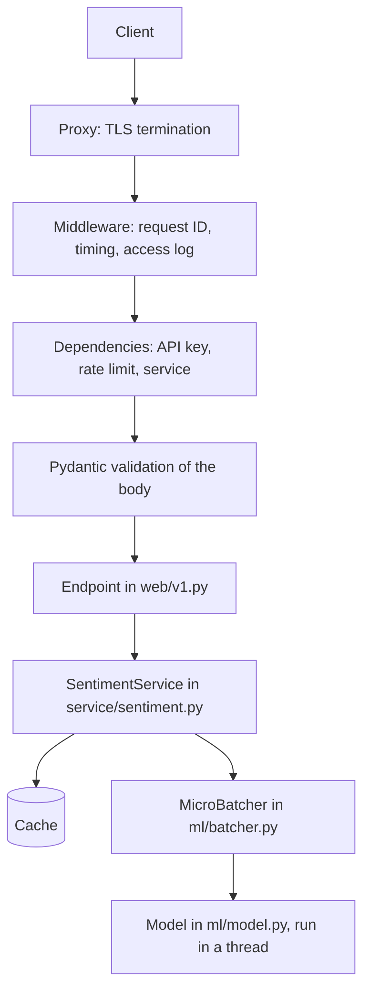

# End-to-end project: a production model service

> **Before this lesson:** this capstone uses the whole track. The lessons it leans on most are
> settings ([lesson 9](#/lesson/fastapi/pydantic-settings)), the lifespan and dependency overrides
> ([lesson 11](#/lesson/fastapi/yield-deps)), routers and the layered structure
> ([lesson 14](#/lesson/fastapi/routers), [lesson 15](#/lesson/fastapi/layers)), API keys and rate
> limits ([lesson 20](#/lesson/fastapi/authz-cors)), testing ([lesson 22](#/lesson/fastapi/testing)),
> streaming ([lesson 24](#/lesson/fastapi/websockets-streaming)), Docker
> ([lesson 25](#/lesson/fastapi/deploy-docker)), health checks
> ([lesson 26](#/lesson/fastapi/observability)) and model serving
> ([lesson 27](#/lesson/fastapi/serving-models)). When a step below feels unfamiliar, the lesson
> named next to it explains it from the start.

## In plain words

Up to now each lesson has looked at one part in isolation: validation, dependencies, caching,
streaming, Docker. Real services are all of those parts at once, and most of the difficulty lies in
how they fit together: which file a rule belongs in, which object owns a resource, what the tests
replace.

Think of building a car from components you already understand. You know how an engine, brakes and
a dashboard each work. Assembling a car is a different skill: the engine must be mounted so that it
can be swapped, the brakes must work even when the radio fails, and the whole thing must pass an
inspection without anyone driving it into a wall. This lesson assembles the car.

The project is a **sentiment-analysis API**. Sentiment analysis means classifying a text as
*positive*, *negative* or *neutral* ("I love this phone" is positive). The service offers single and
batch prediction, a streaming "explain" endpoint, API-key authentication, rate limiting, caching,
versioned routes, health checks, tests and a Docker image. Every file is short, and every choice was
motivated in an earlier lesson. The structure follows the layers of Lubanovic's book: a web layer, a
service layer and a data layer (here, the model), with shared schemas.

Why this matters for a job: take-home assignments and system-design interviews for backend and
ML-engineering roles ask for exactly this kind of service, and a small, well-structured version of it
is a strong portfolio project. Being able to walk a request through every layer and name the reason
for each step is what interviewers listen for.

## Requirements

- `POST /v1/predict`: classify one or many texts; return for each a **label** (positive, negative or
  neutral), a **score** (the model's confidence, between 0 and 1) and the model version.
- `POST /v1/explain/stream`: stream a word-by-word explanation over SSE.
- `GET /v1/model`: model metadata. `GET /healthz` and `GET /readyz`: the probes.
- An API key in the `X-API-Key` header; a rate limit per key; predictions cached by
  `(model_version, text)`.
- The model loads once at startup; inference never blocks the event loop.
- Configuration from the environment; structured logs with request IDs; tests that do not need the
  real model.

## How a request flows

Before looking at files, here is the path of one `POST /v1/predict` through the service. Each box
lives in a different file, and each arrow is a call:



The endpoint knows HTTP and nothing about models. The service knows the rules (check the cache,
batch the misses) and nothing about HTTP. The model wrapper knows the ML framework and nothing about
either. That separation is what lets each part be tested, replaced or scaled on its own.

## Layout

```text
sentiment-service/
├── app/
│   ├── main.py              # app factory, lifespan, middleware, routers, exception handlers
│   ├── config.py            # Settings (pydantic-settings)
│   ├── schemas.py           # Pydantic request/response models      (the book's "model" package)
│   ├── errors.py            # domain exceptions
│   ├── deps.py              # dependencies: settings, auth, rate limit, service
│   ├── web/                 # routers                               (web layer)
│   │   ├── health.py
│   │   └── v1.py
│   ├── service/             # business logic                        (service layer)
│   │   └── sentiment.py
│   └── ml/                  # model loading and inference           (data layer for a model)
│       ├── model.py
│       └── batcher.py
├── tests/
│   ├── conftest.py
│   └── test_api.py
├── requirements.txt
├── Dockerfile
└── .env.example
```

- `main.py` builds the application and wires everything together.
- `config.py` reads settings from the environment.
- `schemas.py` holds the Pydantic models that define requests and responses. The book keeps these
  in a package called `model`; with an ML model in the same project that name would be confusing, so
  it is called `schemas` here.
- `errors.py` defines domain exceptions, such as "model unavailable", that lower layers raise without
  knowing anything about HTTP (lesson 15).
- `deps.py` holds the dependencies that endpoints declare.
- `web/`, `service/` and `ml/` are the three layers.
- `tests/` holds the tests; `.env.example` lists the settings a developer must provide, with fake
  values, and is safe to commit.

## Configuration: `app/config.py`

```python
from functools import lru_cache
from pydantic import Field, SecretStr
from pydantic_settings import BaseSettings, SettingsConfigDict

class Settings(BaseSettings):
    model_config = SettingsConfigDict(env_file=".env", env_prefix="APP_", extra="ignore",
                                      protected_namespaces=())
    environment: str = "dev"
    api_keys: list[SecretStr] = []                 # APP_API_KEYS='["k1","k2"]'
    model_uri: str = "models/sentiment.joblib"
    model_version: str = "2025-01-15"
    redis_url: str = "redis://localhost:6379/0"
    max_batch_size: int = Field(32, ge=1, le=256)
    max_wait_ms: int = Field(5, ge=0, le=100)
    rate_limit_per_minute: int = Field(120, ge=1)
    cache_ttl_seconds: int = Field(300, ge=0)
    cors_origins: list[str] = []

@lru_cache
def get_settings() -> Settings:
    return Settings()
```

- `BaseSettings` (lesson 9) fills each field from an environment variable. `env_prefix="APP_"` means
  the field `model_uri` is read from `APP_MODEL_URI`; `env_file=".env"` also reads a local file during
  development; `extra="ignore"` tolerates unrelated variables.
- `protected_namespaces=()` allows field names starting with `model_` (lesson 27).
- `api_keys: list[SecretStr]` holds the valid keys. `SecretStr` hides the value when printed or
  logged, showing `**********` instead. A list is given in the environment as JSON, as the comment
  shows.
- The numeric fields carry bounds, so a typo such as `APP_MAX_BATCH_SIZE=3200` fails at startup
  instead of in production traffic.
- `@lru_cache` on `get_settings` makes it build the settings once and return the same object every
  time after that.

## Schemas: `app/schemas.py`

```python
from typing import Literal
from pydantic import BaseModel, ConfigDict, Field, field_validator

class PredictRequest(BaseModel):
    model_config = ConfigDict(extra="forbid")
    texts: list[str] = Field(min_length=1, max_length=64)

    @field_validator("texts")
    @classmethod
    def check_texts(cls, v: list[str]) -> list[str]:
        cleaned = [t.strip() for t in v]
        if any(not t or len(t) > 5_000 for t in cleaned):
            raise ValueError("each text must be 1-5000 characters")
        return cleaned

class Prediction(BaseModel):
    label: Literal["positive", "negative", "neutral"]
    score: float = Field(ge=0, le=1)
    cached: bool = False

class PredictResponse(BaseModel):
    model_config = ConfigDict(protected_namespaces=())
    predictions: list[Prediction]
    model_version: str

class ExplainRequest(BaseModel):
    text: str = Field(min_length=1, max_length=5_000)

class ModelInfo(BaseModel):
    name: str
    version: str
    labels: list[str]
```

- `PredictRequest` accepts between 1 and 64 texts and nothing else (`extra="forbid"`). The
  `field_validator` (lesson 8) strips surrounding spaces from each text and rejects any that is then
  empty or longer than 5,000 characters. Every size the client controls is bounded.
- `Prediction` limits `label` to the three allowed values and `score` to the range 0 to 1, so the
  service can never send out a malformed answer, even if the model misbehaves. `cached` tells the
  client whether the answer came from the cache.
- `PredictResponse` wraps the list and always names the model version.
- `ExplainRequest` and `ModelInfo` describe the other two endpoints.

## The model wrapper: `app/ml/model.py`

The "data layer" of an ML service is the model itself. Wrap it behind a small interface so that the
rest of the app, and the tests, never touch framework-specific objects:

```python
from typing import Protocol

class SentimentModel(Protocol):
    name: str
    version: str
    labels: list[str]
    def predict_batch(self, texts: list[str]) -> list[tuple[str, float]]: ...

class SklearnSentimentModel:
    name = "sentiment"
    labels = ["negative", "neutral", "positive"]

    def __init__(self, uri: str, version: str):
        import joblib
        self._pipeline = joblib.load(uri)            # tokenizer/vectoriser + classifier in ONE artefact
        self.version = version

    def predict_batch(self, texts: list[str]) -> list[tuple[str, float]]:
        proba = self._pipeline.predict_proba(texts)                   # vectorised, releases the GIL
        idx = proba.argmax(axis=1)
        return [(self.labels[i], float(p[i])) for i, p in zip(idx, proba)]
```

- A `Protocol` describes the shape an object must have (these attributes, this method) without
  requiring it to inherit from anything. Any class with `name`, `version`, `labels` and a matching
  `predict_batch` counts as a `SentimentModel`, including the fake one the tests use.
- `SklearnSentimentModel` loads a scikit-learn `Pipeline` that contains *both* the text preprocessing
  and the classifier, so there is no separate preprocessing code to drift out of step with training
  (lesson 27).
- `predict_proba` returns, for each text, one probability per label. `argmax(axis=1)` picks the
  position of the largest probability in each row, and the method returns pairs such as
  `("positive", 0.93)`.

`app/ml/batcher.py` is the `MicroBatcher` from lesson 27, calling
`await run_in_threadpool(model.predict_batch, texts)` so that inference runs in a worker thread.

## Service layer: `app/service/sentiment.py`

No HTTP here, only rules: look in the cache, batch the misses, assemble the results.

```python
import hashlib

class SentimentService:
    def __init__(self, model, batcher, cache, ttl: int):
        self.model, self.batcher, self.cache, self.ttl = model, batcher, cache, ttl

    def _key(self, text: str) -> str:
        digest = hashlib.sha256(text.encode()).hexdigest()
        return f"pred:{self.model.version}:{digest}"       # model version in the key!

    async def predict(self, texts: list[str]) -> list[Prediction]:
        results: list[Prediction | None] = [None] * len(texts)
        misses: list[int] = []
        for i, text in enumerate(texts):
            hit = await self.cache.get(self._key(text))
            if hit is not None:
                results[i] = Prediction.model_validate_json(hit).model_copy(update={"cached": True})
            else:
                misses.append(i)
        if misses:
            outputs = await asyncio.gather(*(self.batcher.submit(texts[i]) for i in misses))
            for i, (label, score) in zip(misses, outputs):
                pred = Prediction(label=label, score=score)
                results[i] = pred
                await self.cache.set(self._key(texts[i]), pred.model_dump_json(), ex=self.ttl)
        return results

    async def explain(self, text: str):
        pred = (await self.predict([text]))[0]
        for word in f"The text reads as {pred.label} with confidence {pred.score:.2f}.".split():
            yield word + " "
```

- The constructor receives its collaborators (model, batcher, cache) instead of creating them. That
  is dependency injection at the class level, and it is what lets tests pass in fakes.
- `_key` builds the cache key from the model version and a SHA-256 hash of the text. Including the
  version means a newly deployed model never serves answers cached from the old one.
- `predict` makes a result list with one empty slot per text. For each text it asks the cache; a hit
  is turned back into a `Prediction` with `cached=True`, and a miss records the position in `misses`.
- All misses are submitted to the batcher at once with `asyncio.gather`, so they can share one model
  call. Each result goes into its original position and into the cache with an expiry time
  (`ex=self.ttl`, in seconds).
- `explain` is an async generator producing a short explanation word by word. A real system would
  relay an LLM's tokens here, exactly as lesson 28 did; the placeholder keeps the project
  self-contained.

## Dependencies: `app/deps.py`

```python
api_key_header = APIKeyHeader(name="X-API-Key", auto_error=False)

def require_api_key(key: Annotated[str | None, Depends(api_key_header)],
                    settings: Annotated[Settings, Depends(get_settings)]) -> str:
    valid = key is not None and any(
        secrets.compare_digest(key, k.get_secret_value()) for k in settings.api_keys)
    if not valid:
        raise HTTPException(status_code=401, detail="Invalid or missing API key",
                            headers={"WWW-Authenticate": "ApiKey"})
    return hashlib.sha256(key.encode()).hexdigest()[:12]         # an ID safe to log / use as limiter key

async def rate_limit(request: Request, client_id: Annotated[str, Depends(require_api_key)],
                     settings: Annotated[Settings, Depends(get_settings)]) -> None:
    allowed, retry_after = await request.app.state.limiter.allow(client_id)
    if not allowed:
        raise HTTPException(status_code=429, detail="Rate limit exceeded",
                            headers={"Retry-After": str(retry_after)})

def get_service(request: Request) -> SentimentService:
    service = getattr(request.app.state, "service", None)
    if service is None:
        raise HTTPException(status_code=503, detail="Model not ready")
    return service

ServiceDep = Annotated[SentimentService, Depends(get_service)]
```

- `APIKeyHeader(name="X-API-Key", auto_error=False)` reads the header and documents it in OpenAPI
  (so the docs page shows an "Authorize" button). With `auto_error=False` a missing header gives
  `None` instead of an automatic error, so our own code decides the response.
- `require_api_key` compares the key with each valid key using `secrets.compare_digest`. An ordinary
  `==` stops at the first different character, so its running time leaks how much of a guess was
  right; measuring that is a **timing attack**. `compare_digest` takes the same time either way.
- On success it returns a short hash of the key rather than the key itself: an identifier that can
  appear in logs and serve as the rate-limit key without exposing the secret.
- `rate_limit` depends on `require_api_key`, so authentication always runs first, then asks the
  limiter stored on `app.state` whether this client may proceed. If not, `429` with a `Retry-After`
  header.
- `get_service` hands out the service built in the lifespan, or `503` while it does not exist.

Here is the key check on its own, runnable:

```python-run
import hashlib, secrets

VALID_KEYS = ["demo-key-alpha", "demo-key-beta"]       # in the real app: settings.api_keys

def require_api_key(key):
    valid = key is not None and any(secrets.compare_digest(key, k) for k in VALID_KEYS)
    if not valid:
        return 401, "Invalid or missing API key"
    return 200, hashlib.sha256(key.encode()).hexdigest()[:12]   # an ID that is safe to log

for key in [None, "demo-key-alphx", "demo-key-alpha", "demo-key-beta"]:
    print(f"{key!r:18} ->", *require_api_key(key))
```

The missing key and the near-miss `demo-key-alphx` both get `401`. The two valid keys get `200` and
two different 12-character identifiers; the keys themselves never appear in the output.

## Web layer: `app/web/v1.py`

```python
router = APIRouter(prefix="/v1", tags=["v1"], dependencies=[Depends(rate_limit)])   # auth + limit on all

@router.post("/predict", response_model=PredictResponse)
async def predict(req: PredictRequest, service: ServiceDep) -> PredictResponse:
    try:
        async with asyncio.timeout(5):
            preds = await service.predict(req.texts)
    except asyncio.QueueFull:
        raise HTTPException(503, "Server busy", headers={"Retry-After": "1"})
    except TimeoutError:
        raise HTTPException(504, "Inference timed out")
    return PredictResponse(predictions=preds, model_version=service.model.version)

@router.get("/model", response_model=ModelInfo)
async def model_info(service: ServiceDep) -> ModelInfo:
    m = service.model
    return ModelInfo(name=m.name, version=m.version, labels=m.labels)

@router.post("/explain/stream")
async def explain_stream(req: ExplainRequest, service: ServiceDep):
    async def events():
        try:
            async for token in service.explain(req.text):
                yield f"event: token\ndata: {json.dumps({'text': token})}\n\n"
            yield f"event: done\ndata: {json.dumps({'model_version': service.model.version})}\n\n"
        except asyncio.CancelledError:
            raise
        except Exception:
            logger.exception("explain failed")
            yield 'event: error\ndata: {"message": "generation failed"}\n\n'
    return StreamingResponse(events(), media_type="text/event-stream",
                             headers={"Cache-Control": "no-cache", "X-Accel-Buffering": "no"})
```

- `dependencies=[Depends(rate_limit)]` on the router (lesson 10) runs authentication and rate
  limiting for every route in it, without each endpoint mentioning them.
- `predict` is thin: it calls the service inside a five-second `asyncio.timeout` and translates the
  two operational failures into HTTP. A full batching queue (`QueueFull`) becomes `503` with
  `Retry-After: 1`; a timeout becomes `504 Gateway Timeout`. Validation already happened before the
  function body ran.
- `model_info` reports the live model.
- `explain_stream` is lesson 28's pattern in miniature: token events, a final `done` event carrying
  the model version, cancellation passed through, and an in-band `error` event for failures.

`app/web/health.py` holds `/healthz` (always `200`) and `/readyz` (`503` until `app.state.service`
exists). They are deliberately outside the authenticated router: probes carry no API key and must not
use up anyone's rate limit.

## Wiring: `app/main.py`

```python
@asynccontextmanager
async def lifespan(app: FastAPI):
    settings = get_settings()
    model = await run_in_threadpool(SklearnSentimentModel, settings.model_uri, settings.model_version)
    await run_in_threadpool(model.predict_batch, ["warm up"])
    batcher = MicroBatcher(model.predict_batch, settings.max_batch_size, settings.max_wait_ms / 1000)
    batch_task = asyncio.create_task(batcher.run())
    redis_client = redis.from_url(settings.redis_url, decode_responses=True)
    app.state.limiter = RedisRateLimiter(redis_client, settings.rate_limit_per_minute)
    app.state.service = SentimentService(model, batcher, redis_client, settings.cache_ttl_seconds)
    logger.info("model loaded", extra={"model_version": model.version})
    yield                                              # ---- serving ----
    app.state.service = None                           # readiness -> 503 while draining
    batch_task.cancel()
    with contextlib.suppress(asyncio.CancelledError):
        await batch_task
    await redis_client.aclose()

def create_app() -> FastAPI:
    settings = get_settings()
    app = FastAPI(title="Sentiment Service", version="1.0.0", lifespan=lifespan,
                  openapi_url=None if settings.environment == "prod" else "/openapi.json")
    app.add_middleware(RequestContextMiddleware)       # request ID + JSON access log + metrics
    app.add_middleware(CORSMiddleware, allow_origins=settings.cors_origins,
                       allow_methods=["GET", "POST"], allow_headers=["X-API-Key", "Content-Type"])
    app.include_router(health.router)
    app.include_router(v1.router)

    @app.exception_handler(ModelError)
    async def model_error_handler(request, exc):
        return JSONResponse(status_code=503, content={"detail": "Model unavailable"})
    return app

app = create_app()
```

The lifespan, in order:

1. Load the model **in a thread** (`run_in_threadpool`), because loading a large file is blocking
   work and the event loop should stay responsive even during startup.
2. Warm it up with one dummy prediction.
3. Create the micro-batcher and start its background loop as a task.
4. Connect to Redis, and build the rate limiter and the service on top of it.
5. Log that the model is loaded, with its version as a structured field.
6. `yield`: the app serves traffic.
7. On shutdown, first set `app.state.service = None`. From that moment `/readyz` answers `503`, so the
   load balancer stops sending new requests while requests in progress drain (lesson 26).
8. Cancel the batcher task and wait for it to finish (`contextlib.suppress` ignores the expected
   `CancelledError`), then close the Redis connection.

`create_app()` is an **app factory**: a function that builds and returns a fresh application. Tests
can call it to get a clean app each time, instead of sharing one global object. It turns off the
OpenAPI document in production (`openapi_url=None`), adds the request-context middleware (lesson 21)
and CORS for the configured origins (lesson 20), includes the two routers, and registers one exception
handler that turns the domain exception `ModelError` into a `503`.

## Run the core logic

The framework glue aside, the heart of the service is plain Python. This cell runs the schemas, a fake
model, the micro-batcher, the cache-aware service and a stand-in for the endpoint together, the same
objects the tests use:

```python-run
import asyncio, hashlib, time
from typing import Literal
from pydantic import BaseModel, ConfigDict, Field, ValidationError, field_validator

# ---------- schemas ----------
class PredictRequest(BaseModel):
    model_config = ConfigDict(extra="forbid")
    texts: list[str] = Field(min_length=1, max_length=64)
    @field_validator("texts")
    @classmethod
    def check_texts(cls, v):
        cleaned = [t.strip() for t in v]
        if any(not t or len(t) > 5000 for t in cleaned):
            raise ValueError("each text must be 1-5000 characters")
        return cleaned

class Prediction(BaseModel):
    label: Literal["positive", "negative", "neutral"]
    score: float = Field(ge=0, le=1)
    cached: bool = False

# ---------- fake model (what tests inject) ----------
class FakeModel:
    name, version, labels = "sentiment", "test-1", ["negative", "neutral", "positive"]
    calls = 0
    def predict_batch(self, texts):
        FakeModel.calls += 1
        out = []
        for t in texts:
            pos = sum(w in t.lower() for w in ("love", "great", "good"))
            neg = sum(w in t.lower() for w in ("hate", "awful", "bad"))
            out.append(("positive", 0.9) if pos > neg else ("negative", 0.9) if neg > pos else ("neutral", 0.6))
        return out

# ---------- micro-batcher ----------
class MicroBatcher:
    def __init__(self, fn, max_batch=8, max_wait=0.005):
        self.fn, self.max_batch, self.max_wait, self.q = fn, max_batch, max_wait, asyncio.Queue(100)
    async def submit(self, item):
        fut = asyncio.get_running_loop().create_future()
        self.q.put_nowait((item, fut))
        return await fut
    async def run(self):
        while True:
            batch = [await self.q.get()]
            deadline = time.monotonic() + self.max_wait
            while len(batch) < self.max_batch and (left := deadline - time.monotonic()) > 0:
                try: batch.append(await asyncio.wait_for(self.q.get(), left))
                except asyncio.TimeoutError: break
            for (_, fut), out in zip(batch, self.fn([i for i, _ in batch])):
                fut.set_result(out)

# ---------- cache + service ----------
class DictCache:
    def __init__(self): self.d = {}
    async def get(self, k): return self.d.get(k)
    async def set(self, k, v, ex): self.d[k] = v

class SentimentService:
    def __init__(self, model, batcher, cache): self.model, self.batcher, self.cache = model, batcher, cache
    def _key(self, t): return f"pred:{self.model.version}:{hashlib.sha256(t.encode()).hexdigest()}"
    async def predict(self, texts):
        results, misses = [None] * len(texts), []
        for i, t in enumerate(texts):
            hit = await self.cache.get(self._key(t))
            if hit: results[i] = Prediction.model_validate_json(hit).model_copy(update={"cached": True})
            else: misses.append(i)
        outs = await asyncio.gather(*(self.batcher.submit(texts[i]) for i in misses))
        for i, (label, score) in zip(misses, outs):
            results[i] = Prediction(label=label, score=score)
            await self.cache.set(self._key(texts[i]), results[i].model_dump_json(), ex=300)
        return results

# ---------- "web layer" ----------
async def predict_endpoint(body, service):
    try:
        req = PredictRequest.model_validate(body)
    except ValidationError as e:
        return 422, [{"loc": ["body", *err["loc"]], "type": err["type"]} for err in e.errors()]
    preds = await service.predict(req.texts)
    return 200, {"predictions": [p.model_dump() for p in preds], "model_version": service.model.version}

model = FakeModel()
batcher = MicroBatcher(model.predict_batch)
task = asyncio.create_task(batcher.run())
service = SentimentService(model, batcher, DictCache())

print(await predict_endpoint({"texts": ["I love this", "awful, I hate it", "it is a phone"]}, service))
print("model calls so far:", FakeModel.calls, "(3 texts, 1 batch)")
print(await predict_endpoint({"texts": ["I love this"]}, service))
print("model calls after repeat:", FakeModel.calls, "(served from cache)")
print(await predict_endpoint({"texts": [], "extra": 1}, service))
print(await predict_endpoint({"texts": ["   "]}, service))
task.cancel()
```

What each part stands for:

- The **schemas** are copies of `app/schemas.py`.
- `FakeModel` replaces the real classifier with a word-counting rule: more "love/great/good" than
  "hate/awful/bad" is positive (score 0.9), the reverse is negative, a tie is neutral (score 0.6).
  It counts how many times it is called.
- `MicroBatcher`, `DictCache` (an in-memory stand-in for Redis) and `SentimentService` are
  condensed versions of the real ones.
- `predict_endpoint` plays the web layer: it validates the body, turning errors into a `422` list as
  FastAPI would, and calls the service.

The output, line by line:

1. `(200, {...})` with three predictions: `positive` 0.9 for "I love this", `negative` 0.9 for
   "awful, I hate it", `neutral` 0.6 for "it is a phone", all with `cached: False`, and
   `model_version: 'test-1'`.
2. `model calls so far: 1`: three texts, one model call, thanks to the batcher.
3. Asking about "I love this" again returns `positive` with `cached: True`.
4. `model calls after repeat: 1`: the cache answered and the model was not called.
5. `(422, [...])` with two errors: `['body', 'texts'] too_short` (an empty list) and
   `['body', 'extra'] extra_forbidden` (an unknown field).
6. `(422, [...])` with `['body', 'texts'] value_error`: a text of only spaces is empty after
   stripping, so the validator rejects it.

## Tests: `tests/`

```python
# conftest.py
def make_fake_service():
    return SentimentService(FakeModel(), ImmediateBatcher(FakeModel()), DictCache(), ttl=60)

@pytest.fixture
def client():
    app = create_app()
    fake_service = make_fake_service()
    app.dependency_overrides[get_service] = lambda: fake_service
    app.dependency_overrides[require_api_key] = lambda: "test-client"
    app.dependency_overrides[rate_limit] = lambda: None
    with TestClient(app) as c:        # (a test lifespan/settings avoids loading the real model)
        yield c
    app.dependency_overrides.clear()

# test_api.py
def test_predict_happy_path(client):
    r = client.post("/v1/predict", json={"texts": ["I love it", "I hate it"]})
    assert r.status_code == 200
    body = r.json()
    assert [p["label"] for p in body["predictions"]] == ["positive", "negative"]
    assert body["model_version"] == "test-1"

@pytest.mark.parametrize("payload", [{}, {"texts": []}, {"texts": ["ok"], "oops": 1},
                                     {"texts": ["x" * 5001]}, {"texts": ["a"] * 65}])
def test_predict_validation(client, payload):
    assert client.post("/v1/predict", json=payload).status_code == 422

def test_auth_required():
    app = create_app()
    app.dependency_overrides[get_service] = make_fake_service
    r = TestClient(app).post("/v1/predict", json={"texts": ["hi"]})
    assert r.status_code == 401

def test_stream_ends_with_done(client):
    with client.stream("POST", "/v1/explain/stream", json={"text": "I love it"}) as r:
        events = [l for l in r.iter_lines() if l.startswith("event:")]
    assert events[-1] == "event: done"
```

- The `client` **fixture** (lesson 22) builds a fresh app with `create_app()` and overrides three
  dependencies: the service becomes one built on `FakeModel` (with `ImmediateBatcher`, a batcher that
  calls the model straight away), authentication returns a fixed client ID, and rate limiting does
  nothing. Then it yields a `TestClient` and clears the overrides afterwards.
- `test_predict_happy_path` checks the labels and the model version of a normal request.
- `test_predict_validation` is **parametrised**: pytest runs it once for each of five bad payloads
  (empty body, empty list, unknown field, a text over 5,000 characters, 65 texts) and expects `422`
  every time. One test function, five cases.
- `test_auth_required` overrides only the service, *not* authentication, and checks that a request
  without a key gets `401`. A test that proves the lock works is as important as one that proves the
  key works.
- `test_stream_ends_with_done` reads the event stream and checks that the last event is `done`, the
  terminator that tells clients the answer is complete.

None of these tests loads a real model or needs Redis, so they run in well under a second.

## Packaging: `Dockerfile`

```dockerfile
FROM python:3.13-slim
ENV PYTHONUNBUFFERED=1 PYTHONDONTWRITEBYTECODE=1 OMP_NUM_THREADS=2
RUN useradd --create-home --uid 10001 app
WORKDIR /code
COPY requirements.txt .
RUN pip install --no-cache-dir -r requirements.txt
COPY ./app ./app
USER app
EXPOSE 8000
CMD ["fastapi", "run", "app/main.py", "--port", "8000", "--proxy-headers"]
```

This is lesson 25's hardened image with one addition: `OMP_NUM_THREADS=2` limits the numerical
library's own threads, to avoid the thread oversubscription described in lesson 27.

Run one process per container; replicas, TLS, probes (`/healthz`, `/readyz`) and autoscaling belong to
the platform. The model artefact is fetched from the registry or volume named by `APP_MODEL_URI` at
startup, so shipping a new model is a configuration change plus a rolling restart, and a rollback is
the same change reversed.

## Review checklist

Walk a request through and name the lesson behind each step:

1. TLS terminates at the proxy; Uvicorn receives ASGI events (*ASGI stack*, *deployment*).
2. Middleware assigns a request ID and starts the timer (*middleware, logging*).
3. The router matches `/v1/predict`; dependencies authenticate the key and apply the rate limit
   (*routers, dependencies, security*).
4. Pydantic validates the body, or answers `422` (*Pydantic*).
5. The service checks the cache and submits misses to the batcher (*layers, caching, batching*).
6. Inference runs in a thread; the event loop stays free (*async*).
7. The response model serialises the predictions with the model version (*response models,
   versioning*).
8. The access log line and the metrics are emitted (*observability*).

> [!INTERVIEW]
> "Design a production ML inference API." — Structure the answer along this lesson: (1) contract —
> versioned REST endpoints, strict Pydantic schemas with bounds, model version in responses; (2) lifecycle
> — model loaded once in lifespan, warm-up, readiness gating; (3) execution — inference off the event
> loop, bounded concurrency, dynamic batching, timeouts and load shedding; (4) cross-cutting — auth, rate
> limits (by tokens for LLMs), caching keyed by model version + input hash; (5) operations — Docker image,
> one process per container, replicas behind a load balancer, config via environment, health probes,
> structured logs, RED metrics plus model metrics, tracing; (6) change management — tests with fake
> models via dependency overrides, canary/shadow rollouts, instant rollback.

## Extensions to try

- Add `/v2/predict` returning a probability for every label; mark v1 deprecated (lesson 28).
- Swap `DictCache` for Redis and the fake limiter for a token bucket in a Lua script (lessons 18
  and 20).
- Add Prometheus metrics for batch size and queue wait; alert on p95 latency (lesson 26).
- Add a shadow model: run it on a sample of traffic and log where it disagrees with the primary.
- Store predictions asynchronously for drift monitoring (background task, queue, data warehouse).

## Summary

- The project applies the layered architecture: thin routers, a service holding the rules, a model
  wrapper behind a small interface, and shared Pydantic schemas.
- The lifespan owns long-lived resources; dependencies hand them out, and tests override them.
- Validation, authentication, rate limiting, caching, batching, timeouts, streaming, logging and health
  checks each occupy a few lines in a predictable place.
- A new model is configuration, not code: change the URI and version, roll the replicas.

## Glossary

- **Sentiment analysis** — classifying a text as positive, negative or neutral.
- **Label / score** — the predicted class / the model's confidence in it, from 0 to 1.
- **`SecretStr`** — a Pydantic type that hides its value when printed or logged.
- **`Protocol`** — a description of the attributes and methods an object must have, without
  inheritance.
- **Collaborator** — an object another object works with, such as the cache a service uses.
- **`APIKeyHeader`** — FastAPI's security helper that reads an API key from a header and documents it.
- **Timing attack** — guessing a secret by measuring how long comparisons take;
  `secrets.compare_digest` prevents it.
- **App factory** — a function that builds and returns a new application object.
- **Fixture** — a pytest function that prepares something a test needs, such as a client.
- **Parametrised test** — one test function run once for each of several inputs.
- **Fake** — a simple stand-in object used in tests instead of the real one.
- **Capstone** — a final project that combines everything learned.

```quiz
[
  {"q": "Why is the model wrapped behind a small interface (predict_batch) instead of used directly in routers?", "options": ["It is faster", "The rest of the app and the tests depend on a narrow contract, so models and frameworks can be swapped or faked", "Pydantic requires it", "To avoid loading the model"], "answer": 1,
   "explain": "This is the layering principle applied to ML: the 'data layer' hides framework details behind a simple API."},
  {"q": "Why does the cache key include the model version?", "options": ["To make keys longer", "So predictions from an old model are never served after a new model is deployed", "Redis requires it", "For authentication"], "answer": 1,
   "explain": "Cached outputs are only valid for the model that produced them; versioned keys invalidate implicitly on rollout."},
  {"q": "The rate-limit and auth dependencies are attached to the v1 router. Why are health endpoints in a separate router?", "options": ["They are slower", "Probes must work without credentials and shouldn't consume rate-limit budget", "FastAPI forbids mixing", "They need WebSockets"], "answer": 1,
   "explain": "Orchestrator probes are unauthenticated and frequent; keeping them outside the protected router avoids false failures."},
  {"q": "During shutdown the lifespan sets app.state.service = None first. What does that achieve?", "options": ["Frees GPU memory instantly", "Readiness starts failing so the load balancer stops sending new traffic while in-flight work drains", "It restarts the worker", "It clears the cache"], "answer": 1,
   "explain": "Failing readiness during draining is how a replica leaves rotation gracefully."},
  {"q": "How do the tests avoid loading the real model?", "options": ["They skip prediction tests", "They override the get_service dependency with a service built on a fake model", "They mock HTTP", "They run in production"], "answer": 1,
   "explain": "dependency_overrides injects fakes at the boundary so API tests are fast and deterministic."},
  {"q": "Shipping a new model version in this design requires:", "options": ["Rewriting the routers", "Changing APP_MODEL_URI/APP_MODEL_VERSION and performing a rolling restart", "A database migration", "Rebuilding the client SDK"], "answer": 1,
   "explain": "The model is configuration, not code: new replicas load the new artefact and readiness gates the rollout; rollback is the same switch reversed."},
  {"q": "Why does require_api_key use secrets.compare_digest instead of ==?", "options": ["It is shorter", "Its running time does not reveal how many characters of a guess were right, preventing timing attacks", "It hashes the key", "== does not work on strings"], "answer": 1,
   "explain": "A normal comparison can stop at the first mismatch; constant-time comparison leaks nothing through timing."}
]
```

> **Source:** Lubanovic, *FastAPI*, Part III "Making a Website" (ch. 8 "Web Layer", ch. 9 "Service Layer", ch. 10 "Data Layer"), ch. 12 "Testing", ch. 13 "Production", ch. 14 "Databases, Data Science, and a Little AI"; https://fastapi.tiangolo.com/advanced/events/, /tutorial/bigger-applications/, /tutorial/testing/, /deployment/docker/
