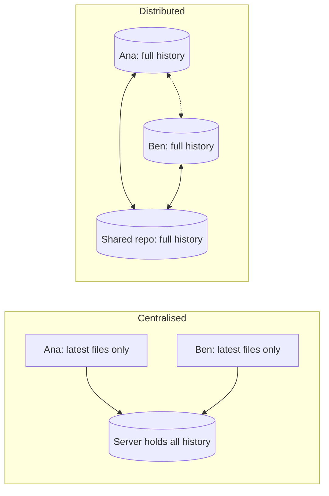
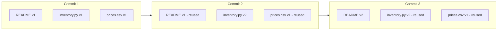
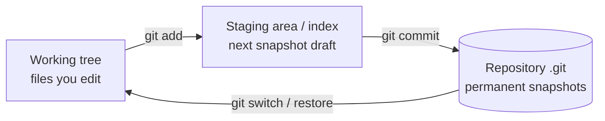
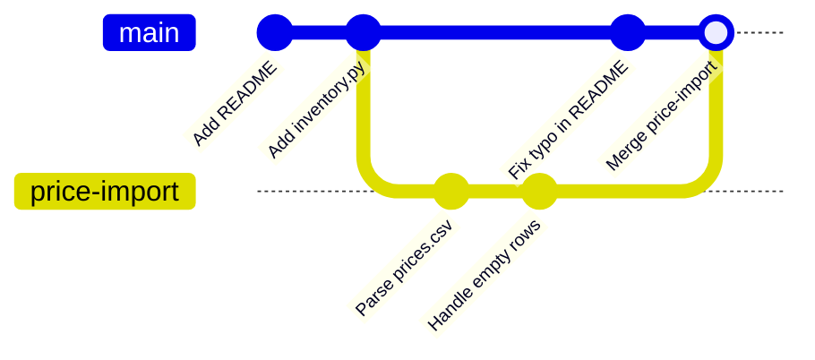

# Version control and how Git thinks

> **Before this lesson:** nothing is required beyond knowing how to create folders and edit text files. You do not need to have used a terminal (a window where you type commands) before; every command shown here is explained. This is the first lesson of the track.

## In plain words

Think about writing a long document with the "track changes" feature switched on, plus an endless "undo" button that still works after you close the program, plus the ability for five people to edit at once without overwriting each other. A **version control system** is that idea applied to a whole folder of files instead of one document. It is a program that keeps a dated, labelled history of the folder, so that any earlier state can be looked at or brought back.

An everyday analogy: a photographer shooting a building site once a day from the same spot. Each photo is a complete picture of the site on that day. Flip through the photos and you can see when the roof went on, and who signed the delivery note that day. **Git** is the most widely used version control system, and it works the same way: it takes a complete "photo" (Git calls it a **commit**) of your project folder each time you ask it to.

Why this matters for a job: practically every software team keeps its code in Git. Being unable to use it is like being unable to use email. Being *good* at it means you can work alongside others without losing work, find out when and why something broke, and undo mistakes calmly.

## Why this lesson exists

Picture a folder called `thesis` that contains `draft.docx`, `draft-v2.docx`, `draft-v2-final.docx` and `draft-v2-final-REALLY.docx`. Everyone has built that folder at least once. It is a home-made version control system, and it fails in predictable ways: you cannot tell what changed between two copies, you cannot tell *why* it changed, two people cannot work at the same time without emailing files around, and one careless "save as" destroys a week of work.

A **version control system** (VCS) is a tool that solves those problems on purpose. It records the state of a set of files over time so that you can

- go back to any earlier state of one file or of the whole project,
- see exactly what changed between two states, who changed it, when, and with what explanation,
- let several people work in parallel and combine their work,
- experiment freely, because nothing recorded is ever lost by accident.

Git is the VCS that almost the whole software industry settled on. It is also famous for being confusing. Nearly all of that confusion disappears once you hold the right mental model, and the model is small: **Git is a database of snapshots, addressed by a hash of their content, with a few movable name tags pointing into it.** The rest of this track unpacks that sentence. This first lesson gives you the vocabulary and the model; you will type very little, on purpose.

## Three generations of version control

It helps to see what Git replaced, because many of its design choices are reactions.

**Local systems.** The first tools kept a small database of changes next to your files on one machine. They beat the "copy the folder" method because they stored differences compactly and could rebuild any old revision. They did nothing for collaboration: the history lived on one disk.

**Centralised systems.** Tools such as CVS, Subversion and Perforce put the history on one server. Each developer checks out a working copy of the *latest* files, edits, and sends changes back to the server. This made teamwork possible and gave administrators a single place to control access. The price is a single point of failure. When the server is down, nobody can commit, compare with history or create a branch. If the server's disk dies and backups are stale, the history is gone, because clients only ever held one snapshot.

**Distributed systems.** In Git, Mercurial and similar tools, a client does not fetch only the newest files. It **clones the entire repository**, every version of every file. Each clone is a full backup and a full peer. You can commit, branch, search history and compare versions with no network at all, and you can exchange work with any other clone, not only with one blessed server.



> [!NOTE]
> "Distributed" does not mean "no central repository". Almost every team still nominates one repository (on GitHub, GitLab or an internal server) as the place where finished work meets. The difference is that this is a *convention*, not a technical requirement, and losing that server loses nothing that someone's clone does not also have.

## Where Git came from

Git was written in 2005 by the Linux kernel community, led by Linus Torvalds, after the proprietary tool the project had been using stopped being available free of charge. The kernel is a huge codebase with thousands of contributors, so the replacement had a demanding wish list: it had to be very fast, simple in its core design, strong at non-linear development (thousands of parallel branches), fully distributed, and able to handle a project of that size without slowing down. Those goals explain Git's character today. Branching is nearly free, almost every operation is local and instant, and the internal data model is small enough to describe in a page.

## Idea 1: snapshots, not differences

Many older systems think of history as a base version of each file plus a list of changes made to it over time. Git thinks differently. Every time you commit, Git records what **every tracked file looks like at that moment**: a snapshot of the whole project. If a file did not change, Git does not store it again; the new snapshot points at the copy it already has.



This sounds wasteful and is not, for two reasons you will see in the internals module: identical content is stored once, and Git later compresses similar files against each other. What the snapshot model buys is simplicity. A commit is a complete, self-contained picture; comparing any two commits never requires replaying a chain of patches; branches and merges become cheap operations on pointers.

The following runnable model shows how unchanged files are shared between snapshots.

```python-run
import hashlib

store = {}                      # content-addressed storage: key -> content

def save(content):
    key = hashlib.sha1(content.encode()).hexdigest()[:8]
    store[key] = content        # saving the same content twice is a no-op
    return key

def snapshot(files):
    """A snapshot is just a mapping file name -> key of its content."""
    return {name: save(text) for name, text in files.items()}

v1 = snapshot({"README": "Orchard stock tool", "inventory.py": "print('v1')", "prices.csv": "apple,3"})
v2 = snapshot({"README": "Orchard stock tool", "inventory.py": "print('v2')", "prices.csv": "apple,3"})
v3 = snapshot({"README": "Orchard stock tool. Run inventory.py", "inventory.py": "print('v2')", "prices.csv": "apple,3"})

for name, snap in (("v1", v1), ("v2", v2), ("v3", v3)):
    print(name, snap)
print("3 snapshots x 3 files = 9 entries, but stored objects:", len(store))
```

Nine file slots, five stored contents. The snapshots are complete, yet only changed files cost space.

## Idea 2: almost everything is local

Because your clone contains the whole history, the commands you use most (viewing the log, comparing with last month, creating a branch, committing) read and write only files on your own disk. That is why Git feels instant compared with a centralised tool that needs a round trip to a server for each question. It also means you can work on a train with no signal, commit ten times, and upload everything when you are back online. Only a handful of commands talk to the network: `clone`, `fetch`, `pull`, `push` and a few relatives.

## Idea 3: integrity through hashing

Before Git stores anything, it computes a checksum of it, and then uses that checksum as the thing's **name**. The checksum is a SHA-1 hash: 40 hexadecimal characters such as

```
8f3a91c0d2e47b5a6c9e1f0b7d4a2c8e5f6b3a19
```

Two consequences follow. First, Git cannot fail to notice corruption or tampering: if a single bit of a stored file changes, its hash no longer matches its name. Second, the same content always gets the same name, on every machine in the world, without any central authority handing out revision numbers. That is what makes a distributed system workable.

You will see these ids constantly, usually shortened to the first seven or so characters (`8f3a91c`). Git accepts any unambiguous prefix.

> [!NOTE]
> SHA-1 is no longer considered strong against a determined attacker who wants to construct two different inputs with one hash. Git has hardened its SHA-1 implementation against the known attack and also supports SHA-256 repositories (`git init --object-format=sha256`). For learning, everything behaves the same; the ids are longer.

## Idea 4: Git generally only adds data

Almost every Git action adds something to the database: a new snapshot, a new name tag. Very few actions remove anything, and committed snapshots are hard to lose even when you try. Commands that look destructive (deleting a branch, "undoing" a commit) normally move or delete only a *name*; the snapshots stay in the database for weeks and can be found again. This is why experienced users are relaxed about experimenting. The real danger zone is narrow and worth memorising now:

> [!WARNING]
> Work that has **never been committed** is not in the database, so Git cannot bring it back. Commands that overwrite uncommitted changes in your files (`git restore <file>`, `git checkout -- <file>`, `git reset --hard`, `git clean -f`) are the ones that genuinely destroy data. Commit early and often; a messy commit can be tidied later, a lost edit cannot.

## Idea 5: the three states

This is the idea beginners most often skip and then struggle without. A file that Git knows about is always in one of three states:

| State | Meaning |
|---|---|
| **Modified** | You changed the file, but have not told Git that this change belongs in the next snapshot. |
| **Staged** | You marked the current version of the file to go into the next snapshot. |
| **Committed** | The version is safely stored in the database as part of a snapshot. |

These states correspond to three places in a Git project:

- The **working tree** (or working directory): the ordinary files you see and edit. It is one version of the project, checked out of the database for you to use.
- The **staging area**, technically called the **index**: a file inside the `.git` directory that holds the proposed contents of your next commit.
- The **repository** (the `.git` directory): the database of all snapshots plus the name tags. This is what gets copied when you clone.



The everyday loop is therefore: edit files in the working tree; **stage** exactly the changes you want with `git add`; **commit**, which stores what is staged as a permanent snapshot.

Why have a staging area at all? Because the unit you want to record is "one logical change", and that rarely equals "everything I have touched since the last commit". Maybe you fixed a bug and, while you were there, renamed a variable and added a debug print. The staging area lets you build a commit containing only the bug fix, then a second commit with the rename, and never commit the debug print. Tools without a staging step push people toward giant "misc changes" commits.

Here is the loop in a real session. The project is a tiny stock tool called `orchard`. Do not worry about memorising the commands yet; watch how the file moves between areas.

```bash
$ mkdir orchard && cd orchard
$ git init
Initialized empty Git repository in /home/mira/orchard/.git/

$ echo "Orchard stock tool" > README.md
$ git status --short
?? README.md
```

`??` means Git sees a file it is not tracking. Nothing is staged, nothing is committed.

```bash
$ git add README.md
$ git status --short
A  README.md
```

`A` in the first column: the file is **staged** as an addition. A copy of its current content now sits in the index.

```bash
$ git commit -m "Add README"
[main (root-commit) 4c1e7a2] Add README
 1 file changed, 1 insertion(+)
 create mode 100644 README.md

$ git status --short
$
```

The snapshot is **committed** under the id beginning `4c1e7a2`. Status prints nothing because all three areas now agree.

```bash
$ echo "Run: python inventory.py" >> README.md
$ git status --short
 M README.md
```

`M` in the *second* column: **modified** in the working tree, not staged. The index still holds the old version, and so does the repository.

The same journey, modelled in a few lines of Python so you can poke at it:

```python-run
repo = {"commits": [], "index": {}, "worktree": {}}

def edit(name, text):  repo["worktree"][name] = text
def add(name):         repo["index"][name] = repo["worktree"][name]
def commit(msg):       repo["commits"].append((msg, dict(repo["index"])))

def state(name):
    last = repo["commits"][-1][1] if repo["commits"] else {}
    w, i, c = repo["worktree"].get(name), repo["index"].get(name), last.get(name)
    if i is None:            return "untracked"
    if w != i:               return "modified (not staged)"
    if i != c:               return "staged"
    return "committed"

edit("README.md", "Orchard stock tool");  print("after edit   :", state("README.md"))
add("README.md");                         print("after add    :", state("README.md"))
commit("Add README");                     print("after commit :", state("README.md"))
edit("README.md", "Orchard stock tool\nRun: python inventory.py")
print("after 2nd edit:", state("README.md"))
```

## A first look at history as a graph

Each commit remembers which commit came before it (its **parent**). Follow those links and you get the project's history. When two people work in parallel, history forks; when their work is combined, it joins again. So history is not a list but a graph, and you will draw it constantly in this track.



Read it left to right as time. `main` and `price-import` are **branches**: names that point at a commit and move forward as you add commits. The last commit has two parents; it is a **merge commit** that combines the two lines of work. Module 3 is devoted to this picture.

## The command line, and why this track uses it

Git has many graphical front ends, and they are fine for day-to-day work. This track teaches the command line because it is the only interface that exposes every feature, because every tutorial, error message and colleague's advice is phrased in commands, and because once you understand the commands you can drive any GUI, while the reverse is not true. Commands look like `git <verb> [options] [arguments]`, for example `git commit -m "message"`.

## Pitfalls and misconceptions

- **"Git stores diffs."** It stores snapshots. Diffs are computed on demand by comparing two snapshots. Thinking in snapshots makes commands like `reset`, `checkout` and `cherry-pick` much easier to reason about.
- **"Git and GitHub are the same thing."** Git is the tool on your machine. GitHub is one of several websites that host Git repositories and add collaboration features. You can use Git for years without any hosting service.
- **"Committing sends my work to the team."** A commit is local. Sharing is a separate, explicit step (`push`).
- **"`git add` means 'start tracking this file'."** It means "put the current content of this file into the next snapshot". You run it for new files *and* every time you want to include a fresh edit.
- **"If I staged it, it is saved."** Staged content is in the index, which is better than nothing, but only a commit gives it a place in history.
- **Forgetting the working tree is only one checkout.** The files you see are a view of one snapshot plus your edits. Switching branches rewrites them. The durable truth lives in `.git`.

> [!TIP]
> When Git confuses you, ask three questions in order: What does the last commit (HEAD) contain? What does the index contain? What does my working tree contain? `git status` answers all three, and almost every "what happened there?" moment is a disagreement between those three places.

> [!INTERVIEW]
> **"How is Git different from a centralised VCS such as Subversion?"** A strong answer names three things. (1) *Distribution*: every clone has full history, so commits, branches, logs and diffs are local and fast, and there is no single point of failure. (2) *Data model*: Git records whole-project snapshots identified by content hashes, forming a graph of commits, rather than per-file revision numbers on a server. (3) *Branching*: a branch is a 41-byte pointer, so creating and merging branches is cheap and routine. Mention the staging area as a bonus: commits are composed deliberately rather than "everything that changed".

## Cheat sheet

| Term | One-line meaning |
|---|---|
| Repository | The `.git` directory: all snapshots plus names for them |
| Working tree | The files checked out for you to edit |
| Index / staging area | The draft of the next commit |
| Commit | A permanent snapshot with author, date, message and parent link(s) |
| SHA-1 id | 40-hex-character name of an object, derived from its content |
| Clone | A full copy of a repository, history included |
| Modified / staged / committed | Changed on disk / marked for next commit / stored in the database |
| `git status` | Show how the three areas differ |
| `git add <file>` | Copy the file's current content into the index |
| `git commit` | Store the index as a new snapshot |

## Summary

Version control records the history of a project so that every past state can be recovered, compared and explained. Git is a *distributed* system: every clone holds the complete history, which makes most operations local, fast and safe. Git stores *snapshots* of the whole project and names everything by a hash of its content, which guarantees integrity and lets unchanged files be shared between snapshots. Files travel through three places, the working tree, the index and the repository, and correspondingly through three states: modified, staged and committed. History is a graph of commits linked to their parents, with branches as movable names. Uncommitted work is the only work Git cannot protect, so commit often.

## Glossary

- **Version control system (VCS):** a program that records the history of a set of files so earlier states can be inspected and restored.
- **Git:** a distributed version control system, created in 2005 for the Linux kernel project.
- **Repository (repo):** the database where Git keeps every snapshot and every name; it lives in a hidden folder called `.git` inside your project.
- **Clone:** a complete copy of a repository, including all history.
- **Commit:** one saved snapshot of the whole project, together with who made it, when, a message explaining it, and a link to the commit before it.
- **Snapshot:** the full state of all tracked files at one moment.
- **Hash (SHA-1):** a 40-character fingerprint computed from content; the same content always gives the same fingerprint, and Git uses it as the content's name. SHA stands for Secure Hash Algorithm.
- **Working tree:** the ordinary files in your project folder that you open and edit.
- **Index (staging area):** Git's draft of the next commit, filled by `git add`.
- **Tracked file:** a file Git has been told to include in snapshots; an **untracked** file is one Git sees in the folder but is not recording.
- **Modified / staged / committed:** changed on disk only / copied into the index / stored permanently in the repository.
- **Branch:** a movable name that points at a commit and marks one line of work.
- **Parent:** the commit that came directly before a given commit.
- **Merge commit:** a commit with two parents that joins two lines of work.

## Check yourself

```quiz
[
  {"q": "What does a Git commit fundamentally record?", "options": ["A snapshot of every tracked file at that moment, reusing unchanged content", "A compressed archive of the working directory including ignored files", "The list of line changes since the previous commit", "Only the files named in the commit message"], "answer": 0, "explain": "Git's model is snapshot-based. Unchanged files are not stored again; the new snapshot points at the existing stored content. Diffs are computed when you ask for them."},
  {"q": "You edit report.txt, run `git add report.txt`, then edit it again. What will `git commit` record for that file?", "options": ["Both versions as two commits", "The latest version on disk", "Nothing, because the file changed after staging", "The version as it was when you ran git add"], "answer": 3, "explain": "git add copies the content at that moment into the index. The commit stores the index, not the working tree, so the second edit stays as an unstaged modification."},
  {"q": "Which statement best describes a distributed VCS?", "options": ["Only one person can commit at a time", "Files are split across many servers for speed", "Each clone contains the full history and can operate without a server", "There can be no central repository"], "answer": 2, "explain": "Distribution means every clone is a complete repository. Teams still usually agree on one shared repository, but that is a convention."},
  {"q": "Why can Git detect a corrupted file in its database?", "options": ["File modification times are recorded", "The server re-verifies files nightly", "Every object is named by a hash of its content, so changed content no longer matches its name", "It keeps three copies of everything"], "answer": 2, "explain": "Content addressing: the SHA-1 of the stored bytes is the object's id. Any change to the bytes produces a different hash."},
  {"q": "Which of these operations needs a network connection?", "options": ["git commit", "git diff", "git push", "git log"], "answer": 2, "explain": "Committing, reading history and diffing use only the local repository. push (like fetch, pull and clone) exchanges data with another repository."},
  {"q": "Which work is Git genuinely unable to recover?", "options": ["A file removed in a later commit", "A commit on a branch you deleted yesterday", "A commit you amended", "Edits in the working tree that were never staged or committed and were then overwritten"], "answer": 3, "explain": "Anything committed stays in the object database for a good while even if no branch points to it. Content that never entered the database cannot be restored by Git."},
  {"q": "What is the main purpose of the staging area?", "options": ["To back up the working tree", "To let you choose precisely which changes form the next commit", "To hold files that are ignored", "To speed up commits by caching files"], "answer": 1, "explain": "The index is a draft of the next snapshot. It lets you split unrelated edits into separate, focused commits."}
]
```

> **Source:** Chacon & Straub, Pro Git 2e, ch. 1 (About Version Control; A Short History of Git; What is Git?; The Command Line). Explanations, examples and code written for this guide.
