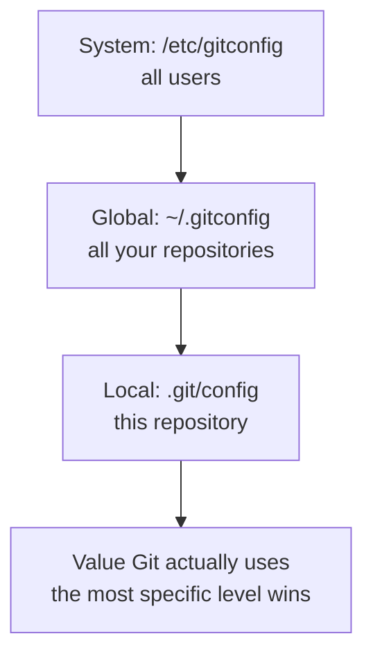
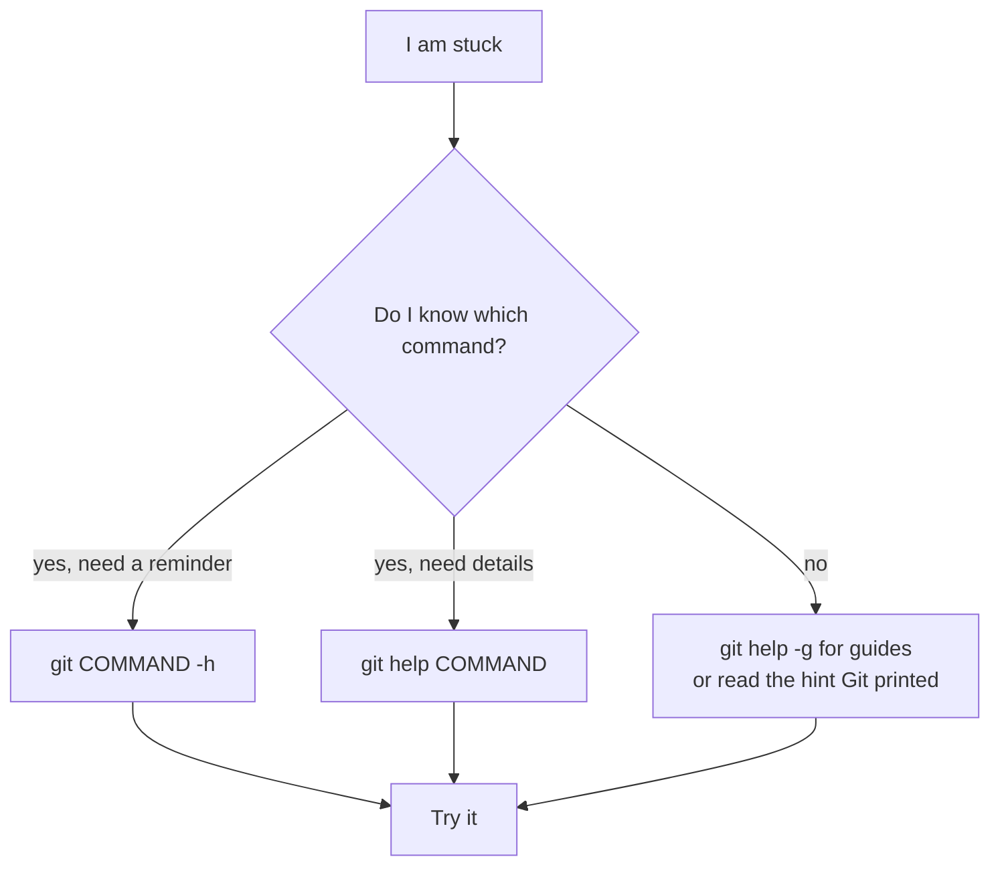
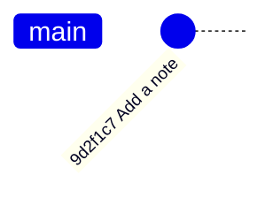

# Installing, configuring and getting help

> **Before this lesson:** read [Version control and how Git thinks](#/lesson/git/version-control-ideas), which introduces commits, the repository and the three areas. No terminal experience is assumed; the first section below explains what a terminal is.

## In plain words

Before you can use a new phone you put in your name, pick a language and choose a ringtone. Git needs the same kind of one-time introduction. It must be installed, told **who you are** (so that every snapshot you save carries your name), and told a few preferences such as which text editor to open when it needs you to type a message. This lesson walks through that setup and then shows you how to ask Git itself for help, which is the skill that keeps you unstuck for the rest of your career.

An analogy: a notary stamps every document with their name and the date. Git is your personal notary. Each commit (saved snapshot) is stamped with an author name, an email address and a time. If the stamp is wrong or missing, the history of a shared project becomes a mess of "unknown" and "root@laptop". Getting the stamp right takes two commands.

Why it matters for a job: on your first day at any software company, someone will say "clone the repo". If Git is not installed and configured, you are stuck at step zero. Misconfigured identities are also one of the most common small embarrassments for new hires: commits that show up under the wrong name, or under a personal email on company code.

## The terminal in two minutes

A **terminal** (also called a command line, console or shell window) is a program where you type a command as text, press Enter, and read the text reply. On Windows you can use *Git Bash* (installed together with Git), PowerShell or Windows Terminal. On macOS the program is called *Terminal*. On Linux it is usually called *Terminal* or *Konsole*.

In this track a line that begins with `$` is something **you type** (without the `$`; that symbol stands for the prompt, the bit of text the terminal shows when it is waiting for you). Lines without `$` are **what the computer prints back**.

```bash
$ git --version
git version 2.47.1
```

Line by line:

- `git` is the name of the program.
- `--version` is an **option** (also called a flag): extra text that changes what the program does. Here it asks Git to print which release is installed. Options that are whole words start with two dashes; one-letter options start with one dash, such as `-v`.
- The reply `git version 2.47.1` tells you Git is installed. Your number will differ; anything from 2.30 upward behaves like the examples in this track.

If the reply is instead something like `command not found` or `'git' is not recognized`, Git is not installed yet.

## Installing Git

Pick the line for your operating system. You only do this once.

```bash
# Debian, Ubuntu and relatives
$ sudo apt install git-all

# Fedora, RHEL and relatives
$ sudo dnf install git-all

# macOS: typing any git command triggers an offer to install the developer tools
$ git --version

# macOS with the Homebrew package manager
$ brew install git

# Windows with the winget package manager
$ winget install --id Git.Git -e --source winget
```

What these lines mean:

- A line starting with `#` is a **comment**: a note for humans that the terminal ignores.
- `sudo` (Linux and macOS) runs the following command with administrator rights, which installing software requires. It will ask for your password.
- `apt`, `dnf`, `brew` and `winget` are **package managers**, programs that download and install other programs.
- On Windows you can also download the installer from the official site, git-scm.com, and click through it. The installer adds *Git Bash*, a terminal that understands the same commands as Linux and macOS, so examples in this track work unchanged.

After installing, run `git --version` again to confirm.

> [!TIP]
> Installing from source or pinning an exact version is rarely needed. What does matter is not being years out of date: commands such as `git switch` and `git restore` arrived in version 2.23, and the default branch name setting in 2.28. If your version is older than those, update before continuing.

## Where configuration lives: three levels

Git reads settings from three places, and it helps to know them before you set anything. A **configuration file** is a plain text file of `name = value` lines that a program reads at start-up.

| Level | Option | File | Applies to |
|---|---|---|---|
| System | `--system` | `/etc/gitconfig` (or inside the Git install folder on Windows) | every user on the computer |
| Global | `--global` | `~/.gitconfig` (your home folder) | every repository of **your user account** |
| Local | `--local` (the default) | `.git/config` inside one repository | only that repository |

`~` is shorthand for your **home folder**: `/home/mira` on Linux, `/Users/mira` on macOS, `C:\Users\mira` on Windows.

The levels override each other from broad to narrow: a local value beats a global one, which beats a system one. That rule is what lets you say "my name is Mira everywhere, but in *this* repository use my work email".



A small model of that lookup, runnable in the browser. Change the dictionaries and watch which value wins.

```python-run
system = {"core.editor": "vi", "init.defaultBranch": "master"}
global_ = {"user.name": "Mira Okafor", "user.email": "mira@home.example", "init.defaultBranch": "main"}
local = {"user.email": "mira.okafor@work.example"}

def lookup(key):
    # search from the most specific level to the least specific
    for level_name, level in (("local", local), ("global", global_), ("system", system)):
        if key in level:
            return level[key], level_name
    return None, "unset"

for key in ("user.name", "user.email", "init.defaultBranch", "core.editor", "color.ui"):
    value, origin = lookup(key)
    print(f"{key:20} = {value!s:28} (from {origin})")
```

## First-time setup, step by step

### Step 1: your identity

```bash
$ git config --global user.name "Mira Okafor"
$ git config --global user.email "mira@home.example"
```

- `git config` is the command that reads and writes settings.
- `--global` says "store this in my per-user file, so it applies to all my repositories".
- `user.name` is the **key** (the setting's name). Keys have a section (`user`) and a name (`name`) separated by a dot.
- `"Mira Okafor"` is the **value**. The quotation marks are needed because the value contains a space; without them the terminal would hand Git two separate words.
- Neither command prints anything. In the terminal world, silence means success.

The name and email are copied into every commit you make from now on. They are plain text labels, not a login: Git does not check them against anything. (Hosting sites such as GitHub use the email to link commits to your account, which is why it should match an address registered there.)

### Step 2: your editor

Sometimes Git needs you to type more than one line, for example a commit message. It then opens a text editor and waits until you save and close the file. If you never choose one, Git falls back to the system default, which is often Vim, an editor that famously traps newcomers who do not know how to quit it.

```bash
# Visual Studio Code (the --wait flag makes Git pause until you close the tab)
$ git config --global core.editor "code --wait"

# nano, a small beginner-friendly terminal editor
$ git config --global core.editor "nano"

# Notepad++ on Windows
$ git config --global core.editor "'C:/Program Files/Notepad++/notepad++.exe' -multiInst -notabbar -nosession -noPlugin"
```

Run only the line for the editor you use. The `--wait` part matters for graphical editors: without it the editor returns control immediately and Git believes you entered an empty message.

> [!WARNING]
> If you ever find yourself inside Vim by accident (a screen full of `~` characters, and typing does odd things), press `Esc`, then type `:q!` and press Enter to leave without saving, or `:wq` and Enter to save and leave. Then set `core.editor` so it does not happen again.

### Step 3: the default branch name

When you create a new repository, Git creates a first **branch** (a named line of work; module 3 explains branches fully). Historically it was called `master`; most projects and hosting sites now use `main`. Set it once so new repositories match:

```bash
$ git config --global init.defaultBranch main
```

### Step 4: check what you have

```bash
$ git config --list --show-origin
file:/home/mira/.gitconfig      user.name=Mira Okafor
file:/home/mira/.gitconfig      user.email=mira@home.example
file:/home/mira/.gitconfig      core.editor=code --wait
file:/home/mira/.gitconfig      init.defaultbranch=main
```

- `--list` prints every setting Git can find.
- `--show-origin` adds, in front of each one, the file it came from. This is the tool for answering "why is Git using that value?".
- Keys are shown in lower case; Git treats section and variable names without regard to capital letters.

You can also ask for a single key:

```bash
$ git config user.email
mira@home.example

$ git config --show-origin user.email
file:/home/mira/.gitconfig      mira@home.example
```

If the same key appears at several levels, `--list` shows it more than once, and the **last** one printed is the one in effect.

### Step 5 (optional): a different identity for one repository

Inside a work repository, leave out `--global` to write to that repository's own file:

```bash
$ cd ~/work/billing-service
$ git config user.email "mira.okafor@work.example"
$ git config --show-origin user.email
file:.git/config        mira.okafor@work.example
```

- `cd` means "change directory": it moves the terminal into the named folder.
- With no level option, `git config` writes to the local file `.git/config`.
- The second command proves that, here, the local value now wins over the global one.

What the global file looks like if you open it in an editor:

```bash
$ cat ~/.gitconfig
[user]
        name = Mira Okafor
        email = mira@home.example
[core]
        editor = code --wait
[init]
        defaultBranch = main
```

`cat` prints a file's contents. Each `[section]` header groups the keys that start with that section name. You may edit this file by hand; `git config` is a convenience for doing so safely.

## A few settings worth knowing on day one

None of these are required, and each is revisited later in the track.

```bash
# Show colours in output (on by default in modern versions)
$ git config --global color.ui auto

# When pulling, refuse to create surprise merges; only move forward when possible
$ git config --global pull.ff only

# Windows: convert line endings to Windows style on checkout, back on commit
$ git config --global core.autocrlf true

# macOS and Linux: convert only on commit, to keep Windows line endings out
$ git config --global core.autocrlf input
```

A **line ending** is the invisible character (or pair of characters) that marks the end of each line in a text file. Windows traditionally uses two (written CRLF, "carriage return, line feed"), macOS and Linux use one (LF). Without one of the two `autocrlf` settings, mixed teams end up with files where every line looks changed.

To remove a setting:

```bash
$ git config --global --unset pull.ff
```

## Getting help

Git has several hundred commands and options. Nobody memorises them; people who look expert are people who look things up quickly. There are three levels of help.

**The full manual page** for a command. A manual page ("man page") is the complete reference document for one command.

```bash
$ git help config
$ git config --help
$ man git-config
```

All three open the same document. In a terminal pager (the program that shows long text one screen at a time) press Space to scroll, `/word` to search, and `q` to quit. On Windows the page opens in your web browser instead.

**The short summary**, when you only need a reminder of the options:

```bash
$ git add -h
usage: git add [<options>] [--] <pathspec>...

    -n, --[no-]dry-run    dry run
    -v, --[no-]verbose    be verbose

    -i, --[no-]interactive
                          interactive picking
    -p, --[no-]patch      select hunks interactively
    -e, --[no-]edit       edit current diff and apply
    -f, --[no-]force      allow adding otherwise ignored files
    -u, --[no-]update     update tracked files
    ...
```

`-h` (one dash, one letter) prints a compact list directly in the terminal. Square brackets in a `usage:` line mark optional parts; `<angle brackets>` mark something you replace with a real value; `...` means "one or more".

**Git's own hints.** Git prints advice in the output of many commands. Read it; it is usually the exact next command you need.

```bash
$ git comit -m "Add README"
git: 'comit' is not a git command. See 'git --help'.

The most similar command is
        commit
```

Git noticed the typing mistake and suggested the right command.



`git help -a` lists every command, and `git help -g` lists the concept guides, such as `git help tutorial` and `git help everyday`.

## Seeing the configured identity inside a commit

A setting matters only when it affects something. Here is the identity being stamped onto a commit in a scratch repository. A **scratch repository** is a throwaway one you create to experiment in.

```bash
$ mkdir scratch && cd scratch
$ git init
Initialized empty Git repository in /home/mira/scratch/.git/
$ echo "hello" > note.txt
$ git add note.txt
$ git commit -m "Add a note"
[main (root-commit) 9d2f1c7] Add a note
 1 file changed, 1 insertion(+)
 create mode 100644 note.txt
$ git log
commit 9d2f1c7a53b0e6c1f4d8a2b7e9c0d1f2a3b4c5d6 (HEAD -> main)
Author: Mira Okafor <mira@home.example>
Date:   Fri Nov 20 10:14:03 2026 +0100

    Add a note
```

- `mkdir scratch && cd scratch` creates a folder and moves into it; `&&` runs the second command only if the first succeeded.
- `git init` turns the folder into a repository. Note the branch is `main`, from step 3.
- `echo "hello" > note.txt` creates a file containing the word hello; `>` sends the output of `echo` into a file.
- `git add` and `git commit -m` stage and save the snapshot, as in the previous lesson. `-m` supplies the message on the command line, so no editor opens.
- `git log` prints history. The `Author:` line is your configured name and email. The `(HEAD -> main)` note says which commit you are on and that the branch `main` points to it.

The history at this point is one commit:



If you had skipped step 1, the commit command would have stopped with a message beginning `Author identity unknown` and told you the two `git config` commands to run.

## Pitfalls

- **Forgetting `--global`.** Run in a repository, `git config user.name "..."` sets the name for that repository only; the next repository has no name. Run outside any repository, it fails with `fatal: not in a git directory`.
- **Using `--global` when you meant local.** Setting a work email globally stamps it on personal projects too. Check with `git config --show-origin user.email`.
- **A typo in the email.** Hosting sites cannot link the commits to your account, so your contributions appear to come from a stranger. Fixing the setting repairs future commits only; old commits keep the old stamp.
- **Graphical editor without a wait flag.** The commit aborts with `Aborting commit due to empty commit message` because Git did not wait.
- **Assuming config is shared.** Configuration files are **not** part of the project history. Each teammate has their own. Settings that must be shared live in tracked files such as `.gitattributes` and `.gitignore`, covered later.
- **Editing as administrator.** `--system` needs administrator rights and affects everyone on the machine; you almost never want it.

> [!INTERVIEW]
> **"Your commits on the company repository show your personal email. How do you fix it, and how do you stop it happening again?"** For future commits in that repository: `git config user.email work@company.example` (local level). To automate it for every repository under a work folder, add an `includeIf "gitdir:~/work/"` section to `~/.gitconfig` that loads a second file containing the work identity. For the *last* commit, if it has not been shared yet: `git commit --amend --reset-author --no-edit`. Mention that rewriting commits that others already have needs coordination, and that the interviewer is checking you know the three config levels and their precedence.

## Cheat sheet

| Task | Command |
|---|---|
| Check Git is installed | `git --version` |
| Set name for all your repositories | `git config --global user.name "Your Name"` |
| Set email for all your repositories | `git config --global user.email you@example.com` |
| Set email for this repository only | `git config user.email you@work.example` |
| Choose the editor | `git config --global core.editor "code --wait"` |
| Default branch name for new repositories | `git config --global init.defaultBranch main` |
| Show every setting and its file | `git config --list --show-origin` |
| Show one setting | `git config user.name` |
| Remove a setting | `git config --global --unset <key>` |
| Open the global file in your editor | `git config --global --edit` |
| Full manual for a command | `git help <command>` |
| Short option summary | `git <command> -h` |

## Summary

Git is installed with your system's package manager or the official installer, and `git --version` confirms it. Settings live at three levels, system, global and local, and the most specific level wins. The essential first-time setup is your name and email (stamped into every commit), your editor (so that Git never drops you into one you cannot leave), and the default branch name. `git config --list --show-origin` shows what is in effect and where it comes from. For help, `git <command> -h` gives a quick reminder, `git help <command>` gives the full manual, and Git's own printed hints are often the fastest route of all.

## Glossary

- **Terminal (command line, shell):** a program in which you type commands as text and read text replies.
- **Prompt:** the text the terminal shows when it is ready for a command; written as `$` in this track.
- **Option (flag):** extra text after a command, starting with `-` or `--`, that changes its behaviour.
- **Package manager:** a program that installs and updates other programs (`apt`, `dnf`, `brew`, `winget`).
- **Home folder (`~`):** your personal folder on the computer.
- **Configuration (config):** stored settings; in Git, `key = value` pairs kept in text files.
- **System / global / local level:** settings for the whole machine / for your user / for one repository.
- **Key:** the name of a setting, such as `user.email`.
- **Editor:** the program used to type text; Git opens it when it needs a longer message from you.
- **Line ending:** the invisible marker at the end of each text line; LF on Linux and macOS, CRLF on Windows.
- **Man page:** the full reference document for a command.
- **Pager:** the program that shows long output one screen at a time; quit it with `q`.
- **Scratch repository:** a throwaway repository made for experimenting.

## Check yourself

```quiz
[
  {"q": "You set user.email with --global to a personal address and, inside one repository, without any level option to a work address. Which address is used for commits in that repository?", "options": ["Whichever was set most recently", "Git asks each time", "The personal one, because global is stronger", "The work one, because local overrides global"], "answer": 3, "explain": "Precedence goes system, then global, then local, and the most specific level wins. With no level option, git config writes to the repository's own .git/config."},
  {"q": "What does `git config --list --show-origin` add compared with `git config --list`?", "options": ["The default value of each setting", "The date each setting was changed", "The file each setting was read from", "Settings of other users"], "answer": 2, "explain": "--show-origin prefixes each line with the file it came from, which is how you find out which level is supplying a value."},
  {"q": "Why should a graphical editor be configured as `code --wait` and not `code`?", "options": ["It is needed only on Windows", "Without waiting, Git thinks you finished immediately and sees an empty message", "It enables syntax colours", "It makes the editor start faster"], "answer": 1, "explain": "Git launches the editor and continues when that program exits. Many graphical editors return at once unless told to wait, so Git reads an empty file and aborts the commit."},
  {"q": "Does Git verify that the name and email you configure belong to you?", "options": ["Yes, by sending a confirmation email", "Yes, against your operating system account", "No, they are plain labels copied into each commit", "Only when pushing"], "answer": 2, "explain": "They are text stamped into commits. Proof of identity is a separate feature (signing commits), covered in the Git tools module."},
  {"q": "Which command prints a short list of options for `git commit` directly in the terminal?", "options": ["git help commit", "git commit --manual", "git commit -h", "man git-commit"], "answer": 2, "explain": "-h gives the compact usage summary. `git help commit` and `man git-commit` open the full manual page."},
  {"q": "A teammate says a setting you rely on is missing after they cloned the project. Why?", "options": ["Configuration files are not part of the repository history, so they are not copied by clone", "Settings arrive on the first pull", "They need administrator rights", "Clone failed partway"], "answer": 0, "explain": ".git/config and ~/.gitconfig are per-machine. Anything that must be shared has to live in a tracked file such as .gitattributes or .gitignore, or be documented."},
  {"q": "Where does `git config --global` store its values?", "options": ["In /etc/gitconfig", "In .git/config of the current repository", "In a file in your home folder, typically ~/.gitconfig", "On the hosting server"], "answer": 2, "explain": "Global means per user: a file in your home folder that applies to every repository you work in on that machine."}
]
```

> **Source:** Chacon & Straub, Pro Git 2e, ch. 1 (Installing Git; First-Time Git Setup; Getting Help). Explanations, examples and code written for this guide.
