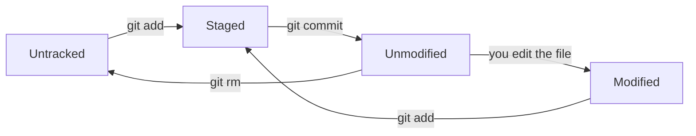
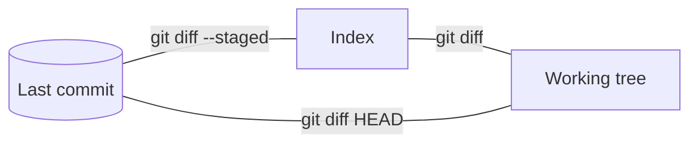
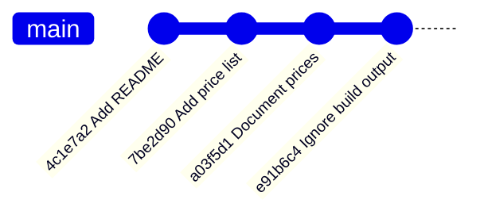

# Getting a repository and recording changes

> **Before this lesson:** you should know the three areas (working tree, index, repository) from [Version control and how Git thinks](#/lesson/git/version-control-ideas) and have Git installed and configured as in [Installing, configuring and getting help](#/lesson/git/setup-and-help).

## In plain words

Recording work in Git is like packing a parcel. Your desk (the **working tree**) is covered in things you have been making. You choose which items go into the box (that choosing is called **staging**, done with `git add`). When the box holds exactly what you want, you seal it, write a label saying what is inside, and put it on the shelf (that is a **commit**). The shelf of sealed, labelled boxes is your project's history.

This lesson covers the handful of commands you will type dozens of times a day for the rest of your working life: starting a repository, checking what state things are in, staging, committing, looking at differences, and telling Git which files to leave out of the parcel altogether.

Why it matters for a job: this loop *is* daily Git. A person who stages carefully and writes clear commit labels produces a history their teammates can read, review and debug. A person who types `git add .` and `git commit -m "stuff"` without looking produces a history nobody can use, and regularly commits passwords and junk files by accident.

## Two ways to get a repository

A **repository** is a project folder that Git is watching, thanks to a hidden subfolder named `.git` that holds the history.

### Way 1: turn an existing folder into a repository

```bash
$ cd ~/projects/orchard
$ git init
Initialized empty Git repository in /home/mira/projects/orchard/.git/
```

- `cd ~/projects/orchard` moves the terminal into the project folder.
- `git init` ("initialise") creates the `.git` subfolder. That is all it does. No file is tracked yet and there is no commit; Git has only prepared an empty database.

### Way 2: copy a repository that already exists

```bash
$ git clone https://git.example.com/greenhouse/orchard.git
Cloning into 'orchard'...
remote: Enumerating objects: 148, done.
remote: Counting objects: 100% (148/148), done.
remote: Compressing objects: 100% (97/97), done.
remote: Total 148 (delta 41), reused 148 (delta 41), pack-reused 0
Receiving objects: 100% (148/148), 32.10 KiB | 2.14 MiB/s, done.
Resolving deltas: 100% (41/41), done.
```

- `git clone <address>` downloads the *entire* history from the address (a **URL**, a web-style address), creates a folder named after the project, and checks out the newest version of the files into it.
- The lines starting with `remote:` are progress messages from the other computer. You can ignore the numbers.
- To choose a different folder name, add it at the end: `git clone <address> my-orchard`.

After either way you have a working tree and a `.git` folder. The rest of the lesson uses a fresh `git init` repository so you can see every state from the beginning.

## The life cycle of a file

Every file in your working tree is either **untracked** (Git sees it but has never been asked to record it) or **tracked** (Git knows it from the last snapshot or from the index). A tracked file is *unmodified*, *modified* or *staged*.



## Step 1: check the state with git status

`git status` is the command to run whenever you are unsure. It changes nothing.

```bash
$ git status
On branch main

No commits yet

nothing to commit (create/copy files and use "git add" to track)
```

- `On branch main`: you are on the line of work named `main`.
- `No commits yet`: the history is empty.
- The last line says the working tree has nothing Git could record, and hints at the next command.

Create a first file and look again:

```bash
$ echo "# Orchard stock tool" > README.md
$ git status
On branch main

No commits yet

Untracked files:
  (use "git add <file>..." to include in what will be committed)
        README.md

nothing added to commit but untracked files present (use "git add" to track)
```

`README.md` is listed under **Untracked files**. Git will never include a file in a snapshot unless you ask; this protects you from committing build output or private notes by accident.

## Step 2: stage with git add

```bash
$ git add README.md
$ git status
On branch main

No commits yet

Changes to be committed:
  (use "git rm --cached <file>..." to unstage)
        new file:   README.md
```

`git add README.md` copied the file's current content into the index. The heading **Changes to be committed** lists what the next snapshot will contain.

Now the detail that surprises every beginner. Edit the file again *after* staging:

```bash
$ echo "Counts fruit in the warehouse." >> README.md
$ git status
On branch main

No commits yet

Changes to be committed:
  (use "git rm --cached <file>..." to unstage)
        new file:   README.md

Changes not staged for commit:
  (use "git add <file>..." to update what will be committed)
  (use "git restore <file>..." to discard changes in working directory)
        modified:   README.md
```

- `>>` appends a line to the file (a single `>` would replace the file).
- The same file now appears **twice**: once staged, once not staged. The staged copy is the one-line version from the moment you ran `git add`. The working tree holds the two-line version. If you committed now, the one-line version would be recorded.
- To include the newer edit, run `git add README.md` again. `git add` means "stage the content as it is right now", every time.

```bash
$ git add README.md
$ git status --short
A  README.md
```

`--short` (or `-s`) prints a compact view: two status letters, then the file name. The left letter describes the index, the right letter the working tree.

| Code | Meaning |
|---|---|
| `??` | untracked |
| `A ` | new file, staged |
| `M ` | modified and staged |
| ` M` | modified, not staged |
| `MM` | staged, then modified again |
| `D ` | deletion staged |
| ` D` | deleted on disk, deletion not staged |

## Step 3: commit

```bash
$ git commit -m "Add README describing the tool"
[main (root-commit) 4c1e7a2] Add README describing the tool
 1 file changed, 2 insertions(+)
 create mode 100644 README.md
```

- `git commit` stores the index as a permanent snapshot.
- `-m "..."` supplies the message. Without `-m`, Git opens your editor so you can write a longer one.
- The reply tells you the branch (`main`), that this is the very first commit (`root-commit`), the short id (`4c1e7a2`), the message, and a summary of what changed. `100644` is the file's **mode**, a number meaning "ordinary, non-executable file".

A commit records what was *staged*. Anything modified but not staged stays in your working tree, untouched, for a later commit.

For edits to files that are already tracked there is a shortcut: `git commit -a -m "message"` stages every modified or deleted tracked file and commits in one go. It does **not** pick up untracked files, and it removes the chance to review what you are including, so use it with open eyes.

## Step 4: see what changed with git diff

`git status` says *which* files changed. `git diff` shows *what* changed, line by line. A **diff** is a listing of the differences between two versions of text.

Add a second file, commit it, then make two edits and stage only one:

```bash
$ printf 'apple,3\npear,5\n' > prices.csv
$ git add prices.csv
$ git commit -m "Add price list"
[main 7be2d90] Add price list
 1 file changed, 2 insertions(+)
 create mode 100644 prices.csv

$ printf 'apple,3\npear,6\nplum,4\n' > prices.csv
$ echo "See prices.csv for prices." >> README.md
$ git add README.md
```

Now `git diff` with no arguments compares the **working tree with the index**: changes you have made but not yet staged.

```bash
$ git diff
diff --git a/prices.csv b/prices.csv
index 0d1c8f3..5a9e2b7 100644
--- a/prices.csv
+++ b/prices.csv
@@ -1,2 +1,3 @@
 apple,3
-pear,5
+pear,6
+plum,4
```

How to read it:

- `diff --git a/prices.csv b/prices.csv`: which file. `a/` is the old side, `b/` the new side.
- `index 0d1c8f3..5a9e2b7`: the ids of the old and new content.
- `--- a/prices.csv` and `+++ b/prices.csv`: a legend. Lines starting with `-` come from the old version, lines starting with `+` from the new one.
- `@@ -1,2 +1,3 @@`: a **hunk header**. A hunk is one block of nearby changes. This one says: in the old file the block starts at line 1 and is 2 lines long; in the new file it starts at line 1 and is 3 lines long.
- A line starting with a space is unchanged context. `-pear,5` was removed; `+pear,6` and `+plum,4` were added. A changed line is shown as a removal plus an addition.

`README.md` is missing from that output because its change is already staged. To see staged changes (**index compared with the last commit**), which is exactly what the next commit will contain:

```bash
$ git diff --staged
diff --git a/README.md b/README.md
index 91a3c5e..c44f0d1 100644
--- a/README.md
+++ b/README.md
@@ -1,2 +1,3 @@
 # Orchard stock tool
 Counts fruit in the warehouse.
+See prices.csv for prices.
```

`--cached` is an older spelling of `--staged`; they are identical.



The runnable model below reproduces the idea: a diff is computed from two versions on demand, nothing more.

```python-run
import difflib

old = ["apple,3", "pear,5"]
new = ["apple,3", "pear,6", "plum,4"]

for line in difflib.unified_diff(old, new, "a/prices.csv", "b/prices.csv", lineterm=""):
    print(line)
```

> [!TIP]
> Make `git diff --staged` a habit immediately before every commit. It is your last look inside the parcel before sealing it, and it catches stray debug lines, half-finished edits and secrets.

## Ignoring files with .gitignore

Some files should never be recorded: compiled output, downloaded dependencies, editor settings, log files, and files holding passwords. A **`.gitignore`** file lists name patterns that Git should pretend not to see. It is an ordinary tracked file, so the whole team shares it.

```bash
$ cat .gitignore
# compiled Python files
__pycache__/
*.pyc

# local environment and secrets
.env
venv/

# logs anywhere, except one we keep as a sample
*.log
!sample.log

# only the TODO file at the top level, not docs/TODO
/TODO

# all PDFs anywhere below docs
docs/**/*.pdf
```

The rules for one line:

- Blank lines and lines starting with `#` are ignored.
- `*` matches any run of characters except `/`; `?` matches one character; `[abc]` matches one of the listed characters.
- A trailing `/` makes the pattern match folders only (`venv/`).
- A leading `/` pins the pattern to the folder where the `.gitignore` file lives (`/TODO`). A pattern with no slash matches at any depth.
- `**` matches any number of nested folders.
- A leading `!` *re-includes* something an earlier line ignored. Later lines override earlier ones.

Check which rule is responsible for ignoring a file:

```bash
$ git check-ignore -v build.log
.gitignore:9:*.log      build.log
```

The reply names the file, the line number and the pattern that matched.

> [!WARNING]
> `.gitignore` only affects files that are **not yet tracked**. If a file is already in a commit, adding it to `.gitignore` does nothing; Git keeps recording changes to it. You must also stop tracking it with `git rm --cached <file>`. And if a password was ever committed, ignoring it later does not remove it from history; treat the password as leaked and change it. The rescue module shows the full procedure.

## Removing and moving files

Deleting a tracked file in your file manager leaves Git with a "deleted, not staged" change. `git rm` deletes the file **and** stages the deletion in one step:

```bash
$ git rm notes-old.txt
rm 'notes-old.txt'
$ git status --short
D  notes-old.txt
```

To stop tracking a file but **keep it on disk** (the usual fix after committing something that should have been ignored):

```bash
$ git rm --cached .env
rm '.env'
$ git status --short
D  .env
?? .env
```

`--cached` restricts the removal to the index. The file now shows as a staged deletion (it will vanish from the next snapshot) and as untracked (it still exists on disk). Add it to `.gitignore` and the second line disappears.

Renaming:

```bash
$ git mv prices.csv price-list.csv
$ git status --short
R  prices.csv -> price-list.csv
```

`git mv` is a convenience for three steps: rename the file, `git rm` the old name, `git add` the new name. Git does not store "this was renamed" anywhere. It records snapshots and works out renames afterwards by noticing that a removed file and an added file have the same or very similar content.

## The history so far



Each commit points back to the one before it. So far the history is a straight line; branching comes in module 3.

## Pitfalls

- **`git add .` without looking.** The dot means "everything in this folder and below". It will happily stage log files, credentials and a 2 GB dataset. Run `git status` first, and prefer naming files or using `git add -p` (interactive staging, covered in the tools module).
- **Editing after staging and forgetting to re-add.** The commit silently contains the older content. `git status` shows the file in both sections when this is about to happen.
- **Expecting `.gitignore` to untrack a committed file.** It does not; see the warning above.
- **Empty folders.** Git tracks files, not folders. An empty folder cannot be committed. The common workaround is to put a placeholder file named `.gitkeep` inside it.
- **Vague messages.** `fix`, `update`, `wip` tell a future reader nothing. Write what the change does and, if it is not evident, why: "Reject negative quantities in stock import".
- **One giant commit.** A commit that mixes a bug fix, a rename and a new feature cannot be reviewed, reverted or understood separately. One logical change per commit.

> [!INTERVIEW]
> **"What is the difference between `git diff`, `git diff --staged` and `git diff HEAD`?"** `git diff` compares the working tree with the index: what you have changed but not staged. `git diff --staged` compares the index with the last commit: what the next commit will contain. `git diff HEAD` compares the working tree with the last commit: everything changed since the last commit, staged or not. A follow-up often asked: "Why would a file appear in both the staged and unstaged lists?" Because the index holds a copy of the file from when it was added, and the file was edited again afterwards.

## Cheat sheet

| Task | Command |
|---|---|
| Start a repository in the current folder | `git init` |
| Copy an existing repository | `git clone <url> [folder]` |
| What is the state of things? | `git status` or `git status -s` |
| Stage a file's current content | `git add <file>` |
| Stage all changes to tracked files | `git add -u` |
| Unstaged changes, line by line | `git diff` |
| Staged changes, line by line | `git diff --staged` |
| Commit what is staged | `git commit -m "message"` |
| Stage tracked changes and commit | `git commit -a -m "message"` |
| Delete a file and stage the deletion | `git rm <file>` |
| Stop tracking but keep the file | `git rm --cached <file>` |
| Rename a file | `git mv <old> <new>` |
| Why is this file ignored? | `git check-ignore -v <file>` |

## Summary

You obtain a repository with `git init` (new, empty history) or `git clone` (full copy of an existing one). Files start untracked; `git add` stages their current content; `git commit` seals the staged content into a snapshot with a message. `git status` shows which files differ between the last commit, the index and the working tree, and `git diff` / `git diff --staged` show those differences line by line. `.gitignore` keeps unwanted files out, but only if they were never tracked. `git rm` and `git mv` stage deletions and renames. The discipline that makes everything else in Git pleasant is small, reviewed, clearly labelled commits.

## Glossary

- **`git init`:** creates an empty repository (a `.git` folder) in the current folder.
- **`git clone`:** downloads a complete copy of an existing repository.
- **URL:** a web-style address such as `https://host/path`, telling Git where another repository lives.
- **Untracked file:** a file in the working tree that Git has never been asked to record.
- **Tracked file:** a file that is in the last snapshot or in the index.
- **Stage (verb):** copy a file's current content into the index with `git add`.
- **Commit message:** the label explaining what a commit changes and why.
- **Root commit:** the first commit in a repository; it has no parent.
- **Diff:** a line-by-line listing of the differences between two versions.
- **Hunk:** one block of neighbouring changed lines in a diff, introduced by an `@@` header.
- **Context lines:** unchanged lines shown around a change to help you locate it.
- **Mode:** a number recording the kind of file and whether it is executable, for example `100644`.
- **`.gitignore`:** a tracked text file of patterns naming files Git should not track.
- **Pattern (glob):** a file-name template using wildcards such as `*` and `?`.

## Check yourself

```quiz
[
  {"q": "After `git init` in a folder containing ten files, how many files are tracked?", "options": ["Only files not matched by .gitignore", "None", "All ten", "Only text files"], "answer": 1, "explain": "git init only creates the empty .git database. Files become tracked when you git add them."},
  {"q": "`git status -s` shows `MM app.py`. What does that mean?", "options": ["It is in a merge conflict", "The file was modified by two people", "It was moved twice", "It has staged changes and further unstaged changes on top"], "answer": 3, "explain": "The left column is the index compared with the last commit, the right column is the working tree compared with the index. Both show a modification, so the file was staged and then edited again."},
  {"q": "Which command shows exactly what the next commit will contain?", "options": ["git diff", "git status", "git log", "git diff --staged"], "answer": 3, "explain": "git diff --staged (also spelled --cached) compares the index with the last commit, and the index is what gets committed."},
  {"q": "config.env is already committed. You add `config.env` to .gitignore. What happens to future edits of that file?", "options": ["They are ignored", "Git refuses to commit", "The file is deleted from disk", "They are still tracked and shown as modified"], "answer": 3, "explain": "Ignore rules apply only to untracked files. To stop tracking it, run git rm --cached config.env and commit that."},
  {"q": "In a .gitignore, what does the pattern `/build` match compared with `build`?", "options": ["They are identical", "`/build` matches only at the level of the .gitignore file; `build` matches at any depth", "`/build` matches only folders", "`/build` is invalid"], "answer": 1, "explain": "A leading slash anchors the pattern to the folder containing the .gitignore. Without any slash the pattern can match in any subfolder."},
  {"q": "What does `git commit -a` NOT include?", "options": ["Files staged earlier", "Deleted tracked files", "Modified tracked files", "New untracked files"], "answer": 3, "explain": "-a stages modifications and deletions of files Git already tracks. Brand-new files must be added explicitly."},
  {"q": "How does Git know a file was renamed?", "options": ["It compares snapshots and detects that removed and added files have similar content", "It cannot; renames always appear as unrelated delete and add", "git mv writes a rename record into the commit", "The file system tells it"], "answer": 0, "explain": "Commits store snapshots only. Rename detection is done when history is displayed, by content similarity, which is why git mv and a manual rename plus add give the same result."},
  {"q": "In the hunk header `@@ -10,4 +10,6 @@`, what do the numbers say?", "options": ["Lines 10 and 4 were changed, then 10 and 6", "10 deletions and 4 additions", "The old block starts at line 10 and has 4 lines; the new block starts at line 10 and has 6 lines", "The file has 10 hunks"], "answer": 2, "explain": "Each side is start,count. The new block is two lines longer than the old one, so the hunk adds a net of two lines."}
]
```

> **Source:** Chacon & Straub, Pro Git 2e, ch. 2 (Getting a Git Repository; Recording Changes to the Repository). Explanations, examples and code written for this guide.
