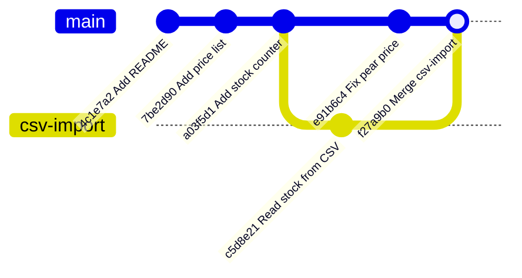
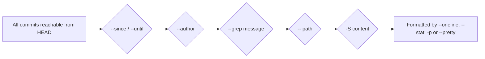

# Viewing history with git log

> **Before this lesson:** you should be able to stage and commit, and read a diff, as taught in [Getting a repository and recording changes](#/lesson/git/recording-changes).

## In plain words

A ship's captain keeps a logbook: one entry per event, each with a time, a signature and a note. Months later, when someone asks "when did we change course, and who decided?", the answer is found by reading the log, not by remembering.

Every commit you make is an entry in your project's logbook. `git log` is the command that reads the logbook back to you. On its own it prints every entry from newest to oldest. Its real power is in the options that let you ask sharp questions: "show me only last week", "only changes to this file", "only commits whose message mentions invoices", "only commits that added or removed this exact word in the code".

Why it matters for a job: most of the time you spend with Git on a real team is spent *reading* history, not writing it. You read it to review a colleague's work, to find out why a strange line of code exists, to write release notes, and to find which change introduced a bug. Fluency with `git log` is what separates someone who guesses from someone who looks it up in seconds.

## A small history to explore

The examples use the `orchard` project after a few days of work. Its history has six commits by two people, including a short side branch that was merged back.



A **branch** is a named line of work; a **merge** joins two lines. Both are explained properly in module 3. For now it is enough to see that history can fork and rejoin, and that the last commit here has two parents.

## The plain log

```bash
$ git log
commit f27a9b04c1d5e8a6b3f2079d1e4c5a6b7d8e9f01 (HEAD -> main)
Merge: e91b6c4 c5d8e21
Author: Mira Okafor <mira@home.example>
Date:   Thu Nov 19 16:42:10 2026 +0100

    Merge branch 'csv-import'

commit e91b6c4f0a1b2c3d4e5f60718293a4b5c6d7e8f9
Author: Mira Okafor <mira@home.example>
Date:   Thu Nov 19 15:03:44 2026 +0100

    Fix pear price

commit c5d8e2107f6e5d4c3b2a19087f6e5d4c3b2a1908 (csv-import)
Author: Tomas Lind <tomas@greenhouse.example>
Date:   Wed Nov 18 11:20:31 2026 +0100

    Read stock from CSV
...
```

Reading one entry line by line:

- `commit f27a9b0…` is the full 40-character id of the commit.
- `(HEAD -> main)` is a **decoration**: names that currently point at this commit. `HEAD` is Git's marker for "the commit you are on right now"; `main` is the branch. On the third entry, `(csv-import)` shows that the other branch points there.
- `Merge: e91b6c4 c5d8e21` appears only on merge commits and lists the two parents.
- `Author:` and `Date:` come from the identity configured by whoever made the commit.
- The indented text is the commit message.

The output opens in a **pager**, a viewer for long text. Press Space or the arrow keys to move, `/text` to search, and `q` to quit.

## Shorter views

The plain log is too tall for most uses. These three options are the everyday ones.

```bash
$ git log --oneline
f27a9b0 (HEAD -> main) Merge branch 'csv-import'
e91b6c4 Fix pear price
c5d8e21 (csv-import) Read stock from CSV
a03f5d1 Add stock counter
7be2d90 Add price list
4c1e7a2 Add README
```

`--oneline` squeezes each commit into its short id and the first line of its message (the **subject**). This is why the first line of a commit message should make sense on its own.

```bash
$ git log --oneline --graph --all
*   f27a9b0 (HEAD -> main) Merge branch 'csv-import'
|\
| * c5d8e21 (csv-import) Read stock from CSV
* | e91b6c4 Fix pear price
|/
* a03f5d1 Add stock counter
* 7be2d90 Add price list
* 4c1e7a2 Add README
```

- `--graph` draws the shape of history with text characters. Each `*` is a commit; the lines show which commit is whose parent. You can see the fork after `a03f5d1` and the join at `f27a9b0`.
- `--all` includes every branch, not only the one you are on.

This combination is so useful that most people give it a short name (an alias; see the lesson on remotes, tags and aliases).

```bash
$ git log -2 --stat
commit f27a9b04c1d5e8a6b3f2079d1e4c5a6b7d8e9f01 (HEAD -> main)
Merge: e91b6c4 c5d8e21
Author: Mira Okafor <mira@home.example>
Date:   Thu Nov 19 16:42:10 2026 +0100

    Merge branch 'csv-import'

commit e91b6c4f0a1b2c3d4e5f60718293a4b5c6d7e8f9
Author: Mira Okafor <mira@home.example>
Date:   Thu Nov 19 15:03:44 2026 +0100

    Fix pear price

 prices.csv | 2 +-
 1 file changed, 1 insertion(+), 1 deletion(-)
```

- `-2` limits the output to the two newest commits. Any number works.
- `--stat` adds a summary of which files each commit touched and how many lines were added (`+`) and removed (`-`).

To see the full line-by-line change of each commit, use `-p` (short for `--patch`; a **patch** is a diff packaged so that it can be applied elsewhere):

```bash
$ git log -1 -p e91b6c4
commit e91b6c4f0a1b2c3d4e5f60718293a4b5c6d7e8f9
Author: Mira Okafor <mira@home.example>
Date:   Thu Nov 19 15:03:44 2026 +0100

    Fix pear price

diff --git a/prices.csv b/prices.csv
index 0d1c8f3..5a9e2b7 100644
--- a/prices.csv
+++ b/prices.csv
@@ -1,2 +1,2 @@
 apple,3
-pear,5
+pear,6
```

Here an id (`e91b6c4`) was given as the starting point. `git show e91b6c4` prints the same thing for a single commit and is the quicker spelling.

## Designing your own format

`--pretty=format:"..."` lets you choose exactly which fields to print. Inside the quotes, placeholders that begin with `%` are replaced for each commit.

```bash
$ git log --pretty=format:"%h | %an | %ar | %s"
f27a9b0 | Mira Okafor | 18 hours ago | Merge branch 'csv-import'
e91b6c4 | Mira Okafor | 20 hours ago | Fix pear price
c5d8e21 | Tomas Lind | 2 days ago | Read stock from CSV
a03f5d1 | Mira Okafor | 3 days ago | Add stock counter
7be2d90 | Mira Okafor | 4 days ago | Add price list
4c1e7a2 | Mira Okafor | 4 days ago | Add README
```

| Placeholder | Prints |
|---|---|
| `%H` / `%h` | full / short commit id |
| `%an` / `%ae` | author name / author email |
| `%ad` / `%ar` | author date / author date, relative ("2 days ago") |
| `%cn` / `%cr` | committer name / committer date, relative |
| `%s` | subject (first line of the message) |
| `%b` | body (the rest of the message) |
| `%d` | decorations (branch and tag names) |
| `%p` | short ids of the parents |

A newcomer's question here: what is the difference between **author** and **committer**? The author is the person who originally wrote the change. The committer is the person who last placed it into the history. They are usually the same. They differ when, for example, you email a fix to a project and a maintainer applies it: you are the author, the maintainer is the committer.

This output is easy for other programs to consume, which is why custom formats are common in scripts.

## Limiting what is shown

All of these can be combined; a commit must satisfy every filter to be shown.

### By time

```bash
$ git log --oneline --since="2 days ago"
f27a9b0 (HEAD -> main) Merge branch 'csv-import'
e91b6c4 Fix pear price
c5d8e21 (csv-import) Read stock from CSV

$ git log --oneline --until="2026-11-17"
7be2d90 Add price list
4c1e7a2 Add README
```

`--since` (or `--after`) and `--until` (or `--before`) accept exact dates and phrases such as `"2 weeks ago"` or `"yesterday"`.

### By person

```bash
$ git log --oneline --author="Tomas"
c5d8e21 (csv-import) Read stock from CSV
```

The text is matched against the author name and email; a partial match is enough.

### By message text

```bash
$ git log --oneline --grep="price"
e91b6c4 Fix pear price
7be2d90 Add price list
```

`--grep` searches commit **messages**. Add `-i` to ignore upper and lower case.

### By file or folder

```bash
$ git log --oneline -- prices.csv
e91b6c4 Fix pear price
7be2d90 Add price list
```

Everything after the `--` is treated as a path. Only commits that changed that file (or anything under that folder) are listed. The `--` separator stops Git from confusing a file name with a branch name.

### By content change: the pickaxe

```bash
$ git log --oneline -S "read_stock"
c5d8e21 (csv-import) Read stock from CSV
```

`-S "text"` (nicknamed the **pickaxe**) finds commits that changed the *number of times* the text appears in the code: commits that introduced it or removed it. This answers "when did this function first appear?" and "who deleted this setting?". Its relative `-G "regex"` matches commits whose diff contains a line matching a pattern.

### Leaving out merges

```bash
$ git log --oneline --no-merges
e91b6c4 Fix pear price
c5d8e21 (csv-import) Read stock from CSV
a03f5d1 Add stock counter
7be2d90 Add price list
4c1e7a2 Add README
```

Merge commits usually carry no change of their own, so hiding them gives a cleaner list of real work.



## What order are commits shown in?

By default `git log` starts at the commit you are on and walks backwards through parents, showing newer commits before older ones by date. With `--graph` (or `--topo-order`) Git guarantees a stricter rule: a commit is never shown before all of its children have been shown, so lines of development are not shuffled together.

The model below builds the small history from this lesson as a dictionary and walks it. It is the same idea Git uses: each commit knows its parents, and the log is a traversal.

```python-run
import heapq

# id: (date, parents, subject)
commits = {
    "4c1e7a2": (1, [], "Add README"),
    "7be2d90": (2, ["4c1e7a2"], "Add price list"),
    "a03f5d1": (3, ["7be2d90"], "Add stock counter"),
    "c5d8e21": (4, ["a03f5d1"], "Read stock from CSV"),
    "e91b6c4": (5, ["a03f5d1"], "Fix pear price"),
    "f27a9b0": (6, ["e91b6c4", "c5d8e21"], "Merge branch 'csv-import'"),
}

def log(start):
    """Newest-first walk from start, never visiting a commit twice."""
    heap = [(-commits[start][0], start)]
    seen = {start}
    while heap:
        _, cid = heapq.heappop(heap)
        date, parents, subject = commits[cid]
        yield cid, subject
        for p in parents:
            if p not in seen:
                seen.add(p)
                heapq.heappush(heap, (-commits[p][0], p))

print("log from main (f27a9b0):")
for cid, subject in log("f27a9b0"):
    print("  ", cid, subject)

print("log from e91b6c4 (before the merge) does not include the CSV commit:")
for cid, subject in log("e91b6c4"):
    print("  ", cid, subject)
```

The second listing makes an important point: `git log` shows the commits **reachable** from where you start, meaning those you can arrive at by following parent links. A commit on another branch that has not been merged is not part of your history and does not appear unless you ask for it with `--all` or name that branch.

## Realistic questions and the commands that answer them

**"What did the team do this week, for the status meeting?"**

```bash
$ git log --since="1 week ago" --no-merges --pretty=format:"%ad %an: %s" --date=short
2026-11-19 Mira Okafor: Fix pear price
2026-11-18 Tomas Lind: Read stock from CSV
2026-11-17 Mira Okafor: Add stock counter
```

`--date=short` prints dates as year-month-day.

**"Who touched the price file, and what exactly did they change?"**

```bash
$ git log -p --follow -- price-list.csv
```

`--follow` keeps tracing a file's history across a rename, which a plain path filter does not do.

**"Which commits are on the CSV branch but not yet on main?"**

```bash
$ git log --oneline main..csv-import
```

The two-dot form `A..B` means "reachable from B but not from A". (After the merge in our example this prints nothing, because `main` already contains everything.) The tools module covers this notation in depth.

**"How much did each person contribute?"**

```bash
$ git shortlog -sn
     5  Mira Okafor
     1  Tomas Lind
```

`git shortlog` groups commits by author; `-s` shows only counts and `-n` sorts by count.

> [!TIP]
> When a `git log` command returns nothing, do not assume there is no match. Check three things: are you on the branch you think you are (add `--all`)? Is the path spelled exactly, including upper and lower case? Did a filter such as `--author` match the email instead of the name you expected?

> [!WARNING]
> Nothing in this lesson changes your repository; `git log`, `git show` and `git shortlog` are read-only. The danger is of a different kind: dates and author names in commits are supplied by the person's own computer and are not verified. Do not treat `git log --author` as proof of who did something, and do not rely on dates being in order. Signed commits, covered in the tools module, exist for the cases where proof matters.

## Pitfalls

- **Forgetting `--all`.** Without it you see only what is reachable from your current commit, and may conclude that a colleague's branch "is not there".
- **Mixing up `--grep` and `-S`.** `--grep` searches commit messages. `-S` searches for changes in file content. Searching messages for a function name finds only commits whose author happened to mention it.
- **Leaving out `--` before a path.** If a file and a branch share a name, Git stops with an "ambiguous argument" error. The separator removes the doubt.
- **Path filter plus renames.** `git log -- newname` stops at the commit that performed the rename. Add `--follow` (single file only).
- **Reading `--stat` numbers as importance.** A one-line change can matter more than a thousand-line reformat.
- **Being stuck in the pager.** Press `q`. To print without a pager for one command, use `git --no-pager log`.

> [!INTERVIEW]
> **"A config value changed some time in the last year and nobody remembers when. How do you find the commit?"** Use the pickaxe: `git log -S "MAX_RETRIES = 5" --oneline -- settings.py` lists the commits where the number of occurrences of that exact text changed, which are the commit that introduced it and the one that removed or altered it. Add `-p` to see the surrounding diff. If the text varies, `-G` with a regular expression matches any diff line. Mention `git log -L :function_name:file.py` to trace the history of one function, and `git blame` when you want the last change to each line. Interviewers are checking that you search content history rather than scrolling through messages.

## Cheat sheet

| Goal | Command |
|---|---|
| One line per commit | `git log --oneline` |
| Draw the branch structure | `git log --oneline --graph --all` |
| Last N commits | `git log -N` |
| Files and line counts per commit | `git log --stat` |
| Full diff per commit | `git log -p` |
| One commit in full | `git show <id>` |
| Custom columns | `git log --pretty=format:"%h %an %ar %s"` |
| Since / until a date | `git log --since="2 weeks ago" --until="yesterday"` |
| By author | `git log --author="name"` |
| By message text | `git log --grep="text" -i` |
| By file, across renames | `git log --follow -- <file>` |
| Commits adding or removing a string | `git log -S "string"` |
| Skip merge commits | `git log --no-merges` |
| On B but not on A | `git log A..B` |
| Commit counts per author | `git shortlog -sn` |

## Summary

`git log` walks the commit graph backwards from where you are and prints what it finds. Display options (`--oneline`, `--graph`, `--stat`, `-p`, `--pretty=format`) control how much of each commit you see; limiting options (`-N`, `--since`, `--author`, `--grep`, a path after `--`, `-S`, `--no-merges`) control which commits are shown, and they combine freely. The log contains only commits reachable from the starting point, so `--all` or an explicit branch name is needed to look elsewhere. Reading history well is the foundation for reviewing, debugging and explaining a codebase.

## Glossary

- **Log:** the list of commits reachable from a starting commit, newest first.
- **Subject:** the first line of a commit message; shown by `--oneline`.
- **Body:** the remaining lines of a commit message, after a blank line.
- **HEAD:** Git's name for the commit you currently have checked out.
- **Decoration:** branch and tag names printed in brackets next to a commit in the log.
- **Pager:** the viewer Git uses for long output; leave it with `q`.
- **Patch:** a diff in a form that can be applied to files; `-p` shows one per commit.
- **Author:** the person who wrote a change. **Committer:** the person who recorded it in this history.
- **Reachable:** a commit is reachable from another if you can get to it by following parent links.
- **Parent:** the commit (or commits, for a merge) directly before a given commit.
- **Pickaxe (`-S`):** a search for commits that added or removed a given piece of text.
- **Regular expression (regex):** a compact pattern language for matching text, used by `-G` and `--grep`.
- **Path filter:** a file or folder name after `--` that restricts the log to commits touching it.

## Check yourself

```quiz
[
  {"q": "Which command shows the fork-and-join shape of all branches compactly?", "options": ["git log --oneline --graph --all", "git log -p", "git shortlog -sn", "git log --stat"], "answer": 0, "explain": "--graph draws parent links as text art, --oneline keeps each commit to one line, and --all includes every branch rather than only the current one."},
  {"q": "You want commits whose changes added or removed the text `apply_discount`. Which option?", "options": ["--follow apply_discount", "-S apply_discount", "--grep=apply_discount", "--author=apply_discount"], "answer": 1, "explain": "-S (the pickaxe) looks at file content and reports commits where the number of occurrences of the string changed. --grep only searches commit messages."},
  {"q": "A colleague committed to branch `reports` an hour ago, but `git log --oneline` on `main` does not show it. Why?", "options": ["The log is cached for a day", "Their clock is wrong", "The log shows commits reachable from your current commit, and that branch is not merged", "The log only shows your own commits"], "answer": 2, "explain": "Plain git log starts at HEAD and follows parents. Use git log --all or git log reports to include other branches."},
  {"q": "What is the difference between a commit's author and its committer?", "options": ["The committer is always the project lead", "The author wrote the change; the committer recorded it into this history", "There is none", "The author owns the repository"], "answer": 1, "explain": "They differ when someone else applies your patch, or when a commit is rebased or cherry-picked by another person: your authorship is kept, the committer is whoever performed the operation."},
  {"q": "What does `git log --oneline -- docs/` show?", "options": ["Commits that changed anything under the docs folder", "Commits on a branch named docs", "All files in docs", "Commits whose message contains docs"], "answer": 0, "explain": "Everything after -- is a path filter. Only commits touching that path are listed."},
  {"q": "Why might `git log -- newname.py` stop early for a file that was renamed last month?", "options": ["The log is limited to 30 days", "A path filter matches the current name only; --follow is needed to continue through the rename", "Renames delete history", "The file is too large"], "answer": 1, "explain": "History is not lost; the filter no longer matches older commits where the file had another name. --follow tells Git to track the single file across renames."},
  {"q": "In `--pretty=format:\"%h %an %s\"`, what does %s print?", "options": ["The short id", "The committer's signature", "The first line of the commit message", "The file statistics"], "answer": 2, "explain": "%s is the subject. %h is the short id and %an the author name."}
]
```

> **Source:** Chacon & Straub, Pro Git 2e, ch. 2 (Viewing the Commit History). Explanations, examples and code written for this guide.
