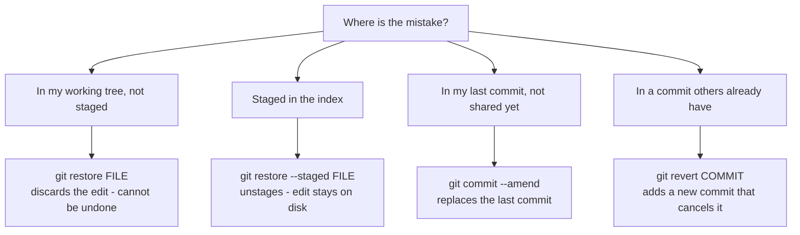
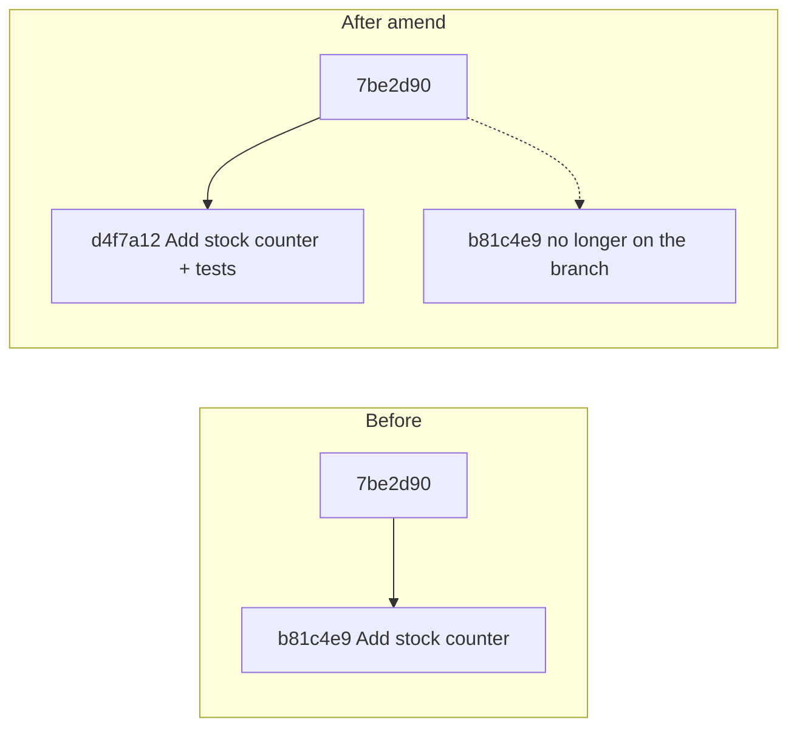
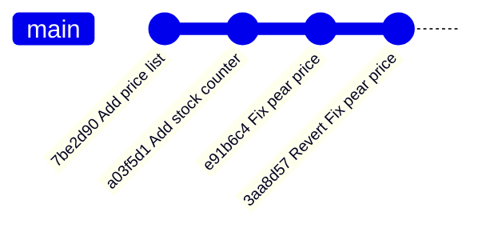

# Undoing things safely

> **Before this lesson:** you need the staging and commit loop from [Getting a repository and recording changes](#/lesson/git/recording-changes) and the ability to read `git log --oneline` from [Viewing history with git log](#/lesson/git/viewing-history).

## In plain words

Everyone makes mistakes while working: a typo in a message, a file left out of a commit, something staged that should not have been, an edit that turned out to be a bad idea. Git has an "undo" for each of these, but unlike the single undo button in a word processor, there are **several different undos**, one for each place a mistake can live.

Think of sending a letter. If the mistake is still on your desk as a draft, you scribble it out (discard a working-tree change). If the letter is already in the envelope but not sealed, you take the page back out (unstage). If the envelope is sealed but still in your hand, you can open it and reseal it (amend the last commit). If it has already been posted and delivered, you cannot un-send it; the honest fix is to send a second letter that says "please disregard the first" (revert).

Why it matters for a job: mistakes are normal, and what teams judge is how you repair them. Picking the wrong undo can throw away an afternoon of your own work, or, worse, rewrite history that colleagues have already built on. This lesson teaches you to choose the right undo by asking one question first: **where is the mistake right now?**

## The decision map



Keep this picture in mind. Each section below is one branch of it, starting with the gentlest.

## Undo 1: fix the last commit with --amend

The most common slip is committing a moment too early: the message has a typo, or one file was forgotten.

Start with the simplest case, a wrong message:

```bash
$ git commit -m "Add stok counter"
[main a03f5d1] Add stok counter
 1 file changed, 12 insertions(+)
 create mode 100644 inventory.py

$ git commit --amend -m "Add stock counter"
[main b81c4e9] Add stock counter
 Date: Tue Nov 17 09:30:12 2026 +0100
 1 file changed, 12 insertions(+)
 create mode 100644 inventory.py
```

- `git commit --amend` means "redo the most recent commit".
- `-m "..."` gives the corrected message. Without `-m`, your editor opens with the old message ready to edit.
- Look at the ids: the commit was `a03f5d1`, and is now `b81c4e9`. Amend did **not** edit the old commit. It built a brand-new commit and moved the branch to it. The old one is no longer part of the branch.

Now the second case, a forgotten file:

```bash
$ git commit -m "Add stock counter"
[main b81c4e9] Add stock counter
 1 file changed, 12 insertions(+)

$ git add tests/test_inventory.py
$ git commit --amend --no-edit
[main d4f7a12] Add stock counter
 Date: Tue Nov 17 09:30:12 2026 +0100
 2 files changed, 31 insertions(+)
 create mode 100644 inventory.py
 create mode 100644 tests/test_inventory.py
```

- First you stage the missing file as usual.
- `--amend` takes whatever is in the index now and makes it the content of the replacement commit.
- `--no-edit` keeps the existing message so no editor opens.

The effect on history: the commit count stays the same, but the last commit is swapped for a new one.



Why does the id change? Because a commit's id is a fingerprint of its entire content: snapshot, message, author, dates and parent. Change any of those and it is, by definition, a different commit.

> [!WARNING]
> Amend only commits that exist **only on your machine**. If you already shared the commit (pushed it to a server others use), amending creates a second, different commit while your teammates still have the first. Your next push is rejected, and forcing it through makes their history disagree with the server's. For shared commits, use `git revert` (Undo 4) or add a follow-up commit.

## Undo 2: unstage a file

You meant to commit two changes separately, but staged both:

```bash
$ git add .
$ git status
On branch main
Changes to be committed:
  (use "git restore --staged <file>..." to unstage)
        modified:   README.md
        modified:   inventory.py
```

Git prints the cure in the hint. Follow it:

```bash
$ git restore --staged inventory.py
$ git status
On branch main
Changes to be committed:
  (use "git restore --staged <file>..." to unstage)
        modified:   README.md

Changes not staged for commit:
  (use "git add <file>..." to update what will be committed)
  (use "git restore <file>..." to discard changes in working directory)
        modified:   inventory.py
```

- `git restore --staged <file>` copies the file's version from the last commit back into the index. In other words, it removes the file's change from the parcel.
- The edit itself is still in your working tree, listed under "not staged". Nothing was lost. This undo is completely safe.

Older tutorials (and Git versions before 2.23) spell this `git reset HEAD inventory.py`. It does the same thing.

## Undo 3: discard an edit in the working tree

You tried something in `inventory.py`, it made things worse, and you want the file back the way it was at the last commit (or, more exactly, the way it is in the index).

```bash
$ git status --short
 M inventory.py

$ git restore inventory.py
$ git status --short
$
```

- `git restore <file>` (without `--staged`) overwrites the file in your working tree with the copy from the index.
- Status prints nothing afterwards: the file is back to its recorded state.

> [!WARNING]
> `git restore <file>` **destroys the uncommitted edit permanently.** The discarded lines were never stored in the repository, so no Git command can bring them back. Before running it, look at what you are about to lose with `git diff inventory.py`. If there is any chance you will want the work later, save it instead with `git stash` (covered in the tools module) or commit it on a side branch. The older spelling, `git checkout -- inventory.py`, is equally destructive.

You can also restore a file from an older commit, not only the latest:

```bash
$ git restore --source=7be2d90 prices.csv
$ git status --short
 M prices.csv
```

`--source=<commit>` picks the commit to copy from. The file in your working tree now has the content it had at `7be2d90`, and Git reports it as modified, ready for you to review, stage and commit.

To throw away **all** uncommitted changes to tracked files at once: `git restore .` (the dot means "this folder and everything below"). The same warning applies, multiplied.

## Undo 4: cancel a shared commit with revert

The commit `e91b6c4 Fix pear price` was pushed to the team's server yesterday, and it turns out the price was right before. Since colleagues already have this commit, you must not remove or replace it. Instead you add a new commit that applies the exact opposite change.

```bash
$ git log --oneline -3
e91b6c4 (HEAD -> main, origin/main) Fix pear price
a03f5d1 Add stock counter
7be2d90 Add price list

$ git revert e91b6c4
[main 3aa8d57] Revert "Fix pear price"
 1 file changed, 1 insertion(+), 1 deletion(-)

$ git log --oneline -4
3aa8d57 (HEAD -> main) Revert "Fix pear price"
e91b6c4 (origin/main) Fix pear price
a03f5d1 Add stock counter
7be2d90 Add price list
```

- `git revert <commit>` works out the diff that commit introduced, applies the reverse of it, and commits the result. Your editor opens with a ready-made message, `Revert "Fix pear price"`, which you can extend with the reason.
- `origin/main` in the log is Git's record of where the server's copy of the branch is; the next lesson explains it. It still points at the old commit until you push.
- The history grew by one commit. Nothing was rewritten, so pushing this is an ordinary, safe push.



To revert without committing straight away (for example to revert several commits and record them as one), add `-n` (short for `--no-commit`); the reversed changes are staged and you commit when ready.

## Undo 5: remove the last commit from your local branch with reset

Sometimes the last commit is wrong as a whole, it has not been shared, and you want it gone rather than amended. `git reset` moves the branch back to an earlier commit. It has three strengths, and the lesson [Reset demystified](#/lesson/git/reset-advanced-merging) explains the mechanism fully; here is the practical summary.

`HEAD~1` means "the commit one step before the current one" (`~1` reads as "go back one parent").

```bash
$ git log --oneline -2
9c02e6b (HEAD -> main) Half-finished discount logic
a03f5d1 Add stock counter

$ git reset --soft HEAD~1
$ git log --oneline -1
a03f5d1 (HEAD -> main) Add stock counter
$ git status --short
M  inventory.py
```

- `--soft` moves the branch back one commit and touches nothing else. The changes from the removed commit are still **staged** (`M` in the left column), as if you had never typed `git commit`.

| Command | Branch moves back | Index | Working tree | What you are left with |
|---|---|---|---|---|
| `git reset --soft HEAD~1` | yes | unchanged | unchanged | changes still staged |
| `git reset HEAD~1` (same as `--mixed`) | yes | reset | unchanged | changes in files, not staged |
| `git reset --hard HEAD~1` | yes | reset | reset | changes gone |

> [!WARNING]
> `git reset --hard` discards every uncommitted change in tracked files, with no confirmation. And like `--amend`, any form of `reset` that removes commits must only be used on commits you have not shared. If the commit has been pushed, use `git revert`.

A safety net exists for *commits* that reset or amend removed. Git keeps a private diary of every position your branch has had, called the **reflog** (reference log):

```bash
$ git reflog -3
a03f5d1 (HEAD -> main) HEAD@{0}: reset: moving to HEAD~1
9c02e6b HEAD@{1}: commit: Half-finished discount logic
a03f5d1 (HEAD -> main) HEAD@{2}: commit: Add stock counter

$ git reset --hard 9c02e6b
HEAD is now at 9c02e6b Half-finished discount logic
```

The removed commit `9c02e6b` is still in the database, and resetting to its id brings it back. This works for committed work only; edits that were never committed are not in the reflog.

## A runnable model of the four everyday undos

The model keeps the three areas as dictionaries and a list of commits, and implements each undo in one or two lines. Read the functions: each undo copies content in a different direction.

```python-run
history = [{"prices.csv": "pear,5"}]            # list of snapshots; last one is HEAD
index = dict(history[-1])
worktree = dict(history[-1])

def show(label):
    print(f"{label:28} HEAD={history[-1]}  index={index}  worktree={worktree}  commits={len(history)}")

def commit():            history.append(dict(index))
def restore(path):       worktree[path] = index[path]              # discard working-tree edit
def restore_staged(path): index[path] = history[-1][path]          # unstage
def amend():             history[-1] = dict(index)                 # replace last commit
def revert_last():
    history.append(dict(history[-2]))                              # new commit = state before last
    index.update(history[-1]); worktree.update(history[-1])

show("start")
worktree["prices.csv"] = "pear,6"; index["prices.csv"] = "pear,6"; show("edit + add")
restore_staged("prices.csv");      show("restore --staged")
restore("prices.csv");             show("restore (edit lost)")
worktree["prices.csv"] = "pear,6"; index["prices.csv"] = "pear,6"; commit(); show("edit, add, commit")
worktree["prices.csv"] = "pear,7"; index["prices.csv"] = "pear,7"; amend();  show("fix + commit --amend")
revert_last();                     show("revert")
```

Notice that `amend` leaves the number of commits unchanged, while `revert` increases it.

## Realistic walk-through: a messy five minutes

You commit, notice three problems, and repair them in order.

```bash
$ git add .
$ git commit -m "Add discout rules"
[main 5e1d0aa] Add discout rules
 3 files changed, 40 insertions(+)
 create mode 100644 debug.log
 create mode 100644 discounts.py
 create mode 100644 tests/test_discounts.py
```

Problems: the message has a typo, `debug.log` should never be committed, and nothing has been pushed yet. Because the commit is local, amend is the right tool.

```bash
$ git rm --cached debug.log
rm 'debug.log'
$ echo "*.log" >> .gitignore
$ git add .gitignore
$ git commit --amend -m "Add discount rules"
[main 8b3f6c2] Add discount rules
 Date: Fri Nov 20 11:02:45 2026 +0100
 3 files changed, 41 insertions(+)
 create mode 100644 discounts.py
 create mode 100644 tests/test_discounts.py
```

- `git rm --cached debug.log` removes the log file from the index but leaves it on disk.
- The `.gitignore` line prevents it from being staged again.
- `--amend` rebuilds the last commit from the corrected index with the corrected message. The summary no longer lists `debug.log`.

Had the commit already been pushed, the repair would have been a second, ordinary commit ("Remove debug.log and ignore logs") instead.

## Pitfalls

- **Amending or resetting shared commits.** This is the classic way to cause a colleague a bad morning. Rule of thumb: if `git status` says your branch is "up to date with origin" or "ahead by 0", the last commit is shared.
- **Confusing `restore` with `restore --staged`.** With `--staged` nothing is lost. Without it, your edit is deleted. Read the command twice before pressing Enter.
- **Using `reset --hard` to "clean up".** It is the right tool only when you are certain every uncommitted change is disposable.
- **Thinking revert means "go back to that commit".** `git revert X` undoes the change made *by* X only. Later commits stay. To return a whole project to an older state without rewriting history, revert a range (`git revert --no-commit X..HEAD`) and commit.
- **Reverting a revert by accident.** Reverting commit R, where R is itself a revert, re-applies the original change. That is sometimes exactly what you want, but read the log first.
- **Believing the reflog protects everything.** It protects commits. It does not hold edits that were never committed.

> [!TIP]
> Before any command you are unsure about, make a free safety copy of the current position: `git branch backup-before-undo`. A branch is only a name pointing at the current commit, so this costs nothing, and if the undo goes wrong you can return with `git reset --hard backup-before-undo`.

> [!INTERVIEW]
> **"What is the difference between `git reset` and `git revert`, and when do you use each?"** `reset` moves a branch pointer backwards, so commits drop out of the branch's history; depending on the mode it also resets the index and working tree. It rewrites history and is for local, unshared work. `revert` creates a new commit that applies the inverse of an earlier commit; history only grows, so it is the safe choice for anything already pushed. A complete answer also mentions that neither destroys the old commits immediately (the reflog can recover them), and that `git commit --amend` is a small-scale relative of reset: it replaces the last commit and has the same "local only" rule.

## Cheat sheet

| Situation | Command | Loses work? | Rewrites history? |
|---|---|---|---|
| Typo in last commit message (not pushed) | `git commit --amend -m "new"` | no | yes |
| Forgot a file in last commit (not pushed) | `git add f` then `git commit --amend --no-edit` | no | yes |
| Staged a file by mistake | `git restore --staged f` | no | no |
| Bad edit in a file, want it gone | `git restore f` | **yes** | no |
| Get one file as it was in an old commit | `git restore --source=<id> f` | overwrites `f` | no |
| Remove last commit, keep changes staged | `git reset --soft HEAD~1` | no | yes |
| Remove last commit, keep changes unstaged | `git reset HEAD~1` | no | yes |
| Remove last commit and its changes | `git reset --hard HEAD~1` | **yes** | yes |
| Cancel a commit that was pushed | `git revert <id>` | no | no |
| Find a commit you removed | `git reflog` | – | – |

## Summary

Git offers a different undo for each place a mistake can be. A staged file is unstaged with `git restore --staged`, which is harmless. A working-tree edit is thrown away with `git restore`, which is permanent. The most recent local commit is replaced with `git commit --amend`, or removed with `git reset`, both of which rewrite history and therefore apply to unshared commits only. A shared commit is cancelled with `git revert`, which adds a new commit and rewrites nothing. Commits removed by amend or reset remain recoverable through the reflog for a while; uncommitted edits do not. When unsure, create a backup branch first.

## Glossary

- **Amend:** replace the most recent commit with a corrected one (`git commit --amend`).
- **Unstage:** remove a file's change from the index while keeping the edit on disk.
- **Restore:** copy a file's content from the index or a commit into the working tree or index.
- **Revert:** create a new commit that applies the opposite of an earlier commit.
- **Reset:** move the current branch to a different commit, optionally resetting the index and working tree.
- **`--soft`, `--mixed`, `--hard`:** the three strengths of reset: branch only; branch and index; branch, index and working tree.
- **Rewrite history:** replace existing commits with different ones, which changes their ids.
- **Shared (pushed) commit:** a commit that has been uploaded to a repository other people use.
- **`HEAD~1`:** the commit one step before the current one.
- **Reflog:** Git's local diary of where your branch and HEAD have pointed, used to recover removed commits.
- **`origin/main`:** your repository's record of where the server's `main` branch was last seen.

## Check yourself

```quiz
[
  {"q": "You committed locally and immediately notice a typo in the message. Nothing is pushed. What is the cleanest fix?", "options": ["git commit --amend -m \"corrected message\"", "git revert HEAD", "git restore --staged .", "Make a second commit saying the first message was wrong"], "answer": 0, "explain": "Amend replaces the last commit with a corrected one. It rewrites history, which is fine because the commit exists only on your machine."},
  {"q": "Why does the commit id change after `git commit --amend`, even if only the message changed?", "options": ["Git picks a random id every time", "The parent commit changes", "The id is a hash of the commit's full content, including the message, so any change yields a new commit", "The date is reset to zero"], "answer": 2, "explain": "A commit is immutable and named by its content. Amend builds a new commit and moves the branch to it; the old one is left behind."},
  {"q": "Which command can permanently destroy work that Git cannot recover?", "options": ["git restore --staged report.py", "git revert HEAD", "git commit --amend", "git restore report.py"], "answer": 3, "explain": "git restore <file> overwrites the working-tree file with the indexed version. The discarded edit was never committed, so it is not in the database or the reflog."},
  {"q": "A bad commit was pushed yesterday and teammates have pulled it. How should you undo it?", "options": ["git commit --amend", "git revert <commit> and push", "Delete the branch and recreate it", "git reset --hard HEAD~1 and force push"], "answer": 1, "explain": "Revert adds a new commit that cancels the old one. History is not rewritten, so everyone can pull it normally."},
  {"q": "After `git reset --soft HEAD~1`, where are the changes from the removed commit?", "options": ["In a stash", "Still staged in the index", "Gone", "In the working tree only, unstaged"], "answer": 1, "explain": "--soft moves only the branch. Index and working tree are untouched, so the changes sit staged, ready to be recommitted."},
  {"q": "What does `git restore --staged notes.md` do to the edits in notes.md on disk?", "options": ["Commits them", "Nothing; it only resets the index entry", "Deletes them", "Moves them to a new branch"], "answer": 1, "explain": "It copies the last commit's version into the index. The working-tree file keeps your edit, now listed as not staged."},
  {"q": "You ran `git reset --hard HEAD~1` and regret it. The removed commit had been committed normally. How can you get it back?", "options": ["Run git revert HEAD", "It is impossible", "Run git restore .", "Find its id with git reflog and reset or branch to that id"], "answer": 3, "explain": "The commit object still exists. The reflog lists previous positions of HEAD, so you can point a branch at the old id again."},
  {"q": "`git revert a1b2c3d` on a branch with five later commits does what?", "options": ["Adds one commit undoing only the change introduced by a1b2c3d", "Reverts all five later commits", "Returns the project to the state of a1b2c3d, dropping the five later commits", "Deletes a1b2c3d from history"], "answer": 0, "explain": "Revert inverts a single commit's change and keeps everything else. The later commits remain in place."}
]
```

> **Source:** Chacon & Straub, Pro Git 2e, ch. 2 (Undoing Things), with reset and revert material from ch. 7. Explanations, examples and code written for this guide.
