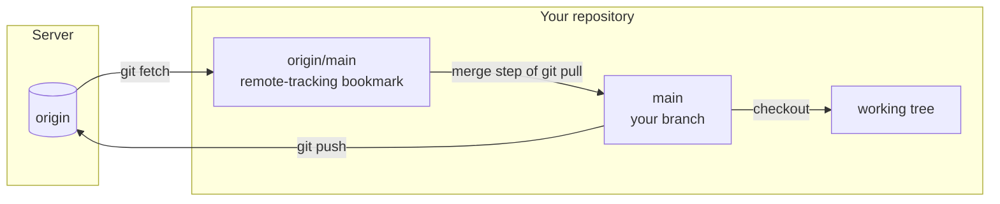
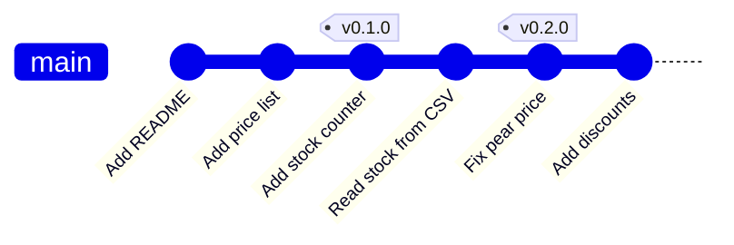

# Remotes, tags and aliases

> **Before this lesson:** you should be comfortable committing and reading the log ([Getting a repository and recording changes](#/lesson/git/recording-changes), [Viewing history with git log](#/lesson/git/viewing-history)) and know which undos are safe for shared commits ([Undoing things safely](#/lesson/git/undoing-things)).

## In plain words

So far every command has worked on one copy of the project, the one on your computer. Real projects have many copies: one on each teammate's laptop and usually one on a server everyone can reach. This lesson covers three small tools that make life with many copies comfortable.

- A **remote** is a saved contact entry for another copy of the repository. Instead of typing a long web address every time you want to send or receive work, you give the address a short nickname such as `origin`, the way you save a phone number under a name.
- A **tag** is a permanent bookmark on one particular commit, usually marking a release such as `v1.0.0`. Branches move as you work; a tag stays where you put it, like a sticky flag on the page of a book where a chapter ends.
- An **alias** is a short nickname you invent for a long command you type often, like a speed-dial button.

Why it matters for a job: "push your branch", "pull the latest main" and "which version is in production?" are everyday sentences on a team. The first two are about remotes; the third is answered by tags. Aliases are a small thing, but the people who seem fast with Git are mostly people who set up a few of them.

## Part 1: remotes

### What a remote is

A **remote repository** is a copy of your project stored somewhere else: a hosting service, a company server, a colleague's machine, or even another folder on your own disk. A **remote** (the noun on its own) is the nickname plus address by which your repository knows that other copy.

When you clone a repository, Git automatically saves the address you cloned from under the nickname **`origin`**. There is nothing magical about the word; it is a default name.

```bash
$ git clone https://git.example.com/greenhouse/orchard.git
$ cd orchard
$ git remote
origin
$ git remote -v
origin  https://git.example.com/greenhouse/orchard.git (fetch)
origin  https://git.example.com/greenhouse/orchard.git (push)
```

- `git remote` lists the nicknames your repository knows.
- `-v` ("verbose", meaning "say more") adds the address behind each nickname. There are two lines because Git lets the address for downloading (**fetch**) differ from the address for uploading (**push**); normally they are the same.

A repository created with `git init` has no remotes until you add one.

### Adding another remote

Suppose your colleague Tomas keeps his own copy and you want to look at his work:

```bash
$ git remote add tomas https://git.example.com/tomas/orchard.git
$ git remote -v
origin  https://git.example.com/greenhouse/orchard.git (fetch)
origin  https://git.example.com/greenhouse/orchard.git (push)
tomas   https://git.example.com/tomas/orchard.git (fetch)
tomas   https://git.example.com/tomas/orchard.git (push)
```

`git remote add <nickname> <address>` saves a new contact. Nothing is downloaded yet.

### Fetch: download without changing your work

```bash
$ git fetch tomas
remote: Enumerating objects: 9, done.
remote: Counting objects: 100% (9/9), done.
remote: Total 6 (delta 2), reused 6 (delta 2), pack-reused 0
Unpacking objects: 100% (6/6), 1.02 KiB | 204.00 KiB/s, done.
From https://git.example.com/tomas/orchard
 * [new branch]      main        -> tomas/main
 * [new branch]      csv-import  -> tomas/csv-import
```

- `git fetch <remote>` contacts the other copy and downloads every commit it has that you lack.
- The last lines are the important ones. Tomas's branch `main` is now visible in your repository under the name `tomas/main`, and his `csv-import` as `tomas/csv-import`. These are **remote-tracking branches**: read-only bookmarks that record where the branches of a remote were the last time you fetched.
- Your own branches and your files are untouched. Fetching is always safe. You can now inspect the new work with `git log tomas/csv-import` or `git diff main tomas/csv-import` before deciding what to do with it.

### Pull: fetch, then combine

```bash
$ git pull
remote: Enumerating objects: 5, done.
remote: Counting objects: 100% (5/5), done.
remote: Total 3 (delta 1), reused 3 (delta 1), pack-reused 0
Unpacking objects: 100% (3/3), 284 bytes | 94.00 KiB/s, done.
From https://git.example.com/greenhouse/orchard
   e91b6c4..2d7c9f3  main       -> origin/main
Updating e91b6c4..2d7c9f3
Fast-forward
 README.md | 3 +++
 1 file changed, 3 insertions(+)
```

`git pull` is two steps in one: a `git fetch` from the remote your branch is linked to, followed by combining the downloaded commits into your current branch. Here the combining was a **fast-forward**: your branch had no commits of its own since the last sync, so Git moved it forward to the newer commit. When both you and the remote have new commits, pull has to merge or rebase; both are covered in the branching module.



### Push: upload your commits

```bash
$ git push origin main
Enumerating objects: 5, done.
Counting objects: 100% (5/5), done.
Delta compression using up to 8 threads
Compressing objects: 100% (3/3), done.
Writing objects: 100% (3/3), 342 bytes | 342.00 KiB/s, done.
Total 3 (delta 1), reused 0 (delta 0), pack-reused 0
To https://git.example.com/greenhouse/orchard.git
   2d7c9f3..6fa01be  main -> main
```

- `git push <remote> <branch>` uploads the commits on your branch that the remote lacks and moves the remote's branch forward.
- The last line reads: on the remote, `main` moved from commit `2d7c9f3` to commit `6fa01be`.
- You need write permission on the remote for this to work.

Push succeeds only if nobody else pushed in the meantime. If a colleague got there first, you see:

```bash
$ git push origin main
To https://git.example.com/greenhouse/orchard.git
 ! [rejected]        main -> main (fetch first)
error: failed to push some refs to 'https://git.example.com/greenhouse/orchard.git'
hint: Updates were rejected because the remote contains work that you do not
hint: have locally. This is usually caused by another repository pushing to
hint: the same ref. If you want to integrate the remote changes, use
hint: 'git pull' before pushing again.
```

The remote refuses because accepting your push would throw away the colleague's commit. The fix is in the hint: bring their work into yours (`git pull`), then push again.

> [!WARNING]
> You will see advice online to "fix" a rejected push with `git push --force`. That command tells the server to discard whatever it has and take your version, which deletes your colleague's commits from the shared branch. Never force-push a branch other people use. When you truly must replace your *own* branch on the server (for example after tidying its history), use `git push --force-with-lease`, which refuses if someone else pushed since you last fetched.

### Inspecting, renaming and removing remotes

```bash
$ git remote show origin
* remote origin
  Fetch URL: https://git.example.com/greenhouse/orchard.git
  Push  URL: https://git.example.com/greenhouse/orchard.git
  HEAD branch: main
  Remote branches:
    csv-import tracked
    main       tracked
  Local branch configured for 'git pull':
    main merges with remote main
  Local ref configured for 'git push':
    main pushes to main (up to date)
```

This report tells you which branches exist on the remote, which local branch is linked to which remote branch for `pull`, and whether you are up to date.

```bash
$ git remote rename tomas lind
$ git remote remove lind
$ git remote set-url origin git@git.example.com:greenhouse/orchard.git
```

- `rename` changes a nickname (and renames its remote-tracking branches to match).
- `remove` deletes the contact entry and its remote-tracking branches. Nothing happens on the server.
- `set-url` changes the saved address, for example when a project moves or you switch from the HTTPS style of address to the SSH style (SSH is explained in the server module).

A tiny runnable model of fetch and push, treating each repository as a dictionary of commits plus branch names:

```python-run
# each repository: commits (id -> list of parent ids) plus branch names
server = {"commits": {"A": [], "B": ["A"]}, "main": "B"}
mine   = {"commits": {"A": [], "B": ["A"]}, "main": "B", "origin/main": "B"}

def is_ancestor(commits, old, new):
    """True if 'old' can be reached from 'new' by following parent links."""
    todo, seen = [new], set()
    while todo:
        c = todo.pop()
        if c == old:
            return True
        if c not in seen:
            seen.add(c)
            todo.extend(commits.get(c, []))
    return False

def fetch():
    mine["commits"].update(server["commits"])
    mine["origin/main"] = server["main"]          # only the bookmark moves

def push():
    if not is_ancestor(mine["commits"], server["main"], mine["main"]):
        return "rejected (fetch first)"
    server["commits"].update(mine["commits"])
    server["main"] = mine["main"]
    mine["origin/main"] = mine["main"]
    return "ok"

server["commits"]["C"] = ["B"]; server["main"] = "C"    # a teammate pushes C
mine["commits"]["D"] = ["B"];   mine["main"] = "D"      # you commit D locally

print("1. push:", push())
fetch()
print("2. after fetch: main =", mine["main"], "| origin/main =", mine["origin/main"])
mine["commits"]["M"] = ["D", "C"]; mine["main"] = "M"   # the merge step of git pull
print("3. push:", push(), "| server main =", server["main"])
```

## Part 2: tags

### What a tag is and why you want one

A **tag** is a name attached to one specific commit that does not move. Teams use tags to mark releases, so that "what exactly did we ship as version 1.2.0?" always has a precise answer.



The branch has moved on past `v0.2.0`, but the tag still marks the exact commit that was released.

Git has two kinds of tag.

- A **lightweight tag** is only a name pointing at a commit. Nothing else is stored.
- An **annotated tag** is a full object in the database with its own author, date and message, and it can be cryptographically signed. Use annotated tags for releases, because they record who released what and when.

### Creating and listing tags

```bash
$ git tag -a v0.2.0 -m "Second preview: CSV import and corrected prices"
$ git tag
v0.1.0
v0.2.0
```

- `-a` makes an annotated tag; `v0.2.0` is the tag name; `-m` supplies its message.
- With no arguments, `git tag` lists the tags in alphabetical order.

```bash
$ git show v0.2.0
tag v0.2.0
Tagger: Mira Okafor <mira@home.example>
Date:   Fri Nov 20 12:05:17 2026 +0100

Second preview: CSV import and corrected prices

commit e91b6c4f0a1b2c3d4e5f60718293a4b5c6d7e8f9
Author: Mira Okafor <mira@home.example>
Date:   Thu Nov 19 15:03:44 2026 +0100

    Fix pear price
...
```

`git show <tag>` prints the tag's own information first (the tagger, date and message), then the commit it points to.

A lightweight tag is created by giving only a name, with none of `-a`, `-s` or `-m`:

```bash
$ git tag tried-new-parser
```

To tag an older commit, add its id at the end:

```bash
$ git tag -a v0.1.0 a03f5d1 -m "First preview"
```

Filter the list with a pattern, and sort by version number instead of alphabetically (alphabetical order would put `v0.10.0` before `v0.9.0`):

```bash
$ git tag -l "v0.*" --sort=version:refname
v0.1.0
v0.2.0
v0.9.0
v0.10.0
```

### Sharing tags

`git push` does **not** upload tags unless you ask. This surprises many people who tag a release and then wonder why the build server cannot find it.

```bash
$ git push origin v0.2.0
To https://git.example.com/greenhouse/orchard.git
 * [new tag]         v0.2.0 -> v0.2.0

$ git push origin --tags
```

- The first form pushes one tag by name.
- `--tags` pushes every tag you have that the remote lacks, including throwaway lightweight ones. `--follow-tags` is a more careful alternative: it pushes only annotated tags that belong to the commits being pushed.

### Deleting tags, and looking at tagged code

```bash
$ git tag -d tried-new-parser
Deleted tag 'tried-new-parser' (was c5d8e21)

$ git push origin --delete v0.2.0-rc1
To https://git.example.com/greenhouse/orchard.git
 - [deleted]         v0.2.0-rc1
```

`-d` deletes a tag in your repository only; the second command deletes it on the remote.

To look at the files exactly as they were at a tag:

```bash
$ git switch --detach v0.2.0
HEAD is now at e91b6c4 Fix pear price
```

`--detach` puts you on the commit itself instead of on a branch, a state Git calls **detached HEAD**. You can look around and run the code. If you want to make changes starting from the tag (say, a bug fix for an old release), create a branch there instead: `git switch -c hotfix-0.2 v0.2.0`.

> [!TIP]
> Treat a published tag as permanent. If you tag the wrong commit and have already pushed, do not move the tag: people and build systems that fetched it keep the old one and will not be told. Publish a new tag (`v0.2.1`) instead.

## Part 3: aliases

Git does not guess a command from its first letters, so `git st` is an error unless you define it. An **alias** teaches Git a shortcut. Aliases are ordinary configuration settings in the `alias` section.

```bash
$ git config --global alias.st status
$ git config --global alias.co checkout
$ git config --global alias.sw switch
$ git config --global alias.br branch
$ git config --global alias.ci commit
```

After this, `git st` runs `git status`, and anything you type after the alias is passed along: `git ci -m "message"` runs `git commit -m "message"`.

Aliases may include options, which is where they start paying for themselves:

```bash
$ git config --global alias.lg "log --oneline --graph --decorate --all"
$ git config --global alias.unstage "restore --staged"
$ git config --global alias.last "log -1 HEAD --stat"

$ git lg
* 6fa01be (HEAD -> main, origin/main) Add discounts
* e91b6c4 (tag: v0.2.0) Fix pear price
* c5d8e21 Read stock from CSV
* a03f5d1 (tag: v0.1.0) Add stock counter
* 7be2d90 Add price list
* 4c1e7a2 Add README

$ git unstage inventory.py
```

`git unstage inventory.py` expands to `git restore --staged inventory.py`, which reads more naturally.

An alias that begins with `!` runs an external program instead of a Git subcommand:

```bash
$ git config --global alias.root '!pwd'
```

All of these end up as plain lines in `~/.gitconfig`:

```bash
$ git config --global --get-regexp alias
alias.st status
alias.lg log --oneline --graph --decorate --all
alias.unstage restore --staged
alias.last log -1 HEAD --stat
```

## Pitfalls

- **Thinking `origin/main` is live.** It is a snapshot of the remote from your last fetch. If it looks out of date, run `git fetch`.
- **Thinking `git remote remove` deletes the server copy.** It deletes only your contact entry.
- **Pulling with uncommitted changes and a conflict.** Commit (or stash) first, so that the pull has a clean starting point.
- **Forgetting to push tags.** The release tag exists only on your laptop until you push it.
- **Moving a published tag.** Others will silently keep the old target. Create a new tag instead.
- **Lightweight tags for releases.** They carry no author, date or message, and `git describe` ignores them by default.
- **Aliases that hide danger.** An alias such as `nuke = reset --hard` saves three seconds and one day costs three hours. Keep destructive commands long.
- **Relying on your aliases on someone else's machine.** They are per-user configuration and are not part of the repository.

> [!INTERVIEW]
> **"What is the difference between `git fetch` and `git pull`?"** `fetch` downloads new commits and updates the remote-tracking branches (`origin/main` and so on); your own branches and working tree do not change, so it is always safe. `pull` is `fetch` followed by integrating the fetched branch into your current branch, by merge or by rebase depending on configuration, so it can change your files and can produce conflicts. Many experienced people fetch first, inspect with `git log main..origin/main`, and then integrate deliberately. A common follow-up, **"lightweight versus annotated tags?"**: lightweight is a bare pointer; annotated is a stored object with tagger, date, message and optional signature, and is the right choice for releases.

## Cheat sheet

| Task | Command |
|---|---|
| List remotes with addresses | `git remote -v` |
| Add a remote | `git remote add <name> <url>` |
| Download without changing your branches | `git fetch <name>` |
| Download and integrate | `git pull` |
| Upload a branch | `git push <name> <branch>` |
| Details of a remote | `git remote show <name>` |
| Rename / remove / re-address a remote | `git remote rename a b` / `git remote remove a` / `git remote set-url a <url>` |
| Annotated tag on current commit | `git tag -a v1.2.0 -m "message"` |
| Tag an older commit | `git tag -a v1.1.0 <id> -m "message"` |
| List tags in version order | `git tag -l "v1.*" --sort=version:refname` |
| Push one tag / all tags | `git push origin v1.2.0` / `git push origin --tags` |
| Delete a tag locally / remotely | `git tag -d v1.2.0` / `git push origin --delete v1.2.0` |
| Look at the code at a tag | `git switch --detach v1.2.0` |
| Define an alias | `git config --global alias.lg "log --oneline --graph --all"` |

## Summary

A remote is a nickname for another copy of the repository; `origin` is the one created by clone. `git fetch` downloads new commits and updates remote-tracking branches such as `origin/main` without touching your work; `git pull` fetches and then integrates; `git push` uploads and is refused when the remote has commits you lack. Tags are fixed names for commits: lightweight tags are bare pointers, annotated tags carry tagger, date and message and are the right tool for releases. Tags are shared only when pushed explicitly. Aliases are configuration entries that shorten commands you type often.

## Glossary

- **Remote repository:** a copy of the project stored somewhere other than your working folder.
- **Remote:** a saved nickname and address for a remote repository.
- **`origin`:** the default nickname of the remote you cloned from.
- **Fetch:** download commits from a remote and update remote-tracking branches, changing nothing else.
- **Remote-tracking branch:** a read-only local bookmark such as `origin/main` recording where a remote's branch was at the last fetch.
- **Pull:** fetch, then integrate the fetched commits into the current branch.
- **Push:** upload local commits to a remote and move its branch forward.
- **Fast-forward:** moving a branch forward along a straight line of newer commits, with no merge needed.
- **Rejected push:** a push the remote refuses because it holds commits you do not have.
- **Force push:** a push that overwrites the remote's branch; dangerous on shared branches.
- **Tag:** a fixed name for one commit. **Lightweight tag:** only the name. **Annotated tag:** a stored object with tagger, date and message.
- **Detached HEAD:** being on a commit directly, not on any branch.
- **Alias:** a user-defined shortcut for a Git command.

## Check yourself

```quiz
[
  {"q": "After `git fetch origin`, which of these has changed in your repository?", "options": ["The remote-tracking branches such as origin/main", "Your local main branch", "The remote server", "Your working tree files"], "answer": 0, "explain": "Fetch downloads new commits and moves only the remote-tracking bookmarks. Your branches and files stay as they were."},
  {"q": "Your push is rejected with `(fetch first)`. What does that mean?", "options": ["You have uncommitted changes", "The remote branch has commits you do not have, so accepting your push would lose them", "Your password is wrong", "The remote is offline"], "answer": 1, "explain": "Someone pushed before you. Integrate their commits with git pull (merge or rebase), then push again."},
  {"q": "Why is `git push --force` on a shared branch dangerous?", "options": ["It deletes your local branch", "It pushes all tags", "It is slow", "It replaces the remote branch with yours and discards commits others pushed"], "answer": 3, "explain": "Force tells the server to move the branch even though that drops commits. Colleagues' work disappears from the branch. --force-with-lease is the safer variant for your own branches."},
  {"q": "You created tag v1.0.0 and ran `git push origin main`. Is the tag on the server?", "options": ["Only if it is lightweight", "Yes, tags travel with branches", "Only if it is signed", "No, tags must be pushed explicitly"], "answer": 3, "explain": "Pushing a branch does not send tags. Use git push origin v1.0.0, --tags, or --follow-tags."},
  {"q": "What does an annotated tag store that a lightweight tag does not?", "options": ["Nothing; they are identical", "Tagger name, date and a message, as a separate object", "The branch it was made on", "A copy of all files"], "answer": 1, "explain": "A lightweight tag is only a name for a commit. An annotated tag is its own object with metadata and can be signed, which suits releases."},
  {"q": "What does `git remote remove tomas` do?", "options": ["Deletes your saved nickname and its remote-tracking branches only", "Blocks Tomas from pushing", "Deletes all commits Tomas authored", "Deletes Tomas's repository on the server"], "answer": 0, "explain": "Remote commands edit your local list of contacts. The other repository is unaffected."},
  {"q": "Given `git config --global alias.lg \"log --oneline --graph\"`, what does `git lg -5` run?", "options": ["An error, aliases take no arguments", "git lg five times", "git log --oneline --graph -5", "git log -5 only"], "answer": 2, "explain": "Extra words after an alias are appended to the expanded command."},
  {"q": "You check out a tag with `git switch --detach v0.2.0` and want to fix a bug there. What should you do first?", "options": ["Delete the tag", "Commit directly; the tag will move", "Force push", "Create a branch at that commit, for example git switch -c hotfix-0.2"], "answer": 3, "explain": "In detached HEAD no branch records new commits, so they are easy to lose when you switch away. A branch gives them a name. Tags never move on their own."}
]
```

> **Source:** Chacon & Straub, Pro Git 2e, ch. 2 (Working with Remotes; Tagging; Git Aliases). Explanations, examples and code written for this guide.
