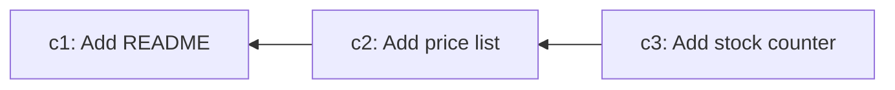
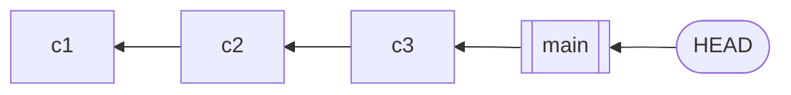
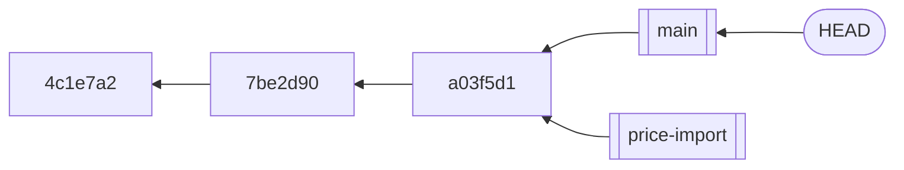
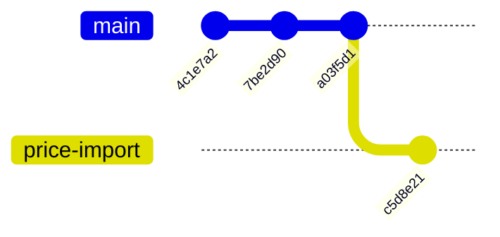
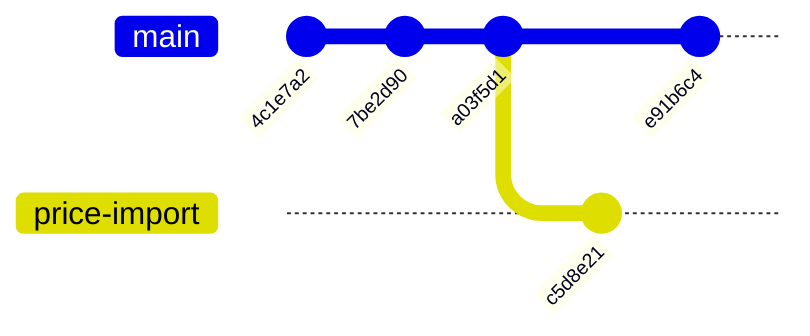
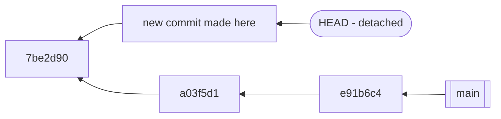

# What a branch really is

> **Before this lesson:** you should know that a commit is a snapshot with a link to its parent ([Version control and how Git thinks](#/lesson/git/version-control-ideas)) and be able to commit and read `git log --oneline --graph` ([Viewing history with git log](#/lesson/git/viewing-history)).

## In plain words

Imagine a long paper scroll on which you write a story, one paragraph after another. Each paragraph refers to the one before it. Now imagine a **bookmark** clipped to the newest paragraph, labelled "main". Every time you write a new paragraph, you slide the bookmark down to it.

A **branch** in Git is that bookmark, and nothing more: a name that points at one commit and slides forward when you add a commit. To try a different ending for the story, you clip on a *second* bookmark labelled "alternate-ending" at the same paragraph and continue writing from there. The original bookmark stays where it was. You now have two lines of story sharing the same beginning. You never photocopy the scroll.

People coming from older tools expect a branch to be a full copy of the project in another folder, slow to make and heavy to keep. In Git a branch is a tiny file containing one commit id. Creating one takes a millisecond. That is why Git users create branches constantly: one for every feature, every bug fix, every experiment.

Why it matters for a job: every team workflow you will meet (feature branches, pull requests, release branches, hotfixes) is built on this one idea. If you believe a branch is a copy, Git's behaviour looks random. Once you see it as a movable name, commands such as merge, rebase and reset become predictable.

## Step 1: commits form a chain

Recall what a commit stores: a snapshot of the project, the author and message, and the id of its **parent**, the commit that came before. Three commits therefore form a chain in which each one points back to the previous one.



The arrows point from child to parent, from newer to older. That direction matters: a commit knows its past, never its future. Diagrams in this track often draw time left to right, but the stored links always point backwards.

## Step 2: a branch is a name pointing at a commit

When you made your first commit, Git created a branch called `main` and pointed it at that commit. With every further commit, Git moved `main` forward. You can see the pointer directly, because it is a small text file:

```bash
$ cat .git/refs/heads/main
a03f5d1c9e8b7a6f5d4c3b2a1908f7e6d5c4b3a2
```

- `cat` prints a file.
- `.git/refs/heads/main` is where Git keeps the branch named `main`. ("refs" is short for references; "heads" is Git's old word for branch tips.)
- The content is one 40-character commit id and a line break: 41 bytes. That is the entire branch.

(In an older or tidied-up repository the file may be missing because Git has packed many such names into one file, `.git/packed-refs`. The command `git rev-parse main` prints the same id in every case.)

## Step 3: HEAD is the "you are here" marker

With several branches around, Git needs to know which one you are working on. It records that in a special pointer called **HEAD**. Normally HEAD does not point at a commit directly; it points at a *branch*.

```bash
$ cat .git/HEAD
ref: refs/heads/main
```

Read this as "you are on `main`". The branch HEAD names is the **current branch**. When you commit, Git creates the new commit with the current commit as its parent and moves the current branch forward to it. HEAD follows along because it is attached to that branch.



## Step 4: create a branch

```bash
$ git branch price-import
$ git log --oneline --decorate
a03f5d1 (HEAD -> main, price-import) Add stock counter
7be2d90 Add price list
4c1e7a2 Add README
```

- `git branch <name>` creates a new branch pointing at the commit you are currently on. It does **not** switch to it.
- In the log, `(HEAD -> main, price-import)` shows both names on the same commit, and the arrow shows that HEAD is still attached to `main`.



Nothing was copied. One 41-byte file was written.

## Step 5: switch branches

```bash
$ git switch price-import
Switched to branch 'price-import'
$ git log --oneline --decorate -1
a03f5d1 (HEAD -> price-import, main) Add stock counter
```

- `git switch <name>` moves HEAD to the named branch and updates the files in your working tree to match that branch's commit. Here both branches are on the same commit, so no file changes.
- The arrow in the log now reads `HEAD -> price-import`.

`git switch -c <name>` creates a branch and switches to it in one step (`-c` for "create"). In older material you will see `git checkout <name>` and `git checkout -b <name>`; they do the same job. `switch` was introduced in Git 2.23 because `checkout` had too many unrelated duties.

## Step 6: commit on the new branch

```bash
$ echo "import csv" > importer.py
$ git add importer.py
$ git commit -m "Parse prices from CSV"
[price-import c5d8e21] Parse prices from CSV
 1 file changed, 1 insertion(+)
 create mode 100644 importer.py

$ git log --oneline --decorate
c5d8e21 (HEAD -> price-import) Parse prices from CSV
a03f5d1 (main) Add stock counter
7be2d90 Add price list
4c1e7a2 Add README
```

The new commit's parent is `a03f5d1`. Only `price-import` moved forward, because it is the branch HEAD was attached to. `main` stayed behind.



## Step 7: switch back, and watch your files change

```bash
$ git switch main
Switched to branch 'main'
$ ls
README.md  inventory.py  prices.csv
```

- `ls` lists the files in the folder. `importer.py` is gone from the working tree.

It has not been deleted from the project. Switching did two things: it attached HEAD to `main`, and it rewrote the working tree to match the snapshot `main` points to, which does not contain that file. Switch back to `price-import` and the file reappears. This is the feature that makes one folder serve as many "copies" of the project.

## Step 8: let the two branches diverge

Make a commit on `main` now:

```bash
$ echo "Prices are in euros." >> README.md
$ git commit -a -m "Document currency"
[main e91b6c4] Document currency
 1 file changed, 1 insertion(+)

$ git log --oneline --graph --all
* e91b6c4 (HEAD -> main) Document currency
| * c5d8e21 (price-import) Parse prices from CSV
|/
* a03f5d1 Add stock counter
* 7be2d90 Add price list
* 4c1e7a2 Add README
```

- `--all` is needed so that the log shows both branches, not only the current one.
- The text drawing shows two commits that share the parent `a03f5d1`. The history has **diverged**: each branch has a commit the other lacks.



Both lines of work are safe and separate. The next lesson shows how to bring them together.

## The whole mechanism in thirty lines of Python

This model stores commits in a dictionary, branches in another dictionary, and HEAD as a branch name. Run it and compare each printed line with the steps above. Notice that `branch` writes one dictionary entry and `commit` moves only the current branch.

```python-run
commits = {}                 # id -> {"parent": id or None, "msg": str}
branches = {}                # name -> commit id
HEAD = "main"                # the name of the current branch
counter = 0

def commit(msg):
    global counter
    counter += 1
    cid = f"c{counter}"
    commits[cid] = {"parent": branches.get(HEAD), "msg": msg}
    branches[HEAD] = cid                 # only the current branch moves
    return cid

def branch(name):
    branches[name] = branches[HEAD]      # a branch is one pointer: nothing is copied

def switch(name):
    global HEAD
    HEAD = name

def log(name):
    cid, out = branches[name], []
    while cid:
        out.append(f"{cid} {commits[cid]['msg']}")
        cid = commits[cid]["parent"]
    return out

commit("Add README"); commit("Add price list"); commit("Add stock counter")
branch("price-import")
print("after branch :", branches, "| HEAD ->", HEAD)
switch("price-import"); commit("Parse prices from CSV")
print("after commit :", branches, "| HEAD ->", HEAD)
switch("main"); commit("Document currency")
print("diverged     :", branches)
print("main         :", log("main"))
print("price-import :", log("price-import"))
```

The two logs share their last three entries. That shared tail is the common history; the first entry of each is what makes the branches different.

## What happens to uncommitted changes when you switch?

A newcomer's natural worry: "I have edits I have not committed. If I switch, do I lose them?"

Git is careful here. If your uncommitted edits touch files that are **the same** in both branches, Git carries the edits along and tells you:

```bash
$ git switch price-import
M       README.md
Switched to branch 'price-import'
```

The `M README.md` line says the modified file came with you.

If switching would need to overwrite a file you have edited, Git refuses:

```bash
$ git switch main
error: Your local changes to the following files would be overwritten by checkout:
        importer.py
Please commit your changes or stash them before you switch branches.
Aborting
```

Nothing was changed. You have two honest options, exactly as the message says: commit the work, or set it aside with `git stash` (covered in the tools module).

> [!WARNING]
> `git switch --discard-changes <branch>` (and the older `git checkout -f <branch>`) switch anyway by throwing your uncommitted edits away. Those edits were never committed, so they cannot be recovered. Use these options only when you have looked at `git diff` and are sure the edits are worthless.

## Detached HEAD, demystified

Normally HEAD points at a branch. You can also point it straight at a commit:

```bash
$ git switch --detach 7be2d90
HEAD is now at 7be2d90 Add price list
$ cat .git/HEAD
7be2d90e4f3a2b1c0d9e8f7a6b5c4d3e2f1a0b9c
```

HEAD now holds a commit id instead of a branch name. This state is called **detached HEAD**. It is useful for looking at an old version or testing a tag. The catch: if you commit here, no branch moves forward to remember the new commit. When you switch away, nothing points at it, and it becomes hard to find.



The cure costs nothing: give the commit a name before leaving.

```bash
$ git switch -c experiment
Switched to a new branch 'experiment'
```

## Listing, renaming and deleting branches

```bash
$ git branch
  experiment
* main
  price-import

$ git branch -v
  experiment   7f3a2d1 Try a different parser
* main         e91b6c4 Document currency
  price-import c5d8e21 Parse prices from CSV
```

- `git branch` with no arguments lists your branches; the `*` marks the current one.
- `-v` adds each branch's latest commit.

```bash
$ git branch -m experiment parser-trial
$ git branch -d parser-trial
error: The branch 'parser-trial' is not fully merged.
If you are sure you want to delete it, run 'git branch -D parser-trial'.
```

- `-m` renames a branch.
- `-d` deletes a branch, but only if its commits are already contained in another branch. Git refuses here because deleting the name would leave commit `7f3a2d1` with nothing pointing at it.
- `-D` (capital) deletes regardless.

> [!WARNING]
> `git branch -D` removes the only name for commits that exist nowhere else. They are not erased at once (the reflog keeps their ids for a few weeks, and the rescue module shows how to bring them back), but they no longer appear in any normal listing. Check with `git log main..<branch>` what the branch holds before forcing a delete.

## Why this design is powerful

Because branches are pointers, three things are true that are not true in systems where a branch is a copy.

1. **Creating a branch is instant** and takes no space, whatever the size of the project.
2. **Switching is fast**: Git changes only the files that differ between the two snapshots.
3. **Merging is tractable**: each commit records its parent, so Git can find where two branches diverged without being told. The next lesson relies on this.

> [!TIP]
> Give branches short, descriptive names that say what the work is for: `fix-negative-stock`, `feature/csv-import`, `docs/install-guide`. A slash is allowed and many teams use it to group branches by kind. Avoid names such as `test2` or `mira-branch`; three weeks later nobody, including you, will know what they hold.

## Pitfalls

- **Believing a branch contains commits.** A branch points at one commit. "The commits on a branch" is shorthand for "the commits reachable from that pointer by following parents", which includes history shared with other branches.
- **Forgetting that `git branch name` does not switch.** You create the branch, keep working, and commit on the old one. Use `git switch -c name` to create and switch together.
- **Committing in detached HEAD and switching away.** The commits become unreachable. Create a branch first.
- **Expecting each branch to have its own working files.** There is one working tree. Switching rewrites it. (Separate folders per branch are possible with `git worktree`, an advanced feature.)
- **Deleting with `-D` out of habit.** The lowercase `-d` exists to protect you; let it.
- **Reading `git log` without `--all` and thinking a branch vanished.** The plain log shows only what is reachable from HEAD.

> [!INTERVIEW]
> **"What is a branch in Git, and why is branching cheap?"** A branch is a reference: a file under `.git/refs/heads/` holding the 40-character id of one commit. Creating a branch writes that one small file; no project files are copied. `HEAD` is a symbolic reference naming the current branch, and committing creates a commit whose parent is the current tip and then advances that one branch. Follow-ups to be ready for: "What is detached HEAD?" (HEAD holds a commit id instead of a branch name, so new commits are not recorded by any branch) and "What happens to the files when you switch?" (the working tree and index are updated to the target commit's snapshot; Git refuses if that would overwrite uncommitted changes).

## Cheat sheet

| Task | Command |
|---|---|
| List branches (current marked `*`) | `git branch` |
| List with latest commit | `git branch -v` |
| Create a branch here | `git branch <name>` |
| Create and switch | `git switch -c <name>` (old: `git checkout -b <name>`) |
| Switch to an existing branch | `git switch <name>` (old: `git checkout <name>`) |
| Go back to the previous branch | `git switch -` |
| Look at an old commit without a branch | `git switch --detach <commit>` |
| Rename a branch | `git branch -m <old> <new>` |
| Delete a merged branch | `git branch -d <name>` |
| Delete an unmerged branch | `git branch -D <name>` |
| See all branches as a graph | `git log --oneline --graph --all` |
| Which commit does a name point at? | `git rev-parse <name>` |

## Summary

Commits form a chain through their parent links. A branch is a name that points at one commit; `HEAD` normally points at a branch and marks it as current. Committing adds a commit on top of the current one and moves only the current branch. `git branch` creates a name, `git switch` moves HEAD and rewrites the working tree to the target snapshot, refusing when that would destroy uncommitted edits. When two branches each gain commits after a shared ancestor, history has diverged. Pointing HEAD directly at a commit is called detached HEAD; commits made there need a branch to keep them findable. Branches being pointers is what makes Git's branching fast and its merging possible.

## Glossary

- **Branch:** a movable name that points at one commit.
- **Tip:** the commit a branch currently points at.
- **Reference (ref):** any name stored by Git that resolves to a commit id; branches and tags are refs.
- **HEAD:** the pointer that says where you are; usually it names the current branch.
- **Current branch:** the branch HEAD is attached to; the one that moves when you commit.
- **`git switch`:** change the current branch and update the working tree to match.
- **`git checkout`:** the older command that does what `switch` does (and several other things).
- **Diverge:** two branches diverge when each has commits the other does not.
- **Common ancestor:** a commit that is in the history of both branches.
- **Detached HEAD:** HEAD pointing straight at a commit instead of at a branch.
- **Reachable:** obtainable by starting at a pointer and following parent links.
- **Fully merged:** a branch whose tip is reachable from another branch, so deleting its name loses nothing.

## Check yourself

```quiz
[
  {"q": "What is physically stored when you run `git branch feature`?", "options": ["A copy of every commit", "A compressed archive of the working tree", "A small file containing one commit id", "A copy of every project file"], "answer": 2, "explain": "A branch is a reference: a file under .git/refs/heads holding the id of the commit it points to. Nothing else is created."},
  {"q": "You are on `main`, run `git branch fix`, then commit. Which branch moves?", "options": ["fix", "Both", "Neither", "main"], "answer": 3, "explain": "git branch creates the name but does not switch. HEAD is still attached to main, so main advances and fix stays behind."},
  {"q": "What does HEAD normally contain?", "options": ["The id of the first commit", "A list of all branches", "The staged files", "A reference to the current branch"], "answer": 3, "explain": "The file .git/HEAD usually reads `ref: refs/heads/<branch>`. Only in detached state does it hold a commit id."},
  {"q": "After switching from `price-import` to `main`, a file you created on `price-import` is gone from the folder. Why?", "options": ["Git deleted it permanently", "The working tree was rewritten to match main's snapshot, which does not include that file", "The file was ignored", "Switching always clears the folder"], "answer": 1, "explain": "The file lives in the commit on price-import. Switch back and it reappears; there is one working tree showing one snapshot at a time."},
  {"q": "You commit twice in detached HEAD and then switch to main. What is true?", "options": ["The commits are deleted instantly", "Git refuses to switch", "The commits still exist but no branch points to them, so they are hard to find", "The commits were added to main"], "answer": 2, "explain": "No branch advanced with those commits. They stay in the database for a while and can be found through the reflog, but you should create a branch before leaving."},
  {"q": "Why does `git branch -d topic` sometimes refuse to delete?", "options": ["The branch has commits not reachable from another branch, so deleting the name could lose work", "The branch is too old", "You lack permission", "The branch is currently pushed"], "answer": 0, "explain": "Lowercase -d is the safe delete: it checks the branch is fully merged. -D overrides the check."},
  {"q": "Two branches have diverged. What does that mean?", "options": ["Each has at least one commit that the other does not have", "They belong to different remotes", "One was deleted", "They have different names for the same commit"], "answer": 0, "explain": "They share history up to a common ancestor and each added commits after it."},
  {"q": "You have uncommitted edits to app.py, which differs between your branch and the one you want to switch to. What does `git switch other` do?", "options": ["Refuses and asks you to commit or stash", "Merges the two versions automatically", "Overwrites your edits silently", "Deletes app.py"], "answer": 0, "explain": "Git never silently overwrites uncommitted work on a plain switch. It aborts with a message naming the file."}
]
```

> **Source:** Chacon & Straub, Pro Git 2e, ch. 3 (Branches in a Nutshell). Explanations, examples and code written for this guide.
