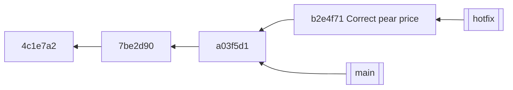
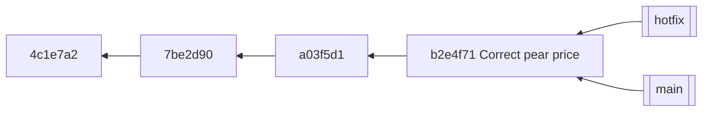
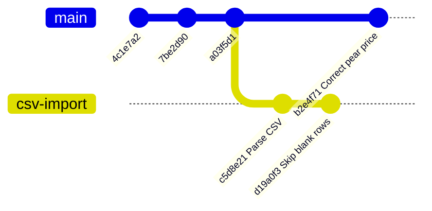
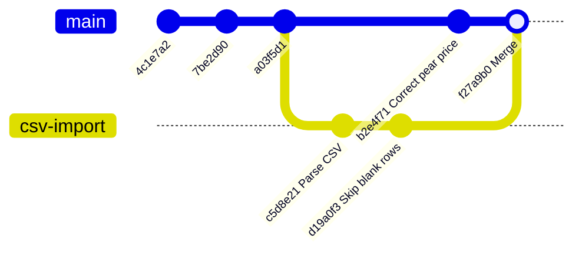
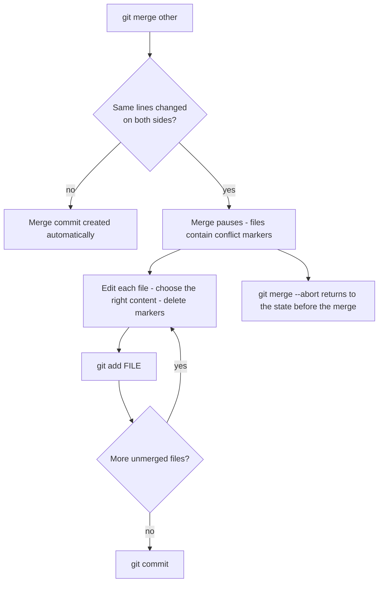

# Merging and resolving conflicts

> **Before this lesson:** you need the idea of a branch as a pointer and of diverged history from [What a branch really is](#/lesson/git/branches-in-a-nutshell), and you should be able to read a diff ([Getting a repository and recording changes](#/lesson/git/recording-changes)).

## In plain words

Two people each take a photocopy of the same recipe home. One adds a line about preheating the oven. The other changes the amount of sugar. Next week they want one recipe that has both improvements. Because they still have the original photocopy, the job is mechanical: compare each person's copy with the original, collect what each one changed, and apply both sets of changes to the original.

That is a **merge**: combining two lines of work that started from the same point. Git does it automatically almost all the time, using the same three-way comparison (original, yours, theirs).

Trouble arises only when both people changed **the same line** in different ways: one wrote "200 g sugar", the other "150 g sugar". No rule can decide which is right, so Git stops and asks a human. That situation is a **merge conflict**. A conflict is not an error and not a sign you did something wrong; it is Git declining to guess.

Why it matters for a job: on a team, merging happens many times a day, and conflicts come up every week. Developers who understand what Git is showing them resolve a conflict in two minutes. Those who do not understand it panic, pick a side at random, and delete a colleague's work. This lesson makes you the first kind.

## The scenario

The `orchard` project has a `main` branch. You start a branch for a new feature and a colleague reports an urgent bug at the same time. We will go through the two kinds of merge in the order they occur in real life.

```bash
$ git log --oneline
a03f5d1 (HEAD -> main) Add stock counter
7be2d90 Add price list
4c1e7a2 Add README
```

## Merge type 1: fast-forward

Create a branch for the urgent fix, commit on it, and return to `main`:

```bash
$ git switch -c hotfix
Switched to a new branch 'hotfix'
$ sed -i 's/pear,5/pear,6/' prices.csv
$ git commit -a -m "Correct pear price"
[hotfix b2e4f71] Correct pear price
 1 file changed, 1 insertion(+), 1 deletion(-)
$ git switch main
Switched to branch 'main'
```

- `git switch -c hotfix` creates the branch and moves onto it.
- `sed -i 's/pear,5/pear,6/' prices.csv` is a quick way to edit a file from the terminal: it replaces the text `pear,5` with `pear,6`. You could equally open the file in an editor.
- `git commit -a -m` stages the tracked change and commits it.

The picture before merging: `hotfix` is one commit ahead of `main`, and `main` has not moved.



Now merge. You always merge **into the branch you are on**, naming the branch to bring in:

```bash
$ git merge hotfix
Updating a03f5d1..b2e4f71
Fast-forward
 prices.csv | 2 +-
 1 file changed, 1 insertion(+), 1 deletion(-)
```

- `git merge hotfix` means "make the current branch (`main`) include everything in `hotfix`".
- `Fast-forward` is the key word. `main`'s commit is a direct ancestor of `hotfix`'s commit, so there is nothing to combine. Git slides the `main` pointer forward to `b2e4f71`. No new commit is created.



The fix is in `main`; the `hotfix` name is no longer needed:

```bash
$ git branch -d hotfix
Deleted branch hotfix (was b2e4f71).
```

Deleting the name loses nothing, because `main` points at the same commit.

## Merge type 2: three-way merge

Meanwhile the feature branch `csv-import` was started earlier, from `a03f5d1`, and has two commits of its own. `main` has since gained the hotfix. The histories have diverged.



A fast-forward is impossible: `main`'s commit `b2e4f71` is not an ancestor of `csv-import`. Git has to combine two snapshots. It does so with three inputs:

1. the tip of the current branch (`b2e4f71`, "ours"),
2. the tip of the branch being merged (`d19a0f3`, "theirs"),
3. their **merge base**: the most recent commit that both histories share (`a03f5d1`).

For every file, Git compares base with ours and base with theirs. A part changed on only one side takes that side's version. A part changed identically on both sides is taken once. A part untouched on both sides stays as it is.

```bash
$ git switch main
$ git merge csv-import
Merge made by the 'ort' strategy.
 importer.py | 14 ++++++++++++++
 1 file changed, 14 insertions(+)
 create mode 100644 importer.py
```

- `ort` is the name of Git's default merge algorithm; you do not need to choose it.
- Git created a new commit automatically (opening your editor first for the message, pre-filled with `Merge branch 'csv-import'`).

That new commit is a **merge commit**. It is special in one way only: it has **two parents**.

```bash
$ git log --oneline --graph
*   f27a9b0 (HEAD -> main) Merge branch 'csv-import'
|\
| * d19a0f3 (csv-import) Skip blank rows
| * c5d8e21 Parse CSV
* | b2e4f71 Correct pear price
|/
* a03f5d1 Add stock counter
* 7be2d90 Add price list
* 4c1e7a2 Add README
```



Only `main` moved. `csv-import` still points at `d19a0f3`; merging never changes the branch you merge *from*.

### Finding the merge base yourself

Git finds the base by walking parent links from both tips until the histories meet. You can ask for it directly:

```bash
$ git merge-base b2e4f71 d19a0f3
a03f5d1c9e8b7a6f5d4c3b2a1908f7e6d5c4b3a2
```

Here is the same search as a runnable model. Change the graph and the two tips to experiment.

```python-run
parents = {
    "4c1e7a2": [],
    "7be2d90": ["4c1e7a2"],
    "a03f5d1": ["7be2d90"],
    "c5d8e21": ["a03f5d1"],
    "d19a0f3": ["c5d8e21"],
    "b2e4f71": ["a03f5d1"],
}

def ancestors(commit):
    """Every commit reachable from 'commit', including itself."""
    seen, todo = set(), [commit]
    while todo:
        c = todo.pop()
        if c not in seen:
            seen.add(c)
            todo.extend(parents[c])
    return seen

def merge_base(a, b):
    common = ancestors(a) & ancestors(b)
    # the best common ancestor is the one that is not the parent of another common ancestor
    not_best = {p for c in common for p in parents[c]}
    return sorted(common - not_best)

print("ancestors of main tip      :", sorted(ancestors("b2e4f71")))
print("ancestors of csv-import tip:", sorted(ancestors("d19a0f3")))
print("merge base                 :", merge_base("b2e4f71", "d19a0f3"))
print("can main fast-forward to csv-import?", "b2e4f71" in ancestors("d19a0f3"))
```

The last line is the fast-forward test from earlier: a fast-forward is possible exactly when the current tip is an ancestor of the other tip.

## Conflicts

### How a conflict arises

Suppose both branches edited the **same line** of `README.md`. On `main` someone wrote "Prices are in euros." On branch `currency-note` someone wrote "Prices are in US dollars." The base version said "Prices are listed below."

```bash
$ git merge currency-note
Auto-merging README.md
CONFLICT (content): Merge conflict in README.md
Automatic merge failed; fix conflicts and then commit the result.
```

- `Auto-merging README.md`: Git is combining changes inside this file.
- `CONFLICT (content)`: both sides changed the same region differently.
- The last line says what to do. The merge is **paused**, not failed. No merge commit exists yet.

### Step 1: see where you stand

```bash
$ git status
On branch main
You have unmerged paths.
  (fix conflicts and run "git commit")
  (use "git merge --abort" to abort the merge)

Unmerged paths:
  (use "git add <file>..." to mark resolution)
        both modified:   README.md

no changes added to commit (use "git add" and/or "git commit -a")
```

`both modified` names the file that needs you. Files that merged cleanly are already staged and do not need attention.

### Step 2: read the markers

Open `README.md`. Git has written both versions into it, fenced with **conflict markers**:

```bash
$ cat README.md
# Orchard stock tool
Counts fruit in the warehouse.
<<<<<<< HEAD
Prices are in euros.
=======
Prices are in US dollars.
>>>>>>> currency-note
```

- Everything between `<<<<<<< HEAD` and `=======` is the version from **your current branch** ("ours").
- Everything between `=======` and `>>>>>>> currency-note` is the version from **the branch being merged** ("theirs").
- Lines outside the markers merged without trouble.

### Step 3: decide and edit

Your job is to make the file say what it *should* say, and remove all three marker lines. You may keep one side, keep the other, or write something new that combines them. Suppose the truth is that both currencies are supported:

```bash
$ cat README.md
# Orchard stock tool
Counts fruit in the warehouse.
Prices are in euros; a US dollar column is planned.
```

### Step 4: mark as resolved and finish

```bash
$ git add README.md
$ git status
On branch main
All conflicts fixed but you are still merging.
  (use "git commit" to conclude merge)

Changes to be committed:
        modified:   README.md

$ git commit
[main 6ab33d9] Merge branch 'currency-note'
```

- `git add` on a conflicted file tells Git "this file is resolved". Git does not inspect your edit; staging is your word that it is right.
- `git commit` with no message opens the editor with a prepared merge message. Saving it creates the merge commit. (`git merge --continue` does the same.)



### The escape hatch

If you started a merge and are not ready to deal with it:

```bash
$ git merge --abort
```

This puts the branch, the index and the working tree back exactly as they were before `git merge`. It is always available while the merge is paused.

> [!WARNING]
> Start merges from a clean state: commit or stash your own edits first. `git merge --abort` tries to restore uncommitted changes you had before the merge, but it cannot always do so, and such edits can be lost. Run `git status` before `git merge`, and proceed only if it reports nothing to commit.

### Seeing the original too

Knowing what the line said *before* either change often makes the decision obvious. Ask Git to include the base version in the markers:

```bash
$ git config --global merge.conflictStyle zdiff3
```

With that setting the conflict above would appear as:

```bash
<<<<<<< HEAD
Prices are in euros.
||||||| a03f5d1
Prices are listed below.
=======
Prices are in US dollars.
>>>>>>> currency-note
```

The middle section, after `|||||||`, is the merge base. You can now see that each side replaced a neutral sentence with a specific currency.

### Tools that help

- `git diff` during a paused merge shows only the conflicted regions.
- `git checkout --ours README.md` or `git checkout --theirs README.md` takes one whole side of a file, for cases where you know one version should win entirely. You still need `git add` afterwards.
- `git mergetool` opens a graphical three-pane tool if you have one configured.
- Most editors (VS Code, IntelliJ and others) recognise the markers and offer buttons such as "Accept current" and "Accept incoming". "Current" is ours; "incoming" is theirs.

### A model of the three-way rule

The function below applies the rule to a single line (or any single value): compare each side with the base.

```python-run
def merge_value(base, ours, theirs):
    if ours == theirs:   return ours, "same on both sides"
    if ours == base:     return theirs, "only theirs changed -> take theirs"
    if theirs == base:   return ours, "only ours changed -> take ours"
    return None, "CONFLICT: both changed differently"

cases = [
    ("apple,3", "apple,3", "apple,3"),
    ("pear,5",  "pear,6",  "pear,5"),
    ("plum,4",  "plum,4",  "plum,9"),
    ("fig,2",   "fig,3",   "fig,3"),
    ("Prices are listed below.", "Prices are in euros.", "Prices are in US dollars."),
]
for base, ours, theirs in cases:
    result, why = merge_value(base, ours, theirs)
    print(f"base={base!r:28} ours={ours!r:24} theirs={theirs!r:28} -> {result!r}  ({why})")
```

Real merges apply this reasoning to regions of lines after aligning the three files; the problem *Three-way merge of line lists* in this module has you build that.

## Keeping a merge commit on purpose

Sometimes a fast-forward is possible but you want the history to show that a group of commits arrived together as one feature. `--no-ff` forces a merge commit:

```bash
$ git merge --no-ff csv-import -m "Merge csv-import: read stock from CSV files"
```

The opposite, `--ff-only`, refuses to merge unless a fast-forward is possible. It is a safe default for updating your local `main` from the server, because it never creates a surprise merge commit.

## Pitfalls

- **Merging in the wrong direction.** `git merge X` changes the branch you are *on*. Check with `git status` or the prompt before merging.
- **Committing a file that still contains markers.** Git does not stop you. Search before committing: `git diff --check` reports leftover markers, and so does `grep -n '<<<<<<<' -r .`.
- **Resolving by always picking "mine".** That silently deletes the other person's change. Read both sides; if unsure, ask the author.
- **Resolving the text but not the meaning.** Two changes can merge without any textual conflict and still break the program together (one branch renames a function, the other adds a new call to the old name). Always build and run the tests after a merge.
- **Panicking at `Automatic merge failed`.** Nothing is lost. Both versions are in the file, and `git merge --abort` is one command away.
- **Long-lived branches.** The longer two branches stay apart, the more the same lines get touched on both sides. Merging `main` into your feature branch regularly keeps each conflict small.

> [!TIP]
> In a conflict, "ours" is always the branch you were on when you typed the command, and "theirs" is the branch named in the command. If you are on `main` and run `git merge feature`, ours is `main`. The marker labels (`HEAD` and the branch name) tell you the same thing.

> [!INTERVIEW]
> **"Explain fast-forward versus three-way merge."** A fast-forward happens when the current branch's tip is an ancestor of the branch being merged; Git moves the pointer forward and creates no commit. When the branches have diverged, Git performs a three-way merge using both tips and their merge base, and records the result in a merge commit with two parents. **"What causes a conflict and how do you resolve one?"** A conflict occurs when both sides changed the same region of a file differently relative to the base (or one side edited a file the other deleted). Resolution: `git status` to list unmerged paths, edit each file to the intended content and remove the markers, `git add` each one, then `git commit`; `git merge --abort` backs out. Strong candidates add that they rerun tests afterwards, and that enabling the `zdiff3` conflict style shows the base version.

## Cheat sheet

| Task | Command |
|---|---|
| Merge a branch into the current one | `git merge <branch>` |
| Merge only if fast-forward is possible | `git merge --ff-only <branch>` |
| Always create a merge commit | `git merge --no-ff <branch>` |
| Find the common ancestor | `git merge-base <a> <b>` |
| Which files are conflicted? | `git status` |
| Show conflicted regions | `git diff` |
| Take one whole side for a file | `git checkout --ours <file>` / `git checkout --theirs <file>` |
| Mark a file resolved | `git add <file>` |
| Finish the merge | `git commit` or `git merge --continue` |
| Give up and go back | `git merge --abort` |
| Show the base in conflict markers | `git config --global merge.conflictStyle zdiff3` |
| Which branches are already merged here? | `git branch --merged` |

## Summary

Merging brings the work of another branch into the current one. When the current tip is an ancestor of the other branch, Git fast-forwards: it moves the pointer and creates nothing. When the branches have diverged, Git performs a three-way merge using the two tips and their merge base, and records a merge commit with two parents. If both sides changed the same lines differently, the merge pauses with conflict markers in the affected files; you edit the files to the correct content, stage them and commit, or abort to return to the starting point. Start merges from a clean working tree and test the result, because a merge without textual conflicts is not guaranteed to be correct.

## Glossary

- **Merge:** combine the changes of another branch into the current branch.
- **Fast-forward:** a merge that only moves the branch pointer forward, possible when no divergence exists.
- **Three-way merge:** combining two snapshots by comparing each with their common ancestor.
- **Merge base:** the most recent commit shared by both branches' histories.
- **Merge commit:** a commit with two (or more) parents recording the result of a merge.
- **Ours / theirs:** the current branch's version / the version from the branch being merged.
- **Conflict:** a region changed differently on both sides, which Git will not resolve by itself.
- **Conflict markers:** the lines `<<<<<<<`, `=======`, `>>>>>>>` that Git writes around the two versions.
- **Unmerged path:** a file that still has unresolved conflicts.
- **Resolve:** edit a conflicted file to its intended content and stage it.
- **`--abort`:** stop a paused merge and restore the state from before it.
- **Merge strategy (`ort`):** the algorithm Git uses to compute a merge.
- **`--no-ff` / `--ff-only`:** always create a merge commit / merge only when fast-forward is possible.

## Check yourself

```quiz
[
  {"q": "When does `git merge feature` result in a fast-forward?", "options": ["Whenever there are no conflicts", "When feature has only one commit", "When the current branch's tip is an ancestor of feature's tip", "When both branches have the same number of commits"], "answer": 2, "explain": "If the current branch has no commits that feature lacks, there is nothing to combine, so Git moves the pointer forward without creating a commit."},
  {"q": "How many parents does a merge commit created by merging one branch have?", "options": ["None", "One", "Two", "It depends on the number of files"], "answer": 2, "explain": "It records both lines of history: the previous tip of the current branch and the tip of the merged branch."},
  {"q": "In a three-way merge, a line is unchanged in ours compared with the base but edited in theirs. What does Git do?", "options": ["Deletes the line", "Keeps our version", "Takes their version", "Reports a conflict"], "answer": 2, "explain": "Only one side changed it, so that change is the intended result. A conflict needs both sides to change the same region differently."},
  {"q": "In conflict markers, what lies between `<<<<<<< HEAD` and `=======`?", "options": ["The merge base version", "Git's suggested resolution", "The version from the current branch (ours)", "The version from the branch being merged (theirs)"], "answer": 2, "explain": "The upper block is ours, labelled HEAD. The lower block, ending at >>>>>>> with the branch name, is theirs."},
  {"q": "After editing a conflicted file to the right content, what tells Git it is resolved?", "options": ["git merge --resolved", "Deleting the other branch", "Saving the file", "git add on that file"], "answer": 3, "explain": "Staging a conflicted path marks it resolved. When no unmerged paths remain, git commit concludes the merge."},
  {"q": "You began a merge, see ten conflicted files, and want to return to exactly where you were. Which command?", "options": ["git revert HEAD", "git reset --soft", "git merge --abort", "git branch -D main"], "answer": 2, "explain": "While a merge is paused, --abort restores the pre-merge branch, index and working tree."},
  {"q": "After `git merge csv-import` on main creates a merge commit, where does the csv-import branch point?", "options": ["At the merge base", "Where it pointed before; it does not move", "At the new merge commit", "It is deleted"], "answer": 1, "explain": "Merging changes only the branch you are on. The merged-from branch keeps its tip until you move or delete it."},
  {"q": "A merge completes with no conflicts, yet the program no longer runs. How is that possible?", "options": ["Git corrupted a file", "Textual merging cannot detect changes that are incompatible in meaning, such as a renamed function still called elsewhere", "Fast-forward merges skip files", "The merge base was wrong"], "answer": 1, "explain": "Git merges lines, not meaning. Two edits in different places can each be fine alone and broken together, so tests should run after every merge."}
]
```

> **Source:** Chacon & Straub, Pro Git 2e, ch. 3 (Basic Branching and Merging). Explanations, examples and code written for this guide.
