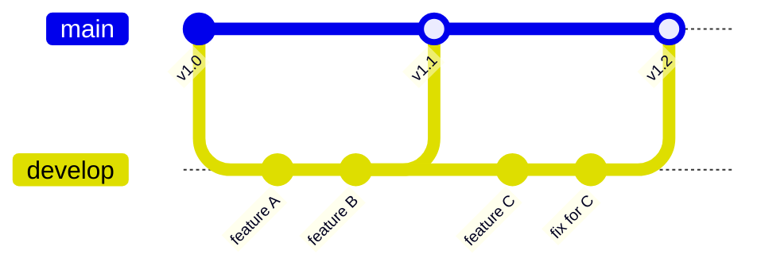
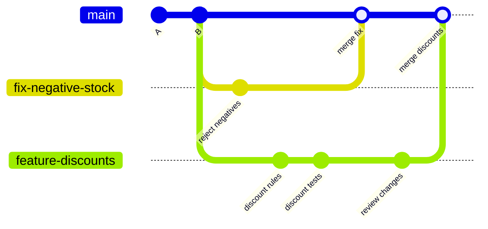
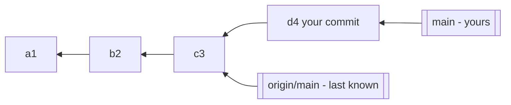
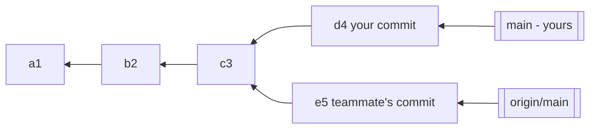
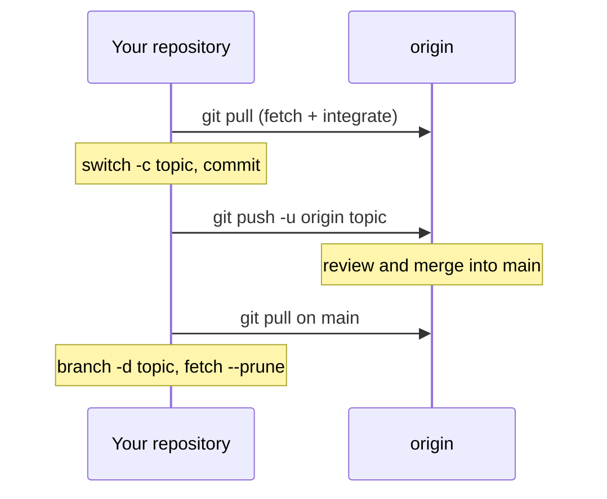

# Branch management, workflows and remote branches

> **Before this lesson:** you should understand branches and merging ([What a branch really is](#/lesson/git/branches-in-a-nutshell), [Merging and resolving conflicts](#/lesson/git/merging-and-conflicts)) and the basics of fetch, pull and push ([Remotes, tags and aliases](#/lesson/git/remotes-tags-aliases)).

## In plain words

A busy kitchen has several stations: one for prep, one for the grill, one for plating. Food moves from station to station, and only finished plates go out to the dining room. Nobody plates a dish that is still raw.

Branches let a software team work the same way. One branch holds only finished, tested work (the dining room). Other branches hold work in progress (the stations). Short-lived branches come and go for individual tasks. A **branching workflow** is the team's agreement about which branches exist and how work moves between them.

There is a second half to the story. Your teammates' branches live on a shared server, not on your laptop. Your own repository keeps a set of read-only bookmarks, called **remote-tracking branches**, that record where the server's branches were the last time you checked. Understanding those bookmarks answers the questions that puzzle every newcomer: "Why does Git say my branch is 2 commits behind?", "Why can I see `origin/feature` but not switch to it?", "How do I put my branch on the server?"

Why it matters for a job: from your first week you will be told "push your branch and open a pull request" and "your branch is behind main, update it". Both instructions are about the material in this lesson.

## Part 1: managing your branches

### Seeing what you have

```bash
$ git branch
  csv-import
  currency-note
* main
  wip-discounts

$ git branch -v
  csv-import    d19a0f3 Skip blank rows
  currency-note 81c7d22 State the currency
* main          6ab33d9 Merge branch 'currency-note'
  wip-discounts 9c02e6b Half-finished discount logic
```

- `git branch` lists local branches; `*` marks the one you are on.
- `-v` adds the short id and subject of each branch's newest commit.

### Which branches are finished?

```bash
$ git branch --merged
  csv-import
  currency-note
* main

$ git branch --no-merged
  wip-discounts
```

- `--merged` lists branches whose tip is already contained in the current branch. Everything they hold is in `main`, so their names can be deleted without losing anything.
- `--no-merged` lists branches with work that the current branch does not yet contain.

Both accept a branch name to compare against instead of the current one, for example `git branch --no-merged main`.

```bash
$ git branch -d csv-import currency-note
Deleted branch csv-import (was d19a0f3).
Deleted branch currency-note (was 81c7d22).

$ git branch -d wip-discounts
error: The branch 'wip-discounts' is not fully merged.
If you are sure you want to delete it, run 'git branch -D wip-discounts'.
```

Lowercase `-d` refuses to delete unmerged work, which is the protection you want.

### Renaming a branch

```bash
$ git branch --move wip-discounts discounts
```

`--move` (short `-m`) renames a local branch. If the old name was already pushed, the server still has it; pushing the new name and deleting the old one on the server are separate steps, shown in Part 3.

> [!WARNING]
> Renaming a branch that other people or automated systems use (above all the main branch) breaks their setups: their clones, build scripts and open pull requests still refer to the old name. Agree on it with the team first, and update every place that mentions the name.

## Part 2: branching workflows

Because branches cost nothing, teams use them to organise work. Two patterns appear everywhere, usually together.

### Long-running branches

Some branches live for the whole life of the project and represent **levels of stability**. A common arrangement:

- `main`: only code that is released or ready to release.
- `develop` (some teams call it `next`): work that has been reviewed and is being tested together before release.

Work flows in one direction, from less stable to more stable. When `develop` has been tested enough, it is merged into `main`.



A helpful way to see it: the branches are pointers at different distances along the same line of commits. The stable pointer trails behind; the unstable one runs ahead.

### Topic branches

A **topic branch** (also called a feature branch) is a short-lived branch for exactly one piece of work: one feature, one bug fix, one experiment. You create it, commit on it for a few hours or days, merge it, and delete it.



Why this works so well:

- **Isolation.** Unfinished work on one topic cannot break another topic or the main line.
- **Context switching.** An urgent bug arrives while you are mid-feature: commit or stash, switch to `main`, branch, fix, merge, switch back. Your feature was never disturbed.
- **Review.** A branch that contains one topic is easy for a colleague to read and discuss as a unit.
- **Easy abandonment.** If the experiment fails, delete the branch. The main line never saw it.

Everything in Parts 1 and 2 happens entirely in your local repository. Branches reach other people only when you push them, which is the subject of the rest of the lesson.

## Part 3: remote branches

### What `origin/main` is

After a clone, your repository has **two kinds** of pointer for the main branch:

- `main`: your own local branch. It moves when *you* commit, merge or reset.
- `origin/main`: a **remote-tracking branch**. It records where `main` was on the remote called `origin` the last time your repository talked to it. You cannot commit on it. Git moves it for you during `fetch`, `pull` and `push`.

```bash
$ git branch -a
* main
  remotes/origin/HEAD -> origin/main
  remotes/origin/main
  remotes/origin/reports
```

- `-a` lists all branches, local and remote-tracking. `-r` lists only the remote-tracking ones.
- `remotes/origin/HEAD -> origin/main` records which branch the remote treats as its default.
- `origin/reports` is a branch a teammate pushed. You have a bookmark for it, but no local branch of your own yet.

### Divergence between you and the server

Say you make a commit on `main` while a teammate pushes a different commit to the server. Before you fetch, your repository knows nothing of the teammate's commit:



Run `git fetch` and the bookmark moves to show the server's real position:

```bash
$ git fetch origin
From https://git.example.com/greenhouse/orchard
   c3a91f0..e5b7d24  main       -> origin/main

$ git status
On branch main
Your branch and 'origin/main' have diverged,
and have 1 and 1 different commits each, respectively.
  (use "git pull" if you want to integrate the remote branch with your own)
```

- The fetch line reads: on `origin`, `main` moved from `c3a91f0` to `e5b7d24`, and your bookmark `origin/main` was updated to match.
- `git status` compares your `main` with the bookmark and reports one commit on each side.



This is ordinary diverged history, the same shape as in the merging lesson. You integrate with `git merge origin/main` (or `git pull`, which fetches and merges in one step), then push.

Here is the bookkeeping as a runnable model. The key point it shows: `origin/main` is a memory, and only a fetch refreshes it.

```python-run
server_main = "c3"
local = {"main": "c3", "origin/main": "c3"}
ahead_of = {"c3": [], "d4": ["c3"], "e5": ["c3"]}       # commit -> parents

def count_ahead_behind():
    def anc(c):
        seen, todo = set(), [c]
        while todo:
            x = todo.pop()
            if x not in seen:
                seen.add(x); todo.extend(ahead_of[x])
        return seen
    mine, theirs = anc(local["main"]), anc(local["origin/main"])
    return len(mine - theirs), len(theirs - mine)

local["main"] = "d4"            # you commit
server_main = "e5"              # a teammate pushes; your repository does not know
print("before fetch: ahead/behind =", count_ahead_behind(), "| origin/main =", local["origin/main"])

local["origin/main"] = server_main      # git fetch
print("after fetch : ahead/behind =", count_ahead_behind(), "| origin/main =", local["origin/main"])
```

Before the fetch, Git believes you are 1 ahead and 0 behind, because its memory is stale. After the fetch it knows the truth: 1 ahead, 1 behind.

### Pushing a new branch

A local branch exists only on your machine until you push it.

```bash
$ git switch -c discounts
$ git commit -a -m "Add discount rules"
$ git push -u origin discounts
Enumerating objects: 5, done.
Counting objects: 100% (5/5), done.
Writing objects: 100% (3/3), 412 bytes | 412.00 KiB/s, done.
Total 3 (delta 1), reused 0 (delta 0), pack-reused 0
To https://git.example.com/greenhouse/orchard.git
 * [new branch]      discounts -> discounts
branch 'discounts' set up to track 'origin/discounts'.
```

- `git push origin discounts` uploads the branch and creates `discounts` on the server.
- `-u` (short for `--set-upstream`) also records a link between your local `discounts` and `origin/discounts`. The last line of output confirms it.
- You need `-u` only the first time. From then on, plain `git push` and `git pull` on this branch know where to go.

### Tracking branches and the upstream

A local branch that is linked to a remote-tracking branch is called a **tracking branch**, and the branch it is linked to is its **upstream**. The link gives you three conveniences: `git pull` and `git push` need no arguments, and `git status` tells you how far ahead or behind you are.

To start working on a branch a teammate pushed:

```bash
$ git fetch origin
$ git switch reports
branch 'reports' set up to track 'origin/reports'.
Switched to a new branch 'reports'
```

There is no local branch called `reports`, but exactly one remote has one, so Git creates a local branch from `origin/reports` and sets up the tracking link automatically. The long spelling is `git switch -c reports --track origin/reports`.

See all the links at once:

```bash
$ git fetch --all
$ git branch -vv
  discounts 8b3f6c2 [origin/discounts] Add discount rules
* main      d4c81aa [origin/main: ahead 1, behind 1] Document currency
  reports   2e9f0b7 [origin/reports: behind 3] Monthly totals
  scratch   77a1c05 Local experiment
```

- `-vv` shows each branch's upstream in square brackets with the ahead and behind counts.
- `main` has one commit to push and one to integrate. `reports` is three commits behind its upstream. `scratch` has no upstream; it exists only locally.
- These numbers are measured against your bookmarks, so run `git fetch --all` first to make them current.

To change or set the upstream of an existing branch: `git branch -u origin/discounts`.

The shorthand `@{u}` (or `@{upstream}`) means "the upstream of the current branch", which makes two everyday questions short:

```bash
$ git log --oneline @{u}..HEAD      # what would I push?
$ git log --oneline HEAD..@{u}      # what would I receive?
```

### Pulling

`git pull` runs `git fetch` and then integrates the upstream into the current branch. In recent Git versions, if your branch and its upstream have diverged and you never told Git how to combine them, pull stops and asks you to choose:

```bash
$ git pull
hint: You have divergent branches and need to specify how to reconcile them.
hint:   git config pull.rebase false  # merge
hint:   git config pull.rebase true   # rebase
hint:   git config pull.ff only       # fast-forward only
fatal: Need to specify how to reconcile divergent branches.
```

The three choices: create a merge commit; replay your commits on top of the fetched ones (rebasing, the next lesson); or refuse unless a fast-forward is possible. Many people set `pull.ff only` globally so that pull never does anything surprising, and then merge or rebase deliberately when it stops.

### Deleting a remote branch

When a topic branch has been merged, remove it from the server too:

```bash
$ git push origin --delete discounts
To https://git.example.com/greenhouse/orchard.git
 - [deleted]         discounts
```

This removes the pointer on the server. Teammates' repositories keep their stale `origin/discounts` bookmark until they clean up:

```bash
$ git fetch --prune
From https://git.example.com/greenhouse/orchard
 - [deleted]         (none)     -> origin/discounts
```

`--prune` deletes remote-tracking branches whose branch no longer exists on the remote. Setting `git config --global fetch.prune true` makes every fetch do this.

> [!WARNING]
> `git push origin --delete <branch>` takes effect for everyone immediately and asks for no confirmation. If the branch was not merged, the server no longer has any name for its commits. Check first with `git branch -r --merged origin/main`, which lists the remote branches already contained in the main line.

## A complete day, start to finish

```bash
$ git switch main
$ git pull                              # start from the latest shared state
$ git switch -c fix-negative-stock      # topic branch
# ... edit, test ...
$ git commit -a -m "Reject negative quantities in stock import"
$ git push -u origin fix-negative-stock # publish; open a pull request on the host
# ... review, approval, merge on the server ...
$ git switch main
$ git pull                              # receive the merged result
$ git branch -d fix-negative-stock      # delete the local name
$ git fetch --prune                     # drop the stale remote-tracking bookmark
```



## Pitfalls

- **Treating `origin/main` as live.** It changes only when you fetch, pull or push. A status of "up to date with 'origin/main'" means up to date with your *last fetch*.
- **Trying to work on `origin/something` directly.** Switching to a remote-tracking branch by its full name gives a detached HEAD. Create a local branch from it (`git switch something`).
- **Forgetting `-u` on the first push.** Later `git push` fails with "The current branch has no upstream branch". The message contains the command to fix it.
- **Believing a merged branch must be kept.** After merging, the branch name is redundant. Stale branches pile up and make the list hard to read.
- **Deleting the local branch and assuming the server one went too.** Local and remote branches are separate pointers; each needs its own delete.
- **Long-lived topic branches.** A branch that lives for weeks drifts far from `main` and produces large conflicts. Keep topics small, or merge `main` into them often.

> [!TIP]
> Put the two cleanup settings in your global configuration once and forget about them: `git config --global fetch.prune true` and `git config --global pull.ff only`. The first keeps your list of remote-tracking branches honest; the second stops `git pull` from creating a merge you did not ask for.

> [!INTERVIEW]
> **"What is the difference between `main`, `origin/main` and the `main` on the server?"** There are three pointers. The server's `main` is the shared truth. `origin/main` is your repository's cached record of where the server's `main` was at your last fetch, pull or push; it is read-only for you. Your local `main` is your own branch, which moves when you commit or merge. `git fetch` updates `origin/main` from the server; `git merge origin/main` (or the second half of `git pull`) updates local `main` from `origin/main`; `git push` updates the server's `main` from your local one and then `origin/main` to match. **"What is an upstream branch?"** The remote-tracking branch a local branch is configured to pull from and push to, set with `git push -u` or `git branch -u`, and shown by `git branch -vv`.

## Cheat sheet

| Task | Command |
|---|---|
| Local branches with last commit | `git branch -v` |
| All branches, including remote-tracking | `git branch -a` |
| Branches with upstream and ahead/behind | `git branch -vv` |
| Branches already merged here / not yet | `git branch --merged` / `git branch --no-merged` |
| Rename a branch | `git branch -m <old> <new>` |
| Publish a branch and set its upstream | `git push -u origin <branch>` |
| Start a local branch from a teammate's | `git switch <branch>` |
| Set the upstream of an existing branch | `git branch -u origin/<branch>` |
| What would I push? | `git log @{u}..HEAD` |
| What would I receive? | `git log HEAD..@{u}` |
| Update all bookmarks, dropping deleted ones | `git fetch --all --prune` |
| Delete a branch on the remote | `git push origin --delete <branch>` |
| Pull without surprises | `git pull --ff-only` |

## Summary

`git branch` with `-v`, `--merged` and `--no-merged` tells you what branches you have and which are finished; `-d` deletes safely. Teams organise work with long-running branches that represent stability levels and short-lived topic branches for individual tasks. Remote-tracking branches such as `origin/main` are your repository's memory of the remote's branches and move only when you communicate with the remote. A local branch linked to one is a tracking branch, and the linked branch is its upstream; `git push -u` creates the link, `git branch -vv` shows it together with ahead and behind counts. `git pull` is a fetch followed by an integration step. Branches on the server are deleted with `git push origin --delete`, and stale bookmarks are cleaned with `git fetch --prune`.

## Glossary

- **Branching workflow:** a team's agreement about which branches exist and how work moves between them.
- **Long-running branch:** a branch kept for the life of the project, such as `main` or `develop`.
- **Topic branch (feature branch):** a short-lived branch for one piece of work.
- **Remote branch:** a branch that exists in a remote repository.
- **Remote-tracking branch:** your local, read-only record of a remote branch, named `<remote>/<branch>`.
- **Tracking branch:** a local branch linked to a remote-tracking branch.
- **Upstream:** the remote-tracking branch a local branch is linked to; written `@{u}`.
- **Ahead / behind:** the number of commits your branch has that the upstream lacks, and the reverse.
- **`-u` / `--set-upstream`:** the push option that records the upstream link.
- **Prune:** delete remote-tracking branches whose remote branch no longer exists.
- **Diverged:** both your branch and its upstream have commits the other lacks.
- **Pull request:** a request, made on a hosting site, to have your pushed branch reviewed and merged (covered in the GitHub module).

## Check yourself

```quiz
[
  {"q": "What does `git branch --merged` list?", "options": ["Branches whose tip is already contained in the current branch", "Branches with conflicts", "Branches that exist on the remote", "Branches that have merge commits"], "answer": 0, "explain": "Those branches have no commits the current branch lacks, so deleting their names loses nothing."},
  {"q": "When does `origin/main` in your repository move?", "options": ["When you fetch, pull or push", "Whenever anyone pushes to the server", "Once per hour automatically", "When you commit on main"], "answer": 0, "explain": "A remote-tracking branch is a cache updated only when your repository communicates with the remote."},
  {"q": "`git status` says your branch is up to date with 'origin/main'. A teammate pushed five minutes ago and you have not fetched. Is your branch current with the server?", "options": ["Only if you are on main", "Not necessarily; status compares against the bookmark from your last fetch", "Yes, status checks the server", "Yes, pushes are sent to all clones"], "answer": 1, "explain": "status is a local comparison. Run git fetch to refresh origin/main, then check again."},
  {"q": "What does the `-u` in `git push -u origin reports` do?", "options": ["Updates all branches", "Forces the push", "Records origin/reports as the upstream of the local branch", "Uploads untracked files"], "answer": 2, "explain": "--set-upstream links the local branch to the remote-tracking branch so that later git push, git pull and git status need no arguments."},
  {"q": "A teammate pushed branch `reports`. After `git fetch`, how do you get a local branch for it?", "options": ["git merge reports", "git switch origin/reports", "git branch -d reports", "git switch reports"], "answer": 3, "explain": "With no local branch of that name and exactly one remote having it, git switch creates a local tracking branch from origin/reports. Switching to origin/reports itself gives a detached HEAD."},
  {"q": "In `git branch -vv`, a line shows `[origin/main: ahead 2, behind 1]`. What does it mean?", "options": ["Two conflicts and one merge", "Two teammates are ahead of you", "The branch was pushed twice", "You have 2 commits to push and there is 1 commit on the upstream you do not have"], "answer": 3, "explain": "Ahead counts commits only on your branch; behind counts commits only on the upstream. Both non-zero means the branches have diverged."},
  {"q": "You deleted a branch on the server. Why do teammates still see `origin/<branch>` in `git branch -r`?", "options": ["They have a local branch with that name", "Remote branches cannot be deleted", "The delete failed", "Their remote-tracking bookmark is stale until they run git fetch --prune"], "answer": 3, "explain": "Fetch does not remove bookmarks for deleted remote branches unless pruning is requested or configured."},
  {"q": "What is the main benefit of doing each task on its own topic branch?", "options": ["Commits become smaller automatically", "It makes pushes faster", "Unfinished work is isolated, can be reviewed as a unit and can be abandoned without affecting the main line", "It avoids the need for commit messages"], "answer": 2, "explain": "Isolation, reviewability and cheap abandonment are why topic branches are the basis of nearly every team workflow."}
]
```

> **Source:** Chacon & Straub, Pro Git 2e, ch. 3 (Branch Management; Branching Workflows; Remote Branches). Explanations, examples and code written for this guide.
