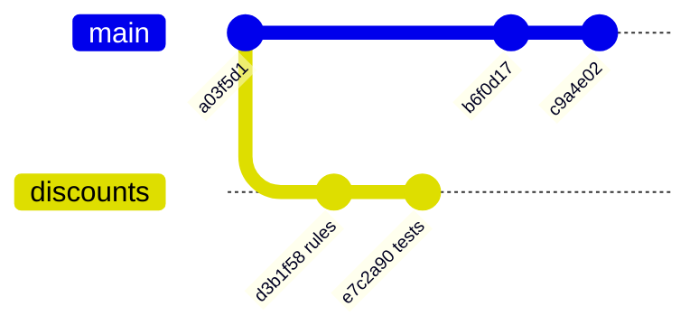
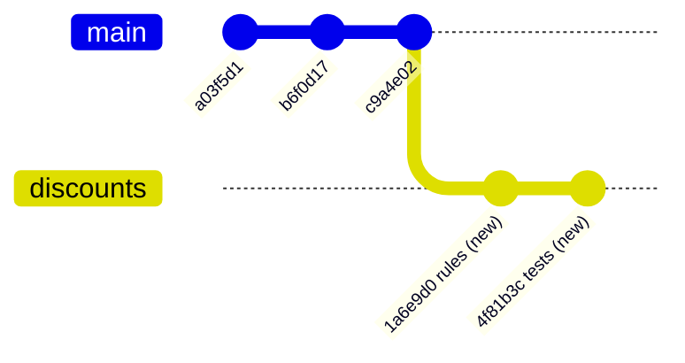
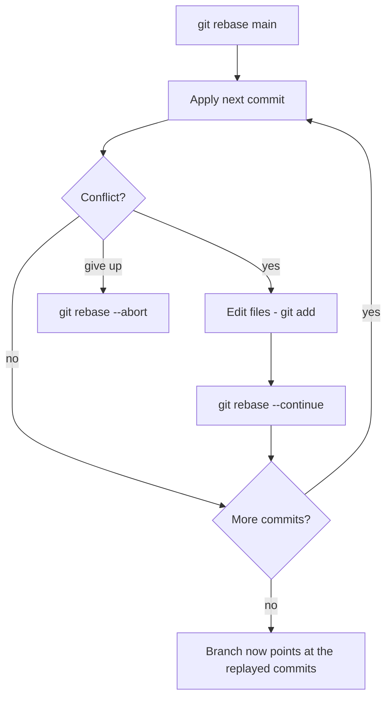
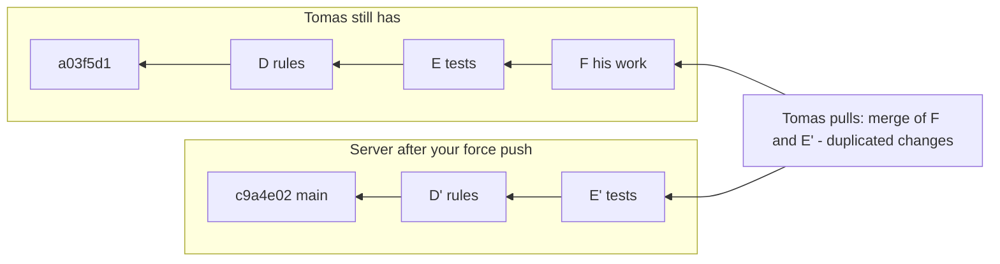
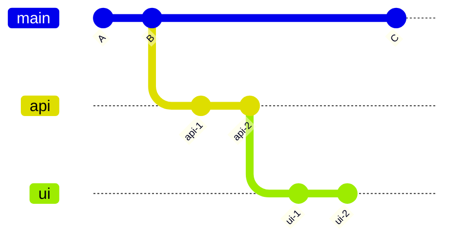
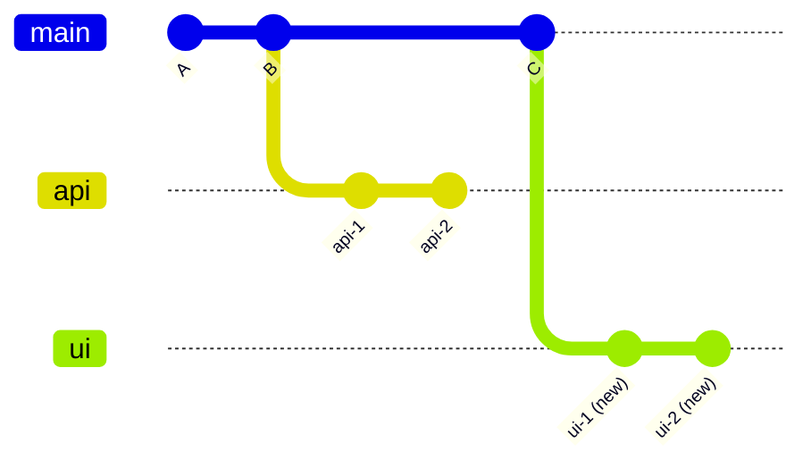

# Rebasing and its golden rule

> **Before this lesson:** you must be comfortable with diverged branches and three-way merges ([Merging and resolving conflicts](#/lesson/git/merging-and-conflicts)) and with remote-tracking branches and pushing ([Branch management, workflows and remote branches](#/lesson/git/branch-workflows-remote)).

## In plain words

You are writing chapter 5 of a shared book. You started from the version of chapter 4 that existed on Monday. By Wednesday the editor has revised chapter 4. You now have two ways to bring your chapter in line.

- **Merge:** staple a note to the book saying "chapter 5 was written against Monday's chapter 4; here is how the two were reconciled". The record of what happened is exact, with the detour visible.
- **Rebase:** rewrite your chapter 5 as though you had started from Wednesday's chapter 4. The final text is the same, and the book reads as one straight story, but the record now says something that did not literally happen.

In Git, **rebasing** means taking the commits you made on a branch and replaying them, one at a time, on top of a different starting commit. "Re-base" is literal: you give your work a new base. The result is a tidy, straight history.

The price is that the replayed commits are **new commits** with new ids; the originals are abandoned. That is harmless for work only you have. It causes real damage when other people already have the originals. Hence one rule, which this lesson will repeat: **do not rebase commits that exist outside your own repository.**

Why it matters for a job: many teams require branches to be rebased onto the latest main line before merging, and "merge or rebase?" is one of the most frequently asked Git interview questions. You need to be able to do it, explain it, and know when not to.

## The starting picture

You branched `discounts` from `main` at commit B and made two commits. Meanwhile `main` gained two commits from teammates.

```bash
$ git log --oneline --graph --all
* e7c2a90 (HEAD -> discounts) Add discount tests
* d3b1f58 Add discount rules
| * c9a4e02 (main) Speed up CSV import
| * b6f0d17 Correct pear price
|/
* a03f5d1 Add stock counter
```



## Option A, for comparison: merge

Merging `main` into `discounts` would create a merge commit with two parents. All four commits keep their ids, and the graph shows a fork and a join. You saw this in the merging lesson. It is always safe.

## Option B: rebase

```bash
$ git switch discounts
$ git rebase main
Successfully rebased and updated refs/heads/discounts.
```

- You stand on the branch whose commits should move (`discounts`).
- `git rebase main` means "replay my commits on top of `main`".

What Git did, step by step:

1. Found the merge base of `discounts` and `main`: `a03f5d1`.
2. Collected the commits on `discounts` after that base: `d3b1f58`, `e7c2a90`. For each one it worked out the change that commit introduced (its diff against its parent).
3. Moved to the tip of `main`, `c9a4e02`.
4. Applied the first change there and committed it, producing a **new** commit. Then applied the second on top of that, producing another new commit.
5. Pointed the `discounts` branch at the last new commit.

```bash
$ git log --oneline --graph --all
* 4f81b3c (HEAD -> discounts) Add discount tests
* 1a6e9d0 Add discount rules
* c9a4e02 (main) Speed up CSV import
* b6f0d17 Correct pear price
* a03f5d1 Add stock counter
```



Look closely at the ids. "Add discount rules" was `d3b1f58` and is now `1a6e9d0`. The message, author and change are the same; the commit is not. Its parent is different (`c9a4e02` instead of `a03f5d1`), and since a commit's id is a fingerprint of everything in it, including the parent, a different parent means a different id. The old commits `d3b1f58` and `e7c2a90` still sit in the database for a while, but no branch points to them.

The history is now a straight line. Because `main` is a direct ancestor of `discounts`, bringing the work into `main` is a fast-forward:

```bash
$ git switch main
$ git merge discounts
Updating c9a4e02..4f81b3c
Fast-forward
 discounts.py            | 22 ++++++++++++++++++++++
 tests/test_discounts.py | 18 ++++++++++++++++++
 2 files changed, 40 insertions(+)
```

**The final files are identical** whether you merged or rebased. Only the shape of history differs.

### A runnable model of rebase

The model stores each commit as a parent plus a "change" and computes ids from content, as Git does. Watch the ids of the replayed commits differ from the originals while the changes are preserved.

```python-run
import hashlib

commits = {}   # id -> {"parent": id, "change": str}

def make(parent, change):
    cid = hashlib.sha1(f"{parent}|{change}".encode()).hexdigest()[:7]
    commits[cid] = {"parent": parent, "change": change}
    return cid

def history(tip):
    out = []
    while tip:
        out.append(tip); tip = commits[tip]["parent"]
    return out

def rebase(branch_tip, onto):
    base = next(c for c in history(branch_tip) if c in set(history(onto)))    # merge base
    mine = [c for c in history(branch_tip) if c not in set(history(base))][::-1]   # oldest first
    new_tip = onto
    for c in mine:
        new_tip = make(new_tip, commits[c]["change"])     # same change, new parent -> new id
    return new_tip

A = make(None, "stock counter")
B = make(A, "pear price"); C = make(B, "faster import")          # main
D = make(A, "discount rules"); E = make(D, "discount tests")     # discounts

print("discounts before:", [(c, commits[c]["change"]) for c in history(E)])
E2 = rebase(E, C)
print("discounts after :", [(c, commits[c]["change"]) for c in history(E2)])
print("old commits still stored:", D in commits and E in commits)
```

## Conflicts during a rebase

Each replayed commit can conflict with what is now underneath it. When that happens, the rebase pauses at that commit.

```bash
$ git rebase main
Auto-merging prices.csv
CONFLICT (content): Merge conflict in prices.csv
error: could not apply d3b1f58... Add discount rules
hint: Resolve all conflicts manually, mark them as resolved with
hint: "git add/rm <conflicted_files>", then run "git rebase --continue".
hint: You can instead skip this commit: run "git rebase --skip".
hint: To abort and get back to the state before "git rebase", run "git rebase --abort".
Could not apply d3b1f58... Add discount rules
```

The procedure mirrors a merge conflict, with a different final command:

```bash
$ git status                 # lists the conflicted files
# edit prices.csv: choose the right content, remove the markers
$ git add prices.csv
$ git rebase --continue
[detached HEAD 1a6e9d0] Add discount rules
 2 files changed, 23 insertions(+), 1 deletion(-)
Successfully rebased and updated refs/heads/discounts.
```

- `git add` marks the file as resolved.
- `git rebase --continue` commits the resolved step and proceeds to the next commit. With many commits you may be stopped several times.
- `git rebase --abort` cancels the whole rebase and puts the branch back exactly where it started.
- `git rebase --skip` drops the commit being applied; use it only when that commit's change is no longer wanted.

A point that trips people up: during a rebase the meaning of the two sides in the conflict markers is **swapped** compared with a merge. "Ours" (the `HEAD` block) is the branch you are rebasing *onto* (`main`, plus your commits replayed so far), and "theirs" is your own commit being replayed. Read the content of each block instead of relying on the labels.



## The golden rule

> [!WARNING]
> **Do not rebase commits that exist outside your repository and that other people may have based work on.** Rebasing abandons existing commits and creates new ones that are similar but different. If those commits were pushed and a teammate pulled them, the teammate still has the originals. After you force-push the rebased branch, their next pull merges old and new together: every change appears twice in the log, conflicts appear from nowhere, and untangling it costs the team hours.

Here is the failure, slowly.

1. You push `discounts` containing commits D and E.
2. Tomas fetches it and adds his commit F on top of E.
3. You rebase `discounts` onto the new `main`. D and E are replaced by D' and E'. A normal push is now rejected, because the server's branch (ending at E) is not an ancestor of yours. You run `git push --force`.
4. Tomas pulls. His repository has D, E, F; the server has D', E'. Git sees two diverged lines and merges them. The result contains D and D', E and E': the same changes twice, under different ids.



The safe zone is easy to state: **rebase local commits you have not pushed, or a branch that only you use.** Everything else, merge.

If you are the one who pulled and discover a teammate has force-pushed a rebased branch you built on, `git pull --rebase` (or `git rebase origin/discounts`) often repairs it: Git compares the changes themselves, notices that your copies of D and E match D' and E', skips them, and replays only your own commit F.

### Force pushing the right way

Rebasing your *own* pushed topic branch (to update it before review, say) is common and accepted on many teams, provided nobody else commits to that branch. The push after such a rebase has to be forced. Use the careful form:

```bash
$ git push --force-with-lease origin discounts
```

`--force-with-lease` overwrites the remote branch only if it is still where your `origin/discounts` bookmark says it is. If a teammate pushed to the branch in the meantime, the push is refused and their work survives. Plain `--force` performs no such check.

## Useful variations

### Rebase while pulling

```bash
$ git pull --rebase
```

This fetches, then rebases your unpushed local commits on top of the fetched branch instead of merging. It keeps a shared branch free of "Merge branch 'main' of ..." commits. It respects the golden rule automatically, because the commits being replayed are the ones you have not pushed. Make it the default with `git config --global pull.rebase true`.

### Moving a branch that grew from another branch: `--onto`

Suppose `ui` was started from `api` (not from `main`), and you want to land `ui` without `api`.



```bash
$ git rebase --onto main api ui
```

Read it as: "take the commits that are on `ui` but not on `api`, and replay them onto `main`". The three arguments are the new base, the old base to cut from, and the branch to move. Afterwards `ui-1'` and `ui-2'` sit directly on top of C, and `api` is untouched.



### Rebasing a branch without switching to it

`git rebase main discounts` first switches to `discounts` and then rebases it onto `main`; it saves you one command.

### Interactive rebase

`git rebase -i main` opens a list of your commits and lets you reorder, combine, reword or drop them before replaying. It is the main tool for cleaning up a branch before review and has its own section in [Signing, searching and rewriting history](#/lesson/git/sign-search-rewrite). The golden rule applies to it without change.

## Merge or rebase?

There are two honest views of what history is for.

- **History as a record of what happened.** Every commit and every merge is a fact. Rewriting it is falsifying the record. This view favours merging.
- **History as the story of how the project was built.** Readers are served by a clear narrative, not by every wrong turn. You edit a book before publishing it. This view favours rebasing and tidying before sharing.

Most teams combine them: **rebase your own local work to keep it tidy and current; merge to integrate shared branches; never rewrite what others depend on.**

| | Merge | Rebase |
|---|---|---|
| Existing commits | kept unchanged | replaced by new copies |
| History shape | fork and join, with a merge commit | straight line |
| Safe on shared branches | yes | no |
| Conflicts | resolved once, in the merge commit | resolved per replayed commit |
| Records when integration happened | yes | no |
| Finding a bug with `git bisect` | works; merges add steps | linear history is the easiest case |

> [!TIP]
> Before a rebase you feel unsure about, create a backup name: `git branch backup-discounts`. If the result is wrong, `git reset --hard backup-discounts` restores the branch. Even without a backup, `git reflog` lists the commit the branch pointed to before the rebase (look for the entry mentioning `rebase (start)` and take the one before it), and `ORIG_HEAD` holds it too: `git reset --hard ORIG_HEAD`.

## Pitfalls

- **Rebasing a shared branch.** The golden rule. If more than one person commits to the branch, merge.
- **Plain `--force` after a rebase.** Use `--force-with-lease`.
- **Running `git pull` (merge) after rebasing your pushed branch.** The server still has your old commits; pulling merges old and new and duplicates everything. After rebasing a pushed branch, the next step is a forced push, not a pull.
- **Resolving the same conflict repeatedly.** A long branch replayed commit by commit can hit a similar conflict at several steps. Squashing related commits first, or enabling `rerere` (see the advanced merging lesson), reduces the pain.
- **Losing track mid-rebase.** `git status` always says "rebase in progress" and which commit is being applied. `--abort` is always available.
- **Assuming tests still pass.** Each replayed commit now sits on different code. Run the tests after rebasing.

> [!INTERVIEW]
> **"Explain `git merge` versus `git rebase`."** Both integrate changes from one branch into another. Merge creates a new commit with two parents that ties the histories together; nothing existing is altered, so it is safe everywhere and preserves the true sequence of events. Rebase takes the commits unique to your branch and reapplies them on top of the target, producing new commits with new ids and a linear history; the end content is the same. Because rebase rewrites commits, the rule is to rebase only commits that have not been shared, otherwise collaborators end up with duplicate commits. In practice: rebase local topic work onto the latest main before opening a pull request, push with `--force-with-lease` if the branch was already published and is yours alone, and merge for integrating shared branches. Mention `pull --rebase`, `--onto`, and recovery through the reflog to show depth.

## Cheat sheet

| Task | Command |
|---|---|
| Replay current branch onto `main` | `git rebase main` |
| Continue after resolving a conflict | `git add <files>` then `git rebase --continue` |
| Cancel a rebase in progress | `git rebase --abort` |
| Drop the commit being applied | `git rebase --skip` |
| Fetch and replay local commits on top | `git pull --rebase` |
| Move commits of `ui` not in `api` onto `main` | `git rebase --onto main api ui` |
| Edit, reorder or squash commits | `git rebase -i <base>` |
| Push a rebased branch that is yours alone | `git push --force-with-lease` |
| Undo a completed rebase | `git reset --hard ORIG_HEAD` or use `git reflog` |
| Make pull rebase by default | `git config --global pull.rebase true` |

## Summary

Rebasing replays the commits unique to your branch on top of another commit, producing new commits with the same changes and a straight-line history. The files end up the same as with a merge; the record differs. Conflicts are resolved commit by commit with `git add` and `git rebase --continue`, and `--abort` returns to the start. Because the original commits are replaced, rebasing work that others already have forces them to reconcile two versions of the same changes, so the golden rule is to rebase only unshared commits. `git pull --rebase` and `--force-with-lease` are the safe everyday forms, `--onto` transplants part of a branch, and the reflog or `ORIG_HEAD` undoes a rebase that went wrong.

## Glossary

- **Rebase:** replay a series of commits on top of a new starting commit.
- **Base:** the commit a branch's own commits start from.
- **Replay (reapply):** apply the change a commit made onto different underlying code, creating a new commit.
- **Linear history:** a history with no forks or merge commits.
- **Rewrite history:** replace existing commits with new ones that have different ids.
- **Golden rule:** do not rebase commits that other people may have.
- **`--continue` / `--abort` / `--skip`:** go on after resolving / cancel the whole rebase / drop the current commit.
- **`--onto`:** the option that names the new base separately from the old one.
- **Force push:** a push that replaces the remote branch even though it is not a fast-forward.
- **`--force-with-lease`:** a force push that is refused if the remote branch moved since your last fetch.
- **`ORIG_HEAD`:** a name Git sets to the previous position of a branch before operations such as rebase and merge.
- **Interactive rebase:** a rebase in which you edit the list of commits before they are replayed.

## Check yourself

```quiz
[
  {"q": "After `git rebase main` on branch `topic`, why do topic's commits have new ids?", "options": ["Git renumbers all commits periodically", "The author changes", "Each replayed commit has a different parent, and the id is a hash of the commit's full content including the parent", "Rebase compresses the commits"], "answer": 2, "explain": "The same change applied on a different parent is a different commit object. The originals are abandoned, not edited."},
  {"q": "After rebasing `topic` onto `main` with no conflicts, how do the final files compare with merging `main` into `topic` instead?", "options": ["They are identical; only the history shape differs", "Merge loses some changes", "They always conflict", "Rebase loses some changes"], "answer": 0, "explain": "Both end with the combined content. Merge records a two-parent commit; rebase yields a straight line of new commits."},
  {"q": "What is the golden rule of rebasing?", "options": ["Never rebase more than one commit", "Always rebase before merging", "Rebase only on Fridays", "Do not rebase commits that others may already have"], "answer": 3, "explain": "Rebasing replaces commits. If collaborators hold the originals, their history and the rewritten one must be reconciled, which duplicates changes and causes conflicts."},
  {"q": "A rebase stops with a conflict. After fixing the file, which commands continue?", "options": ["git commit, then git rebase main again", "git add <file>, then git rebase --continue", "git merge --continue", "git push --force"], "answer": 1, "explain": "Stage the resolved file and tell the rebase to carry on. It then applies the remaining commits."},
  {"q": "Why prefer `git push --force-with-lease` over `git push --force`?", "options": ["It creates a merge commit", "It does not require permissions", "It is faster", "It refuses to overwrite the remote branch if someone else pushed since your last fetch"], "answer": 3, "explain": "The lease is a check that the remote branch is still where your remote-tracking bookmark says. If not, the push fails instead of destroying a colleague's commits."},
  {"q": "What does `git rebase --onto main api ui` do?", "options": ["Replays the commits that are in ui but not in api onto main", "Rebases main onto ui", "Deletes the api branch", "Merges api and ui into main"], "answer": 0, "explain": "The arguments are new base, old base, branch. Commits after api up to ui are transplanted onto main; api is left alone."},
  {"q": "You rebased a branch you had already pushed, and `git status` suggests `git pull`. Why is following that suggestion a mistake?", "options": ["Pull is disabled during rebase", "Pull would merge your old pushed commits with the rebased copies, duplicating every change", "It is not a mistake", "Pull deletes the branch"], "answer": 1, "explain": "The server holds the pre-rebase commits. The correct next step, if the branch is yours alone, is git push --force-with-lease."},
  {"q": "How can you undo a rebase that completed but produced a bad result?", "options": ["It cannot be undone", "git revert HEAD", "git reset --hard ORIG_HEAD, or find the earlier tip in git reflog", "git rebase --abort"], "answer": 2, "explain": "The original commits remain in the database. ORIG_HEAD and the reflog record where the branch pointed before. --abort works only while the rebase is still in progress."}
]
```

> **Source:** Chacon & Straub, Pro Git 2e, ch. 3 (Rebasing). Explanations, examples and code written for this guide.
