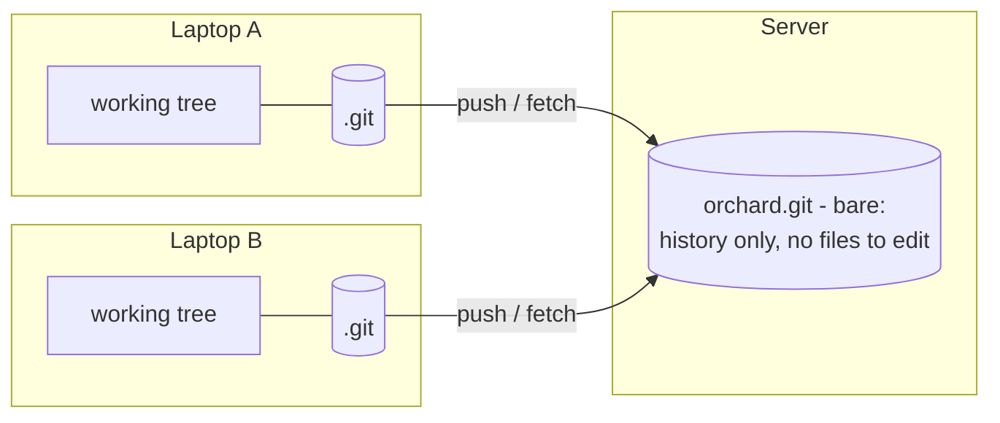

# Protocols and putting Git on a server

> **Before this lesson:** you should know what a remote is and how clone, fetch and push behave ([Remotes, tags and aliases](#/lesson/git/remotes-tags-aliases)), and what remote-tracking branches are ([Branch management, workflows and remote branches](#/lesson/git/branch-workflows-remote)).

## In plain words

Two friends can swap photos by plugging one phone into the other. A group of ten cannot work that way: they need a shared album that is always online and that everyone can add to. For a team using Git, that shared album is a **server**: a computer that is always switched on and reachable, holding a copy of the repository that everybody pushes to and fetches from.

Two questions follow. First, *how* do your computer and the server talk? There are a few standard "languages" for that conversation, called **protocols**, in the same way that post, phone and email are different ways to reach the same person. Second, what does the repository on the server look like? It turns out to be a slightly unusual kind of repository with no working files, called a **bare repository**.

Why it matters for a job: you will rarely set up a Git server yourself, since most companies use a hosting service. But every day you will choose between an `https://` and an `git@...` address, hit an authentication error, or be asked "why can I clone but not push?". Those are protocol questions. Knowing what the server side is also removes the mystery from hosting services: they are, underneath, bare repositories reached over these same protocols with a website on top.

## What a remote repository needs to be

A repository you collaborate through has three requirements.

1. **Reachable**: on a machine that is on when colleagues need it.
2. **Access-controlled**: some people may write, some may only read, the rest may do neither.
3. **Not somebody's desk**: nobody edits files inside it directly, so a push never collides with a person's half-finished edits.

The third point leads to the bare repository.

## Bare repositories

A normal repository is a project folder containing your files plus a hidden `.git` folder with the history. A **bare repository** is the `.git` part alone, with no working tree. By convention its folder name ends in `.git`.

```bash
$ ls orchard
README.md  inventory.py  prices.csv

$ ls -a orchard
.  ..  .git  README.md  inventory.py  prices.csv

$ git clone --bare orchard orchard.git
Cloning into bare repository 'orchard.git'...
done.

$ ls orchard.git
HEAD  config  description  hooks  info  objects  packed-refs  refs
```

- `ls` lists a folder; `-a` includes hidden entries (names starting with a dot), which is how `.git` becomes visible.
- `git clone --bare <source> <target>` makes a copy that consists only of the repository database.
- The last listing shows the contents of a bare repository: the same items that live inside `.git` in a normal one. `objects` holds the snapshots, `refs` holds the branch and tag pointers, `HEAD` names the default branch.

Why must the shared copy be bare? Imagine pushing to a colleague's normal repository while they have `main` checked out. Your push would move their `main` to a new commit underneath them while their files still show the old one. Their next `git status` would be nonsense. Git refuses such a push by default. A bare repository has no checked-out files, so there is nothing to disturb.



To create an empty bare repository to start a new project in: `git init --bare orchard.git`. Add `--shared` if several user accounts on the server must write to it; that sets the folder permissions for group writing.

## The four protocols

A **protocol** is an agreed set of rules for a conversation between two programs. Git can transfer data in four ways. The address you give to `git clone` or `git remote add` selects the protocol.

| Protocol | Address looks like | Read | Write | Authentication |
|---|---|---|---|---|
| Local | `/srv/git/orchard.git` or `file:///srv/git/orchard.git` | yes | yes | file-system permissions |
| HTTP(S), "smart" | `https://git.example.com/greenhouse/orchard.git` | yes | yes | username and password or token |
| SSH | `git@git.example.com:greenhouse/orchard.git` or `ssh://git@git.example.com/greenhouse/orchard.git` | yes | yes | SSH keys |
| Git | `git://git.example.com/orchard.git` | yes | (not safely) | none |

### 1. Local protocol

The remote is another folder on the same machine, or on a network drive that appears as a folder.

```bash
$ git clone /srv/git/orchard.git
Cloning into 'orchard'...
done.

$ cd orchard
$ git remote -v
origin  /srv/git/orchard.git (fetch)
origin  /srv/git/orchard.git (push)
```

- `/srv/git/orchard.git` is a plain path. Git copies the files it needs directly (and, on the same disk, links to them instead of copying, which is very fast).
- Writing `file:///srv/git/orchard.git` instead makes Git use its normal transfer procedure, which is slower but produces a clean copy without leftovers.

**Good for:** quick experiments, a shared drive in a small office, practising remote commands without a network (several examples in this track use it).
**Weak points:** a shared drive is harder to reach from outside and is often slower than a real server; anyone with write access to the folder can damage the repository files directly.

### 2. HTTP

HTTP is the protocol web browsers use; **HTTPS** is the same thing encrypted. Git over HTTP comes in two flavours.

**Smart HTTP** is the modern one. A program on the server holds a real conversation with your Git: "which commits do you have?", "then here is exactly what you are missing". It supports reading and writing, and it can serve anonymous reads and authenticated writes from **one address**.

```bash
$ git clone https://git.example.com/greenhouse/orchard.git
Cloning into 'orchard'...
remote: Enumerating objects: 148, done.
remote: Total 148 (delta 41), reused 148 (delta 41), pack-reused 0
Receiving objects: 100% (148/148), 32.10 KiB | 2.14 MiB/s, done.
Resolving deltas: 100% (41/41), done.

$ git push origin main
Username for 'https://git.example.com': mira
Password for 'https://mira@git.example.com':
To https://git.example.com/greenhouse/orchard.git
   6fa01be..9b2e417  main -> main
```

- The clone needed no login because this repository allows public reading.
- The push asked for a username and password. On most hosting services the "password" must be a **personal access token**: a long random string you generate on the website, which can be limited in what it may do and revoked without changing your real password.

**Good for:** nearly everything. One address for everyone. HTTPS passes through almost every corporate firewall, because it uses the same network port as ordinary web browsing. The connection is encrypted and the server's identity is verified by its certificate.
**Weak points:** typing credentials on every push is tedious, so you set up a **credential helper** (a small program that remembers them; see the tools module). Running the server side yourself is a little more work than SSH.

**Dumb HTTP** is the old flavour: the server hands out the repository's files as if they were web pages, with no conversation. It is read-only and inefficient. You will meet it only on very old installations, and may safely treat it as history.

### 3. SSH

**SSH** (Secure Shell) is the standard way to log in to another computer securely and run commands there. Git can ride on it.

```bash
$ git clone git@git.example.com:greenhouse/orchard.git
Cloning into 'orchard'...
remote: Enumerating objects: 148, done.
Receiving objects: 100% (148/148), 32.10 KiB | 1.07 MiB/s, done.
Resolving deltas: 100% (41/41), done.
```

Decoding the address `git@git.example.com:greenhouse/orchard.git`:

- `git` before the `@` is the **user account** on the server to log in as. Hosting services have everyone connect as one shared account named `git` and tell people apart by their key.
- `git.example.com` is the server.
- After the colon comes the path of the repository on that server.

The longer spelling `ssh://git@git.example.com/greenhouse/orchard.git` means the same.

Instead of a password, SSH normally uses a **key pair**: two matching files, a private key that never leaves your machine and a public key that you give to the server. The next lesson shows how to create and install them.

**Good for:** teams where everybody needs write access. Setup on a server is easy because almost every server already runs SSH. Everything is encrypted and authenticated. Once your key is installed, you are never asked for a password.
**Weak points:** no anonymous access. Every user needs an account or a registered key, so SSH alone cannot serve an open-source project to the public. Some restrictive networks block the SSH port.

### 4. The Git protocol

Git ships with a small server program (a **daemon**, meaning a program that runs in the background waiting for requests) that listens on network port 9418 and serves repositories with no authentication and no encryption.

```bash
$ git clone git://git.example.com/orchard.git
```

**Good for:** very fast, read-only public access to large projects.
**Weak points:** there is no authentication, so either everybody can push or nobody can; in practice it is read-only. There is no encryption and no way to verify you reached the real server. It needs its own firewall opening. For these reasons most hosting services have switched it off, and you should prefer HTTPS.

### Choosing


You can switch an existing clone at any time; the history is unaffected:

```bash
$ git remote set-url origin git@git.example.com:greenhouse/orchard.git
$ git remote -v
origin  git@git.example.com:greenhouse/orchard.git (fetch)
origin  git@git.example.com:greenhouse/orchard.git (push)
```

## Putting a repository on your own server

This is the whole procedure for the simplest real server: a machine you can already reach with SSH. Suppose its name is `git.example.com` and repositories live in `/srv/git`.

**Step 1: make a bare copy of the project** on your machine.

```bash
$ git clone --bare orchard orchard.git
Cloning into bare repository 'orchard.git'...
done.
```

**Step 2: copy that folder to the server.**

```bash
$ scp -r orchard.git mira@git.example.com:/srv/git
```

- `scp` ("secure copy") copies files to another machine over SSH. `-r` means "recursively", that is, the folder and everything inside it.
- `mira@git.example.com:/srv/git` is the destination: user, server, folder.

**Step 3: anyone with SSH access to that server and read permission on the folder can now clone.**

```bash
$ git clone mira@git.example.com:/srv/git/orchard.git
```

Those with write permission on the folder can also push. To let a group of user accounts write, run once on the server:

```bash
$ ssh mira@git.example.com
$ cd /srv/git/orchard.git
$ git init --bare --shared
Reinitialized existing shared Git repository in /srv/git/orchard.git/
```

- `ssh user@server` opens a terminal session on the server.
- `git init --bare --shared` on an existing repository does not erase anything; it adjusts the permissions so that members of the folder's group can write.

That is a working Git server: a bare repository on a machine people can log in to. No special software was installed. Everything else you may add (a website for browsing, fine-grained permissions, pull requests) is convenience on top.

To publish your existing local project to it and make it your `origin`:

```bash
$ cd orchard
$ git remote add origin mira@git.example.com:/srv/git/orchard.git
$ git push -u origin main
To git.example.com:/srv/git/orchard.git
 * [new branch]      main -> main
branch 'main' set up to track 'origin/main'.
```

### A model of the "smart" conversation

What makes the smart protocols efficient is a short negotiation before any data moves. The receiving side says which commits it already has; the sending side works out the smallest set of commits that fills the gap. The model below plays both roles for a fetch. It is pure Python, so you can change the two repositories and rerun it.

```python-run
# each repository: commit id -> list of parent ids, plus where its main branch points
server = {"commits": {"A": [], "B": ["A"], "C": ["B"], "D": ["C"]}, "main": "D"}
ben    = {"commits": {"A": [], "B": ["A"]}, "main": "B", "origin/main": "B"}

def reachable(commits, tip):
    seen, todo = set(), [tip]
    while todo:
        c = todo.pop()
        if c in commits and c not in seen:
            seen.add(c)
            todo.extend(commits[c])
    return seen

def fetch(client, srv):
    print("server: my main is at", srv["main"])                       # 1. server advertises its branches
    have = set(client["commits"])
    print("client: I want", srv["main"], "and I already have", sorted(have))   # 2. client states wants and haves
    missing = reachable(srv["commits"], srv["main"]) - have           # 3. server computes the difference
    print("server: sending", sorted(missing))
    for c in missing:
        client["commits"][c] = srv["commits"][c]
    client["origin/main"] = srv["main"]                               # 4. client moves its bookmark

fetch(ben, server)
print("ben now has", sorted(ben["commits"]), "| origin/main =", ben["origin/main"], "| main =", ben["main"])
print()
fetch(ben, server)      # a second fetch has nothing to send
```

Two commits travel the first time and none the second. Ben's own `main` did not move: fetching only updates the bookmark. A real server packs the missing commits, together with their files, into one compressed bundle called a **packfile** before sending; the internals module looks inside one.

You can rehearse every remote command on one machine with no server at all, using the local protocol: `git init --bare /tmp/server.git`, then `git clone /tmp/server.git ana` and `git clone /tmp/server.git ben` give you a "server" and two "colleagues" as three folders.

## What history looks like across three repositories

Each repository has its own pointers, but commits with the same id are the same commit everywhere. After Ana pushes and before Ben fetches:


Ben's repository still ends at B. The commits C and D exist on the server and in Ana's clone. A `git fetch` in Ben's repository copies C and D across and moves his `origin/main` bookmark to D.

## Pitfalls

- **Pushing to a non-bare repository.** Git answers `refusing to update checked out branch`. Make the shared repository bare.
- **Mixing up the two SSH address styles.** `git@host:path` (with a colon, no `ssh://`) and `ssh://git@host/path` (with slashes). Writing `ssh://git@host:path` treats the text after the colon as a port number and fails.
- **Entering your account password where a token is required.** Hosting services reject passwords for Git over HTTPS; create a personal access token.
- **Assuming `git://` is safe because it is fast.** It has no encryption and no authentication. Do not use it on untrusted networks.
- **Forgetting file permissions on a self-hosted repository.** "Permission denied" on push to an SSH server usually means the user account cannot write to the folder. `--shared` plus a common group fixes it.
- **Copying a normal repository to the server by hand.** It works for fetching but pushes to the checked-out branch are refused. Use `git clone --bare`.

> [!WARNING]
> Giving someone SSH access to a server so that they can push normally also gives them a login **shell**: the ability to run any command on that machine as their user. The next lesson shows how to restrict an account to Git operations only. Do not hand out unrestricted accounts on a server that holds anything else of value.

> [!TIP]
> When a remote operation fails and the message is unhelpful, ask Git to show the conversation. For SSH addresses: `GIT_SSH_COMMAND="ssh -v" git fetch` prints each step of the SSH login. For HTTPS addresses: `GIT_CURL_VERBOSE=1 git fetch` prints the web requests. The cause (wrong key offered, expired token, blocked port) is usually visible within the first screen of output.

> [!INTERVIEW]
> **"What is the difference between cloning over HTTPS and over SSH?"** Both transfer the same data with the same efficiency; they differ in transport and authentication. HTTPS runs over the web port (443), works through nearly all firewalls, can allow anonymous reads, and authenticates with a username plus a token, typically cached by a credential helper. SSH runs over port 22, never allows anonymous access, and authenticates with a key pair, so there are no prompts once the key is registered. **"What is a bare repository and why do servers use one?"** A repository with no working tree, only the contents of `.git`. A shared repository must be bare because pushing to a branch that is checked out in someone's working tree would leave their files out of step with the branch; with no working tree that problem cannot arise.

## Cheat sheet

| Task | Command |
|---|---|
| Make a bare copy of a repository | `git clone --bare <repo> <name>.git` |
| Create a new empty bare repository | `git init --bare <name>.git` |
| Allow group write access | `git init --bare --shared` (inside the repository) |
| Clone from a folder | `git clone /path/to/repo.git` |
| Clone over HTTPS | `git clone https://host/owner/repo.git` |
| Clone over SSH | `git clone git@host:owner/repo.git` |
| Copy a bare repository to a server | `scp -r repo.git user@host:/srv/git` |
| Add a server as `origin` and publish | `git remote add origin <url>` then `git push -u origin main` |
| Change the address of a remote | `git remote set-url origin <url>` |
| Debug an SSH connection | `GIT_SSH_COMMAND="ssh -v" git fetch` |
| Debug an HTTPS connection | `GIT_CURL_VERBOSE=1 git fetch` |

## Summary

A shared repository lives on an always-reachable machine and is bare: it holds the history without a working tree, so pushes cannot interfere with anyone's files. Git reaches remotes over four protocols. The local protocol uses a folder path and suits experiments and shared drives. Smart HTTPS uses one address for reading and writing, authenticates with tokens, and works through firewalls. SSH authenticates with key pairs, is simple to host, and allows no anonymous access. The Git protocol is fast but unauthenticated and unencrypted, and is fading from use. Setting up a basic server needs nothing more than a bare clone copied to a machine people can reach by SSH, with file permissions deciding who may write.

## Glossary

- **Server:** a computer that is always on and reachable, providing a service to others.
- **Protocol:** an agreed set of rules for communication between programs.
- **Bare repository:** a repository with no working tree, only the Git database; conventionally named `something.git`.
- **Local protocol:** accessing a remote repository through a folder path.
- **HTTP / HTTPS:** the web's transfer protocol, and its encrypted form.
- **Smart HTTP:** Git over HTTP with a server-side program that negotiates exactly what to send; supports push.
- **Dumb HTTP:** an obsolete, read-only way of serving repository files as static web files.
- **SSH (Secure Shell):** a protocol for secure remote login and command execution.
- **Key pair:** a private key kept secret and a matching public key shared with servers, used to prove identity.
- **Personal access token:** a revocable, limited-scope substitute for a password, issued by a hosting service.
- **Credential helper:** a program that stores and supplies credentials to Git.
- **Daemon:** a background program that waits for and serves requests.
- **Packfile:** a single compressed file holding many Git objects, used for storage and transfer.
- **Port:** a number identifying a particular service on a machine (443 for HTTPS, 22 for SSH, 9418 for the Git protocol).
- **`scp`:** a command that copies files between machines over SSH.
- **Shell:** the program that interprets commands you type after logging in.

## Check yourself

```quiz
[
  {"q": "What is a bare repository?", "options": ["A repository without branches", "A repository with no commits", "A repository that ignores all files", "A repository consisting only of the Git database, with no working tree"], "answer": 3, "explain": "It contains what a normal repository keeps in .git and nothing else, which is what a shared, pushed-to repository should be."},
  {"q": "Why does Git refuse a push to the checked-out branch of a normal (non-bare) repository?", "options": ["Normal repositories are read-only", "The network protocol forbids it", "The branch would move while that repository's working tree still shows the old files", "Pushes need administrator rights"], "answer": 2, "explain": "The owner's files and index would no longer correspond to their branch. A bare repository has no working tree, so the issue does not exist."},
  {"q": "Which protocol never permits anonymous access?", "options": ["HTTPS", "Git", "SSH", "Local"], "answer": 2, "explain": "SSH always authenticates the user, normally by key. HTTPS can serve anonymous reads; the Git protocol has no authentication at all."},
  {"q": "In the address `git@git.example.com:greenhouse/orchard.git`, what is the `git` before the @?", "options": ["The user account on the server used for the SSH login", "The protocol name", "The name of the repository", "A required keyword"], "answer": 0, "explain": "It is an SSH user name. Hosting services use one shared account called git and identify you by which key you present."},
  {"q": "Why is HTTPS often the only protocol that works inside a corporate network?", "options": ["It needs no authentication", "It is the only encrypted protocol", "It uses the standard web port, which firewalls almost always allow", "It is the fastest"], "answer": 2, "explain": "Port 443 carries ordinary web traffic, so it is rarely blocked, whereas the SSH and Git ports frequently are."},
  {"q": "What is the main drawback of the git:// protocol?", "options": ["It requires a website", "It cannot clone", "It is slow", "It has no authentication or encryption"], "answer": 3, "explain": "Anyone can read, nobody can be identified for writing, and the data is not protected or verified in transit."},
  {"q": "What is the minimum needed to host a repository for a small team on a machine they can all SSH into?", "options": ["A bare repository in a folder the team's accounts can read and write", "A hosting product licence", "The git daemon", "A web server and database"], "answer": 0, "explain": "SSH access plus a bare repository with suitable file permissions is already a working server."},
  {"q": "A hosting site rejects your account password when you push over HTTPS. What is the usual fix?", "options": ["Re-clone the repository", "Switch to the git:// protocol", "Use --force", "Create a personal access token and use it as the password"], "answer": 3, "explain": "Most services require tokens for Git over HTTPS. Tokens can be scoped and revoked independently of your real password."}
]
```

> **Source:** Chacon & Straub, Pro Git 2e, ch. 4 (The Protocols; Getting Git on a Server). Explanations, examples and code written for this guide.
