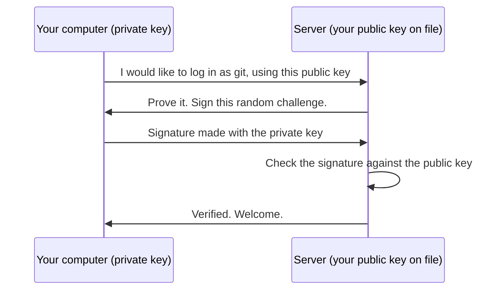
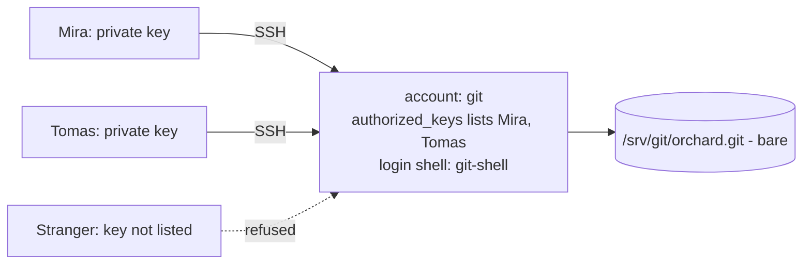

# SSH keys, access control and hosting options

> **Before this lesson:** read [Protocols and putting Git on a server](#/lesson/git/protocols-and-bare-repos), which explains bare repositories and the SSH and HTTPS protocols.

## In plain words

When you check into a hotel you get a key card. The front desk never needs to remember your face or ask for a password each time you come back; the door recognises the card. If you lose it, the desk cancels that one card and nothing else changes.

An **SSH key** is a key card for servers. You create it once on your computer. It comes in two halves. One half, the **private key**, stays on your machine and is never shown to anyone. The other half, the **public key**, is safe to hand out; you give it to every server you want to enter. When you connect, your computer proves it holds the private half without ever sending it. The server compares against the public half it has on file and lets you in, with no password typed.

The second part of this lesson is a tour of where a team's shared repository can live: from "a folder on a machine in the cupboard" to full hosting services such as GitHub or GitLab, which add a website, permissions and review tools on top of the same Git underneath.

Why it matters for a job: "add your SSH key" is on every first-day checklist, and `Permission denied (publickey)` is one of the most common error messages a new developer meets. Understanding keys lets you fix it in a minute instead of an afternoon. Knowing the hosting options lets you understand what your company's setup is doing and why.

## How key authentication works

**Authentication** means proving who you are. With a password, you prove it by sending a secret to the server, which then also knows the secret. With a key pair, you prove it without revealing anything.

The two keys are mathematically linked: something locked with one can only be unlocked with the other, and knowing the public key does not let anyone work out the private one. The login goes like this:



A **signature** here is a value that can only be produced with the private key and that anyone holding the public key can check. Since the challenge is random each time, a recording of one login is useless for the next.

The idea in miniature, with small numbers so you can run it. (Real keys use far larger numbers or different mathematics; this is a teaching model of the principle, not something to use for security.)

```python-run
import hashlib, random

# A toy RSA key pair built from two small primes
p, q = 61, 53
n = p * q                    # 3233, part of both keys
e = 17                       # public exponent
d = pow(e, -1, (p - 1) * (q - 1))   # private exponent, 2753

public_key, private_key = (n, e), (n, d)
print("public key (share freely):", public_key)
print("private key (never share):", private_key)

def digest(message):
    return int(hashlib.sha256(message.encode()).hexdigest(), 16) % n

def sign(message, key):          # needs the private key
    n, d = key
    return pow(digest(message), d, n)

def verify(message, signature, key):   # needs only the public key
    n, e = key
    return pow(signature, e, n) == digest(message)

challenge = f"random-challenge-{random.randint(0, 10**9)}"
signature = sign(challenge, private_key)
print("server checks signature        :", verify(challenge, signature, public_key))
print("attacker guesses a signature   :", verify(challenge, (signature + 1) % n, public_key))
print("old signature, new challenge   :", verify(challenge + "x", signature, public_key))
```

The server stores only the public key. Even if the server is broken into, the attacker gains nothing that lets them impersonate you elsewhere.

## Creating your key pair

### Step 1: check whether you already have one

Keys live in a hidden folder named `.ssh` in your home folder.

```bash
$ ls ~/.ssh
config  id_ed25519  id_ed25519.pub  known_hosts
```

- `id_ed25519` is a private key; `id_ed25519.pub` (same name plus `.pub`) is its public half.
- Older key types are named `id_rsa` / `id_rsa.pub`.
- `known_hosts` is a list of servers you have connected to before.
- If the folder does not exist or contains no `id_*` files, you have no key yet.

### Step 2: generate one

```bash
$ ssh-keygen -t ed25519 -C "mira@work.example"
Generating public/private ed25519 key pair.
Enter file in which to save the key (/home/mira/.ssh/id_ed25519):
Enter passphrase (empty for no passphrase):
Enter same passphrase again:
Your identification has been saved in /home/mira/.ssh/id_ed25519
Your public key has been saved in /home/mira/.ssh/id_ed25519.pub
The key fingerprint is:
SHA256:pV3n0cX7m1Qy8rTz2LkJ5uA9bE4dF6gH0iW3sYx1ZcM mira@work.example
```

Line by line:

- `ssh-keygen` is the program that creates keys.
- `-t ed25519` chooses the key type. Ed25519 is the modern default: short, fast and secure. (On a very old server that does not accept it, use `-t rsa -b 4096`.)
- `-C "..."` attaches a comment, by convention your email, so you can tell keys apart later.
- At the first question, press Enter to accept the suggested file location.
- The **passphrase** is a password that encrypts the private key file on your disk. If someone copies the file from your laptop, they still cannot use it without the passphrase. Choose one; you will see below how to avoid retyping it constantly.
- The **fingerprint** is a short summary of the key, handy for checking that two people are talking about the same key.

### Step 3: look at the public key

```bash
$ cat ~/.ssh/id_ed25519.pub
ssh-ed25519 AAAAC3NzaC1lZDI1NTE5AAAAIJq1v7Xk0b9c2mPz4WQy8nRt6uA3eF5gH7iK9LmN0oPq mira@work.example
```

A public key is one long line: the type, the key data, and your comment. This line is what you give to servers.

> [!WARNING]
> Share only the file ending in `.pub`. The other file is your private key: never email it, never paste it into a chat or a website, never commit it to a repository. Anyone who obtains it (and its passphrase, if any) can act as you on every server that trusts the key. If a private key is exposed, remove its public half from every server and service immediately and generate a new pair.

### Step 4: give the public key to the server

On a hosting service, you paste the line into a settings page (usually "SSH keys" under your account settings). On a server you manage yourself, the key goes into a file on the server, covered in the next section.

### Step 5: test

```bash
$ ssh -T git@git.example.com
The authenticity of host 'git.example.com (203.0.113.20)' can't be established.
ED25519 key fingerprint is SHA256:hQ2kT9vLx0aB3cD4eF5gH6iJ7kL8mN9oP0qR1sT2uV3.
Are you sure you want to continue connecting (yes/no/[fingerprint])? yes
Warning: Permanently added 'git.example.com' (ED25519) to the list of known hosts.
Welcome, mira! You have successfully authenticated, but shell access is not provided.
```

- `ssh -T user@server` attempts a login without opening an interactive session.
- The first time you contact a server, SSH shows the **server's** fingerprint and asks whether you trust it. This protects you against an impostor server. Hosting services publish their fingerprints so that you can compare. Typing `yes` records the server in `known_hosts`, and the question is not asked again.
- The final line confirms that your key was accepted.

### Avoiding the passphrase prompt: the agent

An **SSH agent** is a small background program that holds your unlocked private key in memory for the duration of your session, so you type the passphrase once.

```bash
$ eval "$(ssh-agent -s)"
Agent pid 48213
$ ssh-add ~/.ssh/id_ed25519
Enter passphrase for /home/mira/.ssh/id_ed25519:
Identity added: /home/mira/.ssh/id_ed25519 (mira@work.example)
```

- The first line starts the agent (many desktop systems start one for you).
- `ssh-add` hands it your key, asking for the passphrase one time.

## A self-managed server, step by step

This is the classic small-team setup. Everyone connects as one shared account named `git`, and that account's list of accepted public keys decides who gets in. All commands in this section are typed **on the server**.

**Step 1: create the account and its key list.**

```bash
$ sudo adduser git
$ su git
$ cd
$ mkdir .ssh && chmod 700 .ssh
$ touch .ssh/authorized_keys && chmod 600 .ssh/authorized_keys
```

- `sudo adduser git` creates a user account called `git` (needs administrator rights).
- `su git` switches to being that user; `cd` alone goes to its home folder.
- `mkdir .ssh` creates the folder; `chmod 700` makes it accessible only to its owner.
- `touch` creates an empty file; `chmod 600` makes it readable and writable only by its owner. SSH refuses to use key files with looser permissions.

**Step 2: add each teammate's public key**, one per line, to `authorized_keys`.

```bash
$ cat /tmp/id_ed25519.mira.pub >> ~/.ssh/authorized_keys
$ cat /tmp/id_ed25519.tomas.pub >> ~/.ssh/authorized_keys
```

`>>` appends a file's content to another file. Every key listed here may log in as `git`.

**Step 3: create a bare repository.**

```bash
$ sudo mkdir -p /srv/git/orchard.git
$ sudo chown git:git /srv/git/orchard.git
$ cd /srv/git/orchard.git
$ git init --bare
Initialized empty Git repository in /srv/git/orchard.git/
```

`chown git:git` makes the `git` account the owner of the folder so it can write there.

**Step 4: teammates use it** from their own machines.

```bash
$ git remote add origin git@git.example.com:/srv/git/orchard.git
$ git push -u origin main
```

**Step 5: remove the login shell.** As it stands, every key holder can log in and run arbitrary commands as `git`. Git ships with a restricted shell, `git-shell`, that permits only Git's transfer operations.

```bash
$ which git-shell
/usr/bin/git-shell
$ sudo chsh git -s /usr/bin/git-shell
```

- `which` prints where a program is installed.
- `chsh git -s <shell>` changes the program that runs when the `git` user logs in.

Now pushing and fetching still work, but an attempt to log in is refused:

```bash
$ ssh git@git.example.com
fatal: Interactive git shell is not enabled.
hint: ~/git-shell-commands should exist and have read and execute access.
Connection to git.example.com closed.
```



This design is simple and solid, with one limit: every key holder can read and write **every** repository the `git` account owns. Finer rules (this person may read but not write; only leads may push to `main`) need more tooling, which is where the options below come in.

## Other ways to serve

**Read-only public access with the Git daemon.** `git daemon --reuseaddr --base-path=/srv/git/ /srv/git/` serves repositories over the `git://` protocol. A repository is exported only if it contains a file named `git-daemon-export-ok`. Remember from the previous lesson that this protocol is unauthenticated and unencrypted.

**Smart HTTP.** Git includes a program called `git-http-backend`. A web server such as Apache or Nginx passes Git requests to it, and it performs the same negotiation as SSH does. The web server handles encryption and logins, so you can allow anonymous reads and require a login for pushes, all on one `https://` address.

**A simple web viewer.** `git instaweb` starts a temporary website for browsing the current repository's history on your own machine; GitWeb is the same viewer installed permanently on a server. They show history but manage nothing.

**A self-hosted platform.** Products such as GitLab (and lighter alternatives such as Gitea and Forgejo) are complete web applications you install on your own server. Beyond storing repositories they provide user accounts, groups and per-project permissions, a web interface for browsing code, **merge requests** (GitLab's name for the review-before-merge feature that GitHub calls pull requests), issue tracking, and automated pipelines that build and test each push. Companies choose this when code must remain on machines they control.

**A hosted service.** GitHub, GitLab.com, Bitbucket and others run all of the above for you. You create an account, create a repository on the website, and receive an HTTPS and an SSH address. There is no server for you to patch or back up. For most teams, and for nearly all open-source projects, this is the default choice.

| Option | Effort to run | Permissions | Web interface and review | Typical use |
|---|---|---|---|---|
| Bare repository over SSH | very low | all-or-nothing per account | none | tiny team, internal tools |
| Git daemon | low | none (read-only) | none | fast public mirror |
| Smart HTTP with a web server | medium | per web-server rules | none | mixed public read and private write |
| Self-hosted platform (GitLab, Gitea) | high | fine-grained | full | code must stay in-house |
| Hosted service (GitHub and others) | none | fine-grained | full | most teams, open source |

A repository does not care where it lives. The same history can be pushed to several places, and moving hosts is a matter of changing an address:

```bash
$ git remote set-url origin git@newhost.example.com:greenhouse/orchard.git
$ git push -u origin --all
$ git push origin --tags
```

- `--all` pushes every local branch; `--tags` pushes every tag.


After those three commands the new host holds this same history, commit for commit and tag for tag, because commits are identified by their content and not by where they are stored.

### Gitolite and Gitosis: older self-hosting helpers

The single shared `git` account has one weakness, as noted above: every key holder can reach every repository. Before platforms such as GitLab and Gitea were common, small teams filled that gap with two small tools that sit on top of that same SSH account.

**Gitosis** was the first widely used one. You configured it by editing a text file inside a special administrative Git repository and pushing, and it rewrote the server's `authorized_keys` for you. It is no longer maintained, so you will mostly meet it in old documentation or on very old servers. Do not choose it for new work.

**Gitolite** took the same idea much further and is still maintained. It is software installed under the `git` account. A forced command in each `authorized_keys` entry sends every login through Gitolite, which then looks up the user's key name and decides what is allowed. The configuration lives in a repository called `gitolite-admin`: you add public keys as files in a `keydir/` folder and write rules in a file such as `conf/gitolite.conf`:

```text
repo orchard
    RW+  =  alice
    R    =  bob carol

repo @all
    R    =  daemon
```

- `R` means read only, `RW` means read and write, and `RW+` also allows rewriting history (a forced push).
- Rules can be limited per branch with a reference pattern, and users can be gathered into groups written with `@`.
- Adding a person is: commit their public key, edit the rules, push `gitolite-admin`. The server updates itself.

Neither tool has a web page, pull requests or issue tracking; they only manage who may read and write which repository. That is why they are described as historical options here: teams that need review and automation now usually choose a self-hosted platform or a hosted service, while Gitolite remains a good fit for a small server where per-repository, per-branch permissions are all you want.

## Using more than one key or host

A file named `~/.ssh/config` lets you describe each server once. It is useful when you have separate keys for work and personal accounts.

```bash
$ cat ~/.ssh/config
Host work
    HostName git.work.example
    User git
    IdentityFile ~/.ssh/id_ed25519_work
    IdentitiesOnly yes

Host personal
    HostName git.example.com
    User git
    IdentityFile ~/.ssh/id_ed25519_personal
    IdentitiesOnly yes
```

- `Host work` defines a nickname.
- `HostName` is the real server name, `User` the account, `IdentityFile` the private key to offer.
- `IdentitiesOnly yes` tells SSH to offer only that key and not every key the agent holds.

You can then clone with the nickname: `git clone work:greenhouse/orchard.git`.

## Troubleshooting `Permission denied (publickey)`

```bash
$ git fetch
git@git.example.com: Permission denied (publickey).
fatal: Could not read from remote repository.

Please make sure you have the correct access rights
and the repository exists.
```

Work through these in order.

1. **Is a key being offered at all?** `ssh-add -l` lists the keys in the agent. "The agent has no identities" means you need `ssh-add ~/.ssh/id_ed25519`.
2. **Is it the key the server knows?** Compare `ssh-keygen -lf ~/.ssh/id_ed25519.pub` (prints your fingerprint) with the fingerprint shown in the server's or service's key list.
3. **Are you connecting as the right user?** For hosting services the user is `git`, not your own user name. `git remote -v` shows the address.
4. **Watch the login.** `ssh -vT git@git.example.com` prints each key it tries and how the server answers.
5. **On a self-managed server:** check that the key is in `authorized_keys`, that the file has mode 600 and the `.ssh` folder mode 700, and that both belong to the `git` user.

## Pitfalls

- **Uploading the private key.** Only the `.pub` file ever leaves your machine.
- **No passphrase on a laptop key.** A stolen or copied laptop then gives full access. Use a passphrase and the agent.
- **Typing `yes` to an unexpected host-key warning.** If a server you have used before suddenly presents a different fingerprint, SSH prints a loud warning. It may be a rebuilt server, or someone intercepting the connection. Verify with the administrator before accepting.
- **Leaving the `git` account with a normal shell.** Every contributor then has command-line access to the server.
- **One key copied to every machine.** If one machine is compromised you cannot revoke it selectively. Create a separate key pair per device.
- **Leftover access.** When someone leaves the team, remove their line from `authorized_keys` or their account from the hosting service. Keys do not expire by themselves.

> [!TIP]
> Give each key a comment that names the device (`-C "mira@work-laptop-2026"`). Six months later, when the key list on your hosting account shows four entries, you will know which one to delete when the old laptop is retired.

> [!INTERVIEW]
> **"How does SSH key authentication work, and why is it preferred over passwords for Git?"** You generate a key pair; the private key stays on your machine and the public key is registered with the server. At login the server issues a random challenge, your client signs it with the private key, and the server verifies the signature with the public key. No secret travels over the network and the server stores nothing that could be reused elsewhere. Compared with passwords: nothing to type on each push, nothing to phish or replay, each device can have its own key that is revoked individually, and the private key can be protected by a passphrase held in an agent. Follow-up: **"You get `Permission denied (publickey)`. What do you check?"** Whether the agent holds a key (`ssh-add -l`), whether its fingerprint matches one registered on the server, whether the remote address uses the right user (`git@`), and the verbose output of `ssh -vT`.

## Cheat sheet

| Task | Command |
|---|---|
| List existing keys | `ls ~/.ssh` |
| Create a key pair | `ssh-keygen -t ed25519 -C "you@example.com"` |
| Show the public key to copy | `cat ~/.ssh/id_ed25519.pub` |
| Show a key's fingerprint | `ssh-keygen -lf ~/.ssh/id_ed25519.pub` |
| Start the agent and add the key | `eval "$(ssh-agent -s)"` then `ssh-add ~/.ssh/id_ed25519` |
| List keys held by the agent | `ssh-add -l` |
| Test the connection | `ssh -T git@host` |
| Debug the connection | `ssh -vT git@host` |
| Authorise a key on your own server | append the `.pub` line to `~git/.ssh/authorized_keys` |
| Restrict the `git` account to Git only | `sudo chsh git -s $(which git-shell)` |
| Move a repository to a new host | `git remote set-url origin <url>`; `git push -u origin --all`; `git push origin --tags` |

## Summary

SSH keys replace passwords with a key pair: the private half stays on your machine, protected by a passphrase and held by an agent; the public half is registered on each server. Logging in is a challenge signed by the private key and verified with the public key. A minimal team server is one `git` account whose `authorized_keys` file lists the team's public keys, a bare repository, and `git-shell` as the login shell so the account can do nothing except Git transfers. For anonymous or web-based access there are the Git daemon and smart HTTP; for accounts, fine-grained permissions, review and automation there are self-hosted platforms and hosted services. The repository itself is identical wherever it is stored, so changing hosts means changing a remote address and pushing.

## Glossary

- **Authentication:** proving who you are to a system.
- **Key pair:** a private key and its matching public key.
- **Private key:** the secret half, kept only on your device.
- **Public key:** the shareable half, registered on servers.
- **Signature:** a value produced with a private key that anyone can verify with the public key.
- **`ssh-keygen`:** the program that creates SSH keys.
- **Ed25519 / RSA:** two kinds of key; Ed25519 is the modern default.
- **Passphrase:** a password that encrypts the private key file on disk.
- **Fingerprint:** a short summary of a key used to identify it.
- **SSH agent:** a background program that keeps unlocked keys in memory.
- **`authorized_keys`:** the file on a server listing public keys allowed to log in to an account.
- **`known_hosts`:** the file on your machine listing servers whose identity you have accepted.
- **`git-shell`:** a restricted login shell that only permits Git operations.
- **Merge request / pull request:** a proposal, on a hosting platform, to review and merge a branch.
- **Self-hosted:** software you install and run on your own servers. **Hosted service:** a provider runs it for you.
- **Gitosis:** an older, no longer maintained tool that managed SSH access to shared Git repositories from a configuration repository.
- **Gitolite:** a maintained tool, installed under the shared `git` account, that applies per-repository and per-branch read and write rules to SSH users.
- **Forced command:** an `authorized_keys` option that makes a key run one fixed program, whatever the client asks for.

## Check yourself

```quiz
[
  {"q": "Which file do you give to a server or hosting service?", "options": ["~/.ssh/id_ed25519", "~/.ssh/known_hosts", "~/.gitconfig", "~/.ssh/id_ed25519.pub"], "answer": 3, "explain": "The .pub file is the public half and is safe to share. The file without the extension is the private key and must never leave your machine."},
  {"q": "During SSH key login, what crosses the network?", "options": ["The passphrase", "Your account password", "A signature of a random challenge, made with the private key", "The private key"], "answer": 2, "explain": "The server sends a challenge; the client returns a signature that the server verifies with the stored public key. The private key and passphrase never leave the client."},
  {"q": "What does the passphrase on a key protect against?", "options": ["Network eavesdropping", "Someone who obtains a copy of your private key file from your disk", "Forgetting your user name", "The server being hacked"], "answer": 1, "explain": "It encrypts the private key at rest. Without the passphrase the copied file is useless."},
  {"q": "What is the job of ssh-agent?", "options": ["It keeps your unlocked key in memory so you enter the passphrase once per session", "It generates keys", "It encrypts repository contents", "It uploads the public key to servers"], "answer": 0, "explain": "The agent holds decrypted keys and answers signing requests for SSH, removing repeated passphrase prompts."},
  {"q": "On a self-managed server, why set the git account's login shell to git-shell?", "options": ["It makes pushes faster", "It enables HTTPS", "It limits the account to Git transfer operations, so key holders cannot run arbitrary commands", "It is required for bare repositories"], "answer": 2, "explain": "With a normal shell every contributor can log in and run commands on the server. git-shell allows only push and fetch operations."},
  {"q": "With the single shared `git` account and authorized_keys setup, what can each key holder access?", "options": ["Every repository that account owns, for reading and writing", "Read-only access to all repositories", "Nothing until approved per repository", "Only repositories they created"], "answer": 0, "explain": "File permissions are per account, and everyone logs in as the same account. Finer control needs a platform or additional tooling."},
  {"q": "What does a self-hosted platform such as GitLab add on top of plain Git over SSH?", "options": ["User accounts, per-project permissions, a web interface, review of merge requests and automation", "Nothing significant", "A different commit format", "Faster hashing"], "answer": 0, "explain": "The Git data and protocols are the same. The platform adds collaboration and administration features around them."},
  {"q": "You see `Permission denied (publickey)` and `ssh-add -l` prints `The agent has no identities`. What is the most likely fix?", "options": ["Delete known_hosts", "Re-clone the repository", "Add your key to the agent with ssh-add", "Switch to the git:// protocol"], "answer": 2, "explain": "No key is being offered. Load the key into the agent, then test again with ssh -T."},
  {"q": "What problem does Gitolite solve on a server that uses one shared git account?", "options": ["It encrypts the repositories", "It replaces SSH with HTTPS", "It lets you give each key different read or write rights per repository without separate system accounts", "It adds pull requests"], "answer": 2, "explain": "Every login passes through Gitolite, which checks the rules kept in the gitolite-admin repository. It does not provide a web interface or review features."}
]
```

> **Source:** Chacon & Straub, Pro Git 2e, ch. 4 (Generating Your SSH Public Key; Setting Up the Server; Git Daemon; Smart HTTP; GitWeb; GitLab; Third Party Hosted Options). Explanations, examples and code written for this guide.
