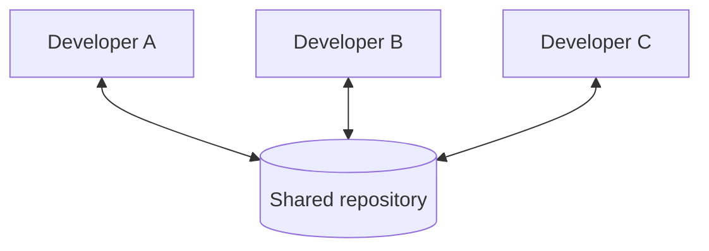
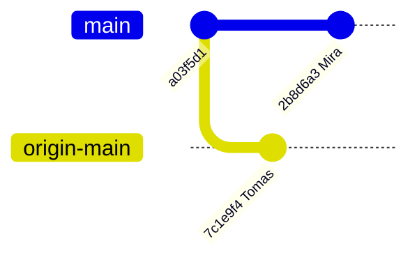
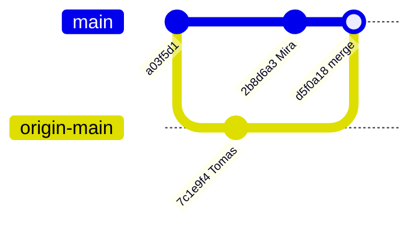
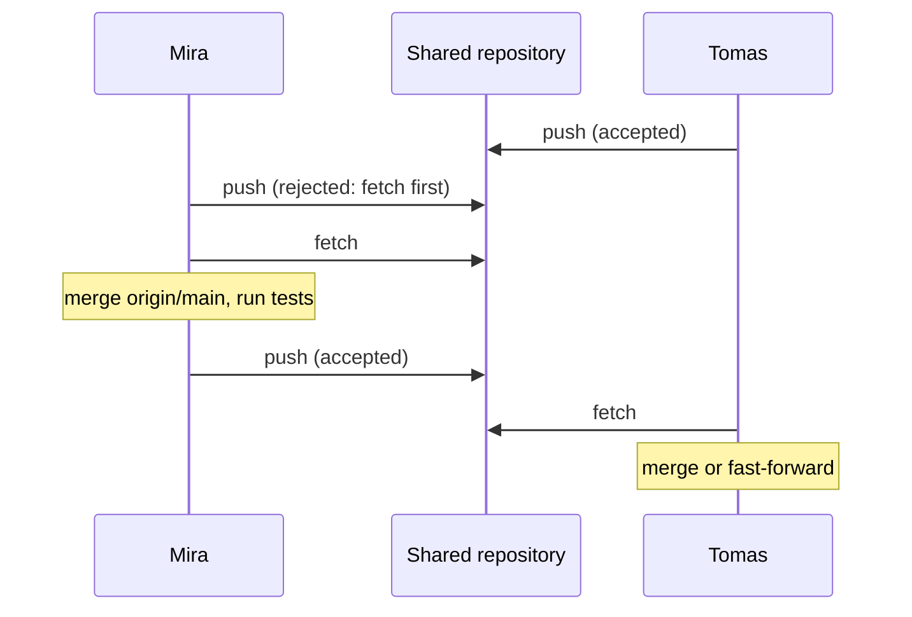

# Distributed workflows and contributing to a project

> **Before this lesson:** you should be able to branch, merge and rebase ([Merging and resolving conflicts](#/lesson/git/merging-and-conflicts), [Rebasing and its golden rule](#/lesson/git/rebasing)) and to fetch, pull and push with remote-tracking branches ([Branch management, workflows and remote branches](#/lesson/git/branch-workflows-remote)).

## In plain words

A village cookbook can be put together in different ways. In a small household, everyone writes straight into the one shared notebook. In a larger club, members write recipes on their own sheets and hand them to an editor, who decides what goes into the book. In a very large association, regional editors collect and check recipes first, then pass the good ones up to a chief editor.

Git supports all three arrangements, because every person has a complete copy of the project and work can flow between any two copies. A **distributed workflow** is the agreed route that changes travel from the person who writes them to the project's official history. This lesson describes the common routes, and then teaches the craft of being a good **contributor**: someone whose changes are easy for others to understand, check and accept.

Why it matters for a job: your code is only useful once it is accepted into the shared history, and it is accepted by *people*. Clean commits with clear messages, sent through the route the team expects, get merged quickly. Tangled commits get sent back. Every company has some version of this, and open-source projects are strict about it.

## Three workflow shapes

### 1. Centralised workflow

Everyone clones one shared repository and pushes to it directly.



It is the familiar model from older tools, with one Git-specific rule: the server accepts a push only if it is a fast-forward. If a colleague pushed before you, you must first fetch and integrate their commits, then push. Nobody can overwrite anybody by accident. Small teams work happily this way, usually with a topic branch per task.

### 2. Integration-manager workflow

Each contributor has **two** repositories: a private clone on their own machine, and a public copy of their own that others can read. One person, the **integration manager** (or maintainer), owns the official repository and decides what goes in.

```mermaid
flowchart LR
  O[(Official repository<br/>maintainer writes)]
  F[(Contributor's public copy)]
  L[Contributor's laptop]
  O -- 1. clone / fetch --> L
  L -- 2. push topic branch --> F
  F -. 3. please pull .-> M[Maintainer]
  M -- 4. fetch, review, merge --> O
```

1. The contributor clones the official repository.
2. They push their work to their own public copy.
3. They ask the maintainer to take a look (a **pull request**).
4. The maintainer fetches from the contributor's copy, reviews, merges locally and pushes to the official repository.

This is the model behind forks and pull requests on hosting sites, covered in the GitHub module. Its strength: contributors never need write access to the official repository, and nobody blocks anybody.

### 3. Dictator-and-lieutenants workflow

For enormous projects (the Linux kernel is the standard example), a second layer is added. **Lieutenants** each look after one area of the code and collect contributors' work for it. A single **benevolent dictator** pulls from the lieutenants and pushes to the reference repository everyone clones from.

```mermaid
flowchart BT
  D1[Developers] --> L1[Lieutenant: networking]
  D2[Developers] --> L2[Lieutenant: file systems]
  L1 --> BD[Dictator]
  L2 --> BD
  BD --> R[(Reference repository)]
  R -. everyone rebases on .-> D1
  R -. .-> D2
```

Few projects need this, but it shows what "distributed" permits: review responsibility can be delegated in layers.

Real teams mix these shapes. A typical company uses the centralised shape with a rule that nobody pushes straight to `main`: work goes to topic branches on the shared repository and is merged after review.

## Being a good contributor: the commit itself

Before any route matters, the unit you send has to be good. Three habits cover most of it.

### Habit 1: no whitespace noise

**Whitespace** means invisible characters: spaces, tabs, line breaks. Spaces left at the ends of lines, or a file whose line endings all changed, produce diffs in which reviewers cannot find the real change. Git can check before you commit:

```bash
$ git diff --check
inventory.py:14: trailing whitespace.
+    total = 0   
inventory.py:22: new blank line at EOF.
```

- `git diff --check` examines your unstaged changes and reports whitespace problems with file and line number. Add `--staged` to check what you are about to commit.
- No output means no problems.

### Habit 2: one logical change per commit

If you fixed a bug, renamed a function and updated the documentation, those are three commits. A reviewer can then read each one on its own, and a later reader can undo one without losing the others. When several changes are mixed in your working tree, `git add --patch` (short `-p`) lets you stage them piece by piece:

```bash
$ git add --patch inventory.py
diff --git a/inventory.py b/inventory.py
@@ -10,6 +10,8 @@ def count(rows):
     total = 0
     for row in rows:
+        if row.quantity < 0:
+            raise ValueError("negative quantity")
         total += row.quantity
     return total
(1/2) Stage this hunk [y,n,q,a,d,j,J,g,/,e,?]? y
```

Git shows one block of changes (a hunk) at a time and asks whether to stage it. `y` stages it, `n` skips it, `s` splits a hunk into smaller ones, `q` stops. The tools module covers this fully.

### Habit 3: a message that explains

The widely followed shape:

```bash
$ git commit
```

and in the editor:

```
Reject negative quantities in stock import

A CSV row with a negative quantity used to be added to the total,
which let a typing mistake in the warehouse export silently lower
reported stock. Raise ValueError with the row number instead, so
the import stops and the operator can correct the file.

Fixes: #142
```

- **Line 1, the subject:** about 50 characters, written as an instruction ("Reject", "Add", "Fix"), no full stop. It is what `git log --oneline` shows.
- **Line 2:** blank. Many tools rely on this separation.
- **The body:** wrapped at about 72 characters. Say what was wrong and why this change is the right fix. The diff already shows *what* changed; the message exists to carry the *why*.

## Scenario 1: a small private team

Two developers, Mira and Tomas, share one repository and both may push. This is the centralised shape. Follow one round trip.

Mira and Tomas both clone. Both commit locally. Tomas pushes first:

```bash
# Tomas
$ git push origin main
To git.example.com:greenhouse/orchard.git
   a03f5d1..7c1e9f4  main -> main
```

Mira tries to push her commit:

```bash
# Mira
$ git push origin main
To git.example.com:greenhouse/orchard.git
 ! [rejected]        main -> main (fetch first)
error: failed to push some refs to 'git.example.com:greenhouse/orchard.git'
```

The server holds Tomas's commit, which Mira does not have; accepting her push would discard it. She fetches and looks before combining:

```bash
$ git fetch origin
From git.example.com:greenhouse/orchard
   a03f5d1..7c1e9f4  main       -> origin/main

$ git log --oneline --graph --all
* 2b8d6a3 (HEAD -> main) Reject negative quantities
| * 7c1e9f4 (origin/main) Speed up CSV import
|/
* a03f5d1 Add stock counter
```



She merges, tests, and pushes:

```bash
$ git merge origin/main
Merge made by the 'ort' strategy.
 importer.py | 9 +++++----
 1 file changed, 5 insertions(+), 4 deletions(-)

$ git push origin main
To git.example.com:greenhouse/orchard.git
   7c1e9f4..d5f0a18  main -> main
```



Had Mira preferred a straight history, `git pull --rebase` would have replayed her one unpushed commit on top of Tomas's instead (allowed by the golden rule, because her commit was not yet shared).

The cycle, as a picture:



Two commands help you see what is on each side before integrating. `A..B` means "commits reachable from B that are not reachable from A".

```bash
$ git log --oneline origin/main..main     # mine, not yet on the server
2b8d6a3 Reject negative quantities

$ git log --oneline main..origin/main     # on the server, not yet in mine
7c1e9f4 Speed up CSV import
```

## Scenario 2: a managed team with topic branches

In a larger team, developers do not push to `main`. Each feature lives on a branch on the shared repository, often worked on by two people, and a lead merges finished features.

```bash
$ git switch -c feature-discounts
$ git commit -a -m "Add percentage discounts"
$ git push -u origin feature-discounts
```

A colleague, Jonas, joins the feature:

```bash
# Jonas
$ git fetch origin
$ git switch feature-discounts
branch 'feature-discounts' set up to track 'origin/feature-discounts'.
$ git commit -a -m "Add bulk discounts"
$ git push
```

Mira's next push is rejected for the usual reason, so she integrates his commit first:

```bash
# Mira
$ git fetch origin
$ git log --oneline feature-discounts..origin/feature-discounts
9e4c7b1 Add bulk discounts
$ git merge origin/feature-discounts
$ git push
```

When the feature is ready, the pair tells the lead, who merges `origin/feature-discounts` into `main`. Throughout, `main` only ever received finished, reviewed work.

Pushing a local branch to a differently named remote branch is occasionally needed. The form is `git push origin <local>:<remote>`, for example `git push origin discounts-wip:feature-discounts`. The text with the colon is called a **refspec** (reference specification) and is explained in the internals module.

## Scenario 3: a public project, through your own public copy

You do not have write access to the official repository. You work in a topic branch and publish it somewhere the maintainer can read: your own copy, called a **fork** on hosting sites.

```bash
$ git clone https://git.example.com/greenhouse/orchard.git
$ cd orchard
$ git switch -c fix-empty-rows
# ... work, commit ...
$ git remote add myfork git@git.example.com:mira/orchard.git
$ git push -u myfork fix-empty-rows
```

- The clone gives you `origin`, the official repository (read-only for you).
- `git remote add myfork ...` registers your own public copy.
- You push the **topic branch**, not `main`, to your copy. Keeping your `main` identical to the official one makes it easy to stay in step.

Then you tell the maintainer. On a hosting site you click "New pull request". Without one, Git can write the request text for you:

```bash
$ git request-pull origin/main myfork
The following changes since commit a03f5d1c9e8b7a6f5d4c3b2a1908f7e6d5c4b3a2:

  Add stock counter (2026-11-17 09:30:12 +0100)

are available in the Git repository at:

  git@git.example.com:mira/orchard.git fix-empty-rows

for you to fetch changes up to 1f6b3d9e...:

  Skip empty rows in CSV import (2026-11-20 14:02:55 +0100)

----------------------------------------------------------------
Mira Okafor (1):
      Skip empty rows in CSV import

 importer.py | 4 +++-
 1 file changed, 3 insertions(+), 1 deletion(-)
```

`git request-pull <base> <where-to-fetch-from>` summarises where the work starts, where it can be fetched from, and what it contains.

### Keeping your contribution current

While you wait for review, the official `main` moves on. If the maintainer says "this no longer merges cleanly", bring your branch up to date:

```bash
$ git fetch origin
$ git rebase origin/main
$ git push --force-with-lease myfork fix-empty-rows
```

This rewrites commits you have already pushed, which the golden rule warns about. It is acceptable here because the branch is a proposal in *your* copy that nobody else builds on, and maintainers generally expect it.

> [!WARNING]
> Force-push only a branch that is yours alone, and always with `--force-with-lease`, never plain `--force`. If a reviewer or teammate has pushed commits to your branch (some sites let maintainers do this), a plain force push erases them. And never rebase or force-push the project's shared branches.

If the maintainer asks for a cleaner submission, start a fresh branch and squash the work into one commit:

```bash
$ git switch -c fix-empty-rows-v2 origin/main
$ git merge --squash fix-empty-rows
Squash commit -- not updating HEAD
Automatic merge went well; stopped before committing as requested
$ git commit -m "Skip empty rows in CSV import"
$ git push -u myfork fix-empty-rows-v2
```

- `git merge --squash <branch>` puts the combined changes of that branch into your index and working tree **without** creating a merge commit or recording the branch as a parent.
- The following `git commit` records them as one ordinary commit.

## Scenario 4: a public project, by email

Some long-established projects, the Linux kernel and Git itself among them, receive changes as **patches** sent to a mailing list. A patch is a commit written out as a text file: the message plus the diff.

```bash
$ git format-patch -M origin/main
0001-Skip-empty-rows-in-CSV-import.patch
0002-Document-CSV-format.patch
```

- `git format-patch <base>` writes one numbered file per commit on your branch that is not in `<base>`.
- `-M` asks Git to describe renames compactly.

Each file looks like an email:

```bash
$ cat 0001-Skip-empty-rows-in-CSV-import.patch
From 1f6b3d9e... Mon Sep 17 00:00:00 2001
From: Mira Okafor <mira@home.example>
Date: Fri, 20 Nov 2026 14:02:55 +0100
Subject: [PATCH 1/2] Skip empty rows in CSV import

Blank lines at the end of an export produced a ValueError.
Ignore rows with no fields.
---
 importer.py | 4 +++-
 1 file changed, 3 insertions(+), 1 deletion(-)

diff --git a/importer.py b/importer.py
...
```

The subject line becomes the commit subject; the text up to the `---` line becomes the body; anything you write between `---` and the diff is a note to reviewers that will not be recorded. `git send-email *.patch` posts the files to the list once your mail server settings are configured. The maintainer's side of this exchange is the subject of the next lesson.

## Seeing what you are about to propose

Two views are worth checking before every push or pull request.

```bash
$ git log --oneline origin/main..HEAD
1f6b3d9 Skip empty rows in CSV import

$ git diff origin/main...HEAD
```

- The first lists the commits you would be proposing.
- The second, with **three dots**, shows the changes on your branch since it forked from `origin/main`, ignoring whatever happened on `origin/main` afterwards. That is the diff a reviewer will see.

A model of those two range notations on a small graph:

```python-run
parents = {"A": [], "B": ["A"], "C": ["B"],        # main: A-B-C
           "X": ["B"], "Y": ["X"]}                 # topic: forked at B, commits X-Y

def reach(tip):
    seen, todo = set(), [tip]
    while todo:
        c = todo.pop()
        if c not in seen:
            seen.add(c); todo.extend(parents[c])
    return seen

main, topic = "C", "Y"
print("main..topic  (to propose)     :", sorted(reach(topic) - reach(main)))
print("topic..main  (to catch up on) :", sorted(reach(main) - reach(topic)))
common = reach(main) & reach(topic)
base = [c for c in common if not any(c in parents[d] for d in common)]
print("merge base                    :", base)
print("'git diff main...topic' compares", base[0], "with", topic)
```

## Pitfalls

- **Working on `main` in a project where you contribute by pull request.** Your `main` then differs from the official one and every later update is a merge. Always branch.
- **One huge commit, or thirty tiny "fix typo" commits.** Aim for a short series in which each commit is a complete, sensible step.
- **Pushing without fetching first.** The rejection is harmless, but integrating blindly is not: look at what arrived (`git log main..origin/main`) before merging.
- **Letting a branch go stale.** Rebase or merge the latest main line into it regularly while it is under review.
- **Mixing formatting changes with logic changes.** A reformatted file hides the two lines that matter. Send reformatting as its own commit.
- **Ignoring the project's contribution guide.** Many projects have a `CONTRIBUTING` file stating their route, message format and tests. Read it first.

> [!TIP]
> Before you ask for review, read your own change as a stranger would: `git log -p origin/main..HEAD`. If you would be confused or bored reviewing it, tidy it first with an interactive rebase. Five minutes here routinely saves a day of back-and-forth.

> [!INTERVIEW]
> **"Describe the workflow you use to contribute a change to a shared repository."** A solid answer walks the loop: update the local main line (`git switch main && git pull --ff-only`); create a topic branch; make small, focused commits with messages that explain why; run tests and `git diff --check`; fetch and rebase onto the latest main (or merge it in) to resolve conflicts on your side; push the branch (`-u` the first time) and open a pull request; respond to review with further commits or by amending and pushing with `--force-with-lease`; after it is merged, delete the branch locally and remotely. Then name the variations: direct push in a tiny team, fork-and-pull when you lack write access, patches by email in some open-source projects. Interviewers listen for small commits, updating before pushing, and never force-pushing shared branches.

## Cheat sheet

| Task | Command |
|---|---|
| Check for whitespace errors | `git diff --check` |
| Stage part of a file | `git add -p <file>` |
| What would I push? | `git log --oneline origin/main..HEAD` |
| What is new on the server? | `git log --oneline HEAD..origin/main` |
| Diff a reviewer will see | `git diff origin/main...HEAD` |
| Publish a topic branch | `git push -u origin <branch>` |
| Push to a different remote branch name | `git push origin <local>:<remote>` |
| Add your public copy as a remote | `git remote add myfork <url>` |
| Update a proposed branch | `git fetch origin && git rebase origin/main` |
| Republish after a rebase (own branch only) | `git push --force-with-lease` |
| Combine a branch into one new commit | `git merge --squash <branch>` then `git commit` |
| Generate a pull-request summary | `git request-pull origin/main <your-remote>` |
| Write commits as patch files | `git format-patch -M origin/main` |
| Email the patches | `git send-email *.patch` |

## Summary

Because every clone is a full repository, teams can arrange the flow of changes in several ways: everyone pushing to one shared repository, contributors publishing to their own copies for a maintainer to pull from, or layered maintainers for very large projects. Whatever the route, good contributions share the same qualities: no whitespace noise, one logical change per commit, and messages with a short subject and a body that explains why. In a shared repository you fetch and integrate before pushing; in a managed team you collaborate on topic branches that a lead merges; in a public project you push a topic branch to your own copy and request a pull, keeping it current by rebasing and force-pushing with a lease; and some projects take patches by email, produced with `git format-patch`.

## Glossary

- **Distributed workflow:** the agreed route by which changes travel from authors to the official history.
- **Centralised workflow:** everyone pushes to one shared repository.
- **Integration manager (maintainer):** the person who decides what is merged into the official repository.
- **Fork:** your own server-side copy of someone else's repository.
- **Pull request:** a request that a maintainer fetch and merge a branch you published.
- **Lieutenant / dictator:** area maintainers and the final maintainer in a layered workflow.
- **Contributor:** a person who proposes changes to a project.
- **Whitespace:** invisible characters such as spaces, tabs and line breaks.
- **Subject / body:** the first line of a commit message / the explanatory paragraphs after a blank line.
- **Patch:** a commit written out as text (message plus diff) so it can be sent and applied elsewhere.
- **`format-patch` / `send-email`:** commands that write commits as patch files and email them.
- **Squash:** combine several commits into one.
- **Refspec:** the `source:destination` notation saying which reference to transfer and where.
- **`A..B` / `A...B`:** commits in B not in A / (with `git diff`) changes on B since it forked from A.

## Check yourself

```quiz
[
  {"q": "In the integration-manager workflow, where does a contributor push their work?", "options": ["Nowhere; they email the whole repository", "Directly to the official repository's main branch", "To their own public copy, then they ask the maintainer to pull", "To the maintainer's laptop"], "answer": 2, "explain": "Contributors need no write access to the official repository. The maintainer fetches from the contributor's copy, reviews and merges."},
  {"q": "Why should each commit contain one logical change?", "options": ["It makes each change reviewable, revertible and understandable on its own", "Git limits commit size", "It makes pushes faster", "It avoids conflicts entirely"], "answer": 0, "explain": "Focused commits can be read, tested, cherry-picked or reverted independently. Mixed commits force all-or-nothing decisions."},
  {"q": "What should the body of a commit message mainly explain?", "options": ["Why the change was needed and why this approach was taken", "How long the work took", "The names of reviewers", "Which lines changed"], "answer": 0, "explain": "The diff already shows what changed. The message carries the reasoning that the code cannot."},
  {"q": "Your push to the shared main is rejected with `fetch first`. What is the correct sequence?", "options": ["git push --force", "git fetch, integrate origin/main by merge or rebase, test, then push", "Delete the remote branch and push again", "Wait for the colleague to revert"], "answer": 1, "explain": "The server has commits you lack. Bring them into your branch, verify, and push the combined result."},
  {"q": "What does `git log origin/main..HEAD` show?", "options": ["Commits on the server you do not have", "The merge base", "Commits on your current branch that are not on origin/main", "All commits by you"], "answer": 2, "explain": "A..B lists commits reachable from B but not from A: here, your unpublished work relative to the remote-tracking branch."},
  {"q": "What does `git merge --squash topic` do?", "options": ["Stages the combined changes of topic without committing or recording topic as a parent", "Deletes topic", "Rebases topic onto the current branch", "Creates a merge commit with two parents"], "answer": 0, "explain": "It leaves the result in the index for you to commit as a single ordinary commit, so history shows one change and no merge."},
  {"q": "When is force-pushing a rebased branch acceptable?", "options": ["Never", "When the branch is your own proposal that nobody else builds on, using --force-with-lease", "Only on main", "Whenever a normal push is rejected"], "answer": 1, "explain": "Rewriting your own unmerged topic branch is routine in review workflows. The lease protects against overwriting commits someone else added."},
  {"q": "What does `git format-patch origin/main` produce?", "options": ["A new branch", "One compressed archive of the repository", "One text file per commit on your branch not in origin/main, containing message and diff", "A merge commit"], "answer": 2, "explain": "Each patch file is an email-shaped text representation of one commit, used by projects that review changes on a mailing list."}
]
```

> **Source:** Chacon & Straub, Pro Git 2e, ch. 5 (Distributed Workflows; Contributing to a Project). Explanations, examples and code written for this guide.
