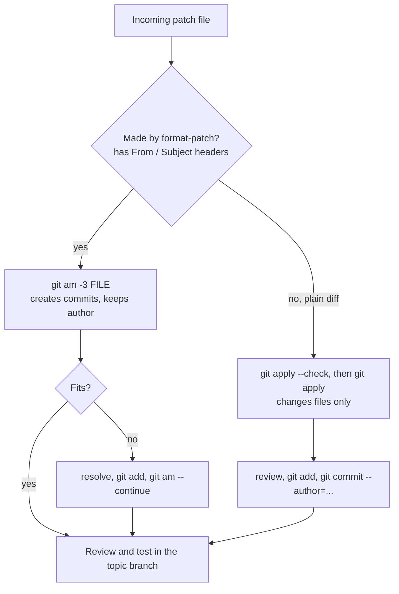
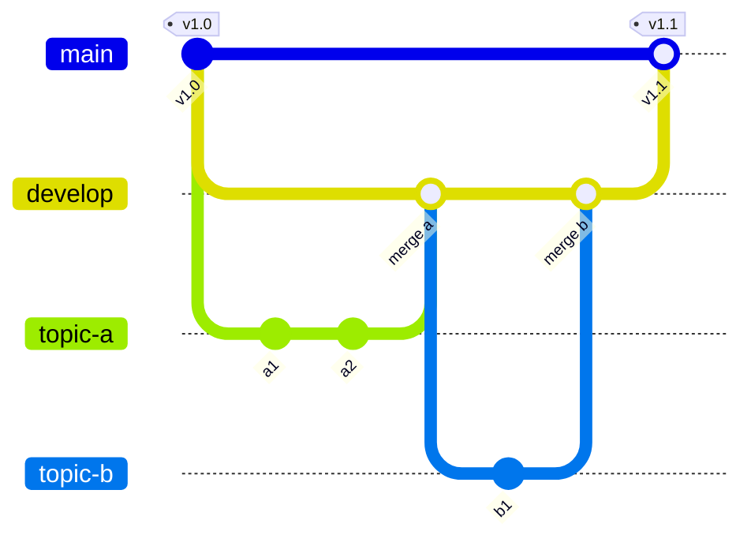
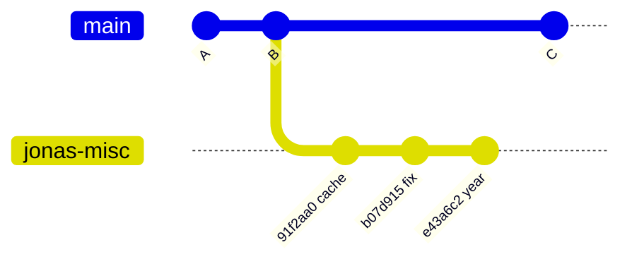
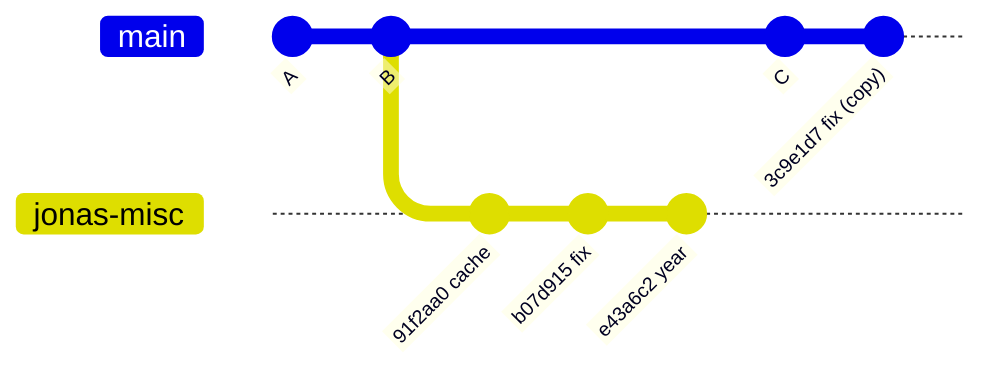
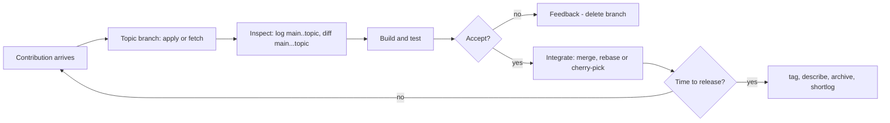

# Maintaining a project

> **Before this lesson:** read [Distributed workflows and contributing to a project](#/lesson/git/contributing), which describes the contributor's side (topic branches, pull requests, patches). You also need merging, rebasing and tags ([Merging and resolving conflicts](#/lesson/git/merging-and-conflicts), [Rebasing and its golden rule](#/lesson/git/rebasing), [Remotes, tags and aliases](#/lesson/git/remotes-tags-aliases)).

## In plain words

The editor of a magazine does not write most of the articles. The editor receives submissions, reads them, asks for corrections, decides which go into the next issue, and makes sure the issue that goes to print is coherent and labelled with the right number.

A project **maintainer** does the same job for code. Contributions arrive as branches to pull or as patch files. The maintainer looks at each one in isolation, decides whether it is ready, combines the accepted ones into the official history, and from time to time stamps a release so that users know exactly which version they have.

Why it matters for a job: you do not need to run an open-source project to need these skills. Any developer who reviews a colleague's branch, picks one fix out of a branch to ship early, prepares a release, or answers "what exactly changed between version 2.3 and 2.4?" is doing a maintainer's work. The commands in this lesson are the ones senior engineers reach for daily.

## Rule zero: try contributions in a topic branch

Never apply incoming work straight onto your main line. Give each contribution its own throwaway branch. If it turns out to be broken, you delete the branch and your main line never knew.

```bash
$ git switch -c review/mira-empty-rows main
Switched to a new branch 'review/mira-empty-rows'
```

- `git switch -c <name> <start>` creates the branch at `main` and moves onto it.
- The `review/` prefix and the contributor's name are a naming convention that keeps such branches easy to find and clean up.

## Receiving work, route 1: patches

A **patch** is a change written out as text. Patches come in two forms, and each has its own command.

### A bare diff: `git apply`

Someone sends you the output of `git diff` saved in a file.

```bash
$ git apply --check /tmp/empty-rows.diff
$ git apply /tmp/empty-rows.diff
$ git status --short
 M importer.py
```

- `git apply --check <file>` tests whether the patch fits your files without changing anything. No output means it fits.
- `git apply <file>` makes the changes in your working tree. It creates **no commit**: you review, stage and commit yourself, and the commit carries your name as author unless you say otherwise.
- `git apply` is all-or-nothing. If any part does not fit, nothing is applied. (The older Unix `patch` command applies what it can and leaves the rest, which can leave files half-changed.)

### An emailed commit: `git am`

A file made by `git format-patch` (see the previous lesson) contains the author, date, message and diff. `git am` ("apply mailbox") turns it back into a commit.

```bash
$ git am 0001-Skip-empty-rows-in-CSV-import.patch
Applying: Skip empty rows in CSV import

$ git log -1 --pretty=fuller
commit 5d2c8e1f...
Author:     Mira Okafor <mira@home.example>
AuthorDate: Fri Nov 20 14:02:55 2026 +0100
Commit:     Tomas Lind <tomas@greenhouse.example>
CommitDate: Sat Nov 21 09:15:02 2026 +0100

    Skip empty rows in CSV import
```

- `git am <file>` creates one commit per patch file, automatically.
- `--pretty=fuller` prints both identities. The **author** is the person who wrote the change (Mira); the **committer** is the person who applied it (Tomas). This is the standard case in which the two differ.

If a patch does not fit, `git am` stops:

```bash
$ git am 0002-Document-CSV-format.patch
Applying: Document CSV format
error: patch failed: README.md:8
error: README.md: patch does not apply
Patch failed at 0002 Document CSV format
hint: Use 'git am --show-current-patch=diff' to see the failed patch
When you have resolved this problem, run "git am --continue".
If you prefer to skip this patch, run "git am --skip" instead.
To restore the original branch and stop patching, run "git am --abort".
```

The three exits are the same trio you know from rebase: fix and `--continue`, `--skip` this patch, or `--abort` everything. A better first move is often to retry with a three-way merge:

```bash
$ git am --abort
$ git am -3 0002-Document-CSV-format.patch
Applying: Document CSV format
Using index info to reconstruct a base tree...
Falling back to patching base and 3-way merge...
Auto-merging README.md
```

`-3` tells Git to use the ids recorded in the patch to find the original version of the file and perform a three-way merge. That usually succeeds where a plain application fails, and when it cannot, you get ordinary conflict markers to resolve.

`git am -i` asks for confirmation before each patch, which is handy for a large batch.



## Receiving work, route 2: branches to pull

When a contributor publishes a branch, you fetch it. For someone who contributes regularly, add a remote once:

```bash
$ git remote add mira https://git.example.com/mira/orchard.git
$ git fetch mira
From https://git.example.com/mira/orchard
 * [new branch]      fix-empty-rows -> mira/fix-empty-rows
$ git switch -c review/mira-empty-rows mira/fix-empty-rows
```

For a one-off contribution, you can pull from an address without saving it as a remote:

```bash
$ git pull https://git.example.com/jonas/orchard.git typo-fix
```

Compared with patches, this route keeps the contributor's exact commits and their real starting point, so Git's three-way merge has full information.

## What does this contribution actually contain?

Before merging anything, answer two questions.

**Which commits would I be adding?**

```bash
$ git log --oneline main..review/mira-empty-rows
5d2c8e1 Skip empty rows in CSV import
```

`main..branch` lists the commits on the branch that `main` does not have. Add `-p` to read each one's diff.

**What is the total change to the code?** The naive command is misleading:

```bash
$ git diff main review/mira-empty-rows
```

This compares the two branch tips directly. If `main` has moved on since the contributor branched, the output also shows, reversed, everything `main` gained in the meantime, as though the contribution were removing it. What you want is the difference between the branch and the point where it **forked** from `main`:

```bash
$ git diff main...review/mira-empty-rows
diff --git a/importer.py b/importer.py
index 3b1f0c2..8e4d7a9 100644
--- a/importer.py
+++ b/importer.py
@@ -6,5 +6,7 @@ def read_stock(path):
     with open(path, newline="") as fh:
         for row in csv.reader(fh):
+            if not row:
+                continue
             rows.append(parse(row))
```

The three dots mean "compare the merge base of the two with the second one". This is exactly the diff a pull-request page displays.

A model of why two dots mislead and three dots do not:

```python-run
# snapshots: file -> content, at the fork point, on main now, and on the topic branch
base  = {"importer.py": "read rows",              "README.md": "v1"}
main  = {"importer.py": "read rows",              "README.md": "v2 (updated on main)"}
topic = {"importer.py": "read rows, skip empty",  "README.md": "v1"}

def diff(a, b):
    return {f: (a.get(f), b.get(f)) for f in sorted(set(a) | set(b)) if a.get(f) != b.get(f)}

print("git diff main topic    ->", diff(main, topic))
print("git diff main...topic  ->", diff(base, topic))
```

The two-dot diff claims the topic "changes" `README.md` back to `v1`. It does not; `main` moved forward. The three-dot diff shows only what the contributor did.

## Integrating accepted work

Once a contribution is reviewed and tested, it goes into a long-lived branch. Projects choose among a few policies.

### Policy 1: merge

The plainest policy: merge each finished topic branch into `main`, then delete the topic branch.

```bash
$ git switch main
$ git merge --no-ff review/mira-empty-rows -m "Merge fix-empty-rows from Mira Okafor"
$ git branch -d review/mira-empty-rows
```

`--no-ff` forces a merge commit even when a fast-forward would be possible, so the history records that these commits arrived together as one contribution.

A more careful variant uses two long-lived branches. Topics are merged into `develop` first, where they are tested together. When `develop` is stable, `main` is fast-forwarded to it and tagged. Users who clone get a `main` that only ever contains released code.



Very large projects add more stages (a branch for work proposed for the next release, another for experimental integration that is rebuilt regularly), but the principle is unchanged: work graduates from less stable branches to more stable ones.

### Policy 2: rebase or cherry-pick for a linear history

Some maintainers want `main` to be a straight line with no merge commits. Two tools serve that.

**Rebase the topic, then fast-forward:**

```bash
$ git switch review/mira-empty-rows
$ git rebase main
$ git switch main
$ git merge --ff-only review/mira-empty-rows
```

**Cherry-pick** copies a single commit onto the current branch. It takes the change that commit introduced and applies it as a new commit where you are. It is the right tool when you want one commit out of a branch and not the others.

```bash
$ git log --oneline main..review/jonas-misc
e43a6c2 Update copyright year
b07d915 Fix off-by-one in stock total
91f2aa0 Experimental cache (not ready)

$ git switch main
$ git cherry-pick b07d915
[main 3c9e1d7] Fix off-by-one in stock total
 Date: Thu Nov 19 17:20:11 2026 +0100
 1 file changed, 1 insertion(+), 1 deletion(-)
```

- `git cherry-pick <commit>` reapplies that one change on top of `main`.
- The new commit has a **different id** (`3c9e1d7`, not `b07d915`), because its parent differs. Author and message are preserved. Adding `-x` appends a line "(cherry picked from commit b07d915...)" to the message, which is good practice on shared branches.

Before:



After `git cherry-pick b07d915` on `main`:



If the picked change does not fit, cherry-pick pauses with conflict markers. Resolve, `git add`, then `git cherry-pick --continue`; or `git cherry-pick --abort`.

> [!WARNING]
> Cherry-picking and rebasing create **new commits**. If you cherry-pick from a branch and later merge that same branch, Git usually copes, but the same change now exists twice in history under two ids, which confuses `git log` and can cause conflicts. And, as always, do not rebase a branch other people have based work on. Use these tools on contributions you are integrating, not on published shared history.

### Remembering conflict resolutions: rerere

A maintainer who repeatedly merges long-lived topics may have to resolve the same conflict again and again. **Rerere** ("reuse recorded resolution") makes Git remember how you resolved a conflict and apply the same resolution automatically the next time the identical conflict appears.

```bash
$ git config --global rerere.enabled true
```

It is covered in detail in the lesson on advanced merging.

## Releases

### Tagging

When the main line reaches a state worth releasing, mark it with an annotated tag (signed, if the project uses signing; see the tools module):

```bash
$ git tag -a v1.1.0 -m "Release 1.1.0: CSV import fixes"
$ git push origin v1.1.0
```

### Build numbers with `git describe`

A commit id such as `3c9e1d7` says nothing about how new it is. `git describe` produces a human-readable name for any commit, built from the nearest tag:

```bash
$ git describe main
v1.1.0-4-g3c9e1d7
```

Read it in three parts:

- `v1.1.0`: the most recent annotated tag reachable from this commit;
- `4`: the number of commits made since that tag;
- `g3c9e1d7`: the letter `g` (for Git) followed by the short commit id.

If the commit is exactly a tagged one, the output is the tag name alone. This string is ideal as a build number: it sorts sensibly, a person can read it, and Git accepts it anywhere a commit id is expected (`git show v1.1.0-4-g3c9e1d7`). By default only annotated tags are considered; `--tags` includes lightweight ones.

```python-run
# A model of git describe on a straight history
history = ["a1", "b2", "c3", "d4", "e5", "f6", "g7"]          # oldest -> newest
tags = {"b2": "v1.0.0", "d4": "v1.1.0"}

def describe(commit):
    i = history.index(commit)
    for back in range(0, i + 1):                  # walk towards older commits
        candidate = history[i - back]
        if candidate in tags:
            return tags[candidate] if back == 0 else f"{tags[candidate]}-{back}-g{commit}"
    return "fatal: No names found, cannot describe anything."

for c in history:
    print(c, "->", describe(c))
```

### Packaging a release with `git archive`

Users who do not use Git need a plain download of the files. `git archive` exports a snapshot without the `.git` folder:

```bash
$ git archive main --prefix='orchard-1.1.0/' | gzip > orchard-1.1.0.tar.gz
$ git archive main --prefix='orchard-1.1.0/' --format=zip > orchard-1.1.0.zip
```

- `git archive <commit>` writes the files of that commit as an archive to standard output.
- `--prefix='orchard-1.1.0/'` puts everything inside a top-level folder of that name, so that unpacking does not scatter files.
- `| gzip > file` pipes the archive through the `gzip` compressor into a file; `--format=zip` produces a zip file directly.

### A change summary with `git shortlog`

For release notes you want a list of what changed since the previous release, grouped by author:

```bash
$ git shortlog --no-merges main --not v1.0.0
Mira Okafor (3):
      Reject negative quantities in stock import
      Skip empty rows in CSV import
      Document CSV format

Tomas Lind (2):
      Speed up CSV import
      Fix off-by-one in stock total
```

- `main --not v1.0.0` selects commits reachable from `main` but not from the tag `v1.0.0`, which is another way of writing `v1.0.0..main`.
- `--no-merges` leaves out merge commits.
- Each author's commits are listed under their name with a count.

The full maintainer loop:



## Pitfalls

- **Applying contributions directly on `main`.** A bad patch then has to be reverted publicly. Use a topic branch.
- **Reviewing with a two-dot diff.** It mixes in changes from the main line. Use `main...topic`.
- **`git apply` and forgetting authorship.** It makes no commit, so the commit you then create is yours. Credit the contributor with `git commit --author="Name <email>"`, or ask for a `format-patch` file and use `git am`.
- **Cherry-picking without `-x` on release branches.** Months later nobody can tell where the commit came from.
- **Tagging before pushing the commits, or moving a tag after publishing.** Users end up with a tag that points at something they cannot fetch, or with two meanings for one version.
- **Lightweight tags with `git describe`.** They are ignored by default, giving a surprising "No names found" or an older base tag.

> [!TIP]
> To test how a contribution behaves once combined with the current main line, without committing to anything, merge it in a scratch branch: `git switch -c try main && git merge --no-commit --no-ff review/mira-empty-rows`. Run the tests. Then `git merge --abort` and delete the branch, or commit if you are satisfied.

> [!INTERVIEW]
> **"What is `git cherry-pick` and when would you use it?"** It applies the change introduced by one existing commit as a new commit on the current branch, keeping author and message but getting a new id. Typical uses: back-porting a bug fix from the main line to a release branch, taking one good commit from a branch that is otherwise not ready, and recovering a commit made on the wrong branch. Risks to mention: it duplicates the change under a second id, so prefer merging when you want the whole branch, and use `-x` to record the origin. A related question, **"`git apply` versus `git am`?"**: `apply` changes files from a plain diff and commits nothing; `am` consumes `format-patch` mail files and creates commits that keep the original author, date and message.

## Cheat sheet

| Task | Command |
|---|---|
| Start a branch to try a contribution | `git switch -c review/<name> main` |
| Test whether a diff fits | `git apply --check <file>` |
| Apply a plain diff (no commit) | `git apply <file>` |
| Apply `format-patch` files as commits | `git am -3 <files>` |
| Continue / skip / stop a failed `am` | `git am --continue` / `--skip` / `--abort` |
| Fetch a contributor's branch | `git fetch <remote>` then `git switch -c review/x <remote>/<branch>` |
| Commits a branch would add | `git log --oneline main..<branch>` |
| The change a branch would make | `git diff main...<branch>` |
| Merge keeping a merge commit | `git merge --no-ff <branch>` |
| Copy one commit here | `git cherry-pick -x <commit>` |
| Remember conflict resolutions | `git config --global rerere.enabled true` |
| Readable name for a commit | `git describe <commit>` |
| Export a snapshot as an archive | `git archive <commit> --prefix='name/' --format=zip > name.zip` |
| Changes since a release, by author | `git shortlog --no-merges <tag>..main` |

## Summary

A maintainer evaluates each contribution in its own topic branch. Plain diffs are applied with `git apply`, which changes files only; `format-patch` mails are applied with `git am`, which recreates commits with their original author, and `-3` adds a three-way merge fallback. Published branches are fetched from the contributor's repository. `git log main..topic` lists what would be added and `git diff main...topic` shows the change relative to the fork point. Accepted work is integrated by merging (optionally through staged stability branches), or by rebasing or cherry-picking when a linear history is wanted. Releases are marked with annotated tags; `git describe` derives readable build names from them, `git archive` exports a snapshot for distribution, and `git shortlog` summarises the changes for release notes.

## Glossary

- **Maintainer:** the person responsible for accepting changes into a project and making releases.
- **Patch:** a change expressed as text that can be applied to files.
- **`git apply`:** applies a diff to the working tree without committing.
- **`git am`:** applies emailed patches made by `format-patch`, creating commits.
- **Author / committer:** who wrote the change / who put it into this history.
- **Fork point (merge base):** the commit from which a topic branch departed from the main line.
- **Two-dot / three-dot diff:** compare the two tips / compare the fork point with the second tip.
- **`--no-ff`:** merge option that always creates a merge commit.
- **Cherry-pick:** copy the change of one commit onto the current branch as a new commit.
- **Back-port:** apply a fix made on a newer line of development to an older, still-supported release.
- **Rerere:** "reuse recorded resolution"; Git remembers and replays conflict resolutions.
- **`git describe`:** names a commit as nearest-tag, commits since, and short id.
- **`git archive`:** exports the files of a commit as a tar or zip archive.
- **`git shortlog`:** summarises commits grouped by author.
- **Release:** a version of the project published for users, marked with a tag.

## Check yourself

```quiz
[
  {"q": "What is the key difference between `git apply` and `git am`?", "options": ["apply works only on binary files", "apply changes the working tree from a diff without committing; am creates commits from format-patch files, preserving the author", "am is the older name for apply", "apply needs a network connection"], "answer": 1, "explain": "git apply is a strict replacement for the patch program. git am reads mail-formatted patches and recreates each as a commit with the original author, date and message."},
  {"q": "After `git am` applies Mira's patch in Tomas's repository, who is the author and who is the committer?", "options": ["Mira is the author; Tomas is the committer", "Mira is both", "Tomas is the author; Mira is the committer", "Tomas is both"], "answer": 0, "explain": "Authorship comes from the patch header. The committer is whoever applied it."},
  {"q": "Why is `git diff main...topic` (three dots) better for review than `git diff main topic`?", "options": ["It includes untracked files", "It compares topic with the fork point, so changes made on main since then are not shown as if the topic undid them", "It is faster", "It shows only file names"], "answer": 1, "explain": "The direct tip-to-tip diff includes the inverse of everything main gained after the branch forked. Three dots isolates the contribution."},
  {"q": "What does `git am -3` add?", "options": ["A three-way merge fallback when a patch does not apply cleanly", "Three retries", "It signs the commits", "It applies three patches at once"], "answer": 0, "explain": "Using blob ids recorded in the patch, Git reconstructs a base and merges, which often succeeds or at least yields normal conflict markers."},
  {"q": "You cherry-pick commit b07d915 onto main. What is true of the result?", "options": ["A merge commit is created", "The original commit is deleted from its branch", "A new commit with a different id but the same change, author and message is added to main", "main now contains b07d915 itself"], "answer": 2, "explain": "A commit's id depends on its parent, so the copy necessarily has a new id. The source branch is untouched."},
  {"q": "`git describe` prints `v2.3.0-7-g4d1c9ab`. What does the 7 mean?", "options": ["Seven commits were made after the tag v2.3.0", "Seven contributors", "The seventh release", "Seven files changed"], "answer": 0, "explain": "The format is nearest tag, number of commits since it, then g and the short id of the described commit."},
  {"q": "What does `git archive main --prefix='app-1.0/' --format=zip > app-1.0.zip` produce?", "options": ["A zip of the files in main's snapshot, inside a folder app-1.0, without the .git history", "A patch series", "A bundle of all branches", "A clone of the repository"], "answer": 0, "explain": "git archive exports one snapshot as an ordinary archive for people who do not need the history."},
  {"q": "Why try an incoming contribution on a topic branch and not on main?", "options": ["Topic branches run tests faster", "If it is rejected or broken, deleting the branch leaves main untouched", "It is required by git am", "main cannot receive patches"], "answer": 1, "explain": "Isolation makes evaluation free of risk: the main line only changes when you deliberately integrate."}
]
```

> **Source:** Chacon & Straub, Pro Git 2e, ch. 5 (Maintaining a Project). Explanations, examples and code written for this guide.
