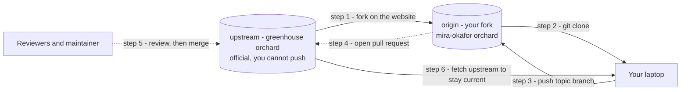
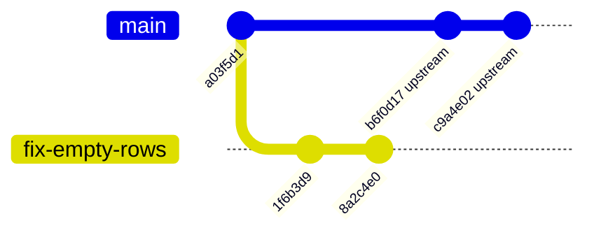
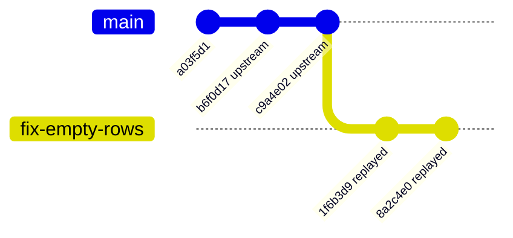
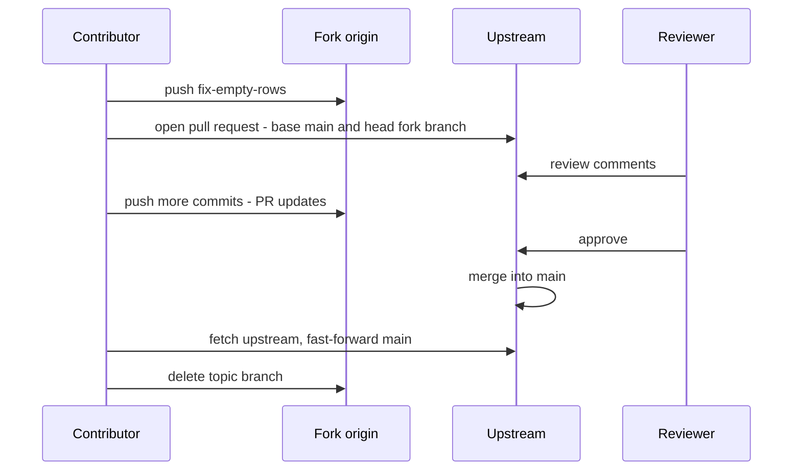

# Accounts, forks and the pull-request flow

> **Before this lesson:** you should be able to branch, commit and push ([Branch management, workflows and remote branches](#/lesson/git/branch-workflows-remote)), understand SSH keys and tokens ([SSH keys, access control and hosting options](#/lesson/git/ssh-keys-and-hosting)), and know the integration-manager workflow ([Distributed workflows and contributing to a project](#/lesson/git/contributing)).

## In plain words

Git is the tool on your computer. **GitHub** is a website that stores Git repositories and wraps them in features for working with other people: a page for every project, a place to discuss problems, and a structured way to propose a change and have it checked before it is accepted. (GitLab and Bitbucket are similar sites; nearly everything here has a direct equivalent there.)

The central idea is the **pull request**. Imagine a shared recipe binder that only the head chef may write in. You photocopy the binder (a **fork**), write your improved recipe on your copy, and then hand the chef a note: "Please take a look at page 12 of my copy; I suggest we add it." The chef and other cooks read it, scribble comments, you make corrections, and when everyone is satisfied the chef copies the page into the real binder. A pull request is that note, together with the whole conversation attached to it.

Why it matters for a job: at almost every software company, no code reaches the main branch without going through a pull request (some call it a merge request). Opening, updating, reviewing and merging pull requests is the daily rhythm of professional development. A public profile with thoughtful contributions is also one of the few portfolios an employer can inspect directly.

## Setting up an account properly

Creating an account takes a minute on the website. Four pieces of setup make it usable and safe.

**1. Authentication for Git operations.** GitHub does not accept your account password for `git push`. Use one of:

- an **SSH key**: paste the contents of your `.pub` file into *Settings → SSH and GPG keys* (creating keys is covered in the SSH lesson), and clone with addresses of the form `git@github.com:owner/repo.git`;
- a **personal access token** used as the password over HTTPS: created under *Settings → Developer settings*, limited to the permissions you choose, and revocable at any time;
- the official **GitHub CLI** (`gh`), a command-line program that signs in through your browser and configures Git for you with `gh auth login`.

**2. Your commit email.** GitHub links a commit to your profile when the email inside the commit matches an address registered on your account. Add the addresses you commit with under *Settings → Emails*. If you prefer not to publish your address, GitHub provides a private "noreply" address that you can put into `git config user.email`.

**3. Two-factor authentication (2FA).** This means that signing in needs two things: your password and a code from your phone or a hardware key. It is the single most effective protection for an account, and many organisations require it.

**4. A recognisable profile.** A name and a picture make collaboration friendlier; they have no technical effect.

Test the SSH route:

```bash
$ ssh -T git@github.com
Hi mira-okafor! You've successfully authenticated, but GitHub does not provide shell access.
```

The greeting with your user name confirms the key is registered.

## Vocabulary of a GitHub repository page

| Term | Meaning |
|---|---|
| **Repository** ("repo") | One project: its Git history plus issues, pull requests and settings |
| **Owner** | The user or organisation account the repository belongs to; the address is `github.com/owner/repo` |
| **Collaborator** | A person given permission to push to the repository |
| **Issue** | A numbered discussion thread for a bug report, question or feature idea |
| **Pull request (PR)** | A numbered proposal to merge one branch into another, with discussion and review |
| **Fork** | Your own server-side copy of someone else's repository |
| **Star / Watch** | Bookmark a repository / receive notifications about it |
| **README** | A file shown on the repository's front page, usually `README.md` |

Issues and pull requests share one sequence of numbers per repository, and writing `#142` in any comment or commit message creates a link to that item.

## Two situations, one flow

**You have push access** (your team's repository). You push your topic branch to the shared repository and open a pull request from it to `main`.

**You do not have push access** (an open-source project). You fork, push your topic branch to your fork, and open a pull request from your fork's branch to the original repository's `main`.

Everything after "push the branch" is identical. The lesson follows the fork case, because it contains every step.



## The flow, step by step

### Step 1: fork

On the project's page, press **Fork**. GitHub creates `github.com/mira-okafor/orchard`, a complete copy under your account that you may push to. The original is conventionally called the **upstream** repository.

### Step 2: clone your fork and connect the upstream

```bash
$ git clone git@github.com:mira-okafor/orchard.git
Cloning into 'orchard'...
remote: Enumerating objects: 148, done.
Receiving objects: 100% (148/148), 32.10 KiB | 1.07 MiB/s, done.
Resolving deltas: 100% (41/41), done.

$ cd orchard
$ git remote add upstream https://github.com/greenhouse/orchard.git
$ git remote -v
origin    git@github.com:mira-okafor/orchard.git (fetch)
origin    git@github.com:mira-okafor/orchard.git (push)
upstream  https://github.com/greenhouse/orchard.git (fetch)
upstream  https://github.com/greenhouse/orchard.git (push)
```

- Cloning your fork makes it the remote named `origin`.
- `git remote add upstream <address>` registers the official repository so you can fetch new work from it. The names `origin` and `upstream` are conventions; many tools assume them.
- The upstream address can be HTTPS since you only read from it.

### Step 3: create a topic branch

```bash
$ git switch -c fix-empty-rows
Switched to a new branch 'fix-empty-rows'
```

Never work on your fork's `main`. Keeping `main` identical to upstream's `main` makes staying current trivial (step 7).

### Step 4: commit and push

```bash
$ git commit -a -m "Skip empty rows in CSV import"
[fix-empty-rows 1f6b3d9] Skip empty rows in CSV import
 1 file changed, 3 insertions(+), 1 deletion(-)

$ git push -u origin fix-empty-rows
Enumerating objects: 5, done.
Writing objects: 100% (3/3), 356 bytes | 356.00 KiB/s, done.
remote:
remote: Create a pull request for 'fix-empty-rows' on GitHub by visiting:
remote:      https://github.com/mira-okafor/orchard/pull/new/fix-empty-rows
remote:
To github.com:mira-okafor/orchard.git
 * [new branch]      fix-empty-rows -> fix-empty-rows
branch 'fix-empty-rows' set up to track 'origin/fix-empty-rows'.
```

Lines starting with `remote:` are messages sent back by GitHub. It offers a direct link for the next step.

### Step 5: open the pull request

Follow the link (or press **Compare & pull request** on the website). The form asks for:

- the **base**: the repository and branch you want to merge *into* (`greenhouse/orchard`, `main`);
- the **head** (also called *compare*): the branch that contains your work (`mira-okafor/orchard`, `fix-empty-rows`);
- a **title** and a **description**.

A good description answers three questions for the reviewer:

```
Skip empty rows in CSV import

**Problem:** warehouse exports end with blank lines, and the importer
raised ValueError on them (see #142).

**Change:** rows with no fields are ignored before parsing.

**How I tested it:** added test_blank_lines; ran the full suite.

Closes #142
```

- `Closes #142` is a **closing keyword**. When this pull request is merged into the default branch, GitHub closes issue 142 automatically. `Fixes` and `Resolves` work the same way.

From the terminal, the GitHub CLI does the same:

```bash
$ gh pr create --base main --title "Skip empty rows in CSV import" --body "Closes #142"
Creating pull request for mira-okafor:fix-empty-rows into main in greenhouse/orchard

https://github.com/greenhouse/orchard/pull/157
```

If the work is not finished but you want early feedback, open it as a **draft pull request**. A draft is visible and can be commented on, but cannot be merged until you mark it ready.

### Step 6: discussion and updates

A pull request page has three main views: **Conversation** (comments and events in time order), **Commits**, and **Files changed** (the combined diff, where reviewers attach comments to specific lines).

A pull request is not a frozen snapshot of your code. It follows a **branch**. To respond to feedback, you commit to the same branch and push; the pull request updates by itself.

```bash
$ git commit -a -m "Treat whitespace-only rows as empty too"
$ git push
To github.com:mira-okafor/orchard.git
   1f6b3d9..8a2c4e0  fix-empty-rows -> fix-empty-rows
```

The new commit appears in the conversation, and reviewers are notified. No new pull request is needed.

### Step 7: keep the branch current with upstream

While your pull request waits, `upstream/main` moves. If GitHub reports "This branch has conflicts that must be resolved", or the project asks you to update, bring upstream's changes in.

```bash
$ git fetch upstream
From https://github.com/greenhouse/orchard
   a03f5d1..c9a4e02  main       -> upstream/main
```

Then choose one of two ways.

**Merge upstream into your branch** (always safe, adds a merge commit):

```bash
$ git merge upstream/main
Auto-merging importer.py
CONFLICT (content): Merge conflict in importer.py
Automatic merge failed; fix conflicts and then commit the result.
# resolve, then:
$ git add importer.py
$ git commit
$ git push
```

**Rebase your branch onto upstream** (linear history, rewrites your commits):

```bash
$ git rebase upstream/main
$ git push --force-with-lease
```

Before and after the rebase:





> [!WARNING]
> After rebasing a branch that is already pushed, the push must be forced, and a forced push replaces what is on GitHub. Use `git push --force-with-lease`, which refuses if someone else (for example a maintainer helping you) added commits to your branch since your last fetch. Never force-push `main` or any branch other people work on. Check the project's contribution guide: some projects prefer merge updates so that reviewers' comments stay attached to unchanged commits.

Also bring your own `main` up to date now and then, so that new topic branches start from current code:

```bash
$ git switch main
$ git merge --ff-only upstream/main
$ git push origin main
```

`--ff-only` succeeds because you never commit on `main` yourself. (GitHub's **Sync fork** button does the server-side half of this.)

### Step 8: merge

When reviewers approve and automated checks pass, a maintainer presses the merge button. GitHub offers three kinds of merge; a repository's settings decide which are allowed.

| Button | What it does to the base branch | History result |
|---|---|---|
| **Create a merge commit** | Adds a merge commit with two parents (like `git merge --no-ff`) | Every original commit kept, plus a merge commit |
| **Squash and merge** | Combines all the pull request's commits into one new commit | One commit per pull request; originals not in `main` |
| **Rebase and merge** | Replays each commit onto the base (new ids), no merge commit | Linear, all commits kept individually |

The team-workflows module compares these in depth. For now: after "squash" or "rebase" merges, the commits on `main` have different ids from the ones on your branch, which matters for cleanup.

### Step 9: clean up

```bash
$ git switch main
$ git pull upstream main
$ git push origin main
$ git branch -d fix-empty-rows
$ git push origin --delete fix-empty-rows
```

- If the pull request was squash- or rebase-merged, `git branch -d` may complain that the branch "is not fully merged", because the exact commits are not in `main`. Once you have confirmed on the website that the pull request shows as merged, `git branch -D` is fine.

The whole exchange as a timeline:



## Pull requests under the hood

A pull request is not a Git feature; Git has no object called "pull request". GitHub stores one as a database record plus ordinary Git references. Every pull request's head is available on the upstream repository under a reference named `refs/pull/<number>/head`. That lets a maintainer fetch any pull request without adding the contributor's fork as a remote:

```bash
$ git fetch upstream pull/157/head:review/pr-157
From https://github.com/greenhouse/orchard
 * [new ref]         refs/pull/157/head -> review/pr-157
$ git switch review/pr-157
```

- `pull/157/head:review/pr-157` is a refspec: "fetch the reference `pull/157/head` and store it locally as branch `review/pr-157`".
- With the GitHub CLI the same is `gh pr checkout 157`.

A model of the bookkeeping, to make the point that a pull request is "two branch names and a conversation":

```python-run
upstream = {"main": "c9a4e02"}
fork = {"main": "a03f5d1", "fix-empty-rows": "1f6b3d9"}
commits = {"a03f5d1": [], "b6f0d17": ["a03f5d1"], "c9a4e02": ["b6f0d17"],
           "1f6b3d9": ["a03f5d1"], "8a2c4e0": ["1f6b3d9"]}

pr = {"number": 157, "base": ("upstream", "main"), "head": ("fork", "fix-empty-rows"), "comments": []}

def reach(tip):
    seen, todo = set(), [tip]
    while todo:
        c = todo.pop()
        if c not in seen:
            seen.add(c); todo.extend(commits[c])
    return seen

def pr_commits():
    """What the 'Commits' tab shows: reachable from head, not from base."""
    return sorted(reach(fork[pr["head"][1]]) - reach(upstream[pr["base"][1]]))

print("PR #157 shows commits:", pr_commits())
fork["fix-empty-rows"] = "8a2c4e0"             # contributor pushes another commit to the same branch
print("after another push   :", pr_commits())   # the PR follows the branch
```

## Writing on GitHub: Markdown essentials

Descriptions and comments are written in **Markdown**, a lightweight way to format plain text. The features you will use constantly:

- **Task lists**: lines starting with `- [ ]` render as checkboxes that can be ticked in the page, good for "to do before merge" lists.
- **Code**: wrap inline code in backticks; for a block, put three backticks on the line before and after, optionally followed by a language name for colouring.
- **Quoting**: start a line with `>` to quote what you are replying to.
- **Mentions**: `@username` notifies that person. `#157` links an issue or pull request. A commit id is linked automatically.
- **Images**: drag a screenshot into the comment box.

## Pitfalls

- **Committing on your fork's `main`.** It then diverges from upstream and every sync becomes a merge. Branch for every change.
- **Opening the pull request against the wrong base.** GitHub pre-selects the default branch, which is usually right, but check the base and head lines before submitting, above all in repositories with release branches.
- **Creating a new pull request for every round of feedback.** Push to the same branch; the pull request updates.
- **A commit email that is not on your account.** The commits appear with a grey anonymous avatar and do not count as yours. Fix `user.email` for future commits.
- **Huge pull requests.** A 2,000-line pull request gets a tired "looks good". Several small, focused ones get real review and merge sooner.
- **Deleting the fork while a pull request is open.** The pull request loses its head branch.
- **Pasting secrets.** Tokens or passwords in code, issues or comments on a public repository are harvested by automated scanners within minutes. Revoke anything that leaks.

> [!TIP]
> Open the pull request early as a draft, with a checklist of what remains. Reviewers can warn you about a wrong direction on day one instead of day five, and the draft status makes it clear that it is not yet a request to merge.

> [!INTERVIEW]
> **"Walk me through contributing to a repository you cannot push to."** Fork it on the hosting site; clone the fork (`origin`) and add the original as `upstream`; create a topic branch from an up-to-date `main`; commit focused changes; push the branch to the fork with `-u`; open a pull request with the original's `main` as base and the fork's branch as head, describing the problem, the change and how it was tested, and linking the issue with a closing keyword; address review by pushing further commits to the same branch; keep current by fetching `upstream` and merging or rebasing (force-pushing with a lease after a rebase); after merge, fast-forward local `main` from upstream and delete the topic branch. **"Fork versus branch?"** A fork is a separate server-side repository under your account, used when you lack push rights; a branch is a pointer inside one repository. Teams with shared write access usually use branches in one repository.

## Cheat sheet

| Task | Command |
|---|---|
| Test SSH authentication | `ssh -T git@github.com` |
| Sign in with the GitHub CLI | `gh auth login` |
| Clone your fork | `git clone git@github.com:<you>/<repo>.git` |
| Register the original repository | `git remote add upstream https://github.com/<owner>/<repo>.git` |
| Start a change | `git switch -c <topic>` |
| Publish it | `git push -u origin <topic>` |
| Open a pull request from the terminal | `gh pr create --base main --title "..." --body "..."` |
| Update the pull request | commit, then `git push` |
| Bring in upstream changes (merge) | `git fetch upstream && git merge upstream/main` |
| Bring in upstream changes (rebase) | `git fetch upstream && git rebase upstream/main && git push --force-with-lease` |
| Sync your `main` | `git switch main && git merge --ff-only upstream/main && git push origin main` |
| Check out someone's pull request | `git fetch upstream pull/<n>/head:pr-<n>` or `gh pr checkout <n>` |
| Delete the merged branch | `git branch -d <topic>` and `git push origin --delete <topic>` |

## Summary

GitHub hosts Git repositories and adds collaboration features around them. After securing your account (SSH key or token, registered commit email, two-factor authentication), the contribution flow is: fork the project if you cannot push to it, clone, add the original as `upstream`, work on a topic branch, push it, and open a pull request naming a base branch to merge into and a head branch containing your work. The pull request tracks the head branch, so further pushes update it. You keep the branch current by fetching upstream and merging or rebasing, and after approval a maintainer merges with a merge commit, a squash or a rebase. A pull request is a record on the site plus ordinary Git references, which is why any pull request can be fetched as `pull/<number>/head`.

## Glossary

- **GitHub:** a website that hosts Git repositories and provides collaboration tools.
- **Fork:** your own copy, on the hosting site, of another account's repository.
- **Upstream:** the original repository a fork was made from; also the usual remote name for it.
- **Pull request (PR):** a proposal to merge one branch into another, with discussion and review.
- **Base / head:** the branch to merge into / the branch containing the proposed changes.
- **Draft pull request:** a pull request marked as not ready to merge.
- **Issue:** a numbered discussion thread for bugs, ideas and tasks.
- **Closing keyword:** words such as `Closes #12` that close an issue when the pull request merges.
- **Collaborator:** a user with push permission on a repository.
- **Personal access token:** a revocable credential used in place of a password for HTTPS and API access.
- **Two-factor authentication (2FA):** sign-in that needs a second proof, such as a phone code.
- **GitHub CLI (`gh`):** the official command-line program for GitHub.
- **Markdown:** a plain-text formatting syntax used for READMEs, descriptions and comments.
- **Squash merge / rebase merge:** merge options that combine a pull request into one commit / replay its commits linearly.

## Check yourself

```quiz
[
  {"q": "What is a fork?", "options": ["A local branch with a special name", "A merge commit with three parents", "Your own server-side copy of another account's repository, which you can push to", "A pull request that was rejected"], "answer": 2, "explain": "Forking creates a full copy under your account. You push topic branches there and propose them to the original through pull requests."},
  {"q": "In a pull request, what are the base and the head?", "options": ["They are two names for the same branch", "Base is the branch to merge into; head is the branch with your changes", "Base is your branch; head is main", "Base is the first commit; head is the last"], "answer": 1, "explain": "The pull request asks for head to be merged into base, typically your topic branch into the project's main."},
  {"q": "A reviewer asks for a change on your open pull request. What do you do?", "options": ["Close it and open a new one", "Commit the change on the same branch and push; the pull request updates automatically", "Edit the commit on the website only", "Email a patch"], "answer": 1, "explain": "A pull request follows its head branch. New commits pushed to that branch appear in it immediately."},
  {"q": "Why should you avoid committing on your fork's main branch?", "options": ["Pull requests cannot come from forks", "main then diverges from upstream's main, making every later sync a merge or a conflict", "It deletes the upstream", "GitHub forbids it"], "answer": 1, "explain": "If main only ever mirrors upstream, updating is a fast-forward and every new topic branch starts from clean, current code."},
  {"q": "What does writing `Closes #142` in a pull request description do?", "options": ["Nothing; it is only a comment", "Deletes branch 142", "Closes issue 142 automatically when the pull request is merged into the default branch", "Closes the pull request"], "answer": 2, "explain": "Closing keywords link the pull request to an issue and close the issue on merge."},
  {"q": "After rebasing your pull-request branch onto upstream/main, which push is appropriate?", "options": ["git push", "git push --force-with-lease", "git push upstream main", "git push --tags"], "answer": 1, "explain": "The rebased branch is not a descendant of what is on the server, so a plain push is rejected. The lease form overwrites only if nobody else has pushed to the branch."},
  {"q": "How can a maintainer fetch pull request 157 without adding the contributor's fork as a remote?", "options": ["git fetch upstream pull/157/head:pr-157", "git merge 157", "It is impossible", "git clone --pr 157"], "answer": 0, "explain": "GitHub exposes each pull request's head as the reference refs/pull/<number>/head on the base repository."},
  {"q": "A pull request with five commits is merged with 'Squash and merge'. What appears on main?", "options": ["Five commits plus a merge commit", "One new commit containing the combined changes", "Five replayed commits", "Nothing until the branch is deleted"], "answer": 1, "explain": "Squash merging collapses the pull request into a single commit on the base branch. The original commits remain only on the topic branch."}
]
```

> **Source:** Chacon & Straub, Pro Git 2e, ch. 6 (Account Setup and Configuration; Contributing to a Project). Explanations, examples and code written for this guide.
