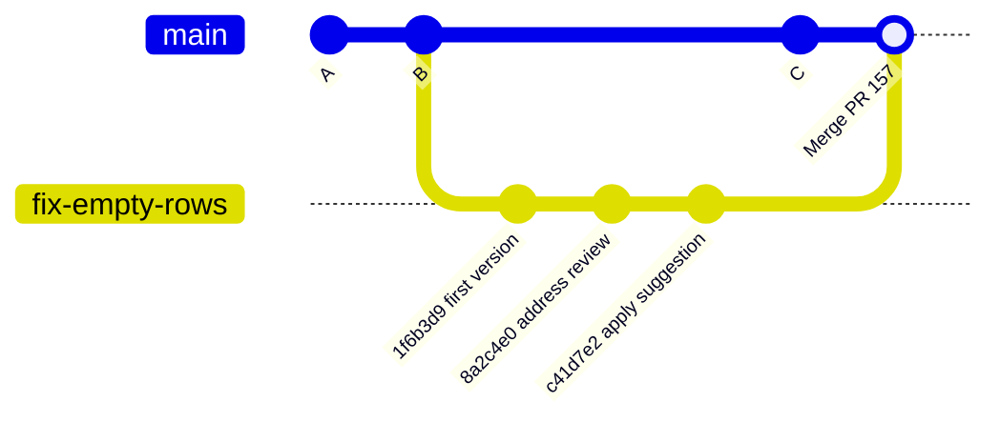
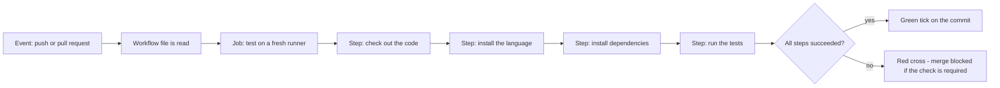
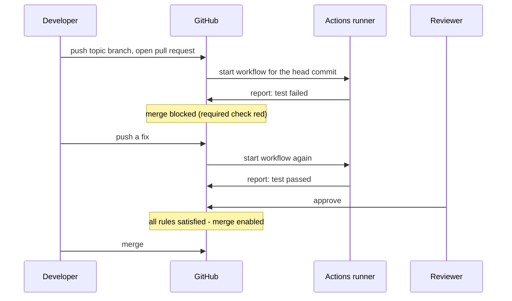

# Reviews, protected branches and Actions

> **Before this lesson:** read [Accounts, forks and the pull-request flow](#/lesson/git/github-forks-prs), which explains forks, pull requests, base and head. The maintainer's view from [Maintaining a project](#/lesson/git/maintaining) is helpful background.

## In plain words

A hospital does not let one person prescribe, dispense and administer a drug with nobody else looking. A second pair of eyes checks the prescription, the pharmacy has rules about who may unlock which cabinet, and machines run standard tests on every sample. None of this exists because staff are distrusted. It exists because people are busy and mistakes are normal.

Software teams build the same safety net around their main branch, and GitHub provides the parts:

- **Code review**: before a change is merged, at least one other person reads it and either approves or asks for changes.
- **Protected branches**: rules, enforced by the server, such as "nobody may push straight to `main`" and "a pull request needs one approval and passing tests before it can be merged".
- **Organisations and teams**: a way to manage who may do what across many repositories.
- **GitHub Actions**: robots that run your tests (or anything else) automatically whenever code is pushed or a pull request opens.

Why it matters for a job: on your first day you will be a reviewer's subject, and within weeks you will be a reviewer yourself. You will see a red cross next to your pull request and need to find out which automated check failed. And you will be blocked by a branch rule and need to understand that it is a rule, not a bug.

## Part 1: code review

### What a review is

A **code review** is the practice of having someone other than the author read a change before it joins the main line. Its purposes, in rough order of value: catch defects early, spread knowledge of the code among the team, keep the codebase consistent, and give the author a chance to learn.

On GitHub a review happens on the pull request's **Files changed** tab. The reviewer can attach a comment to any line of the diff, and then submits the whole review with one of three verdicts.

| Verdict | Meaning |
|---|---|
| **Comment** | Remarks without a decision |
| **Approve** | "I am satisfied; this can be merged" |
| **Request changes** | "This should not be merged until these points are addressed" |

A reviewer can also write a **suggestion**: a proposed replacement for specific lines, shown as a small diff inside the comment. The author can accept it with one click, which creates a commit on the branch.

### Reviewing on your own machine

Reading a diff on a web page shows you the text. To *run* the change, fetch the pull request locally. Every pull request's head is published under a reference on the base repository (as described in the previous lesson):

```bash
$ git fetch origin pull/157/head:review/pr-157
From github.com:greenhouse/orchard
 * [new ref]         refs/pull/157/head -> review/pr-157
$ git switch review/pr-157
Switched to branch 'review/pr-157'
```

- `git fetch origin pull/157/head:review/pr-157` downloads the pull request's commits and creates a local branch named `review/pr-157` pointing at them.
- `git switch` moves onto that branch, so your working tree contains the proposed code.

Now look at exactly what it proposes:

```bash
$ git log --oneline main..review/pr-157
8a2c4e0 Treat whitespace-only rows as empty too
1f6b3d9 Skip empty rows in CSV import

$ git diff main...review/pr-157 --stat
 importer.py            | 6 ++++--
 tests/test_importer.py | 14 ++++++++++++++
 2 files changed, 18 insertions(+), 2 deletions(-)
```

- The first command lists the commits the pull request would add (reachable from the branch, not from `main`).
- The second, with three dots, summarises the change relative to the point where the branch forked from `main`. `--stat` shows file names and line counts instead of the full diff.

Then build it, run the tests, try the feature. With the GitHub command-line program the fetch-and-switch is one step: `gh pr checkout 157`.

If you review many pull requests, you can teach Git to fetch **all** of them on every `git fetch` by adding a second fetch rule to the remote:

```bash
$ git config --add remote.origin.fetch "+refs/pull/*/head:refs/remotes/origin/pr/*"
$ git fetch origin
From github.com:greenhouse/orchard
 * [new ref]         refs/pull/155/head -> origin/pr/155
 * [new ref]         refs/pull/157/head -> origin/pr/157
$ git switch --detach origin/pr/157
```

- The quoted text is a **refspec**: "take every reference matching `refs/pull/*/head` on the server and store it locally as `refs/remotes/origin/pr/*`". The leading `+` allows the local copies to be overwritten when a contributor force-pushes.
- Each pull request then appears as a remote-tracking branch named `origin/pr/<number>`.

### How the review conversation moves the branch



Each round of feedback adds commits to the topic branch. The merge at the end brings all of them (or, with a squash merge, their combined effect) into `main`.

### Being a good reviewer and a good author

These habits are what teams mean by "review etiquette"; the team-workflows module expands on them.

**As an author:**
- Keep the pull request small and about one thing.
- Review your own diff before asking anyone else to.
- Say in the description what to look at and how you tested.
- Answer every comment, even with a brief "done" or a reason for disagreeing.

**As a reviewer:**
- Review promptly; a waiting pull request blocks a colleague.
- Comment on the code, not the person: "this loop reads past the end when the list is empty" and not "you got this wrong".
- Separate what must change from what is a preference. A common convention is to prefix minor remarks with "nit:".
- Ask questions when you do not understand. Confusing code is itself a finding.
- Approve when it is good enough and better than what was there, not only when it is perfect.

## Part 2: protected branches

### The problem

By default, anyone with push access to a repository can push to any branch, including `main`, and can force-push or delete it. One mistyped command could remove the team's history from the server.

A **protected branch** is a branch with server-side rules attached. Repository administrators configure them under *Settings → Branches* (classic "branch protection rules") or *Settings → Rules* (the newer "rulesets", which can also cover tags and apply across many repositories).

### The common rules

| Rule | Effect |
|---|---|
| Require a pull request before merging | Direct pushes to the branch are refused |
| Require approvals (a number) | The merge button stays disabled until that many reviewers approve |
| Dismiss stale approvals when new commits are pushed | An approval does not carry over to code the reviewer has not seen |
| Require review from code owners | People listed for the changed files must approve |
| Require status checks to pass | Named automated checks (tests, linters) must succeed |
| Require branches to be up to date | The head must contain the latest base before merging |
| Require linear history | Only squash or rebase merges are allowed; no merge commits |
| Require signed commits | Every commit must carry a verified signature |
| Block force pushes / block deletion | History on the branch cannot be rewritten or removed |

### What a blocked push looks like

```bash
$ git switch main
$ git commit -a -m "Quick fix"
$ git push origin main
remote: error: GH006: Protected branch update failed for refs/heads/main.
remote: error: Changes must be made through a pull request.
To github.com:greenhouse/orchard.git
 ! [remote rejected] main -> main (protected branch hook declined)
error: failed to push some refs to 'github.com:greenhouse/orchard.git'
```

- `remote:` lines come from GitHub. It names the rule that stopped you.
- `[remote rejected]` means the server refused. (Compare `[rejected]`, without "remote", which is your own Git declining a non-fast-forward before sending.)

Nothing is lost; your commit is still in your local `main`. The repair is to move it onto a topic branch and open a pull request:

```bash
$ git switch -c quick-fix
Switched to a new branch 'quick-fix'
$ git push -u origin quick-fix
$ git switch main
$ git reset --hard origin/main
HEAD is now at c9a4e02 Speed up CSV import
```

- `git switch -c quick-fix` creates a new branch at your current commit, so the commit now has a second name.
- After pushing that branch, you return to `main` and reset it to match the server's `main`.

> [!WARNING]
> `git reset --hard origin/main` discards every local commit on `main` that the server does not have, and all uncommitted changes in tracked files. Run it only **after** you have created the new branch (so the commit is still reachable) and checked that `git status` shows no uncommitted work you care about.

### Code owners

A file named `CODEOWNERS` (in the repository root, in `docs/`, or in `.github/`) maps paths to the people or teams responsible for them. GitHub then requests their review automatically on pull requests that touch those paths, and a protection rule can make their approval mandatory.

```bash
$ cat .github/CODEOWNERS
# Each line: a path pattern, then one or more owners.
# The LAST matching line wins.
*                 @greenhouse/maintainers
/docs/            @greenhouse/writers
*.sql             @tomas-lind
/src/billing/     @greenhouse/payments @mira-okafor
```

- Patterns use the same style as `.gitignore`.
- `@greenhouse/maintainers` names a team inside the organisation `greenhouse`; `@tomas-lind` names one person.
- Since the last matching line wins, the general rule goes first and the specific rules after it.

A model of that "last match wins" lookup:

```python-run
from fnmatch import fnmatch

rules = [("*", ["@greenhouse/maintainers"]),
         ("docs/*", ["@greenhouse/writers"]),
         ("*.sql", ["@tomas-lind"]),
         ("src/billing/*", ["@greenhouse/payments", "@mira-okafor"])]

def owners(path):
    found = None
    for pattern, who in rules:
        # a pattern without a slash matches the file name at any depth
        target = path if "/" in pattern else path.split("/")[-1]
        if fnmatch(target, pattern):
            found = who                      # keep overwriting: the last match wins
    return found

for p in ["README.md", "docs/install.md", "db/schema.sql", "src/billing/invoice.py", "src/app.py"]:
    print(f"{p:26} -> {owners(p)}")
```

## Part 3: organisations and teams

A personal account suits individual work. A company or an open-source project uses an **organisation**: an account that is owned by a group of people instead of one person, and that owns repositories.

- **Members** belong to the organisation. **Owners** are members with full administrative rights.
- **Teams** are named groups of members (`@greenhouse/payments`). You grant a team a permission level on a repository once, and everyone on the team has it. When a person changes role, you move them between teams instead of editing dozens of repositories.
- **Permission levels** on a repository, from least to most: *Read* (view and clone), *Triage* (manage issues and pull requests without write access), *Write* (push), *Maintain* (manage the repository without access to destructive settings), *Admin* (everything, including deleting it).
- The **audit log** records who did what and when: who added a member, changed a protection rule, or deleted a repository.

The guiding rule is **least privilege**: give each person the lowest level that lets them do their work. Most developers need Write on the repositories they work in; few need Admin.

## Part 4: GitHub Actions

### The idea

**Continuous integration** (CI) is the practice of automatically building and testing every change as soon as it is pushed, so that problems are found within minutes by a machine and not days later by a person. **GitHub Actions** is GitHub's built-in automation service, and running CI is its most common use.

You describe what should happen in a text file inside the repository. GitHub reads the file, and when the triggering event occurs, it starts a fresh temporary computer, runs your steps there, and reports the result next to the commit and on the pull request.

The vocabulary:

| Term | Meaning |
|---|---|
| **Workflow** | One automated process, defined by one file in `.github/workflows/` |
| **Event** | What starts a workflow: a push, a pull request, a schedule, a manual click |
| **Job** | A group of steps that run on the same machine |
| **Step** | One command, or one reusable action |
| **Action** | A packaged, reusable step published by GitHub or the community |
| **Runner** | The machine that executes a job |



### A first workflow, line by line

Workflow files are written in **YAML**, a text format in which structure is expressed by indentation: a line indented under another belongs to it, and a line starting with `-` is an item of a list. Create the file `.github/workflows/tests.yml`:

```bash
$ mkdir -p .github/workflows
$ cat .github/workflows/tests.yml
name: Tests

on:
  push:
    branches: [main]
  pull_request:

jobs:
  test:
    runs-on: ubuntu-latest
    steps:
      - uses: actions/checkout@v4
      - uses: actions/setup-python@v5
        with:
          python-version: "3.12"
      - name: Install dependencies
        run: pip install -r requirements.txt
      - name: Run the test suite
        run: pytest
```

Reading it from the top:

- `name: Tests` is the label shown in the GitHub interface.
- `on:` lists the events. `push:` with `branches: [main]` means "when commits are pushed to `main`". `pull_request:` with nothing under it means "when any pull request is opened or updated".
- `jobs:` begins the list of jobs. This file has one, with the identifier `test`.
- `runs-on: ubuntu-latest` asks for a runner with a recent Ubuntu Linux. GitHub also offers Windows and macOS runners.
- `steps:` is the ordered list of things to do.
- `uses: actions/checkout@v4` runs a ready-made action that clones your repository onto the runner. Almost every workflow starts with it, because the runner begins empty. `@v4` selects the version of the action.
- `uses: actions/setup-python@v5` installs Python; the `with:` block passes it a setting, here the version.
- A step with `run:` executes a shell command. `name:` gives the step a readable label in the log.
- If any step ends with a non-zero **exit code** (the number a program returns to say whether it succeeded; zero means success), the job fails and later steps are skipped.

Commit and push this file like any other:

```bash
$ git add .github/workflows/tests.yml
$ git commit -m "Run tests on every push and pull request"
$ git push
```

From that push onwards, each commit on GitHub shows a yellow dot while the workflow runs, then a green tick or a red cross. On a pull request the result appears in a **Checks** section above the merge button.

### Connecting checks to branch protection

The pieces now fit together. In the protection rule for `main`, enable "Require status checks to pass" and select the check named `test`. From then on, the merge button on every pull request stays disabled until that job has succeeded on the latest commit of the head branch.



### Finding out why a check failed

On the website, click **Details** next to the failed check to open the log of each step. From the terminal with the GitHub command-line program:

```bash
$ gh pr checks 157
Some checks were not successful
1 failing, 0 successful, 0 skipped, and 0 pending checks

X  test  42s  https://github.com/greenhouse/orchard/actions/runs/9012345678

$ gh run view 9012345678 --log-failed
test    Run the test suite    FAILED tests/test_importer.py::test_blank_lines - AssertionError
```

- `gh pr checks <number>` lists each check and its state.
- `gh run view <id> --log-failed` prints only the log lines of the steps that failed.

Reproduce the failure locally by running the same command the workflow runs (`pytest` here), fix, commit, and push; the workflow starts again automatically.

### Secrets

Workflows often need credentials, for example to publish a package. Never write them into the workflow file. Store them under *Settings → Secrets and variables → Actions* and refer to them by name:

```bash
$ cat .github/workflows/publish.yml
name: Publish
on:
  push:
    tags: ["v*"]
jobs:
  publish:
    runs-on: ubuntu-latest
    steps:
      - uses: actions/checkout@v4
      - name: Upload package
        run: ./scripts/upload.sh
        env:
          UPLOAD_TOKEN: ${{ secrets.UPLOAD_TOKEN }}
```

- `tags: ["v*"]` triggers the workflow when a tag starting with `v` is pushed, which ties publishing to the release tags from the maintaining lesson.
- `${{ secrets.UPLOAD_TOKEN }}` is replaced at run time with the stored value, and GitHub masks it in logs.

> [!WARNING]
> Workflows execute code, with access to your repository and its secrets. Two rules keep this safe. First, by default GitHub does not pass secrets to workflows triggered by pull requests from forks; do not work around that (for example with the `pull_request_target` event) unless you understand precisely which code runs. Second, a third-party action is someone else's program running in your pipeline: prefer well-known publishers, and pin the action to a full commit id instead of a movable tag such as `@v4` when the workflow handles anything sensitive.

## Other automation in brief

- **Webhooks**: GitHub sends a web request to an address you choose whenever an event happens, so an outside system can react (post in a chat channel, start a deployment).
- **The API**: everything visible on the website can also be read and changed by programs. `gh api repos/greenhouse/orchard/pulls` returns the open pull requests as structured data.
- **Issue and pull-request templates**: files in `.github/` that pre-fill the description form, so reporters and authors supply the information reviewers need.
- **Dependabot**: a built-in service that opens pull requests to update outdated or vulnerable dependencies.

## Pitfalls

- **Approving without reading.** A rubber-stamp review is worse than none, because it creates false confidence.
- **Treating a green tick as proof.** CI proves only that the tests you have passed. Reviewers still need to ask what is *not* tested.
- **Bypassing protection "this once".** Administrators can often override rules. Each override teaches the team that the rules are optional.
- **Requiring checks that are flaky.** A test that fails at random blocks everyone and trains people to press "re-run" without thinking. Fix or quarantine it.
- **YAML indentation mistakes.** A wrong number of spaces changes the meaning or makes the file invalid. Use spaces, never tabs, and let an editor with YAML support help.
- **`CODEOWNERS` ordering.** A general pattern placed last overrides the specific ones above it.
- **Secrets in logs.** A step that prints its environment can leak values in transformed forms that masking does not catch. Do not echo secrets.

> [!TIP]
> Make the automated checks runnable with one local command (for example `make test` or a script in the repository) and have the workflow call that same command. Then "it fails on GitHub but I cannot reproduce it" becomes rare, and newcomers have one thing to run before pushing.

> [!INTERVIEW]
> **"How does your team keep the main branch healthy?"** Describe the layers. Branch protection on `main`: no direct pushes, pull request required, at least one approval, stale approvals dismissed on new commits, required status checks, force pushes and deletion blocked. Continuous integration through a workflow that runs on every pull request (lint, tests, build) and reports a status that the protection rule requires. `CODEOWNERS` so the right people review sensitive paths. Small pull requests and timely, specific reviews. Mention the difference between a check being green and the change being correct, and that secrets are stored in the platform's secret store and are not exposed to untrusted fork pull requests. **"What is the difference between `[rejected]` and `[remote rejected]` on push?"** The first is your client refusing a non-fast-forward; the second is the server refusing, typically because of a protection rule or a server-side hook.

## Cheat sheet

| Task | Command or place |
|---|---|
| Fetch a pull request for local review | `git fetch origin pull/<n>/head:review/pr-<n>` or `gh pr checkout <n>` |
| Commits a pull request adds | `git log --oneline main..review/pr-<n>` |
| Its change relative to the fork point | `git diff main...review/pr-<n>` |
| Fetch all pull requests routinely | `git config --add remote.origin.fetch "+refs/pull/*/head:refs/remotes/origin/pr/*"` |
| Approve from the terminal | `gh pr review <n> --approve` |
| Request changes | `gh pr review <n> --request-changes -b "reason"` |
| Protect a branch | repository *Settings → Branches* or *Rules* |
| Assign reviewers by path | `.github/CODEOWNERS` |
| Define automation | `.github/workflows/<name>.yml` |
| See check status | `gh pr checks <n>` |
| Read the failing log | `gh run view <run-id> --log-failed` |
| Move a commit off protected `main` | `git switch -c <topic>`, push, then reset `main` to `origin/main` |

## Summary

Code review puts a second reader between a change and the main branch; on GitHub the reviewer comments on lines of the diff and submits an approval or a request for changes, and can fetch the pull request locally through `refs/pull/<number>/head` to run it. Protected branches turn team agreements into server-enforced rules: pull requests instead of direct pushes, required approvals and status checks, no force pushes. `CODEOWNERS` routes reviews to the people responsible for each path, and organisations with teams and permission levels manage access at scale. GitHub Actions runs workflows, defined as YAML files under `.github/workflows/`, in response to events; a workflow's result becomes a status check that protection rules can require, which closes the loop between automation and merging.

## Glossary

- **Code review:** having someone other than the author examine a change before it is merged.
- **Approve / request changes:** review verdicts that permit or block merging.
- **Suggestion:** a reviewer's proposed replacement lines that the author can accept as a commit.
- **Protected branch:** a branch with server-enforced rules about how it may change.
- **Ruleset:** GitHub's newer, more general form of branch and tag rules.
- **Status check:** a pass or fail result attached to a commit by an automated system.
- **`CODEOWNERS`:** a file mapping path patterns to the people or teams who must review changes there.
- **Organisation:** a shared account that owns repositories and has members.
- **Team:** a named group of organisation members used to grant permissions.
- **Least privilege:** giving each person the minimum access needed for their work.
- **Continuous integration (CI):** automatically building and testing every change.
- **GitHub Actions:** GitHub's automation service.
- **Workflow / job / step:** an automated process / a group of steps on one machine / a single command or action.
- **Runner:** the machine that executes a job.
- **YAML:** an indentation-based text format used for workflow files.
- **Exit code:** the number a program returns on finishing; zero means success.
- **Secret:** an encrypted value stored by the platform and supplied to workflows at run time.
- **Webhook:** a web request GitHub sends to an external address when an event occurs.

## Check yourself

```quiz
[
  {"q": "What does a review verdict of 'Request changes' do on a branch that requires approvals?", "options": ["Deletes the pull request", "Automatically reverts the commits", "Blocks merging until the reviewer's concerns are addressed and the review is updated or dismissed", "Nothing; it is only a label"], "answer": 2, "explain": "With required reviews, an outstanding request for changes keeps the merge button disabled."},
  {"q": "Your push to main fails with `[remote rejected] main -> main (protected branch hook declined)`. What happened?", "options": ["Your commit is corrupt", "The server refused because a protection rule forbids direct pushes", "Your local Git found a conflict", "The network dropped"], "answer": 1, "explain": "'remote rejected' means the server declined the update. Put the commit on a topic branch and open a pull request."},
  {"q": "In a CODEOWNERS file, two patterns match a changed file. Which owners are used?", "options": ["Whoever committed most recently", "Those of the last matching line", "Those of the first matching line", "Both sets combined"], "answer": 1, "explain": "The last matching pattern takes precedence, so general rules are written first and specific ones after."},
  {"q": "Where must a GitHub Actions workflow file live?", "options": ["In .github/workflows/ as a YAML file", "In the .git directory", "On the runner", "Anywhere in the repository"], "answer": 0, "explain": "GitHub looks only in .github/workflows/ for files ending in .yml or .yaml."},
  {"q": "Why does nearly every workflow begin with `uses: actions/checkout@v4`?", "options": ["It installs Git", "The runner starts empty, and this action clones the repository onto it", "It authenticates the user", "It creates the pull request"], "answer": 1, "explain": "A fresh runner has no copy of your code. The checkout action fetches the commit that triggered the workflow."},
  {"q": "How do branch protection and Actions work together?", "options": ["Actions edits the protection rules", "They are unrelated", "Protection rules run the tests", "A workflow reports a status check, and a protection rule can require that check to pass before merging"], "answer": 3, "explain": "The workflow produces a pass or fail status for the head commit; the rule makes merging conditional on it."},
  {"q": "Why should 'dismiss stale approvals when new commits are pushed' usually be enabled?", "options": ["To save storage", "To delete old branches", "So that an approval cannot cover code added after the reviewer looked", "To make merges faster"], "answer": 2, "explain": "Without it, an author could gain approval and then push unreviewed changes before merging."},
  {"q": "Where should a workflow's API token be stored?", "options": ["In the workflow YAML file", "In the repository's or organisation's encrypted secrets, referenced by name", "In a commit message", "In the repository's README"], "answer": 1, "explain": "Secrets are stored encrypted by the platform, injected at run time and masked in logs. Anything committed to the repository is visible to everyone who can read it."}
]
```

> **Source:** Chacon & Straub, Pro Git 2e, ch. 6 (Maintaining a Project; Managing an organization; Scripting GitHub), with current GitHub features (rulesets, CODEOWNERS, Actions) described from their documentation. Explanations, examples and code written for this guide.
