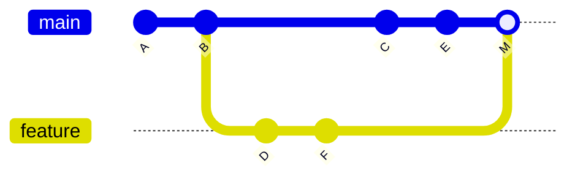
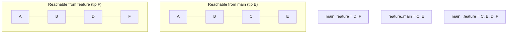
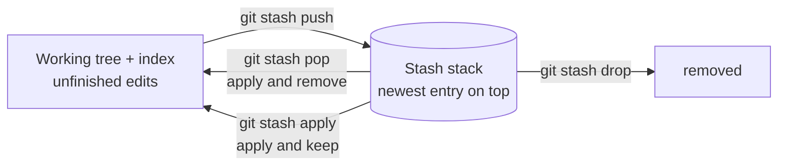
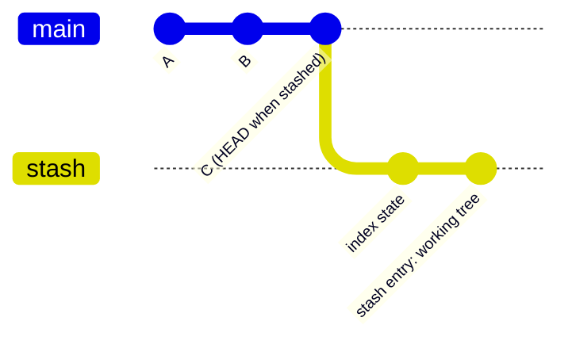

# Revision selection, interactive staging, stash and clean

> **Before this lesson:** you should be comfortable with commits, branches, merges and the three areas ([Getting a repository and recording changes](#/lesson/git/recording-changes), [What a branch really is](#/lesson/git/branches-in-a-nutshell), [Merging and resolving conflicts](#/lesson/git/merging-and-conflicts)).

## In plain words

This lesson collects four tools that turn an adequate Git user into a precise one.

1. **Revision selection** is how you point at a commit. A beginner copies long ids. But you can also say "two commits before the tip of main", "where this branch was yesterday", or "everything on my branch that is not yet on main", in the same way that you can give a location as an exact address, as "two doors down from the bakery", or as "everything on this street except the corner shop".
2. **Interactive staging** lets you put *part* of a file into the next commit. Think of sorting a pile of post into separate envelopes, even when two letters arrived stapled together.
3. **Stash** is a drawer. When you are interrupted mid-task, you sweep your unfinished edits into the drawer, deal with the interruption on a clean desk, and take the edits back out afterwards.
4. **Clean** is the bin for stray files that Git is not tracking. It is the one tool here that destroys things, so it comes with a dry-run switch.

Why it matters for a job: these are the tools behind tidy, reviewable commits and calm context switches. "Stash your changes and pull" and "can you split that into two commits?" are everyday requests.

## Part 1: selecting revisions

A **revision** is Git's general word for "something that identifies a commit". Every command that takes a commit accepts any of the forms below.

The examples use this history (`main` checked out at M):



M is a merge commit: its **first parent** is E (the branch you were on when you merged) and its **second parent** is F (the branch you merged in).

### Form 1: ids and short ids

```bash
$ git show 1c002dd4b536e7479fe34593e72e6c6c1819e53b
$ git show 1c002dd
```

Git accepts any prefix of an id that is at least four characters long and unambiguous in your repository. `git log --abbrev-commit` chooses a safe short length for you. In very large repositories seven characters may not be unique; Git then prints an "ambiguous" error and lists the candidates.

### Form 2: names

A branch name, a tag name, or `HEAD` stands for the commit it points to. To see what a name resolves to:

```bash
$ git rev-parse main
8f3a91c0d2e47b5a6c9e1f0b7d4a2c8e5f6b3a19
$ git rev-parse --short HEAD
8f3a91c
```

`git rev-parse` translates any revision expression into a full id. It is the tool for checking that an expression means what you think. `@` alone is an abbreviation for `HEAD`.

### Form 3: ancestry, `~` and `^`

These suffixes walk from a commit to its ancestors.

- `X~n` means "go back n generations, always following the **first** parent". `X~` is `X~1`.
- `X^n` means "the n-th parent of X". `X^` is `X^1`. It matters only for merge commits, which have more than one parent.

For the history above, with `HEAD` at M:

| Expression | Commit | Reasoning |
|---|---|---|
| `HEAD~1` or `HEAD^` | E | first parent of M |
| `HEAD^2` | F | second parent of M |
| `HEAD~2` | C | first parent, twice: M → E → C |
| `HEAD^^` | C | same thing written with carets |
| `HEAD^2~1` | D | second parent F, then its first parent |
| `HEAD~3` | B | M → E → C → B |

The mistake to avoid: `HEAD~2` and `HEAD^2` are different. The first is "two steps back"; the second is "the other side of the merge".

```bash
$ git log --oneline -1 HEAD^2
3e5f7a1 F
$ git log --oneline -1 HEAD~2
9b0c4d2 C
```

On Windows `cmd.exe`, the caret is a special character: write `HEAD^^` to mean one caret, or put the expression in double quotes.

A resolver for these expressions, to experiment with:

```python-run
import re

parents = {"A": [], "B": ["A"], "C": ["B"], "E": ["C"], "D": ["B"], "F": ["D"], "M": ["E", "F"]}
refs = {"HEAD": "M", "main": "M", "feature": "F"}

def resolve(expr):
    name, suffix = re.fullmatch(r"([^~^]+)((?:[~^]\d*)*)", expr).groups()
    cur = refs.get(name, name)
    for op, num in re.findall(r"([~^])(\d*)", suffix):
        n = int(num) if num else 1
        if op == "~":
            for _ in range(n):
                cur = parents[cur][0]          # first parent, n times
        elif n > 0:
            cur = parents[cur][n - 1]          # n-th parent, once
    return cur

for e in ["HEAD", "HEAD~1", "HEAD^2", "HEAD~2", "HEAD^^", "HEAD^2~1", "HEAD~3", "feature~1"]:
    print(f"{e:10} -> {resolve(e)}")
```

### Form 4: the reflog, "where was this before?"

Git keeps a local diary, the **reflog**, of every position HEAD and each branch has had over the last few months.

```bash
$ git reflog -4
8f3a91c (HEAD -> main) HEAD@{0}: merge feature: Merge made by the 'ort' strategy.
7d2b6e0 HEAD@{1}: commit: E
9b0c4d2 HEAD@{2}: checkout: moving from feature to main
3e5f7a1 (feature) HEAD@{3}: commit: F
```

- `HEAD@{1}` means "where HEAD was one move ago". `main@{yesterday}` or `main@{2.weeks.ago}` asks by time.
- The reflog exists only in your repository. It is not pushed or cloned, and entries expire (90 days by default).

It is the basis of most rescue operations; the internals and rescue modules use it heavily.

### Form 5: ranges

Many commands accept a *set* of commits.

**Two dots, `A..B`:** commits reachable from B that are **not** reachable from A. Read it as "what B has that A lacks".

```bash
$ git log --oneline main..feature      # on feature, not yet on main
$ git log --oneline origin/main..HEAD  # what I am about to push
```

For branches before the merge above (`main` at E, `feature` at F): `main..feature` is D and F; `feature..main` is C and E.

**Exclusions with `^` or `--not`:** `A..B` is shorthand for `B ^A`. The long form allows more than two points: `git log feature hotfix ^main` shows commits on either branch that are not on `main`.

**Three dots, `A...B`:** commits reachable from **either** A or B but **not both** (the symmetric difference). With `--left-right`, each commit is marked with the side it belongs to:

```bash
$ git log --oneline --left-right main...feature
< 7d2b6e0 E
< 9b0c4d2 C
> 3e5f7a1 F
> 5a8c1f4 D
```

`<` marks commits only on the left name (`main`), `>` those only on the right (`feature`).



Note that `git diff` gives the dots a different meaning (see the lesson on maintaining): `git diff A...B` compares B with the merge base.

## Part 2: interactive staging

You edited `inventory.py` in two places: a bug fix near the top and an unrelated rename lower down. These should be two commits. `git add -p` (short for `--patch`) lets you stage one **hunk** (block of changed lines) at a time.

```bash
$ git add -p inventory.py
diff --git a/inventory.py b/inventory.py
index 3b1f0c2..8e4d7a9 100644
--- a/inventory.py
+++ b/inventory.py
@@ -10,6 +10,8 @@ def count(rows):
     total = 0
     for row in rows:
+        if row.quantity < 0:
+            raise ValueError("negative quantity")
         total += row.quantity
     return total
(1/2) Stage this hunk [y,n,q,a,d,j,J,g,/,s,e,?]? y
@@ -31,7 +33,7 @@ def report(rows):
-    t = count(rows)
+    total = count(rows)
     print(f"Total: {total}")
(2/2) Stage this hunk [y,n,q,a,d,K,g,/,e,?]? n
```

- Git shows the first hunk and waits. `y` stages it.
- It shows the second hunk. `n` leaves it unstaged.

The answers you will use:

| Key | Meaning |
|---|---|
| `y` / `n` | stage this hunk / do not stage it |
| `s` | split the hunk into smaller hunks (offered when unchanged lines separate the changes) |
| `e` | edit the hunk by hand, for changes on adjacent lines that `s` cannot separate |
| `a` / `d` | stage / skip this hunk and all remaining hunks in the file |
| `q` | quit; hunks already answered stay as decided |
| `?` | show help |

Check the result before committing:

```bash
$ git status --short
MM inventory.py
$ git diff --staged     # shows only the bug fix
$ git commit -m "Reject negative quantities"
$ git commit -a -m "Rename t to total in report"
```

`MM` confirms that the file is partly staged and partly not. The first commit takes the staged hunk; the second takes the rest.

The same `-p` switch works in the other directions:

- `git restore --staged -p` unstages chosen hunks.
- `git restore -p` discards chosen hunks from the working tree (permanent).
- `git stash -p` stashes chosen hunks.
- `git commit -p` stages interactively and then commits.

`git add -i` opens a menu-driven version with file-level commands (`update`, `revert`, `add untracked`, `patch`, `diff`). Most people use `-p` directly.

> [!TIP]
> A commit built with `git add -p` has never existed as a whole on your disk: the working tree still contains the unstaged remainder. Before pushing, verify that each commit works by itself. `git stash --keep-index` hides everything that is *not* staged, so you can run the tests against exactly what you are about to commit, then `git stash pop` to bring the rest back.

## Part 3: stash

### The situation

You are halfway through a change, the files are in a broken state, and someone needs an urgent fix on another branch. You do not want to commit half-done work, and Git will not let you switch branches if that would overwrite your edits.

```bash
$ git status --short
 M importer.py
M  inventory.py
```

One file has an unstaged edit, one a staged edit.

### Stash and restore

```bash
$ git stash push -m "wip: discount parsing"
Saved working directory and index state On main: wip: discount parsing

$ git status --short
$
```

- `git stash push` saves your staged and unstaged changes to tracked files and resets the working tree to the last commit.
- `-m` attaches a description. Without it the entry is labelled with the latest commit's subject, which is unhelpful when you have several.
- Status prints nothing: the desk is clear. Switch branch, fix, commit, come back.

```bash
$ git stash list
stash@{0}: On main: wip: discount parsing
stash@{1}: WIP on main: 7d2b6e0 E
```

The stash is a **stack**: the newest entry is `stash@{0}`, and older ones are pushed down.

```bash
$ git stash pop
On branch main
Changes not staged for commit:
        modified:   importer.py
        modified:   inventory.py

Dropped refs/stash@{0} (4c9d1e7a...)
```

- `git stash pop` reapplies the newest entry and, if that worked, removes it from the stack.
- Notice that `inventory.py` came back as *not staged*. By default, restoring does not re-stage. Use `git stash pop --index` to restore the staged state as well.

`git stash apply` reapplies without removing the entry; `git stash drop` removes an entry without applying it. Any of them takes an entry name: `git stash apply stash@{1}`.



### Looking inside

```bash
$ git stash show stash@{0}
 importer.py  | 4 +++-
 inventory.py | 2 ++
 2 files changed, 5 insertions(+), 1 deletion(-)
$ git stash show -p stash@{0}      # the full diff
```

### What gets stashed

| Kind of change | Default | With option |
|---|---|---|
| Modified tracked files | yes | |
| Staged changes | yes | kept in place with `--keep-index` |
| Untracked files | **no** | `-u` / `--include-untracked` |
| Ignored files | no | `-a` / `--all` |

Forgetting `-u` is the most common surprise: a new file you created stays behind in the working tree.

### When restoring conflicts

If the code changed underneath in the meantime, applying a stash can conflict, exactly like a merge:

```bash
$ git stash pop
Auto-merging importer.py
CONFLICT (content): Merge conflict in importer.py
The stash entry is kept in case you need it again.
```

Resolve the markers and `git add` the file. Because the pop did not complete cleanly, the entry is **kept**; once you are satisfied, remove it with `git stash drop`.

When a stash is old and the branch has moved a long way, sidestep the conflict by turning the stash into a branch:

```bash
$ git stash branch discount-parsing
Switched to a new branch 'discount-parsing'
Dropped refs/stash@{0} (4c9d1e7a...)
```

`git stash branch <name>` creates a branch at the commit where the stash was made, applies the stash there (which always fits), and drops it.

### What a stash really is

A stash entry is an ordinary commit (in fact a small group of commits) that is not on any branch. It records the working tree, with the index state and the original HEAD as parents.



This is why a stash can be shown with `git show`, applied on any branch, and recovered for a while even after `git stash drop` (the rescue module shows how).

A model of the stack behaviour:

```python-run
dirty = {"importer.py": "half-done parsing"}
stack = []                                   # index 0 is the newest entry

def push(msg):
    global dirty
    stack.insert(0, (msg, dirty)); dirty = {}

def pop(n=0):
    msg, saved = stack[n]
    clash = [p for p in saved if p in dirty]
    if clash:
        return f"conflict in {clash}; entry kept"
    dirty.update(saved); del stack[n]
    return f"applied and dropped '{msg}'"

push("wip: discount parsing")
dirty["README.md"] = "notes for hotfix"
push("wip: readme notes")
print([f"stash@{{{i}}}: {m}" for i, (m, _) in enumerate(stack)])
dirty["importer.py"] = "urgent fix touched the same file"
print(pop(1))            # overlaps with current edits
print(pop(0))            # different file: fine
print("dirty now:", dirty, "| entries left:", len(stack))
```

## Part 4: clean

`git clean` deletes **untracked** files from the working tree: build output, editor backups, files left by a failed merge.

> [!WARNING]
> `git clean` permanently deletes files that Git has never stored. There is no undo and the reflog cannot help. Always run it first with `-n` (dry run), read the list, and only then run it for real. If in doubt, `git stash --include-untracked` puts the same files in the stash instead of destroying them.

```bash
$ git clean -n -d
Would remove build/
Would remove notes.tmp

$ git clean -f -d
Removing build/
Removing notes.tmp
```

- `-n` (or `--dry-run`) prints what would be removed and removes nothing.
- `-d` includes untracked directories.
- `-f` ("force") is required to delete anything, as a safety catch.

By default, files matched by `.gitignore` are left alone. Two switches change that:

| Command | Removes |
|---|---|
| `git clean -fd` | untracked files and directories, not ignored ones |
| `git clean -fdx` | untracked **and** ignored files: a pristine tree, as after a fresh clone |
| `git clean -fdX` | **only** ignored files (build products), keeping your new untracked files |

`git clean -i` asks interactively, file by file.

One more trap: an untracked directory that is itself a Git repository (it contains its own `.git`) is skipped even with `-fd`. A second `-f` (`git clean -ffd`) is needed to remove it, which should make you stop and check that you really want to.

## Pitfalls

- **`~2` versus `^2`.** Two generations back versus the second parent. Check with `git rev-parse`.
- **Reading `A..B` backwards.** It lists what is in B and not in A. Say it aloud as "from A up to B".
- **Expecting the reflog on another machine.** It is local and temporary.
- **Stashing and forgetting.** A stash list with fifteen unnamed entries is a graveyard. Use messages, and prefer a commit on a work-in-progress branch for anything that will wait longer than a day.
- **`git stash` without `-u`.** New files are not included.
- **`git stash pop` after a conflict.** The entry is not dropped; remove it yourself once resolved, or it will confuse you later.
- **`git clean -fdx` in a project with local configuration.** It deletes ignored files such as `.env` and installed dependencies. Dry-run first.
- **Partial staging without testing.** Commits made of selected hunks can be individually broken.

> [!INTERVIEW]
> **"What is the difference between `HEAD~2` and `HEAD^2`?"** `~n` follows first parents n times, so `HEAD~2` is the grandparent along the main line. `^n` selects the n-th parent of a single commit, so `HEAD^2` is the second parent of a merge commit, the tip of the branch that was merged in; on a non-merge commit it does not exist. **"What does `git stash` do, and what are its limits?"** It records the staged and unstaged changes to tracked files as a commit off to the side, stacks it under `stash@{0}`, and resets the working tree to HEAD. `pop` reapplies and drops it; `apply` keeps it. Limits: untracked files need `-u`; the staged state is restored only with `--index`; applying can conflict; and entries are local. **"`A..B` versus `A...B`?"** Two dots: reachable from B and not from A. Three dots: reachable from exactly one of them.

## Cheat sheet

| Task | Command |
|---|---|
| Resolve any expression to an id | `git rev-parse <expr>` |
| Parent / grandparent (first-parent line) | `HEAD~1`, `HEAD~2` |
| Second parent of a merge | `HEAD^2` |
| Where a branch pointed before | `main@{1}`, `main@{yesterday}` |
| Commits in B but not A | `git log A..B` |
| Commits in exactly one of A, B | `git log --left-right A...B` |
| Stage chosen hunks | `git add -p` |
| Unstage chosen hunks | `git restore --staged -p` |
| Shelve work in progress | `git stash push -m "msg"` (add `-u` for new files) |
| List / inspect stashes | `git stash list` / `git stash show -p stash@{0}` |
| Restore and remove / restore and keep | `git stash pop` / `git stash apply` |
| Restore including the staged state | `git stash pop --index` |
| Turn a stash into a branch | `git stash branch <name>` |
| Preview deletion of untracked files | `git clean -n -d` |
| Delete untracked files and directories | `git clean -f -d` |
| Delete only ignored files | `git clean -f -d -X` |

## Summary

A revision can be an id or its prefix, a branch or tag name, a relative expression (`~n` for first-parent generations, `^n` for a chosen parent), or a reflog position. Ranges select sets: `A..B` is what B has that A lacks, and `A...B` is what exactly one side has. `git add -p` stages individual hunks so that each commit holds one logical change. `git stash` shelves tracked changes on a local stack and resets the working tree; `pop`, `apply`, `drop` and `branch` manage the entries, with `-u` and `--index` covering untracked files and staged state. `git clean` deletes untracked files for good, so it is always preceded by a dry run.

## Glossary

- **Revision:** any expression that names a commit.
- **Short id:** an unambiguous prefix of a full commit id.
- **`git rev-parse`:** translates a revision expression into a full id.
- **First parent / second parent:** for a merge commit, the branch you were on / the branch merged in.
- **`~n`:** n generations back along first parents. **`^n`:** the n-th parent.
- **Reflog:** a local, temporary log of where HEAD and branches have pointed.
- **Range:** an expression selecting a set of commits.
- **Double dot (`A..B`):** commits reachable from B and not from A.
- **Triple dot (`A...B`):** commits reachable from one of A, B but not both.
- **Hunk:** one block of neighbouring changes in a diff.
- **Interactive (patch) staging:** choosing hunks one at a time with `git add -p`.
- **Stash:** a stack of shelved uncommitted changes.
- **Pop / apply / drop:** reapply and remove / reapply and keep / remove without applying.
- **Dry run:** a mode in which a command reports what it would do without doing it.
- **`git clean`:** deletes untracked files from the working tree.

## Check yourself

```quiz
[
  {"q": "HEAD is a merge commit whose first parent is E and second parent is F. What is HEAD^2?", "options": ["The commit two steps before E", "F", "E", "The grandparent along the main line"], "answer": 1, "explain": "^n picks the n-th parent of that one commit. ~2 would walk two first-parent steps instead."},
  {"q": "What does `git log main..feature` list?", "options": ["Commits on both branches", "Commits on main not on feature", "All commits between the two dates", "Commits reachable from feature but not from main"], "answer": 3, "explain": "A..B means reachable from B excluding what is reachable from A: the work on feature that main lacks."},
  {"q": "Which statement about the reflog is true?", "options": ["It is local to your repository and its entries expire", "It is shared by all clones", "It is pushed with the branch", "It lists every commit in the project"], "answer": 0, "explain": "The reflog records movements of references in one repository only and is pruned after a period (90 days by default for reachable entries)."},
  {"q": "During `git add -p`, a hunk contains two unrelated changes separated by unchanged lines. Which key helps?", "options": ["q", "a", "s", "d"], "answer": 2, "explain": "s splits the hunk at the unchanged lines so each part can be staged or skipped separately. For adjacent lines, e (manual edit) is needed."},
  {"q": "You run `git stash` and a newly created file is still in the working tree. Why?", "options": ["Stash ignores Python files", "Untracked files are not stashed unless you pass -u", "The stash failed", "The file is too large"], "answer": 1, "explain": "By default only changes to tracked files are stashed. --include-untracked adds new files."},
  {"q": "What is the difference between `git stash pop` and `git stash apply`?", "options": ["pop works on any branch; apply does not", "apply restores staged state; pop does not", "There is none", "pop removes the entry after applying it successfully; apply keeps it"], "answer": 3, "explain": "Both reapply the changes. pop additionally drops the entry, unless a conflict occurred, in which case the entry is kept."},
  {"q": "What should you run before `git clean -fd`?", "options": ["git gc", "git push", "git stash drop", "git clean -n -d to preview what will be deleted"], "answer": 3, "explain": "Clean deletes files Git never stored, so there is no recovery. The dry run lists the victims first."},
  {"q": "Which command deletes only files matched by .gitignore, keeping new untracked source files?", "options": ["git clean -fdx", "git clean -n", "git clean -fd", "git clean -fdX"], "answer": 3, "explain": "Capital X restricts removal to ignored files. Lowercase x removes ignored and untracked files alike."}
]
```

> **Source:** Chacon & Straub, Pro Git 2e, ch. 7 (Revision Selection; Interactive Staging; Stashing and Cleaning). Explanations, examples and code written for this guide.
