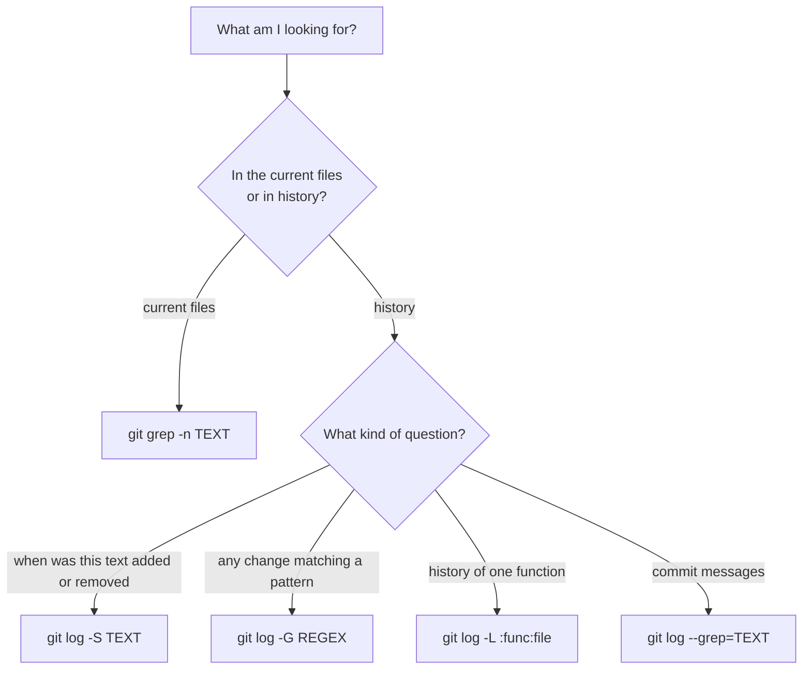
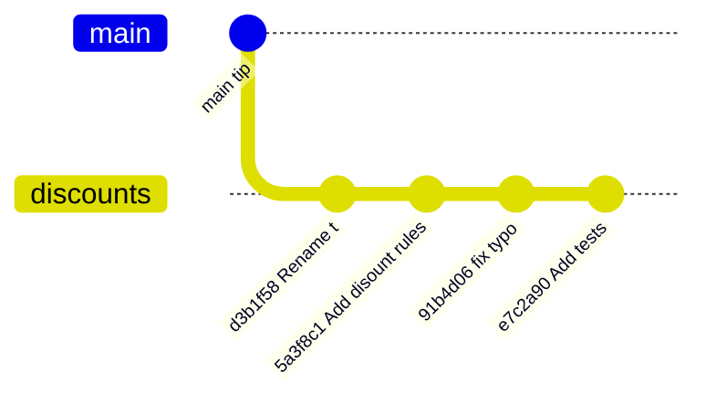
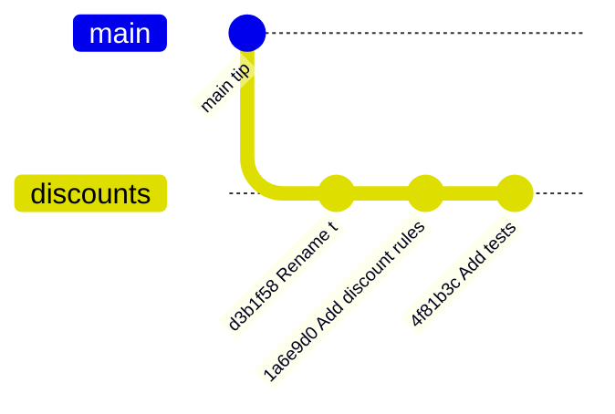
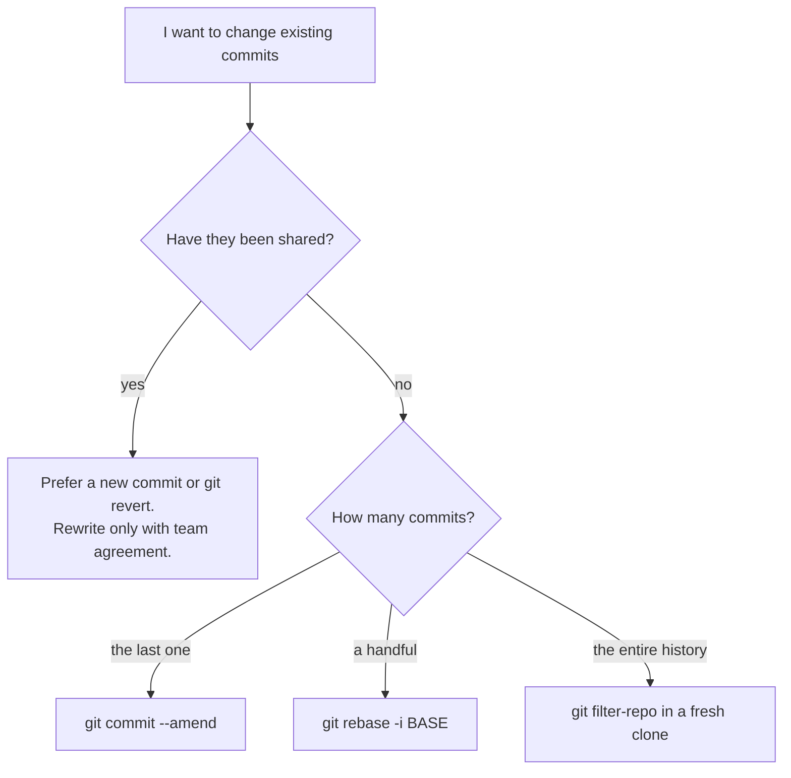

# Signing, searching and rewriting history

> **Before this lesson:** you need commits, tags and amend ([Undoing things safely](#/lesson/git/undoing-things), [Remotes, tags and aliases](#/lesson/git/remotes-tags-aliases)), the golden rule of rebasing ([Rebasing and its golden rule](#/lesson/git/rebasing)), and key pairs ([SSH keys, access control and hosting options](#/lesson/git/ssh-keys-and-hosting)).

## In plain words

Three separate skills live in this lesson.

**Signing** is a wax seal on a letter. Anyone can write "from the Queen" at the top of a page, and anyone can type any name into Git's author field. A seal made with a ring only the Queen owns is different: it proves the letter came from her and has not been altered. A **signed commit** or **signed tag** carries such a seal, made with your private key.

**Searching** is the index at the back of a book, plus a time machine. You can ask "where in the code does this word appear?" and also "in which commit did this word first appear, or disappear?".

**Rewriting history** is editing a draft before you hand it in. While commits are still only on your machine, you can reword them, reorder them, merge several into one, split one into several, or remove one. What reaches your colleagues is the clean final version, not the trail of false starts.

Why it matters for a job: reviewers appreciate a branch that tells a clear story in a few well-shaped commits, and interactive rebase is how that is produced. Searching history is how you answer "when did this break and why?". Signing is required by a growing number of companies and open-source projects as a defence against forged commits.

## Part 1: signing your work

### Why a name is not proof

```bash
$ git -c user.name="Linus Torvalds" -c user.email="torvalds@example.org" commit --allow-empty -m "Totally legitimate"
[main 6e0b2f4] Totally legitimate
 Author: Linus Torvalds <torvalds@example.org>
```

- `-c key=value` sets a configuration value for this one command.
- `--allow-empty` permits a commit with no changes, used here to make the point.
- Git accepted a false author without complaint. The author field is a label and nothing more.

A **digital signature** closes this gap. It is a value computed from the commit's content and your private key. Anyone holding your public key can verify two things: that the signature was made by the holder of the private key, and that the content has not changed since.

### Setting up, the short way: sign with your SSH key

Since Git 2.34 you can sign with the SSH key you already use for pushing.

```bash
$ git config --global gpg.format ssh
$ git config --global user.signingkey ~/.ssh/id_ed25519.pub
```

- `gpg.format ssh` tells Git to use SSH keys for signatures. (The setting's name is historical; signing was originally done only with a tool called GPG.)
- `user.signingkey` names the key to sign with.

The traditional way uses **GPG** (GNU Privacy Guard), a separate encryption program. You create a key with `gpg --full-generate-key`, find its id with `gpg --list-secret-keys --keyid-format=long`, and set `git config --global user.signingkey <KEYID>`. The Git commands below are the same for both kinds of key.

### Signing commits and tags

```bash
$ git commit -S -m "Reject negative quantities"
[main 2b8d6a3] Reject negative quantities
 1 file changed, 2 insertions(+)

$ git tag -s v1.1.0 -m "Release 1.1.0"
```

- `-S` (capital) signs the commit.
- `-s` (lowercase, on `git tag`) creates a signed annotated tag.

To sign everything without typing the switch each time:

```bash
$ git config --global commit.gpgsign true
$ git config --global tag.gpgsign true
```

### Verifying

```bash
$ git log --show-signature -1
commit 2b8d6a3f...
Good "git" signature for mira@home.example with ED25519 key SHA256:pV3n0cX7m1Qy8rTz2LkJ5uA9bE4dF6gH0iW3sYx1ZcM
Author: Mira Okafor <mira@home.example>
Date:   Fri Nov 20 14:10:31 2026 +0100

    Reject negative quantities

$ git tag -v v1.1.0
$ git verify-commit 2b8d6a3
```

- `--show-signature` prints the verification result above each commit.
- `git tag -v <tag>` and `git verify-commit <id>` verify one object.

For SSH signatures, Git needs a list of which keys you trust for which identities, called the **allowed signers file**. Without it, verification reports that it cannot check:

```bash
$ echo "mira@home.example $(cat ~/.ssh/id_ed25519.pub)" >> ~/.config/git/allowed_signers
$ git config --global gpg.ssh.allowedSignersFile ~/.config/git/allowed_signers
```

Each line of that file pairs an email with a public key. Hosting sites do the equivalent on their side: upload your public key as a *signing key* in your account settings, and your signed commits are shown with a "Verified" badge.

`git log --pretty="format:%h %G? %an %s"` prints a one-letter signature status per commit: `G` good, `B` bad, `U` good but of unknown trust, `N` none.

The principle in runnable form. Real signatures use public-key mathematics, where verifying needs only the public key; this model uses a shared secret (an HMAC) to show the two properties that matter: only the key holder can produce the seal, and any change to the content breaks it.

```python-run
import hashlib, hmac

def sign(content, key):
    return hmac.new(key, content.encode(), hashlib.sha256).hexdigest()[:16]

def verify(content, signature, key):
    return hmac.compare_digest(sign(content, key), signature)

mira_key = b"only-mira-has-this"
commit = "author Mira Okafor\n\nReject negative quantities"

seal = sign(commit, mira_key)
print("signature               :", seal)
print("untouched commit        :", verify(commit, seal, mira_key))
print("message altered         :", verify(commit.replace("Reject", "Allow"), seal, mira_key))
print("forged with another key :", verify(commit, sign(commit, b"attacker"), mira_key))
```

> [!TIP]
> Signing protects against impersonation only if somebody checks. Policies such as `git merge --verify-signatures`, or a protected-branch rule "Require signed commits", are what give signatures teeth. Before enabling such a rule, make sure every contributor has a working key, or nobody will be able to merge.

## Part 2: searching

### Searching the files: `git grep`

`git grep` searches the tracked files of your working tree (or of any commit) for text or a pattern. It is fast and skips ignored and untracked files.

```bash
$ git grep -n "read_stock"
importer.py:5:def read_stock(path):
inventory.py:3:from importer import read_stock
inventory.py:18:    rows = read_stock(args.path)
```

- `-n` prints line numbers. Each result is `file:line:content`.

Useful switches:

```bash
$ git grep -c "read_stock"                 # count of matches per file
importer.py:1
inventory.py:2

$ git grep -p "quantity" -- "*.py"         # show the enclosing function of each match
$ git grep -e "import" --and -e "csv"      # lines matching both
$ git grep -n "read_stock" v1.0.0          # search the tree of an old tag
```

- `-p` adds the line of the function each match sits in.
- `-- "*.py"` limits the search to paths matching the pattern.
- Naming a commit or tag searches that snapshot without checking it out.

### Searching the history

`git grep` answers "where is it now?". The log answers "when did it change?".

**The pickaxe, `-S`:** commits that changed the number of occurrences of a string, meaning commits that added or removed it.

```bash
$ git log -S "MAX_ROWS" --oneline
c9a4e02 Speed up CSV import
4c1e7a2 Add README
```

**`-G` with a pattern:** commits whose diff has an added or removed line matching a **regular expression** (a pattern language for text).

```bash
$ git log -G "MAX_ROWS\s*=\s*\d+" --oneline
```

The difference: if a commit moves a line containing `MAX_ROWS` without changing how many times it occurs, `-S` does not report it but `-G` does.

**The line log, `-L`:** the history of one function or one range of lines.

```bash
$ git log -L :read_stock:importer.py --oneline
c9a4e02 Speed up CSV import

diff --git a/importer.py b/importer.py
--- a/importer.py
+++ b/importer.py
@@ -5,6 +5,7 @@ def read_stock(path):
...
1a6e9d0 Read stock from CSV
...
```

- `-L :<function>:<file>` asks Git to find that function's boundaries and show every commit that touched lines inside it, with the relevant part of each diff.
- `-L 10,25:importer.py` does the same for lines 10 to 25.



## Part 3: rewriting history

> [!WARNING]
> Every command in this part replaces commits with new ones that have different ids. That is safe for commits that exist **only in your repository**. If the commits have been pushed and others may have fetched them, rewriting forces everyone to repair their copies (the golden rule from the rebasing lesson). Before starting, create a safety name: `git branch backup-before-rewrite`.

### The smallest rewrite: amend

`git commit --amend` replaces the most recent commit (see the lesson on undoing). Everything below extends that idea to older commits.

### Interactive rebase

`git rebase -i <base>` lists the commits after `<base>` in your editor and lets you say what to do with each before replaying them.

Our branch has four commits on top of `main`:

```bash
$ git log --oneline main..HEAD
e7c2a90 Add discount tests
91b4d06 fix typo
5a3f8c1 Add disount rules
d3b1f58 Rename t to total
```



Problems: the second commit's message has a spelling mistake, and "fix typo" should have been part of the commit it repairs.

```bash
$ git rebase -i main
```

The editor opens with a **todo list**. Note the order: **oldest at the top**, the reverse of `git log`.

```
pick d3b1f58 Rename t to total
pick 5a3f8c1 Add disount rules
pick 91b4d06 fix typo
pick e7c2a90 Add discount tests

# Commands:
# p, pick = use commit
# r, reword = use commit, but edit the commit message
# e, edit = use commit, but stop for amending
# s, squash = use commit, but meld into previous commit
# f, fixup = like "squash" but keep only the previous commit's log message
# d, drop = remove commit
```

Each line is an instruction: an action, a commit id and the subject (shown for your orientation only). Git will carry out the lines from top to bottom. You edit the action words, save and close.

| Action | Effect |
|---|---|
| `pick` | replay the commit unchanged |
| `reword` | replay it, then stop to let you edit the message |
| `edit` | replay it, then pause so you can amend or split it |
| `squash` | combine it into the commit above, and let you edit the combined message |
| `fixup` | combine it into the commit above, discarding its own message |
| `drop` (or deleting the line) | leave the commit out |
| moving a line | changes the order of commits |

Change the list to:

```
pick d3b1f58 Rename t to total
reword 5a3f8c1 Add disount rules
fixup 91b4d06 fix typo
pick e7c2a90 Add discount tests
```

Save and close. Git replays the first commit, stops at the second to open the editor for the new message ("Add discount rules"), folds the third into it, and replays the fourth.

```bash
Successfully rebased and updated refs/heads/discounts.

$ git log --oneline main..HEAD
4f81b3c Add discount tests
1a6e9d0 Add discount rules
d3b1f58 Rename t to total
```



Four commits became three. `d3b1f58` kept its id because nothing about it or before it changed; every commit from the first altered one onwards has a new id.

A model of how the todo list is executed:

```python-run
commits = {"d3b1f58": "Rename t to total", "5a3f8c1": "Add disount rules",
           "91b4d06": "fix typo", "e7c2a90": "Add discount tests"}

todo = [("pick", "d3b1f58"),
        ("reword", "5a3f8c1", "Add discount rules"),
        ("fixup", "91b4d06"),
        ("pick", "e7c2a90")]

result = []                                   # list of [original ids, message]
for step in todo:
    action, cid = step[0], step[1]
    if action == "pick":
        result.append([[cid], commits[cid]])
    elif action == "reword":
        result.append([[cid], step[2]])
    elif action == "squash":
        result[-1][0].append(cid); result[-1][1] += "\n\n" + commits[cid]
    elif action == "fixup":
        result[-1][0].append(cid)             # message of the folded commit is thrown away
    # "drop": do nothing

for ids, message in result:
    print(f"{'+'.join(ids):18} {message!r}")
```

### Fixups without hand-editing: autosquash

When you notice a mistake in an older commit, record the repair as a specially marked commit and let Git place it:

```bash
$ git commit --fixup=5a3f8c1
[discounts 0c7d2e9] fixup! Add disount rules

$ git rebase -i --autosquash main
```

- `--fixup=<commit>` creates a commit whose subject is `fixup!` followed by the target's subject.
- `--autosquash` arranges the todo list so that each `fixup!` commit sits directly under its target with the action already set to `fixup`. You save and close.

### Splitting a commit

Mark the commit `edit` in the todo list. When the rebase pauses there:

```bash
Stopped at 5a3f8c1...  Add discount rules
$ git reset HEAD^
Unstaged changes after reset:
M       discounts.py
M       prices.csv
$ git add prices.csv
$ git commit -m "Add discount column to price list"
$ git add discounts.py
$ git commit -m "Add discount rules"
$ git rebase --continue
```

- `git reset HEAD^` undoes the commit you are stopped on while keeping its changes in the working tree, unstaged.
- You then make as many separate commits as you want from those changes.
- `git rebase --continue` replays the rest.

### When a rewrite goes wrong

- During the rebase: `git rebase --abort` returns to the starting state.
- After it has finished: `git reset --hard ORIG_HEAD`, or find the old tip in `git reflog` and reset to it, or reset to the backup branch you created.

### Rewriting many commits at once

Sometimes a change must be applied to the **whole** history: a large file or a password that should never have been committed, or an author email that was wrong from the start. Interactive rebase is the wrong tool for hundreds of commits.

Git has an old built-in command for this, `git filter-branch`. It is slow and has many traps, and Git's own documentation recommends a separate tool, **`git filter-repo`**, in its place.

```bash
# Remove a file from every commit in history
$ git filter-repo --invert-paths --path secrets.env

# Keep only one subdirectory and make it the new project root
$ git filter-repo --subdirectory-filter services/billing

# Correct names and emails according to a mapping file
$ git filter-repo --mailmap corrections.mailmap
```

- `--path <file> --invert-paths` keeps everything *except* that path.
- `--subdirectory-filter <dir>` produces a history containing only that directory's contents.
- `--mailmap <file>` rewrites author and committer identities using lines of the form `Correct Name <correct@email> <old@email>`.

`git filter-repo` is installed separately (for example `pip install git-filter-repo`) and by default insists on running in a fresh clone, so that an untouched copy still exists.

> [!WARNING]
> Whole-history rewriting changes the id of every affected commit and every commit after it. All collaborators must discard their old clones and clone again, open pull requests are invalidated, and the rewritten history must be force-pushed. If the reason is a leaked password or key, the rewrite does **not** make it safe: copies exist in other clones, caches and forks. Revoke and replace the secret first; clean the history second. The rescue module walks through the full procedure.



## Pitfalls

- **Signing with a key the verifier does not know.** The commit shows as unverified. Upload the public key to the hosting site as a signing key, or add it to the allowed signers file.
- **Assuming an unsigned-looking author is genuine.** Without a verified signature, author information is unproven.
- **`-S` versus `-G`.** `-S` counts occurrences of a literal string; `-G` matches changed lines against a pattern.
- **Reading the todo list upside down.** Oldest commit is at the top. `squash` and `fixup` fold into the line *above*.
- **Squashing the first line.** The first commit in the list has nothing above it to fold into; Git reports an error.
- **Rebasing across merge commits.** By default, interactive rebase flattens merges. Pass `--rebase-merges` to keep them.
- **Rewriting pushed commits out of tidiness.** Tidy before you push, not after.
- **Trusting a history rewrite to remove a secret.** Rotate the secret regardless.

> [!INTERVIEW]
> **"How would you clean up a messy feature branch before opening a pull request?"** With `git rebase -i` against the branch's base: reorder so related commits sit together, `fixup` or `squash` the small corrections into the commits they correct, `reword` unclear messages, and `edit` to split a commit that mixes concerns; or commit repairs with `--fixup` as you go and finish with `git rebase -i --autosquash`. State the constraint: this rewrites commit ids, so it is done before sharing, or, on a branch that is yours alone, followed by `git push --force-with-lease`. **"How do you find the commit that removed a function?"** `git log -S "function_name" -- path` lists commits that changed its number of occurrences; the newest result is the removal. `git log -L :function_name:file` shows its full history. **"Does a commit's author field prove who wrote it?"** No; only a verified signature does.

## Cheat sheet

| Task | Command |
|---|---|
| Use an SSH key for signing | `git config --global gpg.format ssh` and `git config --global user.signingkey <pubkey-file>` |
| Sign a commit / a tag | `git commit -S` / `git tag -s <name>` |
| Sign by default | `git config --global commit.gpgsign true` |
| Verify | `git log --show-signature`, `git verify-commit <id>`, `git tag -v <tag>` |
| Search tracked files | `git grep -n "text"` |
| Search an old snapshot | `git grep "text" <commit>` |
| Commits adding or removing a string | `git log -S "text"` |
| Commits whose diff matches a pattern | `git log -G "regex"` |
| History of one function | `git log -L :<func>:<file>` |
| Edit recent commits | `git rebase -i <base>` |
| Record a repair for an older commit | `git commit --fixup=<id>` |
| Apply recorded repairs | `git rebase -i --autosquash <base>` |
| Undo a finished rebase | `git reset --hard ORIG_HEAD` |
| Remove a path from all history | `git filter-repo --invert-paths --path <file>` |

## Summary

The author field of a commit is an unverified label; a signature made with your private key and checked against your public key proves origin and integrity, and Git can sign commits and tags with SSH or GPG keys. `git grep` searches tracked files in the working tree or in any commit, while `git log -S`, `-G` and `-L` search history for the commits that added, removed or changed specific content. Local history can be reshaped: `--amend` for the last commit, interactive rebase to reword, reorder, squash, split or drop a series (with `--fixup` and `--autosquash` to automate repairs), and `git filter-repo` for changes across the entire history. All rewriting creates new commits, so it belongs before sharing, and it never substitutes for revoking a leaked secret.

## Glossary

- **Digital signature:** a value made with a private key that proves who produced some content and that it is unaltered.
- **GPG (GNU Privacy Guard):** an encryption and signing program traditionally used for Git signatures.
- **Signed commit / signed tag:** a commit or annotated tag carrying a signature.
- **Allowed signers file:** a list pairing identities with trusted SSH public keys, used to verify SSH signatures.
- **Verified:** the label hosting sites show when a signature matches a key registered to the account.
- **`git grep`:** searches the content of tracked files.
- **Regular expression (regex):** a pattern language for matching text.
- **Pickaxe (`-S`):** log search for commits that change how often a string occurs.
- **Line log (`-L`):** log restricted to the history of a function or line range.
- **Interactive rebase:** a rebase in which you edit a todo list of actions per commit.
- **Todo list:** the list of `pick`, `reword`, `edit`, `squash`, `fixup`, `drop` lines that the rebase executes.
- **Squash / fixup:** fold a commit into the previous one, keeping / discarding its message.
- **Autosquash:** automatic placement of `fixup!` commits in the todo list.
- **`git filter-repo`:** the recommended tool for rewriting an entire history.
- **Rotate (a secret):** revoke a leaked credential and issue a new one.

## Check yourself

```quiz
[
  {"q": "What does a verified signature on a commit prove that the author field does not?", "options": ["That the commit is on the main branch", "That the commit was created by the holder of a specific private key and has not been altered", "That the commit was reviewed", "That the code has no bugs"], "answer": 1, "explain": "Anyone can type any name and email into Git. A signature can only be produced with the private key, and it fails to verify if the content changes."},
  {"q": "Which command finds the commits in which the number of occurrences of the string `MAX_ROWS` changed?", "options": ["git grep MAX_ROWS", "git log --grep=MAX_ROWS", "git log -S MAX_ROWS", "git blame MAX_ROWS"], "answer": 2, "explain": "-S (the pickaxe) reports commits that add or remove the string. git grep searches current files; --grep searches commit messages."},
  {"q": "In the todo list of `git rebase -i`, where is the oldest commit?", "options": ["In random order", "At the top", "At the bottom", "It is not listed"], "answer": 1, "explain": "The list is in the order the commits will be replayed, oldest first, the opposite of git log."},
  {"q": "What is the difference between `squash` and `fixup` in an interactive rebase?", "options": ["fixup works only on the last commit", "squash deletes the change; fixup keeps it", "There is none", "Both fold the commit into the one above; squash lets you combine the messages, fixup discards the folded commit's message"], "answer": 3, "explain": "The code changes are combined in both cases. They differ only in what happens to the message."},
  {"q": "You are paused on a commit marked `edit` and want to split it into two commits. What is the first command?", "options": ["git commit --amend", "git rebase --skip", "git revert HEAD", "git reset HEAD^"], "answer": 3, "explain": "Resetting to the parent removes the commit while leaving its changes in the working tree, so you can stage and commit them in separate pieces, then git rebase --continue."},
  {"q": "What does `git commit --fixup=abc1234` followed later by `git rebase -i --autosquash main` achieve?", "options": ["It reverts abc1234", "It signs abc1234", "It pushes abc1234", "It folds the repair commit into abc1234 automatically during the rebase"], "answer": 3, "explain": "The fixup! commit is moved under its target in the todo list with the fixup action preset."},
  {"q": "A password was committed three months ago and pushed. What must happen first?", "options": ["Run git filter-repo and force push", "Revoke and replace the password", "Add the file to .gitignore", "Delete the repository"], "answer": 1, "explain": "The secret has been copied to other clones and possibly caches, so removing it from history cannot make it secret again. Rotate it, then clean history if desired."},
  {"q": "Why should interactive rebase be used only on commits that have not been shared?", "options": ["It replaces commits with new ones, so anyone who has the originals ends up with conflicting history", "Shared commits are read-only on disk", "Hosting sites delete rebased branches", "It is slow on shared commits"], "answer": 0, "explain": "Every rewritten commit gets a new id. Collaborators still holding the old ones would reintroduce them or have to repair their branches."}
]
```

> **Source:** Chacon & Straub, Pro Git 2e, ch. 7 (Signing Your Work; Searching; Rewriting History). Explanations, examples and code written for this guide.
