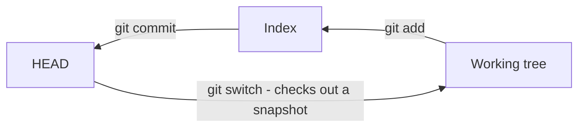
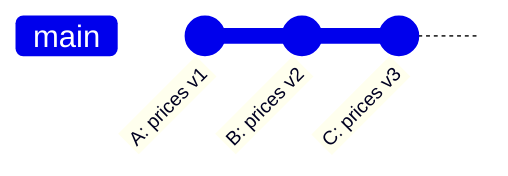
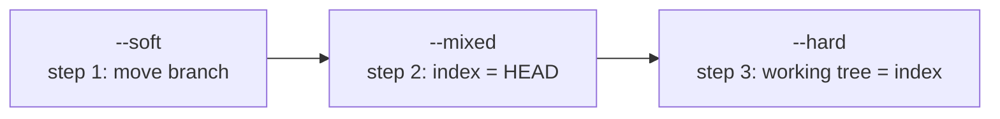
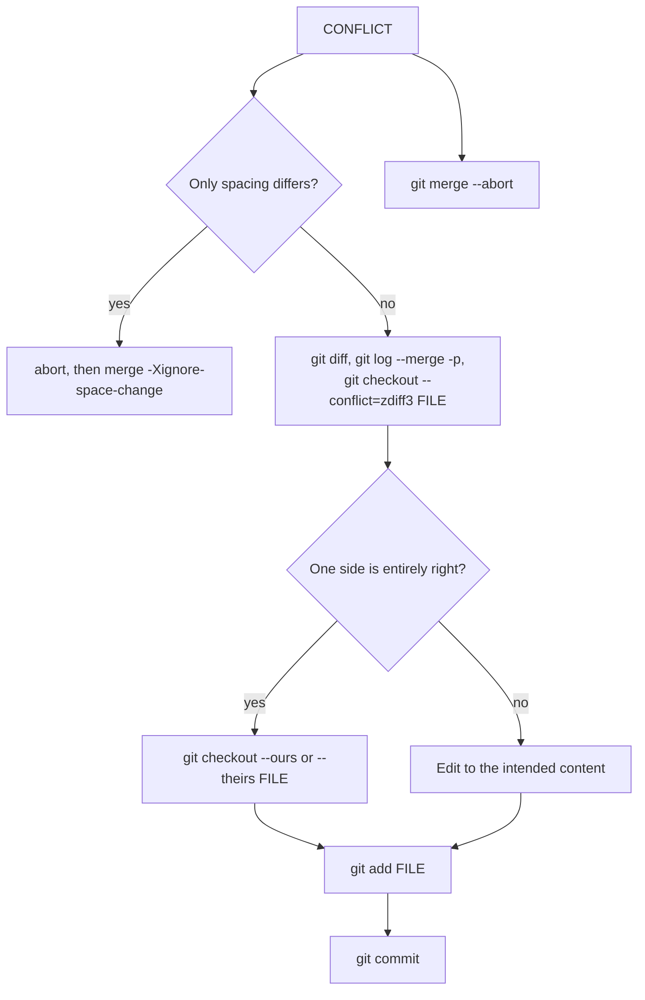
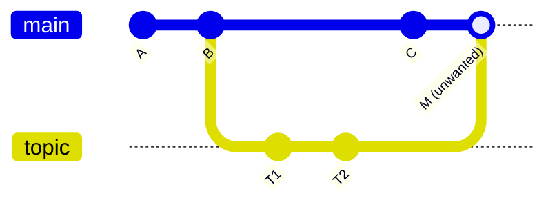
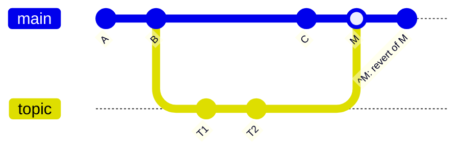

# Reset demystified, advanced merging and rerere

> **Before this lesson:** you need the three areas ([Version control and how Git thinks](#/lesson/git/version-control-ideas)), branches and HEAD ([What a branch really is](#/lesson/git/branches-in-a-nutshell)), merge conflicts ([Merging and resolving conflicts](#/lesson/git/merging-and-conflicts)) and the everyday undos ([Undoing things safely](#/lesson/git/undoing-things)).

## In plain words

`git reset` has a reputation as the command people are afraid of. The fear comes from treating it as magic. It is not: reset does at most three small things, always in the same order, and the option you give tells it after which one to stop.

Picture three trays on a desk. The left tray holds the last finished report (the last commit). The middle tray holds the draft of the next report (the staging area). The right tray is the paper you are writing on now (your files). Every Git command you know moves paper between these trays. `git commit` copies the middle tray to the left. `git add` copies the right to the middle. **Reset copies in the other direction**: from left to middle, and optionally from middle to right, after first choosing *which* finished report sits in the left tray.

The second half of the lesson returns to merging with better tools: how to inspect a conflict properly, how to back out, how to tell Git to prefer one side, how to undo a merge that has already been made, and how to have Git remember your conflict resolutions (**rerere**) so you never solve the same conflict twice.

Why it matters for a job: "explain soft, mixed and hard reset" is a standard interview question, and the first serious conflict on a long-lived branch is where many newcomers lose a colleague's work. Both become routine with the model below.

## Part 1: the three trees

Git manages three collections of files. The original documentation calls them "trees".

| Tree | What it is | Role |
|---|---|---|
| **HEAD** | the snapshot of the last commit on the current branch | what you last committed; parent of the next commit |
| **Index** | the staging area | the proposed next commit |
| **Working tree** | the files on disk | your sandbox |

You can look at the first two directly:

```bash
$ git ls-tree -r HEAD
100644 blob 8baef1b4abc478178b004d62031cf7fe6db6f903    README.md
100644 blob 0d1c8f3a55b0e6c1f4d8a2b7e9c0d1f2a3b4c5d6    prices.csv

$ git ls-files -s
100644 8baef1b4abc478178b004d62031cf7fe6db6f903 0       README.md
100644 0d1c8f3a55b0e6c1f4d8a2b7e9c0d1f2a3b4c5d6 0       prices.csv
```

- `git ls-tree -r HEAD` lists every file recorded in the last commit, with the id of its content.
- `git ls-files -s` lists every file in the index, with the id of the staged content.
- When the ids match, as here, the index and HEAD agree: nothing is staged.

The ordinary workflow moves content rightwards to leftwards:



`git status` is a report of two comparisons: HEAD against index ("changes to be committed") and index against working tree ("changes not staged").

## Part 2: what reset does

Start from this history, on `main`, with everything clean:



All three trees contain `prices.csv` version 3. We will run `git reset <mode> HEAD~1` (HEAD~1 is commit B) in each mode.

### Step 1: move the branch that HEAD points to (stop here with `--soft`)

Reset first moves the **current branch** to the target commit. Note the difference from `git switch`, which moves HEAD itself to another branch and leaves branches where they are.

```bash
$ git reset --soft HEAD~1
$ git log --oneline
7be2d90 (HEAD -> main) B: prices v2
4c1e7a2 A: prices v1
$ git status --short
M  prices.csv
```

- `main` now points at B. Commit C is no longer on the branch.
- The index and the working tree were not touched: both still hold version 3.
- So the index (v3) differs from HEAD (v2): status shows a staged modification. You are in exactly the state you were in a moment before you committed C.

This is what `git commit --amend` does internally: a soft reset to the parent followed by a new commit.

### Step 2: update the index (stop here with `--mixed`, the default)

Next, reset copies the snapshot HEAD now points to into the index.

```bash
$ git reset HEAD~1          # same as: git reset --mixed HEAD~1
Unstaged changes after reset:
M       prices.csv
$ git status --short
 M prices.csv
```

- Branch at B, index at v2, working tree still v3.
- The change is now an **unstaged** modification. You have undone both the commit and the `git add`.

### Step 3: update the working tree (only with `--hard`)

Finally, reset copies the index into the working tree.

```bash
$ git reset --hard HEAD~1
HEAD is now at 7be2d90 B: prices v2
$ git status --short
$
```

- All three trees hold v2. Version 3 is gone from your files.

> [!WARNING]
> `git reset --hard` is one of the few Git commands that destroys work. It overwrites tracked files in the working tree without asking. Uncommitted edits are lost for good, because they were never stored. (The *commit* C can still be recovered through `git reflog`; the unsaved edits on top of it cannot.) Before a hard reset, run `git status`, and if anything is listed that you might want, commit or stash it first.

| Mode | 1. Move branch | 2. Reset index | 3. Reset working tree | Safe for uncommitted work? |
|---|---|---|---|---|
| `--soft` | yes | no | no | yes |
| `--mixed` (default) | yes | yes | no | yes (files untouched) |
| `--hard` | yes | yes | yes | **no** |



A model of the three steps:

```python-run
commits = {"A": {"prices.csv": "v1"}, "B": {"prices.csv": "v2"}, "C": {"prices.csv": "v3"}}

def reset(state, mode, target):
    head, index, work = state
    head = target                                   # step 1: move the branch
    if mode in ("mixed", "hard"):
        index = dict(commits[target])               # step 2: index := snapshot
    if mode == "hard":
        untracked = {p: c for p, c in work.items() if p not in state[1] and p not in commits[target]}
        work = {**commits[target], **untracked}     # step 3: working tree := snapshot (+ untracked files)
    return head, index, work

start = ("C", {"prices.csv": "v3"}, {"prices.csv": "v3", "notes.txt": "untracked"})
for mode in ("soft", "mixed", "hard"):
    head, index, work = reset(start, mode, "B")
    print(f"--{mode:5} HEAD={head} index={index} worktree={work}")
```

The untracked `notes.txt` survives even the hard reset: Git only overwrites files it tracks.

### Reset with a path

If you name a file, reset skips step 1 (a branch cannot point at part of a commit) and applies step 2 to that file only.

```bash
$ git reset HEAD -- prices.csv        # copy prices.csv from HEAD into the index
```

That is "unstage this file": the exact opposite of `git add prices.csv`. The modern spelling is `git restore --staged prices.csv`. You can also copy a file from an older commit into the index: `git reset 4c1e7a2 -- prices.csv`.

### Squashing with reset

A quick way to turn the last three commits into one, without an interactive rebase:

```bash
$ git reset --soft HEAD~3
$ git commit -m "Add discount support"
```

The soft reset moves the branch back three commits while leaving the index holding the final state; the new commit records that state in one step.

### Reset versus checkout and switch

| Command | Moves HEAD to another branch | Moves the branch | Index | Working tree | Safe for local edits |
|---|---|---|---|---|---|
| `git reset --soft <c>` | no | yes | no | no | yes |
| `git reset <c>` | no | yes | yes | no | yes |
| `git reset --hard <c>` | no | yes | yes | yes | **no** |
| `git switch <branch>` | yes | no | yes | yes | yes (refuses if edits would be lost) |
| `git restore --staged <file>` | no | no | yes (that file) | no | yes |
| `git restore <file>` | no | no | no | yes (that file) | **no** |

## Part 3: advanced merging

### Before you merge

Start clean. `git status` should report nothing to commit; stash or commit otherwise. Then every way out described below works reliably.

### Looking at a conflict properly

Two branches changed the same function. One also reformatted the file's spacing.

```bash
$ git merge whitespace-cleanup
Auto-merging inventory.py
CONFLICT (content): Merge conflict in inventory.py
Automatic merge failed; fix conflicts and then commit the result.
```

**Option A: back out.** `git merge --abort` restores the pre-merge state.

**Option B: ignore whitespace.** If one side only changed spacing, almost every line "conflicts" for no real reason. Abort and retry while telling the merge to disregard such differences:

```bash
$ git merge --abort
$ git merge -Xignore-space-change whitespace-cleanup
Auto-merging inventory.py
Merge made by the 'ort' strategy.
```

`-X<option>` passes an option to the merge algorithm. `ignore-space-change` treats runs of spaces as equal; `ignore-all-space` ignores spacing entirely.

**Option C: see all three versions.** During a conflict the index holds three copies of the file, called **stages**: stage 1 is the common ancestor (base), stage 2 is ours, stage 3 is theirs.

```bash
$ git ls-files -u
100644 a1c3e5f7... 1       inventory.py
100644 b2d4f6a8... 2       inventory.py
100644 c3e5a7b9... 3       inventory.py

$ git show :1:inventory.py > inventory.base.py
$ git show :2:inventory.py > inventory.ours.py
$ git show :3:inventory.py > inventory.theirs.py
```

- `git ls-files -u` lists unmerged entries with their stage numbers.
- `git show :2:inventory.py` prints the stage-2 (ours) version; `>` saves it to a file.

**Option D: targeted diffs.**

```bash
$ git diff --ours        # what the merge result changes compared with our version
$ git diff --theirs      # ... compared with their version
$ git diff --base        # ... compared with the common ancestor
```

**Option E: richer markers.** Re-create the conflict markers for one file including the base version:

```bash
$ git checkout --conflict=zdiff3 inventory.py
$ cat inventory.py
<<<<<<< ours
    total = sum(r.quantity for r in rows if r.quantity > 0)
||||||| base
    total = sum(r.quantity for r in rows)
=======
    total = sum(max(r.quantity, 0) for r in rows)
>>>>>>> theirs
```

The middle section shows what the line was before either side changed it. Here both sides were trying to ignore negative quantities, in different ways, and you can now pick one deliberately. Set `merge.conflictStyle zdiff3` globally to always get this form. The same command with `--conflict=merge` also restores the markers if you made a mess of an edit and want to start that file again.

**Option F: take one whole side of a file.** `git checkout --ours inventory.py` or `git checkout --theirs inventory.py`, then `git add`.

**Option G: which commits collide?**

```bash
$ git log --oneline --left-right --merge
< 2b8d6a3 Ignore negative quantities in total
> 9e4c7b1 Clamp negative quantities to zero
```

`--merge` limits the log to commits from either side that touch a currently conflicted file. `<` is ours, `>` theirs. Reading both messages (and `-p` for their diffs) usually tells you what each author intended.



### Preferring a side automatically

For conflicting hunks only, tell Git which side wins:

```bash
$ git merge -Xours feature        # on a conflict, keep our version of that hunk
$ git merge -Xtheirs feature      # on a conflict, take their version of that hunk
```

Everything that merges without conflict is still combined from both sides. Do not confuse this with the *strategy* `-s ours`:

```bash
$ git merge -s ours old-experiment
```

`-s ours` records a merge commit whose content is exactly our side; the other branch's changes are discarded completely. It is used to mark a branch as merged without taking anything from it.

### Undoing a merge

Suppose the merge is done and turns out to be a mistake.



**Case 1: the merge is only local.** Move the branch back:

```bash
$ git reset --hard HEAD~1
HEAD is now at 9b0c4d2 C
```

`HEAD~1` of a merge commit is its first parent, the commit you were on before merging. The merge commit is then no longer on the branch. Because this rewrites history, it is for unshared merges only.

**Case 2: the merge has been pushed.** Add a commit that reverses it:

```bash
$ git revert -m 1 HEAD
[main 5f2e8a7] Revert "Merge branch 'topic'"
```

- A merge has two parents, so Git must be told which side is the "mainline" to return to. `-m 1` means "keep parent 1 (our previous `main`) and undo what parent 2 brought in".
- History grows by one commit `^M`, whose content equals C.



There is a famous trap here. The commits T1 and T2 are still **reachable** from `main` through M, so Git considers `topic` already merged. If you later fix the problem on `topic` and merge it again, Git brings in only the commits made after T2; the reverted changes of T1 and T2 do not come back. The remedy is to **revert the revert** first, which restores those changes, and then merge the new work:

```bash
$ git revert 5f2e8a7           # brings T1 and T2's changes back
$ git merge topic              # adds the new fixes on top
```

### Subtree merging, briefly

Sometimes one project should live in a sub-folder of another (a library vendored into `vendor/lib`). The **subtree** strategy lets you merge another project's history into a sub-folder and keep pulling its updates: `git read-tree --prefix=vendor/lib/ -u lib_branch` places it, and later `git merge -Xsubtree=vendor/lib lib_branch` updates it. It is an alternative to submodules (next lesson) with the files stored directly in your repository.

## Part 4: rerere

**Rerere** stands for "reuse recorded resolution". With it switched on, Git saves how you resolved each conflict. When the same conflict appears again, Git applies your earlier resolution automatically.

When does the same conflict recur? When you rebase a long branch repeatedly, when you merge a topic to test it, undo the merge and merge again later, or when a maintainer merges many topics into a throwaway integration branch that is rebuilt every day.

```bash
$ git config --global rerere.enabled true
```

First encounter:

```bash
$ git merge clamp-negatives
Auto-merging inventory.py
CONFLICT (content): Merge conflict in inventory.py
Recorded preimage for 'inventory.py'
Automatic merge failed; fix conflicts and then commit the result.
```

`Recorded preimage` means Git stored the conflicted state. Resolve as usual:

```bash
$ git add inventory.py
$ git commit
Recorded resolution for 'inventory.py'.
[main 8c1d4e6] Merge branch 'clamp-negatives'
```

Now undo that merge and redo the integration as a rebase, which hits the same conflict:

```bash
$ git reset --hard HEAD~1
$ git switch clamp-negatives
$ git rebase main
Auto-merging inventory.py
CONFLICT (content): Merge conflict in inventory.py
Resolved 'inventory.py' using previous resolution.
```

`Resolved ... using previous resolution`: the file already contains your earlier answer, with no markers. Git still stops, so that you can check it:

```bash
$ git diff                    # review what rerere applied
$ git add inventory.py
$ git rebase --continue
```

Helper commands: `git rerere status` lists files with recorded pre-images in the current conflict, `git rerere diff` shows the resolution being applied, and `git rerere forget <file>` discards a recorded resolution that was wrong.

A model: rerere is a lookup table keyed by the conflict's content.

```python-run
import hashlib

memory = {}        # fingerprint of a conflict -> resolution

def fingerprint(ours, theirs):
    return hashlib.sha1(f"{ours}\x00{theirs}".encode()).hexdigest()[:10]

def merge_hunk(base, ours, theirs, resolve=None):
    if ours == theirs or theirs == base: return ours, "clean"
    if ours == base:                     return theirs, "clean"
    key = fingerprint(ours, theirs)
    if key in memory:
        return memory[key], "resolved using previous resolution"
    answer = resolve(ours, theirs)                 # a human decides
    memory[key] = answer
    return answer, "conflict: recorded resolution"

base, ours, theirs = "sum(q)", "sum(q for q in qs if q > 0)", "sum(max(q, 0) for q in qs)"
print(merge_hunk(base, ours, theirs, resolve=lambda o, t: t))
print(merge_hunk(base, ours, theirs))      # the same conflict again: no human needed
```

> [!TIP]
> Turn on `rerere.enabled` and `merge.conflictStyle zdiff3` once, globally, and leave them on. They cost nothing when there are no conflicts and save real time when there are. If a recorded resolution turns out to be wrong, `git rerere forget <file>` makes Git ask you again.

## Pitfalls

- **Using `reset --hard` to "see an old version".** That moves your branch and discards work. To look, use `git switch --detach <commit>`; to get one old file, `git restore --source=<commit> <file>`.
- **Resetting a branch that has been pushed.** History is rewritten; the next push is rejected. Use `git revert` for shared commits.
- **Confusing `-Xours` with `-s ours`.** The first resolves conflicting hunks in our favour and merges everything else. The second throws away the other branch's changes entirely.
- **Reverting a merge and then re-merging the branch.** The earlier commits do not return unless you revert the revert.
- **Forgetting `-m` when reverting a merge.** Git stops with "commit is a merge but no -m option was given".
- **Ours and theirs during a rebase.** They are swapped compared with a merge: "ours" is the branch being rebased onto.
- **Trusting rerere blindly.** It replays text, not judgement. Review with `git diff` before continuing.

> [!INTERVIEW]
> **"Explain `git reset --soft`, `--mixed` and `--hard`."** Reset performs up to three steps. One: move the branch that HEAD points to onto the target commit. Two: make the index match that commit. Three: make the working tree match the index. `--soft` stops after step one, so the undone changes remain staged; `--mixed`, the default, stops after step two, so they remain in the files but unstaged; `--hard` does all three and discards uncommitted changes to tracked files. Add that commits removed this way remain recoverable through the reflog, while uncommitted edits overwritten by `--hard` do not, and that reset rewrites history so it is for unshared commits. **"How do you undo a merge that has been pushed?"** `git revert -m 1 <merge-commit>`, and to merge the branch again later, revert that revert first.

## Cheat sheet

| Task | Command |
|---|---|
| Undo last commit, keep changes staged | `git reset --soft HEAD~1` |
| Undo last commit, keep changes unstaged | `git reset HEAD~1` |
| Undo last commit and discard its changes | `git reset --hard HEAD~1` |
| Unstage one file | `git restore --staged <file>` (or `git reset HEAD -- <file>`) |
| Squash the last N commits | `git reset --soft HEAD~N` then `git commit` |
| List conflicted files with stages | `git ls-files -u` |
| Show base / ours / theirs version | `git show :1:<file>` / `:2:<file>` / `:3:<file>` |
| Re-create markers with the base shown | `git checkout --conflict=zdiff3 <file>` |
| Commits from both sides touching conflicts | `git log --oneline --left-right --merge` |
| Merge ignoring spacing changes | `git merge -Xignore-space-change <branch>` |
| Auto-resolve conflicts in favour of one side | `git merge -Xours <branch>` / `-Xtheirs` |
| Undo a local merge | `git reset --hard HEAD~1` |
| Undo a pushed merge | `git revert -m 1 <merge>` |
| Remember conflict resolutions | `git config --global rerere.enabled true` |
| Discard a recorded resolution | `git rerere forget <file>` |

## Summary

Git tracks three trees: HEAD, the index and the working tree. `git reset` moves the current branch to a commit and then, depending on the mode, copies that commit's snapshot into the index (`--mixed`) and on into the working tree (`--hard`); `--soft` only moves the branch. With a path, reset only updates the index for that file. During a conflict the index holds the base, ours and theirs versions as stages 1 to 3, which you can extract, diff and re-render with the base included. Merge options can ignore whitespace or prefer a side for conflicting hunks. A local merge is undone by resetting to its first parent; a shared one by `git revert -m 1`, with the caveat that re-merging later requires reverting the revert. Rerere records conflict resolutions and replays them when the same conflict returns.

## Glossary

- **The three trees:** HEAD (last commit's snapshot), the index (next commit's draft), the working tree (files on disk).
- **`git reset`:** move the current branch to a commit, optionally updating index and working tree.
- **`--soft` / `--mixed` / `--hard`:** stop after moving the branch / after resetting the index / after resetting the working tree.
- **`git ls-files -s`:** lists the index entries with their content ids.
- **Stage (in a conflict):** one of three index copies of a conflicted file: 1 base, 2 ours, 3 theirs.
- **Base:** the common-ancestor version used by a three-way merge.
- **`zdiff3` conflict style:** conflict markers that also include the base version.
- **Merge option (`-X`):** a setting passed to the merge algorithm, such as `ours`, `theirs`, `ignore-space-change`.
- **Merge strategy (`-s`):** the algorithm itself; `-s ours` keeps our content and ignores the other side.
- **Mainline parent (`-m 1`):** the parent of a merge commit to keep when reverting it.
- **Revert of a revert:** re-applying changes that an earlier revert removed.
- **Subtree merge:** merging another project's history into a sub-folder.
- **Rerere:** "reuse recorded resolution"; automatic replay of earlier conflict resolutions.
- **Pre-image / resolution:** the conflicted state rerere records / the resolved content it stores for it.

## Check yourself

```quiz
[
  {"q": "After `git reset --soft HEAD~1`, what does `git status` show for the changes of the undone commit?", "options": ["They are staged (changes to be committed)", "Nothing; they are gone", "They are unstaged modifications", "They are untracked"], "answer": 0, "explain": "--soft moves only the branch. The index still holds the newer content, so compared with the new HEAD it appears as staged changes."},
  {"q": "Which reset mode is the default when none is given?", "options": ["--hard", "--mixed", "--soft", "--keep"], "answer": 1, "explain": "git reset <commit> is --mixed: branch and index are reset, the working tree is left alone."},
  {"q": "What can NOT be recovered after `git reset --hard`?", "options": ["The branch name", "Untracked files", "Uncommitted edits to tracked files that were overwritten", "The commits that were on the branch"], "answer": 2, "explain": "Removed commits remain in the object database and the reflog. Edits that were never committed were never stored. Untracked files are not touched by reset."},
  {"q": "What does `git reset HEAD -- report.py` do?", "options": ["Moves the branch back one commit", "Deletes report.py", "Discards working tree edits to report.py", "Copies report.py from HEAD into the index, unstaging its changes"], "answer": 3, "explain": "With a path, reset skips moving the branch and updates only the index entry. The working tree file keeps its edits."},
  {"q": "During a merge conflict, what does `git show :3:app.py` print?", "options": ["The file with conflict markers", "Our version", "Their version", "The common ancestor version"], "answer": 2, "explain": "Stage 1 is the base, stage 2 is ours, stage 3 is theirs."},
  {"q": "What is the difference between `git merge -Xours topic` and `git merge -s ours topic`?", "options": ["-s ours prefers our side for conflicts; -Xours discards everything", "-Xours aborts on conflict", "-Xours prefers our side only for conflicting hunks; -s ours discards all of topic's changes", "They are the same"], "answer": 2, "explain": "-X passes an option to the normal merge algorithm. -s selects a different strategy that keeps our tree as the result regardless of the other branch."},
  {"q": "You reverted a pushed merge of `topic` with `git revert -m 1`. Later `topic` gets a fix and you merge it again, but the original changes are missing. Why?", "options": ["Git considers the earlier topic commits already merged; only the new ones are applied, and the revert's removal still stands", "Reverts cannot be combined with merges", "The merge base was lost", "The revert deleted the topic commits"], "answer": 0, "explain": "The first merge commit is still in history, so those commits are reachable. Revert the revert to restore their changes, then merge."},
  {"q": "What does rerere do?", "options": ["Rebases automatically every hour", "Removes conflict markers by always choosing ours", "Records how you resolved a conflict and applies the same resolution when the identical conflict reappears", "Reverts the last three commits"], "answer": 2, "explain": "Reuse recorded resolution stores pre-image and resolution pairs and replays them. Git still pauses so you can review and stage the result."}
]
```

> **Source:** Chacon & Straub, Pro Git 2e, ch. 7 (Reset Demystified; Advanced Merging; Rerere). Explanations, examples and code written for this guide.
