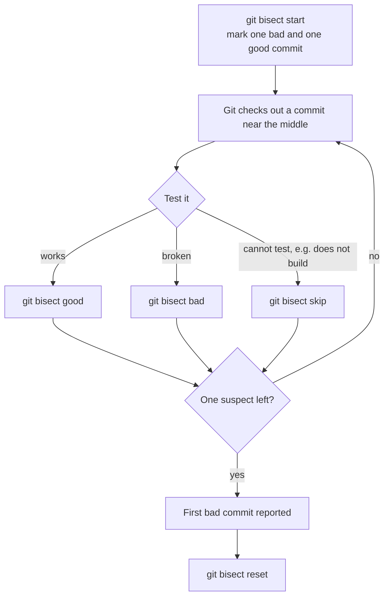
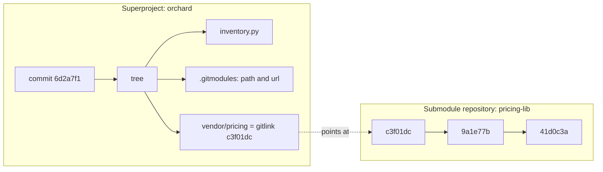
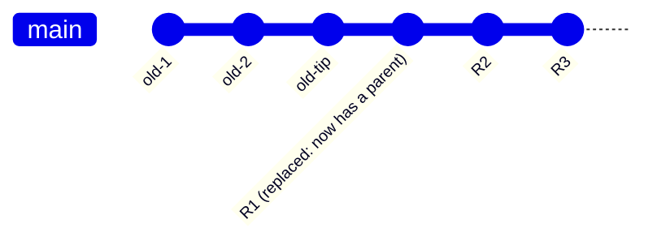

# Bisect, blame, submodules, bundles, replace and credentials

> **Before this lesson:** you need to read history and ranges ([Viewing history with git log](#/lesson/git/viewing-history), [Revision selection, interactive staging, stash and clean](#/lesson/git/revisions-staging-stash)) and to understand remotes and protocols ([Remotes, tags and aliases](#/lesson/git/remotes-tags-aliases), [Protocols and putting Git on a server](#/lesson/git/protocols-and-bare-repos)).

## In plain words

This lesson is a toolbox with six drawers. You will not open all of them every week, but each solves a problem that is miserable without it.

- **Bisect** finds *which commit* broke something. It plays the number-guessing game: "is it higher or lower?" With a thousand suspect commits, ten questions are enough.
- **Blame** tells you, for each line of a file, which commit last changed it and who made that commit. Despite the name, its real use is finding the *reason* a line exists.
- **Submodules** let one repository contain another, pinned to an exact version, like a recipe book that says "use the stock from page 40 of this other book, third edition".
- **Bundles** pack a repository, or part of its history, into a single file you can carry on a USB stick when there is no network between two machines.
- **Replace** lets you tell Git "whenever you see this object, use that one instead", without rewriting any history.
- **Credential helpers** remember your password or token so that you are not asked on every push.

Why it matters for a job: "the tests passed last week and fail today; find out why" is a task you will be given. Bisect turns it from a day of guessing into ten minutes. Submodules appear in many company codebases and confuse nearly everyone at first.

## Part 1: debugging with Git

### Blame: who last changed this line, and why?

```bash
$ git blame -L 10,16 inventory.py
a03f5d1c (Mira Okafor  2026-11-17 09:30:12 +0100 10) def count(rows):
a03f5d1c (Mira Okafor  2026-11-17 09:30:12 +0100 11)     total = 0
a03f5d1c (Mira Okafor  2026-11-17 09:30:12 +0100 12)     for row in rows:
2b8d6a37 (Mira Okafor  2026-11-20 14:10:31 +0100 13)         if row.quantity < 0:
2b8d6a37 (Mira Okafor  2026-11-20 14:10:31 +0100 14)             raise ValueError("negative quantity")
c9a4e021 (Tomas Lind   2026-11-19 16:02:44 +0100 15)         total += row.quantity
a03f5d1c (Mira Okafor  2026-11-17 09:30:12 +0100 16)     return total
```

- `git blame <file>` annotates every line; `-L 10,16` restricts it to lines 10 to 16.
- Each output line has the short id of the commit that last changed that line, the author, the date, the line number, and the line.
- A commit id beginning with `^` marks a line unchanged since the file's first commit.

The id is the valuable part. Lines 13 and 14 came from `2b8d6a37`; `git show 2b8d6a37` gives the message and full diff, which is where the reasoning lives.

Two options make blame smarter:

```bash
$ git blame -w -C -C inventory.py
```

- `-w` ignores changes that only altered spacing, so a reformatting commit does not hide the real author.
- `-C` detects lines that were moved or copied from other files in the same commit; given twice, it also looks at the commit that created the file. Blame then reports where the code was *originally* written.

A commit that only reformatted the code can be skipped permanently: list its id in a file and run `git blame --ignore-revs-file .git-blame-ignore-revs` (or set `blame.ignoreRevsFile` in configuration).

### Bisect: find the commit that broke it

The situation: the build passes at tag `v1.0.0` and fails at the current commit. Between them lie 100 commits. Checking them one by one could take 100 tries. **Binary search** (repeatedly halving the range) needs about seven.

```bash
$ git bisect start
$ git bisect bad                    # the commit I am on is broken
$ git bisect good v1.0.0            # this old one worked
Bisecting: 49 revisions left to test after this (roughly 6 steps)
[4d1c9ab7e2f0...] Cache parsed price list
```

- `git bisect start` begins a session.
- `git bisect bad` with no argument marks the current commit as bad.
- `git bisect good <commit>` marks a known working commit.
- Git then checks out a commit in the middle and tells you how many remain.

You test this commit (run the program or the tests) and report:

```bash
$ python -m pytest -q
1 failed, 41 passed
$ git bisect bad
Bisecting: 24 revisions left to test after this (roughly 5 steps)
[9e4c7b1d03a5...] Add bulk discounts

$ python -m pytest -q
42 passed
$ git bisect good
Bisecting: 12 revisions left to test after this (roughly 4 steps)
[1a6e9d0f55c2...] Refactor price lookup
```

Each answer halves the range. After a few more rounds:

```bash
$ git bisect bad
b07d915e8c41a2f6d3907be5c1a8f04d6e2b7c93 is the first bad commit
commit b07d915e8c41a2f6d3907be5c1a8f04d6e2b7c93
Author: Tomas Lind <tomas@greenhouse.example>
Date:   Thu Nov 19 17:20:11 2026 +0100

    Round discounted prices to whole cents

 discounts.py | 4 ++--
 1 file changed, 2 insertions(+), 2 deletions(-)
```

Git names the first bad commit: the one whose parent was good and which is itself bad. You now have a four-line diff to study instead of a hundred commits.

**Always finish with a reset**, which returns you to the branch you started on:

```bash
$ git bisect reset
Previous HEAD position was b07d915 Round discounted prices to whole cents
Switched to branch 'main'
```

> [!WARNING]
> During a bisect you are in a detached HEAD state on historical commits. Do not start fixing the bug there, and do not forget `git bisect reset`: until you run it, your working tree shows old code and new commits would not be on any branch. Also start a bisect with a clean working tree; uncommitted changes can stop Git from checking out the commits it needs.



The search on a straight history, as a model. Change `first_bad` and watch the number of tests stay near log2 of the range.

```python-run
commits = [f"c{i:03}" for i in range(101)]      # c000 (good) ... c100 (bad)
first_bad = 73

def is_bad(i):                                   # stands for "run the tests on this commit"
    return i >= first_bad

good, bad, tests = 0, 100, 0
while bad - good > 1:
    mid = (good + bad) // 2
    tests += 1
    verdict = "bad" if is_bad(mid) else "good"
    print(f"test {tests}: {commits[mid]} is {verdict:4}  ({bad - good - 1} suspects before this test)")
    if is_bad(mid): bad = mid
    else:           good = mid
print(f"first bad commit: {commits[bad]} after {tests} tests instead of up to 100")
```

In a history with merges, "the middle" is the commit that splits the remaining suspects most evenly; the problem *Choose the next commit for git bisect* has you compute it.

### Automated bisect

If a command can tell good from bad by its **exit code** (zero for success, anything else for failure), Git can run the whole search itself:

```bash
$ git bisect start HEAD v1.0.0
$ git bisect run python -m pytest -q tests/test_discounts.py
running 'python' '-m' 'pytest' '-q' 'tests/test_discounts.py'
...
b07d915e8c41a2f6d3907be5c1a8f04d6e2b7c93 is the first bad commit
bisect found first bad commit
$ git bisect reset
```

- `git bisect start <bad> <good>` marks both ends in one line.
- `git bisect run <command>` runs the command at each step: exit code 0 means good, 1 to 127 (except 125) means bad, and 125 means "skip this commit, it cannot be tested".

Other details: `git bisect log` prints the answers given so far, and `git bisect replay <file>` repeats them, which helps after a mistaken answer. If "good" and "bad" do not suit what you are hunting (for example, the commit where something became *faster*), start with `git bisect start --term-old slow --term-new fast` and use those words.

## Part 2: submodules

### The problem

Your project needs another project's code: a shared library maintained by a different team. Copying its files in means updates are manual and local tweaks get lost. A **submodule** keeps the other project as its own repository inside a sub-folder of yours, while your repository records exactly which commit of it you use.

### Adding one

```bash
$ git submodule add https://git.example.com/greenhouse/pricing-lib.git vendor/pricing
Cloning into '/home/mira/orchard/vendor/pricing'...
done.

$ git status --short
A  .gitmodules
A  vendor/pricing
```

Two things were staged.

```bash
$ cat .gitmodules
[submodule "vendor/pricing"]
        path = vendor/pricing
        url = https://git.example.com/greenhouse/pricing-lib.git
```

- `.gitmodules` is a tracked text file that maps the folder to the address it is cloned from, so teammates get the same setup.

```bash
$ git diff --cached --submodule
Submodule vendor/pricing 0000000...c3f01dc (new submodule)

$ git commit -m "Add pricing library as a submodule"
[main 6d2a7f1] Add pricing library as a submodule
 2 files changed, 4 insertions(+)
 create mode 100644 .gitmodules
 create mode 160000 vendor/pricing
```

- Your repository does **not** store the library's files. For `vendor/pricing` it stores one entry with the special mode `160000`, whose content is a commit id: `c3f01dc`. Such an entry is called a **gitlink**.
- That is the key idea: **a submodule is a pointer to one exact commit of another repository.**



The containing repository is called the **superproject**.

### Cloning a project that has submodules

A plain clone creates the submodule folders but leaves them **empty**:

```bash
$ git clone https://git.example.com/greenhouse/orchard.git
$ ls orchard/vendor/pricing
$
```

Two commands fill them in:

```bash
$ git submodule init
Submodule 'vendor/pricing' (https://git.example.com/greenhouse/pricing-lib.git) registered for path 'vendor/pricing'
$ git submodule update
Cloning into '/home/tomas/orchard/vendor/pricing'...
Submodule path 'vendor/pricing': checked out 'c3f01dc5a8e2...'
```

- `init` copies the addresses from `.gitmodules` into your local configuration.
- `update` clones each submodule and checks out the exact commit the superproject records.

Or do everything at once: `git clone --recurse-submodules <url>`, or after a plain clone, `git submodule update --init --recursive` (`--recursive` handles submodules inside submodules).

### Receiving changes

When a teammate changes which commit the superproject points to, `git pull` updates the pointer but not the folder's contents:

```bash
$ git pull
   6d2a7f1..e0b9c44  main       -> origin/main
Fast-forward
 vendor/pricing | 2 +-
$ git status --short
 M vendor/pricing
$ git submodule update --init --recursive
Submodule path 'vendor/pricing': checked out '7f4d21aa...'
```

The ` M vendor/pricing` line means the folder still has the old commit checked out. `git submodule update` fixes it. To make this automatic for commands that understand it (`pull`, `switch`, `checkout`): `git config --global submodule.recurse true`.

### Moving the pointer to a newer library version

```bash
$ git submodule update --remote vendor/pricing
Submodule path 'vendor/pricing': checked out '7f4d21aa...'
$ git diff --submodule
Submodule vendor/pricing c3f01dc..7f4d21a:
  > Add tiered discounts
  > Fix rounding of negative prices
$ git commit -am "Update pricing library"
```

- `--remote` fetches inside the submodule and checks out the tip of its tracked branch (the remote's default branch unless `.gitmodules` names another).
- `git diff --submodule` lists the library commits that the pointer moved over. Setting `diff.submodule log` makes this the default view.
- The commit records the new pointer for everyone.

### Working inside a submodule

`git submodule update` leaves the submodule in **detached HEAD**: on a specific commit, on no branch. To change the library yourself:

```bash
$ cd vendor/pricing
$ git switch main
$ # edit, then:
$ git commit -am "Handle zero-quantity tiers"
$ git push
$ cd ../..
$ git add vendor/pricing
$ git commit -m "Use pricing library with zero-quantity fix"
$ git push
```

Order matters: push the submodule first, then the superproject. Otherwise the superproject points at a commit nobody else can fetch. Make Git check for you:

```bash
$ git push --recurse-submodules=check
The following submodule paths contain changes that can
not be found on any remote:
  vendor/pricing
```

`check` refuses the push; `on-demand` pushes the submodules first.

`git submodule foreach '<command>'` runs a command in every submodule, for example `git submodule foreach 'git status --short'`.

> [!WARNING]
> Three submodule accidents are common. (1) Committing work in a submodule while its HEAD is detached, then running `git submodule update`, which checks out another commit and leaves yours on no branch. Switch to a branch first. (2) Pushing the superproject without pushing the submodule commit it points to; teammates then get "reference is not a tree". (3) Switching the superproject to a branch that predates the submodule: the folder may remain as untracked files. Use `git switch --recurse-submodules`.

## Part 3: bundles

A **bundle** is a single file containing Git objects and references, usable in place of a remote. It is for when two machines cannot reach each other over a network.

```bash
$ git bundle create orchard.bundle HEAD main
Enumerating objects: 148, done.
Total 148 (delta 41), reused 148 (delta 41), pack-reused 0

$ git bundle verify orchard.bundle
The bundle contains these 2 refs:
6d2a7f1c... HEAD
6d2a7f1c... refs/heads/main
The bundle records a complete history.
orchard.bundle is okay
```

- `git bundle create <file> <refs>` writes everything needed for those references. Include `HEAD` so that a clone knows which branch to check out.
- `git bundle verify` checks that the file is intact and that your repository has what it depends on.

On the other machine, the file behaves like a repository address:

```bash
$ git clone orchard.bundle orchard
Cloning into 'orchard'...
Receiving objects: 100% (148/148), done.
```

Later, send only the new commits by giving a range:

```bash
$ git bundle create update.bundle v1.1.0..main
```

and on the receiving side:

```bash
$ git bundle verify update.bundle
The bundle requires this ref:
e91b6c4f0a1b2c3d4e5f60718293a4b5c6d7e8f9
update.bundle is okay
$ git fetch update.bundle main:incoming
$ git merge incoming
```

`requires this ref` means the receiver must already have that commit, which it does if it has `v1.1.0`.

## Part 4: replace

`git replace` creates a reference under `refs/replace/` that says "when asked for object X, give object Y". Commands that read history follow it transparently, but X is not modified, and no ids change.

The classic use is splitting a huge history: publish a small recent repository whose first commit is a root, keep the old history in a separate archive, and let those who want the full story graft the two together locally.

```bash
$ git replace a03f5d1 c0ffee1
$ git log --oneline
...               # history now continues through c0ffee1's ancestors
$ git replace -d a03f5d1        # remove the replacement
```

The picture: the recent repository starts at R1 with no parent. After `git replace R1 OldTip-copy`, reading R1 yields an equivalent commit whose parent is the old history.



Replacement references are local unless you push `refs/replace/*` explicitly, and `git --no-replace-objects <command>` shows the true, unreplaced data. It is a specialised tool; knowing that it exists is enough for most people.

## Part 5: credential storage

Over HTTPS, Git needs a username and a password or token for each operation on a private repository. A **credential helper** stores them.

| Helper | Where secrets are kept | Notes |
|---|---|---|
| none (default) | nowhere | asks every time |
| `cache` | in memory | forgotten after a timeout (default 15 minutes) |
| `store` | a plain text file, `~/.git-credentials` | never expires; **not encrypted** |
| `osxkeychain` | the macOS Keychain | encrypted by the system |
| `manager` | Git Credential Manager: Windows Credential Manager, macOS Keychain, or Linux secret service | cross-platform; supports browser sign-in and two-factor authentication |

```bash
$ git config --global credential.helper cache
$ git config --global credential.helper 'cache --timeout=3600'
$ git config --global credential.helper manager
```

Run only one; each line replaces the previous setting. The second keeps credentials in memory for an hour.

You can watch a helper answer. Git speaks to it with `key=value` lines:

```bash
$ git credential fill
protocol=https
host=git.example.com

protocol=https
host=git.example.com
username=mira
password=ghp_exampleToken123
```

- You type the first two lines and a blank line, describing the server.
- The helper prints what it has stored for that server. With nothing stored, Git would prompt you.

> [!WARNING]
> `credential.helper store` writes your token in readable text into a file in your home folder. Anyone who can read that file can act as you. Prefer your operating system's keychain or Git Credential Manager; if you must use `store`, restrict the file's permissions and use a token with the smallest scope and a short expiry.

A model of the helper protocol:

```python-run
import time

class CacheHelper:
    def __init__(self, timeout):
        self.timeout, self.items = timeout, {}
    def store(self, protocol, host, username, password, now):
        self.items[(protocol, host)] = (username, password, now + self.timeout)
    def get(self, protocol, host, now):
        entry = self.items.get((protocol, host))
        if entry and now < entry[2]:
            return {"username": entry[0], "password": "****" + entry[1][-4:]}
        return None                      # Git would prompt the user

helper = CacheHelper(timeout=900)
t0 = 0
print("first push  :", helper.get("https", "git.example.com", t0) or "prompt user")
helper.store("https", "git.example.com", "mira", "ghp_exampleToken123", t0)
print("5 min later :", helper.get("https", "git.example.com", t0 + 300))
print("20 min later:", helper.get("https", "git.example.com", t0 + 1200) or "prompt user (cache expired)")
print("other host  :", helper.get("https", "other.example.org", t0 + 300) or "prompt user")
```

## Pitfalls

- **Blaming the person.** The last person to touch a line may only have reformatted it. Use `-w`, `-C`, and read the commit before drawing conclusions.
- **Bisecting with a flaky test.** One wrong answer sends the search to the wrong half. Make the test deterministic, or use `git bisect skip` when unsure.
- **Marking good and bad the wrong way round.** Git reports that the good commit is not an ancestor of the bad one, or finds nonsense. `git bisect log` shows what you answered.
- **Forgetting `git bisect reset`.**
- **Empty submodule folders after clone.** Run `git submodule update --init --recursive`.
- **Editing in a detached submodule**, and **pushing the superproject first**.
- **Bundles without `HEAD`.** The clone has no branch checked out; add `HEAD` when creating.
- **Plain-text credentials.**

> [!TIP]
> Before a manual bisect, write the test as a one-line script that exits 0 when the behaviour is right and 1 when it is wrong. Then `git bisect run ./check.sh` does the whole search while you get a coffee, and the script documents precisely what "broken" meant.

> [!INTERVIEW]
> **"A bug appeared some time in the last 500 commits. How do you find the commit that introduced it?"** `git bisect`: start, mark the current commit bad and a known working commit good; Git checks out a midpoint; test and answer good or bad; repeat about nine times (log2 of 500) until Git names the first bad commit; `git bisect reset`. With a script that returns 0 or non-zero, `git bisect run` automates it, and exit code 125 skips untestable commits. Then inspect that commit with `git show`. **"What is a submodule?"** A reference inside one repository to a specific commit of another: the superproject stores a gitlink entry holding the commit id plus a `.gitmodules` file with the address. Mention the two-step clone, detached HEAD inside the submodule, and pushing the submodule before the superproject. **"What does `git blame` show?"** For each line, the last commit that modified it; `-w -C` see through whitespace changes and moved code.

## Cheat sheet

| Task | Command |
|---|---|
| Last change to each line | `git blame -L <a>,<b> <file>` |
| Blame ignoring whitespace and moves | `git blame -w -C -C <file>` |
| Start a bisect | `git bisect start <bad> <good>` |
| Answer / skip | `git bisect good`, `git bisect bad`, `git bisect skip` |
| Automate | `git bisect run <command>` |
| End the session | `git bisect reset` |
| Add a submodule | `git submodule add <url> <path>` |
| Clone with submodules | `git clone --recurse-submodules <url>` |
| Fill or sync submodules | `git submodule update --init --recursive` |
| Move a submodule to its newest upstream | `git submodule update --remote <path>` |
| Push safely with submodules | `git push --recurse-submodules=check` |
| Pack history into a file | `git bundle create <file> HEAD main` |
| Check and use a bundle | `git bundle verify <file>`, `git clone <file>`, `git fetch <file> main:incoming` |
| Substitute one object for another | `git replace <object> <replacement>` |
| Remember HTTPS credentials | `git config --global credential.helper manager` (or `cache`) |

## Summary

`git blame` maps each line of a file to the commit that last changed it, and with `-w` and `-C` sees past reformatting and moved code. `git bisect` performs a binary search between a good and a bad commit, needing about log2(n) tests, and `git bisect run` automates it with any command whose exit code separates good from bad. A submodule embeds another repository at a pinned commit: the superproject stores a gitlink and a `.gitmodules` entry, clones need `--recurse-submodules` or `submodule update --init`, and pushes must send the submodule before the superproject. A bundle packs objects and references into one file that can be cloned or fetched from offline. `git replace` substitutes one object for another when reading, without altering history. Credential helpers store HTTPS usernames and tokens, preferably in the operating system's encrypted store.

## Glossary

- **`git blame`:** annotates each line of a file with the commit and author that last changed it.
- **Binary search:** finding an item by repeatedly halving the range in which it can lie.
- **`git bisect`:** binary search through history for the commit that introduced a change in behaviour.
- **First bad commit:** the commit that is bad while its parent is good.
- **Exit code:** the number a program returns when it ends; 0 means success.
- **Submodule:** a repository embedded in another at a specific commit.
- **Superproject:** the repository that contains submodules.
- **Gitlink:** the tree entry (mode 160000) that records a submodule's commit id.
- **`.gitmodules`:** the tracked file listing each submodule's path and address.
- **Bundle:** a single file holding Git objects and references, usable like a remote.
- **`git replace`:** creates a reference that makes Git substitute one object for another when reading.
- **Credential helper:** a program that stores and supplies usernames and passwords or tokens to Git.
- **Git Credential Manager:** a cross-platform helper that uses the operating system's secure storage.
- **Token scope:** the set of permissions a personal access token grants.

## Check yourself

```quiz
[
  {"q": "Roughly how many tests does `git bisect` need to find the first bad commit among 1,000 candidates in a linear history?", "options": ["About 10", "About 100", "About 500", "1,000"], "answer": 0, "explain": "Each answer halves the remaining suspects, so the number of steps is about log2(1000), which is 10."},
  {"q": "With `git bisect run ./check.sh`, what does an exit code of 125 from the script mean?", "options": ["The commit is good", "The commit cannot be tested and should be skipped", "Abort the bisect", "The commit is bad"], "answer": 1, "explain": "0 means good, 1 to 127 except 125 means bad, and 125 tells bisect to skip the commit, for example because it does not build."},
  {"q": "What must you run when a bisect session is finished?", "options": ["git reset --hard", "Nothing", "git bisect reset", "git clean -fd"], "answer": 2, "explain": "The session leaves you on a detached historical commit. git bisect reset returns to the original branch and clears the bisect state."},
  {"q": "What do `-w` and `-C` add to `git blame`?", "options": ["Showing only the last week", "Counting lines per author", "Colour and wider columns", "Ignoring whitespace-only changes and tracing lines moved or copied from elsewhere"], "answer": 3, "explain": "They let blame see past reformatting commits and code moves to the commit where the logic actually originated."},
  {"q": "What does the superproject store for a submodule folder?", "options": ["A full copy of the submodule's files", "A zip archive", "Nothing; it is ignored", "A gitlink entry containing one commit id, plus the address in .gitmodules"], "answer": 3, "explain": "The submodule's content lives in its own repository. The superproject records only which commit to check out and where to clone from."},
  {"q": "After a plain `git clone` of a project with submodules, the submodule folders are empty. Which command fills them?", "options": ["git fetch --all", "git clean -fdx", "git pull --rebase", "git submodule update --init --recursive"], "answer": 3, "explain": "init registers the addresses and update clones and checks out the recorded commits; --recursive handles nested submodules."},
  {"q": "You committed inside a submodule and in the superproject. In which order should you push?", "options": ["Order does not matter", "Superproject first", "Submodule first, then the superproject", "Only the superproject needs pushing"], "answer": 2, "explain": "The superproject's new commit points at a submodule commit. If that commit is not on the submodule's remote, teammates cannot check it out."},
  {"q": "What is the main risk of `credential.helper store`?", "options": ["It works only on Linux", "It is slow", "Credentials are saved unencrypted in a file on disk", "It expires after 15 minutes"], "answer": 2, "explain": "The store helper writes plain text to ~/.git-credentials. Prefer an operating-system keychain or Git Credential Manager."}
]
```

> **Source:** Chacon & Straub, Pro Git 2e, ch. 7 (Debugging with Git; Submodules; Bundling; Replace; Credential Storage). Explanations, examples and code written for this guide.
