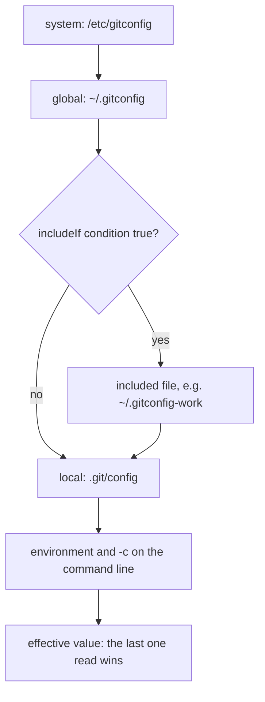
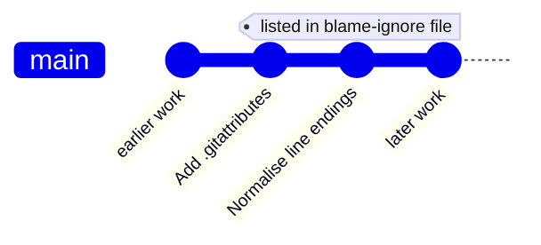

# Configuration and attributes

> **Before this lesson:** you should know the three configuration levels from [Installing, configuring and getting help](#/lesson/git/setup-and-help), how diffs and merges work ([Getting a repository and recording changes](#/lesson/git/recording-changes), [Merging and resolving conflicts](#/lesson/git/merging-and-conflicts)), and what `.gitignore` does.

## In plain words

A new car works as delivered, but you still move the seat, set the mirrors and pair your phone. Git is the same: it works out of the box, and a few adjustments make it fit you and your team. There are two different places for those adjustments, and the difference between them is the main thing to take from this lesson.

- **Configuration** (`git config`) is your personal dashboard: which editor opens, whether output is coloured, how `git pull` behaves. It lives on *your* machine and is **not** shared when someone clones the project.
- **Attributes** (a file named `.gitattributes`) are labels stuck on files *inside the project*: "this file is binary, do not try to merge it", "these files always use Unix line endings", "leave this folder out of release archives". The file is committed, so **everyone** who clones the project gets the same behaviour.

A way to remember it: configuration is about the *person*; attributes are about the *files*.

Why it matters for a job: a surprising share of team friction comes from this area. Pull requests in which every line appears changed because of line endings; merge conflicts in generated files; a colleague's Git behaving differently from yours for no visible reason. Each has a two-line cure once you know where to put it.

## Part 1: configuration that earns its place

Recall the levels: `--system` (the machine), `--global` (your user), `--local` (one repository, the default when inside one), with the more specific level winning. There are hundreds of settings; `git help config` lists them all. The ones below are those people set on purpose.

### Everyday comfort

```bash
$ git config --global core.editor "code --wait"
$ git config --global init.defaultBranch main
$ git config --global help.autocorrect prompt
$ git config --global core.pager "less -FRX"
```

- `core.editor` chooses the editor for messages.
- `init.defaultBranch` names the first branch of new repositories.
- `help.autocorrect prompt` makes Git ask "did you mean `status`?" and run it on confirmation when you mistype a command. A number instead (for example `20`) runs the guess automatically after that many tenths of a second.
- `core.pager` chooses the program for long output. `-F` quits at once if everything fits on one screen, `-R` keeps colours, `-X` leaves the text on screen afterwards. Set it to an empty string, or `cat`, to switch paging off.

### A message template

`commit.template` names a file whose content appears in the editor whenever you commit, as a reminder of the expected shape.

```bash
$ cat ~/.gitmessage.txt
# Subject: imperative mood, 50 characters or fewer

# Why is this change needed? What does it do? (wrap at 72)

# Refs: #issue

$ git config --global commit.template ~/.gitmessage.txt
```

Lines starting with `#` are comments that Git strips from the final message.

### Ignoring your own clutter everywhere

Your editor's backup files and your operating system's folder-metadata files are your personal business and do not belong in every project's `.gitignore`. `core.excludesFile` names a personal ignore file applied to all your repositories.

```bash
$ cat ~/.gitignore_global
.DS_Store
Thumbs.db
*.swp
.idea/
.vscode/

$ git config --global core.excludesFile ~/.gitignore_global
```

### Behaviour of pull, push, fetch and merge

```bash
$ git config --global pull.ff only
$ git config --global push.default simple
$ git config --global push.autoSetupRemote true
$ git config --global fetch.prune true
$ git config --global merge.conflictStyle zdiff3
$ git config --global rerere.enabled true
$ git config --global rebase.autoStash true
```

| Setting | Effect |
|---|---|
| `pull.ff only` | `git pull` refuses to create a merge commit; it only fast-forwards |
| `pull.rebase true` | (alternative) `git pull` rebases your local commits onto the fetched ones |
| `push.default simple` | `git push` sends only the current branch to its same-named upstream (the default since Git 2.0) |
| `push.autoSetupRemote true` | the first `git push` of a new branch sets its upstream, with no `-u` needed |
| `fetch.prune true` | every fetch removes remote-tracking branches that no longer exist on the remote |
| `merge.conflictStyle zdiff3` | conflict markers also show the common-ancestor version |
| `rerere.enabled true` | remember and replay conflict resolutions |
| `rebase.autoStash true` | stash uncommitted changes before a rebase and restore them afterwards |

### Colour and external tools

```bash
$ git config --global color.ui auto
$ git config --global diff.tool vimdiff
$ git config --global merge.tool vscode
$ git config --global mergetool.vscode.cmd 'code --wait --merge $REMOTE $LOCAL $BASE $MERGED'
```

- `color.ui auto` colours output when it goes to a terminal and not when it is piped into a file or another program.
- `diff.tool` and `merge.tool` name the programs started by `git difftool` and `git mergetool`. For a tool Git does not know, `mergetool.<name>.cmd` gives the command line; `$LOCAL`, `$REMOTE`, `$BASE` and `$MERGED` are placeholders Git fills with the paths of our version, their version, the common ancestor and the result file.

### Line endings and whitespace

Text files mark the end of each line with invisible characters. Windows traditionally uses two, carriage return and line feed (**CRLF**); macOS and Linux use one, line feed (**LF**). A team with both kinds of machine can end up with files where every line "changed".

```bash
# On Windows: convert LF to CRLF when checking out, CRLF to LF when committing
$ git config --global core.autocrlf true

# On macOS and Linux: convert CRLF to LF when committing, never the other way
$ git config --global core.autocrlf input
```

With either setting, the repository always stores LF. Because this is configuration, it depends on every teammate having set it correctly; Part 2 shows the more reliable project-level alternative using attributes.

`core.whitespace` controls which spacing problems `git diff` highlights and `git apply` warns about (trailing blanks, spaces before tabs, and so on); the defaults are sensible.

### Conditional includes: two identities without thinking

`includeIf` loads another configuration file only when a condition holds, most often "this repository is under that folder".

```bash
$ cat ~/.gitconfig
[user]
        name = Mira Okafor
        email = mira@home.example
[includeIf "gitdir:~/work/"]
        path = ~/.gitconfig-work

$ cat ~/.gitconfig-work
[user]
        email = mira.okafor@work.example
        signingkey = ~/.ssh/id_ed25519_work.pub
[commit]
        gpgsign = true
```

- `[includeIf "gitdir:~/work/"]` applies to every repository whose `.git` folder lies under `~/work/` (the trailing slash matters).
- Inside such a repository, the values from `~/.gitconfig-work` override the earlier ones.

```bash
$ cd ~/work/billing-service
$ git config --show-origin user.email
file:/home/mira/.gitconfig-work  mira.okafor@work.example
```

### Server-side settings worth knowing

On a bare repository that others push to:

| Setting | Effect |
|---|---|
| `receive.fsckObjects true` | verify every received object for integrity before accepting a push |
| `receive.denyNonFastForwards true` | refuse pushes that are not fast-forwards, even with `--force` |
| `receive.denyDeletes true` | refuse deletion of branches and tags by push |

Hosting services expose the same ideas as branch-protection rules.



## Part 2: attributes

### What they are and where they live

A **Git attribute** is a setting attached to paths. Attributes are written in a file named `.gitattributes`, usually at the top of the project, one pattern per line followed by the attributes for matching files. Because the file is tracked, the settings travel with the repository. (A private, uncommitted variant lives in `.git/info/attributes`.)

```bash
$ cat .gitattributes
# pattern        attributes
*.png            binary
*.sh             text eol=lf
docs/*.md        diff=markdown
```

A line can set an attribute (`text`), unset it (`-text`), or give it a value (`eol=lf`). As with ignore files, later lines override earlier ones for the same attribute.

To ask which attributes apply to a file:

```bash
$ git check-attr -a build.sh
build.sh: text: set
build.sh: eol: lf
```

- `git check-attr -a <file>` lists every attribute that the patterns assign to that file.

### Use 1: line endings, done properly

This is the most valuable use, and it replaces reliance on each person's `core.autocrlf`.

```bash
$ cat .gitattributes
# Let Git decide what is text, and store text with LF in the repository
* text=auto

# Files that must have a specific ending in the working tree
*.sh   text eol=lf
*.bat  text eol=crlf

# Never touch these
*.png  binary
*.zip  binary
```

- `* text=auto` tells Git to detect text files and normalise their line endings to LF when they are committed.
- `eol=lf` forces LF in the working tree as well, on every platform (shell scripts break with CRLF). `eol=crlf` does the opposite for Windows batch files.
- `binary` is shorthand for `-text -diff -merge`: no line-ending conversion, no textual diff, no attempt to merge.

After adding such a file to an existing project, bring the stored files into line once:

```bash
$ git add --renormalize .
$ git status --short
M  scripts/deploy.sh
$ git commit -m "Normalise line endings"
```

`--renormalize` re-applies the conversion rules to all tracked files and stages those whose stored form changes.

> [!WARNING]
> The renormalising commit touches every line of every affected file, so it will conflict with open branches and make `git blame` point at it for those lines. Announce it, merge outstanding work first where you can, and add the commit's id to a `.git-blame-ignore-revs` file so that blame skips it. Also make sure real binary files are marked `binary` *before* you renormalise: converting bytes inside an image or archive corrupts it.

A model of what normalisation does on the way in and out:

```python-run
def to_repository(content, attrs):
    """What 'git add' stores."""
    if attrs.get("text"):
        return content.replace("\r\n", "\n")
    return content                                   # binary: stored byte for byte

def to_working_tree(content, attrs, platform_default):
    """What 'git checkout' writes."""
    if not attrs.get("text"):
        return content
    eol = attrs.get("eol", platform_default)
    return content.replace("\n", "\r\n") if eol == "crlf" else content

windows_file = "#!/bin/sh\r\necho hello\r\n"
stored = to_repository(windows_file, {"text": True})
print("stored in repository      :", repr(stored))
print("checkout on Windows (auto):", repr(to_working_tree(stored, {"text": True}, "crlf")))
print("checkout with eol=lf      :", repr(to_working_tree(stored, {"text": True, "eol": "lf"}, "crlf")))
print("binary file untouched     :", repr(to_working_tree(to_repository("PNG\r\n\x1a", {}), {}, "crlf")))
```

### Use 2: better diffs

For a file Git treats as binary, `git diff` can only say "Binary files differ". The `diff` attribute can name a **diff driver**: a small recipe, defined in configuration, for turning the file into text first.

```bash
$ echo "*.docx diff=word" >> .gitattributes
$ git config diff.word.textconv docx2txt
```

- The attribute says: for `.docx` files use the driver named `word`.
- The configuration says: the `word` driver converts files with the program `docx2txt` before comparing.

`git diff` then shows changed sentences. The same trick works for image metadata (`exiftool`) and other formats. Note the split: the attribute is shared in the repository, but the driver's definition is configuration, so each person must set it up (a project usually documents this, or provides a setup script).

For source code, built-in drivers improve the "function name" shown in each hunk header:

```bash
$ cat .gitattributes
*.py   diff=python
*.md   diff=markdown
*.css  diff=css
```

### Use 3: controlling merges

Some files should never be auto-merged. A lock file generated by a package manager is the usual example: a textual merge of two generated files produces rubbish. Mark it so that Git reports a conflict and leaves your version in place, then regenerate the file with the tool.

```bash
$ cat .gitattributes
package-lock.json  -merge
database.xml       merge=ours
```

- `-merge` means "do not attempt a content merge; on differing changes, flag a conflict and keep our version in the working tree".
- `merge=ours` names a custom **merge driver**. Define it once with `git config --global merge.ours.driver true`; the command `true` succeeds without doing anything, so our version is kept and no conflict is reported. Use it for files that are specific to each branch.

### Use 4: what goes into archives

`git archive` (see the maintaining lesson) respects two attributes.

```bash
$ cat .gitattributes
tests/           export-ignore
.gitattributes   export-ignore
.github/         export-ignore
VERSION          export-subst
```

- `export-ignore` leaves the path out of archives. Users who download a release do not need your tests.
- `export-subst` expands placeholders inside the file when archiving: a file containing `$Format:%h %ad$` is written with the commit's short id and date in its place.

### Use 5: filters

A **filter** transforms a file's content on its way into the repository (**clean**) and on its way out to the working tree (**smudge**).


```bash
$ echo "*.py filter=tidy" >> .gitattributes
$ git config filter.tidy.clean "black -q -"
$ git config filter.tidy.smudge cat
```

- The attribute assigns the filter named `tidy` to Python files.
- `clean` runs each file through the formatter `black` when it is staged (the `-` means "read from standard input").
- `smudge` set to `cat` writes the stored content out unchanged.

This mechanism is how **Git LFS** (Large File Storage) works: its clean filter replaces a big file by a small text pointer in the repository, and its smudge filter downloads the real content at checkout. The team-workflows module returns to it.

As with diff drivers, the filter *definition* is configuration and is not shared by cloning. A filter marked `required = true` makes Git stop with an error when the program is missing, instead of silently storing unfiltered content.

### Summary of the split

| | Configuration | Attributes |
|---|---|---|
| File | `~/.gitconfig`, `.git/config` | `.gitattributes` (tracked) |
| Applies to | a person or one clone | paths in the project |
| Shared by clone | no | yes |
| Typical content | editor, aliases, pull and push behaviour, identities, definitions of drivers and filters | which files are text or binary, line endings, which driver or filter to use, archive rules |

The history of a project that adopts attributes typically shows two commits:



## Pitfalls

- **Expecting configuration to reach teammates.** It does not. Anything the whole team needs goes into `.gitattributes`, `.gitignore`, or documented setup steps.
- **Relying on `core.autocrlf` alone.** One teammate without it commits CRLF files. Use `* text=auto` in `.gitattributes`.
- **Mismatched `autocrlf` and editor settings.** Symptoms: `git status` shows files as modified immediately after a clone, or warnings such as `LF will be replaced by CRLF`.
- **Forgetting to mark binaries.** Line-ending conversion or a "successful" text merge can corrupt them.
- **`merge=ours` without defining the driver.** Git falls back to a normal merge.
- **Attributes that reference tools not everyone has.** Document the setup; use `required = true` for filters whose absence would be harmful.
- **An `includeIf` path without a trailing slash**, which then matches only that exact folder.

> [!TIP]
> When Git does something unexpected to a particular file, ask it why: `git check-attr -a <file>` shows the attributes in force, `git check-ignore -v <file>` shows the ignore rule that matched, and `git config --show-origin --get <key>` shows where a setting comes from. Those three commands settle most "why does it behave differently for me?" discussions.

> [!INTERVIEW]
> **"A pull request shows every line of a file as changed, but the author says they edited two lines. What happened and how do you prevent it?"** The file's line endings changed (LF to CRLF or the reverse), typically because the author's editor or Git setup differs from the team's. Confirm with `git diff -w`, which ignores whitespace and shows only the real edits. Prevent it at project level with a committed `.gitattributes` containing `* text=auto` plus explicit `eol=` rules where a specific ending is required, run `git add --renormalize .` once, and mark binary types as `binary`. Explain why attributes beat `core.autocrlf`: attributes are versioned with the repository and apply to everyone, while configuration is per machine. **"Difference between `.gitignore`, `.gitattributes` and `git config`?"** Which files are untracked-and-ignored; how tracked paths are treated (endings, diff, merge, filters, archives); and per-user or per-clone behaviour.

## Cheat sheet

| Task | Command or line |
|---|---|
| Where does a setting come from? | `git config --show-origin --get <key>` |
| Personal ignore file | `git config --global core.excludesFile ~/.gitignore_global` |
| Commit message template | `git config --global commit.template ~/.gitmessage.txt` |
| Pull without surprise merges | `git config --global pull.ff only` |
| Auto-set upstream on first push | `git config --global push.autoSetupRemote true` |
| Show base in conflicts | `git config --global merge.conflictStyle zdiff3` |
| Identity per folder | `[includeIf "gitdir:~/work/"]` with `path = ...` in `~/.gitconfig` |
| Normalise line endings for all | `* text=auto` in `.gitattributes` |
| Force an ending for a type | `*.sh text eol=lf` |
| Mark a type as binary | `*.png binary` |
| Apply new rules to existing files | `git add --renormalize .` |
| Readable diff for a binary format | `*.docx diff=word` plus `git config diff.word.textconv docx2txt` |
| Never auto-merge a file | `<file> -merge` |
| Exclude from archives | `<path> export-ignore` |
| Which attributes apply? | `git check-attr -a <file>` |

## Summary

Configuration adjusts Git for a person or a clone and is not shared: editor, pager, autocorrect, message templates, a personal ignore file, how pull, push, fetch and merge behave, colours and external tools, and conditional includes that switch identity by folder. Attributes, written in the tracked `.gitattributes` file, adjust how Git treats particular paths for everyone: whether a file is text or binary, which line endings it has in the repository and in the working tree, which diff or merge driver handles it, whether it appears in archives, and which clean and smudge filters transform it. The shared attribute names a driver or filter; its definition remains local configuration. Line-ending trouble, the most common problem in this area, is solved with `* text=auto` and a single renormalising commit.

## Glossary

- **Configuration:** per-system, per-user or per-repository settings managed with `git config`.
- **`includeIf`:** a conditional include that loads another configuration file when a condition holds.
- **Pager:** the program that displays long output page by page.
- **Template (commit):** a file whose text is preloaded into the commit message editor.
- **Line ending:** the invisible end-of-line marker; **LF** on Unix-like systems, **CRLF** on Windows.
- **Normalise:** convert line endings to a single form (LF) in the repository.
- **Attribute:** a per-path setting declared in `.gitattributes`.
- **`binary`:** an attribute shorthand meaning no conversion, no text diff, no merge.
- **Diff driver / textconv:** a configured method for showing differences in a file type, optionally by converting it to text.
- **Merge driver:** a configured program or rule used to merge a particular file type.
- **Clean / smudge filter:** transformations applied when content enters the repository / is written to the working tree.
- **`export-ignore` / `export-subst`:** attributes that omit a path from archives / expand placeholders in it.
- **Git LFS:** Large File Storage, an extension that keeps big files outside the repository using filters.
- **Renormalise:** re-apply line-ending rules to already tracked files.

## Check yourself

```quiz
[
  {"q": "Which of these is shared with everyone who clones the repository?", "options": ["~/.gitconfig", "core.excludesFile", ".gitattributes", ".git/config"], "answer": 2, "explain": ".gitattributes is a tracked file, so it travels with the project. Configuration files and the personal excludes file are local."},
  {"q": "What does the line `* text=auto` in .gitattributes do?", "options": ["Converts every file to CRLF", "Disables diffs", "Marks all files as binary", "Lets Git detect text files and store them with LF line endings in the repository"], "answer": 3, "explain": "Git guesses which files are text and normalises their endings on commit, independent of each person's core.autocrlf."},
  {"q": "What is `binary` shorthand for in .gitattributes?", "options": ["-text -diff -merge", "filter=lfs", "export-ignore", "text eol=crlf"], "answer": 0, "explain": "No line-ending conversion, no textual diff and no content merge."},
  {"q": "You add `*.docx diff=word` to .gitattributes but a teammate still sees 'Binary files differ'. Why?", "options": ["docx files cannot be diffed", "The diff driver's definition (diff.word.textconv) is configuration, which each person must set locally", "They need to re-clone", "The attribute is wrong"], "answer": 1, "explain": "Attributes are shared; the driver they refer to is defined in git config, which is not cloned."},
  {"q": "What does `includeIf \"gitdir:~/work/\"` in ~/.gitconfig achieve?", "options": ["It disables global settings", "It loads an additional configuration file for repositories located under ~/work/", "It clones all work repositories", "It ignores the work folder"], "answer": 1, "explain": "Conditional includes let settings such as the email address and signing key change automatically by location."},
  {"q": "When does a clean filter run?", "options": ["During garbage collection", "When a file is staged, transforming content on its way into the repository", "When a commit is pushed", "When a file is checked out"], "answer": 1, "explain": "Clean runs on git add; smudge runs on checkout when content is written to the working tree."},
  {"q": "What does `pull.ff only` change?", "options": ["git pull never fetches", "git pull succeeds only when it can fast-forward and otherwise stops", "git pull deletes local commits", "git pull always rebases"], "answer": 1, "explain": "It prevents unplanned merge commits; when histories have diverged you decide explicitly whether to merge or rebase."},
  {"q": "After adding line-ending rules to an existing project, which command applies them to files already tracked?", "options": ["git add --renormalize .", "git reset --hard", "git gc", "git clean -fdx"], "answer": 0, "explain": "--renormalize re-runs the conversion on all tracked files and stages those whose stored content changes, ready for one clean-up commit."}
]
```

> **Source:** Chacon & Straub, Pro Git 2e, ch. 8 (Git Configuration; Git Attributes). Explanations, examples and code written for this guide.
