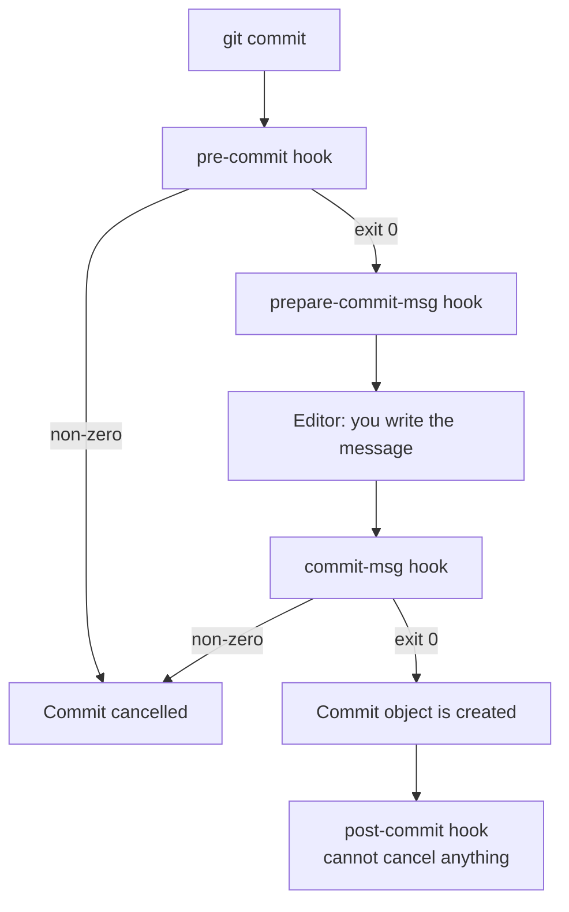
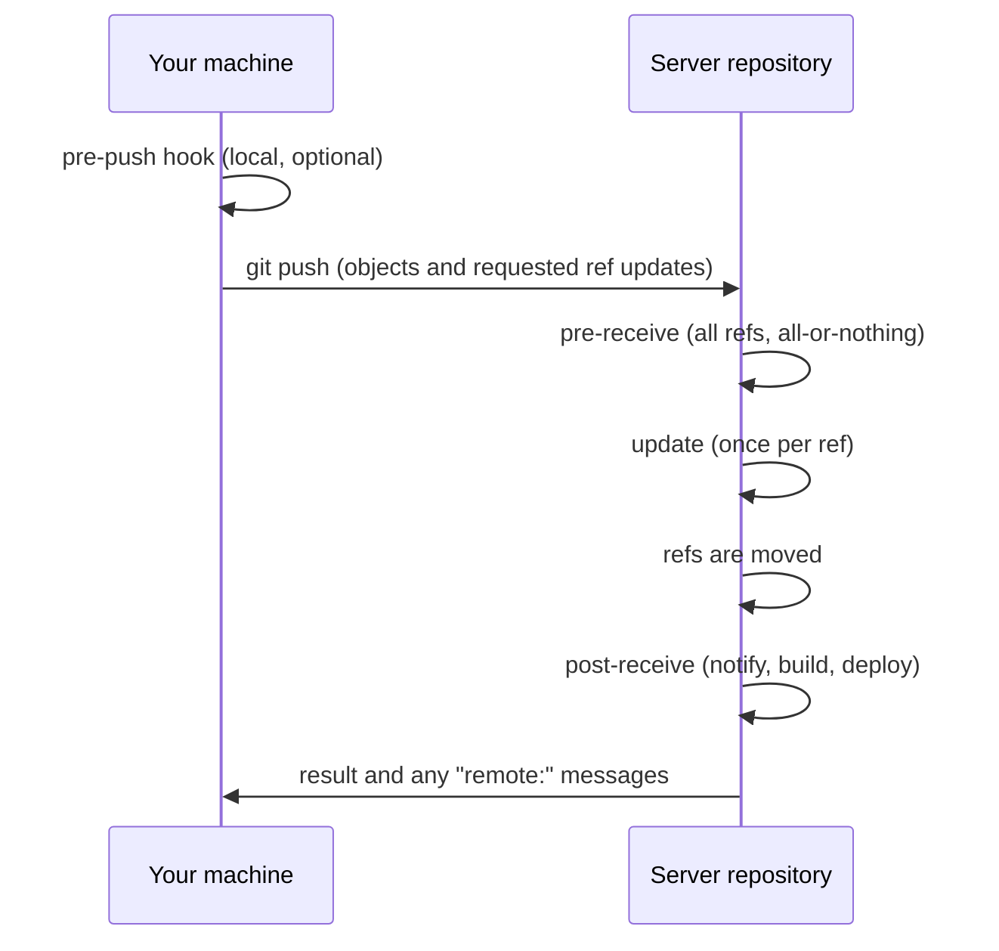
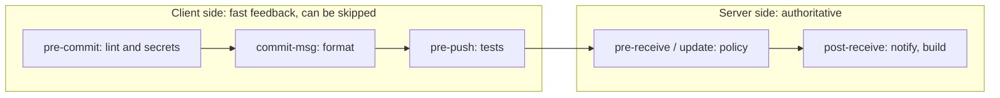
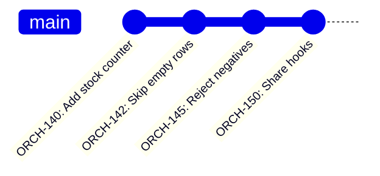

# Hooks and enforcing policy

> **Before this lesson:** read [Configuration and attributes](#/lesson/git/config-and-attributes). You should also know how pushes are accepted or rejected ([Remotes, tags and aliases](#/lesson/git/remotes-tags-aliases)), what a bare repository is ([Protocols and putting Git on a server](#/lesson/git/protocols-and-bare-repos)), and the conventions for commit messages ([Distributed workflows and contributing to a project](#/lesson/git/contributing)).

## In plain words

Many doors have an automatic check attached: the supermarket gate beeps if a tag is still on an item, the office turnstile opens only for a valid badge. Nobody has to remember to perform the check; it runs by itself at the moment that matters.

A **Git hook** is such a check, or more generally any small program, that Git runs automatically at a particular moment: before a commit is created, after a message is typed, before a push leaves your machine, when a push arrives at the server. If a "before" hook says no, the action is cancelled.

Hooks come in two families. **Client-side hooks** run on your own computer and help you catch slips early, like a spell-checker. **Server-side hooks** run on the shared server and are the real gatekeepers, because nobody can skip them.

Why it matters for a job: teams have rules ("messages must mention a ticket", "tests must pass", "no passwords in code", "nobody force-pushes to main"). Rules that depend on memory get broken. Hooks, and their hosted equivalents (branch protection and automated checks), turn rules into something the tools enforce. You will meet hooks in almost every professional repository, usually installed for you by a helper tool, and you need to know what they are when one stops your commit.

## Where hooks live and how they work

Every repository has a `hooks` folder inside `.git`. `git init` fills it with example files:

```bash
$ ls .git/hooks
applypatch-msg.sample      pre-applypatch.sample    pre-rebase.sample
commit-msg.sample          pre-commit.sample        pre-receive.sample
fsmonitor-watchman.sample  pre-merge-commit.sample  prepare-commit-msg.sample
post-update.sample         pre-push.sample          update.sample
```

Three rules make a hook active:

1. The file is in the hooks folder and has **exactly** the hook's name, with no extension: `pre-commit`, not `pre-commit.sample` or `pre-commit.sh`.
2. The file is **executable**, meaning the operating system is allowed to run it as a program. On Linux and macOS: `chmod +x .git/hooks/pre-commit`.
3. It can be written in any language. The first line, called the **shebang** (for example `#!/bin/sh` or `#!/usr/bin/env python3`), tells the system which interpreter to use.

Git decides what to do next from the hook's **exit code**: the number every program returns when it ends. Zero means "fine, carry on". Anything else means "stop".

## A first hook, step by step

Goal: refuse any commit whose staged changes contain the word `DEBUGGING`.

```bash
$ cat .git/hooks/pre-commit
#!/bin/sh
# Refuse the commit if staged changes add a line containing DEBUGGING
if git diff --cached | grep -q '^+.*DEBUGGING'; then
    echo "pre-commit: remove the DEBUGGING lines before committing." >&2
    exit 1
fi
exit 0

$ chmod +x .git/hooks/pre-commit
```

Line by line:

- `#!/bin/sh` says "run this file with the standard shell".
- `git diff --cached` prints the staged changes.
- `|` (a **pipe**) sends that output into the next command.
- `grep -q '^+.*DEBUGGING'` searches for a line that begins with `+` (an added line) and contains the word. `-q` means quiet: print nothing, only report through the exit code whether a match was found.
- If there is a match, `echo ... >&2` prints an explanation to the error stream, and `exit 1` ends the hook with a failure code.
- Otherwise `exit 0` reports success.

Try it:

```bash
$ echo 'print("DEBUGGING", rows)' >> inventory.py
$ git commit -am "Tidy counting"
pre-commit: remove the DEBUGGING lines before committing.

$ git log --oneline -1
2b8d6a3 Reject negative quantities
```

The commit was not created; the log still ends at the previous commit. Remove the line and the same command succeeds.



## The client-side hooks

### Around a commit

| Hook | Runs | Receives | Can cancel? | Typical use |
|---|---|---|---|---|
| `pre-commit` | before the message editor opens | nothing | yes | lint, formatting, fast tests, secret scanning on staged changes |
| `prepare-commit-msg` | after the default message is prepared, before the editor | path of the message file, the kind of commit, sometimes a commit id | yes | pre-fill a template or ticket number |
| `commit-msg` | after you save the message | path of the message file | yes | check the message format |
| `post-commit` | after the commit exists | nothing | no | notifications |

A `commit-msg` hook, written in Python, that requires a ticket reference such as `ORCH-142` at the start of the subject:

```bash
$ cat .git/hooks/commit-msg
#!/usr/bin/env python3
import re, sys

path = sys.argv[1]                       # Git passes the message file's path
subject = open(path, encoding="utf-8").readline().strip()

if not re.match(r"^(ORCH-\d+: |Merge |Revert )", subject):
    sys.stderr.write("commit-msg: subject must start with a ticket, e.g. 'ORCH-142: Fix rounding'\n")
    sys.exit(1)

$ chmod +x .git/hooks/commit-msg
$ git commit -am "Fix rounding"
commit-msg: subject must start with a ticket, e.g. 'ORCH-142: Fix rounding'
$ git commit -am "ORCH-142: Fix rounding"
[main 3c9e1d7] ORCH-142: Fix rounding
 1 file changed, 1 insertion(+), 1 deletion(-)
```

- `sys.argv[1]` is the first argument Git passes to the hook: the name of a temporary file holding the message.
- The hook reads the first line and tests it against a pattern; merges and reverts, whose messages Git writes, are let through.
- `sys.exit(1)` cancels the commit; ending normally returns 0.

### Other client-side moments

| Hook | Runs | Notes |
|---|---|---|
| `pre-rebase` | before a rebase starts | can refuse, for example, to rebase commits that were already pushed |
| `post-rewrite` | after `commit --amend` or `rebase` | receives which command ran and the old and new ids on standard input |
| `post-checkout` | after a successful `switch` or `checkout` | set up the working folder, clear caches |
| `post-merge` | after a successful merge (including the one inside `pull`) | reinstall dependencies when the lock file changed |
| `pre-push` | after the remote's references are known, before objects are sent | receives the remote's name and address as arguments and the list of references on standard input; can cancel the push |
| `pre-auto-gc` | before automatic garbage collection | can postpone it, for example on battery power |

A `pre-push` hook that runs the test suite and blocks the push on failure:

```bash
$ cat .git/hooks/pre-push
#!/bin/sh
echo "pre-push: running tests..."
python -m pytest -q || { echo "pre-push: tests failed, push cancelled." >&2; exit 1; }
```

`A || B` runs B only if A failed.

### Email-patch hooks

Three hooks serve the `git am` workflow from the maintaining lesson: `applypatch-msg` (checks the message of an incoming patch), `pre-applypatch` (runs after the patch is applied and before it is committed) and `post-applypatch` (after the commit). You will meet them only in projects that take patches by email.

### Skipping, and why client-side hooks are advice

```bash
$ git commit --no-verify -m "wip"
$ git push --no-verify
```

`--no-verify` skips `pre-commit` and `commit-msg` (for commit) or `pre-push` (for push).

That switch reveals a fundamental limit: **client-side hooks cannot be trusted as enforcement.** They are not copied by `git clone` (the `.git/hooks` folder is not part of the history), each person can edit or delete their own, and anyone can pass `--no-verify`. They are a convenience that gives fast feedback. Enforcement belongs on the server.

> [!WARNING]
> A hook is a program that runs with your permissions every time you commit, switch branch or push. Because of that, Git deliberately never installs hooks from a cloned repository. Be equally careful yourself: read any "run this to install our hooks" script before running it, and treat a repository that asks you to point `core.hooksPath` at one of its own folders as asking to execute its code on your machine.

### Sharing client-side hooks with a team

Since hooks are not cloned, teams share them in one of two ways.

**A tracked hooks folder.** Keep the hooks in the repository and tell Git to look there:

```bash
$ mkdir .githooks
$ cp .git/hooks/commit-msg .githooks/
$ git add .githooks
$ git commit -m "ORCH-150: Share commit-msg hook"
$ git config core.hooksPath .githooks
```

- `mkdir` creates the folder and `cp` copies the hook into it; `git add` and `git commit` make it part of the project.
- `core.hooksPath` replaces `.git/hooks` with the folder you name.
- Each teammate still has to run that one `git config` command once (it is configuration, which is not shared), usually through a setup script.

**A hook manager.** Tools such as *pre-commit* (Python), *Husky* (JavaScript) or *Lefthook* install small hook files that read a tracked configuration file listing the checks to run. The checks are versioned with the project and installed with one command.

## The server-side hooks

These live in the `hooks` folder of the bare repository on the server and run when someone pushes. Their output is sent back to the pusher's terminal, prefixed with `remote:`.

| Hook | Runs | Receives | Can reject? |
|---|---|---|---|
| `pre-receive` | once per push, before any reference is updated | on standard input, one line per pushed reference: `<old-id> <new-id> <ref-name>` | yes: non-zero rejects **everything** in the push |
| `update` | once **per reference** being updated | three arguments: reference name, old id, new id | yes: rejects only that reference |
| `post-receive` | once, after all updates are done | the same lines as `pre-receive` | no |

`post-receive` is where follow-up actions go: notify a chat channel, start a build, deploy a website. It cannot undo the push, and the pushing client waits until it finishes, so keep it quick or hand long jobs to another process.



## A worked policy

The team's rules for the shared repository:

1. Every commit subject must start with a ticket reference (`ORCH-<number>: `).
2. Pushes to `main` must be fast-forwards (no rewriting of shared history).
3. Only release managers may push to branches named `release/*`.

An `update` hook is a natural fit, because it is called once per branch with exactly the three values needed. The version below is in Python.

```bash
$ cat /srv/git/orchard.git/hooks/update
#!/usr/bin/env python3
import os, re, subprocess, sys

ref, old, new = sys.argv[1:4]
user = os.environ.get("USER", "unknown")
ZERO = "0" * 40                          # all zeros = "does not exist"
RELEASE_MANAGERS = {"mira", "tomas"}

def git(*args):
    return subprocess.run(["git", *args], capture_output=True, text=True).stdout.strip()

def reject(msg):
    print(f"POLICY: {msg}")              # shown to the pusher as "remote: POLICY: ..."
    sys.exit(1)

# Rule 3: who may touch release branches
if ref.startswith("refs/heads/release/") and user not in RELEASE_MANAGERS:
    reject(f"{user} may not push to {ref}")

if new == ZERO:                          # the push deletes this branch
    if ref == "refs/heads/main":
        reject("main may not be deleted")
    sys.exit(0)

# Rule 2: main only moves forward
if ref == "refs/heads/main" and old != ZERO:
    if git("merge-base", old, new) != old:
        reject("non-fast-forward push to main")

# Rule 1: every new commit has a ticket reference
commits = git("rev-list", new if old == ZERO else f"{old}..{new}", "--not", "--all").split()
for c in commits:
    subject = git("log", "-1", "--format=%s", c)
    if not re.match(r"^(ORCH-\d+: |Merge |Revert )", subject):
        reject(f"commit {c[:7]} has no ticket reference: '{subject}'")
```

What the unfamiliar pieces mean:

- `sys.argv[1:4]` are the hook's three arguments: the full reference name (`refs/heads/main`), the id the branch points to now, and the id it would point to.
- An id of forty zeros stands for "nothing": as the old id it means the branch is being created, as the new id that it is being deleted.
- `os.environ["USER"]` is the account name on the server. With one shared `git` account, the identity must come from elsewhere, for example the SSH key; hosting platforms supply their own variables for it.
- `git merge-base old new` returns the common ancestor. If it equals `old`, then `old` is an ancestor of `new`, which is the definition of a fast-forward.
- `git rev-list old..new` lists the ids of the commits being added. `--not --all` removes commits already present on some branch of the server, so old commits that arrive through a merge are not checked again.

What a contributor sees when a rule is broken:

```bash
$ git push origin main
Enumerating objects: 5, done.
Writing objects: 100% (3/3), 310 bytes | 310.00 KiB/s, done.
remote: POLICY: commit 9f1c2ab has no ticket reference: 'quick fix'
remote: error: hook declined to update refs/heads/main
To git.example.com:/srv/git/orchard.git
 ! [remote rejected] main -> main (hook declined)
error: failed to push some refs to 'git.example.com:/srv/git/orchard.git'
```

- The `remote: POLICY:` line is the hook's own message.
- `[remote rejected] ... (hook declined)` tells you a server-side hook refused the update.

The contributor now has to repair local history, for example by rewording the commit with `git commit --amend` or an interactive rebase, and push again. This is acceptable because the commit never reached the server.

The policy logic, separated from Git so that you can run and modify it here:

```python-run
import re

parents = {"A": [], "B": ["A"], "C": ["B"], "X": ["A"]}
subjects = {"A": "ORCH-1: Add README", "B": "ORCH-2: Add price list", "C": "quick fix", "X": "ORCH-9: Rewrite"}
ZERO = "0"

def ancestors(c):
    seen, todo = set(), [c]
    while todo:
        x = todo.pop()
        if x not in seen:
            seen.add(x); todo.extend(parents[x])
    return seen

def update_hook(ref, old, new, user, managers=("mira",)):
    if ref.startswith("refs/heads/release/") and user not in managers:
        return f"REJECT: {user} may not push to {ref}"
    if new == ZERO:
        return "REJECT: main may not be deleted" if ref == "refs/heads/main" else "ok (delete)"
    if ref == "refs/heads/main" and old != ZERO and old not in ancestors(new):
        return "REJECT: non-fast-forward push to main"
    added = ancestors(new) - (ancestors(old) if old != ZERO else set())
    for c in sorted(added):
        if not re.match(r"^(ORCH-\d+: |Merge |Revert )", subjects[c]):
            return f"REJECT: commit {c} has no ticket reference: {subjects[c]!r}"
    return "ok"

print(update_hook("refs/heads/main", "A", "B", "jonas"))
print(update_hook("refs/heads/main", "B", "C", "jonas"))
print(update_hook("refs/heads/main", "B", "X", "jonas"))
print(update_hook("refs/heads/release/1.2", "A", "B", "jonas"))
print(update_hook("refs/heads/release/1.2", "A", "B", "mira"))
print(update_hook("refs/heads/main", "B", ZERO, "mira"))
```

### Adding the friendly half

A rejected push after an hour of work is frustrating. The courteous design is to run the *same* checks on the client, as a `commit-msg` and `pre-push` hook, so that contributors learn of a problem at commit time; the server-side hook remains as the guarantee.



The history that results from an enforced convention reads cleanly:



## Hooks on hosting platforms

On GitHub.com, GitLab.com and similar services you cannot install arbitrary scripts on their servers. The same goals are reached with their features:

| Goal | Self-hosted hook | Hosted equivalent |
|---|---|---|
| No force push or deletion of `main` | `update` hook, or `receive.denyNonFastForwards` and `receive.denyDeletes` | branch protection or rulesets |
| Only certain people push to a branch | `update` hook with an access list | branch restrictions, `CODEOWNERS` |
| Message or branch-name format | `pre-receive` / `update` | push rules (GitLab), rulesets with metadata restrictions (GitHub Enterprise) |
| Tests must pass | `pre-receive` running tests (slow) | required status checks from CI |
| Notify, build, deploy | `post-receive` | webhooks, Actions or pipelines |
| Block secrets | `pre-receive` scanner | push protection / secret scanning |

Self-managed installations of these platforms also offer true `pre-receive` hooks to administrators.

## Pitfalls

- **Hook does not run.** The usual causes: the `.sample` extension is still there, the file is not executable, the shebang line is wrong, or `core.hooksPath` points elsewhere.
- **Windows line endings in a hook script.** The shebang line then ends in an invisible character and the interpreter is "not found". Give hook scripts `eol=lf` in `.gitattributes`.
- **Slow `pre-commit` hooks.** If committing takes thirty seconds, people reach for `--no-verify` and the hook protects nothing. Keep commit hooks to seconds; run the full suite in `pre-push` or CI.
- **Checking the working tree instead of the staged content.** With partial staging, the files on disk are not what is being committed. Inspect `git diff --cached` (or stash unstaged changes inside the hook).
- **Believing client hooks enforce anything.** They can be bypassed; mirror every real rule on the server.
- **A `post-receive` hook that takes minutes.** The pusher's terminal hangs until it finishes.
- **Rejecting without explaining.** A hook that exits 1 silently is maddening. Always print what rule was broken and how to fix it.

> [!TIP]
> Test a hook by running it directly, the way Git would: `.git/hooks/pre-commit; echo "exit code: $?"`, or for an `update` hook, `./update refs/heads/main <old-id> <new-id>` inside a copy of the server repository. Debugging by committing or pushing over and over is much slower.

> [!INTERVIEW]
> **"What are Git hooks, and what is the difference between client-side and server-side hooks?"** Hooks are executables in a repository's hooks directory that Git runs at defined events; a non-zero exit from a "pre" hook aborts the operation. Client-side hooks (`pre-commit`, `commit-msg`, `pre-push`, and so on) run in a developer's clone, give quick feedback, are not transferred by clone and can be bypassed with `--no-verify`, so they are advisory. Server-side hooks (`pre-receive`, `update`, `post-receive`) run in the central repository on push and cannot be bypassed by contributors, so policy is enforced there. **"How would you enforce a commit-message format across a team?"** Enforce on the server (an `update`/`pre-receive` hook, or the hosting platform's push rules and required checks), and distribute the same check as a `commit-msg` hook through `core.hooksPath` or a hook manager so that people find out before pushing.

## Cheat sheet

| Task | Command or file |
|---|---|
| Activate a hook | file named exactly after the hook in `.git/hooks/`, made executable |
| Check staged content before commit | `.git/hooks/pre-commit` (use `git diff --cached`) |
| Validate the message | `.git/hooks/commit-msg` (message file path is argument 1) |
| Run tests before pushing | `.git/hooks/pre-push` |
| Skip client hooks once | `git commit --no-verify`, `git push --no-verify` |
| Share hooks through the repository | `git config core.hooksPath .githooks` |
| Reject pushes on the server, all-or-nothing | `hooks/pre-receive` (reads `old new ref` lines from standard input) |
| Reject per branch | `hooks/update` (arguments: ref, old id, new id) |
| React after a push | `hooks/post-receive` |
| Is `old` an ancestor of `new`? | `git merge-base --is-ancestor <old> <new>` |
| New commits in a push | `git rev-list <old>..<new>` |
| Simple server safeguards | `git config receive.denyNonFastForwards true`, `receive.denyDeletes true` |

## Summary

A hook is a program Git runs at a specific event; it becomes active when a correctly named, executable file exists in the hooks directory, and a non-zero exit from a "pre" hook cancels the operation. Client-side hooks around commit, rebase, checkout, merge and push give developers early feedback, but they are neither cloned nor mandatory, so they cannot enforce policy. Server-side hooks, `pre-receive`, `update` and `post-receive`, run when a push arrives; the first two can reject it, for the whole push or per reference, and the third triggers follow-up actions. A worked policy checks who is pushing, whether a protected branch is only fast-forwarded, and whether each new commit's message follows the convention, with the same checks offered on the client for convenience. Hosting platforms provide these controls as branch protection, push rules, required checks and webhooks.

## Glossary

- **Hook:** a program Git runs automatically at a particular event.
- **Client-side hook:** a hook that runs in a developer's own clone.
- **Server-side hook:** a hook that runs in the shared repository when a push is received.
- **Executable:** a file the operating system is permitted to run as a program.
- **Shebang:** the first line of a script (`#!...`) naming the interpreter that runs it.
- **Exit code:** the number a program returns at its end; zero means success.
- **Standard input:** the stream of text a program reads from, used by Git to pass lists of references to some hooks.
- **Pipe (`|`):** sends one command's output into another command.
- **`pre-commit` / `commit-msg` / `pre-push`:** hooks before a commit is made / after the message is written / before a push is sent.
- **`pre-receive` / `update` / `post-receive`:** server hooks before any reference changes / once per reference / after all changes.
- **`--no-verify`:** the switch that skips client-side verification hooks.
- **`core.hooksPath`:** the setting that tells Git to look for hooks in another folder.
- **Hook manager:** a tool that installs and runs hooks from a tracked configuration file.
- **Policy:** the set of rules a team requires all pushed work to satisfy.
- **Zero id:** forty zeros, meaning "no object", used for a reference being created or deleted.

## Check yourself

```quiz
[
  {"q": "What makes a script in .git/hooks active as a hook?", "options": ["It must have exactly the hook's name with no extension and be executable", "Any file placed there runs automatically", "It must be written in shell", "It must be listed in .gitattributes"], "answer": 0, "explain": "Git looks for a file with the precise hook name and runs it only if it is executable. The language is free; the shebang selects the interpreter."},
  {"q": "A pre-commit hook exits with code 1. What happens?", "options": ["The hook is retried", "The commit is created with a warning", "The commit is cancelled", "The working tree is reset"], "answer": 2, "explain": "A non-zero exit status from a pre hook aborts the operation. Nothing else is changed."},
  {"q": "Why can client-side hooks not be relied on to enforce team policy?", "options": ["They cannot read commit messages", "They are not copied by clone and can be removed or skipped with --no-verify", "They only work on Linux", "They are too slow"], "answer": 1, "explain": "Each developer controls their own .git/hooks. Enforcement must happen where contributors cannot bypass it: on the server."},
  {"q": "Which hook receives the path of the file containing the commit message as its argument?", "options": ["pre-push", "post-commit", "pre-commit", "commit-msg"], "answer": 3, "explain": "commit-msg runs after you have written the message and gets the message file's path, so it can validate or reject it."},
  {"q": "What is the difference between pre-receive and update on the server?", "options": ["Only update can reject", "update runs before pre-receive", "They are identical", "pre-receive runs once for the whole push and can reject all of it; update runs once per reference and can reject each individually"], "answer": 3, "explain": "pre-receive reads all reference updates from standard input and is all-or-nothing. update is called separately for each branch or tag with ref, old id and new id."},
  {"q": "In an update hook, the old id is forty zeros. What does that mean?", "options": ["The repository is corrupt", "The reference is being deleted", "The reference is being created", "The push is a force push"], "answer": 2, "explain": "A zero old id means there was no previous value, so a new branch or tag is being created. A zero new id would mean deletion."},
  {"q": "How can a server hook detect a non-fast-forward push to a branch?", "options": ["Count the commits", "Look for the word force in the message", "Compare commit dates", "Check whether the old id is an ancestor of the new id"], "answer": 3, "explain": "A fast-forward means the new commit descends from the old one. git merge-base old new equalling old, or git merge-base --is-ancestor, tests exactly that."},
  {"q": "What is `core.hooksPath` used for?", "options": ["Pointing Git at a different hooks directory, such as a tracked folder shared by the team", "Setting the server address", "Enabling server-side hooks on a hosting site", "Listing hooks to skip"], "answer": 0, "explain": "Setting it to a folder inside the repository lets hook scripts be versioned; each person still has to set the configuration once."}
]
```

> **Source:** Chacon & Straub, Pro Git 2e, ch. 8 (Git Hooks; An Example Git-Enforced Policy). Explanations, examples and code written for this guide.
