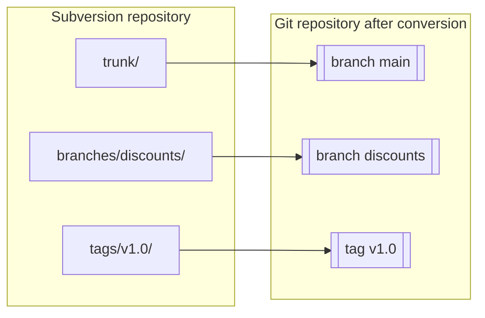
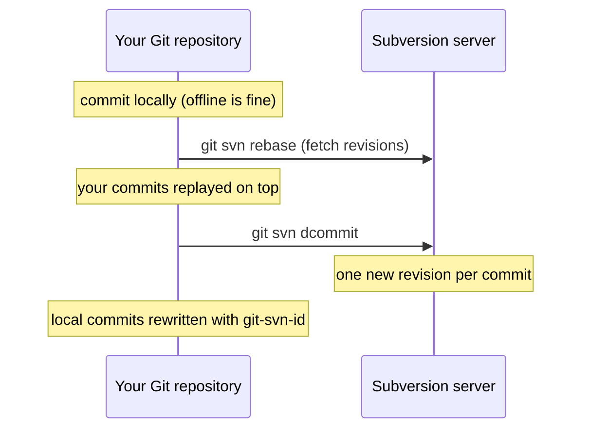
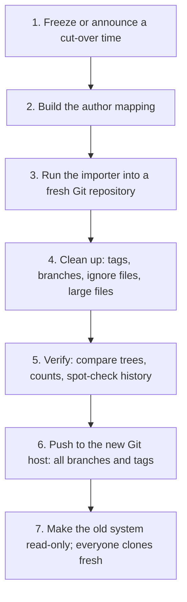
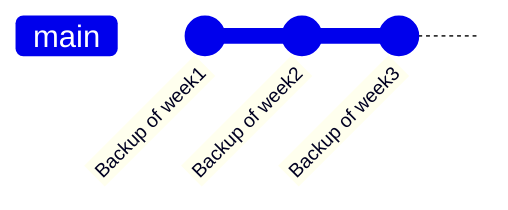

# Bridging to and migrating from other systems

> **Before this lesson:** you should understand how Git's model differs from centralised tools ([Version control and how Git thinks](#/lesson/git/version-control-ideas)), plus branching, rebasing and remotes ([What a branch really is](#/lesson/git/branches-in-a-nutshell), [Rebasing and its golden rule](#/lesson/git/rebasing), [Remotes, tags and aliases](#/lesson/git/remotes-tags-aliases)).

## In plain words

Not every project in the world lives in Git. Plenty of companies still keep code, or at least old code, in other version control systems: **Subversion**, **Mercurial**, **Perforce** and a few rarer ones. Sooner or later you meet one.

There are two things you might want to do.

- **Bridge.** You keep working in Git on your own machine, with all its comforts, while the team's official history stays in the other system. A bridge tool translates in both directions, the way an interpreter lets you speak your own language in a foreign country.
- **Migrate.** The team moves house. The entire history is converted into a Git repository once, and from then on everyone uses Git. This is like translating a whole book and then putting the original on the shelf.

The source book treats these tools in great detail, command by command. This lesson is deliberately shorter: it gives you the mental map, the handful of commands that matter, and the rules that prevent damage. When you face a real bridge or migration, you will read that tool's manual with this map in hand.

Why it matters for a job: "we are moving the old Subversion repository to Git; can you help?" is a common task for a new team member, because the experienced people remember the old system and the new people know Git. Understanding where the two models differ is what makes the difference between a clean migration and one that loses history or authorship.

## How the other systems think

A bridge or migration is a translation between models, so start with the models.

| | Git | Subversion (SVN) | Mercurial (hg) | Perforce (p4) |
|---|---|---|---|---|
| Architecture | distributed | centralised | distributed | centralised |
| Where history lives | every clone | the server | every clone | the server |
| Identifier of a change | hash of content (`4c1e7a2…`) | one increasing number for the whole repository (`r1042`) | hash, plus a local number | changelist number |
| Branch | a movable pointer | a copied folder (`branches/x`) by convention | named branch stored in commits, or "bookmark" pointers | a "stream" or a copied path |
| Tag | a pointer | a copied folder (`tags/x`) | an entry in a tracked file | a label |
| Staging area | yes | no | no | pending changelist |
| Commits offline | yes | no | yes | no |

Three differences cause most of the trouble.

1. **Linear numbering versus a graph.** Subversion's history is a single numbered sequence. Git's is a graph with merges. Anything you send to Subversion must be flattened into that sequence.
2. **Branches as folders.** A standard Subversion repository has three top-level folders: `trunk` (the main line), `branches` and `tags`. Creating a branch means copying `trunk` into `branches/name`. A converter must be told this layout so that it can turn folders into real Git branches and tags.
3. **Identity.** Subversion records a short login name such as `mokafor`. Git records a name and an email. A conversion needs a table mapping one to the other.



## Part 1: Git as a client for Subversion

Git ships with a bridge called `git svn`. It lets you clone a Subversion repository into a local Git repository, work with local commits and branches, and send your work back as Subversion revisions.

### Cloning

```bash
$ git svn clone https://svn.example.com/orchard --stdlayout --authors-file=authors.txt orchard
Initialized empty Git repository in /home/mira/orchard/.git/
r1 = 9a1e77b0c4d2... (refs/remotes/origin/trunk)
        A       README.txt
r2 = 41d0c3a6e8f1... (refs/remotes/origin/trunk)
        A       inventory.py
...
r87 = c3f01dc5a8e2... (refs/remotes/origin/trunk)
Checked out HEAD:
  https://svn.example.com/orchard/trunk r87
```

- `git svn clone <address>` downloads **every revision** one at a time and turns each into a Git commit. For a long history this can take hours.
- `--stdlayout` (or `-s`) tells it the repository uses the standard `trunk`, `branches`, `tags` folders.
- `--authors-file=authors.txt` supplies the identity table (shown in Part 3).
- Each output line `r2 = 41d0c3a…` reports which Git commit a Subversion revision became.

Every imported commit carries a marker in its message recording where it came from:

```bash
$ git log -1
commit c3f01dc5a8e2...
Author: Mira Okafor <mira@home.example>
Date:   Mon Nov 16 10:12:44 2026 +0000

    Add stock counter

    git-svn-id: https://svn.example.com/orchard/trunk@87 0b1c2d3e-...
```

The `git-svn-id` line is how the bridge knows which Git commit corresponds to which revision. Do not remove it.

### The daily loop

```bash
$ git commit -am "Reject negative quantities"     # as many local commits as you like
$ git svn rebase                                  # fetch new revisions and replay yours on top
        M       importer.py
r88 = 7f4d21aa3c5b... (refs/remotes/origin/trunk)
First, rewinding head to replay your work on top of it...
Applying: Reject negative quantities

$ git svn dcommit                                 # send each local commit as a Subversion revision
Committing to https://svn.example.com/orchard/trunk ...
        M       inventory.py
Committed r89
r89 = 2b8d6a37e1f0... (refs/remotes/origin/trunk)
```

- `git svn rebase` is the bridge's "pull": it fetches new revisions and **rebases** your unsent commits onto them.
- `git svn dcommit` is its "push": each local commit becomes one Subversion revision. Afterwards your local commits are **rewritten** (they gain a `git-svn-id` line, so their ids change).



### The rules of the bridge

Because the far side is a single numbered line, three habits are essential.

> [!WARNING]
> When bridging to Subversion: (1) **Keep history linear.** Use `git svn rebase`, not merges; a Git merge commit cannot be represented properly and is flattened on `dcommit`, losing the record of what was merged. (2) **Do not push your Git commits to a shared Git remote before they have been dcommitted.** `dcommit` rewrites them, so anyone who fetched the originals ends up with two versions, the classic rebase problem. (3) **Do not rewrite commits that have already been dcommitted**: they correspond to permanent Subversion revisions.

Local topic branches remain fully available and free: branch, experiment, squash, then rebase onto trunk and dcommit. A few extra commands answer Subversion-style questions: `git svn log` shows history with revision numbers, `git svn blame` annotates in Subversion's format, and `git svn show-ignore` converts Subversion's ignore properties into `.gitignore` lines.

A model of why a merge gets flattened:

```python-run
# Git history: commit -> parents. M is a merge of two lines of work.
parents = {"A": [], "B": ["A"], "X": ["A"], "Y": ["X"], "M": ["B", "Y"]}
changes = {"A": "base", "B": "fix on trunk", "X": "feature part 1", "Y": "feature part 2", "M": "(merge)"}

def first_parent_line(tip):
    line = []
    while tip:
        line.append(tip)
        tip = parents[tip][0] if parents[tip] else None
    return line[::-1]

print("Git graph: M has two parents:", parents["M"])
print("What a linear system receives (first-parent line only):")
for rev, c in enumerate(first_parent_line("M"), start=1):
    note = changes[c] if c != "M" else "one big change containing X and Y, with their separate history gone"
    print(f"  r{rev}: {c}  {note}")
```

The feature's individual commits X and Y do not exist on the other side; only their combined effect arrives, inside the revision made from M.

## Part 2: bridges to Mercurial and Perforce

**Mercurial** is distributed and conceptually close to Git, so the bridge is comfortable. A helper named `git-remote-hg` teaches Git to talk to Mercurial directly:

```bash
$ git clone hg::https://hg.example.com/orchard
$ cd orchard
$ git log --oneline -2
7f4d21a (HEAD -> master, origin/master) Speed up CSV import
c3f01dc Add stock counter
```

- The `hg::` prefix selects the helper. After that, ordinary `git fetch`, `git pull` and `git push` work.
- Mercurial's "bookmarks" correspond to Git branches; its permanent "named branches" appear under a `branches/` prefix. Mercurial does not allow rewriting published history at all, so the golden rule of rebasing applies with full force.

**Perforce** is centralised and widespread in game studios and large corporations. Two bridges exist:

- **Git Fusion**, a server product from Perforce's maker, exposes parts of a Perforce depot as Git repositories that you clone and push to normally.
- **`git p4`**, included with Git, is a client-side bridge in the style of `git svn`:

```bash
$ git p4 clone //depot/orchard/main@all
$ git p4 sync          # fetch new changelists
$ git p4 rebase        # fetch and replay local commits on top
$ git p4 submit        # send local commits as Perforce changelists
```

- `//depot/orchard/main` is a Perforce path; `@all` asks for the full history instead of only the latest state.
- The same three rules apply: keep it linear, do not publish unsent commits, do not rewrite sent ones.

## Part 3: migrating to Git

A migration is a one-way conversion. The outline is the same whatever the source.



### Step 2 in detail: the author map

List the logins that appear in the old history, then write one line per person.

```bash
$ svn log --xml --quiet https://svn.example.com/orchard | grep author | sort -u | \
    perl -pe 's/.*>(.*?)<.*/$1 = /' > authors.txt

$ cat authors.txt
mokafor = Mira Okafor <mira@home.example>
tlind = Tomas Lind <tomas@greenhouse.example>
jberg = Jonas Berg <jonas@greenhouse.example>
```

- The first command asks Subversion for its log in a structured format, keeps the author lines, removes duplicates (`sort -u`) and reshapes each into `login = `.
- You then complete each line by hand with the person's real name and email.

If a login is missing from the file, the import stops and tells you which one, so nothing is converted with a wrong identity.

### Step 3: import from Subversion

```bash
$ git svn clone https://svn.example.com/orchard --stdlayout --no-metadata \
      --authors-file=authors.txt orchard-git
```

`--no-metadata` leaves out the `git-svn-id` lines, since this is a one-way trip and the bridge will not be used afterwards. (Keep them if you want commit messages to record the old revision numbers.)

### Step 4: clean up

`git svn` imports Subversion tags and branches as *remote-tracking* references. Convert them into proper Git tags and branches:

```bash
$ cd orchard-git
$ for t in $(git for-each-ref --format='%(refname:short)' refs/remotes/origin/tags); do
      git tag "${t#origin/tags/}" "$t" && git branch -r -d "$t"
  done
$ for b in $(git for-each-ref --format='%(refname:short)' refs/remotes/origin); do
      git branch "${b#origin/}" "refs/remotes/$b" && git branch -r -d "$b"
  done
$ git branch -m trunk main
```

- `git for-each-ref` lists references under a prefix. Each loop creates a real tag or branch for every imported one and deletes the leftover remote-tracking reference.
- `${t#origin/tags/}` is shell syntax for "the value of `t` with that prefix removed".
- The last line renames Subversion's `trunk` to `main`.

Also translate ignore rules (`git svn show-ignore > .gitignore`, run before discarding the metadata), and decide what to do about very large binary files before publishing (the team-workflows module covers Git LFS).

### Steps 5 and 6: verify and publish

```bash
$ git log --oneline | wc -l                    # number of commits on main
87
$ git shortlog -sn | head -3                   # authors look right?
    51  Mira Okafor
    29  Tomas Lind
     7  Jonas Berg
$ git remote add origin git@git.example.com:greenhouse/orchard.git
$ git push origin --all
$ git push origin --tags
```

- `wc -l` counts lines, here the number of commits; compare it with the old system's revision count for that branch.
- `--all` pushes every branch and `--tags` every tag.

A strong check is to export the latest state from the old system and from the new Git repository into two folders and compare them file by file; they must be identical.

### Importing from other systems

| Source | Tool | Shape of the command |
|---|---|---|
| Subversion | `git svn` | `git svn clone <url> --stdlayout --authors-file=...` |
| Mercurial | `hg-fast-export` | `hg-fast-export.sh -r <hg-repo> -A authors.txt` inside an empty Git repository |
| Perforce | `git p4` | `git p4 clone //depot/path@all` |
| Anything else | a script feeding `git fast-import` | see below |

### A custom importer with `git fast-import`

When no ready-made tool fits (say the "history" is a set of dated backup folders), Git offers a general entrance: `git fast-import` reads a plain text stream describing commits and builds the repository from it. You write a small program that prints that stream.

The stream for one commit looks like this:

```
commit refs/heads/main
mark :1
committer Mira Okafor <mira@home.example> 1794816000 +0000
data 15
Backup of week1
M 644 inline README.md
data 19
Orchard stock tool
```

- `commit refs/heads/main` starts a commit on that branch.
- `mark :1` gives the commit a temporary number so that later commits can refer to it as a parent (`from :1`).
- `committer` supplies name, email, and time as seconds since 1970 plus a time-zone offset.
- `data 15` announces that the next 15 bytes are the message.
- `M 644 inline README.md` followed by `data 19` and 19 bytes says "this commit contains README.md with the following content".

The generator below builds such a stream from a made-up set of weekly backups. Run it to see the output; on a real machine you would pipe it into Git with `python make_stream.py | git fast-import` inside an empty repository.

```python-run
backups = [
    ("week1", 1794816000, {"README.md": "Orchard stock tool\n"}),
    ("week2", 1795420800, {"README.md": "Orchard stock tool\n", "prices.csv": "apple,3\n"}),
    ("week3", 1796025600, {"README.md": "Orchard stock tool\nSee prices.csv\n", "prices.csv": "apple,3\npear,5\n"}),
]

def stream(backups, who="Mira Okafor <mira@home.example>"):
    out = []
    for n, (name, when, files) in enumerate(backups, start=1):
        msg = f"Backup of {name}"
        out += ["commit refs/heads/main", f"mark :{n}", f"committer {who} {when} +0000",
                f"data {len(msg.encode())}", msg]
        if n > 1:
            out.append(f"from :{n - 1}")            # parent = previous backup
        out.append("deleteall")                      # each backup is a full snapshot
        for path, content in sorted(files.items()):
            out += [f"M 644 inline {path}", f"data {len(content.encode())}", content.rstrip("\n")]
    return "\n".join(out)

print(stream(backups))
```

The result of importing that stream is an ordinary Git history:



The reverse tool, `git fast-export`, writes an existing repository out as the same kind of stream, which is occasionally useful for moving history between tools.

## Pitfalls

- **Merging inside a bridged repository.** The merge is flattened on the way out. Rebase instead.
- **Sharing un-dcommitted (or un-submitted) commits through a Git remote.** They are rewritten when sent, so collaborators get duplicates.
- **Skipping the author map.** History ends up attributed to logins such as `mokafor` with invented email addresses, and hosting sites cannot link commits to accounts.
- **Getting the layout wrong.** Without the right `--stdlayout` (or explicit `--trunk`, `--branches`, `--tags`), branches arrive as plain folders inside one giant branch.
- **Migrating huge binaries blindly.** Every version of every large file lands in every clone forever. Decide on large-file handling before the first push.
- **Leaving the old system writable.** Someone commits to it after the conversion and that work is stranded. Make it read-only at cut-over.
- **Declaring victory without verifying.** Compare the final trees and spot-check a few old revisions.
- **Expecting revision numbers to survive.** Git has no global counter. If people refer to "r1042" in tickets, keep the `git-svn-id` metadata or a lookup table.

> [!TIP]
> Do a full rehearsal first. Run the entire conversion into a scratch repository, have two colleagues clone it and try their daily tasks for a day, write down every surprise, fix the script, and only then schedule the real cut-over. Migrations fail on details nobody anticipated, and a rehearsal is the only way to find them cheaply.

> [!INTERVIEW]
> **"How would you migrate a project from Subversion to Git?"** Plan a cut-over: announce a freeze. Build an authors file mapping Subversion logins to names and emails. Import with `git svn clone --stdlayout --authors-file=...` (or the hosting platform's importer), adding `--no-metadata` for a clean one-way move. Convert the imported remote references into real branches and tags, rename trunk to the default branch, translate ignore properties to `.gitignore`, and deal with oversized binaries. Verify by comparing exported trees and commit counts. Push all branches and tags to the new remote, set the Subversion repository read-only, and have everyone clone fresh. **"What changes for developers?"** Commits are local and need a push; branches are cheap pointers, not folder copies; there is a staging area; identifiers are hashes, not revision numbers. **"What if we must keep both for a while?"** Use `git svn` as a bridge with a strictly linear history: `git svn rebase` and `dcommit`, no merges, no publishing of commits before they are dcommitted.

## Cheat sheet

| Task | Command |
|---|---|
| Clone a Subversion repository into Git | `git svn clone <url> --stdlayout --authors-file=authors.txt` |
| Update from Subversion | `git svn rebase` |
| Send commits to Subversion | `git svn dcommit` |
| Convert Subversion ignore rules | `git svn show-ignore > .gitignore` |
| Clone a Mercurial repository | `git clone hg::<url>` (needs `git-remote-hg`) |
| Clone from Perforce | `git p4 clone //depot/path@all` |
| Update / send with Perforce | `git p4 rebase` / `git p4 submit` |
| One-way Subversion import | `git svn clone ... --no-metadata` |
| List imported references | `git for-each-ref refs/remotes` |
| Publish everything after migration | `git push origin --all` and `git push origin --tags` |
| Build a repository from a text stream | `<generator> \| git fast-import` |
| Dump a repository as a stream | `git fast-export --all` |

## Summary

Other version control systems differ from Git mainly in being centralised, in numbering changes linearly, and in representing branches and tags as copied folders. Bridge tools (`git svn`, `git-remote-hg`, `git p4`, Git Fusion) let you use Git locally against such a server; they work by converting revisions to commits and back, which demands a linear history, no publishing of commits before they are sent, and no rewriting afterwards. A migration is a one-off conversion: map authors, import with the right layout, convert imported references into real branches and tags, clean up, verify against the original, push all branches and tags, and retire the old system. For sources without a dedicated tool, `git fast-import` builds a repository from a text stream that a short script can generate.

## Glossary

- **Subversion (SVN):** a centralised version control system with repository-wide revision numbers.
- **Mercurial (hg):** a distributed version control system similar in spirit to Git.
- **Perforce (p4):** a centralised commercial system; its repository is called a depot and its commits changelists.
- **Bridge:** a tool that lets Git act as a client of another version control system.
- **Migration:** a one-time conversion of a project's history into Git.
- **Revision:** Subversion's word for one numbered commit (`r87`).
- **Trunk / branches / tags:** the conventional top-level folders of a Subversion repository.
- **`git svn`:** Git's built-in two-way bridge to Subversion.
- **`dcommit`:** the `git svn` command that sends local commits to Subversion as revisions.
- **`git-svn-id`:** the line added to commit messages linking a Git commit to its Subversion revision.
- **Authors file:** a table mapping the old system's login names to Git names and emails.
- **Cut-over:** the moment a team stops using the old system and starts using the new one.
- **`git fast-import`:** a command that creates commits from a text stream.
- **Mark:** a temporary number in a fast-import stream used to refer to an object created earlier.

## Check yourself

```quiz
[
  {"q": "What is the difference between bridging and migrating?", "options": ["Bridging is one-way; migrating is two-way", "Migrating needs no tools", "Bridging keeps the other system as the official history while you work in Git; migrating converts the history once and the team switches to Git", "They are the same"], "answer": 2, "explain": "A bridge translates continuously in both directions. A migration is a single conversion followed by retiring the old system."},
  {"q": "In a standard Subversion layout, how is a branch represented?", "options": ["Branches are not possible", "As a copy of trunk in a folder under branches/", "As a pointer to a revision", "As a file listing commits"], "answer": 1, "explain": "Subversion branches and tags are folder copies by convention, which is why the importer must be told the layout to produce real Git branches and tags."},
  {"q": "Why should you avoid Git merge commits when working through `git svn`?", "options": ["Subversion's history is linear, so the merge is flattened on dcommit and the merged branch's history is lost", "They are slower", "Subversion rejects them with an error", "They change author names"], "answer": 0, "explain": "Only the first-parent line can be sent as revisions. Use git svn rebase to keep your work linear."},
  {"q": "What does `git svn dcommit` do to your local commits?", "options": ["Deletes them", "Nothing", "Squashes them into one", "Sends each as a Subversion revision and rewrites it locally, changing its id"], "answer": 3, "explain": "Each commit gains a git-svn-id line recording its revision, so it becomes a new commit. That is why unsent commits must not be published to other Git users first."},
  {"q": "What is the purpose of the authors file in a Subversion import?", "options": ["To list who may push", "To set file permissions", "To sign commits", "To map Subversion login names to Git names and email addresses"], "answer": 3, "explain": "Subversion stores only a login. The mapping gives each imported commit a proper Git identity."},
  {"q": "After `git svn clone`, Subversion tags and branches appear as remote-tracking references. What should a migration do with them?", "options": ["Leave them; Git converts them on push", "Create real Git tags and branches from them, then remove the leftover remote references", "Delete them", "Merge them into main"], "answer": 1, "explain": "They must be turned into local tags and branches so that pushing --all and --tags publishes them."},
  {"q": "What does `git fast-import` consume?", "options": ["A text stream describing commits, their metadata and file contents", "A zip archive", "A Subversion dump file only", "A list of URLs"], "answer": 0, "explain": "Any script that can print the stream format can create a Git history, which makes it the universal importer."},
  {"q": "Which step should come last in a migration?", "options": ["Making the old system read-only and having everyone clone the new repository", "Building the author map", "Running the importer", "Converting tags"], "answer": 0, "explain": "Only after import, clean-up, verification and publishing is it safe to cut over; freezing the old system prevents stranded commits."}
]
```

> **Source:** Chacon & Straub, Pro Git 2e, ch. 9 (Git as a Client; Migrating to Git), condensed. Explanations, examples and code written for this guide.
