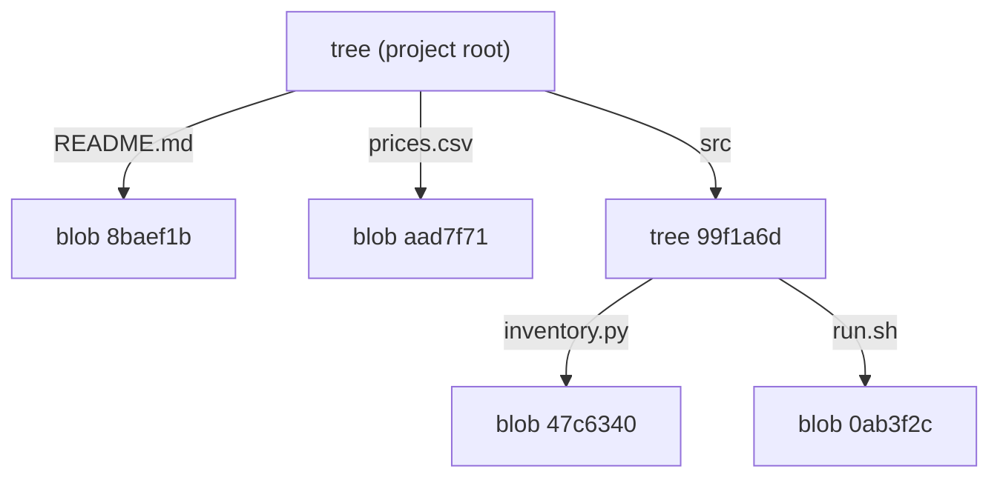
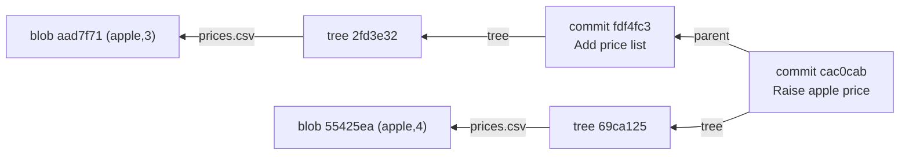
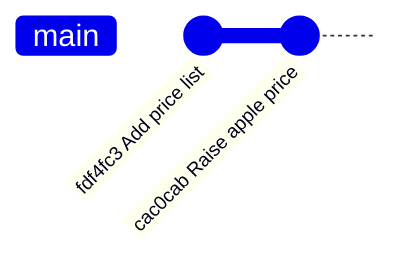
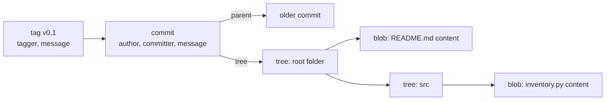
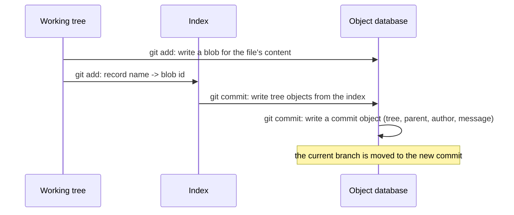

# Objects: blobs, trees, commits and tags

> **Before this lesson:** you should know the snapshot model and content hashing in outline ([Version control and how Git thinks](#/lesson/git/version-control-ideas)), staging and committing ([Getting a repository and recording changes](#/lesson/git/recording-changes)) and annotated tags ([Remotes, tags and aliases](#/lesson/git/remotes-tags-aliases)).

## In plain words

Imagine a cloakroom where the ticket number is not chosen by the attendant but **calculated from the coat itself**: its colour, size, every thread. Hand in the same coat twice and you get the same ticket both times, and the cloakroom keeps only one copy. Hand in a coat with one button changed and the ticket is completely different. Nobody can swap your coat for another without the ticket no longer matching.

Git's storage is that cloakroom. Underneath all the commands you have learned sits a very small database with one rule: *give me some content, and I will store it under a name calculated from that content*. Such a store is called **content-addressable**. Git keeps only four kinds of thing in it:

- a **blob**: the contents of one file;
- a **tree**: a folder listing, saying which names map to which blobs and sub-trees;
- a **commit**: a pointer to one tree (the snapshot), plus author, date, message, and pointers to parent commits;
- a **tag** (annotated): a signed-and-dated label pointing at another object.

Everything else, branches, merges, rebases, is built from these four.

Why it matters for a job: you can use Git for years without this lesson. But the people who are never confused by Git, and who can rescue a repository when something goes wrong, are the ones who know what is underneath. It also happens to be a favourite area for interview questions that separate memorised commands from understanding.

## Porcelain and plumbing

Git's commands come in two layers. The friendly ones you use every day (`add`, `commit`, `switch`, `merge`) are called **porcelain**. Beneath them are low-level commands called **plumbing**, which do one small step each. In this module we use plumbing to watch Git work. You will rarely need these commands at work; they are our microscope.

## Inside the .git folder

```bash
$ git init lab
Initialized empty Git repository in /home/mira/lab/.git/
$ cd lab
$ ls -F .git
HEAD  config  description  hooks/  info/  objects/  refs/
```

- `ls -F` lists a folder and marks sub-folders with a trailing `/`.
- `objects/` is the database this lesson is about.
- `refs/` holds branch and tag pointers, and `HEAD` says which branch is current (next lesson).
- `config` is the repository's configuration; `hooks/` holds hook scripts; `info/` holds a private ignore file. A file named `index` (the staging area) appears after the first `git add`.

```bash
$ find .git/objects
.git/objects
.git/objects/info
.git/objects/pack
```

`find` lists everything under a folder. The database is empty apart from two housekeeping folders.

## Blobs: file contents

### Storing content by hand

```bash
$ echo 'apple,3' | git hash-object -w --stdin
aad7f710a5b9cbfaf7b7cf8aeccf691db57515d6
```

- `echo 'apple,3'` prints the text followed by a line break.
- `|` feeds that into the next command.
- `git hash-object` computes the id Git would give to some content. `--stdin` says "read the content from the pipe", and `-w` says "also write it into the database".
- The reply is the 40-character **object id**.

```bash
$ find .git/objects -type f
.git/objects/aa/d7f710a5b9cbfaf7b7cf8aeccf691db57515d6
```

`-type f` shows only files. One file appeared. Its folder is the first two characters of the id and its name is the remaining 38. That split exists only so that no single folder ends up with millions of entries.

### Reading it back

```bash
$ git cat-file -p aad7f71
apple,3
$ git cat-file -t aad7f71
blob
$ git cat-file -s aad7f71
8
```

- `git cat-file -p <id>` prints an object's content in readable form ("pretty-print").
- `-t` prints its type: this is a **blob**.
- `-s` prints its size in bytes: seven characters plus the line break.

A blob holds content and nothing else. It does not know its file name, its folder, or its permissions. Two files with identical content, anywhere in the project and at any time in history, are one blob.

### How the id is computed

Git does not hash the raw content. It first puts a small header in front: the type, a space, the size in bytes, and a zero byte. Then it applies the SHA-1 hash function (SHA stands for Secure Hash Algorithm) to header plus content.

```
"blob 8\0apple,3\n"   --SHA-1-->   aad7f710...
```

What is written to disk is that same byte sequence, compressed with zlib (a standard compression library). The following code reproduces the whole procedure. The id it prints for the empty file, `e69de29b…`, is the same in every Git repository in the world, and you can confirm any of them on your own machine with `git hash-object`.

```python-run
import hashlib, zlib

def git_object(kind, body):
    """Return (object id, bytes as stored on disk) for a Git object."""
    store = f"{kind} {len(body)}".encode() + b"\0" + body
    return hashlib.sha1(store).hexdigest(), zlib.compress(store)

for text in ["", "hello\n", "apple,3\n"]:
    oid, on_disk = git_object("blob", text.encode())
    print(f"{text!r:12} -> {oid}   stored as {len(on_disk)} compressed bytes in .git/objects/{oid[:2]}/{oid[2:8]}...")

a, _ = git_object("blob", b"apple,3\n")
b, _ = git_object("blob", b"apple,4\n")
print("one character changed:", a[:12], "vs", b[:12])
```

Change one character and the id is unrecognisably different. That property is what lets Git notice any corruption or tampering.

### Versions are separate blobs

```bash
$ echo 'apple,3' > prices.csv
$ git hash-object -w prices.csv
aad7f710a5b9cbfaf7b7cf8aeccf691db57515d6
$ echo 'apple,4' > prices.csv
$ git hash-object -w prices.csv
55425eaeb5e7d2b140e836014371824a19c351db
```

Two versions, two blobs. Either can be brought back with `git cat-file -p <id> > prices.csv`. That is already a tiny version control system, with two flaws: you have to remember ids, and the file's name is stored nowhere. Trees fix the second flaw.

## Trees: folder listings

A **tree** object is Git's record of one folder. Each entry has a **mode** (kind of entry), a type, an object id and a name.

In a real repository that has commits, look at the tree of the latest commit:

```bash
$ git cat-file -p main^{tree}
100644 blob 8baef1b4abc478178b004d62031cf7fe6db6f903    README.md
100644 blob aad7f710a5b9cbfaf7b7cf8aeccf691db57515d6    prices.csv
040000 tree 99f1a6d12cb4b6f19c8655fca46c3ecf317074e0    src
```

- `main^{tree}` means "the tree that the commit at `main` points to".
- The first two entries are files: mode `100644`, type blob, the blob's id, and the name.
- The third entry is a sub-folder: mode `040000`, type tree, and the id of *another tree object* that lists the contents of `src`.

```bash
$ git cat-file -p 99f1a6d
100644 blob 47c6340d6459e05787f644c2447d2595f5d3a54b    inventory.py
100755 blob 0ab3f2c7e9d1845b6a7c8d9e0f1a2b3c4d5e6f70    run.sh
```

| Mode | Meaning |
|---|---|
| `100644` | ordinary file |
| `100755` | executable file |
| `120000` | symbolic link (a file that points at another path) |
| `040000` | sub-folder (a tree) |
| `160000` | submodule (a commit in another repository) |



So a tree is a snapshot of a folder: names bound to content. Because a tree's own id is a hash of its entries, and those entries contain the ids of the blobs and sub-trees, **the id of a root tree identifies the exact content of the entire project**. If two commits have the same root-tree id, their files are identical, and Git knows this by comparing two 40-character strings.

### Building a tree by hand

Normally `git add` and `git commit` do this. With plumbing, the steps are visible:

```bash
$ git update-index --add --cacheinfo 100644,aad7f710a5b9cbfaf7b7cf8aeccf691db57515d6,prices.csv
$ git write-tree
2fd3e32d1c68876acda60226269070d113b8dbc9
$ git cat-file -p 2fd3e32
100644 blob aad7f710a5b9cbfaf7b7cf8aeccf691db57515d6    prices.csv
```

- `git update-index --add --cacheinfo <mode>,<id>,<name>` puts an entry into the index (the staging area) saying "the file `prices.csv` has this blob as its content". This is the core of what `git add` does.
- `git write-tree` turns the current index into a tree object and prints its id. This is the first thing `git commit` does.

## Commits: snapshots with a story

A tree says what the project looks like. It does not say who saved it, when, why, or what came before. A **commit** object adds exactly that.

```bash
$ echo 'Add price list' | git commit-tree 2fd3e3
fdf4fc3344e67ab068f836878b6c4951e3b15f3d
$ git cat-file -p fdf4fc3
tree 2fd3e32d1c68876acda60226269070d113b8dbc9
author Mira Okafor <mira@home.example> 1795168212 +0100
committer Mira Okafor <mira@home.example> 1795168212 +0100

Add price list
```

- `git commit-tree <tree>` creates a commit object for that tree, reading the message from the pipe.
- The commit's content is a few lines of plain text: the id of its **tree**; the **author** and **committer** with a time (seconds since 1 January 1970, then a time-zone offset); a blank line; the message.

This first commit has no parent. A second commit names its predecessor with `-p`:

```bash
$ echo 'Raise apple price' | git commit-tree 69ca12 -p fdf4fc3
cac0cab538b970a37ea1e769cbbde608743bc96d
$ git cat-file -p cac0cab
tree 69ca1256edbc649f3ce36674d3614321fcea7d0f
parent fdf4fc3344e67ab068f836878b6c4951e3b15f3d
author Mira Okafor <mira@home.example> 1795168260 +0100
committer Mira Okafor <mira@home.example> 1795168260 +0100

Raise apple price
```

The `parent` line is the link that forms history. A merge commit has two `parent` lines. At this point `git log cac0cab` works: real history, created without `git add` or `git commit`.



The same history as a commit graph:



### Why history cannot be changed quietly

A commit's id is the hash of its text, and that text contains the tree id and the parent id. So:

- change a file → its blob id changes → the tree id changes → the commit id changes;
- change an old commit → its id changes → its child must name a different parent → the child's id changes → and so on to the tip.

Therefore **one commit id fixes the whole project content and the whole history behind it**. This is why "editing" history (amend, rebase) always produces new commits, and why two people who see the same commit id know they have the same history.

The model below is a miniature Git object store with all three object types, in a simplified text format. Run it, then change one character of the first file and watch every id above it change.

```python-run
import hashlib

store = {}

def put(kind, body):
    data = f"{kind} {len(body.encode())}\0{body}".encode()
    oid = hashlib.sha1(data).hexdigest()
    store[oid] = (kind, body)
    return oid

def blob(text):                 return put("blob", text)
def tree(entries):              return put("tree", "".join(f"{m} {n}\t{o}\n" for m, n, o in sorted(entries, key=lambda e: e[1])))
def commit(t, parents, msg):    return put("commit", f"tree {t}\n" + "".join(f"parent {p}\n" for p in parents) + f"\n{msg}\n")

readme = blob("Orchard stock tool\n")
prices = blob("apple,3\n")
t1 = tree([("100644", "README.md", readme), ("100644", "prices.csv", prices)])
c1 = commit(t1, [], "Add price list")

prices2 = blob("apple,4\n")
t2 = tree([("100644", "README.md", readme), ("100644", "prices.csv", prices2)])
c2 = commit(t2, [c1], "Raise apple price")

print("commit 1:", c1[:10], " tree:", t1[:10])
print("commit 2:", c2[:10], " tree:", t2[:10], " parent:", c1[:10])
print("README.md blob is shared by both trees:", readme[:10])
print("objects stored:", len(store), "(2 commits, 2 trees, 3 blobs)")
```

Seven objects for two commits of a two-file project: the unchanged `README.md` is stored once and referenced from both trees.

## Tags: labels that are objects

A **lightweight tag** is only a pointer file (next lesson). An **annotated tag** is the fourth kind of object.

```bash
$ git tag -a v0.1 -m "First usable version" cac0cab
$ git cat-file -t v0.1
tag
$ git cat-file -p v0.1
object cac0cab538b970a37ea1e769cbbde608743bc96d
type commit
tag v0.1
tagger Mira Okafor <mira@home.example> 1795168400 +0100

First usable version
```

- `object` is the id of what is tagged, and `type` says it is a commit.
- `tagger` and the message belong to the tag itself, independently of the commit's author and message.

A tag object usually points at a commit but may point at any object. `v0.1^{commit}` (or `v0.1^{}`) means "follow the tag to the commit".

## The four objects together



| Object | Contains | Points to | Created by (porcelain) |
|---|---|---|---|
| blob | file content only | nothing | `git add` |
| tree | list of mode, type, id, name | blobs and trees | `git commit` (from the index) |
| commit | author, committer, message | one tree, zero or more parent commits | `git commit`, `git merge` |
| tag | tagger, message, optional signature | any object, usually a commit | `git tag -a` |

And here is what the everyday commands do in these terms:



Note that `git add` already writes the blob into the database. That is why staged content can sometimes be recovered even if it was never committed.

## Inspecting objects in any repository

```bash
$ git cat-file -p HEAD                  # the commit object you are on
$ git cat-file -p HEAD^{tree}           # its root tree
$ git ls-tree -r HEAD                   # every file in the snapshot, recursively
$ git rev-parse HEAD:src/inventory.py   # the blob id of one file in a commit
$ git show HEAD:src/inventory.py        # that file's content at that commit
$ git count-objects -v                  # how many loose objects, how much space
```

`<commit>:<path>` is a general notation for "this path as it was in that commit".

> [!TIP]
> When a Git concept feels vague, look at the object. `git cat-file -p` on a commit, then on its tree, then on a blob, takes one minute and turns "a commit is a snapshot" from a slogan into something you have seen with your own eyes.

> [!WARNING]
> The plumbing commands above that *read* (`cat-file`, `ls-tree`, `rev-parse`) are harmless. Never edit, rename or delete files inside `.git/objects` by hand. Each file's name must equal the hash of its content, and other objects refer to it by that name; one manual change can make commits unreadable. If you suspect damage, run `git fsck` (see the lesson on maintenance and data recovery) and restore from another clone.

## Pitfalls and misconceptions

- **"A commit stores the changes."** A commit stores a pointer to a full snapshot (a tree). Diffs are computed by comparing two trees when you ask.
- **"Blobs know their file names."** Names live in trees. Renaming a file creates a new tree entry pointing at the same blob.
- **"Identical files are stored twice."** Same content, same id, one blob.
- **"The header counts characters."** It counts bytes. A file containing `é` in UTF-8 has one character more than its ASCII look-alike in bytes; hashing with the wrong length gives the wrong id.
- **"Git tracks empty folders."** A tree with no entries is never written for a sub-folder, so empty folders are not recorded.
- **"Amend edits the commit."** Objects are immutable. Amend writes a new commit object and moves the branch.
- **"Deleting a branch deletes commits."** It removes a pointer. The objects stay until garbage collection finds them unreachable.

> [!INTERVIEW]
> **"What happens internally when you run `git add` and `git commit`?"** `git add` compresses the file's content into a blob object named by the SHA-1 of a header plus the content, and records path, mode and blob id in the index. `git commit` writes tree objects from the index (one per directory), then writes a commit object containing the root tree's id, the parent commit id(s), author, committer and message, and finally moves the current branch reference to the new commit's id. **"Why is Git's history tamper-evident?"** Every object is named by the hash of its content, and commits include the hashes of their tree and parents, so changing anything changes every id downstream; a single commit id therefore pins the full content and history. **"Name the four object types."** Blob, tree, commit and annotated tag.

## Cheat sheet

| Task | Command |
|---|---|
| Compute the id of content | `git hash-object <file>` (add `-w` to store it) |
| Print an object | `git cat-file -p <id>` |
| Type / size of an object | `git cat-file -t <id>` / `git cat-file -s <id>` |
| Root tree of a commit | `git cat-file -p <commit>^{tree}` |
| All files in a snapshot | `git ls-tree -r <commit>` |
| Blob id of a path in a commit | `git rev-parse <commit>:<path>` |
| Content of a path in a commit | `git show <commit>:<path>` |
| Stage a blob under a name (plumbing) | `git update-index --add --cacheinfo <mode>,<id>,<path>` |
| Write the index as a tree | `git write-tree` |
| Make a commit object from a tree | `git commit-tree <tree> -p <parent> -m "msg"` |
| Count loose objects | `git count-objects -v` |

## Summary

Git is a content-addressable store: every object is saved under the SHA-1 of a short header plus its content, compressed with zlib. A blob holds one file's content with no name. A tree lists the entries of one folder (mode, type, id, name), pointing at blobs and other trees, so a root tree id identifies an entire snapshot. A commit points at one tree and at its parent commits and adds author, committer and message; the parent links form the history graph. An annotated tag is an object with its own tagger and message pointing at another object. Because ids are derived from content and each level embeds the ids below it, objects are immutable, identical content is stored once, and a commit id fixes both the project's content and its complete history.

## Glossary

- **Content-addressable store:** a database in which each item's key is computed from the item's content.
- **Object:** one stored item in Git's database: a blob, tree, commit or tag.
- **Object id (OID):** the 40-hex-character SHA-1 name of an object.
- **SHA-1:** the hash function Git uses by default to compute object ids.
- **Hash function:** a function that turns any content into a fixed-length fingerprint.
- **zlib:** the compression library Git uses to store objects compactly.
- **Blob:** an object holding the content of one file.
- **Tree:** an object listing the entries of one directory.
- **Mode:** a number in a tree entry describing the kind of entry, such as `100644` for a regular file.
- **Commit:** an object pointing at a tree and parent commits, with author, committer and message.
- **Annotated tag:** a tag stored as an object with tagger and message.
- **Porcelain / plumbing:** user-friendly commands / low-level building-block commands.
- **Loose object:** an object stored as its own file under `.git/objects`.
- **Immutable:** unable to be changed after creation.
- **Symbolic link:** a file whose content is the path of another file.

## Check yourself

```quiz
[
  {"q": "What does a blob object contain?", "options": ["Only the file's content", "The file's content and permissions", "The file's name and content", "A diff against the previous version"], "answer": 0, "explain": "Names and modes are recorded in tree entries. The blob is pure content, which is why identical files share one blob."},
  {"q": "How is a blob's object id computed?", "options": ["SHA-1 of the raw content only", "A random number", "SHA-1 of the header 'blob <size>' plus a zero byte plus the content", "SHA-1 of the file name"], "answer": 2, "explain": "Git prefixes the content with the type, a space, the byte length and a NUL, then hashes the whole sequence."},
  {"q": "Two files in different folders have identical content. How many blobs does Git store for them?", "options": ["It depends on the file names", "One per folder plus one", "Two", "One"], "answer": 3, "explain": "The id depends only on content, so both tree entries point at the same blob."},
  {"q": "What does a tree object record?", "options": ["The commit history", "For one directory: each entry's mode, type, object id and name", "The list of branches", "The differences between two commits"], "answer": 1, "explain": "A tree is a directory listing that maps names to blobs and sub-trees."},
  {"q": "Which lines appear in a commit object?", "options": ["Only the message and date", "The full content of every file", "A list of changed lines", "tree, parent(s), author, committer, then the message"], "answer": 3, "explain": "A commit is a small text object pointing at one tree and its parent commits, with identity, time and message."},
  {"q": "Why does changing an old commit change the ids of all later commits?", "options": ["It does not", "Git renumbers commits by date", "Each commit's content includes its parent's id, so a new parent id means new content and a new hash, repeatedly up the chain", "The files are re-compressed"], "answer": 2, "explain": "Ids are hashes of content that embeds the ids below. This chaining is what makes history tamper-evident."},
  {"q": "What is the difference between a lightweight tag and an annotated tag at the object level?", "options": ["An annotated tag stores a copy of the files", "A lightweight tag is a blob", "None", "A lightweight tag is only a reference to a commit; an annotated tag is a separate tag object with tagger, date and message"], "answer": 3, "explain": "Only annotated tags create a fourth kind of object in the database."},
  {"q": "After `git add notes.txt` but before any commit, where is the file's content?", "options": ["Already stored as a blob in .git/objects and referenced from the index", "Only in the working tree", "In a temporary file that is deleted on commit", "In a tree object"], "answer": 0, "explain": "git add writes the blob immediately and records its id in the index. The tree and commit objects are written at commit time."}
]
```

> **Source:** Chacon & Straub, Pro Git 2e, ch. 10 (Plumbing and Porcelain; Git Objects). Explanations, examples and code written for this guide.
