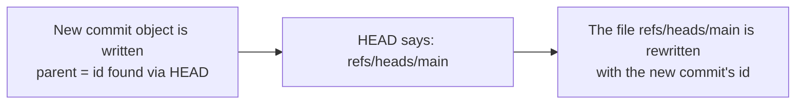
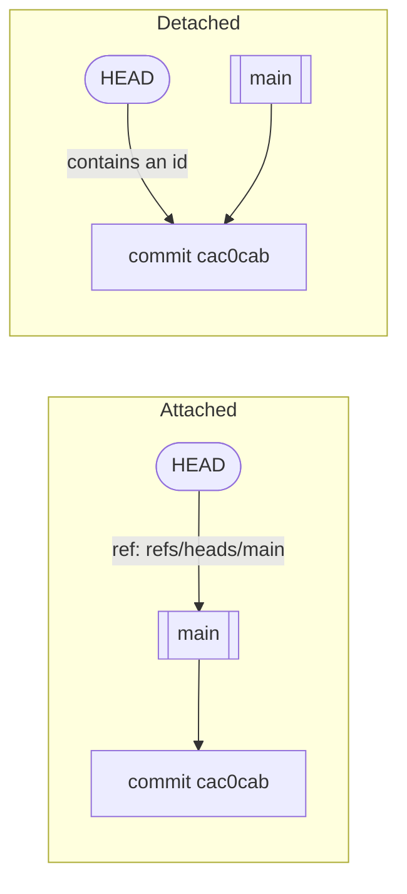
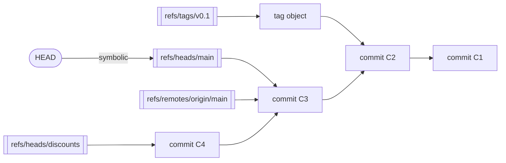
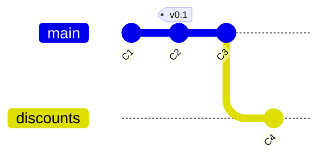
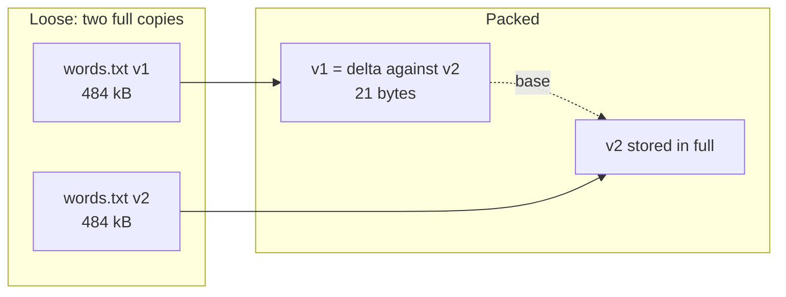

# References and packfiles

> **Before this lesson:** read [Objects: blobs, trees, commits and tags](#/lesson/git/objects). You should also know branches, HEAD and tags from the user's side ([What a branch really is](#/lesson/git/branches-in-a-nutshell), [Remotes, tags and aliases](#/lesson/git/remotes-tags-aliases)).

## In plain words

The previous lesson showed Git's warehouse: every item stored under a long code computed from its content. Two practical problems remain.

**Problem 1: nobody can remember the codes.** A warehouse where each shelf is labelled `cac0cab538b970a3…` needs a signpost at the door saying "today's deliveries: aisle `cac0cab…`". In Git those signposts are called **references**, or **refs**: tiny text files that give a human-friendly name (`main`, `v1.0`, `origin/main`) to an object id. A branch is a ref. A tag is a ref. `HEAD` is a ref that points at another ref.

**Problem 2: storing every version of every file in full is wasteful.** If you change one line of a 10,000-line file, Git's basic storage keeps two complete copies. The warehouse periodically tidies up: it puts thousands of items into one sealed crate and, for near-identical items, keeps one in full and stores the others as "same as that one, except for these lines". That crate is a **packfile**, and the "except for these lines" recipe is a **delta**.

Why it matters for a job: refs explain what every branch and tag command really does, why branch operations are instant, and what "detached HEAD" physically is. Packfiles explain why a repository with ten years of history can be smaller than its working folder, why `git clone` prints "Resolving deltas", and why committing large binary files hurts.

## Part 1: references

### A branch is a file with an id in it

```bash
$ find .git/refs -type f
.git/refs/heads/main
.git/refs/heads/discounts
.git/refs/tags/v0.1

$ cat .git/refs/heads/main
cac0cab538b970a37ea1e769cbbde608743bc96d
```

- `find .git/refs -type f` lists the files under `.git/refs`.
- `refs/heads/` holds local branches, `refs/tags/` holds tags, and `refs/remotes/` holds remote-tracking branches.
- The branch `main` is a file containing one commit id and a line break. That is the whole branch.

You could create a branch by writing such a file. Git offers a plumbing command that does it safely (it checks the id and records the change in the reflog):

```bash
$ git update-ref refs/heads/experiment cac0cab538b970a37ea1e769cbbde608743bc96d
$ git branch
  discounts
  experiment
* main
```

- `git update-ref <ref> <id>` sets a reference to an id. `git branch experiment cac0cab` does this for you.

To see every reference and what it points to:

```bash
$ git show-ref
7f4d21aa3c5b9e8d1f0a2b4c6d8e0f1a3b5c7d9e refs/heads/discounts
cac0cab538b970a37ea1e769cbbde608743bc96d refs/heads/experiment
cac0cab538b970a37ea1e769cbbde608743bc96d refs/heads/main
cac0cab538b970a37ea1e769cbbde608743bc96d refs/remotes/origin/main
9f3c1e2d4b5a6978c0d1e2f3a4b5c6d7e8f9a0b1 refs/tags/v0.1
```

`git for-each-ref` produces the same list with flexible formatting, and is what scripts use.

### HEAD: a reference to a reference

When you commit, how does Git know which branch to move? From `HEAD`.

```bash
$ cat .git/HEAD
ref: refs/heads/main
```

`HEAD` does not normally contain an id. It contains the *name of another reference*. Such an indirect pointer is called a **symbolic reference**. Read it as "the current branch is `main`".

```bash
$ git switch discounts
$ cat .git/HEAD
ref: refs/heads/discounts
```

`git switch` rewrites that one line (and updates the index and working tree to the branch's snapshot). The plumbing equivalents are `git symbolic-ref HEAD` to read it and `git symbolic-ref HEAD refs/heads/discounts` to set it.

Now you can see what a commit does at the lowest level:



**Detached HEAD**, in these terms, is `HEAD` containing an id directly:

```bash
$ git switch --detach v0.1
$ cat .git/HEAD
cac0cab538b970a37ea1e769cbbde608743bc96d
```

With no branch named in `HEAD`, a new commit updates only `HEAD` itself. No branch file changes, which is why such commits are easy to lose when you switch away.



### Tags as references

A **lightweight tag** is a file in `refs/tags/` containing a commit id: the same thing as a branch, except that nothing ever moves it.

```bash
$ git update-ref refs/tags/tried-it cac0cab538b970a37ea1e769cbbde608743bc96d
$ cat .git/refs/tags/tried-it
cac0cab538b970a37ea1e769cbbde608743bc96d
```

An **annotated tag** adds one level: the file in `refs/tags/` contains the id of a **tag object**, and the tag object points at the commit.

```bash
$ cat .git/refs/tags/v0.1
9f3c1e2d4b5a6978c0d1e2f3a4b5c6d7e8f9a0b1
$ git cat-file -t 9f3c1e2
tag
$ git rev-parse v0.1^{commit}
cac0cab538b970a37ea1e769cbbde608743bc96d
```

- The reference holds `9f3c1e2…`, whose type is `tag`.
- `v0.1^{commit}` follows the tag object to the commit.

### Remote-tracking references

```bash
$ cat .git/refs/remotes/origin/main
cac0cab538b970a37ea1e769cbbde608743bc96d
```

These record where each branch was on the remote at your last fetch or push. They differ from branches in one respect: `HEAD` can never be attached to them. Git manages them as bookmarks; you do not commit on them. Switching to one gives a detached HEAD.

### All the pieces in one picture



The same history in graph form:



### Packed refs

A repository with thousands of branches and tags would need thousands of small files. Git periodically gathers references into one file, `.git/packed-refs`:

```bash
$ git pack-refs --all
$ cat .git/packed-refs
# pack-refs with: peeled fully-peeled sorted
7f4d21aa3c5b9e8d1f0a2b4c6d8e0f1a3b5c7d9e refs/heads/discounts
cac0cab538b970a37ea1e769cbbde608743bc96d refs/heads/main
cac0cab538b970a37ea1e769cbbde608743bc96d refs/remotes/origin/main
9f3c1e2d4b5a6978c0d1e2f3a4b5c6d7e8f9a0b1 refs/tags/v0.1
^cac0cab538b970a37ea1e769cbbde608743bc96d
```

- Each line is an id and a reference name.
- A line beginning with `^` gives, for the annotated tag above it, the commit it finally points to (its "peeled" value), saving a lookup.

When Git looks up a reference it checks for a loose file under `refs/` first and falls back to `packed-refs`. When a packed reference is updated, a new loose file is written and takes precedence. This is why you must not conclude that a branch is missing because its file under `.git/refs/heads/` is absent: use `git rev-parse <name>` or `git show-ref`.

A runnable model of reference lookup, including the symbolic `HEAD` and the loose-before-packed rule:

```python-run
loose = {"HEAD": "ref: refs/heads/main",
         "refs/heads/main": "c3c3c3c"}                  # updated recently: loose file
packed = {"refs/heads/main": "c2c2c2c",                 # stale packed value
          "refs/heads/discounts": "c4c4c4c",
          "refs/tags/v0.1": "9f3c1e2"}
objects = {"9f3c1e2": ("tag", "c2c2c2c"), "c2c2c2c": ("commit", None),
           "c3c3c3c": ("commit", None), "c4c4c4c": ("commit", None)}

def read_ref(name):
    value = loose.get(name, packed.get(name))           # loose wins over packed
    if value is None:
        return None
    if value.startswith("ref: "):                       # symbolic ref: follow it
        return read_ref(value[5:])
    return value

def peel(oid):
    kind, target = objects[oid]
    return peel(target) if kind == "tag" else oid       # follow tag objects to the commit

def resolve(short):
    for candidate in (short, "refs/tags/" + short, "refs/heads/" + short, "refs/remotes/" + short):
        oid = read_ref(candidate)
        if oid:
            return candidate, oid, peel(oid)

for name in ("HEAD", "main", "discounts", "v0.1"):
    print(f"{name:10} -> {resolve(name)}")
```

The search order in `resolve` (the exact name, then tags, then branches, then remote-tracking refs) is the order Git itself uses, which is why a tag and a branch with the same name cause "ambiguous" warnings, and why you should avoid such clashes.

## Part 2: packfiles

### Loose objects and their cost

Each object from the previous lesson is first written as its own compressed file, a **loose object**. Compression helps, but every version of a file is still stored in full.

Make the cost visible. Commit a large text file, change one line, commit again:

```bash
$ curl -s https://example.org/big-wordlist.txt > words.txt
$ git add words.txt && git commit -q -m "Add word list"
$ git cat-file -s HEAD:words.txt
483920

$ echo "zymurgy" >> words.txt
$ git commit -q -am "Add one word"
$ git cat-file -s HEAD:words.txt
483928

$ git count-objects -v
count: 6
size: 364
in-pack: 0
packs: 0
size-pack: 0
```

- `curl -s <address> > words.txt` downloads a file (`-s` hides the progress display).
- `git cat-file -s HEAD:words.txt` prints the size of that file's blob: about 484 kB, twice, for two versions differing by eight bytes.
- `git count-objects -v` reports 6 loose objects using 364 kB on disk (after compression), and nothing packed.

### Packing

```bash
$ git gc
Enumerating objects: 6, done.
Counting objects: 100% (6/6), done.
Delta compression using up to 8 threads
Compressing objects: 100% (4/4), done.
Writing objects: 100% (6/6), done.
Total 6 (delta 1), reused 0 (delta 0), pack-reused 0

$ git count-objects -v
count: 0
size: 0
in-pack: 6
packs: 1
size-pack: 183

$ ls .git/objects/pack
pack-3e5f7a1c9b0d2e4f6a8c0b1d3e5f7a9c1b3d5e7f.idx
pack-3e5f7a1c9b0d2e4f6a8c0b1d3e5f7a9c1b3d5e7f.pack
```

- `git gc` ("garbage collect") tidies the repository; among other things it packs loose objects.
- `Total 6 (delta 1)` says six objects were written and one of them is stored as a delta.
- Afterwards there are no loose objects; one pack holds all six in 183 kB, about half the previous space.
- Two files appeared. The `.pack` file contains the objects. The `.idx` file is an **index**: a sorted table from object id to position in the pack, so that Git can find any object without reading the whole pack.

### What is inside

```bash
$ git verify-pack -v .git/objects/pack/pack-3e5f7a1c*.idx
5d0e8f7a... commit 228 152 12
9c1b3a5d... commit 180 123 164
b042a60e... blob   483928 180214 287
0155eb42... tree   37 48 180501
d8329fc1... tree   37 48 180549
033b4468... blob   21 32 180597 1 b042a60e...
non delta: 5 objects
chain length = 1: 1 object
```

Each row is: object id, type, original size, size in the pack, position in the pack. A row with two extra columns is a **delta**: its depth, and the id of the **base** object it is described against.

Read the two blob rows carefully:

- `b042a60e…` is the **newer** version, stored in full (483,928 bytes, compressed to about 180 kB).
- `033b4468…` is the **older** version, stored in 21 bytes as a delta against the newer one.

Storing the *newest* version whole and older versions as deltas is deliberate: the newest version is the one you read most often, so it should be the fastest to reach.



### How a delta works

A delta is a short list of instructions for rebuilding one object from another: "copy bytes 0 to 483,919 from the base; stop". Two instruction kinds suffice: **copy** a range from the base, and **insert** new bytes given literally.

```python-run
def make_delta(base, target):
    """A toy delta: common prefix and suffix are copied, the middle is inserted."""
    p = 0
    while p < min(len(base), len(target)) and base[p] == target[p]:
        p += 1
    s = 0
    while s < min(len(base), len(target)) - p and base[-1 - s] == target[-1 - s]:
        s += 1
    ops = []
    if p: ops.append(("copy", 0, p))
    middle = target[p:len(target) - s]
    if middle: ops.append(("insert", middle))
    if s: ops.append(("copy", len(base) - s, s))
    return ops

def apply_delta(base, ops):
    out = ""
    for op in ops:
        out += base[op[1]:op[1] + op[2]] if op[0] == "copy" else op[1]
    return out

words = "\n".join(f"word{i:05}" for i in range(20000)) + "\n"
v2 = words + "zymurgy\n"            # newer version, stored in full
v1 = words                          # older version, stored as a delta against v2

delta = make_delta(v2, v1)
print("v2 size:", len(v2), "bytes (kept whole)")
print("delta that rebuilds v1 from v2:", delta)
print("rebuilt correctly:", apply_delta(v2, delta) == v1)
```

Git's real algorithm finds matching blocks anywhere in the file, not only at the ends, and it will chain deltas (a delta of a delta) up to a limited depth, but the principle is what you see here.

Two details are often misunderstood:

- **Git chooses delta bases by similarity, not by history.** It looks for objects of similar name and size. Two unrelated files that resemble each other can be deltified against one another.
- **Deltas are a storage detail.** Logically every object is still complete. `git cat-file -p` gives you the full file; the snapshot model from the first lesson is unchanged.

### When packing happens

- Automatically, when the number of loose objects passes a threshold (`gc.auto`, 6,700 by default) or there are too many packs.
- When you run `git gc` or `git repack` yourself.
- **On every network transfer.** `git push`, `git fetch` and `git clone` send a pack built for the occasion, containing exactly the objects the other side lacks. The line "Resolving deltas: 100%" at the end of a clone is the receiver rebuilding and verifying the deltified objects.

### Why large binary files are a problem

Delta compression relies on similarity. Compressed or encrypted formats (images, video, archives, compiled programs) change almost completely when their content changes a little, so each version is stored nearly in full, and every clone carries every version for ever.

> [!WARNING]
> Committing a 200 MB video ten times adds about 2 GB to every clone, permanently: deleting the file in a later commit does not remove the old versions from history. Removing them afterwards means rewriting history for everyone (see the lesson on rewriting history). Decide *before* the first commit how large binaries will be handled; Git LFS, described in the team-workflows module, exists for this.

To find what is taking the space in an existing repository:

```bash
$ git verify-pack -v .git/objects/pack/pack-*.idx | sort -k 3 -n | tail -3
9c0d1e2f... blob   8437760 8421120 20481
7a8b9c0d... blob   20971520 20954112 8443901
1f2e3d4c... blob   209715200 209483776 29398013

$ git rev-list --objects --all | grep 1f2e3d4c
1f2e3d4c5b6a79880f1e2d3c4b5a69788f0e1d2c assets/intro.mp4
```

- `sort -k 3 -n` sorts the rows by the third column (the object's size) numerically; `tail -3` keeps the three largest.
- `git rev-list --objects --all` lists every object reachable from any reference together with its path; `grep` picks out the id, revealing the file name.

## Pitfalls

- **Editing files under `.git/refs` by hand.** A typing error leaves a branch pointing at a non-existent object, and the change bypasses the reflog. Use `git branch`, `git tag` or `git update-ref`.
- **Assuming a missing loose ref file means a missing branch.** It may be in `packed-refs`.
- **A branch and a tag with the same name.** Git warns about ambiguity and picks the tag in most contexts. Rename one.
- **Thinking `git gc` changes history.** It changes only how objects are stored and removes unreachable ones after a grace period; ids and content are untouched.
- **Believing deltas mean Git "stores diffs".** The data model is snapshots; deltas are compression inside packs.
- **Running an aggressive repack on a huge repository casually.** `git gc --aggressive` recomputes all deltas and can take hours for little gain.
- **Copying a `.git` folder while Git is writing to it.** You can capture a half-written pack. Clone or bundle instead.

> [!TIP]
> To answer "what does this name point at?" in any situation, use `git rev-parse --symbolic-full-name <name>` (which reference?) and `git rev-parse <name>` (which id?). They work whether the reference is loose or packed, whether it is a branch, tag or remote-tracking reference, and they follow symbolic references for you.

> [!INTERVIEW]
> **"What is HEAD?"** A symbolic reference stored in `.git/HEAD` that normally contains `ref: refs/heads/<branch>`, naming the current branch. Committing writes a new commit whose parent is the commit HEAD resolves to and then updates that branch's reference. When HEAD holds a commit id directly it is detached, and new commits move only HEAD. **"How does Git store a repository efficiently if every commit is a full snapshot?"** Identical content is stored once because objects are addressed by hash. Beyond that, loose objects are periodically combined into packfiles in which similar objects are stored as deltas against a base, with the newest version usually kept whole; an `.idx` file maps ids to offsets. Packs are also what travels over the network. **"Why do big binaries bloat a repository?"** They compress and deltify poorly, each version is stored almost in full, and history is permanent in every clone.

## Cheat sheet

| Task | Command |
|---|---|
| List all references with ids | `git show-ref` or `git for-each-ref` |
| Id a name resolves to | `git rev-parse <name>` |
| Full reference name | `git rev-parse --symbolic-full-name <name>` |
| Read / set HEAD | `git symbolic-ref HEAD` / `git symbolic-ref HEAD refs/heads/<branch>` |
| Set a reference safely | `git update-ref refs/heads/<name> <id>` |
| Commit behind an annotated tag | `git rev-parse <tag>^{commit}` |
| Pack loose references | `git pack-refs --all` |
| Count loose and packed objects | `git count-objects -vH` |
| Pack and tidy | `git gc` |
| List a pack's contents | `git verify-pack -v .git/objects/pack/pack-*.idx` |
| Largest objects | add `\| sort -k 3 -n \| tail` |
| Path of an object id | `git rev-list --objects --all \| grep <id>` |

## Summary

References are names for object ids, stored as small files under `.git/refs` or as lines in `.git/packed-refs`: branches in `refs/heads`, tags in `refs/tags`, remote-tracking branches in `refs/remotes`. `HEAD` is a symbolic reference naming the current branch; when it holds an id directly it is detached. A lightweight tag is a reference to a commit, while an annotated tag is a reference to a tag object that points to the commit. Objects start life as individual loose files and are periodically gathered into packfiles, where similar objects are stored as deltas against a base (usually keeping the newest version whole) with an index for fast lookup. Packing happens automatically, on demand with `git gc`, and for every network transfer; it changes storage only, never the snapshot model. Large binary files defeat delta compression and permanently enlarge every clone.

## Glossary

- **Reference (ref):** a name that resolves to an object id.
- **`refs/heads` / `refs/tags` / `refs/remotes`:** the places for branches / tags / remote-tracking branches.
- **Symbolic reference:** a reference that points to another reference; `HEAD` is the main example.
- **Detached HEAD:** `HEAD` containing an object id instead of a reference name.
- **Peel:** follow a tag object to the object it finally points to.
- **`packed-refs`:** a single file listing many references, used for efficiency.
- **`git update-ref`:** plumbing that sets a reference and records the change.
- **Loose object:** an object stored as an individual compressed file.
- **Packfile:** a single file containing many objects, some stored as deltas.
- **Pack index (`.idx`):** a table from object ids to their positions in a pack.
- **Delta:** instructions for rebuilding an object from another, similar object.
- **Base (object):** the object a delta is expressed against.
- **`git gc`:** housekeeping that packs objects and removes unreachable ones.
- **Unreachable object:** an object that cannot be reached from any reference.

## Check yourself

```quiz
[
  {"q": "What does the file .git/refs/heads/main contain?", "options": ["The files of the main branch", "The name of the remote", "A list of all commits on main", "The id of the commit that main points to"], "answer": 3, "explain": "A branch is a reference: one object id. Its history is found by following parent links from that commit."},
  {"q": "What does .git/HEAD normally contain?", "options": ["The last commit message", "A commit id", "The staging area", "A line such as `ref: refs/heads/main` naming the current branch"], "answer": 3, "explain": "HEAD is a symbolic reference. Only in detached state does it hold a commit id directly."},
  {"q": "You look in .git/refs/heads and the file for branch `release` is not there, yet `git branch` lists it. Why?", "options": ["The branch is corrupt", "The reference is stored in .git/packed-refs", "git branch is cached", "It is a remote branch"], "answer": 1, "explain": "References may be loose files or lines in packed-refs. Git checks loose files first, then the packed file."},
  {"q": "How does the reference for an annotated tag differ from that of a lightweight tag?", "options": ["It holds two ids", "There is no difference", "It holds the id of a tag object, which in turn points to the commit", "It is stored in refs/heads"], "answer": 2, "explain": "A lightweight tag's reference holds the commit id directly; an annotated tag's reference holds the id of the tag object."},
  {"q": "In a packfile, which version of a frequently edited file is usually stored in full?", "options": ["All versions", "The newest, with older versions stored as deltas against it", "None; all are deltas", "The oldest"], "answer": 1, "explain": "Recent versions are accessed most, so Git keeps them directly readable and reconstructs older ones from deltas."},
  {"q": "What is the .idx file next to a .pack file for?", "options": ["It is a backup of the pack", "It stores the staging area", "It maps object ids to their positions in the pack for fast lookup", "It lists commit messages"], "answer": 2, "explain": "The index lets Git locate any object in the pack without scanning it."},
  {"q": "Does delta compression mean Git's data model is based on diffs?", "options": ["Yes", "Only for binary files", "Only after git gc", "No; every object is logically a complete snapshot, and deltas are only a storage optimisation inside packs"], "answer": 3, "explain": "Reading any object returns its full content. How it is physically stored is invisible to the rest of Git."},
  {"q": "Why do large binary files make repositories grow quickly?", "options": ["Git refuses to compress them", "They disable packing", "Their versions share little byte-level similarity, so each is stored almost in full, and all versions stay in history", "They are stored twice"], "answer": 2, "explain": "Already-compressed formats change globally with small edits, defeating delta compression, and every clone must carry every version."}
]
```

> **Source:** Chacon & Straub, Pro Git 2e, ch. 10 (Git References; Packfiles). Explanations, examples and code written for this guide.
