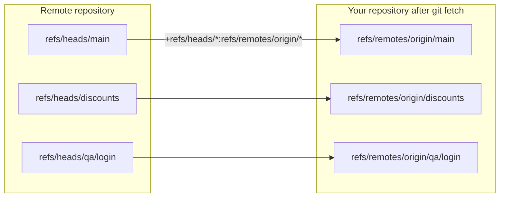
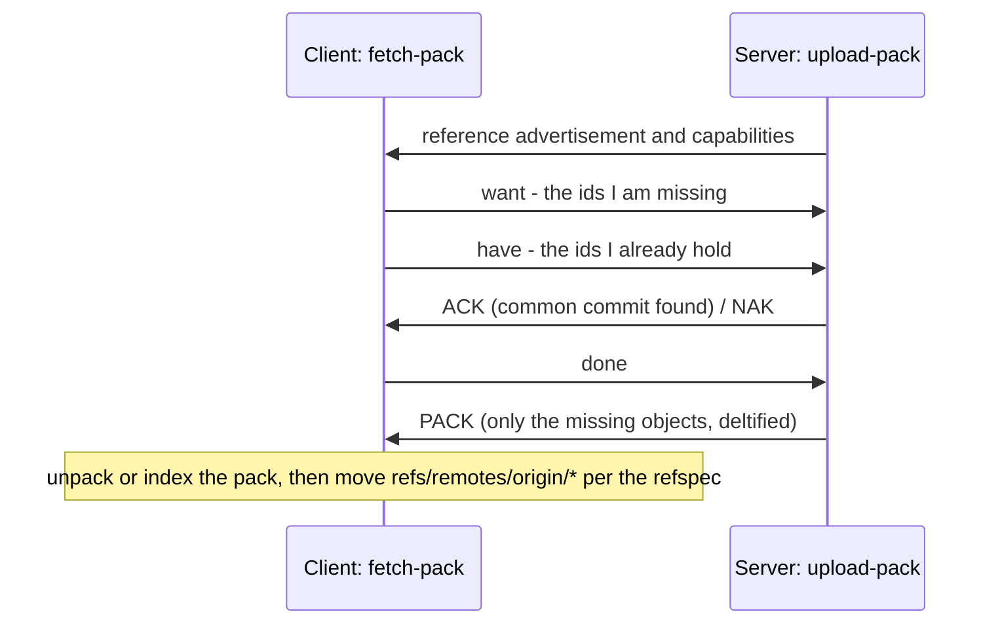
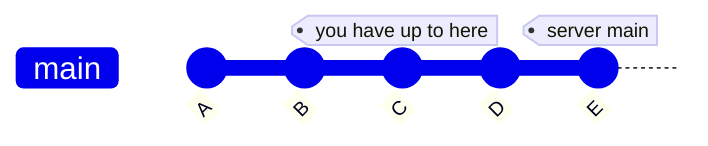
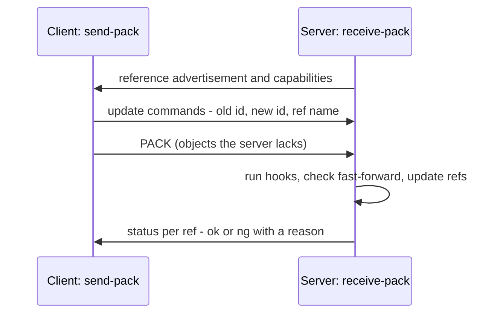

# The refspec and transfer protocols

> **Before this lesson:** read [References and packfiles](#/lesson/git/refs-and-packfiles) (what `refs/heads`, `refs/remotes` and packfiles are). You should also know fetch, pull and push in daily use ([Branch management, workflows and remote branches](#/lesson/git/branch-workflows-remote)) and the protocol families ([Protocols and putting Git on a server](#/lesson/git/protocols-and-bare-repos)).

## In plain words

When you move house, the removal company works from a list: "everything from the kitchen goes to the new kitchen; the boxes from the attic go to the garage; leave the old sofa behind". The list has a "from" column and a "to" column.

A **refspec** (reference specification) is that list for Git. Every `git fetch` and `git push` is guided by one: "take *these* references on the sending side and store them under *those* names on the receiving side". You have been using refspecs since your first clone without seeing them, because Git wrote a default one into your configuration. Once you can read and write them, a number of mysteries dissolve: why a teammate's branch shows up as `origin/feature`, how `git push origin --delete x` works, how to fetch pull requests, how to push to a differently named branch.

The second half of the lesson follows the removal lorry itself: the short conversation two Git programs hold so that only the missing objects travel, in a single packed crate.

Why it matters for a job: custom fetch rules appear in continuous-integration setups, in monorepos, and whenever a team mirrors or reorganises repositories. And when a push or fetch behaves strangely, knowing the conversation underneath lets you debug it instead of guessing.

## Part 1: the refspec

### The one that clone wrote for you

```bash
$ git remote add origin https://git.example.com/greenhouse/orchard.git
$ cat .git/config
[remote "origin"]
        url = https://git.example.com/greenhouse/orchard.git
        fetch = +refs/heads/*:refs/remotes/origin/*
```

- `git remote add` (and `git clone`) creates a section for the remote in the repository's configuration.
- `url` is the address.
- `fetch` is the default **fetch refspec**.

Read the refspec `+refs/heads/*:refs/remotes/origin/*` in three parts:

| Part | Meaning |
|---|---|
| `+` | optional; allow the destination to be updated even when the update is not a fast-forward |
| `refs/heads/*` | the **source**: which references to take from the other side (here: every branch) |
| `refs/remotes/origin/*` | the **destination**: where to store them on this side |

The general shape is `[+]<source>:<destination>`. The `*` is a wildcard; whatever it matched in the source is inserted at the `*` in the destination.

So when the remote has a branch `refs/heads/main`, a fetch stores it locally as `refs/remotes/origin/main`. That is the whole origin of the name `origin/main`.



Why the `+`? If a teammate force-pushes their branch, the remote's branch is no longer a descendant of what you have. Without the `+`, your remote-tracking reference would refuse to move. Since `origin/x` is meant to mirror the remote faithfully, the default refspec forces it.

Because Git expands short names, these are three spellings of the same thing:

```bash
$ git log origin/main
$ git log remotes/origin/main
$ git log refs/remotes/origin/main
```

### One-off refspecs on the command line

Anything after the remote's name in `git fetch` is a refspec that replaces the configured one for that command.

```bash
$ git fetch origin main:refs/remotes/origin/mymain
From https://git.example.com/greenhouse/orchard
 * [new branch]      main       -> origin/mymain
```

- Fetch the remote's `main` and store it as `refs/remotes/origin/mymain`.

Several can be given at once:

```bash
$ git fetch origin main:refs/remotes/origin/mymain discounts:refs/remotes/origin/their-discounts
From https://git.example.com/greenhouse/orchard
 ! [rejected]        main       -> origin/mymain  (non-fast-forward)
 * [new branch]      discounts  -> origin/their-discounts
```

The first was rejected because the update was not a fast-forward and that refspec had no `+`. Writing `+main:refs/remotes/origin/mymain` would have forced it.

With no destination, the fetched commit is recorded only in a special reference called `FETCH_HEAD`:

```bash
$ git fetch origin discounts
From https://git.example.com/greenhouse/orchard
 * branch            discounts  -> FETCH_HEAD
$ git log --oneline -1 FETCH_HEAD
7f4d21a Add bulk discounts
```

### Several fetch rules, and namespaces

A remote may have more than one `fetch` line. Suppose a quality-assurance team pushes its branches under a prefix, `qa/`, and you want only `main` and those:

```bash
$ cat .git/config
[remote "origin"]
        url = https://git.example.com/greenhouse/orchard.git
        fetch = +refs/heads/main:refs/remotes/origin/main
        fetch = +refs/heads/qa/*:refs/remotes/origin/qa/*
```

Each `git fetch origin` now brings only those references. A prefix used this way is called a **namespace**: it keeps one group's branches from cluttering everyone else's view.

Two limits and one extension:

- A pattern may contain **one** `*`. Since Git 2.6 it may stand for part of a name (`refs/heads/qa*:refs/remotes/origin/qa*`).
- A refspec starting with `^` is a **negative refspec** (Git 2.29 and later) that excludes matches: `fetch = ^refs/heads/tmp/*`.

The pull-request trick from the GitHub lessons is this same mechanism:

```bash
$ git config --add remote.origin.fetch "+refs/pull/*/head:refs/remotes/origin/pr/*"
```

### Push refspecs

For `git push` the source is **local** and the destination is on the **remote**.

```bash
$ git push origin main:refs/heads/qa/main
To https://git.example.com/greenhouse/orchard.git
 * [new branch]      main -> qa/main
```

- Push the local branch `main` to the remote as `refs/heads/qa/main`.

The familiar `git push origin main` is shorthand for `git push origin refs/heads/main:refs/heads/main`: same name on both sides.

To make a mapping permanent, add a `push` line:

```bash
[remote "origin"]
        url = https://git.example.com/greenhouse/orchard.git
        fetch = +refs/heads/*:refs/remotes/origin/*
        push = refs/heads/main:refs/heads/qa/main
```

After that, a bare `git push origin` uses it.

### Deleting with a refspec

A refspec with an **empty source** means "put nothing into the destination", which deletes it:

```bash
$ git push origin :discounts
To https://git.example.com/greenhouse/orchard.git
 - [deleted]         discounts

$ git push origin --delete discounts        # the readable spelling, same effect
```

> [!WARNING]
> A leading colon is easy to type by accident, and `git push origin :main` deletes the remote's `main` branch (if the server allows it). Likewise a leading `+`, as in `git push origin +main`, is a force push of that one branch. Read a refspec twice before pressing Enter, and protect important branches on the server so that a slip is refused.

### Seeing the mapping

```bash
$ git ls-remote origin
7f4d21aa3c5b9e8d1f0a2b4c6d8e0f1a3b5c7d9e        HEAD
7f4d21aa3c5b9e8d1f0a2b4c6d8e0f1a3b5c7d9e        refs/heads/main
3e5f7a1c9b0d2e4f6a8c0b1d3e5f7a9c1b3d5e7f        refs/heads/discounts
9f3c1e2d4b5a6978c0d1e2f3a4b5c6d7e8f9a0b1        refs/tags/v0.1
cac0cab538b970a37ea1e769cbbde608743bc96d        refs/tags/v0.1^{}
```

- `git ls-remote <remote>` asks the remote for its list of references without downloading anything.
- The line ending in `^{}` gives, for an annotated tag, the commit it finally points to.

A refspec matcher to experiment with. It implements the single-`*` rule and applies a list of fetch rules to a remote's references:

```python-run
def parse(spec):
    force = spec.startswith("+")
    src, _, dst = spec.lstrip("+").partition(":")
    return force, src, dst

def map_ref(spec, ref):
    """Destination name for one source ref, or None if the refspec does not match it."""
    _, src, dst = parse(spec)
    if "*" not in src:
        return dst if ref == src else None
    head, tail = src.split("*")
    if ref.startswith(head) and ref.endswith(tail) and len(ref) >= len(head) + len(tail):
        middle = ref[len(head):len(ref) - len(tail)]
        return dst.replace("*", middle)
    return None

remote_refs = ["refs/heads/main", "refs/heads/discounts", "refs/heads/qa/login",
               "refs/tags/v0.1", "refs/pull/157/head"]

rules = ["+refs/heads/*:refs/remotes/origin/*",
         "+refs/pull/*/head:refs/remotes/origin/pr/*"]

for ref in remote_refs:
    targets = [t for t in (map_ref(r, ref) for r in rules) if t]
    print(f"{ref:24} -> {targets or 'not fetched by these rules'}")
```

(Tags are a special case in real Git: by default, fetch also brings tags that point into the history being downloaded, even though the refspec does not mention them.)

## Part 2: the transfer protocols

### Dumb and smart

There are two ways to move repository data.

The **dumb protocol** treats the remote repository as a folder of files served over plain HTTP. The client does all the thinking: it asks for a file listing the references, then requests objects one by one, following tree and parent links, and looks into pack indexes when a loose object is missing. Nothing on the server understands Git. It is read-only, slow, and nearly extinct. Its lasting lesson is conceptual: a Git repository is self-describing enough that a client can clone it knowing only how to fetch files.

The **smart protocol** has a Git process at each end, and the two negotiate so that exactly the missing data is sent. It is used over SSH, over HTTPS and by the `git://` daemon. The same two pairs of programs do the work regardless of transport:

| Operation | Program on your machine | Program on the remote |
|---|---|---|
| Push (upload) | `send-pack` | `receive-pack` |
| Fetch (download) | `fetch-pack` | `upload-pack` |

### Watching a fetch

Setting an environment variable makes Git print the packets it exchanges:

```bash
$ GIT_TRACE_PACKET=1 git fetch origin 2>&1 | head -12
packet:        fetch< 7f4d21aa3c5b9e8d1f0a2b4c6d8e0f1a3b5c7d9e HEAD\0multi_ack thin-pack side-band-64k ofs-delta shallow agent=git/2.47.1
packet:        fetch< 7f4d21aa3c5b9e8d1f0a2b4c6d8e0f1a3b5c7d9e refs/heads/main
packet:        fetch< 3e5f7a1c9b0d2e4f6a8c0b1d3e5f7a9c1b3d5e7f refs/heads/discounts
packet:        fetch< 0000
packet:        fetch> want 7f4d21aa3c5b9e8d1f0a2b4c6d8e0f1a3b5c7d9e multi_ack_detailed side-band-64k thin-pack ofs-delta
packet:        fetch> 0000
packet:        fetch> have cac0cab538b970a37ea1e769cbbde608743bc96d
packet:        fetch> have 9a1e77b0c4d2f6e8a0b2c4d6e8f0a1b3c5d7e9f1
packet:        fetch> done
packet:        fetch< ACK cac0cab538b970a37ea1e769cbbde608743bc96d
packet:        fetch< NAK
packet:        fetch< PACK ...
```

- `GIT_TRACE_PACKET=1` in front of a command switches the trace on for that command. `2>&1 | head -12` merges the trace into the normal output and shows the first twelve lines.
- `fetch<` marks lines received from the server and `fetch>` lines sent to it.

The conversation has four acts.

1. **Advertisement.** The server lists every reference with its id. After a zero byte on the first line it also lists its **capabilities**: optional features it supports, such as `side-band-64k` (progress messages alongside data) and `ofs-delta` (a compact delta encoding).
2. **Wants.** The client says which ids it wants (those it lacks), and which capabilities it will use.
3. **Haves.** The client lists commits it already has. The server replies `ACK` when it recognises one. The purpose is to find commits common to both sides, so the server knows where to stop.
4. **Pack.** The server sends one packfile containing every object reachable from the wants and not reachable from the acknowledged haves. The client stores it and updates its references according to the refspec.

`0000` is a **flush packet**: a marker meaning "end of this section". Every other line is prefixed (in the real stream) with four hexadecimal digits giving its length; this framing is called **pkt-line**.



### What "only the missing objects" means on a graph

Suppose the server's `main` has commits A to E and your repository has A to C.



You want E and report having C. The server sends D and E together with the trees and blobs those commits introduce, and nothing older. If E's version of a file is only slightly different from a version you already hold, the pack may contain a delta against *your* copy; this is called a **thin pack**, and the receiver completes it locally.

A model of the negotiation:

```python-run
server = {"A": [], "B": ["A"], "C": ["B"], "D": ["C"], "E": ["D"]}
server_refs = {"refs/heads/main": "E"}
client = {"A": [], "B": ["A"], "C": ["B"]}

def reachable(graph, tips):
    seen, todo = set(), list(tips)
    while todo:
        c = todo.pop()
        if c in graph and c not in seen:
            seen.add(c); todo.extend(graph[c])
    return seen

# 1. advertisement
print("server advertises:", server_refs)
# 2. wants: advertised ids the client lacks
wants = [oid for oid in server_refs.values() if oid not in client]
print("client wants     :", wants)
# 3. haves: the client offers its commits; the server acknowledges the ones it knows
haves = [c for c in client if c in server]
print("client has       :", sorted(haves), "-> server ACKs the common ones")
# 4. pack: reachable from wants minus reachable from common commits
pack = reachable(server, wants) - reachable(server, haves)
print("pack contains    :", sorted(pack))
client.update({c: server[c] for c in pack})
print("client now has   :", sorted(client))
```

### Watching a push

A push is the mirror image.



1. The server advertises its references, so the client knows what the server has.
2. For each reference to change, the client sends a line with the old id, the new id and the name. Forty zeros as the old id means "create"; as the new id, "delete". These are the same three values that server-side `update` hooks receive.
3. The client sends a pack with the objects the server lacks.
4. The server checks each update (hooks, fast-forward rule, permissions), applies it, and reports `ok` or `ng` ("no good") with a reason, which your terminal shows as `[remote rejected]`.

Why does your own Git sometimes print `[rejected] … (non-fast-forward)` before sending anything? After the advertisement the client already knows the server's current id, and can see for itself that the push would not be a fast-forward.

### The same conversation over different transports

- **SSH:** your Git runs `ssh git@host "git-upload-pack 'greenhouse/orchard.git'"` (or `git-receive-pack` for a push) and then talks to that program through the encrypted connection.
- **HTTPS (smart HTTP):** the conversation is cut into web requests. Fetch begins with `GET .../info/refs?service=git-upload-pack` for the advertisement, followed by `POST .../git-upload-pack` carrying wants and haves; the response body is the pack. Push uses the `git-receive-pack` equivalents.
- **`git://`:** a direct network connection to the Git daemon, speaking the same lines with no encryption or authentication.

**Protocol version 2**, the default in current Git, refines fetching: the server no longer lists every reference up front; the client first asks for what it needs (`ls-refs` with a filter), which is far faster on repositories with hundreds of thousands of references. The ideas of wants, haves and a final pack are unchanged. Trace it with `GIT_TRACE_PACKET=1 git -c protocol.version=2 ls-remote origin`.

### Fetching less

Because a fetch is "everything reachable from the wants, minus what I have", Git offers ways to cut the reachable set when a full history is not needed:

| Option | Effect |
|---|---|
| `git clone --depth 1 <url>` | **shallow clone**: only the newest commit(s); history is cut off |
| `git clone --filter=blob:none <url>` | **partial clone**: all commits and trees, file contents downloaded when first needed |
| `git clone --single-branch --branch main <url>` | only one branch's history |
| `git fetch --unshallow` | turn a shallow clone into a complete one |

These are valuable in automated builds and very large repositories; the team-workflows module returns to them.

## Debugging transfers

```bash
$ GIT_TRACE=1 git fetch origin                 # which commands Git runs internally
$ GIT_TRACE_PACKET=1 git fetch origin          # the protocol conversation
$ GIT_CURL_VERBOSE=1 git fetch origin          # the HTTP requests and responses
$ GIT_SSH_COMMAND="ssh -v" git fetch origin    # the SSH login steps
$ git ls-remote origin                         # can I reach it, and what does it have?
$ git config --get-all remote.origin.fetch     # which fetch refspecs apply?
```

When a branch "does not show up" after a fetch, the last two commands settle it at once: either the remote does not have it (`ls-remote`), or your refspec does not cover it.

## Pitfalls

- **A narrowed fetch refspec that you forgot about.** Clones made with `--single-branch`, and many build-server checkouts, fetch only one branch. A teammate's branch will not appear until the refspec is widened: `git remote set-branches origin '*'`.
- **Leading colon or plus by accident** (see the warning above).
- **Expecting `git fetch origin somebranch` to update `origin/somebranch` in very old Git versions.** Modern Git does update it opportunistically; old versions only wrote `FETCH_HEAD`.
- **More than one `*` in a refspec.** It is rejected as invalid.
- **Confusing fetch and push direction.** In a fetch refspec the left side is remote; in a push refspec the left side is local.
- **Committing in a shallow clone and expecting everything to work.** Operations that need old history (blame, merge-base with old branches) may fail or give incomplete answers until you unshallow.
- **Assuming the pack on the wire equals the pack on disk.** Each transfer builds a pack for that occasion.

> [!TIP]
> To make a complete mirror of a repository, including every branch, tag and other reference, use `git clone --mirror <url>`, which sets the fetch refspec to `+refs/*:refs/*`, and `git push --mirror <new-url>` to publish it elsewhere. This is the standard way to move a repository between hosts without losing anything. Be careful with `push --mirror` on an existing remote: it deletes references there that you do not have locally.

> [!INTERVIEW]
> **"What is a refspec?"** A mapping `[+]<src>:<dst>` that tells fetch and push which references to transfer and what to call them on the receiving side. The default fetch refspec `+refs/heads/*:refs/remotes/origin/*` copies every remote branch into the `origin/` remote-tracking namespace, with `+` permitting non-fast-forward updates. Push refspecs map local to remote names; an empty source deletes the destination. **"What happens on the wire during `git fetch`?"** The server advertises its references and capabilities; the client replies with the ids it wants and the commits it has; they agree on common commits; the server sends one packfile containing the objects reachable from the wants but not from the common commits; the client stores it and updates remote-tracking references according to the refspec. Push is the reverse: the client sends old-id, new-id, ref commands plus a pack, and the server accepts or rejects each reference.

## Cheat sheet

| Task | Command |
|---|---|
| Show the fetch refspecs of a remote | `git config --get-all remote.origin.fetch` |
| List references on a remote | `git ls-remote origin` |
| Fetch one branch into a chosen name | `git fetch origin <branch>:refs/remotes/origin/<name>` |
| Fetch without storing a reference | `git fetch origin <branch>` then use `FETCH_HEAD` |
| Add a fetch rule | `git config --add remote.origin.fetch "+refs/heads/qa/*:refs/remotes/origin/qa/*"` |
| Fetch all branches again after a single-branch clone | `git remote set-branches origin '*'` then `git fetch` |
| Push a local branch under another name | `git push origin <local>:<remote>` |
| Delete a remote branch | `git push origin --delete <branch>` (or `git push origin :<branch>`) |
| Force one reference | `git push origin +<branch>` (prefer `--force-with-lease`) |
| Mirror everything | `git clone --mirror <url>`; `git push --mirror <url>` |
| Trace the protocol | `GIT_TRACE_PACKET=1 git fetch` |
| Shallow / partial clone | `git clone --depth 1 <url>` / `git clone --filter=blob:none <url>` |

## Summary

A refspec, written `[+]<source>:<destination>`, maps references on the sending side to names on the receiving side. Clone installs `+refs/heads/*:refs/remotes/origin/*`, which is why remote branches appear as `origin/<name>`; extra or narrower fetch lines select namespaces, pull requests or single branches, and push refspecs rename, force (`+`) or delete (empty source) references on the remote. Data moves by the smart protocol: an advertisement of references and capabilities, the client's wants and haves, agreement on common commits, and a single packfile with exactly the missing objects; push sends reference update commands and a pack and receives a per-reference verdict. The same exchange runs over SSH, HTTPS and the Git daemon, protocol version 2 trims the advertisement, and shallow or partial clones reduce what is requested.

## Glossary

- **Refspec:** a `source:destination` rule mapping references between two repositories.
- **Source / destination:** the reference to read on the sending side / the name to write on the receiving side.
- **`+` (in a refspec):** allow a non-fast-forward update of the destination.
- **Wildcard (`*`):** stands for any text in a reference name; one per side.
- **Namespace:** a prefix under which a group of references is kept.
- **`FETCH_HEAD`:** a reference recording what the most recent fetch downloaded.
- **`git ls-remote`:** lists a remote's references without fetching objects.
- **Dumb protocol:** fetching repository files over plain HTTP with no Git process on the server.
- **Smart protocol:** a negotiation between Git processes that transfers only missing objects.
- **`upload-pack` / `fetch-pack`:** the server and client programs for fetching.
- **`receive-pack` / `send-pack`:** the server and client programs for pushing.
- **Capability:** an optional protocol feature that a side announces it supports.
- **Want / have:** an id the client asks for / an id the client reports already holding.
- **pkt-line / flush packet:** the length-prefixed line format of the protocol / the `0000` end-of-section marker.
- **Thin pack:** a transferred pack whose deltas refer to objects the receiver already has.
- **Shallow clone / partial clone:** a clone with truncated history / one that defers downloading some objects.

## Check yourself

```quiz
[
  {"q": "In the refspec `+refs/heads/*:refs/remotes/origin/*`, what does the part before the colon describe?", "options": ["The branches to delete", "The remote's address", "Which references to take from the remote", "Where references are stored locally"], "answer": 2, "explain": "For fetch, the source (left) names references on the remote and the destination (right) names where they are stored locally."},
  {"q": "What does the leading `+` in a refspec do?", "options": ["Allows the destination to be updated even if the update is not a fast-forward", "Makes the refspec permanent", "Adds a new branch", "Fetches tags too"], "answer": 0, "explain": "It forces the update. For remote-tracking references this keeps them an exact mirror even after a remote force push."},
  {"q": "What does `git push origin :old-feature` do?", "options": ["Deletes the branch old-feature on the remote", "Nothing; it is a syntax error", "Fetches old-feature", "Pushes the current branch to old-feature"], "answer": 0, "explain": "An empty source pushes nothing into the destination, which removes it. `git push origin --delete old-feature` is the clearer spelling."},
  {"q": "Your clone was made with --single-branch. A colleague's branch never appears after `git fetch`. Why?", "options": ["The colleague has not pushed", "The fetch refspec covers only one branch, so other branches are not fetched", "The branch is protected", "Fetch needs --all"], "answer": 1, "explain": "The configured refspec is narrowed to a single branch. Widen it with `git remote set-branches origin '*'` and fetch again."},
  {"q": "During a fetch, what do the client's `have` lines accomplish?", "options": ["They request objects", "They let the server find commits both sides share, so it can send only what is missing", "They authenticate the user", "They list files to delete"], "answer": 1, "explain": "Wants say what is needed; haves let the server compute the boundary of what the client already holds."},
  {"q": "What does the server send at the end of a successful fetch negotiation?", "options": ["The whole repository again", "Each object as a separate file", "One packfile containing the missing objects", "A list of diffs"], "answer": 2, "explain": "The server builds a pack of exactly the objects reachable from the wants and not from the common commits."},
  {"q": "Which programs talk to each other when you push?", "options": ["fetch-pack and upload-pack", "http-backend and curl only", "send-pack on the client and receive-pack on the server", "git-daemon and git-shell"], "answer": 2, "explain": "Push uses send-pack and receive-pack; fetch uses fetch-pack and upload-pack, whatever the transport."},
  {"q": "What does `git clone --depth 1` produce?", "options": ["A bare repository", "A clone without a working tree", "A mirror of all references", "A shallow clone containing only the most recent commit's history"], "answer": 3, "explain": "History is truncated at the given depth, which makes the clone fast but limits operations that need older commits until it is unshallowed."}
]
```

> **Source:** Chacon & Straub, Pro Git 2e, ch. 10 (The Refspec; Transfer Protocols). Explanations, examples and code written for this guide.
