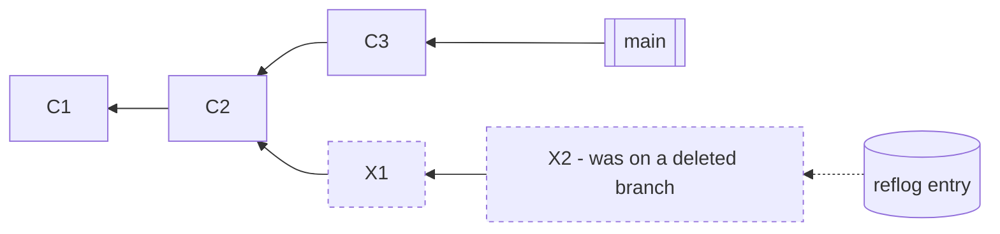
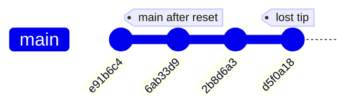
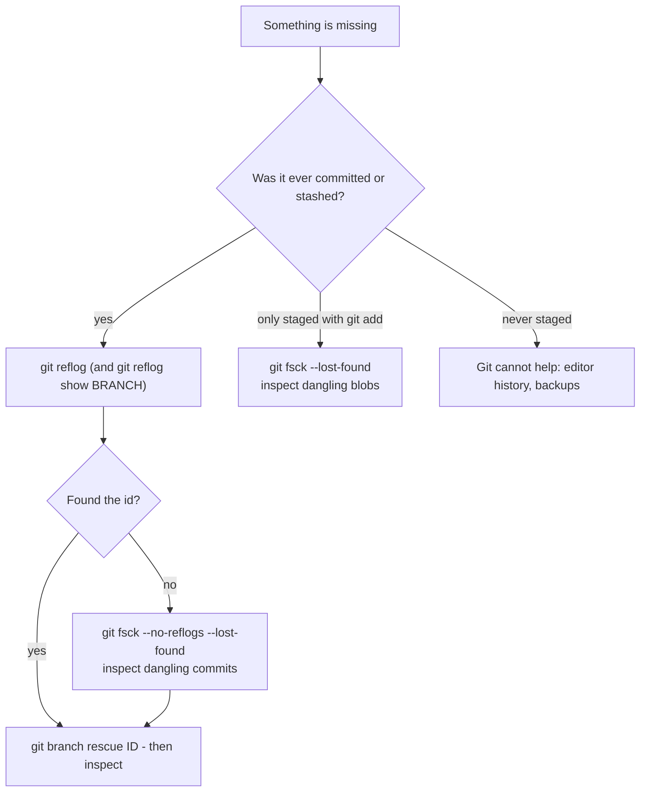

# Maintenance and data recovery

> **Before this lesson:** read [Objects: blobs, trees, commits and tags](#/lesson/git/objects) and [References and packfiles](#/lesson/git/refs-and-packfiles). You should also know what reset and rebase do to a branch ([Reset demystified, advanced merging and rerere](#/lesson/git/reset-advanced-merging), [Rebasing and its golden rule](#/lesson/git/rebasing)).

## In plain words

A workshop needs two kinds of care. One is **tidying**: sweeping the floor, putting loose screws into labelled boxes, throwing out scraps nobody will use. The other is **finding lost things**: the part you were sure you binned turns out to matter, and you go looking for it.

Git needs the same two kinds of care, and they are connected. Git almost never destroys a commit at the moment you "delete" it. Removing a branch, resetting, amending and rebasing only remove *names* or move them. The commits stay in the database, unlabelled, until a periodic clean-up decides they have been unwanted for long enough. That delay is your safety net.

Two tools let you use it. The **reflog** is a diary that Git keeps of every position your branches and HEAD have had: "at 14:02 you were on this commit, then you reset to that one". The **file-system check**, `git fsck`, walks the whole database and lists the commits that no name leads to any more.

Why it matters for a job: sooner or later you, or someone next to you, will say "I think I deleted a week of work". In nearly every such case the work is still there, and recovering it takes a minute if you know where to look. Being the person who can do that calmly is worth a great deal. On the maintenance side, a slow or bloated repository is a daily tax on the whole team.

## Part 1: reachability, the idea behind everything here

An object is **reachable** if you can get to it by starting from some reference (a branch, a tag, `HEAD`, a remote-tracking branch, a stash, a reflog entry) and following pointers: commit to parent, commit to tree, tree to blob. An object nobody can reach is **unreachable** (Git also says **dangling** for an unreachable object that nothing else points to).



`C1`, `C2`, `C3` are reachable from `main`. `X1` and `X2` belonged to a branch that was deleted; no branch reaches them. For the moment a reflog entry still does, which protects them.

Garbage collection removes only objects that are unreachable from **everything**, reflogs included, **and** older than a grace period. So the lifetime of a "deleted" commit is:

| Stage | Protected by | Default duration |
|---|---|---|
| Removed from all branches, still in a reflog | the reflog entry | 30 days for entries not reachable from the branch's current tip (90 days for reachable ones) |
| Reflog entry expired, object now unreachable | the pruning grace period | a further 2 weeks |
| After that | nothing | deleted by the next `git gc` |

A model of the mark-and-sweep idea that garbage collection uses:

```python-run
objects = {                      # object -> objects it points to
    "C1": ["T1"], "C2": ["C1", "T2"], "C3": ["C2", "T3"],
    "X1": ["C2", "T4"], "X2": ["X1", "T5"],
    "T1": ["b_readme"], "T2": ["b_readme", "b_prices1"], "T3": ["b_readme", "b_prices2"],
    "T4": ["b_readme", "b_draft"], "T5": ["b_readme", "b_draft2"],
    "b_readme": [], "b_prices1": [], "b_prices2": [], "b_draft": [], "b_draft2": [],
}

def mark(roots):
    seen, todo = set(), list(roots)
    while todo:
        o = todo.pop()
        if o not in seen:
            seen.add(o); todo.extend(objects[o])
    return seen

refs = {"refs/heads/main": "C3"}
reflog = ["X2"]                                   # an old position of a deleted branch

live = mark(list(refs.values()) + reflog)
print("with the reflog entry   : unreachable =", sorted(set(objects) - live))

live = mark(refs.values())                        # the reflog entry has expired
print("after the entry expires : unreachable =", sorted(set(objects) - live))
print("-> these would be pruned once they are older than the grace period")
```

While the reflog remembers `X2`, nothing is garbage. Once that entry expires, `X1`, `X2`, their trees and the blobs only they used become candidates for removal. `b_readme` survives because live trees also point to it.

## Part 2: maintenance

### What `git gc` does

`git gc` ("garbage collect") is the general tidy-up.

```bash
$ git count-objects -vH
count: 1284
size: 5.92 MiB
in-pack: 20417
packs: 7
size-pack: 38.11 MiB
prune-packable: 0
garbage: 0
size-garbage: 0 bytes

$ git gc
Enumerating objects: 21701, done.
Counting objects: 100% (21701/21701), done.
Delta compression using up to 8 threads
Compressing objects: 100% (6120/6120), done.
Writing objects: 100% (21701/21701), done.
Total 21701 (delta 14853), reused 20417 (delta 14102), pack-reused 0

$ git count-objects -vH
count: 0
size: 0 bytes
in-pack: 21701
packs: 1
size-pack: 36.48 MiB
```

- `git count-objects -vH` reports loose objects (`count`, `size`), packed objects (`in-pack`), the number of packs and their size. `-H` prints sizes in readable units.
- Before: 1,284 loose objects and 7 packs. After: no loose objects and one pack.

In one run, `git gc`:

1. gathers loose objects into a pack and merges small packs into one;
2. packs loose references into `.git/packed-refs`;
3. expires old reflog entries;
4. deletes unreachable objects older than the grace period (`gc.pruneExpire`, default two weeks);
5. refreshes auxiliary indexes that speed up history walks.

### When it runs by itself

After commands that add many objects (commit, merge, fetch, and so on) Git runs `git gc --auto`, which does nothing unless there are more than about 6,700 loose objects (`gc.auto`) or more than 50 packs (`gc.autoPackLimit`). You will occasionally see "Auto packing the repository in background for optimum performance"; that is this mechanism.

For large or busy repositories, modern Git offers scheduled background upkeep:

```bash
$ git maintenance start
```

This registers the repository for periodic tasks (pre-fetching, incremental repacking, updating the commit-graph file) through your operating system's scheduler, so that foreground commands stay fast. `git maintenance run` performs the tasks once; `git maintenance stop` unregisters.

### Checking integrity with `git fsck`

`git fsck` ("file-system check") verifies that every object is readable, that its content matches its id, and that everything a reference needs is present.

```bash
$ git fsck
Checking object directories: 100% (256/256), done.
Checking objects: 100% (21701/21701), done.
dangling commit 9c02e6b4a1d37f58e60b2c9d4a7f1e3b5c8d0a26
dangling blob 4f1c7d2e9a0b3c5d6e8f1a2b3c4d5e6f7a8b9c0d
```

- No lines starting with `error:` or `missing` means the repository is healthy.
- `dangling commit` and `dangling blob` are not errors. They are unreachable leftovers (an amended commit, a file that was staged and then replaced). They are also exactly what you look for when recovering lost work.

### Removing large objects from history

A file that was committed once remains in history, and therefore in every clone, even after a later commit deletes it. To get the space back, the file must be removed from **every commit** that contains it, which rewrites history.

**Step 1: find the culprit.**

```bash
$ git rev-list --objects --all \
    | git cat-file --batch-check='%(objecttype) %(objectname) %(objectsize) %(rest)' \
    | awk '$1 == "blob"' | sort -k3 -n | tail -3
blob 7a8b9c0d1e2f... 20971520 assets/textures.zip
blob 2c3d4e5f6a7b... 52428800 data/export-2024.sql
blob 1f2e3d4c5b6a... 209715200 assets/intro.mp4
```

- `git rev-list --objects --all` lists every reachable object with its path.
- `git cat-file --batch-check=...` adds each object's type and size.
- `awk '$1 == "blob"'` keeps only file contents; `sort -k3 -n | tail -3` shows the three largest. The largest is a 200 MB video.

**Step 2: find which commits touched it.**

```bash
$ git log --oneline --all -- assets/intro.mp4
c41d7e2 Remove intro video from repository
8a2c4e0 Add intro video
```

**Step 3: rewrite history without it** (in a fresh clone, with the tool introduced in the lesson on rewriting history):

```bash
$ git filter-repo --invert-paths --path assets/intro.mp4
```

**Step 4: let the space go.** `git filter-repo` expires reflogs and repacks for you. Done by hand, the equivalent is:

```bash
$ git reflog expire --expire=now --all
$ git gc --prune=now
$ git count-objects -vH
size-pack: 4.87 MiB
```

- `git reflog expire --expire=now --all` empties every reflog, removing the last protection of the old commits.
- `git gc --prune=now` deletes unreachable objects immediately instead of waiting two weeks.

> [!WARNING]
> Step 3 changes the id of every commit from the first affected one onwards, and step 4 **deliberately destroys the safety net** this lesson is about. Do both only in a fresh clone, after the team has agreed, with an untouched backup clone kept aside. Afterwards the rewritten history must be force-pushed and every collaborator must clone again; anyone who pushes from an old clone brings the big file straight back. If the file was removed because it contained a secret, changing that secret is the first step, not this one.

## Part 3: data recovery

### The reflog

Every time `HEAD` or a branch moves, Git appends a line to a log under `.git/logs/`.

```bash
$ git reflog
6ab33d9 (HEAD -> main) HEAD@{0}: reset: moving to HEAD~2
d5f0a18 HEAD@{1}: commit: Add bulk discounts
2b8d6a3 HEAD@{2}: commit: Reject negative quantities
6ab33d9 (HEAD -> main) HEAD@{3}: merge currency-note: Merge made by the 'ort' strategy.
e91b6c4 HEAD@{4}: checkout: moving from csv-import to main
```

Reading one line:

- `d5f0a18` is the commit HEAD pointed to after that step;
- `HEAD@{1}` is a name for "where HEAD was one move ago";
- the rest says what caused the move.

The newest entry is at the top. Each branch has its own log as well: `git reflog show main`. For dates, use `git log -g` (the reflog in `git log` format) or `git reflog --date=iso`.

Two facts to remember: the reflog is **local** (it is not pushed, and a fresh clone starts with an empty one), and it records moves of references, not edits to files.

### Scenario 1: undoing a hard reset

You removed two commits by mistake:

```bash
$ git reset --hard HEAD~2
HEAD is now at 6ab33d9 Merge branch 'currency-note'
```



The reflog above shows that before the reset, HEAD was at `d5f0a18`. Put the branch back:

```bash
$ git reset --hard d5f0a18
HEAD is now at d5f0a18 Add bulk discounts
```

or, to keep the current state and examine the lost work separately:

```bash
$ git branch recovered d5f0a18
$ git log --oneline recovered -3
d5f0a18 (recovered) Add bulk discounts
2b8d6a3 Reject negative quantities
6ab33d9 (HEAD -> main) Merge branch 'currency-note'
```

`git branch <name> <id>` gives the commit a name again, which makes it reachable and therefore safe.

### Scenario 2: restoring a deleted branch

```bash
$ git branch -D payments
Deleted branch payments (was 3aa8d57).
```

Git printed the tip's id as it deleted the branch. If that line is still on your screen:

```bash
$ git branch payments 3aa8d57
```

If it has scrolled away, the HEAD reflog remembers when you were last on that branch:

```bash
$ git reflog | grep payments
e91b6c4 HEAD@{7}: checkout: moving from payments to main
3aa8d57 HEAD@{8}: commit: Handle refunds
0c7d2e9 HEAD@{9}: commit: Add payment client
a03f5d1 HEAD@{10}: checkout: moving from main to payments
```

- `grep payments` keeps the lines mentioning the branch.
- Reading upwards from "moving from main to payments": two commits were made, then you left. The last commit made while on the branch, `3aa8d57`, was its tip.

```bash
$ git branch payments 3aa8d57
```

The problem *Recover a deleted branch from the reflog* in the rescue module asks you to automate exactly this reading.

### Scenario 3: no reflog entry

The reflog can be missing: the entries expired, the commit was made in a different clone, or the reflogs were cleared. The objects may still exist. `git fsck` finds them:

```bash
$ git fsck --full --no-reflogs --lost-found
Checking object directories: 100% (256/256), done.
Checking objects: 100% (21701/21701), done.
dangling commit 3aa8d57c0e2f4a6b8d0c1e3f5a7b9d1c3e5f7a90
dangling commit 9c02e6b4a1d37f58e60b2c9d4a7f1e3b5c8d0a26
dangling blob 4f1c7d2e9a0b3c5d6e8f1a2b3c4d5e6f7a8b9c0d
```

- `--no-reflogs` tells fsck not to count reflog entries as protection, so everything not reachable from a real reference is listed.
- `--lost-found` also writes the objects into `.git/lost-found/` for inspection.

Examine each dangling commit and name the one you want:

```bash
$ git show --stat 3aa8d57
commit 3aa8d57c0e2f4a6b8d0c1e3f5a7b9d1c3e5f7a90
Author: Mira Okafor <mira@home.example>
Date:   Fri Nov 20 15:41:09 2026 +0100

    Handle refunds

 payments.py | 31 +++++++++++++++++++++++++++++++
$ git branch payments 3aa8d57
```

A `dangling commit` is the tip of a lost chain; its ancestors are reachable from it and so are not listed separately.

### Scenario 4: a dropped stash

A stash entry is a commit, so a dropped one becomes a dangling commit. `git stash drop` and `git stash pop` print its id:

```bash
$ git stash drop
Dropped refs/stash@{0} (4c9d1e7a2b3c4d5e6f708192a3b4c5d6e7f8a9b0)
$ git stash apply 4c9d1e7
```

Without the id, look for dangling commits whose message begins with `WIP on` or `On <branch>:`:

```bash
$ git fsck --no-reflogs | awk '/dangling commit/ {print $3}' \
    | xargs -n 1 git log -1 --format='%h %s' | grep -E 'WIP on|On [^ ]+:'
4c9d1e7 On main: wip: discount parsing
```

- `awk` extracts the ids, `xargs -n 1` runs `git log -1` for each one, and `grep -E` keeps those that look like stash entries.

### Scenario 5: a file you staged but never committed

`git add` writes a blob immediately. If the working-tree file is then lost and never committed, the blob is still in the database as a dangling blob.

```bash
$ git fsck --lost-found
dangling blob 4f1c7d2e9a0b3c5d6e8f1a2b3c4d5e6f7a8b9c0d
$ git cat-file -p 4f1c7d2 | head -3
def refund(order, amount):
    if amount <= 0:
        raise ValueError("amount must be positive")
$ git cat-file -p 4f1c7d2 > payments_recovered.py
```

The file name is not stored in a blob, so you identify the content by reading it.

### What cannot be recovered

| Situation | Recoverable? | How |
|---|---|---|
| Commit removed by reset, amend or rebase | yes | reflog |
| Deleted branch | yes | reflog or `git fsck` |
| Dropped stash | yes, for a while | printed id or `git fsck` |
| File staged with `git add`, then lost | usually | dangling blob |
| Edits never staged or committed, overwritten by `restore`, `reset --hard` or `checkout` | **no** | editor's local history or backups only |
| Untracked files deleted by `git clean` | **no** | backups only |
| Anything after `reflog expire --expire=now` plus `gc --prune=now` | **no** | another clone |



## Part 4: environment variables, briefly

Git's behaviour can be adjusted for a single command through **environment variables**: named values set in the shell that programs can read. A handful are worth knowing.

| Variable | Use |
|---|---|
| `GIT_TRACE=1` | print each internal command Git runs |
| `GIT_TRACE_PACKET=1` | print the network protocol conversation |
| `GIT_TRACE_PERFORMANCE=1` | print how long each step took |
| `GIT_CURL_VERBOSE=1` | print HTTP requests and responses |
| `GIT_SSH_COMMAND="ssh -v"` | choose or debug the SSH program |
| `GIT_DIR`, `GIT_WORK_TREE` | point Git at a repository and working tree in unusual locations |
| `GIT_AUTHOR_NAME`, `GIT_AUTHOR_EMAIL`, `GIT_AUTHOR_DATE` (and the `GIT_COMMITTER_` equivalents) | override identity and time for one commit, mostly in scripts |
| `GIT_PAGER`, `GIT_EDITOR` | override the pager and editor |

```bash
$ GIT_TRACE_PERFORMANCE=1 git status 2>&1 | tail -3
14:02:11.412 trace.c:487  performance: 0.004 s: read cache .git/index
14:02:11.530 trace.c:487  performance: 0.118 s: refresh index
14:02:11.533 trace.c:487  performance: 0.139 s: git command: git status
```

Writing `NAME=value` in front of a command sets the variable for that command only. `2>&1` merges the trace, which is written to the error stream, into the normal output so that `tail -3` can show its last lines.

## Pitfalls

- **Panicking and making it worse.** After a mistake, stop. Do not run `git gc`, and do not start experimenting with resets. Look at the reflog first.
- **Running `git gc --prune=now` or expiring reflogs as routine "cleaning".** They remove the safety net and gain almost nothing.
- **Expecting the reflog in a fresh clone or on a colleague's machine.** It is local to the repository where the moves happened.
- **Assuming a deleted file's space returns after the commit that deletes it.** Old commits still contain it.
- **Reading `dangling` in fsck output as corruption.** It is normal leftover material.
- **Taking `git fsck` errors lightly.** `missing blob` or `error: sha1 mismatch` on reachable objects is real damage; copy the object from another clone or re-clone.
- **Copying `.git` with file tools as a backup while Git is running.** Use `git clone --mirror` or `git bundle`.
- **`git gc --aggressive` on a schedule.** It recomputes every delta, is slow, and seldom helps.

> [!TIP]
> Before any operation that rewrites or discards commits, leave yourself a named marker: `git branch backup/before-rebase` or `git tag before-cleanup`. A name makes the old commits reachable, so no expiry applies to them, and recovery becomes `git reset --hard backup/before-rebase` with no detective work. Delete the marker when you are sure.

> [!INTERVIEW]
> **"You ran `git reset --hard` and lost commits. How do you get them back?"** The commits are still in the object database. `git reflog` shows where HEAD pointed before the reset; `git reset --hard <that-id>` or `git branch rescue <that-id>` restores them. If the reflog does not help, `git fsck --lost-found` lists dangling commits to inspect. Uncommitted changes overwritten by the hard reset are not recoverable through Git. **"What does `git gc` do, and when are commits really deleted?"** It packs loose objects and references, expires reflog entries past their age limit, and prunes objects that are unreachable from all references and reflogs and older than the grace period (two weeks by default). So a commit removed from every branch survives about 30 days in the reflog and then two more weeks before it can be pruned. **"How do you shrink a repository bloated by a large file?"** Find it with `rev-list --objects` and `cat-file --batch-check`, rewrite history with `git filter-repo` in a fresh clone, expire reflogs and prune, force-push, and have everyone re-clone.

## Cheat sheet

| Task | Command |
|---|---|
| Object and pack statistics | `git count-objects -vH` |
| Tidy and repack | `git gc` |
| Scheduled background upkeep | `git maintenance start` |
| Verify integrity | `git fsck` |
| History of HEAD's positions | `git reflog` |
| History of one branch's positions | `git reflog show <branch>` |
| Restore a branch to an earlier position | `git reset --hard <id>` or `git reset --hard HEAD@{n}` |
| Name a lost commit | `git branch <name> <id>` |
| List unreachable objects | `git fsck --no-reflogs --lost-found` |
| Recover a dropped stash | `git stash apply <id>` |
| Read a dangling blob | `git cat-file -p <id>` |
| Largest blobs in history | `git rev-list --objects --all \| git cat-file --batch-check='%(objecttype) %(objectname) %(objectsize) %(rest)' \| awk '$1=="blob"' \| sort -k3 -n \| tail` |
| Remove a path from all history | `git filter-repo --invert-paths --path <file>` |
| Drop unreachable objects now (irreversible) | `git reflog expire --expire=now --all && git gc --prune=now` |
| Trace what Git is doing | `GIT_TRACE=1 git <command>` |

## Summary

Git deletes an object only when it is unreachable from every reference and every reflog entry and has passed a grace period, so commits removed by reset, amend, rebase or branch deletion persist for weeks. `git gc` packs objects and references, expires old reflog entries and prunes what has become eligible; it runs automatically when loose objects accumulate, and `git maintenance` schedules lighter upkeep. `git fsck` verifies the database and lists dangling objects. Recovery means finding an id, through `git reflog` or `git fsck --lost-found`, and giving it a name with `git branch`. Stashes and staged files can be recovered the same way as dangling commits and blobs, while edits that never entered the database cannot. Reclaiming space from a large file requires rewriting history and then expiring reflogs and pruning, which permanently removes the safety net and must be coordinated. Trace variables such as `GIT_TRACE` expose what Git does when you need to diagnose it.

## Glossary

- **Reachable:** obtainable from a reference or reflog entry by following object pointers.
- **Unreachable / dangling object:** an object no reference leads to / an unreachable object that no other object points to.
- **Garbage collection (`git gc`):** housekeeping that packs objects and removes eligible unreachable ones.
- **Prune:** delete unreachable objects.
- **Grace period (`gc.pruneExpire`):** the minimum age, two weeks by default, before an unreachable object may be pruned.
- **Reflog:** a local log of the successive values of HEAD and of each branch.
- **`HEAD@{n}`:** the value HEAD had n moves ago.
- **`git fsck`:** verifies the integrity and connectivity of the object database.
- **`--lost-found`:** the fsck option that saves dangling objects under `.git/lost-found/`.
- **`git maintenance`:** scheduled background optimisation of a repository.
- **Commit-graph:** an auxiliary file that speeds up walking history.
- **Loose object / pack:** an object stored as its own file / a file holding many objects.
- **Environment variable:** a named value in the shell that programs read, such as `GIT_TRACE`.
- **Mirror clone:** a bare clone that copies every reference, suitable as a backup.

## Check yourself

```quiz
[
  {"q": "You delete a branch with `git branch -D`. When are its commits actually removed from disk?", "options": ["At the next commit", "Never", "Immediately", "Only after they are unreachable from all references and reflogs and older than the pruning grace period, at a later garbage collection"], "answer": 3, "explain": "Deleting a branch removes a name. Reflog entries protect the commits for about 30 days, then a further two-week grace period applies before git gc may prune them."},
  {"q": "What does `git reflog` show?", "options": ["The server's push log", "All commits in the repository", "The local history of where HEAD has pointed and why", "The list of remote branches"], "answer": 2, "explain": "Each line records a move of HEAD (commit, checkout, reset, merge, rebase) with the resulting commit id."},
  {"q": "After `git reset --hard HEAD~3` you want the three commits back. What is the first thing to do?", "options": ["Look in git reflog for the id HEAD had before the reset", "Run git gc", "Re-clone the repository", "Run git clean -fd"], "answer": 0, "explain": "The entry before the reset holds the old tip. Reset or branch to that id. Running gc would not help and could, with pruning options, destroy the commits."},
  {"q": "In `git fsck` output, what does `dangling commit` mean?", "options": ["The repository is corrupt", "A commit that no reference and no other object points to; normal leftover that can be inspected or recovered", "A commit that failed to push", "A commit with no message"], "answer": 1, "explain": "Dangling objects are produced routinely by amend, rebase, reset and dropped stashes. They are harmless and are the raw material of recovery."},
  {"q": "The reflog has no trace of a lost commit. Which command can still find it?", "options": ["git log --all", "git status", "git fsck --no-reflogs --lost-found", "git remote prune"], "answer": 2, "explain": "fsck walks the object database and lists unreachable commits regardless of whether any log mentions them."},
  {"q": "Which loss can Git NOT recover?", "options": ["A commit removed by an interactive rebase last week", "A stash dropped an hour ago", "Edits to a tracked file that were never staged and were overwritten by git restore", "A branch deleted yesterday"], "answer": 2, "explain": "Content that never entered the object database, by commit, stash or git add, does not exist anywhere in .git."},
  {"q": "A 300 MB file was committed and then deleted in the next commit. Why is the repository still large?", "options": ["Deleted files are kept for 30 days", "The index still references it", "git gc has a bug", "The file's blob is still reachable from the older commit, so it stays in history and in every clone"], "answer": 3, "explain": "History is a chain of snapshots. Space is regained only by rewriting history to remove the file from every commit and then pruning."},
  {"q": "Why is `git reflog expire --expire=now --all && git gc --prune=now` dangerous as a routine command?", "options": ["It deletes branches", "It removes the reflog protection and immediately deletes all unreachable objects, eliminating the possibility of recovery", "It rewrites commit ids", "It pushes to the remote"], "answer": 1, "explain": "Those two steps discard exactly the delayed-deletion safety net that makes Git forgiving. Use them only deliberately, after a coordinated history rewrite."}
]
```

> **Source:** Chacon & Straub, Pro Git 2e, ch. 10 (Maintenance and Data Recovery; Environment Variables). Explanations, examples and code written for this guide.
