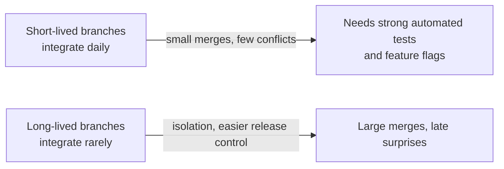
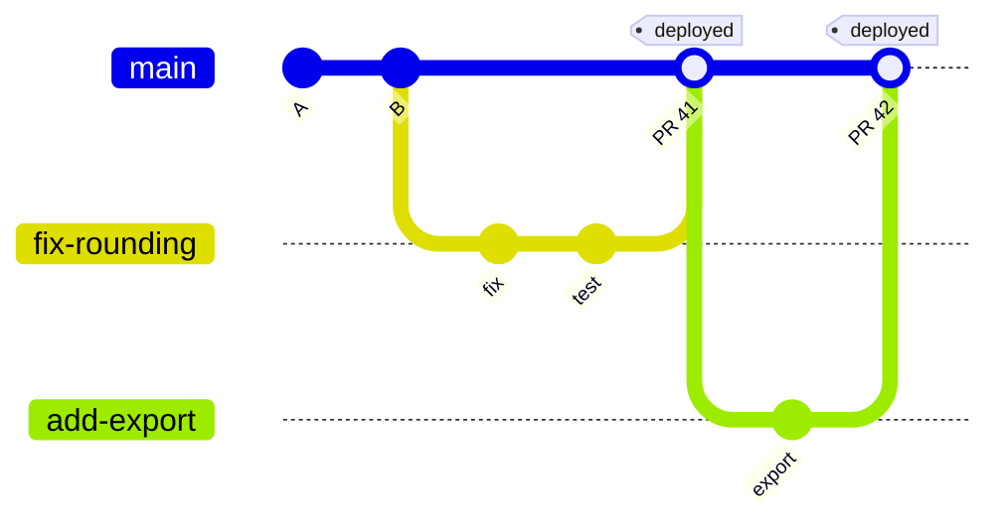
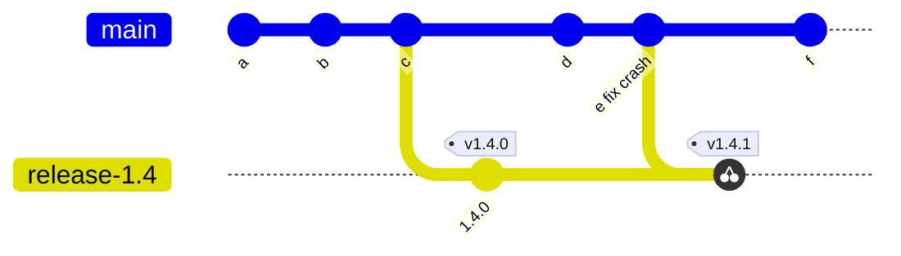
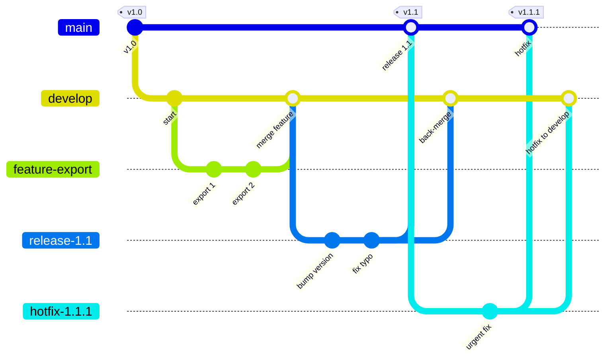
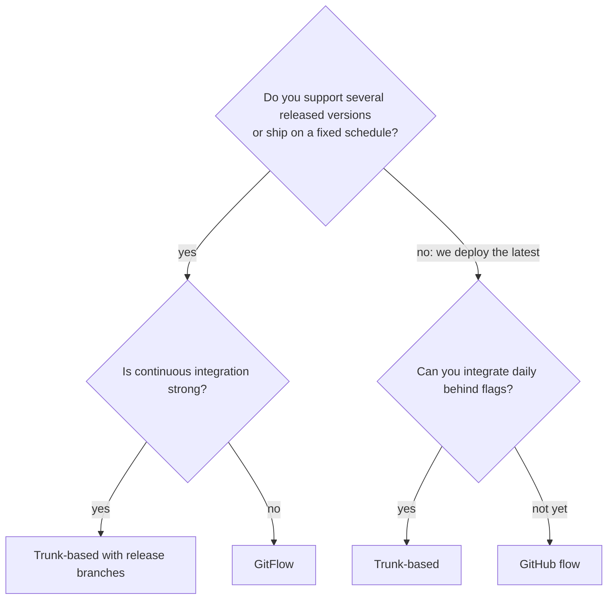
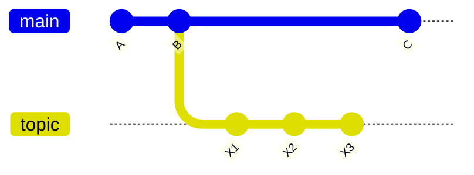
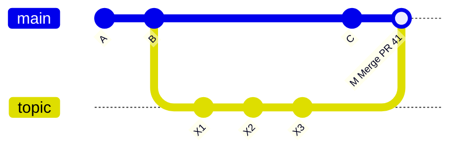
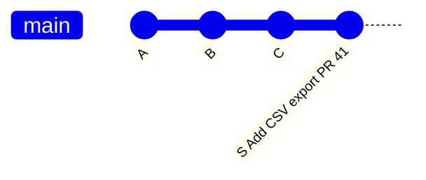
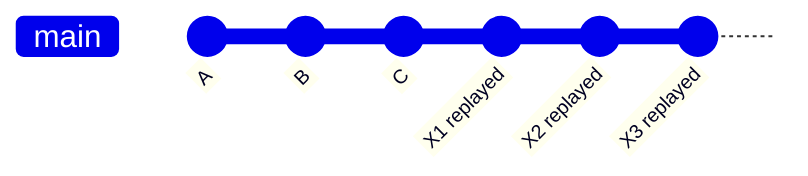

# Trunk-based, GitFlow, GitHub flow and merge strategies

> **Before this lesson:** you should know branches, merging and rebasing ([Merging and resolving conflicts](#/lesson/git/merging-and-conflicts), [Rebasing and its golden rule](#/lesson/git/rebasing)), topic branches and remote branches ([Branch management, workflows and remote branches](#/lesson/git/branch-workflows-remote)), and pull requests with protected branches ([Accounts, forks and the pull-request flow](#/lesson/git/github-forks-prs), [Reviews, protected branches and Actions](#/lesson/git/github-reviews-automation)).

## In plain words

Git gives you branches and merges, the way a kitchen gives you knives and pans. It does not tell you what to cook. A team has to agree on a recipe: which branches exist, how long they live, when work is combined, and how a release gets made. That agreement is called a **branching model** (or branching strategy).

Three recipes dominate, and you can picture them with a road analogy.

- **Trunk-based development** is one main road. Everyone drives on it. Side trips are tiny lay-bys of a few hours, after which you rejoin the road.
- **GitHub flow** is the main road plus short slip roads. Each change leaves on its own slip road, is inspected at a checkpoint (the pull request), and rejoins.
- **GitFlow** is a road system with a motorway for released code, a parallel road for work in progress, slip roads for features, a special lane for preparing each release and an emergency lane for urgent repairs.

The second topic is the choice you make every time a pull request is accepted: how the work enters the main branch. A **merge commit** keeps everything as it happened. A **squash merge** boils the whole pull request down to one commit. A **rebase merge** replays the commits in a straight line. The files end up the same; the history you can read later does not.

Why it matters for a job: every team has picked one of these models, and the first thing you need to learn on joining is which one, because doing the right Git commands in the wrong model creates a mess. "Compare trunk-based development with GitFlow" and "squash or merge?" are also standard interview questions.

## The forces behind any choice

Before the models, the trade-offs they balance.

- **Integration pain grows with time apart.** The longer a branch lives separately, the more it and the main line drift, and the bigger and riskier the eventual merge. This is the single most important fact about branching.
- **Unfinished work must not break users.** Something has to keep half-built features away from customers: a separate branch, or a switch in the code.
- **How often you release.** A website can deploy twenty times a day. A mobile app or a program installed on customers' machines ships a numbered version every few weeks and may have to support several old versions at once.
- **How much automated testing you trust.** Integrating often is only safe if machines check every change.



## Model 1: GitHub flow

The simplest widely used model. One long-lived branch, `main`, is always in a releasable state. Every change follows the same six steps.

1. Create a branch from `main` with a descriptive name.
2. Commit to it and push it.
3. Open a pull request.
4. Discuss, review, let automated checks run.
5. Merge into `main`.
6. Deploy `main` (many teams deploy automatically on every merge).



One full cycle in commands:

```bash
$ git switch main
$ git pull --ff-only
Already up to date.
$ git switch -c fix-rounding
Switched to a new branch 'fix-rounding'
$ git commit -am "Round discounted prices half up"
[fix-rounding 3c9e1d7] Round discounted prices half up
 1 file changed, 1 insertion(+), 1 deletion(-)
$ git push -u origin fix-rounding
 * [new branch]      fix-rounding -> fix-rounding
branch 'fix-rounding' set up to track 'origin/fix-rounding'.
```

- `git pull --ff-only` brings your `main` up to date and refuses to do anything other than move it forward, so you always branch from what is on the server.
- `git switch -c` creates the topic branch; `git push -u` publishes it and records its upstream.

After review and merge on the hosting site:

```bash
$ git switch main
$ git pull --ff-only
Updating 6ab33d9..e5b7d24
Fast-forward
$ git branch -d fix-rounding
Deleted branch fix-rounding (was 3c9e1d7).
```

**Suits:** web applications and services deployed continuously, small and medium teams, most open-source projects.
**Strains when:** you must maintain several released versions at once, or releases need a long stabilisation period.

## Model 2: trunk-based development

GitHub flow taken to its limit. Everyone integrates into one branch, the **trunk** (usually `main`), at least once a day. Branches, where used at all, live for hours, not days. Some teams commit straight to the trunk, relying on pair programming or review after the fact.

Two techniques make this possible.

**Feature flags.** A **feature flag** (or feature toggle) is a switch in the code that turns a feature on or off without changing which code is deployed. Unfinished work is merged, but disabled:

```python
if flags.enabled("bulk-discounts"):
    price = apply_bulk_discount(price, quantity)
```

The code for the new feature is in `main` and is shipped, but customers do not see it until the flag is switched on. This separates **deploying** code (putting it on servers) from **releasing** a feature (letting users see it).

**Release branches cut from the trunk.** When a numbered release is needed, a branch is created at that moment and only receives fixes, which are made on the trunk first and then copied across with `git cherry-pick`.



```bash
$ git switch -c release-1.4 main
$ git tag -a v1.4.0 -m "Release 1.4.0"
$ git push -u origin release-1.4 --follow-tags

# later: a crash is fixed on main as commit 9e4c7b1
$ git switch release-1.4
$ git cherry-pick -x 9e4c7b1
[release-1.4 b07d915] Fix crash on empty CSV
 Date: Fri Nov 20 16:20:11 2026 +0100
 1 file changed, 2 insertions(+)
$ git tag -a v1.4.1 -m "Release 1.4.1"
$ git push --follow-tags
```

- The release branch is created from the current trunk and tagged.
- `--follow-tags` pushes annotated tags that belong to the pushed commits.
- `git cherry-pick -x` copies the fix and records in its message which commit it came from. The rule "fix on trunk first, then cherry-pick to the release" guarantees that no fix exists only on an old release.

**Suits:** teams with thorough automated tests and continuous integration, from start-ups to some of the largest engineering organisations in the world.
**Strains when:** tests are weak (breakage reaches everyone at once), or the team is not comfortable with feature flags.

## Model 3: GitFlow

Published in 2010 and very influential, GitFlow uses two permanent branches and three kinds of temporary ones.

| Branch | Lives | Created from | Merged into | Purpose |
|---|---|---|---|---|
| `main` | for ever | | | exactly what is released; every commit is a release and is tagged |
| `develop` | for ever | `main` | | integration of finished features for the next release |
| `feature/*` | days to weeks | `develop` | `develop` | one feature |
| `release/*` | days | `develop` | `main` **and** `develop` | stabilise a release: only fixes, version numbers, notes |
| `hotfix/*` | hours | `main` | `main` **and** `develop` | urgent repair of a released version |



A release, in commands:

```bash
$ git switch -c release/1.1 develop
$ git commit -am "Bump version to 1.1.0"
$ git switch main
$ git merge --no-ff release/1.1 -m "Release 1.1.0"
$ git tag -a v1.1.0 -m "Release 1.1.0"
$ git switch develop
$ git merge --no-ff release/1.1 -m "Merge release 1.1.0 back into develop"
$ git branch -d release/1.1
$ git push origin main develop --follow-tags
```

- The release branch is cut from `develop` and receives only stabilising commits.
- It is merged into `main` with `--no-ff`, which forces a merge commit so that every release is one clearly visible commit, and tagged.
- It is merged **back** into `develop` so that the fixes made during stabilisation are not lost. Forgetting this back-merge is the classic GitFlow mistake.

A hotfix follows the same pattern, starting from `main`: `git switch -c hotfix/1.1.1 main`, fix, merge into `main`, tag, merge into `develop`.

**Suits:** software with scheduled, versioned releases, several versions supported in parallel, or formal release approval (installed products, some mobile apps, regulated environments).
**Strains when:** you deploy continuously. Its own author added a note in 2020 suggesting that teams delivering web software continuously use a simpler flow instead. Features wait on `develop`, branches live long, and the double merges are overhead with no benefit.

## Choosing

| | Trunk-based | GitHub flow | GitFlow |
|---|---|---|---|
| Long-lived branches | `main` | `main` | `main`, `develop` |
| Branch lifetime | hours | days | days to weeks |
| Unfinished work hidden by | feature flags | staying on the topic branch | staying off `main` |
| Release | deploy from trunk, or a short release branch | deploy `main` after each merge | merge a release branch into `main`, tag |
| Fix for an old version | cherry-pick to its release branch | not directly supported | hotfix branch |
| Merge conflicts | smallest | small | largest |
| Needs | strong CI, flags, discipline | CI and reviews | process discipline |
| Typical user | high-frequency delivery | most web teams | versioned products |



The model below quantifies the first force: the cost of waiting. Two developers each change a random set of files per day; the chance that their work overlaps grows quickly with the number of days before they integrate.

```python-run
import random

def overlap_probability(days_apart, files=400, touched_per_day=6, trials=4000):
    random.seed(7)
    clashes = 0
    for _ in range(trials):
        mine = {random.randrange(files) for _ in range(touched_per_day * days_apart)}
        theirs = {random.randrange(files) for _ in range(touched_per_day * days_apart)}
        clashes += bool(mine & theirs)
    return clashes / trials

print("days before integrating -> chance both sides touched a common file")
for d in (1, 2, 5, 10, 20):
    print(f"{d:>3} day(s): {overlap_probability(d):6.1%}")
```

A shared file is not yet a conflict, but it is where conflicts come from, and the curve explains why every model that works well keeps branches short.

## How a pull request lands: merge, squash or rebase

Suppose a pull request has three commits (X1, X2, X3) and `main` has gained one commit (C) since the branch started.



### Option 1: merge commit

```bash
$ git switch main
$ git merge --no-ff topic -m "Merge pull request #41: Add CSV export"
Merge made by the 'ort' strategy.
```



All original commits are kept with their ids, plus a merge commit M with two parents. `git log --first-parent main` shows one line per pull request; the full log shows every step.

### Option 2: squash merge

```bash
$ git switch main
$ git merge --squash topic
Squash commit -- not updating HEAD
Automatic merge went well; stopped before committing as requested
$ git commit -m "Add CSV export (#41)"
[main 8c1d4e6] Add CSV export (#41)
 4 files changed, 96 insertions(+), 3 deletions(-)
```



- `git merge --squash` stages the combined change of the whole branch without committing and **without recording the branch as a parent**.
- The commit you then make, S, is an ordinary single-parent commit containing everything X1 to X3 did.

`main` gets exactly one commit per pull request. X1, X2 and X3 are not in `main`'s history; they remain only on the topic branch until it is deleted.

### Option 3: rebase merge

```bash
$ git switch topic
$ git rebase main
Successfully rebased and updated refs/heads/topic.
$ git switch main
$ git merge --ff-only topic
Updating 9b0c4d2..4f81b3c
Fast-forward
```



Each commit is replayed on top of C and gets a new id; `main` is then fast-forwarded. The history is a straight line that keeps the individual commits, with no merge commit.

### Comparison

| | Merge commit | Squash merge | Rebase merge |
|---|---|---|---|
| Commits added to `main` | all originals + 1 merge commit | 1 | all, as new copies |
| Original commit ids kept | yes | no | no |
| History shape | graph | straight line | straight line |
| Shows which commits formed one pull request | yes (the merge commit) | yes (one commit) | no |
| Reverting the whole change | `git revert -m 1 <merge>` | `git revert <commit>` | revert a range |
| `git bisect` precision | individual commits | whole pull request | individual commits |
| Works well with messy "wip" commits | no (they land on `main`) | yes | no |
| Git knows the branch is merged | yes | **no** | **no** |

The last row has practical consequences.

> [!WARNING]
> After a squash or rebase merge, the commits on your topic branch are **not** in `main`; only copies of their changes are. Three things follow. (1) `git branch -d topic` refuses with "not fully merged"; once the hosting site shows the pull request as merged, `git branch -D topic` is correct. (2) **Do not keep working on the old branch** or branch from it: merging it again later will produce conflicts and duplicated changes, because Git sees the old commits as new work. Start the next change from the updated `main`. (3) A second branch that was stacked on top of the first must be rebased onto the new `main`: `git rebase --onto main old-topic stacked-topic`.

The model shows the difference in what `main` records:

```python-run
branch = [("X1", "Add export function"), ("X2", "wip"), ("X3", "Add tests, fix typo")]
main = ["A", "B", "C"]

def merge_commit(main, branch):
    return main + [c for c, _ in branch] + ["M(parents: C, X3)"]

def squash(main, branch):
    return main + ["S(" + " + ".join(c for c, _ in branch) + ")"]

def rebase(main, branch):
    return main + [c + "'" for c, _ in branch]

for name, fn in (("merge commit", merge_commit), ("squash", squash), ("rebase", rebase)):
    result = fn(main, branch)
    originals_kept = all(c in result for c, _ in branch)
    print(f"{name:13} main = {result}")
    print(f"{'':13} original ids on main: {originals_kept}; commits added: {len(result) - len(main)}")
```

### Which should a team pick?

- **Squash** is the most common default for application teams: `main` reads as one tidy entry per pull request, and nobody has to polish intermediate commits. Its cost is losing the fine-grained steps, which hurts large pull requests most, a further reason to keep them small.
- **Merge commits** suit teams that craft meaningful commit series and want them preserved, and projects such as GitFlow where a merge commit marks a feature or release.
- **Rebase merge** gives linear history *and* individual commits, but only pays off if every commit on the branch is clean and passes the tests by itself.

Many teams enable exactly one option in the repository settings so that history stays uniform. Whichever is chosen, a protected-branch rule "require linear history" forbids merge commits, and "require branches to be up to date" forces integration with the latest `main` before merging.

## Pitfalls

- **Adopting GitFlow because it looks professional.** For a continuously deployed service it adds ceremony and delay. Choose from your release needs.
- **Long-lived feature branches in any model.** They are where painful merges come from. Split the work, or merge it disabled behind a flag.
- **Forgetting the back-merge in GitFlow.** A fix made on a release or hotfix branch that never reaches `develop` reappears as a bug in the next release.
- **Fixing on a release branch first in trunk-based development.** The fix can be forgotten on the trunk. Fix the trunk, then cherry-pick.
- **Feature flags that are never removed.** Old flags pile up and make the code hard to follow. Delete the flag once the feature is fully released.
- **Reusing a branch after a squash merge.** See the warning above.
- **Mixing landing strategies at random.** A history that is part squashed, part merged, part rebased is harder to read than any one of them.
- **Judging a model without the supporting practices.** Trunk-based development without automated tests is reckless; GitFlow without release discipline is bureaucracy.

> [!TIP]
> Whatever the model, update your branch from the main line often, at least daily: `git fetch origin` then `git rebase origin/main` (for a branch only you use) or `git merge origin/main`. Ten small integrations are far cheaper than one big one, and you find out about a colleague's conflicting change while both of you still remember what you did.

> [!INTERVIEW]
> **"Compare trunk-based development, GitHub flow and GitFlow."** Trunk-based: everyone integrates into one main branch at least daily; branches live hours; unfinished features are hidden behind feature flags; releases come from the trunk or from short release branches that receive cherry-picked fixes. It minimises merge pain and needs strong automated testing. GitHub flow: `main` is always deployable; each change is a short-lived branch with a pull request, review and checks, merged and deployed. GitFlow: permanent `main` (releases) and `develop` (integration), plus feature, release and hotfix branches with merges into both permanent branches; it fits scheduled, versioned releases and multiple supported versions, and is heavy for continuous delivery. **"Squash, merge commit or rebase?"** Merge commits preserve all commits and the true topology; squash yields one commit per pull request and a linear, readable main line at the cost of intermediate history; rebase keeps individual commits linearly but rewrites ids. After squash or rebase, Git does not regard the branch as merged, so delete it and do not reuse it.

## Cheat sheet

| Task | Command |
|---|---|
| Start a change (GitHub flow / trunk-based) | `git switch main && git pull --ff-only && git switch -c <topic>` |
| Keep a topic branch current | `git fetch origin && git rebase origin/main` (or `git merge origin/main`) |
| Cut a release branch | `git switch -c release-1.4 main` then `git tag -a v1.4.0 -m "..."` |
| Copy a fix to a release branch | `git switch release-1.4 && git cherry-pick -x <id>` |
| GitFlow: finish a feature | `git switch develop && git merge --no-ff feature/<name>` |
| GitFlow: finish a release | merge `release/x` into `main` (tag), then into `develop` |
| GitFlow: hotfix | `git switch -c hotfix/x main` … merge into `main` (tag) and `develop` |
| Land with a merge commit | `git merge --no-ff <topic>` |
| Land as one commit | `git merge --squash <topic>` then `git commit` |
| Land linearly keeping commits | `git rebase main` on the topic, then `git merge --ff-only <topic>` on `main` |
| One line per pull request in the log | `git log --oneline --first-parent main` |
| Delete a squash-merged branch | `git branch -D <topic>` and `git push origin --delete <topic>` |
| Re-parent a stacked branch | `git rebase --onto main <old-base> <stacked>` |

## Summary

A branching model is a team's agreement on which branches exist and how work reaches a release. Trunk-based development integrates everyone into one branch at least daily, hides unfinished work behind feature flags, and uses short release branches fed by cherry-picks when versions must be maintained. GitHub flow keeps `main` deployable and routes every change through a short topic branch and a pull request. GitFlow adds a permanent `develop` branch and feature, release and hotfix branches with merges into both permanent branches, which suits scheduled, versioned releases. The shorter branches live, the cheaper integration is. When a pull request lands, a merge commit preserves every commit and the graph, a squash merge records one new commit, and a rebase merge replays the commits linearly; the latter two do not mark the branch as merged, so the branch should be deleted and never reused.

## Glossary

- **Branching model (strategy):** a team's convention for which branches exist and how changes flow between them.
- **Trunk:** the single main branch everyone integrates into; usually `main`.
- **Trunk-based development:** integrating small changes into the trunk at least daily.
- **Feature flag (toggle):** a switch in the code that enables or disables a feature without redeploying.
- **Deploy / release:** put code onto servers / make a feature available to users.
- **GitHub flow:** `main` plus short-lived topic branches merged through pull requests.
- **GitFlow:** a model with `main`, `develop`, and feature, release and hotfix branches.
- **Release branch:** a branch on which a version is stabilised or maintained.
- **Hotfix:** an urgent repair of released code.
- **Back-merge:** merging a release or hotfix branch back into the development branch.
- **Continuous integration (CI):** automatically building and testing every change.
- **Merge commit / squash merge / rebase merge:** landing a branch with a two-parent commit / as one new commit / as replayed commits in a line.
- **`--no-ff`:** force a merge commit even when a fast-forward is possible.
- **`--first-parent`:** follow only the first parent of merges, showing the main line's own history.
- **Stacked branch:** a branch that was started from another unmerged branch.

## Check yourself

```quiz
[
  {"q": "What is the defining practice of trunk-based development?", "options": ["Releases are made from a develop branch", "Everyone integrates small changes into one main branch at least daily", "Every feature gets a long-lived branch", "Only one person may commit"], "answer": 1, "explain": "Branches are very short-lived or absent, which keeps merges small. Unfinished features are hidden with feature flags."},
  {"q": "What problem does a feature flag solve?", "options": ["It speeds up git push", "It lets unfinished code be merged and deployed while staying invisible to users", "It replaces code review", "It prevents merge conflicts entirely"], "answer": 1, "explain": "Flags separate deploying code from releasing a feature, which is what makes frequent integration of incomplete work safe."},
  {"q": "In GitFlow, where is a release branch merged when it is finished?", "options": ["Only into develop", "Into main (and tagged) and back into develop", "Only into main", "It is deleted without merging"], "answer": 1, "explain": "main receives the release; develop must receive the stabilisation fixes too, or they are lost for the next release."},
  {"q": "Which situation is the best fit for GitFlow?", "options": ["A web service deployed twenty times a day", "A desktop product with quarterly versioned releases and several supported versions", "A project without tests", "A one-person script collection"], "answer": 1, "explain": "Scheduled releases, stabilisation periods and hotfixes on released versions are what GitFlow's extra branches are for."},
  {"q": "A pull request with five commits is squash-merged. What does main receive?", "options": ["Five commits and a merge commit", "One new commit with the combined change and a single parent", "Nothing until the branch is deleted", "Five replayed commits"], "answer": 1, "explain": "Squash stages the total change and records it as one ordinary commit; the original commits are not part of main."},
  {"q": "After a squash merge, `git branch -d topic` says the branch is not fully merged. Why?", "options": ["The branch is protected", "The remote is out of date", "main contains a new commit with the same changes, not the branch's own commits, so they are not reachable from main", "The merge failed"], "answer": 2, "explain": "Git decides mergedness by reachability of commits. Confirm the pull request is merged, then delete with -D."},
  {"q": "What does `git log --first-parent main` show in a history that uses merge commits?", "options": ["The main line's own commits and merges, without the individual commits of merged branches", "Only merge conflicts", "Only the first commit", "Commits by the first author"], "answer": 0, "explain": "Following only first parents gives one entry per merged pull request, a concise view of what landed on main."},
  {"q": "In trunk-based development with release branches, where should a bug fix be made first?", "options": ["On a new long-lived branch", "On the release branch, then merged to trunk later", "Directly on the tag", "On the trunk, then cherry-picked to the release branch"], "answer": 3, "explain": "Fixing the trunk first guarantees the fix is never missing from future releases; the cherry-pick carries it to the maintained version."}
]
```

> **Source:** original material for this guide, building on Chacon & Straub, Pro Git 2e, ch. 3 (Branching Workflows) and ch. 5 (Distributed Workflows; Maintaining a Project).
