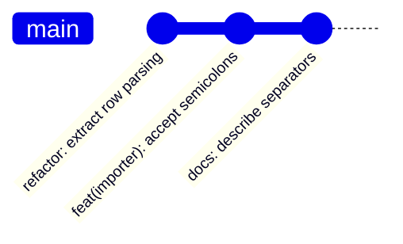
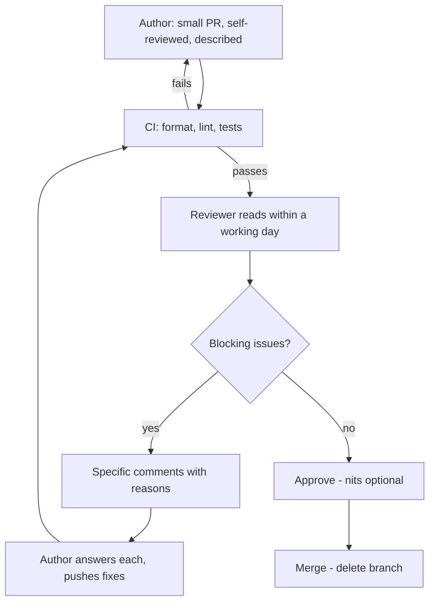
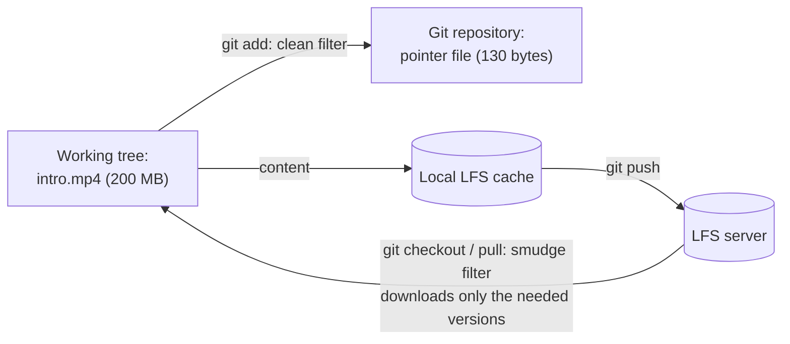

# Commit conventions, review etiquette, monorepos and large files

> **Before this lesson:** you should know how to write and amend commits ([Getting a repository and recording changes](#/lesson/git/recording-changes), [Signing, searching and rewriting history](#/lesson/git/sign-search-rewrite)), how pull requests and reviews work ([Reviews, protected branches and Actions](#/lesson/git/github-reviews-automation)), the branching models ([Trunk-based, GitFlow, GitHub flow and merge strategies](#/lesson/git/branching-models)) and how packfiles store data ([References and packfiles](#/lesson/git/refs-and-packfiles)).

## In plain words

Knowing Git's commands makes you able to work alone. Working well with others takes four more habits, and this lesson covers them.

1. **Commit messages are letters to the future.** In a year, someone (very possibly you) will look at a puzzling line of code and ask "why is it like this?". The commit message is the only place the answer can live. Teams therefore agree on a shape for messages, the way a company agrees on how to label parcels so that any colleague, and any machine, can sort them.
2. **Code review is a conversation between colleagues, not an exam.** How you ask for a review, and how you give one, decides whether the team gets faster and friendlier or slower and resentful.
3. **A monorepo** is one very large repository holding many projects, like one enormous warehouse instead of many small shops. It has real advantages and needs special techniques so that each person only handles the shelves they need.
4. **Large files** (videos, datasets, design files) do not fit Git's way of storing things. They need a side arrangement, the way a library keeps oversized maps in a separate room and puts a card in the catalogue saying where to find them.

Why it matters for a job: these are the things teammates notice about you first. Nobody praises a correct `git rebase`; everybody notices unreadable commit messages, a 3,000-line pull request, a harsh review comment, or the day someone committed a 2 GB file.

## Part 1: commit message conventions

### The basic shape

Every convention builds on the same three-part form.

```
Reject negative quantities in stock import

A CSV row with a negative quantity lowered the reported total
without any warning, so a typing mistake in the warehouse export
went unnoticed. Raise ValueError naming the row instead.

Refs: ORCH-145
```

- **Subject line:** one line, about 50 characters and at most 72, in the **imperative mood** (written as an instruction: "Reject", "Add", "Fix", not "Rejected" or "Fixes"), with no full stop. A test: the subject should complete the sentence "If applied, this commit will …".
- **Blank line.** Tools such as `git log --oneline` and email patches rely on it to tell subject from body.
- **Body:** wrapped at about 72 characters. Explain *why* the change was needed and anything surprising about *how*. Do not narrate the diff; the reader can see the diff.
- **Trailers:** lines at the end in `Key: value` form, such as `Refs:`, `Fixes:`, `Co-authored-by:`, `Signed-off-by:`.

```bash
$ git log --oneline -4
3c9e1d7 Round discounted prices half up
2b8d6a3 Reject negative quantities in stock import
c9a4e02 Speed up CSV import by reading in chunks
a03f5d1 Add stock counter
```

A history written this way can be skimmed like a table of contents.

### Conventional Commits

**Conventional Commits** is a widely adopted specification that adds a small, machine-readable prefix to the subject:

```
<type>[optional scope][!]: <description>

[optional body]

[optional footers]
```

| Type | Use it for |
|---|---|
| `feat` | a new feature visible to users |
| `fix` | a bug fix |
| `docs` | documentation only |
| `style` | formatting that does not change behaviour |
| `refactor` | restructuring that neither fixes a bug nor adds a feature |
| `perf` | a performance improvement |
| `test` | adding or correcting tests |
| `build` | build system or dependencies |
| `ci` | continuous-integration configuration |
| `chore` | routine upkeep that fits nothing above |
| `revert` | reverting an earlier commit |

- The **scope**, in parentheses, names the affected area: `feat(importer): …`.
- A **breaking change** (one that forces users of the code to change something) is marked with `!` before the colon, or with a footer beginning `BREAKING CHANGE:`.

```bash
$ git commit -m "feat(importer): accept semicolon-separated files"
$ git commit -m "fix: round discounted prices half up" -m "Prices such as 2.345 were rounded down because of binary
floating point. Use Decimal with ROUND_HALF_UP." -m "Fixes: #162"
$ git commit -m "feat(api)!: return prices in cents" -m "BREAKING CHANGE: the price field is now an integer number of cents."
```

- Each `-m` adds one paragraph: the first is the subject, the following ones form the body and footers.

Why bother? Because machines can now read the history. The convention is designed to drive **semantic versioning**, the scheme in which a version number `MAJOR.MINOR.PATCH` tells users what kind of change to expect.

| Highest-impact commit since the last release | Version bump | Example |
|---|---|---|
| a breaking change | MAJOR | 1.4.2 → 2.0.0 |
| at least one `feat` | MINOR | 1.4.2 → 1.5.0 |
| only `fix` (and other types) | PATCH | 1.4.2 → 1.4.3 |

Tools can then choose the next version number, write the changelog and tag the release automatically. The model below does the core of that job:

```python-run
import re

HEADER = re.compile(r"^(feat|fix|docs|style|refactor|perf|test|build|ci|chore|revert)(\(([a-z0-9-]+)\))?(!)?: (.+)$")

def classify(message):
    lines = message.split("\n")
    m = HEADER.match(lines[0])
    if not m:
        return None
    breaking = bool(m.group(4)) or any(l.startswith("BREAKING CHANGE: ") for l in lines[1:])
    return {"type": m.group(1), "scope": m.group(3), "breaking": breaking, "description": m.group(5)}

def next_version(current, messages):
    major, minor, patch = map(int, current.split("."))
    parsed = [c for c in map(classify, messages) if c]
    if any(c["breaking"] for c in parsed):   return f"{major + 1}.0.0"
    if any(c["type"] == "feat" for c in parsed): return f"{major}.{minor + 1}.0"
    if any(c["type"] == "fix" for c in parsed):  return f"{major}.{minor}.{patch + 1}"
    return current

history = ["fix: round discounted prices half up",
           "docs: explain CSV format",
           "feat(importer): accept semicolon-separated files",
           "updated stuff"]
for msg in history:
    print(f"{msg!r:55} -> {classify(msg)}")
print("1.4.2 ->", next_version("1.4.2", history))
print("1.4.2 ->", next_version("1.4.2", history + ["feat(api)!: return prices in cents"]))
```

The message `updated stuff` is not understood, which is why teams that depend on the convention enforce it, with a `commit-msg` hook locally and a check on the server (see the lesson on hooks). The problem *Parse and validate a Conventional Commit message* has you write the validator.

### Commit size and atomic commits

An **atomic commit** contains one logical change, complete enough that the project still builds and its tests still pass. Three reasons this matters:

- **Review:** a reviewer can understand one idea at a time.
- **Revert and cherry-pick:** one change can be undone or copied without dragging unrelated ones along.
- **Bisect:** `git bisect` lands on a small, comprehensible commit, and never on one that does not build.

A practical series for one feature might be: `refactor: extract row parsing` (no behaviour change), `feat(importer): accept semicolon-separated files`, `docs: describe supported separators`.



### Trailers worth knowing

```
Co-authored-by: Tomas Lind <tomas@greenhouse.example>
Signed-off-by: Mira Okafor <mira@home.example>
```

- `Co-authored-by:` credits a second author; hosting sites show both people on the commit.
- `Signed-off-by:` (added with `git commit -s`) is a statement, required by some projects under a "Developer Certificate of Origin", that you have the right to contribute the code. It is unrelated to cryptographic signing (`-S`).

## Part 2: code review etiquette

Review is where conventions meet people. The mechanics are in the GitHub lessons; this is the craft.

### For the author

- **Keep it small.** Aim for a pull request a colleague can review in under half an hour: a few hundred changed lines at most. Large work is split into a sequence of pull requests.
- **Review it yourself first.** Read the full diff as a stranger would. Remove debug output, commented-out code and unrelated reformatting.
- **Explain it.** Say what problem this solves, what approach you took and what you rejected, how you tested it, and where you would like particular attention.
- **Make the reviewer's job easy.** Separate mechanical changes (renames, formatting) from logic changes, in different commits or different pull requests.
- **Respond to every comment.** "Done", "Good point, changed", or a courteous explanation of why not. Do not silently ignore, and do not resolve a discussion the reviewer started without answering it.
- **Do not take it personally.** The comments are about the code.

### For the reviewer

- **Be prompt.** A pull request waiting two days costs the author two days of context. Many teams aim to respond within one working day.
- **Understand before judging.** Read the description and, if needed, check the branch out and run it.
- **Comment on the code, with reasons.** "This loop reads `rows[i + 1]` on the last iteration, which is out of range" is useful. "This is wrong" is not.
- **Label the weight of each comment.** A common vocabulary:

| Prefix | Meaning |
|---|---|
| (none) or `blocking:` | must be addressed before merging |
| `question:` | I do not understand; please explain |
| `suggestion:` | consider this alternative; your call |
| `nit:` | trivial preference; ignore freely |
| `praise:` | this is good, and here is why |

- **Offer, do not command.** "What do you think about extracting this into a function?" keeps the author thinking; "Extract this" ends the conversation.
- **Do not review style by hand.** Formatting and naming rules belong in an automatic formatter and linter run by CI, so that humans discuss design and correctness.
- **Approve when it is good enough.** The standard is "this improves the codebase and I would be content to maintain it", not "this is how I would have written it".
- **Say something positive when it is deserved.** It costs one line.



### Updating a pull request during review

Two styles exist; follow your team's.

- **Add commits** (`git commit` then `git push`): reviewers can see exactly what changed since their last look. The fixup commits are then removed by a squash merge.
- **Amend and force-push** (`git commit --amend` or an interactive rebase, then `git push --force-with-lease`): the branch stays tidy, which matters when it will land with a merge commit or a rebase merge.

> [!WARNING]
> Force-pushing a branch that is under review can hide what changed from reviewers and, if a colleague has pushed commits to your branch, destroy their work. Use `--force-with-lease`, never plain `--force`; do it only on your own topic branch; and tell reviewers when you have rewritten the branch after they started. Never force-push a shared branch such as `main`.

## Part 3: monorepos

### What and why

A **monorepo** is a single repository containing many projects: several services, shared libraries, the website, the infrastructure code. The alternative, one repository per project, is sometimes called **polyrepo**.

| | Monorepo | Many repositories |
|---|---|---|
| A change across several projects | one commit, one pull request, one review | several coordinated pull requests |
| Sharing code | import it directly; always the current version | publish versions of a library and upgrade consumers |
| Consistency (tooling, style) | easy to enforce once | drifts between repositories |
| Discoverability | everything is searchable in one place | you need to know where to look |
| Repository size and speed | grows large; needs special handling | each stays small |
| Access control | coarse (though `CODEOWNERS` helps) | per repository |
| CI | must build only what changed, or it is slow | naturally scoped |

Neither is "correct". Small and medium organisations often do well with a monorepo; the costs appear at scale, and Git has grown features to meet them.

### Technique 1: sparse checkout

**Sparse checkout** makes your working tree contain only the directories you choose. The repository still knows about everything; your disk, your editor and `git status` deal only with your part.

```bash
$ git clone --no-checkout https://git.example.com/greenhouse/platform.git
$ cd platform
$ git sparse-checkout init --cone
$ git sparse-checkout set services/billing libs/pricing
$ git checkout main
$ ls
README.md  libs  services
$ ls services
billing
```

- `--no-checkout` clones the history without writing any files yet.
- `git sparse-checkout init --cone` switches on the fast "cone" mode, which selects whole directories.
- `git sparse-checkout set <dirs>` chooses them. Files in the repository's top directory are always included.
- After `git checkout main`, only those directories exist on disk. `git sparse-checkout add <dir>` adds more later, and `git sparse-checkout disable` restores everything.

### Technique 2: partial clone

A **partial clone** downloads commits and trees but postpones downloading file contents (blobs) until a command needs them.

```bash
$ git clone --filter=blob:none https://git.example.com/greenhouse/platform.git
Cloning into 'platform'...
remote: Enumerating objects: 310422, done.
Receiving objects: 100% (310422/310422), 61.20 MiB | 9.80 MiB/s, done.
```

- `--filter=blob:none` means "send no blobs up front". History, branches and logs work at once; the contents of files are fetched on demand, for example when you check out a commit or run `git blame`.
- You need a network connection when a missing blob is first required.

Combined with sparse checkout, a developer can work in a repository of many gigabytes having downloaded a small fraction of it:

```bash
$ git clone --filter=blob:none --sparse https://git.example.com/greenhouse/platform.git
$ cd platform
$ git sparse-checkout set services/billing libs/pricing
```

### Technique 3: shallow clone, for machines

```bash
$ git clone --depth 1 --branch main https://git.example.com/greenhouse/platform.git
```

A **shallow clone** fetches only the most recent commits (here one). It suits build servers that need the files and not the history. For daily development prefer a partial clone, because shallow history breaks or slows commands that look backwards (`blame`, `merge-base`, `describe`).

| | Full clone | Shallow (`--depth 1`) | Partial (`--filter=blob:none`) | Sparse checkout |
|---|---|---|---|---|
| Commit history | all | truncated | all | all |
| File contents downloaded | all versions | latest only | on demand | as cloned |
| Files in working tree | all | all | all | selected directories |
| Good for | small repositories | CI builds | large repositories, daily work | large repositories, daily work |


### Supporting practices

- **`CODEOWNERS`** routes each directory's reviews to its team.
- **Path-filtered CI** runs only the builds and tests affected by the changed paths.
- **Speed features** for huge working trees: `git config core.fsmonitor true` (let the operating system report changed files instead of scanning), `git config core.untrackedCache true`, the commit-graph file, and `git maintenance start`.
- **`git worktree`** gives one repository several working directories on different branches, so you can review a colleague's branch without disturbing your own files:

```bash
$ git worktree add ../platform-review origin/feature-export
Preparing worktree (detached HEAD 7f4d21a)
$ git worktree list
/home/mira/platform         3c9e1d7 [main]
/home/mira/platform-review  7f4d21a (detached HEAD)
$ git worktree remove ../platform-review
```

## Part 4: large files

### Why Git struggles

Recall from the packfile lesson: Git keeps every version of every file for ever, in every clone, and saves space through delta compression, which works on text and fails on already-compressed binary formats. A 100 MB design file edited twenty times costs about 2 GB in every clone, and deleting it in a later commit frees nothing. Hosting services also impose limits; GitHub, for example, rejects any single file over 100 MB.

### Git LFS

**Git LFS** (Large File Storage) is an extension that keeps big files outside the Git repository. In the repository, each large file is replaced by a tiny text **pointer**; the real content lives on a separate LFS server and is downloaded only for the versions you check out.

```bash
$ git lfs install
Git LFS initialized.
$ git lfs track "*.psd" "assets/video/**"
Tracking "*.psd"
Tracking "assets/video/**"
$ cat .gitattributes
*.psd filter=lfs diff=lfs merge=lfs -text
assets/video/** filter=lfs diff=lfs merge=lfs -text
$ git add .gitattributes
$ git add assets/video/intro.mp4
$ git commit -m "feat(site): add intro video via LFS"
$ git push
Uploading LFS objects: 100% (1/1), 210 MB | 12 MB/s, done.
```

- `git lfs install` sets up the LFS filters in your Git configuration (once per machine).
- `git lfs track <pattern>` writes lines into `.gitattributes` assigning the `lfs` filter to matching paths. **Commit `.gitattributes`**, or teammates will commit the big files directly.
- From then on `git add` stores a pointer in the repository and the content in a local LFS cache; `git push` uploads the content to the LFS server.

What Git itself stores for that video:

```bash
$ git show HEAD:assets/video/intro.mp4
version https://git-lfs.github.com/spec/v1
oid sha256:4d7a214614ab2935c943f9e0ff69d22eadbb8f32b1258daaa5e2ca24d17e2393
size 209715200
```

Three lines: a version marker, the SHA-256 hash of the real content, and its size.



A model of the clean and smudge steps:

```python-run
import hashlib

lfs_server = {}                       # oid -> real content

def clean(content):
    """git add: store the content elsewhere, return the small pointer that Git commits."""
    oid = hashlib.sha256(content).hexdigest()
    lfs_server[oid] = content
    return f"version https://git-lfs.github.com/spec/v1\noid sha256:{oid}\nsize {len(content)}\n"

def smudge(pointer):
    """git checkout: read the pointer, fetch the real content."""
    oid = pointer.split("oid sha256:")[1].split("\n")[0]
    return lfs_server[oid]

video_v1 = b"\x00" * 5_000_000
video_v2 = b"\x01" * 5_000_000
p1, p2 = clean(video_v1), clean(video_v2)

print("in the Git repository, version 1 is", len(p1), "bytes:")
print(p1)
print("history holds two pointers:", len(p1) + len(p2), "bytes instead of", len(video_v1) + len(video_v2))
print("checkout restores the real file:", smudge(p2) == video_v2)
```

Useful commands: `git lfs ls-files` lists LFS-managed files, `git lfs pull` downloads content for the current checkout, and `git lfs migrate import --include="*.psd"` rewrites existing history to move matching files into LFS (a history rewrite, with all the usual consequences).

### Costs of LFS, and alternatives

- Everyone needs the LFS client installed; without it they see pointer files instead of content.
- The LFS server is part of the repository's availability, and hosted storage and bandwidth are usually metered.
- Files in LFS cannot be merged meaningfully; for binary assets, LFS **file locking** (`git lfs lock <file>`) lets one person signal that they are editing.

Before reaching for LFS, ask whether the file belongs in version control at all. Build outputs, downloaded dependencies and generated data should be ignored and re-created. Datasets and model files are often better kept in object storage or an artifact store, with only a reference (a URL and a checksum) in the repository.

> [!WARNING]
> Adding a pattern to `.gitattributes` affects only files added **afterwards**. A large file already committed stays in history at full size until history is rewritten with `git lfs migrate` or `git filter-repo`, which changes commit ids and requires the whole team to re-clone. Set up LFS, and a pre-commit or server-side size check, before the first large file arrives.

## Pitfalls

- **Subjects such as "fix", "update", "changes".** They tell a future reader nothing.
- **Describing what instead of why.** "Change timeout from 30 to 60" repeats the diff. "Double the timeout: the reporting endpoint takes 40 s on month-end data" explains it.
- **A convention nobody enforces.** Within a month half the messages ignore it. Automate the check.
- **Giant pull requests.** They get shallow review and long delays.
- **Review comments without reasons, or with sarcasm.** They damage trust and teach nothing.
- **Arguing style in review.** Let a formatter decide.
- **Monorepo CI that builds everything on every change.** Filter by path.
- **Shallow clones for development.** Many commands misbehave; use a partial clone.
- **Forgetting to commit `.gitattributes` after `git lfs track`.**
- **Treating LFS as free.** Storage and bandwidth are billed, and every tool in the chain must support it.

> [!TIP]
> Write the commit message *before* you finish the change, as a one-line statement of intent. If you cannot state in one line what the commit does, it is probably two commits. And when the body is hard to write, that is often the moment you discover you do not yet understand your own change.

> [!INTERVIEW]
> **"What makes a good commit message?"** A short imperative subject (about 50 characters) that says what the commit does; a blank line; a body explaining why the change was needed and any non-obvious decisions; references to issues in trailers. One logical change per commit, so it can be reviewed, reverted and bisected in isolation. Mention Conventional Commits (`type(scope): description`, `!` or `BREAKING CHANGE:` for breaking changes) and that it enables automated changelogs and semantic-version bumps. **"How would you handle a 500 MB binary asset in a Git project?"** Not as a normal Git object: every version would live in every clone and hosts reject files that large. Use Git LFS (pointer in the repository, content on an LFS server, configured through `.gitattributes`), or keep it in external storage with a reference. **"Monorepo versus many repositories?"** Atomic cross-project changes and easy code sharing versus size, tooling and access-control challenges; partial clone, sparse checkout, path-based CI and `CODEOWNERS` are the mitigations.

## Cheat sheet

| Task | Command or convention |
|---|---|
| Message shape | imperative subject ≤ 50–72 chars, blank line, body explaining why |
| Conventional Commits header | `type(scope)!: description` |
| Multi-paragraph message from the terminal | `git commit -m "subject" -m "body" -m "Footer: value"` |
| Add a sign-off trailer | `git commit -s` |
| Credit a co-author | trailer `Co-authored-by: Name <email>` |
| One line per commit | `git log --oneline` |
| Update a PR, own branch only | `git push --force-with-lease` |
| Second working directory for review | `git worktree add ../review <branch>` |
| Work on part of a monorepo | `git sparse-checkout init --cone` then `git sparse-checkout set <dirs>` |
| Clone without file contents up front | `git clone --filter=blob:none <url>` |
| Minimal clone for CI | `git clone --depth 1 <url>` |
| Enable LFS / track a type | `git lfs install` / `git lfs track "*.psd"` (commit `.gitattributes`) |
| List LFS files | `git lfs ls-files` |
| Move existing files into LFS | `git lfs migrate import --include="*.psd"` (rewrites history) |

## Summary

A commit message has an imperative subject, a blank line and a body that explains why; Conventional Commits adds a typed prefix and a breaking-change marker so that tools can derive version numbers and changelogs, and atomic commits keep review, revert and bisect precise. Review works when authors submit small, self-reviewed, well-described changes and reviewers respond promptly with specific, reasoned, weighted comments, leaving style to automation. A monorepo trades size for atomic cross-project changes and easy sharing; partial clone, sparse checkout, shallow clones for CI, worktrees, `CODEOWNERS` and path-filtered CI keep it workable. Large binary files do not suit Git's storage model; Git LFS replaces them with small pointers through `.gitattributes` filters and stores the content separately, and it must be set up before such files enter history.

## Glossary

- **Imperative mood:** phrasing as an instruction, such as "Add" or "Fix".
- **Subject / body / trailer:** the first line of a message / the explanatory paragraphs / `Key: value` lines at the end.
- **Conventional Commits:** a specification for structured commit headers: `type(scope): description`.
- **Scope:** the part of the codebase a commit affects, written in parentheses.
- **Breaking change:** a change that forces users of the code to adapt.
- **Semantic versioning:** `MAJOR.MINOR.PATCH` numbering in which each part signals the kind of change.
- **Changelog:** a human-readable list of changes per release.
- **Atomic commit:** a commit containing exactly one complete logical change.
- **Nit:** a trivial review remark the author may ignore.
- **Linter / formatter:** tools that automatically check code for problems / rewrite it to a standard layout.
- **Monorepo / polyrepo:** one repository for many projects / one repository per project.
- **Sparse checkout:** a working tree limited to selected directories.
- **Partial clone:** a clone that downloads some objects only when needed.
- **Shallow clone:** a clone with truncated history.
- **Worktree:** an additional working directory attached to the same repository.
- **Git LFS:** Large File Storage; keeps big files outside the repository behind small pointer files.
- **Pointer file:** the small text file Git stores in place of an LFS-managed file.

## Check yourself

```quiz
[
  {"q": "Which subject line follows the usual convention?", "options": ["changes", "Fixed the bug.", "I updated the importer to handle more cases and also cleaned up some code and fixed tests", "Reject negative quantities in stock import"], "answer": 3, "explain": "It is short, imperative, specific and has no trailing full stop."},
  {"q": "What should the body of a commit message mainly contain?", "options": ["A copy of the diff", "A list of every file touched", "The reason for the change and any non-obvious decisions", "The author's working hours"], "answer": 2, "explain": "The diff shows what changed; only the message can record why."},
  {"q": "Under Conventional Commits with semantic versioning, which commit triggers a MAJOR version bump?", "options": ["feat(importer): accept semicolons", "feat(api)!: return prices in cents", "fix: handle empty rows", "docs: update README"], "answer": 1, "explain": "The exclamation mark (or a BREAKING CHANGE footer) marks a breaking change, which increases the major number. feat alone is minor; fix is patch."},
  {"q": "Why are small, atomic commits valuable for `git bisect`?", "options": ["They avoid the need for tests", "They compress better", "They skip code review", "The search ends on a small commit that builds, making the cause easy to see"], "answer": 3, "explain": "Bisect identifies one commit; the smaller and more self-contained it is, the less there is to inspect."},
  {"q": "A reviewer writes `nit: prefer a shorter variable name here`. What does that signal?", "options": ["The change is blocked until fixed", "A minor preference the author may ignore", "The pull request should be closed", "The reviewer found a security problem"], "answer": 1, "explain": "Labelling the weight of comments lets the author separate must-fix issues from optional polish."},
  {"q": "What does `git sparse-checkout set services/billing` do in a monorepo?", "options": ["Creates a new repository for billing", "Deletes all other projects from history", "Limits the working tree to that directory (plus top-level files) while the repository still contains everything", "Makes the clone shallow"], "answer": 2, "explain": "Sparse checkout controls which paths are materialised on disk; history and other paths remain in the repository."},
  {"q": "What does `git clone --filter=blob:none` download initially?", "options": ["Commits and trees, with file contents fetched later on demand", "Only tags", "Everything", "Only the latest commit"], "answer": 0, "explain": "A partial clone has full history metadata, so log and branch operations work, and blobs arrive when a command needs them."},
  {"q": "With Git LFS, what does the Git repository store for a tracked 200 MB video?", "options": ["The video, compressed", "A delta against the previous version", "A small text pointer containing a hash and size; the content lives on the LFS server", "Nothing"], "answer": 2, "explain": "The clean filter replaces the file with a pointer on add; the smudge filter fetches the real content on checkout."}
]
```

> **Source:** original material for this guide (commit conventions, review practice, monorepo and large-file techniques), with background from Chacon & Straub, Pro Git 2e, ch. 5 (commit guidelines), ch. 8 (attributes and filters) and ch. 10 (packfiles).
