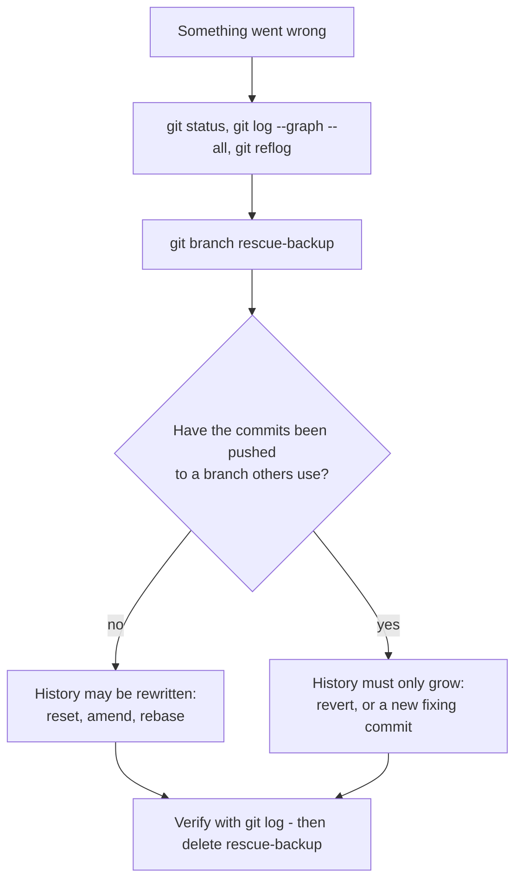
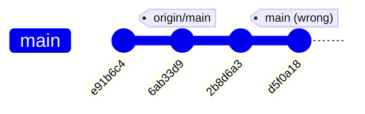
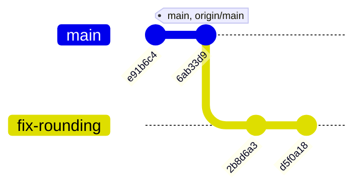
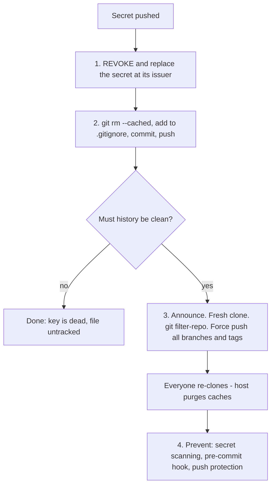
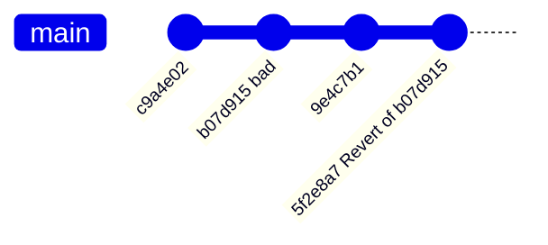
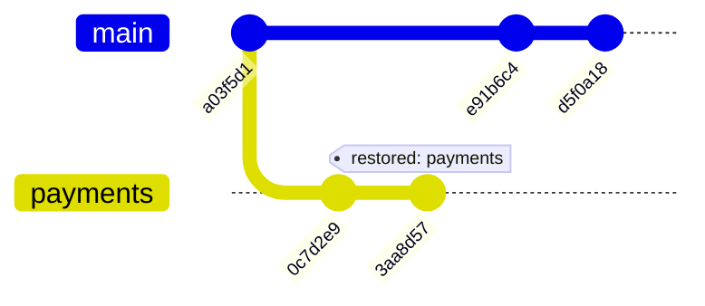

# Rescue drills: wrong branch, pushed secret, undo, recover

> **Before this lesson:** this lesson combines tools taught earlier. You need the everyday undos ([Undoing things safely](#/lesson/git/undoing-things)), reset ([Reset demystified, advanced merging and rerere](#/lesson/git/reset-advanced-merging)), cherry-pick ([Maintaining a project](#/lesson/git/maintaining)), history rewriting ([Signing, searching and rewriting history](#/lesson/git/sign-search-rewrite)) and the reflog ([Maintenance and data recovery](#/lesson/git/maintenance-recovery)).

## In plain words

Pilots do not learn what to do in an engine failure by reading about engines. They practise a short checklist, in a simulator, until their hands know it. When the real thing happens they are calm, because they have done it before.

This lesson is a set of such checklists for the Git mishaps that happen to everyone: committing on the wrong branch, pushing something that should have stayed private, needing to take back a commit that colleagues already have, deleting a branch that still mattered. For each one you get the situation, the reasoning, the exact commands with their output, and a picture of the history before and after.

Why it matters for a job: these moments are when people find out whether you understand Git or have only memorised it. Interviewers know this, so they love to ask "what would you do if…". More importantly, a calm five-minute repair keeps a team moving, and a panicked wrong command can turn a small slip into a lost afternoon.

## Three rules before any rescue

**Rule 1: stop and look.** Run these three read-only commands before changing anything.

```bash
$ git status
$ git log --oneline --graph --all -15
$ git reflog -10
```

- `git status` tells you which branch you are on, whether an operation (merge, rebase, bisect) is in progress, and what is uncommitted.
- `git log --oneline --graph --all -15` draws the last fifteen commits across all branches.
- `git reflog -10` lists the last ten positions of HEAD: your undo history.

**Rule 2: make a safety marker.** A branch is only a name, so creating one costs nothing and makes the current commit impossible to lose.

```bash
$ git branch rescue-backup
```

**Rule 3: ask "has it been shared?"** This single question chooses the kind of repair.



> [!WARNING]
> Three commands in this lesson destroy things and are marked each time they appear: `git reset --hard` (discards uncommitted changes to tracked files), `git push --force` in any form (replaces history on the server) and `git clean` (deletes untracked files). Before each one, check `git status` for uncommitted work you still need, and prefer `--force-with-lease` to plain `--force`. Uncommitted changes that are overwritten cannot be recovered by Git.

## Scenario 1: "I committed to the wrong branch"

You meant to work on a new branch `fix-rounding`, forgot to create it, and made two commits on `main`. Nothing has been pushed.

```bash
$ git log --oneline -4
d5f0a18 (HEAD -> main) Add rounding tests
2b8d6a3 Round discounted prices half up
6ab33d9 (origin/main) Merge branch 'currency-note'
e91b6c4 Fix pear price
```

`origin/main` is two commits behind your `main`: those two are the misplaced ones.



**Reasoning.** The commits themselves are fine; only the *names* are in the wrong place. Put a new name on them, then move `main` back.

```bash
$ git branch fix-rounding
$ git reset --hard origin/main
HEAD is now at 6ab33d9 Merge branch 'currency-note'
$ git switch fix-rounding
Switched to branch 'fix-rounding'
$ git log --oneline --graph --all -4
* d5f0a18 (HEAD -> fix-rounding) Add rounding tests
* 2b8d6a3 Round discounted prices half up
* 6ab33d9 (origin/main, main) Merge branch 'currency-note'
* e91b6c4 Fix pear price
```

- `git branch fix-rounding` creates the new branch at the current commit, without switching. The two commits now have a second name.
- `git reset --hard origin/main` moves `main` back to where the server's `main` is. (Destructive for uncommitted changes: make sure `git status` is clean first.)
- `git switch fix-rounding` takes you to the work.



**Variant A: the commits belong on a branch that already exists.** Copy them there with cherry-pick, then remove them from `main`.

```bash
$ git switch existing-feature
$ git cherry-pick 2b8d6a3 d5f0a18
[existing-feature 4f81b3c] Round discounted prices half up
[existing-feature 9a2c7e1] Add rounding tests
$ git switch main
$ git reset --hard origin/main
```

`git cherry-pick <a> <b>` applies those commits, in the order given, as new commits on the current branch.

**Variant B: you have not committed yet.** Uncommitted changes travel with you when you switch, as long as they do not collide:

```bash
$ git switch -c fix-rounding
```

If Git refuses because the target branch has different versions of the files, use the stash: `git stash`, `git switch <branch>`, `git stash pop`.

**Variant C: the wrong-branch commits were already pushed to a shared branch.** You may not rewrite it. Copy the commits to the right branch with cherry-pick, and undo them on the shared branch with `git revert` (Scenario 3).

## Scenario 2: "I pushed a secret"

You committed a file containing a live API key (a password-like string that lets programs use a paid service) and pushed it.

```bash
$ git log --oneline -3
7f4d21a (HEAD -> main, origin/main) Add export job
c41d7e2 Add service configuration
6ab33d9 Merge branch 'currency-note'
$ git show c41d7e2 --stat
 config/service.env | 3 +++
```

**Reasoning.** This scenario has a strict order, and most people get it backwards. Once pushed, a secret must be assumed stolen: automated scanners read public repositories within minutes, and even in a private repository the key is now in every colleague's clone, in CI caches and in backups. Removing it from Git does not un-leak it.

**Step 1: revoke the secret. Now, before touching Git.** Go to the service that issued the key, disable it and create a new one. This is the only step that makes you safe.

**Step 2: stop the bleeding in the current code.** Remove the file from tracking, ignore it, and commit.

```bash
$ git rm --cached config/service.env
rm 'config/service.env'
$ echo "config/service.env" >> .gitignore
$ git add .gitignore
$ git commit -m "Stop tracking service.env; load secrets from the environment"
[main 0b3d9f2] Stop tracking service.env; load secrets from the environment
 2 files changed, 1 insertion(+), 3 deletions(-)
 delete mode 100644 config/service.env
$ git push
```

- `git rm --cached` removes the file from the index but leaves it on your disk.
- The `.gitignore` entry prevents it from being added again.

At this point the secret is revoked and no longer in the latest snapshot. For many teams, with the key dead, this is enough.

**Step 3 (optional, coordinated): remove it from history.** If policy requires that the old value not appear in history at all, rewrite history in a fresh clone:

```bash
$ git clone https://git.example.com/greenhouse/orchard.git orchard-clean
$ cd orchard-clean
$ git filter-repo --invert-paths --path config/service.env
Parsed 214 commits
New history written in 0.31 seconds; now repacking/cleaning...
$ git remote add origin https://git.example.com/greenhouse/orchard.git
$ git push --force --all
$ git push --force --tags
```

- `git filter-repo --invert-paths --path <file>` rewrites every commit so that the file never existed. Every commit from `c41d7e2` onwards gets a new id.
- `filter-repo` removes the `origin` remote as a safety measure, so it is added again.
- `git push --force --all` replaces every branch on the server. (Destructive: this is one of the rare cases where a forced push to shared branches is intended, and it must be announced.)

To replace only the secret's text inside files that should otherwise stay, use `git filter-repo --replace-text expressions.txt`, where the file lists each secret on its own line.

Then:

- every teammate deletes their clone and clones again (an old clone pushed later would bring the secret back);
- open pull requests must be recreated;
- ask the hosting provider to purge cached views and unreachable commits, since the old commits can remain accessible by id for some time.



**If you caught it before pushing**, the repair is local and easy: if it is the last commit, `git rm --cached config/service.env && git commit --amend`; if older, an interactive rebase with `edit` on that commit. Revoking is still wise if the secret touched any shared machine.

**Prevention:** keep secrets in environment variables or a secrets manager, list such files in `.gitignore` from the first commit, run a secret scanner as a `pre-commit` hook, and enable the hosting platform's push protection.

## Scenario 3: "I need to undo a commit that is already pushed"

Commit `b07d915` broke the checkout page. It is on `main`, pushed, and three colleagues have pulled it and built on it.

```bash
$ git log --oneline -4
9e4c7b1 (HEAD -> main, origin/main) Add bulk discounts
b07d915 Round discounted prices to whole cents
c9a4e02 Speed up CSV import
6ab33d9 Merge branch 'currency-note'
```

**Reasoning.** Shared history must only grow. `git revert` creates a new commit that applies the exact opposite of the bad one.

```bash
$ git revert b07d915
[main 5f2e8a7] Revert "Round discounted prices to whole cents"
 1 file changed, 2 insertions(+), 2 deletions(-)
$ git push
To https://git.example.com/greenhouse/orchard.git
   9e4c7b1..5f2e8a7  main -> main
```

- Git opens your editor with the message `Revert "..."` plus the id of the reverted commit. Add a sentence saying why.
- The push is an ordinary fast-forward. Colleagues receive the fix with a normal pull.



The later commit `9e4c7b1` is untouched: revert removes one commit's change, not everything after it.

**If the revert conflicts** (later commits changed the same lines), Git pauses as in a merge: edit the files, `git add`, then `git revert --continue`; or `git revert --abort`.

**Reverting several commits:**

```bash
$ git revert --no-commit c9a4e02..9e4c7b1
$ git commit -m "Revert discount rounding and bulk discounts (broke checkout)"
```

- The range `A..B` means the commits after A up to and including B.
- `--no-commit` applies all the reversals to the index without committing, so they can be recorded as one commit.

**Reverting a merge commit** needs `-m 1` to say which parent is the main line, and has the "revert the revert before re-merging" trap described in the lesson on advanced merging.

**The exception: your own branch that nobody else uses.** There you may remove the commit outright:

```bash
$ git switch my-topic
$ git reset --hard HEAD~1
$ git push --force-with-lease
```

`--force-with-lease` refuses if anyone pushed to the branch since your last fetch, so you cannot erase work you have not seen.

| Situation | Command | History |
|---|---|---|
| Shared branch | `git revert <id>` | grows by one commit |
| Own unshared branch, last commit | `git reset --hard HEAD~1` | commit removed |
| Own pushed topic branch | reset or rebase, then `git push --force-with-lease` | rewritten |
| Shared merge commit | `git revert -m 1 <merge>` | grows by one commit |

## Scenario 4: "I deleted a branch I still needed"

```bash
$ git branch -D payments
Deleted branch payments (was 3aa8d57).
```

**Reasoning.** Deleting a branch deletes a name. The commits remain in the database for weeks.

**Case 1: the id is still on screen.** Git printed it: `(was 3aa8d57)`.

```bash
$ git branch payments 3aa8d57
$ git log --oneline -2 payments
3aa8d57 (payments) Handle refunds
0c7d2e9 Add payment client
```

`git branch <name> <id>` creates a branch pointing at that commit. The branch is back, complete.

**Case 2: the id is gone from the screen.** The HEAD reflog remembers every time you were on that branch.

```bash
$ git reflog | grep -n payments
4:e91b6c4 HEAD@{7}: checkout: moving from payments to main
7:a03f5d1 HEAD@{10}: checkout: moving from main to payments
$ git reflog | sed -n '4,7p'
e91b6c4 HEAD@{7}: checkout: moving from payments to main
3aa8d57 HEAD@{8}: commit: Handle refunds
0c7d2e9 HEAD@{9}: commit: Add payment client
a03f5d1 HEAD@{10}: checkout: moving from main to payments
```

- `grep -n payments` finds the lines that mention the branch and shows their line numbers.
- `sed -n '4,7p'` prints lines 4 to 7 of the reflog: everything between entering the branch and leaving it.
- The reflog is newest-first. The entry immediately before "moving from payments to main" is the last thing that happened on the branch: `3aa8d57`.

```bash
$ git branch payments 3aa8d57
```

This log-replaying logic is small enough to write yourself; the problem *Recover a deleted branch from the reflog* asks you to.

```python-run
reflog_oldest_first = [
    ("a03f5d1", "checkout: moving from main to payments"),
    ("0c7d2e9", "commit: Add payment client"),
    ("3aa8d57", "commit: Handle refunds"),
    ("e91b6c4", "checkout: moving from payments to main"),
    ("d5f0a18", "commit: Add rounding tests"),
]

def last_tip(entries, start_branch, wanted):
    current, tip = start_branch, None
    for sha, message in entries:
        if message.startswith("checkout: moving from "):
            current = message.rsplit(" to ", 1)[1]      # the branch we are now on
        if current == wanted:
            tip = sha                                   # where that branch pointed after this step
    return tip

print("payments last pointed at:", last_tip(reflog_oldest_first, "main", "payments"))
print("main last pointed at    :", last_tip(reflog_oldest_first, "main", "main"))
```

**Case 3: no reflog entry** (expired, or a different clone). Look for dangling commits:

```bash
$ git fsck --lost-found
dangling commit 3aa8d57c0e2f4a6b8d0c1e3f5a7b9d1c3e5f7a90
$ git show --stat 3aa8d57
$ git branch payments 3aa8d57
```

**Case 4: the branch was deleted on the server too.** If anyone's clone still has `origin/payments` (their remote-tracking branch survives until they prune), they can push it back: `git push origin origin/payments:refs/heads/payments`. Hosting sites also offer a "Restore branch" button on a closed pull request.



## Scenario 5: quick drills

### "My rebase went wrong"

During the rebase:

```bash
$ git rebase --abort
```

After it finished and the result is bad:

```bash
$ git reflog -6
4f81b3c (HEAD -> discounts) HEAD@{0}: rebase (finish): returning to refs/heads/discounts
4f81b3c (HEAD -> discounts) HEAD@{1}: rebase (pick): Add discount tests
1a6e9d0 HEAD@{2}: rebase (pick): Add discount rules
c9a4e02 HEAD@{3}: rebase (start): checkout main
e7c2a90 HEAD@{4}: commit: Add discount tests
d3b1f58 HEAD@{5}: commit: Add discount rules
$ git reset --hard HEAD@{4}
HEAD is now at e7c2a90 Add discount tests
```

The entry before `rebase (start)` is the branch as it was. Resetting to it undoes the whole rebase. (`git reset --hard ORIG_HEAD` works too, if you have run nothing else since.)

### "I reset --hard and lost commits"

```bash
$ git reflog -3
6ab33d9 (HEAD -> main) HEAD@{0}: reset: moving to HEAD~2
d5f0a18 HEAD@{1}: commit: Add rounding tests
2b8d6a3 HEAD@{2}: commit: Round discounted prices half up
$ git reset --hard HEAD@{1}
HEAD is now at d5f0a18 Add rounding tests
```

### "I committed while HEAD was detached"

```bash
$ git switch main
Warning: you are leaving 2 commits behind, not connected to
any of your branches:

  9a2c7e1 Try faster parser
  4c0d8b3 Benchmark parser

If you want to keep them by creating a new branch, this may be a good time
to do so with:

 git branch <new-branch-name> 9a2c7e1

$ git branch parser-experiment 9a2c7e1
```

Git tells you the id and the command. If you missed the message, `git reflog` has the same id.

### "I amended a commit that was already pushed"

Your local branch and the server now have two different versions of that commit, and `git status` says they have diverged. If the branch is yours alone, `git push --force-with-lease`. If others use it, put the server's version back and add your change as a new commit:

```bash
$ git reset --soft origin/main      # branch points at the server's commit; your changes stay staged
$ git commit -m "Follow-up: correct rounding message"
$ git push
```

### "I dropped a stash I needed"

```bash
$ git stash drop
Dropped refs/stash@{0} (4c9d1e7a2b3c4d5e6f708192a3b4c5d6e7f8a9b0)
$ git stash apply 4c9d1e7
```

Without the id: `git fsck --no-reflogs | grep "dangling commit"`, then inspect each with `git show`.

### "I committed a huge file by accident (not pushed)"

```bash
$ git rm --cached data/export.sql
$ echo "data/export.sql" >> .gitignore
$ git add .gitignore
$ git commit --amend --no-edit
```

If the commit is older, use an interactive rebase and `edit` that commit. If it was pushed, it is the same procedure as the secret, minus the revocation.

### "I want to discard everything and match the server exactly"

```bash
$ git fetch origin
$ git status --short            # last look at what will be lost
$ git reset --hard origin/main  # tracked files now match the server
$ git clean -n -d               # preview untracked files that would be deleted
$ git clean -f -d               # delete them
```

Both the reset and the clean are destructive. The dry run with `-n` is there to be read.

## Which tool for which mess

| What happened | Not shared | Shared |
|---|---|---|
| Wrong message on last commit | `git commit --amend` | leave it, or agree a rewrite |
| Forgot a file in last commit | `git add f && git commit --amend --no-edit` | new commit |
| Commit on wrong branch | `git branch new && git reset --hard <before>` | cherry-pick to the right branch + `git revert` |
| Bad commit | `git reset` / `git rebase -i` (drop) | `git revert <id>` |
| Bad merge | `git reset --hard HEAD~1` | `git revert -m 1 <merge>` |
| Secret committed | amend or rebase to remove; revoke if exposed | **revoke first**, untrack, optionally filter-repo + force push |
| Deleted branch | `git branch name <id>` from reflog | restore from any clone or the host |
| Lost commits after reset or rebase | `git reflog`, then `git reset --hard <id>` | same, locally |

## Pitfalls

- **Acting before looking.** Most disasters are a small mistake followed by three hasty commands. Run the three read-only commands first.
- **Using `--force` instead of `--force-with-lease`.**
- **Cleaning history before revoking a secret.** The order is revoke, then clean.
- **Resetting a shared branch.** The next person to push restores the "deleted" commits, or their push is rejected and confusion spreads.
- **Running `git gc --prune=now` or `git reflog expire` while something is lost.** They delete the very things that make rescue possible.
- **Believing `git restore`, `reset --hard` or `clean` can be undone.** For uncommitted work they cannot.
- **Forgetting to tell the team.** A forced push or history rewrite that nobody was warned about creates new victims.

> [!TIP]
> Practise these drills in a scratch repository before you need them. `git init /tmp/drill`, make five commits, then deliberately commit on the wrong branch, delete a branch, hard-reset, and recover each time. Ten minutes of rehearsal turns the real event into a routine.

> [!INTERVIEW]
> **"You accidentally committed to main instead of a feature branch. What do you do?"** If not pushed: `git branch feature` to keep the commits, `git reset --hard origin/main` to put main back, `git switch feature`. If pushed to shared main: cherry-pick the commits onto the feature branch and `git revert` them on main. **"A teammate pushed an API key. What now?"** Revoke and rotate the key immediately, since it must be considered compromised; remove the file from tracking and ignore it; if policy demands, rewrite history with `git filter-repo` in a fresh clone, force-push, have everyone re-clone and ask the host to purge caches; then add secret scanning to prevent a repeat. **"How do you undo a pushed commit?"** `git revert`, because shared history should only move forward; reset plus force push only on a branch nobody else uses, with `--force-with-lease`. **"How do you recover a deleted branch?"** Find its last commit in `git reflog` (or `git fsck --lost-found`) and recreate it with `git branch <name> <id>`.

## Cheat sheet

| Task | Command |
|---|---|
| Look before acting | `git status`; `git log --oneline --graph --all`; `git reflog` |
| Safety marker | `git branch rescue-backup` |
| Move unpushed commits off `main` | `git branch <new>`; `git reset --hard origin/main`; `git switch <new>` |
| Copy commits to another branch | `git cherry-pick <id>...` |
| Stop tracking a file, keep it on disk | `git rm --cached <file>` and add it to `.gitignore` |
| Remove a file from all history | `git filter-repo --invert-paths --path <file>` (fresh clone) |
| Undo a pushed commit | `git revert <id>` |
| Undo several as one | `git revert --no-commit A..B` then `git commit` |
| Undo a pushed merge | `git revert -m 1 <merge>` |
| Remove last commit on your own branch | `git reset --hard HEAD~1` then `git push --force-with-lease` |
| Restore a deleted branch | `git branch <name> <id>` |
| Find a lost id | `git reflog` or `git fsck --lost-found` |
| Undo a finished rebase | `git reset --hard ORIG_HEAD` or `git reset --hard HEAD@{n}` |
| Match the server exactly | `git fetch`; `git reset --hard origin/<branch>`; `git clean -n -d` then `-f -d` |

## Summary

Every rescue starts the same way: look with `git status`, the graph log and the reflog; mark the current commit with a backup branch; and ask whether the commits have been shared. Unshared mistakes are repaired by moving names and rewriting: create a branch on misplaced commits and reset the wrong one, amend, or rebase. Shared mistakes are repaired by adding history: `git revert` for a bad commit or merge. A pushed secret is first revoked at its source, then untracked, and only then, if required and with the team's agreement, removed from history with `git filter-repo` and a forced push. Deleted branches and commits lost to reset or rebase are found through the reflog or `git fsck` and restored by giving the commit a name. The only truly unrecoverable losses are changes that were never committed, stashed or staged.

## Glossary

- **Rescue:** repairing a repository after a mistake without losing work.
- **Safety marker:** a temporary branch or tag created so that the current commit stays reachable.
- **Shared (pushed) commit:** a commit that other people may already have.
- **Revert:** add a commit that undoes an earlier commit's change.
- **Cherry-pick:** copy a commit's change onto the current branch as a new commit.
- **Secret:** a credential such as a password, token or API key.
- **API key:** a secret string that identifies and authorises a program to a service.
- **Revoke / rotate:** disable a credential / replace it with a new one.
- **`git filter-repo`:** a tool that rewrites an entire history, for example to remove a file from every commit.
- **Force push:** a push that replaces the remote branch's history; `--force-with-lease` adds a safety check.
- **Reflog:** the local log of previous positions of HEAD and branches.
- **`ORIG_HEAD`:** the previous position of the branch, saved by commands such as reset, merge and rebase.
- **Dangling commit:** a commit that no branch, tag or other commit points to.
- **Secret scanning / push protection:** automated detection of credentials in commits, before or after they are pushed.
- **Dry run:** running a command in a mode that reports what it would do without doing it.

## Check yourself

```quiz
[
  {"q": "You made two commits on main by mistake and have not pushed. What is the cleanest fix?", "options": ["Delete the repository and re-clone", "git branch new-branch; git reset --hard origin/main; git switch new-branch", "git revert both commits", "git push --force"], "answer": 1, "explain": "Give the commits a new name first, then move main back to the server's position. Nothing is rewritten on the server because nothing was pushed."},
  {"q": "An API key was pushed to the shared repository. What must be done first?", "options": ["Force-push an older commit", "Add the file to .gitignore", "Run git filter-repo", "Revoke the key and issue a new one"], "answer": 3, "explain": "The key must be assumed compromised the moment it left your machine. Removing it from Git does not make it secret again; revoking does make it harmless."},
  {"q": "Why is `git revert` the right tool for a bad commit that colleagues have already pulled?", "options": ["It is faster than reset", "It adds a new commit that undoes the change, so shared history is not rewritten", "It deletes the commit from everyone's clone", "It also reverts later commits"], "answer": 1, "explain": "Everyone can receive the fix with an ordinary pull. Resetting and force-pushing would leave their clones holding commits the server no longer has."},
  {"q": "After `git branch -D payments` the id is no longer on screen. Where do you look first?", "options": ["git reflog, for the last commit made while on that branch", ".gitignore", "git status", "The remote's settings page"], "answer": 0, "explain": "The HEAD reflog records checkouts and commits. The entry just before leaving the branch is its final tip; recreate it with git branch payments <id>."},
  {"q": "A rebase finished and the result is wrong. How do you get the branch back?", "options": ["git rebase --abort", "git revert HEAD", "It cannot be undone", "git reset --hard ORIG_HEAD, or reset to the reflog entry before 'rebase (start)'"], "answer": 3, "explain": "--abort only works while the rebase is in progress. Afterwards the original commits are still in the database and the reflog or ORIG_HEAD names them."},
  {"q": "What does `--force-with-lease` protect against?", "options": ["Overwriting commits that someone else pushed to the branch since you last fetched", "Uncommitted changes", "Slow networks", "Pushing to the wrong remote"], "answer": 0, "explain": "The push succeeds only if the remote branch is still where your remote-tracking reference says it is."},
  {"q": "Which of these cannot be recovered with Git?", "options": ["Uncommitted edits overwritten by git reset --hard", "A commit removed with git reset --hard", "A branch deleted with -D", "A stash dropped a minute ago"], "answer": 0, "explain": "Work that was never committed, stashed or staged was never written to the object database, so no reflog or fsck can find it."},
  {"q": "You pushed a commit to shared main that belongs on a feature branch. What is the correct repair?", "options": ["Delete main", "Nothing can be done", "git reset --hard on main and force push", "Cherry-pick the commit onto the feature branch and git revert it on main"], "answer": 3, "explain": "The feature branch receives a copy of the change, and main gets a new commit that undoes it, with no history rewritten."}
]
```

> **Source:** original worked scenarios for this guide, using techniques from Chacon & Straub, Pro Git 2e, ch. 2 (Undoing Things), ch. 7 (Reset Demystified; Rewriting History; Advanced Merging) and ch. 10 (Maintenance and Data Recovery).
