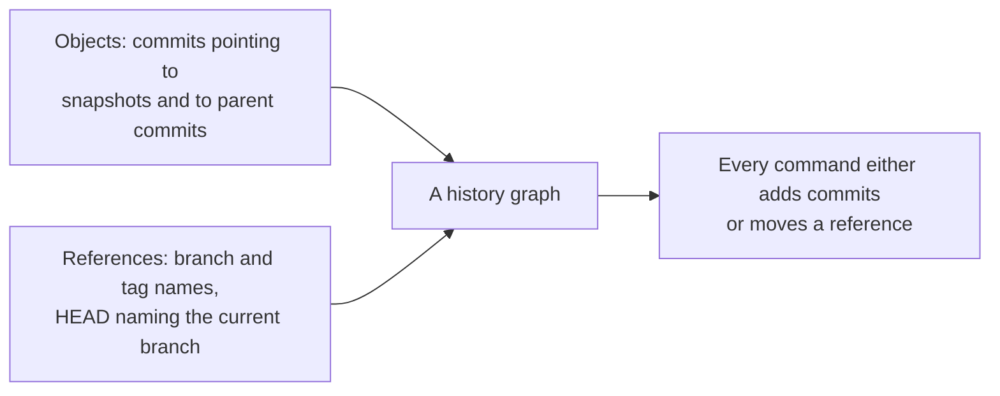
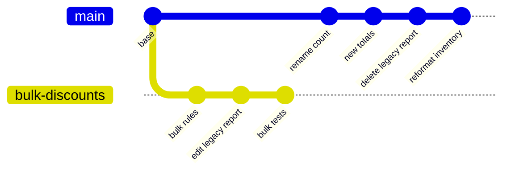
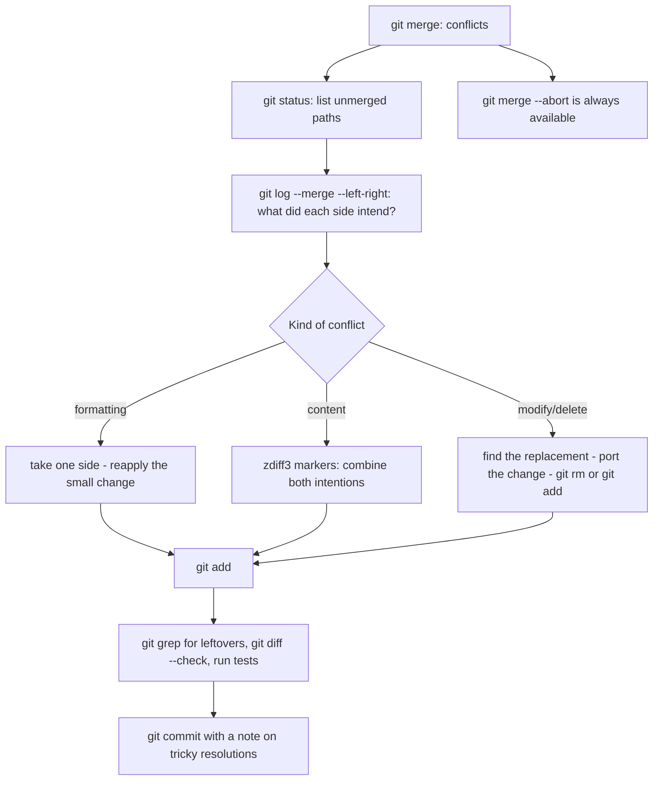
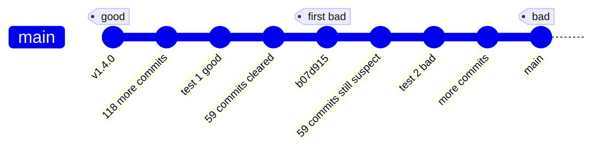
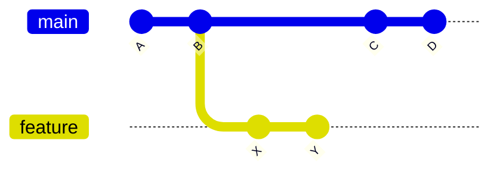
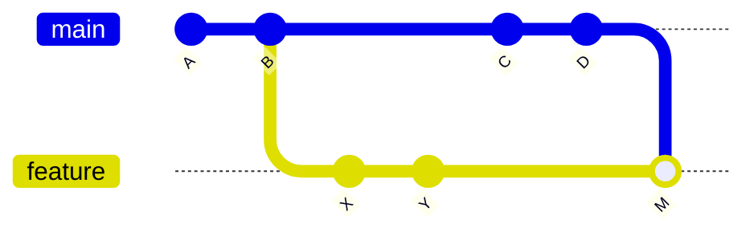
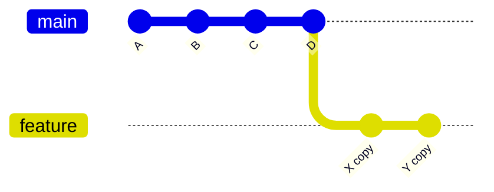
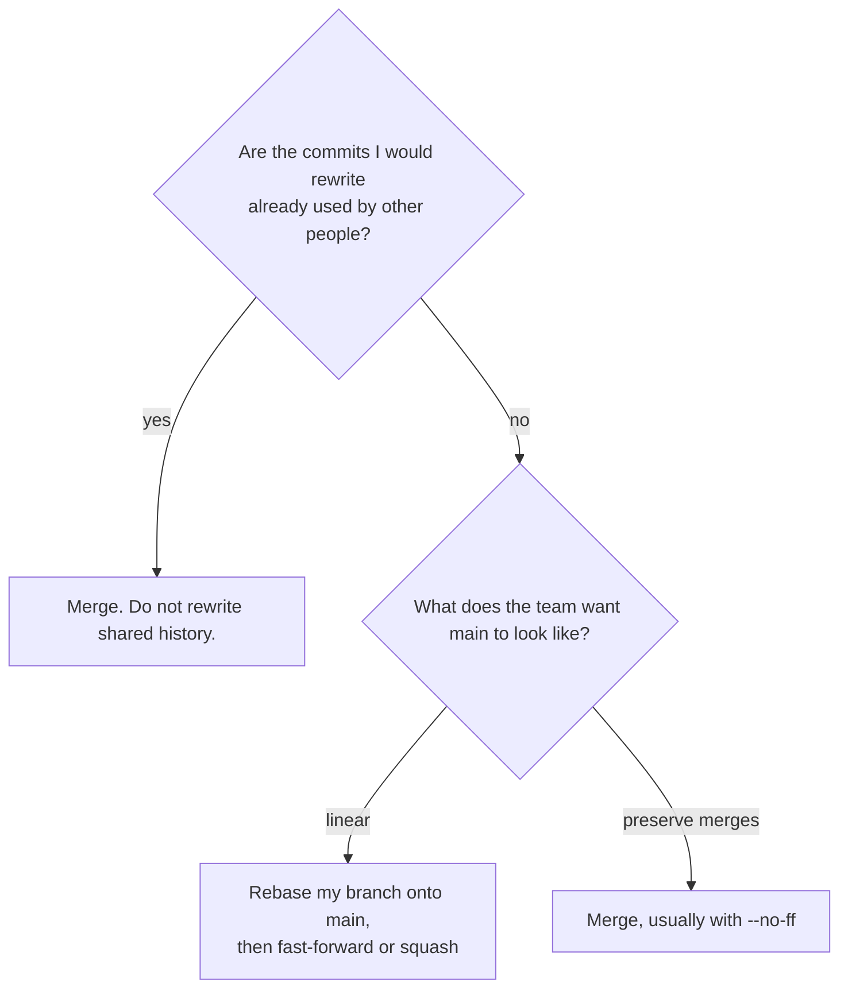

# Interview walkthroughs: conflicts, bisect, merge vs rebase

> **Before this lesson:** this is the capstone of the track. It draws on merging and conflicts ([Merging and resolving conflicts](#/lesson/git/merging-and-conflicts), [Reset demystified, advanced merging and rerere](#/lesson/git/reset-advanced-merging)), rebasing ([Rebasing and its golden rule](#/lesson/git/rebasing)), bisect ([Bisect, blame, submodules, bundles, replace and credentials](#/lesson/git/debugging-submodules-more)), the object model ([Objects: blobs, trees, commits and tags](#/lesson/git/objects)) and the rescue drills ([Rescue drills: wrong branch, pushed secret, undo, recover](#/lesson/git/rescue-scenarios)).

## In plain words

Knowing how to do something and being able to explain it are different skills. A good driving instructor does not only drive well; they can say, out loud and in order, what they are doing and why. An interview about Git tests that second skill. So does everyday teamwork: the colleague who can explain a conflict to a nervous newcomer, or justify a rebase to a sceptical lead, is worth more than one who silently types the right commands.

This lesson takes three situations that come up constantly, both in interviews and on the job, and walks through each twice: first the hands-on procedure, then a clear spoken explanation you could give to someone else.

1. Resolving a nasty merge conflict, the kind with several files and changes that interact.
2. Finding the commit that broke the build.
3. Explaining merge versus rebase to an interviewer.

It ends with a set of short questions and model answers covering the rest of the track.

Why it matters for a job: Git questions appear in nearly every software interview because they reveal how you work with others. The interviewer is rarely checking whether you remember a flag. They are checking whether you have a correct picture in your head, whether you know which actions are dangerous, and whether you can communicate.

## How to answer a Git question well

A reliable structure for any "what would you do if" question:

1. **Restate the situation** in terms of commits and branches. ("So `main` has moved on by ten commits and my branch has five of its own.")
2. **Name the constraint that decides the approach.** Almost always: *has this history been shared?* and *is there uncommitted work at risk?*
3. **Give the commands in order**, saying what each one does.
4. **Mention how you would verify and how you would back out.**
5. **Say what you would do differently next time** if prevention is relevant.

Drawing the commit graph, on a whiteboard or in words, is the single most convincing thing you can do. All of Git's behaviour follows from one model:



## Walkthrough 1: a nasty merge conflict

### The situation

Your branch `bulk-discounts` has lived for two weeks. Meanwhile, on `main`, a colleague renamed the function `count` to `count_items`, another changed how totals are computed, and a third reformatted `inventory.py`. You merge `main` into your branch to catch up.

```bash
$ git switch bulk-discounts
$ git status --short
$ git merge main
Auto-merging discounts.py
CONFLICT (content): Merge conflict in discounts.py
Auto-merging inventory.py
CONFLICT (content): Merge conflict in inventory.py
CONFLICT (modify/delete): legacy_report.py deleted in main and modified in HEAD.  Version HEAD of legacy_report.py left in tree.
Auto-merging tests/test_inventory.py
Automatic merge failed; fix conflicts and then commit the result.
```

- The empty output of `git status --short` confirms you started with no uncommitted changes. That matters: it means `git merge --abort` can restore everything.
- Three files conflict. Two are **content** conflicts (both sides edited the same region). One is a **modify/delete** conflict: `main` deleted a file that you edited.
- `tests/test_inventory.py` merged automatically and needs no action.



### Step 1: take stock, calmly

```bash
$ git status
On branch bulk-discounts
You have unmerged paths.
  (fix conflicts and run "git commit")
  (use "git merge --abort" to abort the merge)

Changes to be committed:
        modified:   tests/test_inventory.py

Unmerged paths:
  (use "git add/rm <file>..." as appropriate to mark resolution)
        both modified:   discounts.py
        both modified:   inventory.py
        deleted by them: legacy_report.py
```

`git status` is your to-do list. Work through the unmerged paths one at a time. "Them" means the branch being merged in (`main`); "us" is the branch you are on.

### Step 2: understand what each side intended

```bash
$ git log --oneline --left-right --merge
< 4f81b3c bulk tests
< 9a2c7e1 edit legacy report
< 1a6e9d0 bulk rules
> 7f4d21a reformat inventory
> c41d7e2 delete legacy report
> b07d915 new totals
> 3c9e1d7 rename count
```

- `--merge` limits the log to commits that touch a conflicted file. `<` marks your side, `>` marks theirs.
- Add `-p` to see each commit's diff. Reading the *messages* first usually reveals the intent: a rename, a new calculation, a deletion, a reformat.

### Step 3: the reformatted file

`inventory.py` conflicts mostly because one side changed spacing. First measure the damage, then make the markers more informative:

```bash
$ grep -c '<<<<<<<' inventory.py
5
$ git checkout --conflict=zdiff3 inventory.py
```

- `grep -c '<<<<<<<' <file>` counts the lines that open a conflict region: five separate conflicts in this file.
- `git checkout --conflict=zdiff3 <file>` rewrites the markers in the file so that each conflict also shows the **base** version, between `|||||||` and `=======`. With the base visible you can tell at a glance which side only changed spacing.

A simpler route for a file dominated by formatting: accept their formatted version wholesale and reapply your small logical change on top.

```bash
$ git checkout --theirs inventory.py
$ git diff HEAD -- inventory.py | grep '^[-+]' | grep -v '^[-+][-+]' | head -5
-def count(rows):
+def count_items(rows):
-    total=0
+    total = 0
```

- `git checkout --theirs inventory.py` replaces the working file with `main`'s version.
- The diff against `HEAD` (your pre-merge commit) shows what you would be giving up, so that you can reapply your own change deliberately. Edit the file, then:

```bash
$ git add inventory.py
```

### Step 4: the content conflict that needs thought

```bash
$ git checkout --conflict=zdiff3 discounts.py
$ sed -n '12,22p' discounts.py
<<<<<<< ours
    n = count(rows)
    return bulk_rate(n) * subtotal
||||||| base
    n = count(rows)
    return RATE * subtotal
=======
    n = count_items(rows)
    return RATE * round_cents(subtotal)
>>>>>>> theirs
```

- `sed -n '12,22p'` prints lines 12 to 22 of the file.

Read it as three statements. Base: the original code. Ours: we replaced the fixed `RATE` with `bulk_rate(n)`. Theirs: they renamed `count` to `count_items` and wrapped the subtotal in `round_cents`. These are **three independent intentions**, and the correct result keeps all of them:

```python
    n = count_items(rows)
    return bulk_rate(n) * round_cents(subtotal)
```

Neither "accept ours" nor "accept theirs" is right. This is the general lesson of hard conflicts: the resolution is a new piece of code that honours both sides, and finding it requires knowing what each side was trying to do.

```bash
$ git add discounts.py
```

### Step 5: the modify/delete conflict

`main` deleted `legacy_report.py`; you edited it. Git kept your version in the working tree and asks you to decide.

```bash
$ git log --oneline -1 main -- legacy_report.py
c41d7e2 delete legacy report
$ git show c41d7e2 --stat | head -6
    delete legacy report

    Replaced by reports/monthly.py (ORCH-171).
```

The file was replaced by another. Your edit therefore needs to move to the new file. Check what you changed, port it, and accept the deletion:

```bash
$ git diff main...HEAD -- legacy_report.py      # your changes to the old file
$ # apply the equivalent change in reports/monthly.py, then:
$ git add reports/monthly.py
$ git rm legacy_report.py
legacy_report.py: needs merge
rm 'legacy_report.py'
```

`git rm` on a conflicted path records "resolved as deleted". (Had you wanted to keep the file, `git add legacy_report.py` would record "resolved as kept".)

### Step 6: check for semantic conflicts

Text conflicts are the ones Git sees. A **semantic conflict** is one it cannot see: the merge is textually clean but the program is wrong. Here `main` renamed `count`, and your *non-conflicting* new code may still call the old name.

```bash
$ git grep -n "count(" -- "*.py"
discounts.py:31:    if count(rows) > 100:
$ git diff --check
$ python -m pytest -q
1 failed, 57 passed
```

- `git grep` finds a leftover call to the old name on a line that never conflicted.
- `git diff --check` reports leftover conflict markers and whitespace errors; no output is good.
- The tests confirm the problem. Fix the call, rerun until green.

### Step 7: conclude

```bash
$ git add discounts.py
$ git status --short
M  discounts.py
M  inventory.py
D  legacy_report.py
M  reports/monthly.py
M  tests/test_inventory.py
$ git commit
[bulk-discounts 8c1d4e6] Merge branch 'main' into bulk-discounts
```

In the merge message, add two lines about any non-obvious resolution ("combined bulk_rate with round_cents; ported legacy report change to reports/monthly.py"). Future readers of this merge will thank you.



> [!WARNING]
> Never resolve a conflict by picking a side you do not understand, and never commit a merge without running the tests. A wrong resolution silently deletes a colleague's change, and because it is buried inside a merge commit it is hard to notice in review. If a conflict involves code you do not know, ask its author. And if you are lost halfway, `git merge --abort` returns you to the state before the merge, provided you started with a clean working tree.

### The spoken version

"First I make sure my working tree is clean, so that I can abort safely. After the merge stops, `git status` gives me the list of conflicted files. Before editing, I look at `git log --merge --left-right` to understand what each side was trying to do. For each file I switch on the diff3-style markers so that I can see the common ancestor, and I write the result that keeps both intentions, which is often neither side verbatim. A modify/delete conflict I resolve by finding out why the file was deleted. Then I look for semantic conflicts that Git cannot detect: I search for uses of anything renamed, and I run the tests. I stage each file, commit the merge, and note any non-obvious resolution in the message. To avoid this next time, I would merge or rebase from main more often and keep the branch shorter-lived, and I would enable rerere so repeated conflicts resolve themselves."

## Walkthrough 2: find the commit that broke the build

### The situation

The nightly build passed at tag `v1.4.0`. Today `main` fails one test. 240 commits were merged in between, by a dozen people.

### The reasoning

Reading 240 diffs is hopeless. But there is a known good commit and a known bad one, and the breakage was introduced at one point in between. That is a search problem, and halving the range each time finds the answer in about eight steps, because 2 to the power 8 is 256.

```python-run
import math

for commits in (10, 240, 1000, 50_000):
    print(f"{commits:>6} commits between good and bad -> about {math.ceil(math.log2(commits))} tests")
```

### Step 1: make "broken" a command

Find one command whose **exit code** says good or bad (zero for success, anything else for failure).

```bash
$ python -m pytest -q tests/test_export.py::test_totals_row
F
1 failed in 0.41s
$ echo $?
1
```

- The single failing test is run by name, which keeps each step fast.
- `echo $?` prints the exit code of the previous command: 1, a failure.

### Step 2: let Git drive

```bash
$ git status --short
$ git bisect start main v1.4.0
Bisecting: 119 revisions left to test after this (roughly 7 steps)
[9e4c7b1d03a5...] Add bulk discounts

$ git bisect run python -m pytest -q tests/test_export.py::test_totals_row
running 'python' '-m' 'pytest' '-q' 'tests/test_export.py::test_totals_row'
.
1 passed in 0.38s
Bisecting: 59 revisions left to test after this (roughly 6 steps)
[1a6e9d0f55c2...] Refactor price lookup
running 'python' '-m' 'pytest' '-q' 'tests/test_export.py::test_totals_row'
F
1 failed in 0.40s
Bisecting: 29 revisions left to test after this (roughly 5 steps)
...
b07d915e8c41a2f6d3907be5c1a8f04d6e2b7c93 is the first bad commit
commit b07d915e8c41a2f6d3907be5c1a8f04d6e2b7c93
Author: Tomas Lind <tomas@greenhouse.example>
Date:   Thu Nov 19 17:20:11 2026 +0100

    Round discounted prices to whole cents

 discounts.py | 4 ++--
 1 file changed, 2 insertions(+), 2 deletions(-)
bisect found first bad commit
```

- A clean working tree first.
- `git bisect start <bad> <good>` marks both ends and checks out a commit in the middle.
- `git bisect run <command>` repeats: run the command; exit code 0 marks the commit good, 1 to 127 (except 125) marks it bad, 125 means "cannot test this one, skip it"; then move to the middle of what remains.
- Seven or eight runs later Git names the **first bad commit**: the one that is bad while its parent is good.



### Step 3: always clean up

```bash
$ git bisect reset
Previous HEAD position was b07d915 Round discounted prices to whole cents
Switched to branch 'main'
```

During a bisect you are on a detached HEAD at historical commits. `git bisect reset` returns you to where you started.

### Step 4: understand and fix

```bash
$ git show b07d915
...
-    return RATE * subtotal
+    return round(RATE * subtotal)
```

A two-line diff. `round` without a second argument rounds to a whole number, not to cents: there is the bug. You now choose between fixing forward (a new commit with the correction and a test that would have caught it) and `git revert b07d915` to restore the build at once and fix properly afterwards. On a broken main branch, reverting first is usually the kinder choice for the team.

### Complications worth mentioning

- **Some commits do not build.** Make the script return 125 for those: `make || exit 125; pytest ...`.
- **The test did not exist at the old commits.** Keep the test script outside the repository (or copy it to a temporary folder) so that it is the same at every step.
- **A flaky test.** One wrong verdict sends the search to the wrong half. Run the test several times per step, or fix the flakiness first.
- **Merges in the range.** Bisect handles a graph; with squash merges it lands on the whole pull request, which is one more argument for small pull requests.
- **The bug is a change, not a breakage.** Use your own words: `git bisect start --term-old fast --term-new slow`.

### The spoken version

"I'd use `git bisect`. I need a known good commit, say the last release tag, a known bad one, the current tip, and a command that returns zero when things work. Then `git bisect start bad good` and `git bisect run` with that command. Git does a binary search over the commit graph, so for a few hundred commits it takes about eight test runs, and it reports the first bad commit. I return with `git bisect reset`, read that commit's diff, and either revert it to unblock the team or fix forward with a regression test. If some commits can't be built, the script exits with 125 to skip them."

## Walkthrough 3: merge versus rebase, explained to an interviewer

### Set up the picture

Start from one diagram: a branch with two commits, and a main line that has moved.



"Both commands answer the same need: my branch and main have diverged, and I want my work combined with the latest main. They differ in what they do to history."

### Merge

```bash
$ git switch feature
$ git merge main
Merge made by the 'ort' strategy.
```



"Merge creates one new commit, M, with two parents. Nothing that existed is changed: X and Y keep their ids. The history records the truth, including the fact that the two lines developed in parallel and when they were joined."

### Rebase

```bash
$ git switch feature
$ git rebase main
Successfully rebased and updated refs/heads/feature.
```



"Rebase takes the commits that are only on my branch, X and Y, and replays their changes one by one on top of the tip of main. The result is new commits with the same changes but different parents, and therefore different ids. The old X and Y are abandoned. History becomes a straight line, as though I had started my work after D."

### The comparison

| | Merge | Rebase |
|---|---|---|
| Existing commits | unchanged | replaced by new copies |
| New commits created | one merge commit | one per replayed commit |
| Shape of history | a graph showing the fork and join | a straight line |
| Conflicts | resolved once | resolved commit by commit |
| Safe on shared branches | yes | **no** |
| What it preserves | what happened, exactly | a clean, readable sequence |
| Undo | `git reset --hard ORIG_HEAD` (local) or `git revert -m 1` (shared) | `git reset --hard ORIG_HEAD` or the reflog |

A model that makes the id change concrete:

```python-run
import hashlib

def commit_id(parents, change):
    return hashlib.sha1(("|".join(parents) + "#" + change).encode()).hexdigest()[:7]

A = commit_id([], "A"); B = commit_id([A], "B")
C = commit_id([B], "C"); D = commit_id([C], "D")          # main
X = commit_id([B], "X"); Y = commit_id([X], "Y")          # feature

M = commit_id([Y, D], "merge")
print("merge : feature =", [X, Y, M], "-> X and Y unchanged, plus a merge commit with two parents")

X2 = commit_id([D], "X"); Y2 = commit_id([X2], "Y")
print("rebase: feature =", [X2, Y2], "-> same changes, new parents, so new ids")
print("ids changed by rebase:", X != X2 and Y != Y2)
```

### The rule that matters

"Because rebase replaces commits, the rule is: **never rebase commits that other people have based work on.** If I rebase a shared branch and force-push, my colleagues still have the old commits. When they pull, Git sees their old copies and my new copies as different work and merges them, so every change appears twice and conflicts appear out of nowhere."

### When to use which



"In practice I rebase my own local or personal topic branch onto the latest main to keep it current and tidy before review, and I push with `--force-with-lease` if I had already published it. I merge when integrating into shared branches, and I follow whatever landing strategy the team has chosen: merge commit, squash or rebase-merge. `git pull --rebase` is a good default for keeping my unpushed commits on top of what I fetch."

### Follow-up questions to expect

- **"What is `--force-with-lease`?"** A forced push that succeeds only if the remote branch is still where my remote-tracking reference says, so I cannot overwrite commits I have never seen.
- **"What is an interactive rebase?"** `git rebase -i`: I edit a todo list to reorder, squash, reword, split or drop my commits before they are replayed.
- **"What if a rebase goes wrong?"** `git rebase --abort` during; `git reset --hard ORIG_HEAD` or the reflog after. The original commits remain in the database for weeks.
- **"Is the final code different?"** No. With the same conflict resolutions, the files end up identical. Only the recorded history differs.
- **"Which is better?"** Neither. One preserves the record, the other tells a cleaner story. The team picks a convention, and the golden rule applies regardless.

## Rapid-fire questions and model answers

**What is the difference between `git fetch` and `git pull`?** Fetch downloads new commits and updates remote-tracking branches such as `origin/main` without touching my branches or files. Pull is fetch followed by integrating the fetched branch into my current one, by merge or rebase.

**What are the three states of a file, and the three areas?** Modified, staged, committed; working tree, index (staging area), repository.

**What is HEAD?** A symbolic reference that normally names the current branch; detached HEAD means it holds a commit id directly, so new commits are on no branch.

**What does a commit contain?** A pointer to a tree (the full snapshot), pointers to parent commits, author, committer, timestamps and the message. Its id is the hash of that content.

**`git reset` versus `git revert` versus `git restore`?** Reset moves the current branch (and optionally resets index and working tree): history rewriting, for local work. Revert adds a commit that undoes an earlier one: safe for shared history. Restore copies file content from the index or a commit into the working tree or index, without moving any branch.

**Soft, mixed, hard reset?** Soft moves the branch only; mixed also resets the index; hard also overwrites the working tree and discards uncommitted changes to tracked files.

**What is a fast-forward?** A merge in which the current branch is an ancestor of the other, so the pointer moves forward and no merge commit is created.

**What is the stash?** A stack of saved uncommitted changes; `stash push` shelves them and cleans the working tree, `stash pop` reapplies.

**How do you stop tracking a file without deleting it?** `git rm --cached <file>` and add it to `.gitignore`.

**What is `.gitignore` versus `.gitattributes`?** Which untracked files Git should not offer to track, versus how tracked paths are treated (line endings, diff, merge, filters).

**What is cherry-pick?** Copying the change of one commit onto the current branch as a new commit.

**How do you recover lost commits?** `git reflog` to find the id, then `git branch <name> <id>` or `git reset --hard <id>`; `git fsck --lost-found` if the reflog does not have it.

**What are hooks?** Scripts Git runs at events; client-side ones are advisory and can be skipped, server-side ones enforce policy.

**How does Git store data efficiently?** Content-addressed objects mean identical content is stored once; packfiles add delta compression between similar objects.

**Why should large binaries stay out of Git?** They do not delta-compress, every version stays in every clone for ever, and hosts limit file size. Use Git LFS or external storage.

## Pitfalls in interviews (and in practice)

- **Reciting commands without the model.** Say what happens to commits and references.
- **Reaching for `--force` or `reset --hard` first.** State the risk before the command, and prefer the non-destructive option.
- **Forgetting the "shared or not" question.** It changes the answer to almost everything.
- **Claiming conflicts are Git's failure.** They are Git declining to guess; the resolution needs human knowledge of intent.
- **Saying rebase is "better" or "dangerous" without qualification.** It is safe on unshared commits and harmful on shared ones.
- **Stopping at "it merged without conflicts".** Clean merges can still be wrong; mention tests.
- **Not admitting uncertainty.** "I would check with `git help rebase`" is a good answer. Nobody memorises every option.

> [!TIP]
> Prepare one true story for each of these: a conflict you resolved, a bug you tracked down, a mistake you recovered from. Structure it as situation, what you looked at first, what you did, how you verified it, and what you changed afterwards. A concrete story told clearly beats any number of memorised definitions.

> [!INTERVIEW]
> **The sixty-second answer to "How does Git work?"** "Git is a content-addressed database of snapshots. Each commit points to a tree that describes every file at that moment, and to its parent commit or commits, so history is a graph. Every object is named by a hash of its content, which makes history tamper-evident and lets identical content be stored once. Branches and tags are named pointers into that graph, and HEAD says which branch I am on. Day to day, I change files in the working tree, stage a selection in the index, and commit it as a new snapshot, which moves my branch forward. Sharing is explicit: fetch and push copy commits between repositories and move pointers. Almost every command either adds commits or moves a pointer, and because commits are rarely deleted immediately, most mistakes can be undone through the reflog."

## Cheat sheet

| Situation | Commands |
|---|---|
| List conflicted files | `git status` |
| What did each side intend? | `git log --oneline --left-right --merge -p` |
| Show the base in conflict markers | `git checkout --conflict=zdiff3 <file>` |
| Take one side of a file | `git checkout --ours <file>` / `git checkout --theirs <file>` |
| Resolve a modify/delete conflict | `git rm <file>` (accept deletion) or `git add <file>` (keep) |
| Check for leftover markers | `git diff --check` |
| Abort a merge / a rebase | `git merge --abort` / `git rebase --abort` |
| Find the breaking commit | `git bisect start <bad> <good>` then `git bisect run <cmd>`; `git bisect reset` |
| Skip untestable commits in bisect | script exits with code 125 |
| Catch up by merging | `git merge main` |
| Catch up by rebasing (own branch) | `git rebase main` then `git push --force-with-lease` |
| Undo a merge or rebase locally | `git reset --hard ORIG_HEAD` |
| Undo a shared merge | `git revert -m 1 <merge>` |

## Summary

A hard conflict is resolved by first understanding what each side intended (`git status`, `git log --merge`, diff3-style markers), then writing a result that preserves both intentions, handling modify/delete conflicts by finding out why the file was removed, and finally checking for semantic conflicts with a search and the test suite before committing. The commit that broke a build is found with `git bisect`: given a good commit, a bad commit and a command whose exit code separates them, Git binary-searches the history in about log2(n) steps and names the first bad commit. Merge and rebase both integrate diverged work: merge adds a two-parent commit and changes nothing that exists, while rebase replays your commits as new ones for a linear history, which is why it must not be applied to commits others depend on. Explaining any of these well means describing what happens to commits and references, naming the risk, and saying how you would verify and back out.

## Glossary

- **Content conflict:** both sides changed the same region of a file differently.
- **Modify/delete conflict:** one side changed a file that the other side deleted.
- **Semantic conflict:** a merge with no textual conflict whose result is nevertheless wrong.
- **Ours / theirs:** the current branch's version / the incoming branch's version (swapped during a rebase).
- **Base:** the common-ancestor version shown by diff3-style conflict markers.
- **`--merge` (log option):** restricts the log to commits touching conflicted files.
- **Binary search:** finding a target by halving the candidate range at each step.
- **First bad commit:** the commit at which the behaviour changes from good to bad.
- **Exit code:** a program's numeric result; zero means success.
- **Fix forward:** correct a problem with a new commit instead of reverting.
- **Regression test:** a test added to make sure a fixed bug does not return.
- **Replay:** reapply a commit's change on a different parent, producing a new commit.
- **Golden rule of rebasing:** do not rebase commits that others have based work on.
- **Landing strategy:** how a team's pull requests enter the main branch: merge commit, squash or rebase.
- **Symbolic reference:** a reference that points at another reference, as HEAD does.

## Check yourself

```quiz
[
  {"q": "During a merge, both sides changed the same lines for different, compatible reasons. What is usually the correct resolution?", "options": ["Write a result that preserves the intent of both sides, which may match neither verbatim", "Always accept theirs", "Always accept ours", "Delete the conflicting lines"], "answer": 0, "explain": "A conflict means two intentions meet. The resolution is new code that honours both, which requires understanding what each side was doing."},
  {"q": "Git reports `CONFLICT (modify/delete)` for a file. What should you do first?", "options": ["Run git add on it immediately", "Force push", "Abort and re-clone", "Find out why the other side deleted the file, for example by reading that commit"], "answer": 3, "explain": "If the file was replaced or moved, your change must be ported; if it was removed by mistake, you keep it. The deleting commit's message and diff tell you which."},
  {"q": "What is a semantic conflict?", "options": ["A conflict between two tags", "A conflict in a binary file", "A conflict caused by whitespace", "A merge that has no textual conflict but produces incorrect behaviour"], "answer": 3, "explain": "Git merges text, not meaning. A rename on one side and a new use of the old name on the other merge cleanly and break the program, so tests must run after every merge."},
  {"q": "About how many test runs does `git bisect` need for 240 candidate commits?", "options": ["About 120", "About 8", "240", "About 24"], "answer": 1, "explain": "Each run halves the range. log2(240) is just under 8."},
  {"q": "In `git bisect run <script>`, what should the script do for a commit that cannot be built?", "options": ["Print SKIP", "Exit 0", "Exit 125", "Exit 1"], "answer": 2, "explain": "125 tells bisect to skip the commit. 0 means good and other codes up to 127 mean bad."},
  {"q": "After `git rebase main` on a feature branch, which statement is true?", "options": ["The feature commits keep their ids", "The feature commits are replaced by new commits with different ids but the same changes", "main is moved", "A merge commit is created"], "answer": 1, "explain": "Each commit is replayed on a new parent, and a commit's id depends on its parent, so the ids change. main is not touched."},
  {"q": "Why must you not rebase a branch that colleagues have already built on?", "options": ["It is slower than merging", "Git forbids it", "They still hold the old commits; reconciling them with the rewritten ones duplicates changes and creates conflicts", "It deletes their local files"], "answer": 2, "explain": "Rebasing replaces commits. Anyone with the originals must merge old and new versions of the same changes, which is the problem the golden rule prevents."},
  {"q": "An interviewer asks whether merge or rebase is better. What is the strongest answer?", "options": ["Neither is universally better: merge preserves the true history and is safe on shared branches; rebase gives linear history and suits unshared work; the team chooses a convention", "Merge, always", "Rebase, always", "It does not matter"], "answer": 0, "explain": "The answer shows you understand what each does to history, the safety rule, and that the choice is a team convention."}
]
```

> **Source:** original walkthroughs for this guide, using techniques from Chacon & Straub, Pro Git 2e, ch. 3 (Basic Branching and Merging; Rebasing), ch. 7 (Advanced Merging; Debugging with Git) and ch. 10 (Git Internals).
