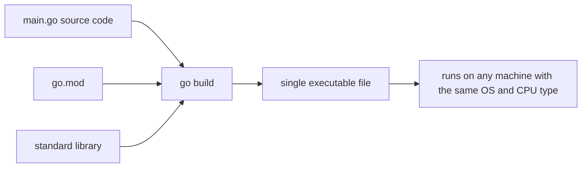

# The toolchain and your first program

> **Before this lesson:** you need no Go knowledge at all. It helps if you have typed a command into a terminal before and have seen a little Python (the [Python track](#/track/python) starts from zero if you have not). Every Go term is explained the first time it appears.

## In plain words

A **programming language** is a set of rules for writing instructions that a computer can carry out. **Go** (often written "Golang" so that search engines can find it) is one such language, created at Google and released in 2009. People reach for it when they build programs that run on servers: web services, command-line tools, databases, and the infrastructure that runs other software (Docker and Kubernetes are both written in Go).

Here is an everyday picture of the difference between Go and Python. Suppose you wrote a recipe in English and want a cook who reads only French to prepare it.

- With **Python**, you hire an interpreter who stands in the kitchen and translates one line at a time while the cook works. You can start cooking at once, but the interpreter must be in the kitchen every time, and a mistake on line 40 is only discovered when the cook reaches line 40.
- With **Go**, you send the whole recipe to a translator first. The translator checks every line, refuses to hand anything back if a step makes no sense, and then gives you a finished French recipe. From then on the cook needs no interpreter and works fast.

The "translator" is called a **compiler**: a program that turns the text you write (the **source code**) into a file the computer can run directly (an **executable**, also called a **binary**). Go's compiler is one piece of a larger kit called the **toolchain**: the set of programs you install to build, format, check and test Go code. You drive the whole kit through one command named `go`.

Why this matters for a job: a Go service is delivered as **one file** with nothing else to install on the server. That makes deployment boring in the best sense, and it is a large part of why backend and platform teams choose Go. In an interview you are expected to know what `go run`, `go build` and `go.mod` do without thinking.

## What you will be able to do

By the end of this lesson you can install Go, create a project, write and run a program that prints text, build an executable, and explain what each piece of the project is for.

## Step 1: install Go and check it

Download the installer for your operating system from `https://go.dev/dl/` and run it. Then open a **terminal** (the text window where you type commands: Terminal on macOS and Linux, PowerShell on Windows) and type:

```text
$ go version
go version go1.25.4 linux/amd64
```

The `$` is the terminal's prompt; you do not type it. The line below it is what the computer answers. Your numbers will differ. The answer has three parts:

- `go1.25.4` is the **version** of the toolchain. A new one appears roughly every six months.
- `linux` is the **operating system** the toolchain was built for (Go calls this `GOOS`). You may see `windows` or `darwin` (the internal name of macOS).
- `amd64` is the **processor architecture**, the family of chip in your machine (Go calls this `GOARCH`). Apple laptops with M-series chips say `arm64`.

If the terminal answers "command not found", the installer did not add Go to your `PATH` (the list of folders your terminal searches for programs). Close the terminal, open a new one, and try again; installers change `PATH` only for terminals opened afterwards.

> [!TIP]
> You can try Go without installing anything at `https://go.dev/play/`, the Go Playground. It compiles and runs small programs on a server and shows the output in your browser.

> [!NOTE]
> This track has two kinds of practice problems. Problems that *model* a Go rule are solved in Python and run in your browser. Problems whose titles are ordinary programming tasks ("Celsius to Fahrenheit", "Worker pool with a concurrency limit") are **real Go**: you write `solution.go`, and it is compiled and tested on a judge server. For those you need to be **logged in**.

## Step 2: create a module

A Go project is called a **module**: a folder of Go files plus one small file named `go.mod` that gives the project a name and records which Go version and which outside libraries it needs. Create one like this:

```text
$ mkdir hello
$ cd hello
$ go mod init example.com/hello
go: creating new go.mod: module example.com/hello
```

Line by line:

1. `mkdir hello` makes a new folder called `hello`.
2. `cd hello` moves the terminal into that folder.
3. `go mod init example.com/hello` asks the `go` command to create `go.mod`. The text `example.com/hello` is the **module path**, the module's unique name. It looks like a web address because, for code you publish, it *is* the address other people download it from (for instance `github.com/yourname/hello`). For practice code any name works; `example.com` is a domain reserved for examples.

Look at what was created:

```text
$ cat go.mod
module example.com/hello

go 1.25.4
```

The first line repeats the module path. The `go` line states the minimum Go version this module is written for. That is all there is for now. When you later use other people's libraries, their names and versions are added here automatically (the [modules lesson](#/lesson/go/go-modules-versioning) covers that).

**How this differs from Python.** A Python script can sit alone in any folder and run. Dependencies are installed into an environment with `pip`, and a `requirements.txt` or `pyproject.toml` is optional bookkeeping. In Go, `go.mod` is not optional for real work: the toolchain reads it on every build so that two people building the same code get exactly the same dependencies.

## Step 3: write the program

Create a file called `main.go` in the `hello` folder with this content:

```go
package main

import "fmt"

func main() {
	fmt.Println("Hello, Go!")
}
```

Seven lines, and every one of them is doing a job. Read it slowly:

- `package main` — every Go file begins by saying which **package** it belongs to. A package is a group of files in one folder that are compiled together. The name `main` is special: it tells the compiler "this package is a program you can run", as opposed to a library meant to be used by other code.
- `import "fmt"` — this makes another package available in this file. `fmt` (pronounced "fumpt" by many, short for *format*) belongs to the **standard library**, the large collection of packages installed together with Go. It contains functions for printing and formatting text.
- `func main() {` — `func` declares a **function**, a named block of instructions. The function called `main` inside package `main` is the **entry point**: when the program starts, this is the code that runs. The empty parentheses mean it takes no inputs. The opening brace `{` starts the function's body and **must be on this same line** (the next lesson explains why).
- `fmt.Println("Hello, Go!")` — call the function `Println` ("print line") from package `fmt`, giving it one piece of text. Text between double quotes is called a **string**. `Println` writes the string to the screen and then moves to a new line. The capital `P` matters: in Go, a name that starts with a capital letter is visible from other packages, and a name that starts with a lower-case letter is private to its own package.
- `}` — ends the function body.

Notice what is missing compared with other languages: no semicolons at the ends of lines, no class wrapped around the function.

## Step 4: run it

```text
$ go run .
Hello, Go!
```

`go run .` means "compile the package in the current folder (the dot) and run the result". Two things happened: the compiler translated `main.go` into a temporary executable, and then that executable ran and printed the line. The temporary file is deleted afterwards. `go run` is the command you use while you are experimenting.

You can also name a file: `go run main.go` does the same for a single-file program.

## Step 5: build a real executable

```text
$ go build
$ ls
go.mod  hello  main.go
$ ./hello
Hello, Go!
```

`go build` compiles the package and leaves the executable in the folder. Its name is the last part of the module path (`hello`, or `hello.exe` on Windows). `./hello` runs it. To choose a different name use `go build -o greeter`.

That one file contains your code, the parts of the standard library you used, and the **Go runtime**: support code that manages memory and schedules concurrent work while your program runs. You could copy `hello` to another computer with the same operating system and chip family and run it there with **no Go installation at all**. Compare that with Python, where the target machine needs a Python interpreter of a suitable version plus every library your script imports.



## The compiler as a strict reviewer

Because the whole program is translated before anything runs, the compiler can refuse programs that contain certain mistakes. Change the program to this:

```go
package main

import (
	"fmt"
	"os"
)

func main() {
	count := 3
	fmt.Println("Hello, Go!")
}
```

Two new things appear. The `import ( ... )` form lists several packages between parentheses, one per line. And `count := 3` creates a **variable** (a named place that holds a value) called `count` holding the number 3; the `:=` symbol means "create this variable and work out its type from the value". Now try to run it:

```text
$ go run .
# example.com/hello
./main.go:5:2: "os" imported and not used
./main.go:9:2: declared and not used: count
```

The program does not run at all. Each message has the form `file:line:column: what is wrong`. Go treats an **unused import** and an **unused local variable** as errors, not warnings. This feels strict on day one. The reasoning is that leftovers are either mistakes or clutter, and a language used by large teams is better off with neither. Python would run the equivalent script without complaint.

A third kind of mistake the compiler catches is a **type error**. Every value in Go has a **type** (the kind of thing it is: whole number, text, and so on), and the type of every variable is fixed when the program is compiled. This property is called **static typing**.

```go
package main

import "fmt"

func main() {
	age := 30
	fmt.Println("Age: " + age)
}
```

```text
./main.go:7:14: invalid operation: "Age: " + age (mismatched types untyped string and int)
```

You cannot glue text and a number together with `+`; Go wants you to say how the number should become text. The corrected line is `fmt.Println("Age:", age)`, because `Println` accepts any number of values separated by commas and prints them with spaces between. The output is `Age: 30`.

In Python the same mistake (`"Age: " + 30`) is also an error, but you find out only when that line executes, which might be deep inside a program that has been running for an hour. The simulation below makes that difference concrete.

### Try it: checking before running versus failing while running

This Python program models a tiny language with two instruction kinds. The "interpreter" runs instructions one at a time and crashes in the middle. The "compiler" checks all of them first and refuses to start.

```python-run
program = [
    ("print", "starting the nightly report"),
    ("print", "step 1 done"),
    ("add", "total", 5),        # fine: number + number
    ("add", "total", "seven"),  # bug: number + text
    ("print", "report sent to 4,000 customers"),
]

def check(instr):
    """Return an error message, or None if the instruction is well typed."""
    if instr[0] == "add" and not isinstance(instr[2], int):
        return f"cannot add {type(instr[2]).__name__} to an int"
    return None

def interpret(prog):
    print("--- interpreter (Python style): run line by line ---")
    total = 0
    for n, instr in enumerate(prog, 1):
        problem = check(instr)
        if problem:
            print(f"line {n}: CRASH while running: {problem}")
            return
        if instr[0] == "print":
            print("  output:", instr[1])
        else:
            total += instr[2]

def compile_then_run(prog):
    print("--- compiler (Go style): check everything first ---")
    errors = [(n, check(i)) for n, i in enumerate(prog, 1) if check(i)]
    if errors:
        for n, msg in errors:
            print(f"line {n}: compile error: {msg}")
        print("  nothing was run")
        return
    interpret(prog)

interpret(program)
print()
compile_then_run(program)
```

Run it. The interpreter printed two lines of real output before it hit the bug; in real life that could be half an email campaign. The compiler printed nothing but the error. Now fix line 4 of `program` (change `"seven"` to `7`) and run again: both versions behave the same. Static typing does not find every bug, but it removes a whole category before the program starts.

## The commands you will use every day

The `go` command has many subcommands. These are the ones a beginner needs:

| Command | What it does |
|---|---|
| `go version` | prints the installed toolchain version |
| `go mod init <path>` | creates `go.mod` and starts a new module |
| `go run .` | compiles and runs the program in the current folder |
| `go build` | compiles and writes an executable |
| `go fmt ./...` | rewrites your files in the standard layout (next lesson) |
| `go vet ./...` | reports suspicious code that compiles but is probably wrong (next lesson) |
| `go test ./...` | runs the tests ([testing lesson](#/lesson/go/go-testing-basics)) |
| `go install` | builds and copies the executable into Go's `bin` folder so you can run it from anywhere |
| `go env` | prints the settings the toolchain is using |
| `go help <command>` | built-in documentation for any subcommand |
| `go doc fmt.Println` | prints the documentation of a package or function |

The pattern `./...` appears often. It means "the package in this folder and in every folder below it".

### Where Go keeps things

Run `go env GOPATH GOROOT GOMODCACHE`:

```text
$ go env GOPATH GOROOT GOMODCACHE
/home/ana/go
/usr/local/go
/home/ana/go/pkg/mod
```

- `GOROOT` is where the toolchain itself and the standard library are installed. You never edit anything there.
- `GOPATH` is a personal workspace folder (by default a folder named `go` in your home directory). Programs installed with `go install` land in its `bin` subfolder. Add that folder to your `PATH` so you can run installed tools by name.
- `GOMODCACHE` is where downloaded libraries are stored, shared by all your projects.

Your own projects can live **anywhere** on disk. Older tutorials say code must be placed under `GOPATH/src`; that rule ended when modules became the default in Go 1.16, and you can ignore it.

## Versions and the compatibility promise

Go publishes a major release about every six months, numbered 1.21, 1.22, 1.23 and so on. Two facts make upgrades calm:

1. **The Go 1 compatibility promise.** Code that compiled with an earlier Go 1.x version is intended to keep compiling and behaving the same with every later 1.x version. Language changes are additions, not removals. Programs written in 2012 still build today.
2. **Toolchain selection.** Since Go 1.21 the `go` line in `go.mod` is a real requirement. If a project says `go 1.25` and you have 1.23 installed, the `go` command downloads the newer toolchain for that project automatically and uses it. You rarely manage versions by hand.

Each release is supported with security fixes until two newer releases exist, so teams normally stay within two versions of the latest.

## A slightly bigger first program

Before the quiz, here is a program that uses everything from this lesson plus one new idea, reading the words typed after the program's name (the **command-line arguments**).

```go
package main

import (
	"fmt"
	"os"
)

func main() {
	name := "stranger"
	if len(os.Args) > 1 {
		name = os.Args[1]
	}
	fmt.Println("Hello,", name)
	fmt.Println("Arguments received:", len(os.Args)-1)
}
```

```text
$ go run . Nami
Hello, Nami
Arguments received: 1
$ go run .
Hello, stranger
Arguments received: 0
```

What is new:

- `os` is the standard-library package for talking to the operating system. `os.Args` is the list of words on the command line. Position 0 is the program's own name, position 1 is the first word after it.
- `len(...)` gives the number of items in a list.
- `if condition { ... }` runs the block only when the condition is true. There are no parentheses around the condition, and the braces are required even for one line.
- `name = os.Args[1]` uses a single `=` because `name` already exists; `:=` creates, `=` changes.

The same program in Python would be about the same length. The difference shows when you ship it: `go build` gives you one file to hand to a colleague.

## Pitfalls

> [!WARNING]
> **"go: go.mod file not found in current directory or any parent directory".** You ran a `go` command outside a module. Move into your project folder, or create the module with `go mod init`.

- **Opening brace on its own line.** Writing `func main()` and then `{` on the next line is a compile error in Go. The reason is explained in the next lesson; for now, keep the brace at the end of the line.
- **Lower-case function names from other packages.** `fmt.println` does not exist. Names used from another package always start with a capital letter.
- **Unused imports and variables.** Delete them or use them; the compiler will not let them pass.
- **Single quotes for text.** `'hello'` is an error. Double quotes make a string; single quotes hold exactly one character, such as `'h'`.
- **Expecting `go run` to leave a file behind.** It does not. Use `go build` when you want the executable.
- **Two `main` functions in one folder.** All files in a folder form one package, so two files that each declare `func main()` clash. Put separate programs in separate folders.

> [!INTERVIEW]
> **"What is the difference between `go run`, `go build` and `go install`?"** `go run` compiles to a temporary location and executes immediately; nothing is kept. `go build` compiles and writes the executable into the current folder (for a library package it only checks that the code compiles). `go install` compiles and places the executable in `GOBIN` (by default `GOPATH/bin`) so it can be run from anywhere. A strong answer adds that all three produce a statically linked binary containing the runtime, which is why Go programs are easy to deploy.

## Cheat sheet

| You want to | Type |
|---|---|
| Check the installation | `go version` |
| Start a project | `go mod init example.com/name` |
| Run while developing | `go run .` |
| Produce an executable | `go build` or `go build -o name` |
| Read documentation | `go doc fmt` or `go doc fmt.Println` |
| See toolchain settings | `go env` |
| Minimum file for a program | `package main` + `func main() { }` |
| Print a line | `fmt.Println("text", value)` |
| Create a variable | `name := value` |

## Summary

- Go is a **compiled**, **statically typed** language: the compiler translates and checks the whole program before it runs, and the result is one self-contained executable.
- A project is a **module**: a folder with a `go.mod` file that names it and pins its requirements.
- A runnable program needs `package main` and a function `func main()`.
- `go run .` is for trying things, `go build` is for producing the file you ship.
- The compiler rejects unused imports, unused local variables and mismatched types. That strictness trades a little friction now for fewer surprises in production.
- Releases arrive twice a year, and the Go 1 compatibility promise keeps old code working.

## Glossary

- **Binary / executable**: a file the operating system can run directly.
- **Compiler**: the program that translates source code into an executable and reports errors while doing so.
- **Entry point**: where execution starts; in Go, `func main()` in package `main`.
- **GOOS / GOARCH**: Go's names for the target operating system and processor architecture.
- **Module**: a Go project; a folder tree with a `go.mod` file.
- **Module path**: the unique name of a module, written like a web address.
- **Package**: the files in one folder, compiled together and sharing one `package` name.
- **Runtime**: support code included in every Go executable that manages memory and concurrent work.
- **Standard library**: the packages that ship with Go, such as `fmt` and `os`.
- **Static typing**: every variable's type is known and checked at compile time.
- **Toolchain**: the compiler and its companion tools, driven by the `go` command.

```quiz
[
  {"q": "What does `go run .` do?",
   "options": ["Compiles the package in the current folder to a temporary executable and runs it", "Runs the source code line by line without compiling", "Builds an executable and leaves it in the current folder", "Downloads the newest Go version"],
   "answer": 0,
   "explain": "Go always compiles. `go run` hides the build step: it compiles to a temporary location, runs the result, and removes it. `go build` is the command that leaves the file behind."},
  {"q": "Which two things make a Go package a runnable program?",
   "options": ["A file named `main.go` and an `import` line", "`package main` and a function `func main()`", "A `go.mod` file and a `class Main`", "A function named `start` and a `go.sum` file"],
   "answer": 1,
   "explain": "The package must be named `main` and must contain `func main()`, the entry point. The file name is free; `main.go` is only a convention."},
  {"q": "A file contains `import \"os\"` but never uses `os`. What happens when you build it?",
   "options": ["It builds; unused imports are ignored", "It builds with a warning", "The build fails with an error", "The import is removed automatically by the compiler"],
   "answer": 2,
   "explain": "An unused import is a compile error in Go (`\"os\" imported and not used`). Editors often delete it for you on save, but the compiler itself refuses."},
  {"q": "What does this program print? `package main; import \"fmt\"; func main() { n := 2; fmt.Println(\"n is\", n) }`",
   "options": ["`n is2`", "`n is 2`", "`n is, 2`", "It does not compile: text and number cannot be mixed"],
   "answer": 1,
   "explain": "`Println` accepts several values of any type and prints them separated by one space, then a newline. Mixing is only an error with the `+` operator, as in `\"n is\" + n`."},
  {"q": "What is the role of `go.mod`?",
   "options": ["It stores the compiled program", "It names the module and records the Go version and dependencies it requires", "It lists the functions the program exports", "It configures the editor's formatting"],
   "answer": 1,
   "explain": "`go.mod` holds the module path, the minimum Go version and (later) each required library with its version, so every build uses the same inputs."},
  {"q": "Your colleague's laptop has no Go installed but uses the same operating system and CPU type as yours. Can they run the file produced by `go build`?",
   "options": ["No, they must install Go first", "Only if they install the standard library", "Yes: the executable includes your code, the needed library code and the runtime", "Only through `go run`"],
   "answer": 2,
   "explain": "A Go binary is self-contained. This is the main deployment advantage over interpreted languages, which need the interpreter and libraries on the target machine."},
  {"q": "Why does `fmt.println(\"hi\")` fail to compile?",
   "options": ["`println` needs two arguments", "Names used from another package must start with a capital letter; the function is `Println`", "`fmt` must be imported as `format`", "Strings need single quotes"],
   "answer": 1,
   "explain": "Capitalisation controls visibility in Go. Only names beginning with an upper-case letter are exported from a package, so `fmt` offers `Println`, not `println`."},
  {"q": "What does the Go 1 compatibility promise say?",
   "options": ["Every release may remove old features after one year", "Programs written for an earlier Go 1.x release should keep compiling and working with later 1.x releases", "Go binaries run on every operating system", "The standard library never gets new packages"],
   "answer": 1,
   "explain": "The promise is about source compatibility across Go 1.x releases. It is why upgrading the toolchain is low risk. Binaries are still specific to one OS and architecture."}
]
```

> **Source:** Bodner, *Learning Go* 2e, ch. 1 (topic coverage; wording and examples are original). Official references: https://go.dev/doc/install, https://go.dev/doc/tutorial/getting-started, https://go.dev/doc/go1compat, https://go.dev/doc/toolchain, https://pkg.go.dev/cmd/go
