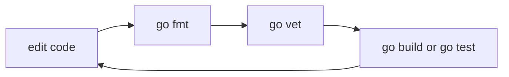

# go fmt, go vet and the daily workflow

> **Before this lesson:** you should have Go installed and have run a first program with `go run .` as shown in [The toolchain and your first program](#/lesson/go/go-toolchain). Nothing else is assumed.

## In plain words

Imagine a newspaper where every journalist chooses their own font, margins and paragraph spacing. Readers would spend effort adjusting to each article before they could take in what it says. Real newspapers avoid this with a **house style**: one layout that everybody follows, enforced by the typesetting system and not by argument.

Go applies the same idea to source code. A tool called **`go fmt`** rewrites any Go file into the one official layout. There are no settings. Nobody on a Go team discusses where braces go or how wide an indent is, because the tool decides and everybody runs it. A second tool, **`go vet`**, plays the role of a proofreader: it reads code that the compiler accepts and points at places that are probably mistakes.

Together with `go build` and `go test`, these make up the loop that a Go developer runs dozens of times a day:



Why this matters for a job: every professional Go codebase expects formatted, vetted code, and most reject contributions automatically if either check fails. Knowing why the rules exist (especially the semicolon rule behind brace placement) is a common screening question because it separates people who memorised syntax from people who understand the language.

## How Python does it, and how Go differs

Python has a style guide, PEP 8, and several competing formatters (Black, autopep8, Ruff's formatter) with configuration files in which teams choose line lengths and quote styles. Formatting is a convention that each project sets up.

In Go the formatter ships inside the toolchain and has **no options**. A well-known saying in the community is that gofmt's style is nobody's favourite, yet gofmt is everybody's favourite. The value comes from uniformity: any Go file from any company looks familiar, code review is about behaviour instead of whitespace, and automated tools can rewrite code safely because the layout is predictable.

## go fmt: the one true layout

Type this file exactly as shown, bad spacing included, and save it as `main.go` in a module:

```go
package main
import "fmt"
func main() {
    total:=0
  for i:=1;i<=3;i++ {
            total+=i
  }
fmt.Println( "total:",total )
}
```

The program is valid (it adds 1 + 2 + 3) but hard to read. Now run the formatter:

```text
$ go fmt ./...
main.go
```

The command prints the name of each file it changed. Open the file again:

```go
package main

import "fmt"

func main() {
	total := 0
	for i := 1; i <= 3; i++ {
		total += i
	}
	fmt.Println("total:", total)
}
```

What changed, and what the rules are:

- **Indentation uses tab characters**, one per nesting level. Each reader's editor decides how wide a tab looks, so people who prefer narrow or wide indents both get their wish from the same file.
- **Spaces around operators** such as `:=`, `+=` and `<=` were added, and the spaces inside the parentheses were removed.
- **Blank lines** were placed between the `package` line, the imports and the function.
- If several values are lined up in a column (for example in a list of constants or struct fields), gofmt pads them with spaces so the columns align.

One thing the formatter does **not** do is wrap long lines. There is no line-length limit in Go; break lines yourself where it helps the reader.

`go fmt` is a convenience wrapper around a program called `gofmt`. Two of its flags are useful directly: `gofmt -l .` lists the files that are not formatted without changing them (handy in automated checks), and `gofmt -d .` shows the differences.

The loop itself, since it appeared above: `for i := 1; i <= 3; i++ { ... }` creates a counter `i` starting at 1, repeats the body while `i <= 3`, and adds one to `i` after each pass (`i++`). Loops get a full treatment in [for, switch and goto](#/lesson/go/go-for-switch).

### goimports: formatting plus import management

In the previous lesson an unused import stopped the build. Managing the import list by hand is tedious, so most people use **goimports**, a superset of gofmt that also adds missing imports and removes unused ones. Install it once:

```text
$ go install golang.org/x/tools/cmd/goimports@latest
$ goimports -l -w .
```

`go install path@latest` downloads a tool, builds it and puts the executable in your Go `bin` folder. `-w` writes the changes to the files, `-l` lists which files changed. In practice you rarely type this: editors with Go support (Visual Studio Code with the Go extension, GoLand, Neovim with `gopls`) run it every time you save. `gopls` is the **language server**, a background program that gives editors Go-aware features such as completion, jump-to-definition and automatic formatting.

## The semicolon rule: why the brace must stay on the line

Here is a fact that surprises newcomers: **Go's grammar uses semicolons to end statements, exactly like C or Java.** You do not see them because the first stage of the compiler, the **lexer** (the part that chops text into words and symbols, called **tokens**), inserts them for you.

The rule the lexer follows is short. At the end of a line, a semicolon is inserted if the last token on that line is one of:

- an **identifier** (a name such as `total` or `fmt`) or a basic **literal** (a value written out, such as `42`, `3.5` or `"text"`);
- one of the keywords `break`, `continue`, `fallthrough` or `return`;
- one of the symbols `++`, `--`, `)`, `]` or `}`.

Now look at what happens if you write the opening brace on its own line:

```go
func main()
{
	fmt.Println("hi")
}
```

The first line ends with `)`. That is on the list, so the lexer turns the line into `func main();`. The compiler then sees a function declaration with no body, followed by a stray `{`, and reports:

```text
./main.go:5:1: syntax error: unexpected semicolon or newline before {
```

So brace placement in Go is not a style preference that a formatter could fix. It is a consequence of the semicolon rule, and the alternative does not compile.

The same rule explains two other habits you will pick up.

**Trailing commas in multi-line lists.** When a list of values is spread over several lines, the last item needs a comma:

```go
primes := []int{
	2,
	3,
	5,   // this comma is required
}
```

Without it the line would end in the literal `5`, a semicolon would be inserted in the middle of the list, and the compiler would complain. (`[]int{...}` creates a list of whole numbers; the [slices lesson](#/lesson/go/go-arrays-slices) explains the notation.)

**Operators at the end of a line when breaking an expression.**

```go
total := price +
	tax        // correct: first line ends with +, no semicolon inserted

total := price
	+ tax      // wrong: semicolon inserted after price
```

### Try it: be the lexer

This Python simulation applies the insertion rule to lines of Go. Edit the list and predict the output before running.

```python-run
import re

KEYWORDS_THAT_END = {"break", "continue", "fallthrough", "return"}
SYMBOLS_THAT_END = ("++", "--", ")", "]", "}")

def needs_semicolon(line):
    code = line.split("//")[0].rstrip()          # ignore comments and trailing spaces
    if not code:
        return False
    if code.endswith(SYMBOLS_THAT_END):
        return True
    last = re.findall(r'"[^"]*"|[A-Za-z_]\w*|\d[\w.]*|\S', code)[-1]   # last token
    if last in KEYWORDS_THAT_END:
        return True
    if last.startswith('"') or last[0].isdigit():   # string or number literal
        return True
    go_keywords = {"func", "if", "else", "for", "var", "package", "import", "go", "defer", "switch", "case"}
    return bool(re.fullmatch(r"[A-Za-z_]\w*", last)) and last not in go_keywords

lines = [
    'func main()',
    '{',
    'total := price +',
    '    tax',
    'x := []int{1, 2,',
    '    3',
    '}',
    'return',
    'if ready {',
    'count++',
]

for l in lines:
    mark = ";" if needs_semicolon(l) else " "
    print(f"{l:<22}{mark}   <- {'semicolon inserted' if mark == ';' else 'nothing inserted'}")
```

Read the result for the first two lines: `func main()` gets a semicolon, which is the brace error from above. Lines 5 and 6 show the missing trailing comma: after `3` a semicolon lands inside the list.

## go vet: the proofreader

The compiler checks that your program is **legal** Go. `go vet` checks that it is probably **what you meant**. It runs a set of small checks, called **analyzers**, each looking for one pattern known to be a bug almost every time. Here is a file with three such patterns:

```go
package main

import "fmt"

func describe(n int) string {
	if n > 0 {
		return "positive"
	} else {
		return "not positive"
	}
	fmt.Println("done")
	return ""
}

func main() {
	name := "Robin"
	age := 30
	fmt.Printf("%d is %s years old\n", name, age)
	age = age
	fmt.Println(describe(age))
}
```

`go build` accepts this file without a word. Then:

```text
$ go vet ./...
# example.com/hello
./main.go:11:2: unreachable code
./main.go:18:2: fmt.Printf format %d has arg name of wrong type string
./main.go:18:2: fmt.Printf format %s has arg age of wrong type int
./main.go:19:2: self-assignment of age to age
```

Go through the findings:

- **Unreachable code.** Both branches of the `if` return, so the `Println` on line 11 can never run. Somebody probably moved code around and left this behind.
- **Printf mismatches.** `fmt.Printf` prints according to a **format string** in which `%d` stands for a whole number and `%s` for text. The arguments are in the wrong order. The compiler cannot see inside the format string; vet can. If you ran the program anyway it would print `%!d(string=Robin) is %!s(int=30) years old`, Go's way of showing a formatting mistake without crashing.
- **Self-assignment.** `age = age` does nothing and is nearly always a typo for something else.

Other analyzers in the default set catch a lock being copied by accident, a `defer` placed where it never helps, struct tags that are malformed, comparisons that are always true or false, and passing a non-pointer to functions that need to fill in a value (such as `json.Unmarshal`). You will meet each of those topics in later lessons, and vet will be there to catch the mistakes.

> [!TIP]
> `go test` runs a small subset of vet automatically before running tests. That is a safety net, not a replacement: run the full `go vet ./...` yourself and in your automated checks.

Vet is deliberately conservative. It reports a problem only when it is confident, so a clean vet run does not mean bug-free code. Stricter third-party tools exist (staticcheck, golangci-lint) and are covered in [vet, staticcheck, golangci-lint and govulncheck](#/lesson/go/go-quality-tools).

## Putting the loop in one command

Typing four commands in a row gets old. Go itself has no task-runner, so teams usually wrap the steps in a **Makefile**, a file read by the classic `make` tool in which you name tasks and list the commands for each.

```text
.DEFAULT_GOAL := build

.PHONY: fmt vet build test clean

fmt:
	go fmt ./...

vet: fmt
	go vet ./...

build: vet
	go build -o bin/hello .

test: vet
	go test ./...

clean:
	rm -rf bin
```

How to read it:

- A line such as `vet: fmt` defines a **target** named `vet` that depends on `fmt`. Asking for `vet` runs `fmt` first.
- The indented lines under a target are the commands. They must be indented with a **tab character**, a historical quirk of `make`.
- `.PHONY` tells `make` these names are tasks, not files to be produced.
- `.DEFAULT_GOAL := build` makes plain `make` run the `build` target.

So `make` formats, vets and builds in order, stopping at the first failure. `make test` formats, vets and tests.

`make` is preinstalled on macOS and Linux. On Windows you can install it, use the Windows Subsystem for Linux, or write the same steps in a small script; some teams prefer cross-platform runners such as Task (`Taskfile.yml`). The tool does not matter. What matters is that one short command runs the full check, so that nobody skips it.

### The same checks in continuous integration

**Continuous integration** (CI) is the practice of having a server build and check every change automatically before it is merged. A typical Go CI job runs:

```text
test -z "$(gofmt -l .)"     # fail if any file is not formatted
go vet ./...
go build ./...
go test ./...
```

The first line uses `gofmt -l`, which prints unformatted file names; `test -z` succeeds only when that output is empty.

## Writing comments the Go way

Formatting is also about comments, because Go's documentation tool reads them. A **comment** is text for humans that the compiler ignores. Go has two forms:

```go
// A line comment runs to the end of the line.

/* A block comment can span
   several lines. */
```

Line comments are used almost everywhere. A comment placed directly above a function, type or package, with no blank line between, becomes its documentation; by convention it starts with the name of the thing it describes:

```go
// Greet returns a friendly greeting for the given name.
func Greet(name string) string {
	return "Hello, " + name
}
```

`go doc Greet` prints that sentence, and the website `pkg.go.dev` shows it for published modules. Python uses docstrings inside the function body for the same purpose; Go uses the comment above.

## Staying up to date

Because of the compatibility promise, updating the toolchain is routine:

1. Install the new version from `go.dev/dl` (or let your package manager do it).
2. Optionally raise the `go` line in `go.mod`, for example with `go mod edit -go=1.25`, when you want to use newer language features.
3. Run `go vet ./...` and your tests.

`go fix` exists for the rare cases where an old API needs mechanical rewriting. Bugs in new compiler releases do occur, so teams normally let a new version settle for a few weeks and read the release notes at `go.dev/doc/devel/release` before upgrading production builds.

## Pitfalls

> [!WARNING]
> Never fight the formatter by hand-aligning code "your way" and then skipping `go fmt`. The next person's editor will reformat the file on save and your change will show up as noise in the review. Let the tool win.

- **Opening brace on a new line.** A compile error caused by automatic semicolons, not a style warning.
- **Missing trailing comma** in a multi-line list or multi-line function call.
- **Breaking a long expression before the operator** instead of after it.
- **Believing a clean `go vet` proves correctness.** It finds a fixed set of patterns only.
- **Spaces instead of tabs in a Makefile.** `make` answers with the cryptic "missing separator".
- **Running `go fmt` without `./...`** in a project with subfolders: only the current folder is formatted.
- **Printf verbs that do not match their arguments.** The program still runs and prints `%!d(...)` noise; vet catches it before your users do.

> [!INTERVIEW]
> **"Why does Go force the opening brace onto the same line?"** Because the lexer inserts a semicolon at the end of any line whose last token could end a statement: an identifier, a literal, `return`/`break`/`continue`/`fallthrough`, `++`, `--`, `)`, `]` or `}`. `func main()` ends in `)`, so a brace on the next line would follow an inserted semicolon and the declaration would have no body. A good follow-up remark: the same rule is why multi-line composite literals need a trailing comma.

## Cheat sheet

| Task | Command or rule |
|---|---|
| Format every file | `go fmt ./...` |
| List unformatted files (for CI) | `gofmt -l .` |
| Format and fix imports | `goimports -w .` |
| Find likely bugs | `go vet ./...` |
| Install a Go tool | `go install path/to/tool@latest` |
| Indentation | tabs, never configured |
| Line length | no limit; wrap by judgement |
| Semicolon inserted after | identifier, literal, `return` `break` `continue` `fallthrough`, `++` `--` `)` `]` `}` |
| Multi-line list | last element needs a trailing comma |
| Doc comment | `// Name does ...` directly above the declaration |

## Summary

- `go fmt` rewrites code into the single official layout. It has no options, which ends style debates and makes all Go code look alike.
- `goimports` does the same and also maintains the import list; editors run it on save through `gopls`.
- Go's grammar has semicolons; the lexer inserts them at line ends after certain tokens. That rule fixes where braces, commas and operators must go.
- `go vet` reports code that compiles but is very likely wrong, such as mismatched `Printf` arguments, unreachable code and self-assignments.
- Wrap format, vet, build and test into one command (a Makefile or similar) and run the same steps in CI.

## Glossary

- **Analyzer**: one individual check inside `go vet` or a similar tool.
- **CI (continuous integration)**: a server that builds and checks every change automatically.
- **Comment**: text in source code that the compiler ignores; `//` or `/* */`.
- **Format string**: the first argument of `Printf`, containing verbs such as `%d` and `%s` that are replaced by the following arguments.
- **gofmt / go fmt**: the standard formatter and its wrapper command.
- **goimports**: a formatter that also adds and removes imports.
- **gopls**: the Go language server that powers editor features.
- **Lexer**: the compiler stage that splits source text into tokens and inserts semicolons.
- **Literal**: a value written directly in code, such as `42` or `"hi"`.
- **Makefile**: a file of named tasks for the `make` tool.
- **Token**: the smallest meaningful unit of source code: a name, a number, a symbol.

```quiz
[
  {"q": "How do you configure the indentation width that `go fmt` uses?",
   "options": ["With a `.gofmt` file in the project root", "With the `-indent` flag", "You cannot: gofmt always indents with tabs and has no style options", "By setting the `GOFMT_WIDTH` environment variable"],
   "answer": 2,
   "explain": "gofmt is intentionally not configurable. It indents with tab characters, and each editor displays tabs at whatever width its user prefers."},
  {"q": "Why does putting `{` on the line after `func main()` fail to compile?",
   "options": ["The formatter forbids it", "The lexer inserts a semicolon after `)` at the end of the line, so the function has no body", "Braces are optional in Go", "`main` must be declared on one line only"],
   "answer": 1,
   "explain": "A line ending in `)` receives an automatic semicolon. The compiler then sees `func main();` followed by an unexpected `{`."},
  {"q": "Which line ending does NOT receive an automatic semicolon?",
   "options": ["`return`", "`count++`", "`total := price +`", "`names[i]`"],
   "answer": 2,
   "explain": "A semicolon is inserted after an identifier, literal, certain keywords, `++`, `--`, `)`, `]` or `}`. The operator `+` is not on the list, which is why you break long expressions after the operator."},
  {"q": "What does this program print? `name := \"Ana\"; fmt.Printf(\"%d\\n\", name)`",
   "options": ["`Ana`", "`0`", "`%!d(string=Ana)`", "Nothing: it does not compile"],
   "answer": 2,
   "explain": "It compiles, because the compiler does not inspect format strings. At run time `%d` meets a string and fmt prints the mismatch marker `%!d(string=Ana)`. `go vet` reports this before you run it."},
  {"q": "`go build` succeeds but `go vet` reports `unreachable code`. What does that tell you?",
   "options": ["The compiler is broken", "The code is legal Go, but some statements can never execute, which usually signals a mistake", "The file is not formatted", "A dependency is missing"],
   "answer": 1,
   "explain": "vet looks for patterns that are legal yet suspicious. Statements after an unconditional `return` are a typical leftover from refactoring."},
  {"q": "What does `goimports` do beyond `gofmt`?",
   "options": ["It compiles the program", "It adds missing import lines and removes unused ones", "It renames variables to follow conventions", "It downloads dependencies"],
   "answer": 1,
   "explain": "goimports formats exactly like gofmt and also keeps the import block in sync with the packages the file uses."},
  {"q": "In a multi-line slice literal, what is required after the last element?",
   "options": ["Nothing", "A semicolon", "A trailing comma", "A closing parenthesis"],
   "answer": 2,
   "explain": "Without the comma the line would end in a literal, a semicolon would be inserted inside the list, and compilation would fail. The trailing comma prevents that."},
  {"q": "Which statement about `go vet` is true?",
   "options": ["A clean run guarantees the program has no bugs", "It reformats code", "It reports a limited set of high-confidence problem patterns and stays silent when unsure", "It replaces the compiler's type checking"],
   "answer": 2,
   "explain": "vet is conservative by design so that its reports are trustworthy. Many bugs are outside its patterns; tests and stricter linters cover more."}
]
```

> **Source:** Bodner, *Learning Go* 2e, ch. 1 (topic coverage; wording and examples are original). Official references: https://go.dev/ref/spec#Semicolons, https://go.dev/blog/gofmt, https://pkg.go.dev/cmd/gofmt, https://pkg.go.dev/cmd/vet, https://pkg.go.dev/golang.org/x/tools/cmd/goimports, https://go.dev/doc/comment
