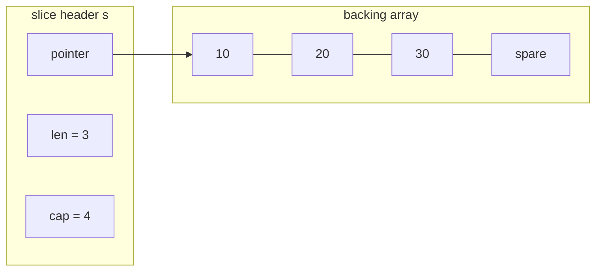

# Arrays and slices: length, capacity and append

> **Before this lesson:** you should be comfortable with variables, types and zero values from [Predeclared types](#/lesson/go/go-predeclared-types) and [Declarations and constants](#/lesson/go/go-declarations-const). If you know Python lists, that helps as a point of comparison, but it is not required.

## In plain words

Programs rarely deal with one value at a time. They handle a list of prices, a batch of messages, the lines of a file. Go's main tool for "many values of the same type in a row" is the **slice**.

To understand a slice you first need the thing underneath it, the **array**. Picture an egg carton: a fixed number of cups in a row, each holding one egg. A 12-cup carton cannot become a 13-cup carton. That is an array: a block of memory with a fixed number of slots.

A **slice** is a sticky note placed on a carton that says three things: "start at this cup", "I am using this many cups", and "this many cups are available before the carton ends". The note is tiny, it can be copied cheaply, and several notes can point at the same carton. When you need more cups than the carton has, Go gets a bigger carton, moves the eggs, and writes you a new note.

Why this matters for a job: slices are in almost every Go function you will read. The way they share memory explains bugs that confuse people for hours, and "what is the difference between an array and a slice?" or "what do `len` and `cap` print here?" are among the most common Go interview questions.

**Compared with Python.** A Python `list` also grows by itself and also keeps spare room behind the scenes. The difference is that Go shows you the machinery: you can see the spare room (`cap`), you decide when to reserve it (`make`), and the growing operation hands you back a possibly-new slice that you must keep (`s = append(s, x)`), where Python's `lst.append(x)` changes the list in place.

## Arrays: fixed size, copied whole

Start with the simplest example.

```go
package main

import "fmt"

func main() {
	var a [3]int
	a[0] = 7
	fmt.Println(a, len(a))

	b := a
	b[1] = 9
	fmt.Println(a, b, a == b)
}
```

```text
[7 0 0] 3
[7 0 0] [7 9 0] false
```

Line by line:

- `var a [3]int` declares an array of exactly three `int` values. All three start at the zero value, 0.
- `a[0] = 7` stores 7 in the first slot. Positions are called **indexes** and start at 0, so a three-element array has indexes 0, 1 and 2.
- `len(a)` is the number of slots, 3.
- `b := a` **copies the entire array**. `b` is a second carton with the same contents.
- `b[1] = 9` changes only the copy, as the second output line shows.
- `a == b` compares element by element. Arrays of the same type can be compared with `==`.

You can write the contents directly, in an **array literal**:

```go
primes := [4]int{2, 3, 5, 7}
days := [...]string{"Sat", "Sun"} // [...] lets the compiler count: this is [2]string
sparse := [5]int{1: 10, 4: 40}     // index: value pairs; the rest are zero
fmt.Println(primes, days, sparse)
```

```text
[2 3 5 7] [Sat Sun] [0 10 0 0 40]
```

Two properties make arrays awkward for everyday use:

1. **The size is part of the type.** `[3]int` and `[4]int` are different types. A function written to accept `[3]int` cannot accept `[4]int`, and the size must be a constant known at compile time, so you cannot make an array whose size comes from user input.
2. **Assigning or passing an array copies all of it.**

For those reasons you will seldom declare arrays yourself. They matter because every slice sits on top of one.

Reading or writing past the end is an error. With a constant index the compiler catches it; otherwise the program stops at run time with a **panic** (Go's word for a crash caused by an unrecoverable mistake):

```text
panic: runtime error: index out of range [5] with length 3
```

Go has no negative indexes: `a[-1]` does not mean "last element" as in Python. The last element is `a[len(a)-1]`.

## Slices: the type you will use

A slice type is written with empty brackets: `[]int` is "slice of int". The simplest way to make one is a **slice literal**, which looks like an array literal without a size:

```go
scores := []int{90, 75, 82}
fmt.Println(scores, len(scores), scores[0])
scores[1] = 80
fmt.Println(scores)
```

```text
[90 75 82] 3 90
[90 80 82]
```

Reading, writing and `len` work as with arrays. What is different is what the variable holds.

### What a slice value really is

A slice variable does not contain the elements. It contains a small record called the **slice header** with three fields:

- a **pointer**: the memory address of the first element the slice can see (a pointer is a value that says where something else is stored; [the pointers module](#/lesson/go/go-pointers-basics) covers them properly);
- the **length**: how many elements the slice currently shows;
- the **capacity**: how many elements exist from that first element to the end of the underlying array.

The array that actually stores the elements is the **backing array**.



`len(s)` reads the length and `cap(s)` reads the capacity. The spare slot in the picture is real memory that the slice is allowed to grow into.

### The zero value: the nil slice

```go
var s []int
fmt.Println(s, len(s), cap(s), s == nil)
```

```text
[] 0 0 true
```

A slice declared without a value is **nil**: its header has no backing array at all, with length and capacity 0. A nil slice is perfectly usable. You can ask its length, loop over it (zero times) and append to it. That is the "useful zero value" idea from earlier lessons.

One restriction: **a slice can be compared with `==` only against `nil`.** `s1 == s2` for two slices does not compile. To compare contents use `slices.Equal(s1, s2)` from the standard `slices` package.

## append: growing a slice

The built-in function `append` adds elements to the end of a slice and **returns the resulting slice**. You must store that result, almost always back into the same variable:

```go
var s []int
s = append(s, 10)
s = append(s, 20, 30)      // several at once
more := []int{40, 50}
s = append(s, more...)     // the three dots spread a slice into separate values
fmt.Println(s, len(s))
```

```text
[10 20 30 40 50] 5
```

Why must you write `s = append(s, ...)`? Go passes every argument to a function as a **copy**. `append` receives a copy of the header. If there is spare capacity, it writes the new element into the backing array and returns a header with a larger length. If there is no room, it allocates a bigger backing array, copies the old elements across, and returns a header pointing at the **new** array. Either way the updated header exists only in the return value. Ignoring it is a compile error (`append(s, 1) (value of type []int) is not used`), which protects you from the most common mistake.

### How capacity grows

Watch the capacity while appending one element at a time:

```go
package main

import "fmt"

func main() {
	var s []int
	for i := 1; i <= 9; i++ {
		s = append(s, i)
		fmt.Println(len(s), cap(s))
	}
}
```

```text
1 1
2 2
3 4
4 4
5 8
6 8
7 8
8 8
9 16
```

Each time the length would exceed the capacity, Go allocates a new backing array about **twice** as large and copies everything over. Between those moments, appending is very cheap because the room already exists. Doubling means that although a single append is occasionally expensive, the average cost per append stays constant; computer scientists call this *amortised constant time*.

For large slices doubling would waste memory, so the runtime slows down: once the capacity reaches 256 elements it grows by roughly a quarter (plus a small amount) each time, and it rounds the result up to a memory block size it has available. The exact numbers are an implementation detail and have changed between Go versions. **Never write code that depends on a particular capacity after `append`.**

### Try it: the growth rule in slow motion

This simulation uses the simplified rule from the practice problem (double below 256, then add a quarter plus 192) and counts how many element copies happen in total.

```python-run
def grow(cap, need):
    if need > 2 * cap:
        return need
    if cap < 256:
        return 2 * cap
    new = cap
    while new < need:
        new += (new + 768) // 4
    return new

def simulate(n, start_cap=0):
    length, cap, copies, reallocs = 0, start_cap, 0, 0
    history = []
    for _ in range(n):
        if length + 1 > cap:
            cap = grow(cap, length + 1)
            copies += length          # old elements move to the new array
            reallocs += 1
            history.append(cap)
        length += 1
    return reallocs, copies, history

for n in (10, 1000):
    r, c, h = simulate(n)
    print(f"append {n} items starting empty: {r} reallocations, {c} copies")
    print("   capacities:", h)

r, c, _ = simulate(1000, start_cap=1000)
print(f"append 1000 items with make([]int, 0, 1000): {r} reallocations, {c} copies")
```

Two lessons from the output: the total number of copies stays close to the number of elements (that is the amortised cost), and reserving the capacity in advance removes the reallocations completely.

## make: creating a slice with a chosen size

When you know roughly how many elements are coming, create the slice with the built-in `make`:

```go
a := make([]int, 3)     // length 3, capacity 3: [0 0 0]
b := make([]int, 0, 10) // length 0, capacity 10: empty, with room reserved
fmt.Println(a, len(a), cap(a))
fmt.Println(b, len(b), cap(b))
```

```text
[0 0 0] 3 3
[] 0 10
```

`make([]T, length)` gives a slice of that many zero values. `make([]T, length, capacity)` also reserves extra room. These two forms suit two styles of filling:

```go
// Style 1: known length, fill by index
squares := make([]int, 5)
for i := range squares {
	squares[i] = i * i
}

// Style 2: reserve capacity, fill with append
evens := make([]int, 0, 5)
for i := 0; i < 10; i += 2 {
	evens = append(evens, i)
}
fmt.Println(squares, evens)
```

```text
[0 1 4 9 16] [0 2 4 6 8]
```

`for i := range squares` loops over the indexes 0 to 4. (Loops have [their own lesson](#/lesson/go/go-for-switch).)

> [!WARNING]
> Mixing the two styles is a well-known beginner bug. `s := make([]int, 3)` followed by `s = append(s, 7)` gives `[0 0 0 7]`, not `[7]`: the slice already has three zeros, and `append` adds after them. If you plan to append, make the length 0.

## Declaring slices: which form to choose

| You have | Write | Result |
|---|---|---|
| Starting values | `s := []int{1, 2, 3}` | length 3 |
| Nothing yet, unknown size | `var s []int` | nil slice, grows with `append` |
| A good size estimate | `s := make([]int, 0, n)` | empty, no reallocations up to `n` |
| Exact size, fill by index | `s := make([]int, n)` | `n` zeros |
| An empty slice that must not be nil | `s := []int{}` | length 0, not nil |

The difference in the last row matters in a few places, such as JSON output, where a nil slice is written as `null` and an empty slice as `[]`. Otherwise prefer `var s []int`.

## Looping, searching and sorting

`for index, value := range slice` visits each element:

```go
package main

import (
	"fmt"
	"slices"
)

func main() {
	temps := []int{21, 18, 25, 19}
	total := 0
	for i, t := range temps {
		fmt.Println(i, t)
		total += t
	}
	fmt.Println("average:", total/len(temps))

	fmt.Println(slices.Contains(temps, 25), slices.Index(temps, 19))
	fmt.Println(slices.Max(temps), min(3, 1, 2))
	slices.Sort(temps)
	fmt.Println(temps)
}
```

```text
0 21
1 18
2 25
3 19
average: 20
true 3
25 1
[18 19 21 25]
```

The `slices` package (in the standard library since Go 1.21) has the helpers Python users expect: `Contains`, `Index`, `Sort`, `Max`, `Min`, `Reverse`, `Equal` and more. `min` and `max` are built-in functions for individual values. `slices.Sort` rearranges the slice in place. The average is 20 and not 20.75 because integer division truncates.

There is also a built-in `clear(s)`, which sets every element to its zero value while keeping the length.

### Slices of slices

Go has no special matrix type. A table is a slice whose elements are slices:

```go
grid := make([][]int, 2) // two rows, each row is a nil slice for now
for r := range grid {
	grid[r] = make([]int, 3) // give each row three columns
}
grid[1][2] = 5
fmt.Println(grid)
```

```text
[[0 0 0] [0 0 5]]
```

## Pitfalls

- **Forgetting that `append` returns the slice.** Always `s = append(s, x)`.
- **`make([]T, n)` followed by `append`** (the leading-zeros bug above).
- **Indexing beyond the length.** `s := make([]int, 0, 10); s[0] = 1` panics: capacity is spare room, not usable elements. Only indexes below `len(s)` are valid.
- **Comparing slices with `==`.** Use `slices.Equal`, or compare with `nil` only.
- **Negative indexes.** Not supported; use `len(s)-1`.
- **Assuming a copy.** `t := s` copies the header, not the elements. Both names now share one backing array, so `t[0] = 99` changes what `s` shows. This is the opposite of arrays and is the subject of the next lesson.

> [!TIP]
> If a function builds a result slice in a loop and the final size is known or can be estimated, write `out := make([]T, 0, n)` before the loop. It is the single cheapest performance improvement in everyday Go code, and reviewers look for it.

> [!INTERVIEW]
> **"What is the difference between an array and a slice?"** An array has a fixed length that is part of its type, holds its elements directly, and is copied in full on assignment or when passed to a function. A slice is a three-field header (pointer, length, capacity) describing a section of a backing array; copying a slice copies only the header, so the copies share elements. Slices can grow with `append`, which reallocates when capacity runs out. Arrays are comparable with `==` when their elements are; slices are comparable only with `nil`. Finish with the growth rule: capacity doubles while small and grows by about 25% once large.

## Cheat sheet

| Operation | Code | Notes |
|---|---|---|
| Array of 3 ints | `var a [3]int` | size is part of the type |
| Slice literal | `s := []int{1, 2, 3}` | |
| Nil slice | `var s []int` | `len 0`, usable with `append` |
| Length / capacity | `len(s)`, `cap(s)` | |
| Add elements | `s = append(s, x, y)` | keep the result |
| Add another slice | `s = append(s, t...)` | |
| Reserve room | `make([]int, 0, n)` | |
| n zero values | `make([]int, n)` | |
| Last element | `s[len(s)-1]` | no negative indexes |
| Loop | `for i, v := range s` | |
| Compare contents | `slices.Equal(a, b)` | |
| Search / sort | `slices.Contains`, `slices.Index`, `slices.Sort` | |

## Summary

- An **array** is a fixed-size block of elements; its size is part of its type and it is copied whole.
- A **slice** is a small header (pointer, length, capacity) over a backing array. It is the list type you use day to day.
- The zero value of a slice is `nil`, which behaves like an empty slice.
- `append` returns a new header; when capacity is exhausted it moves the data to a larger array, roughly doubling while small.
- `make` creates a slice with a chosen length and capacity; reserving capacity avoids repeated copying.
- Length is what you can index; capacity is how far `append` can go without reallocating.

## Glossary

- **Amortised cost**: the average cost per operation over a long sequence, even if single operations are sometimes expensive.
- **Array**: a fixed-length sequence of elements of one type.
- **Backing array**: the array that stores a slice's elements.
- **Capacity**: the number of elements from a slice's first element to the end of its backing array.
- **Index**: the position of an element, counted from 0.
- **Length**: the number of elements a slice currently exposes.
- **nil slice**: a slice with no backing array; the zero value of any slice type.
- **Panic**: a run-time failure that stops normal execution.
- **Slice**: a view (pointer, length, capacity) onto part of an array.
- **Slice header**: the three-field record that a slice variable actually holds.

```quiz
[
  {"q": "What does this print? `a := [3]int{1, 2, 3}; b := a; b[0] = 99; fmt.Println(a[0])`",
   "options": ["`99`", "`1`", "`0`", "Compile error"],
   "answer": 1,
   "explain": "`a` is an array (the brackets contain a size). Assigning an array copies every element, so changing `b` leaves `a` untouched."},
  {"q": "What does this print? `var s []int; fmt.Println(len(s), s == nil)`",
   "options": ["`0 true`", "`0 false`", "It panics: nil slice", "`1 true`"],
   "answer": 0,
   "explain": "The zero value of a slice is nil, with length 0. Reading its length is fine; a nil slice behaves like an empty one."},
  {"q": "What does this print? `s := make([]int, 2); s = append(s, 5); fmt.Println(s)`",
   "options": ["`[5]`", "`[5 0 0]`", "`[0 0 5]`", "`[0 0]`"],
   "answer": 2,
   "explain": "`make([]int, 2)` creates two zero elements. `append` adds after the existing length, giving `[0 0 5]`. Use `make([]int, 0, 2)` if you intend to append."},
  {"q": "Why must you write `s = append(s, x)` instead of only `append(s, x)`?",
   "options": ["`append` is a method and needs a receiver", "`append` receives a copy of the slice header and returns the updated one, which may point to a new backing array", "It is only a style rule", "Because slices are immutable"],
   "answer": 1,
   "explain": "Arguments are passed by value. The new length, and possibly a new array pointer, exist only in the returned header. The compiler even rejects an unused `append` result."},
  {"q": "Starting from `var s []int` and appending one element at a time, which sequence of capacities do you see for lengths 1 through 5?",
   "options": ["1, 2, 3, 4, 5", "1, 2, 4, 4, 8", "2, 2, 4, 4, 8", "8, 8, 8, 8, 8"],
   "answer": 1,
   "explain": "Capacity doubles when exhausted: 1, then 2, then 4 (which also holds the fourth element), then 8 for the fifth."},
  {"q": "`s := make([]int, 0, 10)`. What happens on `s[0] = 1`?",
   "options": ["It stores 1; capacity is 10", "Compile error", "Run-time panic: index out of range [0] with length 0", "The slice grows automatically"],
   "answer": 2,
   "explain": "Only indexes below the length are valid. Capacity is reserved room reachable through `append` or re-slicing, not through indexing."},
  {"q": "Which statement about `[3]int` and `[4]int` is true?",
   "options": ["They are the same type with different lengths", "They are different types; a value of one cannot be assigned to the other", "`[4]int` can be assigned to `[3]int` with truncation", "Both are slices"],
   "answer": 1,
   "explain": "An array's length is part of its type. This rigidity is the main reason slices, whose type does not include a length, are used instead."},
  {"q": "How do you check whether two slices `a` and `b` hold the same elements?",
   "options": ["`a == b`", "`a.Equals(b)`", "`slices.Equal(a, b)`", "`len(a) == len(b)`"],
   "answer": 2,
   "explain": "Slices support `==` only against nil. `slices.Equal` compares lengths and then elements in order."}
]
```

> **Source:** Bodner, *Learning Go* 2e, ch. 3 (topic coverage; wording and examples are original). Official references: https://go.dev/ref/spec#Array_types, https://go.dev/ref/spec#Slice_types, https://go.dev/ref/spec#Appending_and_copying_slices, https://go.dev/blog/slices-intro, https://pkg.go.dev/slices
