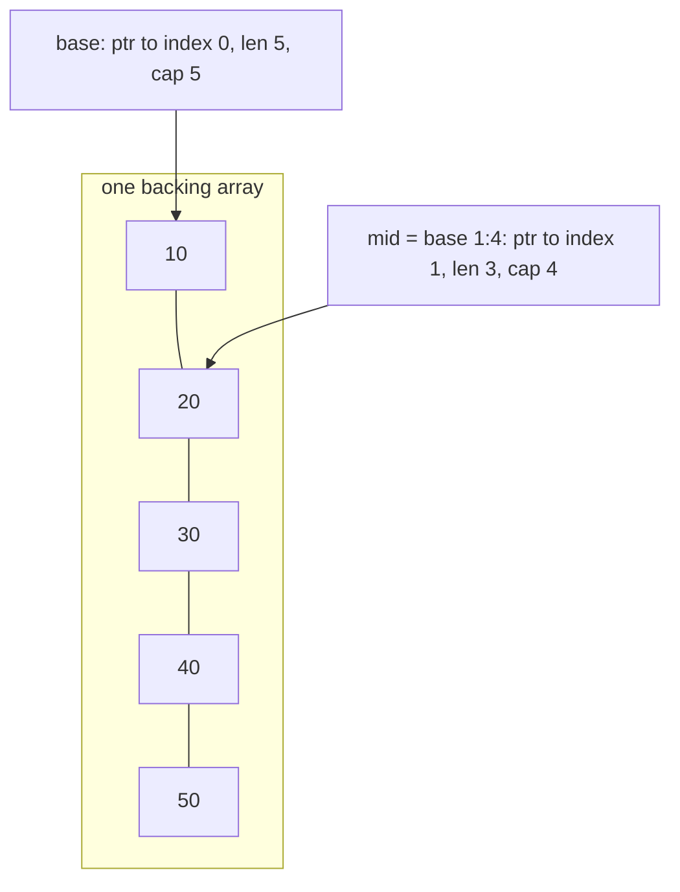

# Slicing, aliasing and copy

> **Before this lesson:** read [Arrays and slices: length, capacity and append](#/lesson/go/go-arrays-slices). You need to know that a slice is a header with a pointer, a length and a capacity over a backing array, and that `append` returns a new header.

## In plain words

Picture a long shelf of books in a library. You place a strip of masking tape under books 2 to 4 and write "Ana's section" on it. A colleague puts another strip under books 3 to 6 and writes "Ben's section". Nobody copied any books. There is one shelf; the two strips mark two overlapping views of it. If Ana replaces book 3, Ben sees the new book too, because book 3 is in both sections.

In Go, taking a part of a slice works exactly like the tape. The operation is called **slicing**, and it creates a new slice header that points into the **same backing array**. When two slices can reach the same memory, they are said to **alias** each other. Aliasing is fast, since no data moves, and it is the reason Go programs handle large buffers efficiently. It is also the reason for the most famous category of Go surprises: you change one slice and another one changes "by itself".

When you want a separate shelf with its own books, you ask for it explicitly with **`copy`** or `slices.Clone`.

Why this matters for a job: aliasing bugs reach production because the code looks innocent and often passes simple tests. Predicting the output of a short program that slices, appends and prints is the single most common Go interview exercise.

**The key difference from Python.** In Python, `part = lst[1:4]` builds a new, independent list. Changing `part[0]` never affects `lst`. In Go, `part := s[1:4]` shares memory with `s`. If you bring only one fact from this lesson to your next code review, bring this one.

## The slice expression

The simplest form is `s[low:high]`. It selects the elements from index `low` up to **but not including** index `high`.

```go
package main

import "fmt"

func main() {
	base := []int{10, 20, 30, 40, 50}

	mid := base[1:4]
	fmt.Println(mid, len(mid), cap(mid))

	fmt.Println(base[:2], base[3:], base[:])
}
```

```text
[20 30 40] 3 4
[10 20] [40 50] [10 20 30 40 50]
```

Line by line:

- `base[1:4]` covers indexes 1, 2 and 3. The length is `high - low = 3`.
- Its **capacity is 4**, not 3. Capacity counts from the slice's first element to the end of the backing array: indexes 1, 2, 3 and 4. The general rule is `cap(s[low:high]) = cap(s) - low`.
- Leaving out `low` means 0; leaving out `high` means `len(s)`. So `base[:2]` is the first two elements, `base[3:]` is everything from index 3, and `base[:]` is the whole slice.



Both headers point into the same five cells. Nothing was copied.

## Aliasing: writes travel

Because the memory is shared, a write through one slice is visible through the other:

```go
base := []int{10, 20, 30, 40, 50}
mid := base[1:4]

mid[0] = 99
fmt.Println(base)

base[3] = -1
fmt.Println(mid)
```

```text
[10 99 30 40 50]
[99 30 -1]
```

`mid[0]` and `base[1]` are the same cell. `base[3]` and `mid[2]` are the same cell. Notice the indexes differ: each slice numbers the cells from its own start.

### Slicing can reveal hidden elements

The bounds of a slice expression are checked against the **capacity**, not the length. That means you can slice a slice to make it longer again:

```go
base := []int{10, 20, 30, 40, 50}
short := base[:2]
fmt.Println(short, len(short), cap(short))

again := short[:4] // legal: 4 <= cap(short)
fmt.Println(again)
```

```text
[10 20] 2 5
[10 20 30 40]
```

`short` shows two elements, but the other three are still in the array behind it, and `short[:4]` brings two of them back into view. Indexing is different: `short[3]` panics, because indexing is checked against the length. Practise these rules in [Slice expressions with capacity](#/problem/go-slice-expr).

## The append trap

Now combine sharing with `append`. Recall: if the slice has spare capacity, `append` writes into the existing backing array.

```go
package main

import "fmt"

func main() {
	base := []int{1, 2, 3, 4}
	head := base[:2] // [1 2], len 2, cap 4

	head = append(head, 100)

	fmt.Println(head)
	fmt.Println(base)
}
```

```text
[1 2 100]
[1 2 100 4]
```

Read that second line again. Nobody assigned to `base`, yet its third element changed from 3 to 100. Here is why. `head` has length 2 and capacity 4, so `append` sees room and stores 100 in the next cell of the backing array. That cell is `base[2]`.

If the capacity had been used up, `append` would have allocated a new array, and the two slices would have silently stopped sharing:

```go
base := []int{1, 2, 3, 4}
all := base[:]            // len 4, cap 4: no spare room
all = append(all, 5)      // new backing array
all[0] = 77
fmt.Println(base, all)
```

```text
[1 2 3 4] [77 2 3 4 5]
```

So whether two slices are connected after an `append` depends on the capacity at that moment. Code whose behaviour depends on something you cannot see at the call site is fragile, which is why the next tool exists.

### Try it: watch the backing array

The simulation below models a slice as (shared list, offset, length, capacity). Change the capacity of the `make` call from 4 to 2 and run it again to see the two slices come apart.

```python-run
class Slice:
    def __init__(self, arr, off, length, cap):
        self.arr, self.off, self.len, self.cap = arr, off, length, cap
    def view(self):
        return self.arr[self.off:self.off + self.len]
    def sub(self, lo, hi):
        return Slice(self.arr, self.off + lo, hi - lo, self.cap - lo)

def make(length, cap):
    return Slice([0] * cap, 0, length, cap)

def append(s, *vals):
    need = s.len + len(vals)
    if need <= s.cap:                                   # room: write in place
        for i, v in enumerate(vals):
            s.arr[s.off + s.len + i] = v
        return Slice(s.arr, s.off, need, s.cap), "in place"
    new_cap = max(need, 2 * s.cap)                      # no room: new array
    arr = s.view() + list(vals) + [0] * (new_cap - need)
    return Slice(arr, 0, need, new_cap), "REALLOCATED"

base = make(2, 4)          # try make(2, 2)
base.arr[0:2] = [1, 2]
x, how_x = append(base, 10)
y, how_y = append(base, 20)
print("x := append(base, 10) ->", how_x)
print("y := append(base, 20) ->", how_y)
print("base:", base.view(), " x:", x.view(), " y:", y.view())
print("same backing array for x and y?", x.arr is y.arr)
```

With capacity 4, `x` and `y` are both `[1, 2, 20]`: the second append overwrote the value written by the first. With capacity 2 each append reallocates and you get `[1, 2, 10]` and `[1, 2, 20]`. The same source code gives two different results.

## The full slice expression: capping the capacity

Go has a three-index form, `s[low:high:max]`, called the **full slice expression**. The third number limits the capacity of the result to `max - low`.

```go
base := []int{1, 2, 3, 4}
head := base[:2:2] // len 2, cap 2: no spare room visible

head = append(head, 100) // must reallocate
fmt.Println(head)
fmt.Println(base)
```

```text
[1 2 100]
[1 2 3 4]
```

Setting `max` equal to `high` means "this slice has no spare capacity". The next `append` is forced to allocate a fresh array, so the parent can never be overwritten by accident. Use this form whenever you hand a sub-slice to code you do not control.

## copy and Clone: independent data

When you want a separate backing array, copy the elements. The built-in `copy(dst, src)` copies elements from the source into the destination and returns how many it copied, which is the smaller of the two **lengths**.

```go
package main

import (
	"fmt"
	"slices"
)

func main() {
	src := []int{1, 2, 3, 4}

	dst := make([]int, 2)
	n := copy(dst, src)
	fmt.Println(n, dst)

	dst[0] = 9
	fmt.Println(src) // unchanged

	var empty []int
	fmt.Println(copy(empty, src)) // destination has length 0

	clone := slices.Clone(src)
	clone[0] = -1
	fmt.Println(src, clone)
}
```

```text
2 [1 2]
[1 2 3 4]
0
[1 2 3 4] [-1 2 3 4]
```

Points to remember:

- The **destination comes first**, like the left side of an assignment.
- `copy` never grows the destination. Copying into a nil or zero-length slice copies nothing, a frequent mistake. Make the destination long enough first: `dst := make([]int, len(src))`.
- `slices.Clone(s)` does "make, then copy" in one call and is the clearest way to duplicate a slice.
- `copy` works correctly even when source and destination overlap in the same array.

A clone is **shallow**: it duplicates the elements themselves. If the elements are slices or pointers, the clone's elements still refer to the same inner data.

## Slices as function arguments

Go passes arguments by value: the function receives a **copy of the slice header**. The copy points at the same backing array. Two consequences follow, and both show up in this program:

```go
package main

import "fmt"

func modify(s []int) {
	s[0] = 100       // writes into the shared backing array
	s = append(s, 4) // changes only the local header
	s[1] = 200
}

func main() {
	full := []int{1, 2, 3} // len 3, cap 3
	modify(full)
	fmt.Println(full)

	roomy := make([]int, 3, 10) // len 3, cap 10
	modify(roomy)
	fmt.Println(roomy)
}
```

```text
[100 2 3]
[100 200 0]
```

Walk through the first call. `s[0] = 100` reaches the caller's array. `append` finds no spare capacity, so it allocates a new array for the local `s`; from then on `s[1] = 200` goes to the new array and the caller never sees it. The caller's header still says length 3 and still points to the old array.

In the second call there is spare capacity, so `append` writes 4 into the shared array at index 3 and `s[1] = 200` also hits the shared array. The caller sees the 200. It does **not** see the 4, because its own header still says length 3.

The rules to take away:

1. A function **can change the elements** the caller sees.
2. A function **cannot change the caller's length or capacity**. If a function needs to add or remove elements, it must **return the new slice**, and the caller must keep it: `nums = addOne(nums)`. This is the same contract `append` has.

## Removing and inserting

There is no `del` statement for slices. The `slices` package provides functions that return the updated slice:

```go
s := []int{1, 2, 3, 4, 5}
s = slices.Delete(s, 1, 3) // remove indexes 1 and 2
fmt.Println(s)
s = slices.Insert(s, 1, 9, 8) // insert before index 1
fmt.Println(s)
```

```text
[1 4 5]
[1 9 8 4 5]
```

Before these helpers existed, people wrote the same thing with `append(s[:1], s[3:]...)`, and you will meet that idiom in older code. It works by sliding the tail over the removed part inside the same backing array. Both forms modify the original array, so any other slice that aliases it sees shifted data. As always, keep the returned slice.

## Arrays and slices convert into each other

```go
arr := [4]int{1, 2, 3, 4}
view := arr[:]         // slice sharing the array's memory
view[0] = 50
fmt.Println(arr)

copyArr := [2]int(view[:2]) // slice to array: copies the elements
copyArr[0] = 7
fmt.Println(arr, copyArr)
```

```text
[50 2 3 4]
[50 2 3 4] [7 2]
```

Slicing an array gives a slice that aliases it. Converting a slice to an array type (possible since Go 1.20) copies, and panics if the slice is shorter than the array.

## A hidden cost: keeping a huge array alive

Go's **garbage collector** (the part of the runtime that frees memory nothing refers to any more) cannot free part of an array. As long as any slice points into a backing array, the **whole** array stays in memory.

```go
func firstLine(file []byte) []byte {
	end := bytes.IndexByte(file, '\n')
	return file[:end] // a 40-byte slice that keeps a 500 MB file in memory
}
```

If the small result lives a long time, clone it: `return bytes.Clone(file[:end])`. Then the large array has no remaining references and can be freed.

## Pitfalls

> [!WARNING]
> Never write `a := append(b, x)` and then keep using both `a` and `b` as if they were unrelated. Depending on `b`'s spare capacity they may or may not share memory. Either reuse one name (`b = append(b, x)`) or make the independence explicit with `slices.Clone` or a full slice expression.

- **Assuming `s[a:b]` copies**, as it does in Python.
- **Checking `high` against the length in your head.** It may go up to the capacity.
- **`copy` into a slice of length 0.**
- **Appending inside a function and expecting the caller to see it.**
- **Deleting elements while another slice aliases the same array.**
- **Returning a small slice of a big buffer** that should have been freed.

> [!INTERVIEW]
> **"What does this print: `a := []int{1,2,3,4}; b := a[:2]; b = append(b, 9); fmt.Println(a)`?"** `[1 2 9 4]`. `b` has length 2 and capacity 4, so `append` writes in place, and index 2 of the shared array is `a[2]`. Then say how to prevent it: `b := a[:2:2]` caps the capacity so `append` must allocate, or `b := slices.Clone(a[:2])` copies up front. Interviewers want both the prediction and the fix.

## Cheat sheet

| Expression | Length | Capacity | Shares memory? |
|---|---|---|---|
| `s[lo:hi]` | `hi - lo` | `cap(s) - lo` | yes |
| `s[lo:hi:max]` | `hi - lo` | `max - lo` | yes, but `append` beyond `max` reallocates |
| `slices.Clone(s)` | `len(s)` | at least `len(s)` | no |
| `copy(dst, src)` | unchanged | unchanged | no (copies `min(len(dst), len(src))` elements) |
| `append(s, x)` with room | `len(s)+1` | same | yes |
| `append(s, x)` without room | `len(s)+1` | larger | no |
| `arr[:]` | `len(arr)` | `len(arr)` | yes |

Valid bounds: `0 <= lo <= hi <= max <= cap(s)`.

## Summary

- Slicing creates a new header over the **same** backing array. Slices that overlap alias each other, so writes through one are visible through the other.
- Length is `high - low`; capacity runs to the end of the array (or to `max` in the three-index form).
- `append` on a sub-slice with spare capacity overwrites the parent's elements. Cap the capacity with `s[lo:hi:hi]` or clone the data to prevent it.
- `copy` and `slices.Clone` create independent data; `copy` is limited by the shorter length.
- Functions receive a copy of the header: element writes are shared, length changes are not. Return the slice when its length changes.
- A small slice keeps its entire backing array alive.

## Glossary

- **Aliasing**: two or more slices (or other references) reaching the same memory.
- **copy**: built-in that copies elements between slices and returns the count.
- **Full slice expression**: `s[low:high:max]`, which also limits capacity.
- **Garbage collector**: the runtime component that frees unreachable memory.
- **Half-open range**: a range that includes its start and excludes its end, as in `[low, high)`.
- **Reallocation**: `append` moving the elements to a new, larger backing array.
- **Shallow copy**: a copy of the elements only, not of what they refer to.
- **Slicing**: making a new slice from part of an existing slice or array.

```quiz
[
  {"q": "`s := []int{10, 20, 30, 40, 50}; t := s[1:3]`. What are `len(t)` and `cap(t)`?",
   "options": ["2 and 2", "2 and 4", "3 and 5", "2 and 5"],
   "answer": 1,
   "explain": "Length is high - low = 2. Capacity counts from index 1 to the end of the backing array: 5 - 1 = 4."},
  {"q": "What does this print? `a := []int{1, 2, 3}; b := a[:2]; b[0] = 7; fmt.Println(a)`",
   "options": ["`[1 2 3]`", "`[7 2 3]`", "`[7 2]`", "Compile error"],
   "answer": 1,
   "explain": "Slicing shares the backing array. `b[0]` and `a[0]` are the same memory cell, so the write shows through `a`. In Python the slice would have been a copy."},
  {"q": "What does this print? `a := []int{1, 2, 3, 4}; b := a[:2]; b = append(b, 9); fmt.Println(a)`",
   "options": ["`[1 2 3 4]`", "`[1 2 9]`", "`[1 2 9 4]`", "`[9 2 3 4]`"],
   "answer": 2,
   "explain": "`b` has capacity 4, so append writes 9 into the next cell of the shared array, which is `a[2]`."},
  {"q": "Same code, but `b := a[:2:2]`. What does `fmt.Println(a)` print after `b = append(b, 9)`?",
   "options": ["`[1 2 3 4]`", "`[1 2 9 4]`", "`[1 2 9]`", "It panics"],
   "answer": 0,
   "explain": "The third index caps the capacity at 2. With no spare room, append allocates a new array, and `a` is not touched."},
  {"q": "What does this print? `src := []int{1, 2, 3}; var dst []int; n := copy(dst, src); fmt.Println(n, dst)`",
   "options": ["`3 [1 2 3]`", "`0 []`", "It panics on a nil slice", "`3 []`"],
   "answer": 1,
   "explain": "`copy` moves min(len(dst), len(src)) elements and never grows the destination. A nil slice has length 0, so nothing is copied."},
  {"q": "A function `func add(s []int) { s = append(s, 1) }` is called as `add(nums)`. What does the caller observe about `len(nums)`?",
   "options": ["It grows by one", "It is unchanged", "It becomes 0", "It depends on the capacity"],
   "answer": 1,
   "explain": "The function works on a copy of the header. The caller's length never changes, whatever the capacity. The function must return the slice for the caller to see the new length."},
  {"q": "`s := []int{1, 2, 3, 4, 5}; t := s[:2]`. Which expression is legal?",
   "options": ["`t[3]`", "`t[:4]`", "`t[:6]`", "`t[-1]`"],
   "answer": 1,
   "explain": "Slice bounds are checked against capacity (5), so `t[:4]` is fine and reveals hidden elements. Indexing is checked against length (2), so `t[3]` panics. `t[:6]` exceeds the capacity."},
  {"q": "Why can returning `bigBuffer[:10]` from a function waste memory?",
   "options": ["Slices of length 10 are always heap allocated", "The small slice keeps the entire backing array reachable, so the garbage collector cannot free it", "Slicing copies the whole buffer", "It cannot; only the 10 bytes are retained"],
   "answer": 1,
   "explain": "A backing array is freed only when no slice refers to any part of it. Clone the small part if it must outlive the big buffer."}
]
```

> **Source:** Bodner, *Learning Go* 2e, ch. 3 (topic coverage; wording and examples are original). Official references: https://go.dev/ref/spec#Slice_expressions, https://go.dev/ref/spec#Appending_and_copying_slices, https://go.dev/blog/slices, https://pkg.go.dev/slices#Clone, https://pkg.go.dev/slices#Delete
