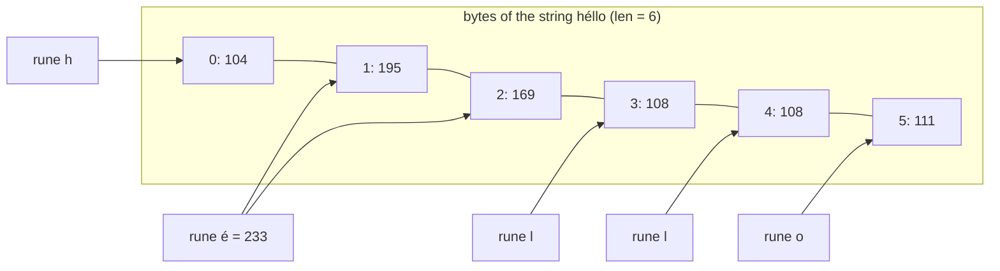

# Strings, runes and bytes

> **Before this lesson:** you should know slices ([Arrays and slices](#/lesson/go/go-arrays-slices)), the integer types `byte` (`uint8`) and `rune` (`int32`) from [Predeclared types](#/lesson/go/go-predeclared-types), and what a `for ... range` loop over a slice looks like.

## In plain words

Computers store only numbers. Text is stored by agreeing on a number for every character and then writing those numbers down. Two separate agreements are involved, and mixing them up is the source of nearly every text bug:

1. **Which number belongs to which character?** The answer is **Unicode**, a giant table that assigns a number, called a **code point**, to every character of every writing system: `A` is 65, `é` is 233, `世` is 19990, and the emoji `🙂` is 128578.
2. **How do you write those numbers as bytes?** The answer Go uses is **UTF-8**, an **encoding** (a rule for turning code points into bytes) in which common English characters take one byte and other characters take two, three or four.

An analogy: a train where most passengers need one seat, but some travel with luggage and need two, three or four seats in a row. Counting **seats** and counting **passengers** give different numbers. In Go, a string is the row of seats: a sequence of **bytes**. A passenger is a **rune**, Go's name for one code point.

So when you ask Go for the length of a string, it counts seats. When you loop over a string with `range`, it hands you passengers. Once you know which of the two you are looking at, strings stop being mysterious.

Why this matters for a job: any service that accepts names, addresses or messages from real people handles non-English text on day one. Truncating a string in the middle of a character, or reporting the wrong length, produces corrupted output that users see. "What is the difference between a byte and a rune?" and "what does `len("héllo")` return?" are standard interview questions.

**Compared with Python.** A Python 3 `str` is a sequence of code points: `len("héllo")` is 5 and `"héllo"[1]` is `"é"`. Bytes are a separate type, `bytes`, that you get by calling `.encode()`. Go made the opposite choice: a `string` *is* the bytes, and you decode to runes when you need characters.

## A string is a read-only sequence of bytes

Start with plain English text, where every character is one byte:

```go
package main

import "fmt"

func main() {
	s := "hello"
	fmt.Println(len(s))
	fmt.Println(s[0], s[1])
	fmt.Println(s[1:3])
}
```

```text
5
104 101
el
```

- `len(s)` is the number of **bytes**, 5.
- `s[0]` is the first byte. Its type is `byte`, so `Println` shows the number 104, the code for `h`. It does not show the letter.
- `s[1:3]` slices bytes 1 and 2 and gives a new string, `"el"`.

Strings are **immutable**: `s[0] = 'j'` does not compile (`cannot assign to s[0]`). To "change" a string you build a new one. Because the bytes can never change, slicing a string is safe and cheap: the substring shares memory with the original, and no aliasing surprises are possible.

## Where bytes and characters part ways

Now add one accented letter.

```go
package main

import (
	"fmt"
	"unicode/utf8"
)

func main() {
	s := "héllo"
	fmt.Println(len(s))
	fmt.Println(utf8.RuneCountInString(s))
	fmt.Println(s[1], s[2])
	fmt.Println(s[:2])
}
```

```text
6
5
195 169
h�
```

- The string has five characters but **six bytes**, because `é` (code point 233) needs two bytes in UTF-8: 195 and 169.
- `utf8.RuneCountInString` counts characters properly: 5.
- `s[1]` and `s[2]` are the two halves of `é`. Neither is a character by itself.
- `s[:2]` takes the `h` and the *first half* of `é`. The result is not valid text. When printed, the broken part shows up as `�`, the replacement character.



### How UTF-8 packs a code point

You do not need to memorise this table, but seeing it once removes the mystery. The first byte announces how many bytes the character uses.

| Code point range | Bytes | First byte looks like | Examples |
|---|---|---|---|
| 0 – 127 | 1 | `0xxxxxxx` | English letters, digits, punctuation (**ASCII**) |
| 128 – 2,047 | 2 | `110xxxxx` | `é`, `ñ`, Greek, Cyrillic, Arabic |
| 2,048 – 65,535 | 3 | `1110xxxx` | `世`, `€`, most Chinese, Japanese, Korean |
| 65,536 and above | 4 | `11110xxx` | emoji such as `🙂` |

Every following byte looks like `10xxxxxx`. **ASCII** is the old 128-character English table; UTF-8 was designed so that pure ASCII text is unchanged, which is why the plain `"hello"` example behaved "normally".

## range decodes runes for you

Looping over a string with `for ... range` does the decoding. On each step it gives you the **byte index** where a character starts and the character as a `rune`:

```go
package main

import "fmt"

func main() {
	for i, r := range "héllo" {
		fmt.Println(i, r, string(r))
	}
}
```

```text
0 104 h
1 233 é
3 108 l
4 108 l
5 111 o
```

Look at the index column: 0, 1, **3**, 4, 5. Index 2 is skipped because it is the second byte of `é`. The second column is the rune's number, and `string(r)` turns a rune back into text.

Compare with a loop over byte positions, which does not decode:

```go
s := "hé"
for i := 0; i < len(s); i++ {
	fmt.Println(i, s[i])
}
```

```text
0 104
1 195
2 169
```

Two different loops, two different views of the same string. Use `range` when you care about characters and the index loop when you care about raw bytes.

### Try it: seats and passengers

Edit the text and compare what Go's `len`, rune count and `range` would report. Try a word with an emoji.

```python-run
def go_view(s):
    data = s.encode("utf-8")
    print(f"text: {s!r}")
    print(f"  len(s)                    = {len(data)}   (bytes)")
    print(f"  utf8.RuneCountInString(s) = {len(s)}   (runes)")
    print("  bytes:", list(data))
    print("  for i, r := range s:")
    i = 0
    for ch in s:
        width = len(ch.encode("utf-8"))
        print(f"    i={i:<2} r={ord(ch):<7} {ch!r}  ({width} byte{'s' if width > 1 else ''})")
        i += width
    print()

go_view("hello")
go_view("héllo")
go_view("Go 世界")
go_view("ok🙂")
```

For `"Go 世界"` you should see 9 bytes and 5 runes: three one-byte characters and two three-byte characters. Then practise decoding, including broken input, in the problem [Bytes, runes and range over a string](#/problem/go-rune-byte-iter).

## Converting between strings, byte slices and rune slices

Three types hold text in different shapes:

- `string`: immutable bytes;
- `[]byte`: a slice of bytes you **can** modify;
- `[]rune`: a slice of code points, one element per character.

```go
package main

import "fmt"

func main() {
	s := "héllo"

	b := []byte(s) // copy the bytes into a modifiable slice
	fmt.Println(b, len(b))

	r := []rune(s) // decode into one rune per character
	fmt.Println(r, len(r))

	r[1] = 'e' // replace é by e
	fmt.Println(string(r))

	b[0] = 'H'
	fmt.Println(string(b), s)
}
```

```text
[104 195 169 108 108 111] 6
[104 233 108 108 111] 5
hello
Héllo héllo
```

Every one of these conversions **copies** the data, which is what keeps strings immutable: changing `b` did not change `s`, as the last line shows. The copy also costs time and memory proportional to the string's size, so avoid converting back and forth inside a tight loop.

A `[]rune` is the tool for position-based work on characters. Reversing a string is the classic example:

```go
func reverse(s string) string {
	r := []rune(s)
	for i, j := 0, len(r)-1; i < j; i, j = i+1, j-1 {
		r[i], r[j] = r[j], r[i]
	}
	return string(r)
}
// reverse("héllo") returns "olléh"
```

The loop uses two indexes moving toward each other and swaps the runes at both ends. Reversing the *bytes* instead would scramble the two bytes of `é`.

> [!WARNING]
> `string(s[1])` does **not** give you the second character. `s[1]` is a byte (195 for `"héllo"`), and converting the number 195 to a string yields the character with code point 195, `Ã`. To get the second character, convert to `[]rune` first or use `range`.

## Useful tools from the standard library

The `strings` package has what Python offers as string methods. In Go they are functions that take the string as the first argument:

```go
package main

import (
	"fmt"
	"strings"
)

func main() {
	s := "  Go is fun, Go is fast  "
	t := strings.TrimSpace(s)
	fmt.Println(t)
	fmt.Println(strings.Contains(t, "fun"), strings.HasPrefix(t, "Go"), strings.Index(t, "is"))
	fmt.Println(strings.ToUpper(t))
	fmt.Println(strings.ReplaceAll(t, "Go", "Rust"))
	parts := strings.Split(t, ", ")
	fmt.Println(parts, len(parts))
	fmt.Println(strings.Join(parts, " & "))
	fmt.Println(strings.Fields(" a  b   c "))
}
```

```text
Go is fun, Go is fast
true true 3
GO IS FUN, GO IS FAST
Rust is fun, Rust is fast
[Go is fun Go is fast] 2
Go is fun & Go is fast
[a b c]
```

`Split` cuts at a separator and returns a slice; `Join` is its inverse; `Fields` splits on any run of whitespace. Other packages you will use: `strconv` for numbers, `unicode` for questions about one rune (`unicode.IsUpper(r)`, `unicode.IsDigit(r)`), and `unicode/utf8` for encoding details.

### Comparing

Strings compare with the ordinary operators. `==` checks that the bytes are identical; `<` and `>` compare byte by byte, which gives dictionary order for plain ASCII. For a case-insensitive check use `strings.EqualFold("Go", "GO")`, which is `true`.

### Building strings efficiently

Because strings are immutable, `s += piece` creates a brand-new string every time and copies everything accumulated so far. In a loop of `n` steps that adds up to work proportional to $n^2$. Use `strings.Builder`, which collects pieces in a growing byte buffer and produces the final string once:

```go
var sb strings.Builder
for i := 1; i <= 3; i++ {
	fmt.Fprintf(&sb, "line %d\n", i) // write formatted text into the builder
}
sb.WriteString("done")
fmt.Print(sb.String())
```

```text
line 1
line 2
line 3
done
```

`var sb strings.Builder` is ready to use at its zero value. `Fprintf` is the variant of `Printf` that writes to a destination you provide; `&sb` passes the builder's address so it can be modified. For joining a ready-made slice, `strings.Join` is simpler still.

## Printing: the verbs worth knowing

| Verb | Shows | `"hé"` or `'é'` prints as |
|---|---|---|
| `%s` | the text | `hé` |
| `%q` | the text in quotes, with escapes | `"hé"` |
| `%x` | the bytes in hexadecimal | `68c3a9` |
| `%v` | the default form of any value | `hé` |
| `%c` | a rune as a character | `é` |
| `%U` | a rune's code point | `U+00E9` |
| `%d` | a rune or byte as a number | `233` |

`%q` and `%x` are the debugging tools: they reveal invisible characters and the exact bytes.

## What a "character" is can get complicated

A rune is one code point, but what a person sees as one character can be several. The flag `🇯🇵` is two code points; `é` can also be written as `e` followed by a separate combining accent (two code points that display as one letter); many emoji are sequences joined by invisible characters. Reversing or truncating by rune can still break those. Handling them correctly requires a library that understands **grapheme clusters** (user-perceived characters). For most backend work, runes are the right level; be aware that the level above exists.

Go source files are UTF-8, so a literal such as `"世界"` contains the UTF-8 bytes of those characters. A string may hold arbitrary bytes, valid text or not. When `range` meets bytes that are not valid UTF-8, it yields the rune 65533 (`U+FFFD`, the replacement character) and moves forward one byte.

## Pitfalls

- **`len(s)` as the character count.** It is the byte count. Use `utf8.RuneCountInString(s)`.
- **Indexing to get a character.** `s[i]` is a byte.
- **Slicing by byte offsets that fall inside a character.** Offsets taken from `range` or from `strings.Index` are always safe; arbitrary numbers are not.
- **`string(byteValue)` or `string(intValue)`.** Produces the character with that code point, not the digits.
- **Truncating user text with `s[:n]`** to fit a database column. Truncate on a rune boundary.
- **Concatenating in a loop with `+=`.**
- **Converting `string` ↔ `[]byte` repeatedly** in hot code; each conversion copies.

> [!TIP]
> If you only need to read text, keep it as a `string`. If you need to edit bytes in place (for example while parsing a network packet), work in `[]byte`; the `bytes` package mirrors almost every function of `strings`. Convert to `[]rune` only for the rare character-position algorithms.

> [!INTERVIEW]
> **"What is the difference between a byte and a rune, and what does `len` return for a string?"** A `byte` is an alias for `uint8`, one unit of storage. A `rune` is an alias for `int32` and represents one Unicode code point. A Go string is an immutable sequence of bytes, conventionally UTF-8, so `len` returns the number of bytes; a code point occupies 1 to 4 of them. Indexing yields bytes; `for i, r := range s` decodes and yields (byte offset, rune). Add that invalid UTF-8 decodes to `U+FFFD` one byte at a time, and that conversions to `[]byte` or `[]rune` copy.

## Cheat sheet

| Question | Code |
|---|---|
| Number of bytes | `len(s)` |
| Number of characters (runes) | `utf8.RuneCountInString(s)` |
| Byte at position i | `s[i]` |
| Loop over characters | `for i, r := range s` |
| Loop over bytes | `for i := 0; i < len(s); i++` |
| Modifiable bytes | `b := []byte(s)` |
| Characters by position | `r := []rune(s)` |
| Back to string | `string(b)`, `string(r)` |
| One rune to string | `string(r)` |
| Build a long string | `strings.Builder` or `strings.Join` |
| See exact bytes | `fmt.Printf("%x %q", s, s)` |
| Is it valid UTF-8? | `utf8.ValidString(s)` |

## Summary

- A Go `string` is an immutable sequence of **bytes**; text is stored as UTF-8.
- Unicode gives every character a **code point**; Go calls a code point a **rune** (`int32`). UTF-8 encodes a rune in 1 to 4 bytes.
- `len` and indexing work on bytes. `range` decodes runes and reports the byte offset of each.
- Convert to `[]byte` to modify bytes and to `[]rune` to work with characters by position; both conversions copy.
- Use the `strings` package for searching, splitting and joining, and `strings.Builder` to assemble text in a loop.
- A user-visible character may consist of several runes.

## Glossary

- **ASCII**: the original 128-character table for English text; each character is one byte in UTF-8.
- **Byte**: 8 bits; in Go the type `byte`, an alias of `uint8`.
- **Code point**: the number Unicode assigns to a character.
- **Encoding**: a rule for representing code points as bytes.
- **Grapheme cluster**: what a reader perceives as one character; may be several code points.
- **Immutable**: cannot be modified after creation.
- **Replacement character**: `U+FFFD` (`�`), produced when decoding invalid UTF-8.
- **Rune**: Go's type for a code point; an alias of `int32`.
- **Unicode**: the standard table of characters and their code points.
- **UTF-8**: the variable-length encoding (1 to 4 bytes per code point) used by Go.

```quiz
[
  {"q": "What does `fmt.Println(len(\"héllo\"))` print?",
   "options": ["5", "6", "10", "It depends on the operating system"],
   "answer": 1,
   "explain": "`len` counts bytes. `é` takes two bytes in UTF-8 and the other four letters one each: 6."},
  {"q": "What does this print? `s := \"hello\"; fmt.Println(s[0])`",
   "options": ["`h`", "`104`", "`\"h\"`", "Compile error"],
   "answer": 1,
   "explain": "Indexing a string yields a byte (uint8), and Println prints a byte as a number. Use `string(s[0])` or `%c` to see the letter for ASCII text."},
  {"q": "What indexes does `for i := range \"aé!\"` produce?",
   "options": ["0, 1, 2", "0, 1, 3", "0, 2, 3", "0, 1, 2, 3"],
   "answer": 1,
   "explain": "`a` is at byte 0, `é` starts at byte 1 and occupies bytes 1 and 2, so `!` starts at byte 3. range reports the starting byte offset of each rune."},
  {"q": "Which expression gives the number of characters (code points) in `s`?",
   "options": ["`len(s)`", "`cap(s)`", "`utf8.RuneCountInString(s)`", "`s.Length()`"],
   "answer": 2,
   "explain": "`utf8.RuneCountInString` decodes the UTF-8 and counts runes. `len([]rune(s))` gives the same number but allocates a slice."},
  {"q": "What does this print? `s := \"héllo\"; fmt.Println(string(s[1]))`",
   "options": ["`é`", "`Ã`", "`195`", "`h`"],
   "answer": 1,
   "explain": "`s[1]` is the byte 195, the first half of `é`. Converting the number 195 to a string yields the character with code point 195, which is `Ã`."},
  {"q": "Why does `s[0] = 'H'` fail to compile for a string `s`?",
   "options": ["The index must be a rune", "Strings are immutable", "`'H'` is a string, not a byte", "Strings start at index 1"],
   "answer": 1,
   "explain": "String contents can never be modified. Convert to `[]byte` (a copy), change that, and convert back."},
  {"q": "What is the most efficient way to build a long string from many pieces in a loop?",
   "options": ["`s += piece` each time", "`strings.Builder`", "`fmt.Sprintf(\"%s%s\", s, piece)` each time", "Convert to `[]rune` and append"],
   "answer": 1,
   "explain": "`+=` copies everything accumulated so far on every step. `strings.Builder` appends into a growing buffer and creates the string once."},
  {"q": "After `b := []byte(s)` and `b[0] = 'X'`, what happened to `s`?",
   "options": ["Its first byte is now `X`", "Nothing: the conversion copied the bytes", "It became invalid UTF-8", "It became nil"],
   "answer": 1,
   "explain": "Converting a string to a byte slice allocates a new array and copies. That is how Go guarantees strings never change."}
]
```

> **Source:** Bodner, *Learning Go* 2e, ch. 3 (topic coverage; wording and examples are original). Official references: https://go.dev/blog/strings, https://go.dev/ref/spec#String_types, https://go.dev/ref/spec#For_range, https://pkg.go.dev/strings, https://pkg.go.dev/unicode/utf8
