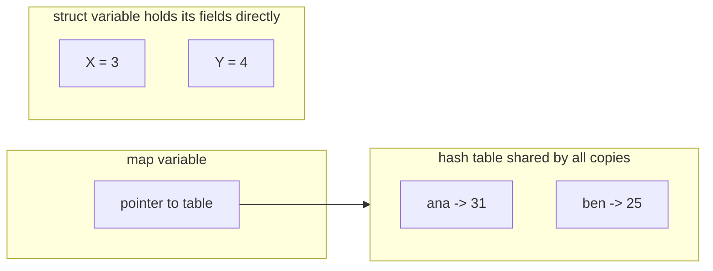

# Maps and structs

> **Before this lesson:** you should know variables, zero values and slices ([Arrays and slices](#/lesson/go/go-arrays-slices)), and have seen `for ... range`. Python's `dict` and classes are used for comparison; you do not need to know them.

## In plain words

This lesson covers the two remaining building blocks for organising data.

A **map** is a lookup table. Think of the coat check at a theatre: you hand over a coat and get a numbered ticket; later you show the ticket and get exactly that coat back, without anyone searching the whole room. The ticket is the **key** and the coat is the **value**. A map stores key–value pairs and finds the value for a key very quickly, however many pairs it holds.

A **struct** is a record that groups several named pieces of data into one unit. Think of a library card: it has a fixed set of labelled boxes (name, member number, expiry date) and every card has the same boxes. Each labelled box is a **field**.

Use a map when the set of keys is not known in advance (word counts, users by ID, settings by name). Use a struct when the set of fields is fixed and known when you write the code (a point has X and Y; an order has an ID, a customer and a total).

Why this matters for a job: nearly every backend program is "read some records, group or look them up, write them out". Records are structs; grouping and lookup are maps. Map behaviour on missing keys, the nil map panic and the random iteration order are perennial interview questions.

**Compared with Python.** A Go map is the counterpart of a `dict`, with three big differences: all keys have one type and all values have one type; reading a missing key returns a zero value instead of raising `KeyError`; and **iteration order is deliberately random**, where a Python dict keeps insertion order. A Go struct is the counterpart of a small class or dataclass with no behaviour attached (behaviour comes in [the methods lesson](#/lesson/go/go-types-methods)), and it is copied when assigned, where Python objects are shared.

## Maps

### Creating and using a map

The type is written `map[KeyType]ValueType`. The simplest way to create one is a **map literal**:

```go
package main

import "fmt"

func main() {
	stock := map[string]int{
		"apple": 3,
		"pear":  0,
	}
	fmt.Println(stock["apple"], len(stock))

	stock["kiwi"] = 12  // add a new pair
	stock["apple"] = 5  // replace an existing value
	stock["pear"]++     // update in place
	fmt.Println(stock)

	delete(stock, "apple")
	delete(stock, "mango") // deleting a missing key is fine
	fmt.Println(stock, len(stock))
}
```

```text
3 2
map[apple:5 kiwi:12 pear:1]
map[kiwi:12 pear:1] 2
```

Line by line: the literal creates a map from `string` keys to `int` values with two pairs (note the trailing comma, required by the semicolon rule). `stock["apple"]` reads a value; `len` counts the pairs. Assigning to a key adds or replaces. `delete(m, key)` removes a pair and does nothing if the key is absent. When `fmt` prints a map it sorts the keys so that output is stable; that is a courtesy of `fmt`, not the map's own order.

An empty map is created with `map[string]int{}` or `make(map[string]int)`. If you know roughly how many pairs are coming, `make(map[string]int, 1000)` reserves room and avoids repeated growth.

### Missing keys and the comma-ok idiom

Reading a key that is not in the map does **not** fail. It returns the zero value of the value type:

```go
stock := map[string]int{"apple": 3, "pear": 0}
fmt.Println(stock["kiwi"]) // 0: key is missing
fmt.Println(stock["pear"]) // 0: key is present with value 0
```

Those two zeros mean different things, and the plain read cannot tell them apart. When the difference matters, ask for a second result:

```go
v, ok := stock["pear"]
fmt.Println(v, ok)

v, ok = stock["kiwi"]
fmt.Println(v, ok)

if qty, ok := stock["apple"]; ok {
	fmt.Println("we stock apples:", qty)
}
```

```text
0 true
0 false
we stock apples: 3
```

The second value is a `bool` that is `true` when the key exists. By convention it is named `ok`, and the pattern is called the **comma-ok idiom**. The `if` line declares `qty` and `ok` and tests `ok` in one statement; you will see this shape constantly.

The zero-value behaviour makes counting pleasant. No "is the key there yet?" check is needed:

```go
package main

import (
	"fmt"
	"strings"
)

func main() {
	counts := map[string]int{}
	for _, word := range strings.Fields("the cat and the hat") {
		counts[word]++ // a missing word reads as 0, then becomes 1
	}
	fmt.Println(counts)
}
```

```text
map[and:1 cat:1 hat:1 the:2]
```

In Python the same loop needs `counts.get(word, 0) + 1` or a `defaultdict`.

### The nil map

A map variable declared without a value is **nil**: it has no storage behind it.

```go
var m map[string]int
fmt.Println(m == nil, len(m), m["x"]) // reading is allowed
m["x"] = 1                            // writing is not
```

```text
true 0 0
panic: assignment to entry in nil map
```

Reading from a nil map behaves like reading from an empty map. **Writing to a nil map crashes the program.** This asymmetry catches everyone once, usually with a struct that has a map field nobody initialised. The fix is to create the map before writing: `m = make(map[string]int)`. Practise the rules in [Map zero values, comma-ok and the nil map](#/problem/go-map-comma-ok).

### Iteration order is random

```go
ages := map[string]int{"ana": 31, "ben": 25, "cy": 40}
for name, age := range ages {
	fmt.Println(name, age)
}
```

Run that three times and the three lines can come out in three different orders. Go's designers randomised the starting point on purpose, so that nobody writes code that accidentally depends on an order the language never promised. When you need a stable order, sort the keys:

```go
package main

import (
	"fmt"
	"maps"
	"slices"
)

func main() {
	ages := map[string]int{"cy": 40, "ana": 31, "ben": 25}
	for _, name := range slices.Sorted(maps.Keys(ages)) {
		fmt.Println(name, ages[name])
	}
}
```

```text
ana 31
ben 25
cy 40
```

`maps.Keys` produces the keys and `slices.Sorted` collects them into a sorted slice (both in the standard library since Go 1.23). In older code you will see the keys appended to a slice by hand and then sorted.

### Try it: why a hash table has no natural order

Inside, a map is a **hash table**. A **hash function** turns each key into a number, and that number decides which of several *buckets* the pair is stored in. This toy version shows that the storage order follows the hash, not the order of insertion.

```python-run
import zlib

def bucket_of(key, buckets):
    return zlib.crc32(key.encode()) % buckets   # a deterministic stand-in for Go's hash

def build(keys, buckets):
    table = [[] for _ in range(buckets)]
    for k in keys:
        table[bucket_of(k, buckets)].append(k)
    return table

keys = ["ana", "ben", "cy", "dee", "eli", "fay"]
for buckets in (4, 8):
    table = build(keys, buckets)
    print(f"{buckets} buckets:")
    for i, b in enumerate(table):
        print(f"   bucket {i}: {b}")
    print("   walk order :", [k for b in table for k in b])
print("insert order  :", keys)
```

The walk order differs from the insertion order, and it changes when the table grows from 4 to 8 buckets. Go additionally starts each loop at a random bucket, which is why even two loops over the same unchanged map can differ.

### Maps are shared, not copied

Assigning a map to another variable, or passing it to a function, does **not** copy the pairs. Both names refer to the same table:

```go
func addBonus(scores map[string]int) {
	scores["bonus"] = 10
}

func main() {
	s := map[string]int{"quiz": 7}
	t := s
	addBonus(s)
	fmt.Println(t, len(t))
}
```

```text
map[bonus:10 quiz:7] 2
```

A map value is, internally, a pointer to the table. Compare this with slices: a function can change a slice's elements but not its length, whereas with a map every change, additions included, is visible to the caller. To get an independent copy use `maps.Clone(m)`.

### What can be a key

Keys must be **comparable**, meaning `==` is defined for them: numbers, strings, booleans, arrays of comparable types, and structs whose fields are all comparable. Slices, maps and functions cannot be keys. Values may be anything, including slices or other maps.

Maps themselves can only be compared to `nil`; for contents use `maps.Equal(a, b)`.

### A set from a map

Go has no set type. Use a map whose values carry no information:

```go
seen := map[string]bool{}
for _, tag := range []string{"go", "db", "go", "api", "db"} {
	seen[tag] = true
}
fmt.Println(len(seen), seen["go"], seen["java"])
```

```text
3 true false
```

Missing keys read as `false`, so `seen[x]` is a membership test. You will also meet `map[string]struct{}`, where the value is an empty struct that occupies zero bytes; it saves a little memory at the price of clumsier syntax (`seen[x] = struct{}{}` and a comma-ok lookup).

> [!WARNING]
> A map must not be written by one goroutine while another reads or writes it. Go detects many such cases and stops the program with `fatal error: concurrent map writes`. Protect shared maps with a mutex ([sync primitives](#/lesson/go/go-sync-primitives)).

## Structs

### Defining and creating

```go
package main

import "fmt"

type Point struct {
	X int
	Y int
}

func main() {
	var origin Point             // zero value: every field is zero
	a := Point{X: 3, Y: 4}       // named fields (preferred)
	b := Point{5, 6}             // positional: values in field order
	c := Point{Y: 9}             // omitted fields are zero

	fmt.Println(origin, a, b, c)
	fmt.Printf("%+v\n", a)

	a.X = 30
	fmt.Println(a.X + a.Y)
}
```

```text
{0 0} {3 4} {5 6} {0 9}
{X:3 Y:4}
34
```

`type Point struct { ... }` defines a new type named `Point` with two fields. A struct's zero value has every field at its own zero value, so a struct variable is always usable. The **struct literal** with field names is preferred: it survives someone adding a field later, while the positional form breaks. Fields are read and written with a dot. The verb `%+v` prints the field names, which is helpful when debugging.

### Structs are copied

```go
p := Point{1, 2}
q := p      // a full copy
q.X = 10
fmt.Println(p, q, p == q)
```

```text
{1 2} {10 2} false
```

Assignment copies every field, as with arrays. Changing `q` leaves `p` alone. This is the opposite of Python, where `q = p` would make both names refer to one object. Structs whose fields are all comparable can be compared with `==`, field by field.

The copy is shallow: if a field is a slice or a map, the copy's field refers to the same backing array or table.

### Structs in slices and maps

```go
type Item struct {
	Name string
	Qty  int
}

func main() {
	cart := []Item{{"pen", 2}, {"ink", 1}}
	cart[0].Qty++ // fine: slice elements are addressable
	fmt.Println(cart)

	for _, it := range cart {
		it.Qty = 0 // changes a COPY
	}
	fmt.Println(cart)

	byName := map[string]Item{"pen": {"pen", 2}}
	it := byName["pen"] // copy out
	it.Qty = 99         // modify the copy
	byName["pen"] = it  // store back
	fmt.Println(byName)
}
```

```text
[{pen 3} {ink 1}]
[{pen 3} {ink 1}]
map[pen:{pen 99}]
```

Three things happen here. `cart[0].Qty++` modifies the element in the slice. The `range` loop gives a **copy** of each element in `it`, so assigning to `it.Qty` changes nothing in `cart`; write `cart[i].Qty = 0` with the index instead. And for a map of structs you cannot write `byName["pen"].Qty = 99` at all (the compiler says `cannot assign to struct field byName["pen"].Qty in map`); you copy the value out, change it and store it back, or you store pointers in the map.

### Anonymous structs and nesting

A struct type can be used without giving it a name, for one-off groupings:

```go
config := struct {
	Host string
	Port int
}{"localhost", 8080}
fmt.Println(config.Host, config.Port)
```

This is common in tests and when shaping JSON. Structs can also contain other structs:

```go
type Address struct{ City string }
type Customer struct {
	Name string
	Home Address
}
c := Customer{Name: "Ana", Home: Address{City: "Lima"}}
fmt.Println(c.Home.City)
```

Two struct types with different names are different types even if their fields are identical, but when the fields match in name, type and order you may convert between them by writing `TypeA(valueOfTypeB)`.



## Pitfalls

- **Writing to a nil map.** Initialise with `make` or a literal first.
- **Depending on map iteration order.** Sort the keys.
- **Treating `m[k] == 0` as "missing".** Use comma-ok.
- **Expecting a map assignment to copy.** It shares; use `maps.Clone`.
- **Modifying the loop variable of a `range` over structs.** It is a copy; index into the slice.
- **`m[key].Field = value`.** Not allowed for struct values in a map.
- **Positional struct literals** for types that may gain fields.
- **Sharing a map between goroutines without a lock.**

> [!TIP]
> When a function returns a map or a slice, callers cannot tell `nil` from empty by using it, because both have length 0 and both can be read. That is intentional: return whichever is natural (usually `nil` when there is nothing) and let callers treat them the same.

> [!INTERVIEW]
> **"In what order does a Go map iterate?"** Unspecified, and randomised on purpose: the runtime starts each `range` at a random position so that programs cannot rely on any order. Insertion order is not kept. For deterministic output collect the keys, sort them, and index the map. Good follow-ups: `fmt` prints maps in sorted key order for readability; a nil map can be read but not written; maps are reference-like, so functions modify the caller's map; concurrent writes are a fatal error.

## Cheat sheet

| Operation | Code | If the key is missing |
|---|---|---|
| Create | `m := map[string]int{}` or `make(map[string]int)` | |
| Read | `v := m[k]` | zero value |
| Read and test | `v, ok := m[k]` | `ok == false` |
| Write | `m[k] = v` | adds (panics on a nil map) |
| Remove | `delete(m, k)` | no-op |
| Count | `len(m)` | |
| Empty it | `clear(m)` | |
| Loop | `for k, v := range m` | random order |
| Sorted loop | `for _, k := range slices.Sorted(maps.Keys(m))` | |
| Copy / compare | `maps.Clone(m)`, `maps.Equal(a, b)` | |
| Define a struct | `type T struct { A int; B string }` | |
| Create a struct | `T{A: 1, B: "x"}` | omitted fields are zero |
| Print with names | `fmt.Printf("%+v", t)` | |

## Summary

- A **map** associates keys with values. Keys must be comparable; all keys share one type and all values share one type.
- Reading a missing key gives the zero value; `v, ok := m[k]` reports whether the key exists.
- A nil map can be read but writing to it panics. Iteration order is random.
- Maps are shared when assigned or passed; structs and arrays are copied.
- A **struct** groups named fields; its zero value has every field zeroed. Prefer literals with field names.
- Loop variables and map values are copies of structs; modify through an index or store back.

## Glossary

- **Comma-ok idiom**: the two-result form `v, ok := m[k]` that reports presence.
- **Comparable**: a type whose values can be tested with `==`.
- **Field**: a named component of a struct.
- **Hash function**: a function that turns a key into a number used to choose a bucket.
- **Hash table**: the data structure behind a map; gives fast lookup by key.
- **Key / value**: what you look up by / what you get back.
- **Map**: Go's built-in key–value collection.
- **nil map**: a map variable with no table behind it.
- **Set**: a collection of distinct items; in Go, a map with empty or boolean values.
- **Struct**: a type made of a fixed list of named fields.
- **Struct literal**: an expression such as `Point{X: 1, Y: 2}` that creates a struct value.

```quiz
[
  {"q": "What does this print? `m := map[string]int{\"a\": 1}; fmt.Println(m[\"b\"])`",
   "options": ["It panics with a missing-key error", "`0`", "`nil`", "`-1`"],
   "answer": 1,
   "explain": "Reading a missing key returns the zero value of the value type, 0 for int. No error or panic occurs."},
  {"q": "What does this print? `m := map[string]int{\"a\": 0}; v, ok := m[\"a\"]; w, ok2 := m[\"z\"]; fmt.Println(v, ok, w, ok2)`",
   "options": ["`0 true 0 false`", "`0 false 0 false`", "`0 true 0 true`", "`nil true nil false`"],
   "answer": 0,
   "explain": "Both reads give 0, but the second result tells them apart: the key `a` exists (true), `z` does not (false)."},
  {"q": "What happens? `var m map[string]int; m[\"x\"] = 1`",
   "options": ["The map is created automatically", "Compile error", "panic: assignment to entry in nil map", "Nothing; the write is ignored"],
   "answer": 2,
   "explain": "A declared-but-uninitialised map is nil. Reads work, writes panic. Create it with `make(map[string]int)` or a literal first."},
  {"q": "You range over the same map twice without changing it. What can you say about the order of the keys?",
   "options": ["Insertion order both times", "Sorted order both times", "The order is unspecified and may differ between the two loops", "Reverse insertion order"],
   "answer": 2,
   "explain": "Go randomises map iteration. If order matters, sort the keys and look the values up."},
  {"q": "What does this print? `type P struct{ X int }; a := P{1}; b := a; b.X = 2; fmt.Println(a.X)`",
   "options": ["`2`", "`1`", "`0`", "Compile error"],
   "answer": 1,
   "explain": "Assigning a struct copies all its fields. `b` is independent of `a`."},
  {"q": "What does this print? `func f(m map[string]int) { m[\"k\"] = 5 }` then `m := map[string]int{}; f(m); fmt.Println(len(m))`",
   "options": ["`0`", "`1`", "It panics", "Compile error"],
   "answer": 1,
   "explain": "A map value refers to a shared hash table. The function's write is visible to the caller, including the new key."},
  {"q": "`items := []Item{{\"pen\", 2}}; for _, it := range items { it.Qty = 0 }`. What is `items[0].Qty` afterwards?",
   "options": ["`0`", "`2`", "It does not compile", "`nil`"],
   "answer": 1,
   "explain": "The loop variable `it` is a copy of each element. Use `for i := range items { items[i].Qty = 0 }` to modify the slice."},
  {"q": "Which type can NOT be used as a map key?",
   "options": ["`string`", "`[2]int`", "`[]int`", "`struct{ A, B int }`"],
   "answer": 2,
   "explain": "Keys must be comparable with `==`. Slices are not comparable, so they cannot be keys. Arrays and structs of comparable fields can."}
]
```

> **Source:** Bodner, *Learning Go* 2e, ch. 3 (topic coverage; wording and examples are original). Official references: https://go.dev/ref/spec#Map_types, https://go.dev/ref/spec#Struct_types, https://go.dev/blog/maps, https://pkg.go.dev/maps, https://go.dev/ref/spec#Comparison_operators
