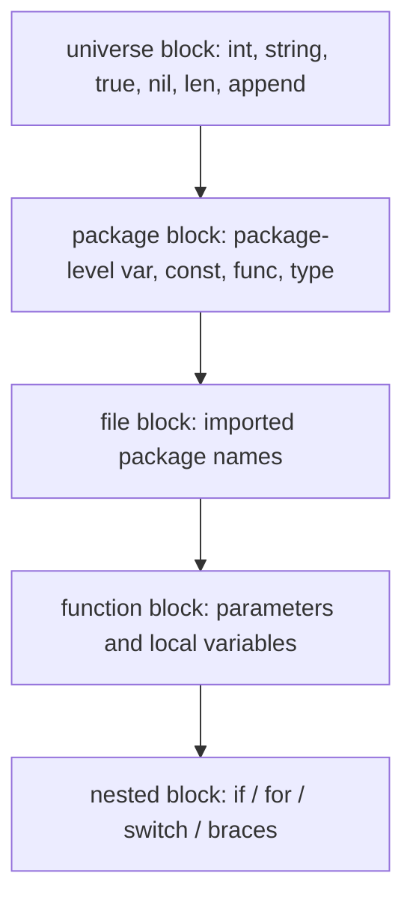

# Blocks, shadowing and if

> **Before this lesson:** you should know the difference between declaring (`:=`, `var`) and assigning (`=`) from [Declarations, constants and typed versus untyped](#/lesson/go/go-declarations-const), and have written a function `main` with a few variables.

## In plain words

Imagine an office building. A note pinned to the board in the **lobby** can be read by everyone in the building. A note on the board of the **third floor** can be read by people on that floor. A note inside **meeting room 3B** is visible only to people in that room. Someone standing in room 3B can read all three boards: the room's, the floor's and the lobby's.

Now suppose the lobby board says "Wi-Fi password: maple" and somebody pins a note in room 3B that also says "Wi-Fi password: cedar". People in that room will read the nearest note and use "cedar". The lobby note is still there, unchanged, and everyone outside the room still uses "maple". The room's note **hides** the lobby's note for the people inside.

Go programs are organised the same way. A region of code where a name is visible is called a **block**, blocks are nested inside each other, and a name declared in an inner block hides a same-named one further out. The hiding is called **shadowing**. It is legal, occasionally useful, and a frequent cause of bugs where a programmer believes they changed a variable but in fact created a second one that disappeared a moment later.

This lesson also introduces `if`, Go's basic decision statement, because `if` is where most blocks (and most accidental shadows) come from.

Why this matters for a job: a shadowed error variable is one of the classic Go production bugs, because the code compiles, reads naturally and silently ignores a failure. Interviewers hand candidates a ten-line program with nested `:=` and ask what it prints.

**Compared with Python.** Python has function scope: a variable assigned inside an `if` or a `for` is still visible after it. Go has **block scope**: a variable declared between `{` and `}` ceases to exist at the closing brace. Python has no declaration statement, so shadowing inside a function cannot happen by accident there in the same way.

## Blocks: where names live

Every pair of braces creates a block. In addition, Go defines some blocks without braces. From outermost to innermost:

1. **The universe block** holds the names built into the language: types such as `int` and `string`, the values `true`, `false` and `nil`, and functions such as `len`, `append` and `make`.
2. **The package block** holds everything declared outside functions in any file of the package.
3. **The file block** holds the names brought in by that file's `import` lines.
4. **Function blocks**: a function's parameters and the variables declared in its body.
5. **Nested blocks**: the bodies of `if`, `for` and `switch` statements, and any bare `{ ... }` you write.



The **scope** of a name is the part of the program where that name can be used. A name is in scope from the point of its declaration to the end of the block that contains it, including all blocks nested inside. When the compiler meets a name, it searches the current block, then the enclosing block, and so on outward, and uses the first match.

A small demonstration with a bare block:

```go
package main

import "fmt"

func main() {
	a := 1
	{
		b := 2
		fmt.Println(a, b) // both visible here
	}
	fmt.Println(a)
	// fmt.Println(b)   // compile error: undefined: b
}
```

```text
1 2
1
```

`b` is declared inside the inner braces and stops existing at the closing brace. The commented line would not compile.

## if statements

Before going deeper into shadowing, here is the statement that creates most blocks.

```go
package main

import "fmt"

func main() {
	temp := 18

	if temp > 25 {
		fmt.Println("hot")
	} else if temp > 15 {
		fmt.Println("mild")
	} else {
		fmt.Println("cold")
	}
}
```

```text
mild
```

Rules, each a small difference from other languages:

- **No parentheses** around the condition.
- **Braces are mandatory**, even for a single statement. There is no one-line `if x: do()` form.
- The condition must be a `bool`. `if temp { ... }` does not compile.
- `else` must be on the same line as the closing brace before it (the semicolon rule from [the fmt lesson](#/lesson/go/go-fmt-vet)).
- The conditions are tested in order and the first true one wins; the rest are skipped.

Go has **no ternary operator** (the `a if cond else b` of Python or `cond ? a : b` of C). You write the `if` out:

```go
label := "odd"
if n%2 == 0 {
	label = "even"
}
```

### if with an initialisation statement

An `if` may begin with a short statement, separated from the condition by a semicolon. A variable declared there is visible in the condition, in every branch of that `if`/`else` chain, and nowhere else.

```go
package main

import "fmt"

func main() {
	name := "Brook"

	if n := len(name); n > 6 {
		fmt.Println("long name:", n)
	} else if n > 3 {
		fmt.Println("medium name:", n)
	} else {
		fmt.Println("short name:", n)
	}
	// n is not defined here
}
```

```text
medium name: 5
```

`n := len(name)` runs first, then `n > 6` is tested. `n` lives in a block that wraps the whole `if` chain. This keeps a helper variable from lingering in the rest of the function.

The most common use is error handling. A function that can fail returns an error value, and the check is written in one line:

```go
if err := saveFile(path); err != nil {
	fmt.Println("could not save:", err)
	return
}
```

Here `err` exists only for this check. You will write this shape hundreds of times.

## Shadowing

**Shadowing** means declaring a name in an inner block that already exists in an outer block. Inside the inner block the name refers to the new variable; the outer one is untouched and becomes visible again when the block ends.

Start with the plainest case:

```go
package main

import "fmt"

func main() {
	x := 10
	if x > 5 {
		fmt.Println(x) // outer x
		x := 5         // NEW variable, shadows the outer x from here on
		fmt.Println(x) // inner x
	}
	fmt.Println(x) // outer x again
}
```

```text
10
5
10
```

Three prints, two variables. The first print inside the `if` runs before the inner declaration, so it still sees the outer `x`. The `:=` then creates a second `x` that lives until the closing brace. After the block, the outer `x` is back, still 10.

Had the line been `x = 5` (assignment), the output would be `10 5 5`: no new variable, and the outer one is changed. **One colon is the entire difference.**

### The multi-variable trap

Recall the rule for `:=` with several names: names that already exist **in the same block** are assigned; the others are created. The words "in the same block" matter enormously.

```go
package main

import "fmt"

func main() {
	x := 10
	if x > 5 {
		x, y := 5, 20 // x does not exist in THIS block, so both are new
		fmt.Println(x, y)
	}
	fmt.Println(x)
}
```

```text
5 20
10
```

The programmer may have intended to update `x` and introduce `y`. But the outer `x` belongs to the function's block, not to the `if` block. Looking only at the current block, both names are new, so both are declared. The outer `x` stays 10.

### The bug this causes in real code

Here is the pattern as it appears in production. The function is meant to return a parsed number and any error:

```go
package main

import (
	"fmt"
	"strconv"
)

func parseOrDefault(text string, useInput bool) (int, error) {
	value := 1
	var err error

	if useInput {
		value, err := strconv.Atoi(text) // shadows BOTH value and err
		fmt.Println("inside:", value, err)
	}
	return value, err
}

func main() {
	fmt.Println(parseOrDefault("42", true))
	fmt.Println(parseOrDefault("oops", true))
}
```

```text
inside: 42 <nil>
1 <nil>
inside: 0 strconv.Atoi: parsing "oops": invalid syntax
1 <nil>
```

Inside the `if`, parsing works (or fails) as expected. But the function returns the **outer** `value` and `err`, which were never touched: `1` and `nil` both times. The second call is the dangerous one. Parsing failed, and the caller was told everything was fine.

The fix is to assign instead of declare:

```go
	if useInput {
		value, err = strconv.Atoi(text) // = assigns to the outer variables
	}
```

Because `value` and `err` already exist and nothing new is being introduced, plain `=` is correct and `:=` was never needed.

### Try it: follow the compiler's lookup

This simulation keeps a stack of blocks, declares with "current block only" semantics and looks names up from the innermost block outward. Change `("short", ...)` to `("assign", ...)` and watch the result flip.

```python-run
def run(program):
    scopes = [{}]
    def lookup(name):
        for depth in range(len(scopes) - 1, -1, -1):
            if name in scopes[depth]:
                return depth
        raise NameError(name)
    for step in program:
        op = step[0]
        if op == "open":
            scopes.append({})
        elif op == "close":
            gone = scopes.pop()
            print(f"{'  ' * len(scopes)}}}   (block ends; dropped {list(gone) or 'nothing'})")
        elif op == "short":                 # name := value  -> ALWAYS the current block
            _, name, value = step
            new = name not in scopes[-1]
            scopes[-1][name] = value
            print(f"{'  ' * (len(scopes)-1)}{name} := {value}   ({'new variable' if new else 'reused'} at depth {len(scopes)-1})")
        elif op == "assign":                # name = value   -> nearest existing variable
            _, name, value = step
            d = lookup(name)
            scopes[d][name] = value
            print(f"{'  ' * (len(scopes)-1)}{name} = {value}    (changed the variable at depth {d})")
        elif op == "print":
            d = lookup(step[1])
            print(f"{'  ' * (len(scopes)-1)}print {step[1]} -> {scopes[d][step[1]]}   (found at depth {d})")

run([
    ("short", "total", 0),
    ("open",),
    ("short", "total", 99),      # try ("assign", "total", 99)
    ("print", "total"),
    ("close",),
    ("print", "total"),
])
```

With `short`, the final print shows 0. With `assign`, it shows 99. Then work through [Blocks and shadowing](#/problem/go-shadowing-scopes) to test yourself on harder nests.

## Shadowing things that are not variables

Any name can be shadowed, including imported packages and names from the universe block.

```go
package main

import "fmt"

func main() {
	fmt.Println(true)
	true := 10 // legal, and a terrible idea
	fmt.Println(true)

	len := 3 // shadows the built-in function len
	fmt.Println(len)
	// fmt.Println(len("abc"))  // compile error: len is now an int, not a function
}
```

```text
true
10
3
```

`true` and `len` are not reserved keywords; they are ordinary names living in the universe block, so an inner declaration can hide them. The same goes for package names:

```go
func main() {
	fmt := "oops"          // shadows the imported package
	// fmt.Println("hi")   // compile error: fmt.Println undefined (type string has no field or method Println)
	_ = fmt
}
```

Names that people shadow by accident in real code: `len`, `cap`, `copy`, `new`, `error`, `string`, `url`, `path`, `json`, `time`. Naming a variable `url` in a file that imports `net/url` is the classic case. Pick a different name (`u`, `target`, `rawURL`).

## When shadowing is fine

Shadowing is not always a mistake. The common, accepted use is `err` inside an `if` initialiser:

```go
if err := step1(); err != nil {
	return err
}
if err := step2(); err != nil {
	return err
}
```

Each `err` is deliberately local to its own check. The dangerous form is the one from the bug above: an inner `:=` whose result is meant to be used **after** the block.

## Finding shadows automatically

The compiler will not help; shadowing is legal. Three things do help:

- **The unused-variable error.** If an inner variable is declared and never read, the build fails with `declared and not used`. Many accidental shadows are caught this way, which is one of the reasons for that strict rule. The bug example above escaped only because the inner values were printed.
- **A shadow analyzer.** There is an optional `shadow` checker (`golang.org/x/tools/go/analysis/passes/shadow`), and linters such as `golangci-lint` can enable shadow detection through `govet`'s settings. It is not part of default `go vet` because it reports the harmless cases as well.
- **A habit.** Before typing `:=` inside a nested block, ask: "do I want a new variable that dies at the closing brace?" If the answer is no, use `=`.

## Pitfalls

> [!WARNING]
> The shadowed-`err` bug: `x, err := f()` inside an `if` or `for` body when `x` or `err` is meant to be used after the block. The outer variables never change, and a failure is reported as success. Use `=` with variables declared before the block.

- **Using a variable after the block it was declared in.** In Python this works; in Go it is `undefined`.
- **`else` on its own line.** A syntax error caused by the automatic semicolon after `}`.
- **Leaving out braces** for a one-line `if`.
- **Shadowing a package name or a built-in** and then being confused by the error message several lines later.
- **Assuming the `if` init variable survives** past the `else`.

> [!TIP]
> Keep the "happy path" at the left margin. Check for the error or the special case, `return` early inside the `if`, and continue un-nested. Code written this way has fewer nested blocks, so fewer places where shadowing can hide.

> [!INTERVIEW]
> **"What is variable shadowing in Go, and how can it cause a bug?"** A declaration in an inner block with the same name as one in an outer block creates a distinct variable that hides the outer one until the block ends. With `:=` and several names on the left, Go only reuses names declared *in the current block*; in a nested block all of them are new. So `result, err := f()` inside an `if` leaves the outer `result` and `err` unchanged, and the function may return a stale `nil` error. Mention the defences: assign with `=`, the unused-variable compile error, and shadow analyzers.

## Cheat sheet

| Situation | What happens |
|---|---|
| `x := 1` in a block where `x` already exists in the **same** block | compile error (no new variables) |
| `x := 1` in a **nested** block | new variable; shadows the outer `x` |
| `x = 1` in a nested block | assigns to the nearest enclosing `x` |
| `x, y := 1, 2`, `x` in same block, `y` new | `x` assigned, `y` declared |
| `x, y := 1, 2` in a nested block | both declared; outer `x` untouched |
| `if v := f(); v > 0 { } else { }` | `v` visible in all branches, gone afterwards |
| Name declared inside `{ }` | undefined after the closing brace |
| `len := 3` | legal; hides the built-in `len` in that block |

## Summary

- A **block** is a region delimited by braces (plus the implicit universe, package and file blocks). A name is in scope from its declaration to the end of its block, including nested blocks.
- Name lookup goes from the innermost block outward and stops at the first match.
- **Shadowing** is declaring an existing name again in an inner block. The outer variable is hidden, not changed.
- `:=` decides "new or reuse" by looking at the current block only. That is the root of the shadowed-`err` bug; use `=` when you mean to update outer variables.
- `if` needs no parentheses, always needs braces, takes only `bool` conditions, and may start with an initialisation statement whose variables are scoped to the `if`/`else` chain.
- Built-in names and package names can be shadowed too. Avoid it.

## Glossary

- **Block**: a section of code, usually between braces, that forms a scope.
- **Block scope**: the rule that a name is visible only within the block where it is declared.
- **Early return**: leaving a function as soon as a special case is handled, keeping the main logic un-nested.
- **Initialisation statement**: the optional statement before the condition in `if stmt; cond { }`.
- **Scope**: the part of the program in which a name can be used.
- **Shadowing**: an inner declaration hiding an outer name.
- **Ternary operator**: a one-line conditional expression such as `cond ? a : b`; Go does not have one.
- **Universe block**: the outermost block containing built-in names such as `int`, `true` and `len`.

```quiz
[
  {"q": "What does this print? `x := 1; if true { x := 2; _ = x }; fmt.Println(x)` (written on separate lines)",
   "options": ["`3`", "`2`", "`1`", "Compile error"],
   "answer": 2,
   "explain": "Inside the block `x := 2` creates a new variable that shadows the outer one. It disappears at the closing brace, and the outer `x` is still 1. (`_ = x` only marks the inner variable as used; without some use the compiler would reject it as declared and not used.)"},
  {"q": "What does this print? `x := 1; if true { x = 2 }; fmt.Println(x)`",
   "options": ["`1`", "`2`", "`0`", "Compile error"],
   "answer": 1,
   "explain": "A single `=` is assignment. The compiler finds the nearest `x`, which is the outer one, and changes it."},
  {"q": "What does this print? `a := 5; if a > 0 { a, b := 1, 2; fmt.Println(a, b) }; fmt.Println(a)`",
   "options": ["`1 2` then `1`", "`1 2` then `5`", "`5 2` then `5`", "Compile error: a redeclared"],
   "answer": 1,
   "explain": "Within the if block neither a nor b exists yet, so both are declared there. The outer a remains 5."},
  {"q": "In `if n := compute(); n > 10 { ... } else { ... }`, where is `n` visible?",
   "options": ["Only in the condition", "In the condition and the first branch only", "In the condition and all branches of the if/else chain, but not after it", "In the rest of the function"],
   "answer": 2,
   "explain": "The initialisation statement's variables are scoped to the whole if/else chain and disappear after it."},
  {"q": "Which of these is a compile error in Go?",
   "options": ["`if x > 0 { return }`", "`if (x > 0) { return }`", "`if x > 0 return`", "`if y := x * 2; y > 0 { return }`"],
   "answer": 2,
   "explain": "Braces are mandatory. Parentheses around the condition are unnecessary but allowed (gofmt removes them)."},
  {"q": "What does this print? `len := 2; fmt.Println(len)`",
   "options": ["Compile error: len is a keyword", "`2`", "`0`", "The address of the len function"],
   "answer": 1,
   "explain": "`len` is a predeclared name in the universe block, not a keyword, so it can be shadowed. Afterwards `len(\"abc\")` would not compile in that scope."},
  {"q": "A function declares `var err error`, then inside a for loop does `data, err := read()` and after the loop returns `err`. What is the problem?",
   "options": ["`read` cannot return two values", "The inner `err` shadows the outer one, so the function always returns the outer nil error", "`err` cannot be declared with var", "There is no problem"],
   "answer": 1,
   "explain": "Inside the loop body both `data` and `err` are new variables. Failures never reach the outer `err`. Declare `data` outside and use `=`, or handle the error inside the loop."},
  {"q": "How do you write the equivalent of Python's `label = 'even' if n % 2 == 0 else 'odd'` in Go?",
   "options": ["`label := n%2 == 0 ? \"even\" : \"odd\"`", "`label := if n%2 == 0 { \"even\" } else { \"odd\" }`", "Declare `label := \"odd\"` and then `if n%2 == 0 { label = \"even\" }`", "`label := \"even\" if n%2 == 0 else \"odd\"`"],
   "answer": 2,
   "explain": "Go has no conditional expression. Use an if statement that assigns, or a small helper function."}
]
```

> **Source:** Bodner, *Learning Go* 2e, ch. 4 (topic coverage; wording and examples are original). Official references: https://go.dev/ref/spec#Blocks, https://go.dev/ref/spec#Declarations_and_scope, https://go.dev/ref/spec#If_statements, https://go.dev/doc/effective_go#if, https://pkg.go.dev/golang.org/x/tools/go/analysis/passes/shadow
