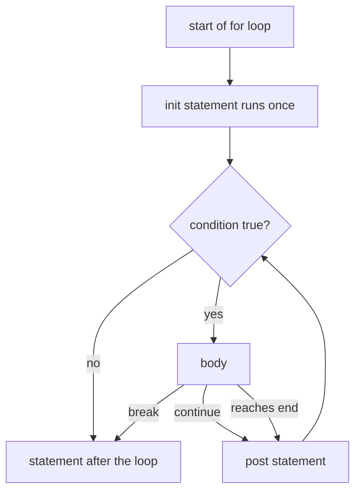

# for, switch and goto

> **Before this lesson:** read [Blocks, shadowing and if](#/lesson/go/go-blocks-shadowing) (blocks, scope, `if`). You should also know slices, strings and maps from the composite types module, because loops are shown running over each of them.

## In plain words

A program becomes useful when it can **repeat** work and **choose** between alternatives. This lesson covers the remaining statements that control the order in which instructions run, the **control structures**.

- A **loop** repeats a block of code. Think of a cook stirring a pot: "stir ten times", "stir until it thickens", "stir forever until someone says stop", and "taste each of the five dishes on the tray" are four different instructions, yet all are repetition. Many languages have a separate keyword for each. Go has one keyword, **`for`**, written in four shapes.
- A **`switch`** picks one branch out of several, like the signs at a road junction: exactly one road is taken, and you do not drift into the neighbouring road afterwards.
- **`goto`** jumps directly to a marked line. It exists, it is restricted, and you will almost never need it.

Why this matters for a job: loops and branches are most of the lines in any program. Go's versions differ from other languages in ways that cause real bugs when carried over from habit: `switch` does not fall through, `range` hands you copies, and `break` inside a `switch` inside a loop does not leave the loop. These are favourite "predict the output" interview questions.

**Compared with Python.** Python has `for x in collection` and `while condition`. Go folds both, plus the C-style counting loop, into `for`. Python's `match` statement is the nearest relative of `switch`. Python's loop variables remain visible after the loop; Go's do not.

## The four shapes of for

### Shape 1: the complete form

```go
package main

import "fmt"

func main() {
	for i := 0; i < 3; i++ {
		fmt.Println("lap", i)
	}
}
```

```text
lap 0
lap 1
lap 2
```

Three parts sit between `for` and `{`, separated by semicolons:

1. the **init statement** `i := 0` runs once, before anything else, and declares a variable that exists only inside the loop;
2. the **condition** `i < 3` is checked before every pass; when it is false the loop ends;
3. the **post statement** `i++` runs after every pass.

No parentheses surround the three parts, and the braces are required. Any of the parts may be left out.

### Shape 2: condition only (the "while" loop)

Leave out the init and post statements, and the semicolons with them:

```go
n := 1
for n < 100 {
	n *= 2
}
fmt.Println(n)
```

```text
128
```

This repeats as long as the condition holds. Go has no `while` keyword; this is it.

### Shape 3: the infinite loop

Leave out everything:

```go
count := 0
for {
	count++
	if count == 4 {
		break
	}
}
fmt.Println(count)
```

```text
4
```

`for { ... }` runs until something inside stops it. **`break`** leaves the loop immediately. Servers use this shape for their main "wait for a request, handle it" cycle.

Its companion is **`continue`**, which skips the rest of the current pass and moves on to the next one:

```go
for i := 1; i <= 6; i++ {
	if i%2 == 1 {
		continue // skip odd numbers
	}
	fmt.Println(i)
}
```

```text
2
4
6
```

### Shape 4: for-range

To visit every element of a collection, use `range`. It gives two values per pass:

```go
package main

import "fmt"

func main() {
	fruits := []string{"fig", "plum", "kiwi"}
	for i, f := range fruits {
		fmt.Println(i, f)
	}
	for _, f := range fruits { // value only: discard the index with _
		fmt.Print(f, " ")
	}
	fmt.Println()
	for i := range fruits { // index only: leave the second variable out
		fmt.Print(i, " ")
	}
	fmt.Println()
	for i := range 3 { // an integer: counts 0, 1, 2 (Go 1.22 and later)
		fmt.Print(i, " ")
	}
	fmt.Println()
}
```

```text
0 fig
1 plum
2 kiwi
fig plum kiwi 
0 1 2 
0 1 2 
```

What `range` yields depends on what you loop over:

| Looping over | First value | Second value | Notes |
|---|---|---|---|
| slice or array | index | copy of the element | in order |
| string | byte offset | rune | decodes UTF-8 ([strings lesson](#/lesson/go/go-strings-runes)) |
| map | key | copy of the value | random order ([maps lesson](#/lesson/go/go-maps-structs)) |
| channel | received value | (none) | until the channel is closed ([concurrency](#/lesson/go/go-goroutines-channels)) |
| integer `n` | 0 … n−1 | (none) | Go 1.22+ |
| iterator function | defined by the function | | Go 1.23+, e.g. `maps.Keys(m)` |

Use for-range by default. Use the complete form when you need unusual stepping: every third element, counting backwards, or two indexes at once.

## Three things range does that surprise people

### 1. The value is a copy

```go
nums := []int{1, 2, 3}
for _, v := range nums {
	v = v * 10 // changes the loop's private copy
	_ = v
}
fmt.Println(nums)

for i := range nums {
	nums[i] = nums[i] * 10 // changes the slice
}
fmt.Println(nums)
```

```text
[1 2 3]
[10 20 30]
```

`v` is a separate variable that receives a copy of each element. Assigning to it does not touch the slice. To modify elements, index into the slice.

### 2. The collection is evaluated once

```go
s := []int{1, 2, 3}
for _, v := range s {
	s = append(s, v*10)
}
fmt.Println(s)
```

```text
[1 2 3 10 20 30]
```

The loop does not run forever. `range` takes the slice header (and so the length, 3) before the first pass and never looks at the variable `s` again. Appending inside the loop grows `s` without lengthening the iteration.

### 3. Each pass gets its own variable (since Go 1.22)

This matters when a function created inside the loop keeps using the loop variable after the pass has ended (such a function is called a closure; see [Closures, defer and call by value](#/lesson/go/go-closures-defer)).

```go
var printers []func()
for i := 0; i < 3; i++ {
	printers = append(printers, func() { fmt.Print(i, " ") })
}
for _, p := range printers {
	p()
}
```

```text
0 1 2 
```

Since Go 1.22, every pass of a `for` loop has a fresh `i`, so each stored function remembers its own value. **Before Go 1.22** there was a single `i` shared by all passes, and this program printed `3 3 3`. That was the most reported Go gotcha for a decade. You will still see the old workaround `i := i` inside loop bodies in existing code; it is harmless and no longer needed when `go.mod` says `go 1.22` or later.

## Labels: break and continue for nested loops

`break` and `continue` act on the innermost loop. To act on an outer loop, give that loop a **label** (a name followed by a colon, placed directly before the `for`) and mention the label:

```go
package main

import "fmt"

func main() {
outer:
	for i := 1; i <= 3; i++ {
		for j := 1; j <= 3; j++ {
			if j == 2 {
				continue outer // next value of i
			}
			if i == 3 {
				break outer // leave both loops
			}
			fmt.Println(i, j)
		}
	}
	fmt.Println("done")
}
```

```text
1 1
2 1
done
```

Trace it: for `i = 1`, `j = 1` prints, then `j = 2` jumps to the next `i`. The same happens for `i = 2`. For `i = 3`, `j = 1` reaches the `break outer` and everything stops. gofmt places labels one indent level to the left of the loop, which is why `outer:` looks out of line.

## switch

A `switch` compares one value against several candidates and runs the first branch that matches.

```go
package main

import "fmt"

func describe(day string) {
	switch day {
	case "sat", "sun":
		fmt.Println(day, "-> weekend")
	case "fri":
		fmt.Println(day, "-> almost there")
	default:
		fmt.Println(day, "-> workday")
	}
}

func main() {
	describe("sun")
	describe("fri")
	describe("tue")
}
```

```text
sun -> weekend
fri -> almost there
tue -> workday
```

Line by line: `switch day {` names the value under test. Each `case` lists one or more candidates separated by commas. Cases are tried from top to bottom; the first match runs. `default` runs when nothing matched; it is optional and may appear anywhere in the list.

**The important difference from C, Java and JavaScript:** when a case finishes, control leaves the `switch`. There is **no automatic fall-through** into the next case, so you do not write `break` at the end of each branch. An empty case does nothing; it does not slide into the next one.

Other properties:

- A `switch` can have an init statement, like `if`: `switch n := len(s); n { ... }`.
- The values can be of any comparable type, not only integers: strings, runes, booleans, even structs.
- Each `case` body is its own block, so variables declared in one case are invisible in the others.
- Duplicate constant cases are a compile error.

### The tagless switch

Leave out the value and each case becomes a full boolean condition. It is a tidier way to write an `if … else if … else` chain:

```go
func grade(score int) string {
	switch {
	case score >= 90:
		return "A"
	case score >= 75:
		return "B"
	case score >= 60:
		return "C"
	default:
		return "F"
	}
}
// grade(82) returns "B"
```

The first true condition wins, so order matters: 82 fails `>= 90` and matches `>= 75`.

### fallthrough

If you do want to continue into the next case, say so with the keyword `fallthrough` as the last statement of a branch:

```go
switch n := 1; n {
case 1:
	fmt.Println("one")
	fallthrough
case 2:
	fmt.Println("two")
case 3:
	fmt.Println("three")
}
```

```text
one
two
```

`fallthrough` jumps into the body of the next case **without testing its condition**. It is rare in practice; listing several values in one `case` is usually what you want.

### Try it: a switch interpreter

Edit the clauses or the value and predict the output. The rules coded here are the ones in the practice problem [switch: matching, default and fallthrough](#/problem/go-switch-fallthrough).

```python-run
def run_switch(tag, clauses):
    """clauses: list of (values or None for default, label, fallthrough?)"""
    start = None
    default = None
    for i, (values, _, _) in enumerate(clauses):
        if values is None:
            default = i
        elif start is None and tag in values:
            start = i
    if start is None:
        start = default
    out = []
    i = start
    while i is not None:
        out.append(clauses[i][1])
        i = i + 1 if clauses[i][2] and i + 1 < len(clauses) else None
    return out

clauses = [
    (None,   "default branch", False),   # default written FIRST on purpose
    ([1],    "one",            True),    # ends with fallthrough
    ([2, 3], "two or three",   False),
    ([4],    "four",           False),
]
for tag in (1, 3, 4, 9):
    print(tag, "->", run_switch(tag, clauses))
```

Notice that `default`, although written first, runs only for 9: its position in the source does not give it priority.

### break inside a switch inside a loop

`break` leaves the innermost `for`, `switch` or `select`. Inside a `switch`, that is the `switch`, not the surrounding loop:

```go
for i := 0; i < 5; i++ {
	switch {
	case i == 2:
		break // leaves the switch only; the loop goes on
	}
	fmt.Print(i, " ")
}
fmt.Println()
```

```text
0 1 2 3 4 
```

To stop the loop from inside a `switch`, label the loop and write `break label`, exactly as in the nested-loop example.

## goto

`goto label` jumps to a labelled statement in the same function.

```go
package main

import "fmt"

func main() {
	attempt := 1
retry:
	fmt.Println("attempt", attempt)
	if attempt < 3 {
		attempt++
		goto retry
	}
	fmt.Println("gave up after", attempt)
}
```

```text
attempt 1
attempt 2
attempt 3
gave up after 3
```

Go fences `goto` in: a jump may not skip over a variable declaration that would then be in scope, and may not jump into a block from outside it. These rules prevent the tangled control flow that gave `goto` its reputation. Even so, the example is clearer as a `for` loop, and that is true of nearly every use. You will find `goto` in a few places in the standard library (hand-tuned parsers, generated code). In application code a loop, a labelled `break` or a helper function is the better tool.



## Choosing between the tools

| Need | Use |
|---|---|
| Visit every element | `for i, v := range collection` |
| Repeat n times | `for i := range n` (or `for i := 0; i < n; i++`) |
| Repeat while a condition holds | `for condition { }` |
| Repeat until an internal event | `for { ... break ... }` |
| Custom stepping, backwards, two indexes | complete `for init; cond; post` |
| One value against many candidates | `switch value { case ...: }` |
| A chain of unrelated conditions | tagless `switch { case cond: }` |
| Two simple alternatives | `if` / `else` |

## Pitfalls

- **Writing `break` at the end of every case.** Unnecessary; harmless, but it marks the code as written by habit from another language.
- **Expecting fall-through.** An empty `case 1:` followed by `case 2:` does not share a body. Write `case 1, 2:`.
- **`break` in a `switch` inside a `for`,** expecting the loop to end.
- **Assigning to the range value variable** to modify a slice.
- **Relying on map order** in a range loop.
- **Deleting from or appending to a slice while ranging over it.** The loop still runs over the original length, and indexes may no longer mean what you think. Build a new slice instead.
- **Old loop-variable semantics.** In modules whose `go.mod` declares a version below 1.22, loop variables are shared between passes.
- **Off-by-one in the condition:** `i <= len(s)` instead of `i < len(s)` panics on the last pass.

> [!TIP]
> Ranging over a large array (not slice) copies the whole array first, and the value variable copies each element. For big structs, loop with the index and refer to `items[i]`, or range over a slice of pointers.

> [!INTERVIEW]
> **"How does Go's `switch` differ from C's?"** No implicit fall-through: each case ends automatically, and `fallthrough` must be written explicitly (it then enters the next case without evaluating its condition). A case may list several values. The tag can be any comparable type, or be omitted so that each case is a boolean expression. Cases are evaluated top to bottom and `default` runs only if none match, wherever it is written. `break` inside a case leaves the `switch`, so leaving an enclosing loop needs a label. Also expect: "what changed about loop variables in Go 1.22?" Each iteration now has its own copy, fixing the closure-capture bug.

## Cheat sheet

| Statement | Form |
|---|---|
| Counting loop | `for i := 0; i < n; i++ { }` |
| While loop | `for cond { }` |
| Infinite loop | `for { }` |
| Range with index and value | `for i, v := range s { }` |
| Range value only / index only | `for _, v := range s { }` / `for i := range s { }` |
| Range over an integer | `for i := range 10 { }` |
| Leave the loop / next pass | `break` / `continue` |
| Leave an outer loop | `label:` before the loop, then `break label` |
| Value switch | `switch x { case 1, 2: ... default: ... }` |
| Condition switch | `switch { case x > 0: ... }` |
| Continue into next case | `fallthrough` (last statement of the case) |
| Jump | `goto label` (avoid) |

## Summary

- `for` is Go's only loop, in four shapes: complete, condition-only, infinite, and range.
- `range` yields (index, element) for slices, (offset, rune) for strings, (key, value) for maps; the value is a copy and the collection is evaluated once.
- Since Go 1.22 each iteration has its own loop variable.
- `break` and `continue` affect the innermost loop; labels let them reach outer loops.
- `switch` runs the first matching case and stops; `fallthrough` is explicit; a tagless switch replaces `if`/`else if` chains.
- `goto` exists with restrictions and is rarely the right choice.

## Glossary

- **break**: leave the innermost `for`, `switch` or `select`.
- **Condition**: the boolean expression that decides whether a loop continues.
- **continue**: skip to the next pass of the loop.
- **Control structure**: a statement that changes the order in which code runs.
- **fallthrough**: keyword that continues into the next `switch` case.
- **Init / post statement**: the parts of a `for` that run once before the loop / after each pass.
- **Iteration (pass)**: one execution of a loop body.
- **Label**: a name followed by a colon that marks a statement as the target of `break`, `continue` or `goto`.
- **Loop variable**: the variable declared by the loop itself, such as `i` or `v`.
- **Tagless switch**: a `switch` with no value, whose cases are boolean expressions.

```quiz
[
  {"q": "What does this print? `n := 0; for n < 5 { n += 2 }; fmt.Println(n)`",
   "options": ["`4`", "`5`", "`6`", "It loops forever"],
   "answer": 2,
   "explain": "n goes 0, 2, 4, 6. The condition is checked before each pass: 4 < 5 allows one more pass, giving 6, and 6 < 5 ends the loop."},
  {"q": "What does this print? `s := []int{1, 2, 3}; for _, v := range s { v *= 2; _ = v }; fmt.Println(s)`",
   "options": ["`[2 4 6]`", "`[1 2 3]`", "`[1 2 3 2 4 6]`", "Compile error"],
   "answer": 1,
   "explain": "The range value `v` is a copy of each element. Changing it does not change the slice. Use `s[i] *= 2` with the index."},
  {"q": "What does this print? `switch x := 2; x { case 1: fmt.Print(\"a\"); case 2: fmt.Print(\"b\"); case 3: fmt.Print(\"c\") }`",
   "options": ["`b`", "`bc`", "`abc`", "Nothing"],
   "answer": 0,
   "explain": "Go cases do not fall through. After the matching case 2 runs, control leaves the switch."},
  {"q": "What does this print? `switch x := 1; x { case 1: fmt.Print(\"a\"); fallthrough; case 5: fmt.Print(\"b\"); case 6: fmt.Print(\"c\") }`",
   "options": ["`a`", "`ab`", "`abc`", "Compile error: 1 is not 5"],
   "answer": 1,
   "explain": "`fallthrough` enters the next case body without checking its value, so `b` prints. That case has no fallthrough, so the switch ends there."},
  {"q": "Inside `for i := 0; i < 3; i++ { switch { case i == 1: break }; fmt.Print(i) }`, what is printed?",
   "options": ["`0`", "`02`", "`012`", "`01`"],
   "answer": 2,
   "explain": "`break` leaves the innermost breakable statement, the switch. The loop continues normally, so 0, 1 and 2 are all printed."},
  {"q": "What does this print? `s := []int{1, 2}; for range s { s = append(s, 0) }; fmt.Println(len(s))`",
   "options": ["`2`", "`4`", "It loops forever", "`3`"],
   "answer": 1,
   "explain": "The range expression is evaluated once, so the loop runs exactly twice (the original length). Each pass appends one element: 2 + 2 = 4."},
  {"q": "How do you write a loop that runs while `ok` is true?",
   "options": ["`while ok { }`", "`for ok { }`", "`for (ok) do { }`", "`loop ok { }`"],
   "answer": 1,
   "explain": "Go has no `while` keyword. A `for` with only a condition is the while loop."},
  {"q": "In Go 1.22 or later, what does this print? `var fs []func(); for i := 0; i < 3; i++ { fs = append(fs, func() { fmt.Print(i) }) }; for _, f := range fs { f() }`",
   "options": ["`333`", "`012`", "`000`", "`222`"],
   "answer": 1,
   "explain": "Each iteration has its own `i` since Go 1.22, so each function captured a different variable. Older versions shared one `i` and printed 333."}
]
```

> **Source:** Bodner, *Learning Go* 2e, ch. 4 (topic coverage; wording and examples are original). Official references: https://go.dev/ref/spec#For_statements, https://go.dev/ref/spec#Switch_statements, https://go.dev/ref/spec#Goto_statements, https://go.dev/blog/loopvar-preview, https://go.dev/doc/effective_go#control-structures
