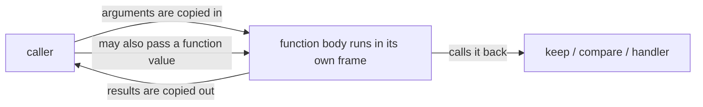

# Declaring and calling functions

> **Before this lesson:** you should be able to write a `main` function with variables, `if` and `for` ([Blocks, shadowing and if](#/lesson/go/go-blocks-shadowing), [for, switch and goto](#/lesson/go/go-for-switch)) and know slices and maps from the composite types module.

## In plain words

A **function** is a named recipe. You write the steps once, give the recipe a name, and from then on anyone can say "make the pancakes with 3 eggs" without repeating the steps. The things the recipe needs from outside (3 eggs) are its **inputs**, and what it hands back (a plate of pancakes) is its **output**.

In programming terms: the placeholders for inputs in the recipe are **parameters**; the actual values supplied when you use it are **arguments**; using it is a **call**; and what comes back is the **return value**. Functions let you split a program into small pieces that can be understood, tested and reused one at a time.

Go's functions have a few traits that shape the whole language:

- every parameter and every result has a declared type;
- a function can return **several values at once**, and this is how Go reports errors;
- there are no default values and no named arguments at the call site;
- a function is itself a value: it can be stored in a variable, kept in a map, passed to another function and returned from one.

Why this matters for a job: the `value, err := doSomething()` shape, made possible by multiple return values, appears in almost every Go function you will read. Passing functions as values is how sorting, HTTP handlers and middleware are written. Interviewers probe both.

**Compared with Python.** Python functions accept default values, keyword arguments, `*args` and `**kwargs`, and return one object (often a tuple). Go functions are stricter and plainer: fixed, typed parameters; at most one variable-length parameter; real multiple results that are not a tuple.

## Declaring a function

The simplest example:

```go
package main

import "fmt"

func add(a int, b int) int {
	return a + b
}

func main() {
	sum := add(2, 3)
	fmt.Println(sum)
}
```

```text
5
```

Read the declaration from left to right:

- `func` starts a function declaration.
- `add` is the name.
- `(a int, b int)` is the parameter list. Each parameter has a name followed by its type. (Go puts the type *after* the name, the reverse of C and Java.)
- `int` after the parentheses is the **result type**.
- The body between braces contains the steps. `return a + b` ends the function and hands the value back.

In `main`, `add(2, 3)` is the call: 2 is copied into `a`, 3 into `b`, the body runs, and the result 5 replaces the call expression.

When neighbouring parameters share a type you may write the type once: `func add(a, b int) int`. A function that returns nothing has no result type and needs no `return` statement, though a bare `return` can be used to leave early:

```go
func greet(name string) {
	if name == "" {
		return // leave early, nothing to hand back
	}
	fmt.Println("Hello,", name)
}
```

The compiler checks every call. `add(2, "3")` fails with `cannot use "3" (untyped string constant) as int value in argument to add`; `add(2)` fails with `not enough arguments in call to add`. And if a function declares a result, every path through it must end in a `return` (`missing return` otherwise).

Functions can be declared in any order within a package. `main` may call a function defined further down the file or in another file of the same package.

### Try it: what happens during a call

Each call gets its own private workspace, called a **stack frame**, holding its parameters and local variables. Frames stack up as functions call other functions and are removed as they return. This simulation prints the frames for a function that calls itself (a **recursive** function) to compute a factorial, the product 1 × 2 × … × n.

```python-run
depth = 0

def factorial(n):
    global depth
    pad = "    " * depth
    print(f"{pad}call factorial({n})   <- new frame with its own n = {n}")
    depth += 1
    if n <= 1:
        result = 1
    else:
        result = n * factorial(n - 1)
    depth -= 1
    print(f"{pad}return {result}          <- frame for n = {n} is discarded")
    return result

print("answer:", factorial(4))
```

Four frames exist at the deepest point, each with a different `n`. This is why one call's variables never collide with another's. The Go version is the same shape: `func factorial(n int) int { if n <= 1 { return 1 }; return n * factorial(n-1) }`.

## Multiple return values

A Go function can return more than one value. List the result types in parentheses:

```go
package main

import (
	"errors"
	"fmt"
)

func divmod(a, b int) (int, int, error) {
	if b == 0 {
		return 0, 0, errors.New("cannot divide by zero")
	}
	return a / b, a % b, nil
}

func main() {
	q, r, err := divmod(7, 2)
	fmt.Println(q, r, err)

	_, _, err = divmod(1, 0)
	fmt.Println(err)
}
```

```text
3 1 <nil>
cannot divide by zero
```

Line by line:

- `(int, int, error)` declares three results: quotient, remainder and an error.
- `error` is a built-in type for describing failures. `errors.New("...")` creates one. The value `nil` in the error position means "no error".
- On failure the function returns zero values for the real results plus a non-nil error. On success it returns the results and `nil`.
- The caller receives all three with `q, r, err := ...`. You must accept every result or explicitly discard some with `_`. Writing `q := divmod(7, 2)` is a compile error (`assignment mismatch: 1 variable but divmod returns 3 values`).

This is **the Go way of reporting errors**: the error is an ordinary last return value that the caller checks, usually like this:

```go
q, r, err := divmod(x, y)
if err != nil {
	return err // or handle it
}
// use q and r
```

Python signals failure by raising an exception that travels up invisibly until something catches it. Go keeps the failure in plain sight at every call. The [errors module](#/lesson/go/go-errors-values) goes deep on this.

Multiple results are **not a tuple**. You cannot store them in a single variable or index into them; they exist only at the moment of the call, to be assigned to separate variables.

### Ignoring results

You can call a function and ignore **all** its results (`fmt.Println(...)` returns two values that everyone ignores). To ignore **some**, use `_`. Ignoring an `error` is almost always a mistake, and linters flag it.

## Named results

Results can be given names. They then act as variables declared at the top of the function, starting at their zero values:

```go
func minMax(nums []int) (lo, hi int) {
	if len(nums) == 0 {
		return // "bare" return: sends back lo and hi as they are (0, 0)
	}
	lo, hi = nums[0], nums[0]
	for _, n := range nums[1:] {
		lo = min(lo, n)
		hi = max(hi, n)
	}
	return lo, hi
}
// minMax([]int{4, 9, 2}) returns 2 9
```

Named results document what each value means, which helps when a function returns two values of the same type. A `return` with no values (a **bare return**) sends back the current values of the named results. Bare returns make longer functions hard to follow, because the reader must scroll up to find what is being returned; most style guides say to name results when it helps documentation and still write the values explicitly on `return`. Named results become necessary in one situation, changing a result from a deferred function, shown in the next lesson.

## No default values, no named arguments

Go has neither `def connect(host, port=5432, timeout=30)` nor `connect(host, timeout=10)`. Every call supplies every parameter, in order. When a function has many optional settings, the idiom is to pass a **struct** whose zero values mean "use the default":

```go
package main

import "fmt"

type DialOptions struct {
	Port    int // 0 means "use 5432"
	Timeout int // seconds; 0 means "use 30"
}

func dial(host string, opts DialOptions) string {
	if opts.Port == 0 {
		opts.Port = 5432
	}
	if opts.Timeout == 0 {
		opts.Timeout = 30
	}
	return fmt.Sprintf("%s:%d (timeout %ds)", host, opts.Port, opts.Timeout)
}

func main() {
	fmt.Println(dial("db.local", DialOptions{}))
	fmt.Println(dial("db.local", DialOptions{Timeout: 5}))
}
```

```text
db.local:5432 (timeout 30s)
db.local:5432 (timeout 5s)
```

The struct literal with field names reads like named arguments, and adding a new option later does not break existing callers. `fmt.Sprintf` formats like `Printf` but returns the text instead of printing it. (Modifying `opts` inside `dial` is safe because the function has its own copy; more on that in the next lesson.)

## Variadic parameters

A function may accept a variable number of arguments through its **last** parameter, written with three dots before the type. Such a parameter is called **variadic**. Inside the function it is a slice.

```go
package main

import "fmt"

func total(label string, nums ...int) int {
	sum := 0
	for _, n := range nums {
		sum += n
	}
	fmt.Println(label, len(nums), "numbers")
	return sum
}

func main() {
	fmt.Println(total("none"))
	fmt.Println(total("three", 1, 2, 3))

	values := []int{10, 20}
	fmt.Println(total("slice", values...))
}
```

```text
none 0 numbers
0
three 3 numbers
6
slice 2 numbers
30
```

- `nums ...int` means "zero or more `int` values". With no extra arguments, `nums` is a nil slice of length 0.
- To pass an existing slice, put three dots **after** it: `values...`. Without the dots the compiler complains that a `[]int` is not an `int`.

You have used variadic functions since the first lesson: `fmt.Println(a ...any)` and `append(slice, elems...)`.

## Functions are values

In Go a function can be treated like any other value. Its type is its **signature**: the parameter types and result types, without names. `func(int, int) int` is the type of every function that takes two ints and returns one.

```go
package main

import "fmt"

func add(a, b int) int { return a + b }
func mul(a, b int) int { return a * b }

func main() {
	var op func(int, int) int // a variable that can hold such a function
	fmt.Println(op == nil)    // its zero value is nil

	op = add
	fmt.Println(op(3, 4))
	op = mul
	fmt.Println(op(3, 4))

	table := map[string]func(int, int) int{
		"+": add,
		"*": mul,
	}
	for _, sym := range []string{"+", "*", "-"} {
		if f, ok := table[sym]; ok {
			fmt.Println(sym, f(6, 7))
		} else {
			fmt.Println(sym, "unsupported")
		}
	}
}
```

```text
true
7
12
+ 13
* 42
- unsupported
```

Note `op = add` has no parentheses: it stores the function itself. `op(3, 4)` calls whatever is stored. Calling a nil function variable panics, so the map lookup uses comma-ok. A map from names to functions, as here, replaces long `switch` statements in command dispatchers and calculators.

A long signature can be given a name with a type declaration, which also makes it self-documenting:

```go
type BinaryOp func(int, int) int

var table = map[string]BinaryOp{"+": add, "*": mul}
```

### Anonymous functions

A function can be written without a name, right where it is needed. This is an **anonymous function** (also called a function literal):

```go
double := func(n int) int { return n * 2 }
fmt.Println(double(21)) // 42

func(msg string) {
	fmt.Println("called immediately:", msg)
}("hi") // the trailing parentheses call it on the spot
```

Functions declared at package level need names; inside a function, anonymous functions are the only kind you can define.

### Passing functions to functions

A function that takes or returns another function is called a **higher-order function**. They let you separate *what to do with each element* from *how to walk the collection*:

```go
package main

import (
	"cmp"
	"fmt"
	"slices"
)

type Person struct {
	Name string
	Age  int
}

func filter(people []Person, keep func(Person) bool) []Person {
	var out []Person
	for _, p := range people {
		if keep(p) {
			out = append(out, p)
		}
	}
	return out
}

func main() {
	crew := []Person{{"Nami", 20}, {"Brook", 90}, {"Chopper", 17}}

	adults := filter(crew, func(p Person) bool { return p.Age >= 18 })
	fmt.Println(adults)

	slices.SortFunc(crew, func(a, b Person) int {
		return cmp.Compare(a.Age, b.Age)
	})
	fmt.Println(crew)
}
```

```text
[{Nami 20} {Brook 90}]
[{Chopper 17} {Nami 20} {Brook 90}]
```

`filter` knows how to loop and collect; the caller supplies the test. `slices.SortFunc` knows how to sort; the caller supplies the comparison, a function that returns a negative number, zero or a positive number when `a` is less than, equal to or greater than `b`. `cmp.Compare` produces exactly that for ordered values. This is Go's replacement for Python's `sorted(crew, key=lambda p: p.age)`.



## Pitfalls

- **Forgetting to handle the extra results.** `x := f()` when `f` returns two values does not compile; `x, _ := f()` compiles and hides an error. Check errors.
- **Expecting default or keyword arguments.** Use an options struct.
- **Passing a slice to a variadic parameter without `...`.**
- **A variadic parameter anywhere but last.** Not allowed.
- **Calling a nil function value.** It panics with a nil pointer dereference.
- **Bare returns in long functions.** Legal, hard to read.
- **Shadowing a named result** inside a nested block with `:=` and then doing a bare return (the compiler reports `result parameter x not in scope at return`).
- **Declaring a named function inside another function.** Not possible; assign an anonymous function to a variable.

> [!TIP]
> Keep the `error` result last and call it `err`. Return the zero value for the other results when you return a non-nil error. Every Go programmer expects this, and tools are built around it.

> [!INTERVIEW]
> **"Does Go support function overloading or default arguments?"** No to both. A package may contain only one function with a given name, and every call supplies all parameters. The idiomatic substitutes are: differently named functions (`Dial` and `DialTimeout`), a trailing variadic parameter, an options struct whose zero values mean "default", and the *functional options* pattern (variadic `...Option`, where each option is a function that adjusts a config). The reason given by the language designers is readability: a call site means one thing without consulting overload rules.

## Cheat sheet

| Goal | Syntax |
|---|---|
| Function with result | `func name(a int, b string) float64 { ... }` |
| Same-type parameters | `func name(a, b int)` |
| No result | `func name() { ... }` |
| Several results | `func name() (int, error)` |
| Named results | `func name() (count int, err error)` |
| Receive results | `v, err := name()` |
| Discard a result | `v, _ := name()` |
| Variadic | `func name(xs ...int)`; call `name(1, 2)` or `name(s...)` |
| Function type | `func(int, int) int` |
| Named function type | `type Op func(int, int) int` |
| Anonymous function | `f := func(x int) int { return x + 1 }` |
| Sort with a comparison | `slices.SortFunc(s, func(a, b T) int { ... })` |

## Summary

- A function has typed parameters and typed results; the compiler checks every call.
- Functions can return several values. The convention `result, err` with a final `error` is Go's error-reporting mechanism.
- Results can be named; bare returns are best kept to short functions.
- There are no default or keyword arguments; use an options struct. The last parameter may be variadic and arrives as a slice.
- Functions are values with a type given by their signature. They can be stored, passed and returned, and written anonymously in place.

## Glossary

- **Anonymous function (function literal)**: a function written without a name.
- **Argument**: a value supplied in a call.
- **Bare return**: `return` with no values in a function with named results.
- **Call**: using a function, written `name(arguments)`.
- **Higher-order function**: a function that takes or returns a function.
- **Named result**: a result given a name in the signature; acts as a pre-declared variable.
- **Parameter**: a placeholder name in the function's declaration.
- **Recursion**: a function calling itself.
- **Return value (result)**: what a function hands back to its caller.
- **Signature**: a function's parameter and result types.
- **Stack frame**: the private workspace of one function call.
- **Variadic parameter**: a final parameter `...T` accepting any number of arguments.

```quiz
[
  {"q": "Given `func split(s string) (string, string)`, which call compiles?",
   "options": ["`a := split(\"x-y\")`", "`a, b := split(\"x-y\")`", "`a, b, c := split(\"x-y\")`", "`var t tuple = split(\"x-y\")`"],
   "answer": 1,
   "explain": "The number of variables on the left must match the number of results. Go's multiple results are not a tuple and cannot be stored in one variable."},
  {"q": "What does this print? `func f(nums ...int) int { return len(nums) }` called as `fmt.Println(f(), f(4, 5))`",
   "options": ["`0 2`", "`nil 2`", "Compile error: missing argument", "`1 2`"],
   "answer": 0,
   "explain": "A variadic parameter accepts zero or more arguments and is a slice inside the function. With none it has length 0."},
  {"q": "`xs := []int{1, 2, 3}` and `func sum(nums ...int) int`. How do you pass `xs`?",
   "options": ["`sum(xs)`", "`sum(...xs)`", "`sum(xs...)`", "`sum(*xs)`"],
   "answer": 2,
   "explain": "The three dots go after the slice at the call site. `sum(xs)` fails because a []int is not an int."},
  {"q": "How does Go usually signal that a function failed?",
   "options": ["By raising an exception", "By returning an `error` value as the last result, which the caller checks", "By returning -1", "By setting a global variable"],
   "answer": 1,
   "explain": "Errors are ordinary values returned alongside the results. `nil` means success. The caller writes `if err != nil { ... }`."},
  {"q": "What does this print? `func named() (n int) { n = 5; return }` called as `fmt.Println(named())`",
   "options": ["`0`", "`5`", "Compile error: missing return value", "`nil`"],
   "answer": 1,
   "explain": "`n` is a named result. A bare return sends back its current value, 5."},
  {"q": "What is the type of the variable `f` in `f := func(a, b int) bool { return a < b }`?",
   "options": ["`func`", "`func(int, int) bool`", "`bool`", "`lambda`"],
   "answer": 1,
   "explain": "A function's type is its signature: parameter types and result types. Parameter names are not part of it."},
  {"q": "Go has no default parameter values. What is the idiomatic way to offer optional settings?",
   "options": ["Overload the function with different parameter lists", "Pass a struct of options whose zero values mean 'use the default'", "Use global variables", "Pass `nil` for every skipped parameter"],
   "answer": 1,
   "explain": "An options struct (or functional options) gives readable call sites and lets new options be added without breaking callers. Go does not support overloading."},
  {"q": "What does this print? `var op func(int) int; fmt.Println(op == nil)`",
   "options": ["`false`", "`true`", "Compile error: functions cannot be compared", "It panics"],
   "answer": 1,
   "explain": "The zero value of a function type is nil. Functions can be compared only with nil. Calling `op(1)` at this point would panic."}
]
```

> **Source:** Bodner, *Learning Go* 2e, ch. 5 (topic coverage; wording and examples are original). Official references: https://go.dev/ref/spec#Function_declarations, https://go.dev/ref/spec#Function_types, https://go.dev/ref/spec#Passing_arguments_to_..._parameters, https://go.dev/doc/effective_go#functions, https://pkg.go.dev/slices#SortFunc
